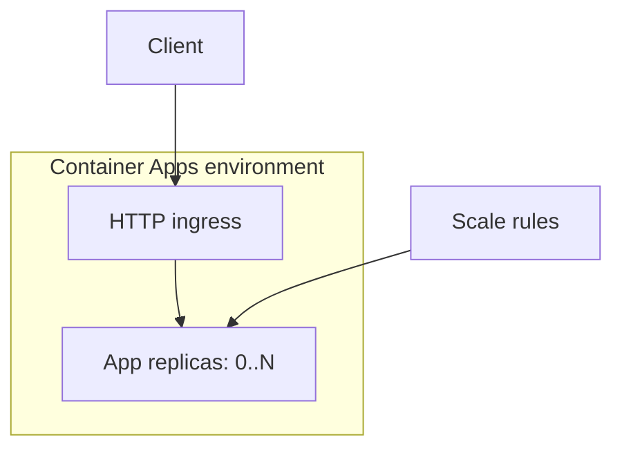

# The host decides who pays for idle time and who repairs the machine

A service can be cheap while nobody uses it and expensive the moment it succeeds. It can also have a small
infrastructure bill and consume days of engineering time in upgrades, networking and failed deployments.
Choosing a host means deciding which of those costs you accept, how new work gets capacity, and who repairs
the machinery underneath your application.

Start with the work. An API holds connections open; a queue worker drains a backlog; a batch task runs to
completion. They may share application code without needing the same host. For the RAG service project,
P1, you need somewhere to run a .NET API that calls a model and retrieves documents. That requirement gives
you a much narrower choice than “where can Azure run code?”

## How Azure turns demand into running code \{#how-azure-compute-works}

Azure offers several boundaries between your application and the machines running it.
[App Service](https://learn.microsoft.com/en-us/azure/app-service/overview) accepts a web application as
code or a container. An **App Service plan** supplies its compute capacity. With
[Container Apps](https://learn.microsoft.com/en-us/azure/container-apps/compare-options), you supply a
container image and application settings. Functions accepts functions invoked by triggers. AKS exposes
Kubernetes; a virtual machine gives you the operating system to configure. The deployment unit determines
which platform concepts enter your release process.

For P1, follow the Container Apps path. A
[Container Apps environment](https://learn.microsoft.com/en-us/azure/container-apps/environment) groups
applications and supplies their shared network and logging context. Azure handles the environment's OS
upgrades and resource balancing. A **workload profile** selects the compute available to an application;
the current workload-profiles environment supports the
[Consumption profile](https://learn.microsoft.com/en-us/azure/container-apps/workload-profiles-overview).



[HTTP ingress](https://learn.microsoft.com/en-us/azure/container-apps/ingress-overview) provides the
application's endpoint, terminates TLS and routes requests to running copies. Those copies are
**replicas**. A [revision](https://learn.microsoft.com/en-us/azure/container-apps/revisions) is an immutable
snapshot of the app's container image and scale settings, from which replicas run. Container Apps
uses [declarative scale rules and KEDA](https://learn.microsoft.com/en-us/azure/container-apps/scale-app)
to adjust replica counts from HTTP demand, events or other supported signals, within configured bounds.
You configure those rules without operating a Kubernetes cluster.

With a minimum of zero and an appropriate trigger, no replica runs while idle after scale-in completes.
The next request can cause a
[cold start](https://learn.microsoft.com/en-us/azure/container-apps/cold-start): resources must be
provisioned, the image made available and the application started. That delay belongs in your latency
budget. A small image helps, but initialization that downloads a large dataset can still make the first
request slow.

Treat every replica as replaceable. A conversation stored only in one process disappears with that
process and is unavailable to another replica. Keep durable documents and conversation state outside
the host; reserve local memory for information you can afford to rebuild. Scale to zero makes this
requirement visible early, before ordinary restarts expose it in production.

## Choose by workload, scaling and operating cost \{#choosing-and-tradeoffs}

These are starting points for a design review, not a ranking. Azure's
[compute selection guidance](https://learn.microsoft.com/en-us/azure/architecture/guide/technology-choices/compute-decision-tree)
also recommends evaluating distinct application components separately.

| Host | Workload shape | Scaling and cost model | When to choose something else |
|---|---|---|---|
| [App Service](https://learn.microsoft.com/en-us/azure/app-service/overview-hosting-plans) | Web application or API; code or container deployment | Plan instances supply capacity; paid dedicated capacity has a standing cost. Scaling options depend on tier. | A queue-driven container worker or Kubernetes API requirement is central. |
| [Container Apps](https://learn.microsoft.com/en-us/azure/container-apps/scale-app) | Containerized API or worker; jobs for bounded executions | Replica scaling from requests or events; Consumption can scale to zero. You maintain the image and app configuration. | You need cluster-level Kubernetes control, or cannot accept cold starts without paying for warm replicas. |
| [Functions — Flex Consumption](https://learn.microsoft.com/en-us/azure/azure-functions/flex-consumption-plan) | Triggered handlers and event-driven endpoints | Linux; on-demand execution billing, scale to zero, optional billed always-ready capacity. | You need to deploy your own container or run an arbitrary continuously listening server. |
| [AKS](https://learn.microsoft.com/en-us/azure/aks/core-aks-concepts) | Applications that require Kubernetes APIs and orchestration controls | Pods run on nodes; workload scaling and underlying node capacity are separate concerns. Operations depend on cluster mode. | A small API needs no Kubernetes-specific capability and the team has no reason to own its platform configuration. |
| [Virtual Machines](https://learn.microsoft.com/en-us/azure/virtual-machines/overview) | Software requiring OS-level control or an existing machine layout | You configure and maintain the guest OS and application; [VM Scale Sets](https://learn.microsoft.com/en-us/azure/virtual-machine-scale-sets/overview) can scale a machine fleet. | Managed application hosting meets the requirement and removes that maintenance. |

App Service is worth considering for a conventional web API, especially when an existing plan has suitable
capacity. Check what shares the plan: other applications compete for the same underlying resources.
[Metric-based autoscale and HTTP-based automatic scaling](https://learn.microsoft.com/en-us/azure/app-service/manage-automatic-scaling)
are different mechanisms. Automatic scaling retains at least one always-ready instance; do not assume
it has the same idle-cost behaviour as Container Apps with zero replicas.

Functions fits work expressed as a trigger and a handler. Flex Consumption scales functions separately
with exceptions: HTTP functions scale together, as do certain other trigger groups. Its
[hosting matrix](https://learn.microsoft.com/en-us/azure/azure-functions/functions-scale) lists Flex
Consumption as generally available, without custom-container support. Choose it for an ingestion handler
because the execution model fits, rather than cutting an existing API into functions merely to obtain
serverless billing.

AKS buys access to Kubernetes, including its configuration surface. Its
[control plane is Azure-managed in both Automatic and Standard modes](https://learn.microsoft.com/en-us/azure/aks/core-aks-concepts).
Your team owns workload manifests and application recovery procedures. In Standard, it also owns node-pool
design, cluster configuration and upgrade choices; Automatic supplies more managed defaults for those
operations. Worker nodes are grouped into node pools. Neither mode writes your readiness checks or
resource requests. A VM moves the boundary further down: an OS dependency can justify it, but “we know
how to SSH” is a weak reason to accept patching and machine recovery.

Two scaling mistakes recur. A worker with no ingress needs a trigger that can wake it from zero; a
polling loop inside a stopped process cannot do that. Also,
[CPU and memory rules do not support scaling to zero](https://learn.microsoft.com/en-us/azure/container-apps/tutorial-scaling).
Choose the signal that represents waiting work. Low CPU can mean the API is waiting on a saturated
dependency, not that it has spare capacity for unlimited requests.

Operational cost includes the time required to diagnose failures and update dependencies. Price the
whole design: warm capacity, data services, telemetry and the work your team retains. There is no useful
universal answer to which host is cheapest without a traffic pattern and a latency requirement.

## In an AI workload \{#in-an-ai-workload}

P1 hosts an ASP.NET Core minimal API that coordinates Azure AI Search retrieval and a Foundry model call,
then returns an answer with citations.

API replicas do not add model throughput. For example,
[Azure OpenAI deployments have token and request rate limits](https://learn.microsoft.com/en-us/azure/foundry/openai/how-to/quota)
and can return HTTP 429. More API replicas can increase pressure on the same limit. Set application
concurrency, retry behaviour and admission limits alongside replica bounds; a maximum replica count is
neither an exact request limit nor a cap on token spending.

Container Apps also has [serverless GPU workload profiles](https://learn.microsoft.com/en-us/azure/container-apps/gpu-serverless-overview),
but P1 does not self-host a model; the [serving lesson](/rag-agents/part-3-production/serving/)
explains the inference-server tradeoff.

Long model calls also change the latency calculation. Measure
[time to first token](/rag-agents/part-3-production/serving/) and completed-answer latency separately;
a warm host cannot remove model generation time. Container Apps currently documents a
[240-second HTTP request timeout](https://learn.microsoft.com/en-us/azure/container-apps/ingress-overview).
Check the complete client-to-model path before designing long synchronous operations. Move work that
exceeds the request contract behind an asynchronous job interface.

Keep document ingestion separate when its load or failure behaviour differs from answering questions.
A batch import should not exhaust the capacity needed for interactive answers. The
[generation lesson](/rag-agents/part-1-rag/generation/) owns grounding and citations; hosting choices
must preserve those behaviours under load. Use the signals described in
[observability and rollout](/ai-sdlc/part-4-platform/observability-rollout) to test that contract when P1
becomes runnable.

## Try it \{#try-it}

Deploy Microsoft's public sample in the host P1 will use. You need Bash, an installed current Azure CLI
and an active subscription with permission to register providers and create resources. Replace the
subscription placeholder. Use a new resource group containing only this exercise; `eastus` is an example
location, subject to your subscription's region access and capacity.

These commands were checked against the live Azure CLI reference. They have **not yet been run against
a live subscription**; no Azure subscription exists for the course yet. The expected results below
describe documented behaviour, not an observed deployment.

Sign in, select the subscription and install the stable extension using the
[login](https://learn.microsoft.com/en-us/cli/azure/reference-index?view=azure-cli-latest#az-login),
[account](https://learn.microsoft.com/en-us/cli/azure/account?view=azure-cli-latest#az-account-set),
[extension](https://learn.microsoft.com/en-us/cli/azure/extension?view=azure-cli-latest#az-extension-add)
and [provider](https://learn.microsoft.com/en-us/cli/azure/provider?view=azure-cli-latest#az-provider-register)
references:

```bash
az login
az account set --subscription "<YOUR_SUBSCRIPTION_ID>"
az extension add --name containerapp --upgrade --allow-preview false
az provider register --namespace Microsoft.App --wait

RESOURCE_GROUP="rg-p1-compute-lab"
LOCATION="eastus"
ENVIRONMENT="p1-compute-env"
APP="p1-compute-sample"

az group create --name "$RESOURCE_GROUP" --location "$LOCATION"
```

Create an environment and select Consumption explicitly for the app. The
[environment reference](https://learn.microsoft.com/en-us/cli/azure/containerapp/env?view=azure-cli-latest#az-containerapp-env-create)
documents `none` as a logging destination. This short lab omits a Log Analytics workspace; [Observability](./observability.md) and
[Evaluation and tracing](../part-3-llms-on-azure/evaluation-and-tracing.md) add telemetry deliberately. The image and port come from Microsoft's
[quickstart](https://learn.microsoft.com/en-us/azure/container-apps/get-started?tabs=bash); allocation and
scaling flags follow the
[create reference](https://learn.microsoft.com/en-us/cli/azure/containerapp?view=azure-cli-latest#az-containerapp-create).

```bash
az containerapp env create \
  --name "$ENVIRONMENT" --resource-group "$RESOURCE_GROUP" \
  --location "$LOCATION" --enable-workload-profiles true \
  --logs-destination none

az containerapp create \
  --name "$APP" --resource-group "$RESOURCE_GROUP" \
  --environment "$ENVIRONMENT" --workload-profile-name Consumption \
  --image mcr.microsoft.com/k8se/quickstart:latest \
  --target-port 80 --ingress external \
  --cpu 0.25 --memory 0.5Gi \
  --min-replicas 0 --max-replicas 1 \
  --scale-rule-name http-rule --scale-rule-type http \
  --scale-rule-http-concurrency 10

az containerapp show \
  --name "$APP" --resource-group "$RESOURCE_GROUP" \
  --query '{host:properties.configuration.ingress.fqdn,min:properties.template.scale.minReplicas,max:properties.template.scale.maxReplicas}' \
  --output json
```

The query should return a hostname with configured `min` of `0` and `max` of `1`. Open `https://` followed by that hostname
in your browser; a successful deployment should display the sample page. External ingress makes this
sample public. The output confirms configuration, not the number of replicas currently running. Stop
requesting the page to allow scale-in to zero after the
[documented cooldown](https://learn.microsoft.com/en-us/azure/container-apps/scale-app#scale-behavior);
a configured zero minimum does not mean immediate shutdown. The concurrency threshold is a scaling setting, not a request rejection rule.

**Cost:** Consumption charges for allocated CPU and memory while replicas run, plus HTTP requests.
This lab’s workload-profiles environment has only the Consumption profile and no
[plan-management fee](https://learn.microsoft.com/en-us/azure/container-apps/billing#dedicated-plan);
that fee applies when you add a Dedicated profile. The
[current pricing page](https://azure.microsoft.com/en-us/pricing/details/container-apps/) includes a
monthly grant per subscription of 180,000 vCPU-seconds, 360,000 GiB-seconds and two million requests.
This lab may fit within unused grants, but it is not guaranteed free. Check paid rates for your region
and offer on the linked pricing page before deploying. At zero replicas there are
[no resource-consumption charges](https://learn.microsoft.com/en-us/azure/container-apps/billing).
Teardown still matters: a public endpoint can receive traffic after you stop using it.

**Teardown:** Delete the dedicated group and everything in it. Keep the same shell variables, check the
group name, and run the documented
[group commands](https://learn.microsoft.com/en-us/cli/azure/group?view=azure-cli-latest):

```bash
az group delete --name "$RESOURCE_GROUP" --yes
az group exists --name "$RESOURCE_GROUP"
```

Expect `false` after deletion completes. Keep the commands for P1's later infrastructure definition;
the sample's mutable `latest` tag is a learning convenience, not a reproducible application release.

## What to take away \{#what-to-take-away}

- Choose the deployment unit and scaling signal from the workload. An API, ingestion handler and batch import can justify different hosts.
- Container Apps supplies P1's container host without requiring a Kubernetes platform. Keep durable state outside replaceable replicas.
- Scale to zero trades idle compute cost for startup latency. Warm capacity needs an explicit budget and a measured reason.
- API capacity and model capacity are separate. Bound concurrency and observe downstream throttling before adding replicas.
- Include operational work in the cost comparison, and tear down the lab even when free grants remain.

**[New terms](../glossary.md#compute)**: App Service plan, Container Apps environment, workload profile, replica, revision, scale to zero, cold start, scale rule, always-ready instance, node pool.

## Sources \{#sources}

Verified as of 2026-10-17.

**Hosting and scaling**

- [Choose an Azure compute service](https://learn.microsoft.com/en-us/azure/architecture/guide/technology-choices/compute-decision-tree)
- [App Service overview](https://learn.microsoft.com/en-us/azure/app-service/overview), [plans](https://learn.microsoft.com/en-us/azure/app-service/overview-hosting-plans) and [automatic scaling](https://learn.microsoft.com/en-us/azure/app-service/manage-automatic-scaling)
- [Container hosting options](https://learn.microsoft.com/en-us/azure/container-apps/compare-options), [environments](https://learn.microsoft.com/en-us/azure/container-apps/environment) and [workload profiles](https://learn.microsoft.com/en-us/azure/container-apps/workload-profiles-overview)
- [Container Apps scaling](https://learn.microsoft.com/en-us/azure/container-apps/scale-app), [scaling tutorial](https://learn.microsoft.com/en-us/azure/container-apps/tutorial-scaling), [cold starts](https://learn.microsoft.com/en-us/azure/container-apps/cold-start), [ingress](https://learn.microsoft.com/en-us/azure/container-apps/ingress-overview), [container resources](https://learn.microsoft.com/en-us/azure/container-apps/containers) and [serverless GPUs](https://learn.microsoft.com/en-us/azure/container-apps/gpu-serverless-overview)
- [Container Apps revisions](https://learn.microsoft.com/en-us/azure/container-apps/revisions)
- [Functions Flex Consumption](https://learn.microsoft.com/en-us/azure/azure-functions/flex-consumption-plan) and [hosting options](https://learn.microsoft.com/en-us/azure/azure-functions/functions-scale)
- [AKS core concepts](https://learn.microsoft.com/en-us/azure/aks/core-aks-concepts), [Virtual Machines overview](https://learn.microsoft.com/en-us/azure/virtual-machines/overview) and [VM Scale Sets](https://learn.microsoft.com/en-us/azure/virtual-machine-scale-sets/overview)
- [Azure OpenAI deployment quota](https://learn.microsoft.com/en-us/azure/foundry/openai/how-to/quota)

**Exercise and billing**

- [Container Apps quickstart](https://learn.microsoft.com/en-us/azure/container-apps/get-started?tabs=bash), [billing](https://learn.microsoft.com/en-us/azure/container-apps/billing) and [pricing](https://azure.microsoft.com/en-us/pricing/details/container-apps/)
- [CLI: login](https://learn.microsoft.com/en-us/cli/azure/reference-index?view=azure-cli-latest#az-login), [account](https://learn.microsoft.com/en-us/cli/azure/account?view=azure-cli-latest#az-account-set), [extension](https://learn.microsoft.com/en-us/cli/azure/extension?view=azure-cli-latest#az-extension-add), [provider](https://learn.microsoft.com/en-us/cli/azure/provider?view=azure-cli-latest#az-provider-register) and [resource groups](https://learn.microsoft.com/en-us/cli/azure/group?view=azure-cli-latest)
- [CLI: Container Apps environments](https://learn.microsoft.com/en-us/cli/azure/containerapp/env?view=azure-cli-latest), [create and show](https://learn.microsoft.com/en-us/cli/azure/containerapp?view=azure-cli-latest)
