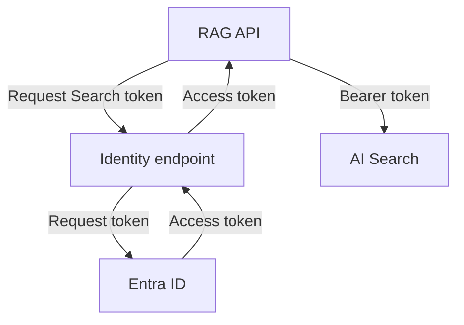

# A service needs its own identity

A RAG API needs to call a model, search an index and read documents after the developer's laptop is
closed. A developer's interactive login cannot be its production identity. A copied shared key works
only by giving the application a secret that someone must distribute, protect and replace.

The running service needs an identity that downstream services can recognise and authorise. Start
with the question: *who is acting on this request?* A person calling your API and your API querying
a search index are different actors, even when the second call happens because of the first.

## How it works on Azure \{#how-it-works-on-azure}

**Microsoft Entra ID** is Azure's identity service. A **tenant** is a
dedicated directory containing users, groups and applications. Treat it as the identity boundary in
which these objects are defined; it is not the running environment for your code.

A **user** is a person's directory identity. A **security group** collects members so access can be
managed through membership rather than one person at a time. For example, maintain an engineering
group instead of repeating the same grants whenever an engineer joins. Security groups can also
contain service principals.

Applications need a different object model. An **app registration** creates an application object in
its home tenant: the application's identity configuration, with a globally unique client ID. A
**service principal** is that application's local representation in a tenant. A single-tenant application
has one service principal in its home tenant; a multitenant application can also have service
principals in consuming tenants. The portal's *App registrations* and *Enterprise applications* views
expose these different objects. Registering an application is not deploying its code.

A **managed identity** is a special service principal whose credentials Azure manages. It has no
associated application object. You enable or attach it on supported Azure compute, then the workload
requests tokens through the hosting platform. You do not create a client secret and copy it into the
application's configuration.

What the application actually presents to a protected service is an **access token**, usually in an
`Authorization: Bearer …` header. An application using a conventional registration must authenticate
through a configured
mechanism such as a secret, certificate or federated credential to obtain its app-only token. With a
managed identity, Azure handles the credentials behind token acquisition.



*One app-only call to Search. [Container Apps provides the identity endpoint](https://learn.microsoft.com/en-us/azure/container-apps/managed-identity);
AI Search validates the API's token and checks its permissions.*

Authentication establishes who is acting. Authorisation decides what that actor may do. An identity
can exist and obtain a valid token while still lacking permission to read a blob or query an index.
Creating the identity completes neither permission assignment nor inbound authentication for your API.

The receiving API validates its tokens. For JWT access tokens accepted by your own API, this includes
the signature, issuer (`iss`), audience (`aud`) and validity (`nbf`, `exp`), followed by authorisation.
The audience names the intended recipient: a token intended for one API is not interchangeable with a
token for another. Merely decoding a JWT does not validate it.

On the calling side, treat a service's access token as opaque and use the acquisition library's expiry
metadata; do not make your client depend on parsing its contents or a fixed lifetime.
An **ID token** serves a different
purpose: it establishes user authentication at the client and is not a token for calling APIs.
These are security tokens, unrelated to the tokens counted in a model's input and output.

## Choosing an identity and its lifecycle \{#choosing-an-identity}

Choose according to who acts and how long the identity must survive. The managed identity types
differ chiefly in lifecycle and attachment.

| Choice | Fits | Poor fit |
|---|---|---|
| User | An engineer working interactively | An unattended production API dependent on that person's login |
| App registration and application service principal | Exposing an Entra-protected API or configuring user sign-in | An app registration plus a secret for a workload's own downstream calls on Azure compute that supports managed identity |
| System-assigned managed identity | Identity owned by one Azure resource and deleted with it | An identity that must survive replacement of that resource |
| User-assigned managed identity | Independent Azure resource, explicitly deleted and attachable to multiple supported resources | Sharing across workloads that should have different permissions |

An API can use both an app registration and a managed identity for different directions of access.
The registration configures its identity as an incoming API protected by Entra; the managed identity
lets its running code authenticate to downstream services. The latter does not replace the former.

A system-assigned identity makes ownership straightforward: the resource and identity live together.
A user-assigned identity lets you create and authorise the identity before compute exists, then retain
it when that compute is replaced. That suits the course project, where infrastructure arrives in stages.

Sharing has a consequence. Every workload attached to the same identity can use its permissions.
Code able to execute on the host can use the identities available there, so a managed identity does
not make an overpowered host safe. Give separate workloads separate identities when their access needs
differ; use the [least-privilege principle](/ai-sdlc/part-4-platform/least-privilege-sandboxing/)
to decide the boundary.

A user-assigned identity exposes three identifiers. Keep their jobs distinct:

| CLI field | What you use it for |
|---|---|
| `clientId` | Select this identity when configuring application token acquisition |
| `principalId` | Identify its service principal when granting permissions |
| `id` | Refer to the Azure resource when attaching it to supported compute |

These values are identifiers, not secrets or authentication proof. Sending a client ID alone proves
nothing. [Identity II — RBAC and keyless access](./rbac-and-keyless-access.md) develops grants and credential selection.

When calls fail, separate authentication from authorisation. For bearer-protected APIs,
[a 401 indicates a missing or invalid token, including a wrong audience; a 403 typically indicates a valid token without the required permission](https://learn.microsoft.com/en-us/aspnet/core/security/authentication/configure-jwt-bearer-authentication?view=aspnetcore-10.0).
Check which identity requested the token, too. In Container Apps, omitting user-assigned identity
selection makes the endpoint try a system-assigned identity that may not exist. With Azure Identity,
[explicitly supply the user-assigned client ID](https://learn.microsoft.com/en-us/azure/container-apps/managed-identity#connect-to-azure-services-in-app-code).

## In an AI workload \{#in-an-ai-workload}

P1 will run a minimal .NET RAG API on Azure Container Apps with one user-assigned runtime identity.
The API will use it for calls to a model in Microsoft Foundry, Azure AI Search, Blob Storage and Key
Vault. Each service has its own access configuration:
[Foundry](https://learn.microsoft.com/en-us/azure/foundry/foundry-models/how-to/configure-entra-id),
[Search](https://learn.microsoft.com/en-us/azure/search/search-security-rbac),
[Blob](https://learn.microsoft.com/en-us/azure/storage/blobs/authorize-access-azure-active-directory)
and [Key Vault](https://learn.microsoft.com/en-us/azure/key-vault/general/authentication).

The same identity does not mean one token reused everywhere or one grant unlocking all four services.
The API requests tokens for the service it intends to call, and each service independently checks
whether that identity has the required permissions. In Container Apps, attach the identity using its
resource ID; when configuring Azure Identity in the application, explicitly select its client ID as
described in the [Container Apps guidance](https://learn.microsoft.com/en-us/azure/container-apps/managed-identity).

One workload-level permission design can serve the teaching project's public corpus because its
documents need no per-user access restrictions. P1 will protect inbound requests with Entra through
an [API app registration](https://learn.microsoft.com/en-us/entra/identity-platform/scenario-protected-web-api-app-configuration)
and enforce its own access rules; creating the managed identity implements none of those controls. With
private documents, the API's ability to read the index would say nothing about which documents its
caller may see. That requires application controls along the
[retrieval path](/rag-agents/part-1-rag/retrieval/). Keep the inbound user's authentication and access
decision separate from the app-only identity used downstream.

Use a separate deployment identity as a design choice: the pipeline that changes infrastructure has
different work to do from the API answering questions. Keeping those permissions apart limits what
runtime code can change. Managed identity also removes a credential value from application configuration,
supporting the [Secrets](/ai-sdlc/part-4-platform/secrets) lesson's rule that credentials stay out of both
the repository and a coding agent's context.

## Try it \{#try-it}

Create the standalone P1 identity and inspect its identifiers. No compute exists yet, so there is
nothing to attach it to. This step grants no downstream access.

Use local Bash with Azure CLI installed. You need an Azure subscription and permission to create and
delete its lab resource group and manage user-assigned identities. Subscription-level
[`Contributor`](https://learn.microsoft.com/en-us/azure/role-based-access-control/built-in-roles/general#contributor)
is one sufficient, broad example; `Managed Identity Contributor` alone does not cover all the group
operations. See the [identity management prerequisites](https://learn.microsoft.com/en-us/entra/identity/managed-identities-azure-resources/manage-user-assigned-managed-identities-azure-cli).

**Cost:** managed identities have
[no additional charge](https://learn.microsoft.com/en-us/entra/identity/managed-identities-azure-resources/overview).
This lab creates only a resource group and identity, with no hosting, storage or model resource.

The commands and flags below were checked against the live Azure CLI reference and checked for Bash
syntax. They were **not run against live Azure**. Replace the tenant and subscription placeholders;
`westeurope` is an example location, subject to your subscription's policies.

```bash
P1_TENANT_ID="replace-with-your-tenant-id"
P1_SUBSCRIPTION_ID="replace-with-your-subscription-id"
P1_LOCATION=westeurope
P1_GROUP=rg-p1-identity
P1_IDENTITY=id-p1-rag-api

az login --tenant "$P1_TENANT_ID"
az account set --subscription "$P1_SUBSCRIPTION_ID"
az account show \
  --query '{subscriptionId:id,tenantId:tenantId,name:name}' \
  --output json
```

Check that the displayed subscription and tenant match your intended lab account before continuing.
The [login reference](https://learn.microsoft.com/en-us/cli/azure/reference-index?view=azure-cli-latest#az-login)
and [account reference](https://learn.microsoft.com/en-us/cli/azure/account?view=azure-cli-latest#az-account-set)
describe these commands. Your local CLI is signed in as you; it is not using the new managed identity.

```bash
az group create \
  --name "$P1_GROUP" \
  --location "$P1_LOCATION" \
  --output none

az identity create \
  --name "$P1_IDENTITY" \
  --resource-group "$P1_GROUP" \
  --location "$P1_LOCATION" \
  --output none

az identity show \
  --name "$P1_IDENTITY" \
  --resource-group "$P1_GROUP" \
  --query '{resourceId:id,clientId:clientId,principalId:principalId}' \
  --output json
```

The [group](https://learn.microsoft.com/en-us/cli/azure/group?view=azure-cli-latest#az-group-create)
and [identity](https://learn.microsoft.com/en-us/cli/azure/identity?view=azure-cli-latest#az-identity-create)
references define creation and inspection. Expect three nonempty values with this shape; the angle-bracket
values below are explanatory placeholders. Resource ID casing can differ: the
[identity reference example](https://learn.microsoft.com/en-us/rest/api/managedidentity/user-assigned-identities/get?view=rest-managedidentity-2024-11-30#examples)
returns `resourcegroups` in lowercase.

```json
{
  "clientId": "<application-client-id>",
  "principalId": "<service-principal-object-id>",
  "resourceId": "/subscriptions/<subscription-id>/resourceGroups/<lab-group>/providers/Microsoft.ManagedIdentity/userAssignedIdentities/id-p1-rag-api"
}
```

Knowing these IDs does not let your laptop authenticate as the identity. Token acquisition will become
available through supported compute after attachment.

**Teardown:** the identity is free; deleting it is lab hygiene. Delete only the dedicated lab group
created above. If you closed the shell, restore its fixed name first:

```bash
P1_GROUP=rg-p1-identity
az group delete --name "$P1_GROUP" --yes
```

[`az group delete`](https://learn.microsoft.com/en-us/cli/azure/group?view=azure-cli-latest#az-group-delete)
deletes the group and its resources. The later deployment step recreates the identity with the same
creation commands; retrieve its current identifiers then.

## What to take away \{#what-to-take-away}

- Name the actor on each call. A user's inbound request and the API's app-only downstream request need
  separate identity and access decisions.
- Distinguish the application object from its tenant-local service principal. Managed identity is a
  special service principal with Azure-managed credentials and no application object.
- Choose managed identity lifecycle deliberately. System-assigned follows one resource; user-assigned
  survives independently, and sharing it shares its permissions.
- Send an access token for the intended service. Identity identifiers are not credentials, and a valid
  token still requires authorisation at the receiver.

**[New terms](../glossary.md#entra-id)**: Microsoft Entra ID, user, security group, app registration, service principal, managed identity, system-assigned managed identity, user-assigned managed identity, client ID, principal ID, Azure resource ID, access token, audience, ID token, authentication, authorisation.

## Sources \{#sources}

Verified as of 2026-10-17.

### Identity objects \{#identity-objects}

- [Identity fundamentals](https://learn.microsoft.com/en-us/entra/architecture/secure-fundamentals)
- [Groups and access management](https://learn.microsoft.com/en-us/entra/fundamentals/concept-learn-about-groups)
- [Application objects and service principals](https://learn.microsoft.com/en-us/entra/identity-platform/app-objects-and-service-principals)
- [Protected web API configuration](https://learn.microsoft.com/en-us/entra/identity-platform/scenario-protected-web-api-app-configuration)
- [Register an application](https://learn.microsoft.com/en-us/entra/identity-platform/quickstart-register-app)
- [Managed identities overview](https://learn.microsoft.com/en-us/entra/identity/managed-identities-azure-resources/overview)
- [Managed identity best practices](https://learn.microsoft.com/en-us/entra/identity/managed-identities-azure-resources/managed-identity-best-practice-recommendations)
- [Managed identities in Container Apps](https://learn.microsoft.com/en-us/azure/container-apps/managed-identity)
- [Managed identities developer overview](https://learn.microsoft.com/en-us/entra/identity/managed-identities-azure-resources/overview-for-developers)
- [User-assigned identity resource: Get, REST 2024-11-30](https://learn.microsoft.com/en-us/rest/api/managedidentity/user-assigned-identities/get?view=rest-managedidentity-2024-11-30)
- [Select a user-assigned identity in .NET](https://learn.microsoft.com/en-us/dotnet/azure/sdk/authentication/user-assigned-managed-identity)

### Tokens \{#tokens}

- [Access tokens](https://learn.microsoft.com/en-us/entra/identity-platform/access-tokens)
- [Access token claims reference](https://learn.microsoft.com/en-us/entra/identity-platform/access-token-claims-reference)
- [Claims validation](https://learn.microsoft.com/en-us/entra/identity-platform/claims-validation)
- [ID tokens](https://learn.microsoft.com/en-us/entra/identity-platform/id-tokens)
- [Client credentials flow](https://learn.microsoft.com/en-us/entra/identity-platform/v2-oauth2-client-creds-grant-flow)
- [Bearer authentication and 401/403 responses in ASP.NET Core 10](https://learn.microsoft.com/en-us/aspnet/core/security/authentication/configure-jwt-bearer-authentication?view=aspnetcore-10.0)

### Project services \{#project-services}

- [Configure Entra ID for Foundry Models](https://learn.microsoft.com/en-us/azure/foundry/foundry-models/how-to/configure-entra-id)
- [Azure AI Search role-based access](https://learn.microsoft.com/en-us/azure/search/search-security-rbac)
- [Authorise access to blobs with Entra ID](https://learn.microsoft.com/en-us/azure/storage/blobs/authorize-access-azure-active-directory)
- [Key Vault authentication](https://learn.microsoft.com/en-us/azure/key-vault/general/authentication)

### CLI exercise \{#cli-exercise}

- [Azure CLI: identity create and show](https://learn.microsoft.com/en-us/cli/azure/identity?view=azure-cli-latest)
- [Azure CLI: login](https://learn.microsoft.com/en-us/cli/azure/reference-index?view=azure-cli-latest#az-login)
- [Azure CLI: account set and show](https://learn.microsoft.com/en-us/cli/azure/account?view=azure-cli-latest)
- [Azure CLI: group create and delete](https://learn.microsoft.com/en-us/cli/azure/group?view=azure-cli-latest)
- [Contributor built-in role](https://learn.microsoft.com/en-us/azure/role-based-access-control/built-in-roles/general#contributor)
- [Manage user-assigned identities with Azure CLI](https://learn.microsoft.com/en-us/entra/identity/managed-identities-azure-resources/manage-user-assigned-managed-identities-azure-cli)
