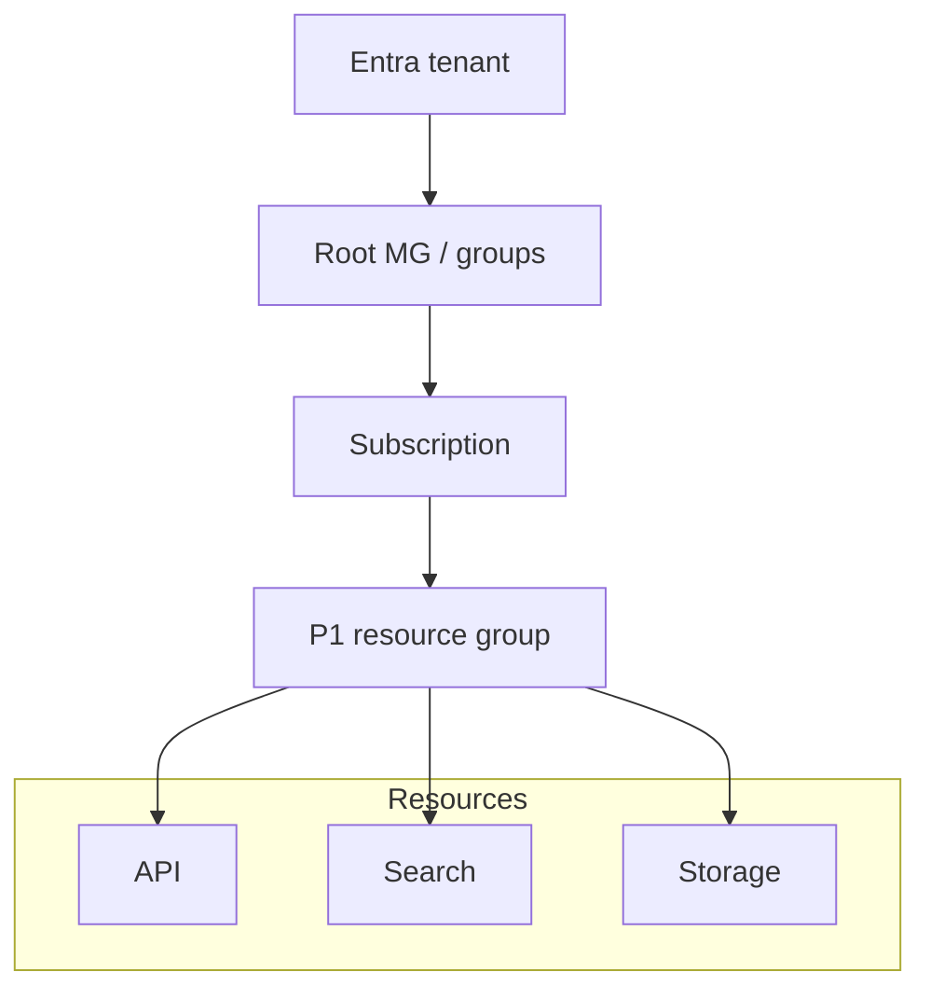

# Resource boundaries decide who can change a service and where its cost lands

A cloud application quickly becomes several independently managed components: somewhere to run code,
somewhere to store documents, a search index and a model endpoint. Create each wherever the setup wizard
happens to point, and the difficult questions arrive later. Which project owns this storage account? Who
can change the model deployment? What keeps charging after the demo ends?

Those questions need answers before the first deployment. A useful resource layout gives you a place to
apply access rules, attribute spending and remove an experiment without dismantling a shared service.
Azure's hierarchy makes those boundaries enforceable. Its shape affects the permissions and costs of the
RAG service you will build throughout this course.

## How it works on Azure \{#how-it-works-on-azure}

Start with identity. A **tenant** is an instance of Microsoft Entra ID: the directory holding identities
such as users, groups and application registrations. Each Azure subscription
[trusts one tenant](https://learn.microsoft.com/en-us/entra/fundamentals/how-subscriptions-associated-directory),
while several subscriptions can trust the same tenant. Signing in identifies you; permission to manage a
particular subscription is a separate question.

Within that identity context, the management hierarchy runs from management groups to subscriptions,
resource groups and resources:



The tenant supplies the identity context; the four levels below it are Azure management scopes.
Regions are a separate placement decision.

**Management groups** collect subscriptions that need common rules. Every subscription sits beneath the
[root management group](https://learn.microsoft.com/en-us/azure/governance/management-groups/overview#root-management-group-for-each-directory),
whose ID equals the tenant ID; additional groups organise branches of that tree.
A region restriction assigned above several subscriptions can apply throughout them. You do not need
to build a custom management-group tree for one learning subscription. Its purpose appears when several
subscriptions must follow the same rules. [Management groups](https://learn.microsoft.com/en-us/azure/governance/management-groups/overview)
keep that rule in one place instead of repeating it subscription by subscription.

A **subscription** is the administrative scope under which you provision services and accumulate their
charges. A **resource group** collects resources you intend to manage through a common lifecycle.
A **resource** is an item Azure manages, such as a storage account or application host. Service-specific
resource providers handle its operations. Most application resources belong to a resource group; some
[resource types exist at higher scopes](https://learn.microsoft.com/en-us/azure/azure-resource-manager/management/overview).

These levels matter because settings attach to a **scope**. An
[Azure RBAC role assignment](https://learn.microsoft.com/en-us/azure/role-based-access-control/scope-overview)
at subscription scope grants its permissions down to the subscription's resources. An assignment at a
single group reaches that group's resources. Azure Policy uses scopes too: an
[allowed-regions policy](https://learn.microsoft.com/en-us/azure/governance/policy/overview)
can reject a deployment even when the caller has permission to create the resource. Access answers
who may act; policy constrains the configuration they may create.

The subscription also connects resource consumption to payment. [Billing accounts and contracts](https://learn.microsoft.com/en-us/azure/cost-management-billing/understand/understand-billing-tenant-relationship)
have their own commercial structure. Management groups govern resources across subscriptions. Resource groups give you a useful way to attribute project spending within a subscription;
they do not create separate payment agreements.

Management requests converge on **Azure Resource Manager (ARM)**. Creating a storage account in the
portal, through Azure CLI or through an infrastructure template reaches the same management layer.
ARM checks the request and routes it to the relevant resource provider. Changing tools therefore does
not evade the subscription's access rules or deployment policies.

That common **control plane** manages resources; the **data plane** uses them. Creating the storage
account is a management operation. Reading a document from Blob Storage goes to the storage service's
endpoint. The [two planes have distinct operations and access considerations](https://learn.microsoft.com/en-us/azure/azure-resource-manager/management/control-plane-and-data-plane):
being able to inspect a resource in the portal does not establish that your application can read its data.

Location cuts across this structure. An [Azure region](https://learn.microsoft.com/en-us/azure/reliability/regions-overview)
is a geographic area containing datacentres and supporting infrastructure. Choose resource locations
for user latency, data requirements and the services available there. A resource group's location stores
its management metadata; it does not force its resources into that region. A group can contain resources
in several regions. Moving a resource into a group named `europe` does not move its data.
Microsoft nevertheless recommends [co-locating the group and its resources](https://learn.microsoft.com/en-us/azure/azure-resource-manager/management/overview#which-location-should-i-use-for-my-resource-group):
control-plane requests route through the group's region, and co-location limits regional-outage impact.
Put P1's group in the region where P1 will run.

Within a region, **availability zones** separate infrastructure with independent power, cooling and
networking. A zonal resource sits in a chosen zone; a zone-redundant service distributes or replicates
across zones. [Support and configuration depend on the service, region and tier](https://learn.microsoft.com/en-us/azure/reliability/availability-zones-overview).
Selecting a region that has zones does not make every resource resilient to a zone failure, and zones
do not provide recovery from an outage of the whole region.

## Choosing boundaries that survive a teardown \{#choosing-boundaries}

For the first project, start with a learning subscription and one resource group for its disposable
development resources. Expand the structure when a real ownership, governance or lifecycle difference
requires it. A separate group per service makes a small application's teardown harder; one group for
every experiment makes deletion too broad.

| Boundary | Use it when | Avoid this mistake |
|---|---|---|
| Management group | Several subscriptions need common policy or access assignments. | Copying an organisation chart without a governance requirement. |
| Separate subscription | Environments need different administration, policy or spending oversight. | Creating a new tenant merely to separate project costs. |
| Resource group | Resources should be deployed, managed and retired together. | Putting a shared document store in a disposable demo group. |
| Tags | You need labels such as project, environment and owner across resources. | Treating a label as an access boundary. |

The deletion test is concrete: would deleting this entire group be an acceptable way to retire the
project? If the group holds another application's data, the boundary needs repair. Resources can
communicate across groups; group them according to their lifecycle. Microsoft recommends [organising resources by lifecycle](https://learn.microsoft.com/en-us/azure/cloud-adoption-framework/ready/azure-setup-guide/organize-resources).

Tags add context that names alone cannot carry. Use a small vocabulary consistently, such as
`project=p1-rag`, `environment=dev` and `owner=learner`. Resources
[do not automatically inherit group tags](https://learn.microsoft.com/en-us/azure/azure-resource-manager/management/tag-resources).
Infrastructure code or policy can apply resource tags. Separately, opt-in
[Cost Management tag inheritance](https://learn.microsoft.com/en-us/azure/cost-management-billing/costs/enable-tag-inheritance)
applies subscription and resource-group tags to child usage records, leaving resources' own tags unchanged.
It supports Enterprise Agreement (EA), Microsoft Customer Agreement (MCA) and Microsoft Partner Agreement
(MPA) billing accounts only, with Azure plan subscriptions required for MPA.

Placement has a different tradeoff. Keeping a small service and its dependencies in one suitable region
reduces the number of cross-region dependencies you must reason about. For production, examine zone
support for each dependency together: a redundant API cannot answer questions if its only retrieval
backend is unavailable. Multiple regions add recovery options, but also introduce data replication,
routing and failover decisions. Choose them from recovery requirements.

Use a budget to make spending visible. A
[budget sends notifications without stopping resources](https://learn.microsoft.com/en-us/azure/cost-management-billing/costs/tutorial-acm-create-budgets).
Cost data typically arrives within **8–24 hours**; budgets are evaluated every **24 hours**, with email
normally sent within **an hour of evaluation**. Someone must respond. The course's USD 10 monthly target
requires planning and teardown.

## In an AI workload \{#in-an-ai-workload}

[P1](../part-5-projects/rag-service.md) joins an ASP.NET Core minimal API on Azure Container Apps to a model deployment in
[Microsoft Foundry](https://learn.microsoft.com/en-us/azure/foundry/what-is-foundry), Azure AI Search and
documents in Blob Storage. Key Vault access through managed identity and Application Insights complete
the runtime setup. Bicep and `azd` describe and provision it; GitHub Actions with OIDC
delivers changes. Today you prepare its subscription, spending alerts and resource-group boundary.

The [ingestion lesson](/rag-agents/part-1-rag/ingestion/) explains preparing documents and building the index.
Here the question is which data and indexes should survive application teardown.
For a lab over public documents, a reproducible index can share the application's disposable lifecycle.
If a later system uses a shared corpus that must survive application teardown, place that storage under
a separately managed lifecycle and make the dependency explicit.

Apply the same reasoning to access. Being in one group does not give the API automatic access to its
model, documents or secrets. Plan those grants deliberately; the
[secrets lesson](/ai-sdlc/part-4-platform/secrets) explains why runtime access should avoid passing secret
values through source code or an agent's context.

For models, choose P1's region using [model and deployment-type availability](https://learn.microsoft.com/en-us/azure/foundry/foundry-models/concepts/deployment-types)
and [available quota](https://learn.microsoft.com/en-us/azure/foundry/openai/quotas-limits#regional-quota-capacity-limits),
which can differ by region. Quota pooling is changing: some models now share subscription-wide or
data-zone pools, so check the chosen model rather than assuming each region adds quota.
That region choice also determines P1's group location.

Check processing separately. Microsoft recommends starting with
[Global Standard](https://learn.microsoft.com/en-us/azure/foundry/foundry-models/concepts/deployment-types),
which may process prompts and responses in any Azure region. Data Zone types keep processing within
the specified data zone; Standard keeps it within the customer-selected Azure geography, potentially
across regions there. Record that deployment choice before sending documents or prompts.

## Try it \{#try-it}

Use an existing learning subscription and **Bash**, locally with
[Azure CLI installed](https://learn.microsoft.com/en-us/cli/azure/install-azure-cli) or in an
[ephemeral Azure Cloud Shell session](https://learn.microsoft.com/en-us/azure/cloud-shell/get-started/ephemeral).
PowerShell is outside this exercise's scope. The CLI references and portal documentation were checked;
neither the commands nor the portal steps have been run against a live subscription for this lesson.

Since [CLI 2.61.0, login prompts for a subscription](https://learn.microsoft.com/en-us/cli/azure/authenticate-azure-cli-interactively#subscription-selector)
when several are accessible. Replace `<id>` below with your learning subscription ID;
[`az account set`](https://learn.microsoft.com/en-us/cli/azure/account?view=azure-cli-latest#az-account-set)
still pins the destination explicitly:

```bash
az login
az account list --output table
AZURE_SUBSCRIPTION_ID="<id>"
az account set --subscription "$AZURE_SUBSCRIPTION_ID"
az account show --output json
```

Check the returned subscription ID and tenant ID before proceeding.

In the portal, open that subscription, then **Budgets → Add**. Following the
[budget tutorial](https://learn.microsoft.com/en-us/azure/cost-management-billing/costs/tutorial-acm-create-budgets),
create `learning-monthly` for the whole subscription, with no filters and an expiry beyond your study period.
Choose **Monthly** for this course's calendar-month target; **Billing month**, if also offered, follows
your invoice period. Set actual-cost email alerts at **50%, 80% and 100%**. Enter **10** in USD or
an equivalent target in the displayed currency. Check the recipient before saving.

[Owner, Contributor or Cost Management Contributor](https://learn.microsoft.com/en-us/azure/cost-management-billing/costs/tutorial-acm-create-budgets#prerequisites)
can create the budget. A new subscription may need up to **48 hours** for Cost Management availability;
return before deploying paid services if setup is unavailable.

Create a tagged group for P1, using a suffix to reduce name collisions. Replace `westeurope` with the
allowed region P1 will run in; list locations with `az account list-locations --output table`.
The [group reference](https://learn.microsoft.com/en-us/cli/azure/group?view=azure-cli-latest) documents
the creation and inspection flags:

```bash
AZURE_RESOURCE_GROUP="rg-p1-rag-dev-$RANDOM"
az group create \
  --subscription "$AZURE_SUBSCRIPTION_ID" \
  --name "$AZURE_RESOURCE_GROUP" \
  --location westeurope \
  --tags project=p1-rag environment=dev owner=learner
az group show \
  --subscription "$AZURE_SUBSCRIPTION_ID" \
  --name "$AZURE_RESOURCE_GROUP" \
  --output json
```

A [resource ID](https://learn.microsoft.com/en-us/azure/role-based-access-control/scope-overview#scope-format)
for a resource in a group has the form `/subscriptions/{id}/resourceGroups/{name}/providers/{namespace}/{type}/{name}`;
the `id` field from `az group show` stops at `/resourceGroups/{name}` because it identifies the group itself.

Expected result: JSON with that group `id`, your chosen location and three tags; no application services
exist yet. The portal lists the budget and thresholds. Do not spend merely to test an alert.

**Cost:** Free for this exercise: only an empty group is created through
[Resource Manager, which is free](https://azure.microsoft.com/en-us/pricing/purchase-options/azure-account).
[Azure budgets and their alerts are also free](https://azure.microsoft.com/en-us/pricing/details/cost-management/).
No model, compute or storage service is provisioned.

**Teardown:** Delete the group now, keeping the same Bash session and variables. You will recreate the
project boundary when you deploy P1. Keep the subscription budget for subsequent exercises; remove it
through the portal if you are ending the course.

```bash
az group delete \
  --subscription "$AZURE_SUBSCRIPTION_ID" \
  --name "$AZURE_RESOURCE_GROUP" \
  --yes
az group exists \
  --subscription "$AZURE_SUBSCRIPTION_ID" \
  --name "$AZURE_RESOURCE_GROUP"
```

The final command should return `false`. In later labs,
[group deletion can fail on locks, protected backup data or cross-group dependencies](https://learn.microsoft.com/en-us/azure/azure-resource-manager/management/delete-resource-group);
check completion. Deleting a group leaves
[Key Vault](https://learn.microsoft.com/en-us/azure/key-vault/general/soft-delete-overview) and
[Foundry/AI services accounts](https://learn.microsoft.com/en-us/azure/ai-services/recover-purge-resources)
soft-deleted, so reusing names can collide until purged (where permitted) or retention expires. Other groups and incurred
charges remain.

## What to take away \{#what-to-take-away}

- The tenant supplies identities; management groups, subscriptions, resource groups and resources supply
  progressively narrower governance scopes. Billing contracts have a separate hierarchy.
- ARM is the shared resource management control plane. Using a resource's data plane requires its own
  access checks.
- Group resources by lifecycle. Put each disposable project in a group you can delete without losing
  another project's data, and apply resource tags explicitly.
- Regions choose placement; zones provide fault isolation within a region when the services are
  configured to use them. Neither follows from the resource-group name.
- Set budget alerts before deploying paid services, and verify teardown afterwards. A budget does not
  cap consumption.

**[New terms](../glossary.md#how-azure-is-organised)**: tenant, management group, subscription, resource group, resource, resource provider, scope, resource ID, Azure Resource Manager, control plane, data plane, region, availability zone, zonal resource, zone-redundant resource, tag, budget.

## Sources \{#sources}

Verified as of 2026-10-17.

- **Identity and hierarchy:** [Microsoft Entra tenants](https://learn.microsoft.com/en-us/entra/identity-platform/quickstart-create-new-tenant), [Subscription and directory relationships](https://learn.microsoft.com/en-us/entra/fundamentals/how-subscriptions-associated-directory), [Management groups](https://learn.microsoft.com/en-us/azure/governance/management-groups/overview), [Resource Manager overview](https://learn.microsoft.com/en-us/azure/azure-resource-manager/management/overview), [Azure RBAC scopes](https://learn.microsoft.com/en-us/azure/role-based-access-control/scope-overview), [Azure Policy](https://learn.microsoft.com/en-us/azure/governance/policy/overview), [Billing and tenants](https://learn.microsoft.com/en-us/azure/cost-management-billing/understand/understand-billing-tenant-relationship).
- **Lifecycle and placement:** [Resource organisation](https://learn.microsoft.com/en-us/azure/cloud-adoption-framework/ready/azure-setup-guide/organize-resources), [Control and data planes](https://learn.microsoft.com/en-us/azure/azure-resource-manager/management/control-plane-and-data-plane), [Resource-group location](https://learn.microsoft.com/en-us/azure/azure-resource-manager/management/overview#which-location-should-i-use-for-my-resource-group), [Regions](https://learn.microsoft.com/en-us/azure/reliability/regions-overview), [Region names](https://learn.microsoft.com/en-us/azure/reliability/regions-list), [Availability zones](https://learn.microsoft.com/en-us/azure/reliability/availability-zones-overview), [Tags](https://learn.microsoft.com/en-us/azure/azure-resource-manager/management/tag-resources), [Cost Management tag inheritance](https://learn.microsoft.com/en-us/azure/cost-management-billing/costs/enable-tag-inheritance), [Group deletion](https://learn.microsoft.com/en-us/azure/azure-resource-manager/management/delete-resource-group), [Key Vault soft delete](https://learn.microsoft.com/en-us/azure/key-vault/general/soft-delete-overview), [Recover or purge Foundry resources](https://learn.microsoft.com/en-us/azure/ai-services/recover-purge-resources).
- **Models:** [Microsoft Foundry](https://learn.microsoft.com/en-us/azure/foundry/what-is-foundry), [Model deployment types](https://learn.microsoft.com/en-us/azure/foundry/foundry-models/concepts/deployment-types), [Model quotas and limits](https://learn.microsoft.com/en-us/azure/foundry/openai/quotas-limits).
- **Exercise:** [Install Azure CLI](https://learn.microsoft.com/en-us/cli/azure/install-azure-cli), [Interactive CLI authentication](https://learn.microsoft.com/en-us/cli/azure/authenticate-azure-cli-interactively), [`az login`](https://learn.microsoft.com/en-us/cli/azure/reference-index?view=azure-cli-latest#az-login), [Ephemeral Cloud Shell](https://learn.microsoft.com/en-us/azure/cloud-shell/get-started/ephemeral), [`az account`](https://learn.microsoft.com/en-us/cli/azure/account?view=azure-cli-latest), [`az group`](https://learn.microsoft.com/en-us/cli/azure/group?view=azure-cli-latest), [Create and manage budgets](https://learn.microsoft.com/en-us/azure/cost-management-billing/costs/tutorial-acm-create-budgets), [Free Azure services](https://azure.microsoft.com/en-us/pricing/free-services), [Azure account free-service table](https://azure.microsoft.com/en-us/pricing/purchase-options/azure-account), [Cost Management pricing](https://azure.microsoft.com/en-us/pricing/details/cost-management/).
