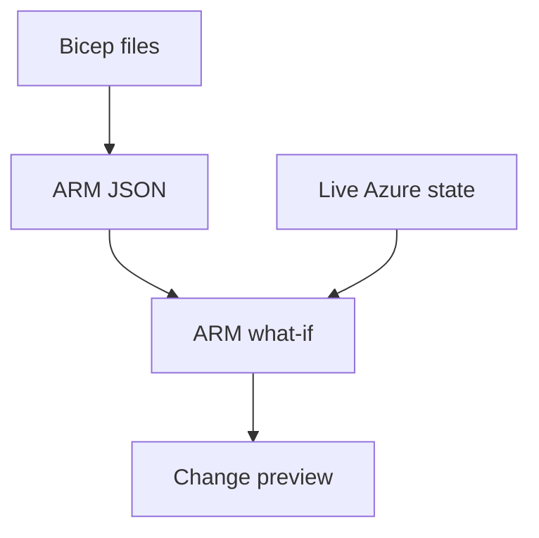

# An environment needs a definition you can review

The service works in one environment. To create another, somebody has to remember which resources they
created, which settings they changed and which permissions made the last access error disappear. A
screenshot records one view of that environment. It cannot reconstruct the decisions behind it.

Infrastructure as code (IaC) puts the intended resource configuration in files you can version and
review. A change to storage access belongs in the same engineering process as a change to the API that
reads it. That definition lets you reconstruct the intended environment and explain a difference before
applying it.

## How it works on Azure \{#how-it-works-on-azure}

[Azure Resource Manager (ARM)](https://learn.microsoft.com/en-us/azure/azure-resource-manager/management/overview)
is Azure's deployment and management layer. It authenticates and authorizes management requests, then
forwards them to the appropriate service. An **ARM template** is a declarative JSON document submitted
to that layer: it describes resources and their desired properties. ARM and an ARM template are
different things; one executes management operations, the other supplies a deployment definition.

[Bicep](https://learn.microsoft.com/en-us/azure/azure-resource-manager/bicep/overview) is a language for
writing those definitions. Its compiler produces ARM JSON. You declare resources with symbolic names,
types, API versions and properties; references between resources establish dependencies. ARM handles
deployment ordering. Moving a declaration above another declaration is not how you make it deploy first.

A [module](https://learn.microsoft.com/en-us/azure/azure-resource-manager/bicep/modules) is another
Bicep file called from the main file. It groups related resources behind parameters and outputs and
compiles into a nested deployment. For P1, a document-storage module can accept a location and tags,
then return a resource ID for other parts of the system to use. Callers should not need to know every
storage setting to connect that module.

Compilation checks the definition locally. Azure's
[what-if operation](https://learn.microsoft.com/en-us/azure/azure-resource-manager/bicep/deploy-what-if)
compares a proposed deployment with the environment and predicts changes without applying them.



The preview depends on both inputs: a source diff alone cannot show a change someone already made in
Azure. A preview with unchanged source can reveal configuration drift in declared resources, but
undeclared resources appear as `Ignore`, so their drift is invisible. What-if also produces noise,
including default-valued properties reported as deleted; a reported difference needs investigation
([limitations and results](https://learn.microsoft.com/en-us/azure/azure-resource-manager/bicep/deploy-what-if)).

## Choosing and tradeoffs \{#choosing-and-tradeoffs}

The language choice determines how you describe resources and manage their lifecycle. The application
workflow determines how you package and deploy the service around them.

| Option | Useful when | Avoid it when / cost of the choice |
|---|---|---|
| ARM JSON | Maintaining an existing template estate or inspecting Bicep's compiled output. | For new handwritten definitions, the JSON structure makes changes harder to read than the equivalent Bicep. |
| Bicep | The resources are on Azure and the team wants ARM deployment semantics without a separate client state file. | It is a poor fit for one configuration that must also manage unrelated platforms. |
| Terraform | The team already operates it, or needs providers spanning several platforms. | The state and backend need ownership, protection and recovery procedures; that is work even for a small service. |
| Azure Developer CLI (`azd`) | You want a repeatable application workflow around code and IaC. | It cannot replace the resource definitions or the review of what those definitions create. |

Microsoft's [Bicep–Terraform comparison](https://learn.microsoft.com/en-us/azure/developer/terraform/comparing-terraform-and-bicep)
documents the key state distinction: Terraform stores mappings between configuration and real resources
in state, which can be local or remote. Bicep relies on Azure's deployment mechanism without a separate
state file for the team to maintain. Choose one owner for each resource; having both tools manage the
same account makes the next change difficult to reason about.

[Azure Developer CLI](https://learn.microsoft.com/en-us/azure/developer/azure-developer-cli/overview)
supports projects containing Bicep or Terraform. Its
[workflow](https://learn.microsoft.com/en-us/azure/developer/azure-developer-cli/azd-commands) uses
`azure.yaml` to describe application services and an `infra` directory for infrastructure definitions.
`azd provision` provisions infrastructure; `azd deploy` deploys the application; `azd up` combines
packaging, provisioning and deployment. For P1, Bicep owns the resource definitions and `azd` will
coordinate the application workflow. Once P1 has its `azd` project configuration,
[`azd provision --preview`](https://learn.microsoft.com/en-us/azure/developer/azure-developer-cli/reference#azd-provision)
provides the Bicep what-if preview through that workflow.

**Configuration drift** means the actual configuration has diverged from the intended configuration. A portal hotfix
may be necessary, but leaving it out of source means the next deployment can overwrite it. Decide
whether to preserve the fix in code or restore the declared configuration. Schedule previews or checks
where that matters; storing a Bicep file does not continuously enforce it.

[Incremental deployment mode](https://learn.microsoft.com/en-us/azure/azure-resource-manager/templates/deployment-modes)
leaves resources omitted from the template in place. For a resource that *is* declared,
properties are reapplied; omitted properties can return to defaults. A template must describe the
resource's intended final configuration, including its non-default settings. Removing a resource from
the file is not a deletion procedure. Current guidance recommends deployment stacks when you need
managed deletion, rather than switching to complete mode as a cleanup shortcut.

Previews also have [blind spots](https://learn.microsoft.com/en-us/azure/azure-resource-manager/bicep/deploy-what-if).
Unresolved `reference()` expressions can report differences that are not real changes. Some resources
or modules can be excluded from analysis when their expressions cannot be evaluated. Read diagnostics
and unexplained changes before proceeding. `Ignore` means a resource was not evaluated: it is outside
the template, or nested-template expansion hit a limit (500 templates, 800 resource groups or five
minutes). `NoChange` means a declared resource's properties are predicted to stay unchanged.

## In an AI workload \{#in-an-ai-workload}

P1's intended service joins an ASP.NET Core minimal API on Container Apps to a Foundry model deployment,
Azure AI Search and Blob Storage, with Key Vault access through managed identity and telemetry in
Application Insights. Its delivery path uses Bicep, `azd` and GitHub Actions with OIDC. Writing one giant
template for that entire system would make the first storage change unnecessarily difficult to review.
Start with a module whose purpose you can explain, then add retrieval, compute and identity boundaries
as their contracts become clear.

Bicep can provision the Search service, but its indexes, vector fields and skillsets are data-plane
objects, not native Bicep resource declarations. Keep those definitions in ingestion code or scripts
that call the Search APIs ([Bicep boundary](https://learn.microsoft.com/en-us/azure/search/search-get-started-bicep),
[Search objects](https://learn.microsoft.com/en-us/rest/api/searchservice/),
[vector index schema](https://learn.microsoft.com/en-us/azure/search/vector-search-how-to-create-index)).
A Foundry/Azure OpenAI model deployment *is* an ARM child resource:
[`Microsoft.CognitiveServices/accounts/deployments`](https://learn.microsoft.com/en-us/azure/templates/microsoft.cognitiveservices/2026-07-01/accounts/deployments).
Put `properties.model.version`, `properties.versionUpgradeOption`, `sku.name` and `sku.capacity` in its
template so model version, upgrade behavior and capacity choices receive review with the infrastructure.

The definition is only part of reproducibility. Two environments can have matching resource settings
and different source documents, index contents or retrieval behavior. Record which corpus and ingestion
configuration belong to a release; follow [Ingestion](/rag-agents/part-1-rag/ingestion/) for the document-to-index
process. Recreating an account does not recreate its documents.

A configuration preview cannot tell you whether answers cite the right evidence. Run the
retrieval and generation checks described in [Evaluation](/rag-agents/part-1-rag/cross-cutting/evaluation/)
after infrastructure changes that could affect behavior. Treat infrastructure validation and answer
quality as separate evidence. A successful deployment with an empty index can still serve a broken RAG
experience.

Keep module outputs limited to what consumers need, such as resource IDs. The
[secrets lesson](/ai-sdlc/part-4-platform/secrets) owns the rule about references and runtime values;
[Storage guidance](https://learn.microsoft.com/en-us/azure/storage/common/storage-account-keys-manage)
recommends identity-based authorization. Returning an account key from a module would spread a credential
through deployment tooling when the application should receive an identity and the appropriate access.

## Try it \{#try-it}

Write P1's first module for resource-group contents: the storage account that will hold public source
documents. This exercise previews that account; later steps add containers, data access and the rest of
the service. Work in your P1 project directory with Bash or zsh and Azure CLI installed.

Both Bicep files below were compiled locally with
[Bicep 0.48.1](https://github.com/Azure/bicep/releases/tag/v0.48.1), the current release on the verification date.
No Azure subscription is available
for this course yet. The Azure commands and flags were checked against the live CLI reference and have
**not yet been run against a live subscription**. Cloud results below are expected results from the
documentation, not an observed deployment.

Create the directory and install the pinned compiler using the
[Bicep CLI commands](https://learn.microsoft.com/en-us/cli/azure/bicep?view=azure-cli-latest):

```bash
mkdir -p infra/modules
az bicep install --version v0.48.1
az bicep version
```

Save this as `infra/modules/p1-resources.bicep`. The
[Storage API reference](https://learn.microsoft.com/en-us/azure/templates/microsoft.storage/2026-06-01/storageaccounts)
defines the pinned API, SKU and properties used here. Anonymous blob access and Shared Key authorization
are disabled; this does not create a private network endpoint or grant anyone data access.

```bicep
targetScope = 'resourceGroup'

param location string
param tags object

resource documents 'Microsoft.Storage/storageAccounts@2026-06-01' = {
  name: 'p1docs${uniqueString(resourceGroup().id)}'
  location: location
  tags: tags
  kind: 'StorageV2'
  sku: {
    name: 'Standard_LRS'
  }
  properties: {
    supportsHttpsTrafficOnly: true
    minimumTlsVersion: 'TLS1_2'
    allowBlobPublicAccess: false
    allowSharedKeyAccess: false
  }
}

output storageResourceId string = documents.id
```

Save the caller as `infra/main.bicep`. Its scope is the existing resource group; it does not create
that group. The [deterministic name](https://learn.microsoft.com/en-us/azure/azure-resource-manager/bicep/bicep-functions-string#uniquestring)
in the module stays the same for the same resource-group ID, although global name availability is not
guaranteed.

```bicep
targetScope = 'resourceGroup'

param environmentName string = 'iac-lab'
param location string = resourceGroup().location

module p1 './modules/p1-resources.bicep' = {
  name: '${deployment().name}-p1'
  params: {
    location: location
    tags: {
      environment: environmentName
      workload: 'p1-rag'
    }
  }
}

output storageResourceId string = p1.outputs.storageResourceId
```

Compile both files. The [`--stdout` option](https://learn.microsoft.com/en-us/cli/azure/bicep?view=azure-cli-latest#az-bicep-build)
prints the JSON templates without leaving generated files beside the source. Compilation does not
create Azure resources.

```bash
az bicep build --file infra/modules/p1-resources.bicep --stdout
az bicep build --file infra/main.bicep --stdout
```

Once you have a subscription, you need permission to create the group and deploy its proposed resources:
[`Provider` is the default validation level](https://learn.microsoft.com/en-us/cli/azure/deployment/group?view=azure-cli-latest#az-deployment-group-what-if)
and checks deployment permissions too. Follow the references for
[sign-in](https://learn.microsoft.com/en-us/cli/azure/authenticate-azure-cli-interactively?view=azure-cli-latest),
[subscription selection](https://learn.microsoft.com/en-us/cli/azure/account?view=azure-cli-latest),
[groups](https://learn.microsoft.com/en-us/cli/azure/group?view=azure-cli-latest) and
[what-if](https://learn.microsoft.com/en-us/cli/azure/deployment/group?view=azure-cli-latest).
Use a new group name reserved for this exercise; choose a permitted location if your subscription's
policy excludes the example location. Replace `<id>` with a subscription ID from the list.

```bash
az login
az account list --output table
subscriptionId="<id>"
az account set --subscription "$subscriptionId"
az account show --output table

rg="rg-p1-iac-lab"
location="westeurope"
az group create --name "$rg" --location "$location"

az deployment group what-if \
  --name p1-preview \
  --resource-group "$rg" \
  --template-file infra/main.bicep \
  --parameters environmentName=iac-lab
```

Expect a proposed `Create` for the storage account in the empty group, subject to validation and
documented preview limitations. Check its name, location, tags and access settings. Compare that full
payload with a resource-only summary using
[`--result-format ResourceIdOnly`](https://learn.microsoft.com/en-us/cli/azure/deployment/group?view=azure-cli-latest#az-deployment-group-what-if):

```bash
az deployment group what-if \
  --name p1-preview \
  --resource-group "$rg" \
  --template-file infra/main.bicep \
  --parameters environmentName=iac-lab \
  --result-format ResourceIdOnly
```

The account should still be proposed as `Create`: the first preview did not deploy it. The summary
omits property details. Use the default `FullResourcePayloads` output when reviewing access settings;
a list of resource IDs cannot show whether those settings are correct. Neither preview demonstrates
drift in an already deployed resource.

**Cost:** Free for this exercise: Bicep compilation is local, and
[Azure lists Resource Manager as always free](https://azure.microsoft.com/en-us/pricing/purchase-options/azure-account).
The cloud steps create only an empty resource group and preview a deployment. They do not provision
Storage, Search, compute or a model deployment.

**Teardown:** Delete the dedicated exercise group using the same shell session. Retain the files as a
learning starting point. Their scope and structure may change when P1 adopts `azd`: its
[default workflow creates a resource group; existing-group deployment is documented as beta](https://learn.microsoft.com/en-us/azure/developer/azure-developer-cli/resource-group-scoped-deployments).

```bash
az group delete --name "$rg" --yes
```

## What to take away \{#what-to-take-away}

- Put the intended environment in reviewable files; reconcile emergency changes back into that definition.
- ARM executes Azure management operations. Bicep compiles to ARM templates; modules expose parameters and outputs.
- Choose Bicep or Terraform with an explicit resource owner and state-management plan. Use `azd` to coordinate the application workflow.
- Read what-if diagnostics and incremental deployment semantics before applying changes. Omission is not a reliable deletion strategy.
- Version infrastructure alongside the AI release's other inputs, then check retrieval and answer quality separately.

**[New terms](../glossary.md#infrastructure-as-code)**: infrastructure as code, ARM template, Bicep, Terraform state, module, what-if, configuration drift, incremental deployment, Azure Developer CLI (azd).

## Sources \{#sources}

Verified as of 2026-10-17.

- **Mechanism and choices:** [Azure Resource Manager](https://learn.microsoft.com/en-us/azure/azure-resource-manager/management/overview), [Bicep overview](https://learn.microsoft.com/en-us/azure/azure-resource-manager/bicep/overview), [Modules](https://learn.microsoft.com/en-us/azure/azure-resource-manager/bicep/modules), [Bicep and Terraform](https://learn.microsoft.com/en-us/azure/developer/terraform/comparing-terraform-and-bicep), [Deployment modes](https://learn.microsoft.com/en-us/azure/azure-resource-manager/templates/deployment-modes), [What-if behavior and limitations](https://learn.microsoft.com/en-us/azure/azure-resource-manager/bicep/deploy-what-if).
- **Application workflow:** [Azure Developer CLI overview](https://learn.microsoft.com/en-us/azure/developer/azure-developer-cli/overview), [Azure Developer CLI commands](https://learn.microsoft.com/en-us/azure/developer/azure-developer-cli/azd-commands), [azd provision reference](https://learn.microsoft.com/en-us/azure/developer/azure-developer-cli/reference#azd-provision), [azd deployment scopes](https://learn.microsoft.com/en-us/azure/developer/azure-developer-cli/resource-group-scoped-deployments).
- **AI resource boundaries:** [Search Bicep quickstart](https://learn.microsoft.com/en-us/azure/search/search-get-started-bicep), [Search data-plane APIs](https://learn.microsoft.com/en-us/rest/api/searchservice/), [Vector index schema](https://learn.microsoft.com/en-us/azure/search/vector-search-how-to-create-index), [Model deployment API 2026-07-01](https://learn.microsoft.com/en-us/azure/templates/microsoft.cognitiveservices/2026-07-01/accounts/deployments).
- **Exercise:** [Bicep CLI reference](https://learn.microsoft.com/en-us/cli/azure/bicep?view=azure-cli-latest), [Pinned compiler installation](https://learn.microsoft.com/en-us/azure/azure-resource-manager/bicep/bicep-cli), [Bicep v0.48.1 release](https://github.com/Azure/bicep/releases/tag/v0.48.1), [Interactive sign-in](https://learn.microsoft.com/en-us/cli/azure/authenticate-azure-cli-interactively?view=azure-cli-latest), [Account commands](https://learn.microsoft.com/en-us/cli/azure/account?view=azure-cli-latest), [Group commands](https://learn.microsoft.com/en-us/cli/azure/group?view=azure-cli-latest), [Deployment commands](https://learn.microsoft.com/en-us/cli/azure/deployment/group?view=azure-cli-latest), [Storage API 2026-06-01](https://learn.microsoft.com/en-us/azure/templates/microsoft.storage/2026-06-01/storageaccounts), [String functions](https://learn.microsoft.com/en-us/azure/azure-resource-manager/bicep/bicep-functions-string#uniquestring), [Storage authorization guidance](https://learn.microsoft.com/en-us/azure/storage/common/storage-account-keys-manage).
- **Cost:** [Azure free services catalogue](https://azure.microsoft.com/en-us/pricing/purchase-options/azure-account).
