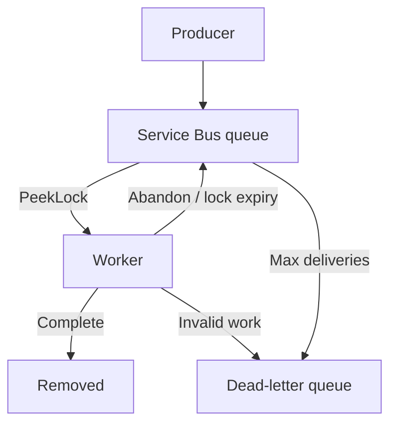

# Accepting work and finishing it are separate promises

A document upload starts parsing, embedding and indexing. If all of that happens inside the upload request,
the caller waits for every dependency. A burst of uploads becomes a burst of model calls. When the request
times out, the caller cannot tell whether nothing happened, half the document was indexed, or everything
finished just before the connection broke. Retrying may repeat work that already succeeded.

Messaging lets a producer hand work to a durable intermediary and continue before a worker finishes it.
That changes the promise you make: “accepted” needs a later, observable completion state. It also creates
questions a successful HTTP response used to hide. Who owns unfinished work? What happens after a worker
crashes? Can an older document overwrite a newer one? Choose the messaging contract before the service.

## How it works on Azure \{#how-it-works-on-azure}

A **command** asks a responsible consumer to do something: `IndexDocument`. An **event** reports something
that happened: `DocumentUploaded`. An **event stream** records successive observations that consumers can
analyse over time. These [messaging contracts](https://learn.microsoft.com/en-us/azure/architecture/guide/technology-choices/messaging)
describe intent; a JSON payload alone cannot tell you which contract it carries.

### Service Bus holds work until a receiver settles it \{#service-bus-holds-work-until-a-receiver-settles-it}

A Service Bus **namespace** [provides the endpoint and contains messaging entities](https://learn.microsoft.com/en-us/azure/service-bus-messaging/service-bus-messaging-overview).
A **queue** holds work for competing consumers: adding workers shares the backlog rather than broadcasting every message to
every worker. A **topic** provides fan-out through named **subscriptions**. Each subscription holds its own
matching messages and has its own receivers. Filters decide which messages enter a subscription; receivers
[read from the subscription, not directly from the topic](https://learn.microsoft.com/en-us/azure/service-bus-messaging/service-bus-queues-topics-subscriptions).

Receiving a message need not remove it. In **PeekLock** mode, the broker temporarily locks it for a receiver.
After the work succeeds, the receiver calls `Complete` to remove it. `Abandon` releases it for another
attempt; an expired lock also permits redelivery. These actions are called **settlement**. In
`ReceiveAndDelete` mode, [removal happens as part of receiving](https://learn.microsoft.com/en-us/azure/service-bus-messaging/message-transfers-locks-settlement),
so a worker crash can lose unfinished work.



Every queue and topic subscription has a **dead-letter queue**, or DLQ, for messages removed from normal
delivery. A consumer can explicitly dead-letter a malformed payload; repeated failed deliveries can also
exceed the [maximum delivery count, which defaults to 10](https://learn.microsoft.com/en-us/azure/service-bus-messaging/service-bus-dead-letter-queues#maximum-delivery-count).
Dead-lettering preserves a failed item for investigation.
It does not repair or replay it. Service Bus has
[no automatic DLQ cleanup](https://learn.microsoft.com/en-us/azure/service-bus-messaging/service-bus-dead-letter-queues),
so assign someone to inspect failures, fix their cause and decide whether to resubmit or remove them.

### Event Grid routes notifications; Event Hubs retains streams \{#event-grid-routes-notifications-event-hubs-retains-streams}

Event Grid connects event sources to interested handlers. For example,
[Blob Storage can publish a blob-created event through a system topic](https://learn.microsoft.com/en-us/azure/event-grid/system-topics).
An event subscription selects the notifications a handler should receive. For push delivery, design for
duplicates and out-of-order arrival. Delivery attempts are bounded, and some errors bypass retries;
[configure dead-lettering](https://learn.microsoft.com/en-us/azure/event-grid/delivery-and-retry)
where failed notifications must be retained.

Event Hubs stores an append-only event log divided into **partitions**. Order belongs to each partition;
there is no total order across the hub. **Consumer groups** let separate applications read the same stream
independently. Under time-based retention, [reading an event leaves it available to other consumers and to
replay until it expires](https://learn.microsoft.com/en-us/azure/event-hubs/event-hubs-features).
A **checkpoint** [records a consumer's processed position in a partition so processing can resume there](https://learn.microsoft.com/en-us/azure/event-hubs/event-processor-balance-partition-load#checkpoint).
Save it after successful processing; saving progress first risks skipping unfinished work on restart.

## Choose the contract, then the guarantees \{#choosing-and-tradeoffs}

| Service | Choose it when | Avoid it when |
|---|---|---|
| Service Bus | A worker must finish a command, or independent subscribers need durable copies with settlement. | You need to retain a telemetry history for repeated analysis; completing a message removes it. |
| Event Grid | A state change should trigger interested handlers without the publisher naming them. | Your design depends on notifications arriving in business order or on unlimited delivery attempts. |
| Event Hubs | Several consumers need their own positions in a retained stream, such as document-processing telemetry. | You want individual jobs to leave a queue after acknowledgment, with a built-in job DLQ. |

The [delivery and processing guarantees](https://learn.microsoft.com/en-us/azure/service-bus-messaging/compare-messaging-services)
usually settle the choice more clearly than the payload format.
The three services can coexist, but every extra handoff needs its own failure handling.

**Retries need a budget.** Retry a transient network failure with backoff and a bounded number of attempts.
A malformed document will still be malformed on the next delivery. Separate transport retries from attempts
to execute the whole job: retry loops at several layers can multiply load during an outage. Decide which
layer owns the next attempt, and send permanent failures for investigation.
[Retries can repeat state-changing operations](https://learn.microsoft.com/en-us/azure/architecture/patterns/retry)
even when the original request succeeded.

**Ordering needs a key.** Two workers can receive successive messages and finish in reverse order. Service
Bus **sessions** group messages by `SessionId`; one receiver holds an exclusive lock on a session. Use a
document ID when updates to that document must be processed sequentially, and keep processing serial within
that session. Different documents can progress independently. Sessions preserve broker order for the group;
they cannot correct a producer that submits versions in the wrong business order. Sessions require
[Standard or Premium; Basic does not support them](https://learn.microsoft.com/en-us/azure/service-bus-messaging/message-sessions).

**Idempotency belongs at the effect.** Suppose indexing succeeds, but the worker dies before Complete.
Redelivery is correct broker behaviour. The consumer must [recognise the completed operation or perform a
write whose repetition has no additional effect](https://learn.microsoft.com/en-us/azure/service-bus-messaging/service-bus-message-loss-and-duplicates).
A durable operation key might combine document ID, source version and ingestion configuration.
A “processed” flag written before indexing can lose work; one written
afterwards still leaves a crash window. Design recovery around that window rather than assuming it away.
Long embedding batches can also outlast a message lock: renew it while legitimate work continues, and still
handle redelivery if renewal fails.

Broker **duplicate detection** addresses a different window: a sender retries because its acknowledgment
was lost. The broker can discard repeated message identities within a configured interval:
[`MessageId` for non-partitioned entities, `MessageId` + `PartitionKey` for partitioned entities](https://learn.microsoft.com/en-us/azure/service-bus-messaging/duplicate-detection).
It cannot tell whether an external index write already succeeded. This feature also
requires [Standard or Premium](https://learn.microsoft.com/en-us/azure/service-bus-messaging/duplicate-detection).
Neither sessions nor duplicate detection makes external effects exactly once.

## In an AI workload \{#in-an-ai-workload}

P1, the RAG service project, stays synchronous: its ASP.NET Core minimal API on Container Apps answers a
question using the retrieval index and a Foundry model deployment. Putting every question on a queue would
require a different client contract for waiting, cancellation and result delivery. Add that complexity only
when the product needs asynchronous answers.

Messaging enters in P3, the optional ingestion pipeline. A blob-created event can announce new
input; a handler can validate it and submit indexing work to Service Bus. Alternatively,
[Event Grid can deliver directly to a Service Bus queue](https://learn.microsoft.com/en-us/azure/event-grid/handler-service-bus),
removing the validation handler's extra hop but moving validation into the worker. A worker can then parse,
chunk, embed and update Azure AI Search independently of the upload request. This is a proposed composition, not
an ingestion system built by this lesson's lab. The underlying chunking and metadata decisions belong to
[Ingestion](/rag-agents/part-1-rag/ingestion).

Carry a blob reference, source version, operation identity and correlation ID through the job. Keep the
document in storage, where the worker can retrieve the intended version. Include ingestion configuration
in the operation identity: changing the embedding model or chunking policy should allow intentional
reprocessing. Check source versions before publishing results so a delayed older job cannot replace newer
content. Session ordering alone cannot enforce that rule when notifications already arrived out of order.

Retries can repeat paid model calls even when the final index write is idempotent. Persist reusable stage
results where worthwhile, cap concurrency against downstream capacity, and distinguish “accepted”,
“processing”, “indexed” and “failed” in durable job state. Watch backlog age and DLQ growth alongside
completion rate; an API can answer health checks while ingestion makes no progress. Link that evidence to
the release decisions taught in
[Observability, rollout, and the kill switch](/ai-sdlc/part-4-platform/observability-rollout).

## Try it \{#try-it}

Create the queue boundary P3 will need, then exercise successful and failed settlement manually. Use a
local Bash shell with Azure CLI installed and an interactive user who can create resources and
[assign roles](https://learn.microsoft.com/en-us/azure/role-based-access-control/role-assignments-cli).
Use [lesson 1's Try it](./how-azure-is-organised.md#try-it) to sign in and set `AZURE_SUBSCRIPTION_ID`; keep that Bash session open through teardown.

These commands were checked against the current CLI reference. They have **not yet been run against a
live Azure subscription**; the portal steps and expected results below follow Microsoft's documentation.

```bash
msg_suffix="$(date +%s)-$RANDOM"
AZURE_RESOURCE_GROUP="rg-p1-rag-dev-$RANDOM"
msg_namespace="sb-rag-$msg_suffix"
msg_location="westeurope"

az group create \
  --subscription "$AZURE_SUBSCRIPTION_ID" \
  --name "$AZURE_RESOURCE_GROUP" --location "$msg_location" \
  --tags project=p1-rag environment=dev owner=learner --output none

msg_namespace_id=$(az servicebus namespace create \
  --resource-group "$AZURE_RESOURCE_GROUP" --name "$msg_namespace" \
  --location "$msg_location" --sku Basic --disable-local-auth true \
  --query id --output tsv)

az servicebus queue create \
  --resource-group "$AZURE_RESOURCE_GROUP" --namespace-name "$msg_namespace" \
  --name ingest --lock-duration PT5M --output none

msg_user_id=$(az ad signed-in-user show --query id --output tsv)
az role assignment create \
  --assignee-object-id "$msg_user_id" --assignee-principal-type User \
  --role "Azure Service Bus Data Owner" \
  --scope "$msg_namespace_id" --output none
```

The explicit [`--sku Basic`](https://learn.microsoft.com/en-us/cli/azure/servicebus/namespace?view=azure-cli-latest#az-servicebus-namespace-create)
avoids the namespace command's Standard default. Basic is the cheapest tier for
this queue exercise; [topics, sessions and duplicate detection are unavailable](https://azure.microsoft.com/en-us/pricing/details/service-bus/).
The queue's [`PT5M` lock duration](https://learn.microsoft.com/en-us/cli/azure/servicebus/queue?view=azure-cli-latest#az-servicebus-queue-create)
gives you five minutes to settle a received message, rather than
the [default one-minute lock](https://learn.microsoft.com/en-us/azure/service-bus-messaging/message-transfers-locks-settlement#renew-locks).

The namespace uses [Microsoft Entra authentication](https://learn.microsoft.com/en-us/azure/service-bus-messaging/authenticate-application)
with local key authentication disabled. Allow [up to five minutes for the data-role assignment to propagate](https://learn.microsoft.com/en-us/azure/service-bus-messaging/authenticate-application#resource-scope).
In the Azure portal, use the same account and subscription, open the new namespace, then **Queues → ingest → Service Bus
Explorer**. Follow the documented [Explorer operations](https://learn.microsoft.com/en-us/azure/service-bus-messaging/explorer):

1. In **Settings**, choose **Microsoft Entra ID** authentication and save.
2. Select **Send messages**, choose **Application/Json**, and send `{"documentId":"guide-1","version":"v1"}`
   with Message ID `guide-1-v1` under **Broker properties**. Leave repeat sending off.
3. Choose **Receive Mode → Receive messages**, use **PeekLock**, and receive one message. Select it and
   choose Complete while its lock is held.
4. Send `{"documentId":"invalid-example"}` with Message ID `invalid-example`. Receive it with PeekLock,
   select it and choose **Dead-letter** while its lock is held.
5. Switch to the **DeadLetter** subqueue and use **Peek Mode → Peek from start** to inspect it.

Expected: Complete removes the first message; the second is visible in DeadLetter. Peeking leaves it there.
No indexing or model call occurs. If a lock expires, receive the message again before settling it.

**Cost:** Basic is billed by operations, without Standard's hourly base charge. The
[West Europe Basic retail meter](https://prices.azure.com/api/retail/prices?%24filter=serviceName%20eq%20%27Service%20Bus%27%20and%20armRegionName%20eq%20%27westeurope%27%20and%20skuName%20eq%20%27Basic%27&currencyCode=USD)
lists **USD 0.05 per million operations** on the verification date. This small exercise should cost far
below a cent in messaging operations; portal activity and retries affect the count. Check your agreement
and currency against the [pricing page](https://azure.microsoft.com/en-us/pricing/details/service-bus/).

**Teardown:** Delete this exercise's dedicated resource group, including the namespace and its DLQ,
then [check that it no longer exists](https://learn.microsoft.com/en-us/cli/azure/group?view=azure-cli-latest#az-group-exists):

```bash
az group delete \
  --subscription "$AZURE_SUBSCRIPTION_ID" \
  --name "$AZURE_RESOURCE_GROUP" --yes
az group exists \
  --subscription "$AZURE_SUBSCRIPTION_ID" \
  --name "$AZURE_RESOURCE_GROUP"
```

The final command should return `false`.

## What to take away \{#what-to-take-away}

- Choose between work to finish, a change to announce and a stream to analyse before choosing a service.
- Complete Service Bus messages after successful work; make redelivery safe at the external effect.
- Scope ordering to a business key. Sessions preserve that group's broker order; version checks protect
  against stale updates.
- Give retries a budget and dead-lettered work an owner. Acceptance is only the start of a job's lifecycle.

**[New terms](../glossary.md#messaging)**: command, event, event stream, namespace (Service Bus), queue, topic and subscription, settlement, PeekLock, dead-letter queue, message session, idempotency, duplicate detection, partition, consumer group, checkpoint.

## Sources \{#sources}

Verified as of 2026-10-17.

Messaging contracts and mechanisms:

- [Asynchronous messaging options](https://learn.microsoft.com/en-us/azure/architecture/guide/technology-choices/messaging)
- [Compare Azure messaging services](https://learn.microsoft.com/en-us/azure/service-bus-messaging/compare-messaging-services)
- [Service Bus overview](https://learn.microsoft.com/en-us/azure/service-bus-messaging/service-bus-messaging-overview)
- [Queues, topics and subscriptions](https://learn.microsoft.com/en-us/azure/service-bus-messaging/service-bus-queues-topics-subscriptions)
- [Message transfers, locks and settlement](https://learn.microsoft.com/en-us/azure/service-bus-messaging/message-transfers-locks-settlement)
- [Dead-letter queues](https://learn.microsoft.com/en-us/azure/service-bus-messaging/service-bus-dead-letter-queues)
- [Message sessions](https://learn.microsoft.com/en-us/azure/service-bus-messaging/message-sessions)
- [Duplicate detection](https://learn.microsoft.com/en-us/azure/service-bus-messaging/duplicate-detection)
- [Prevent message loss and duplicate processing](https://learn.microsoft.com/en-us/azure/service-bus-messaging/service-bus-message-loss-and-duplicates)
- [Retry pattern](https://learn.microsoft.com/en-us/azure/architecture/patterns/retry)
- [Event Grid system topics](https://learn.microsoft.com/en-us/azure/event-grid/system-topics)
- [Event Grid delivery and retry](https://learn.microsoft.com/en-us/azure/event-grid/delivery-and-retry)
- [Service Bus queues and topics as Event Grid handlers](https://learn.microsoft.com/en-us/azure/event-grid/handler-service-bus)
- [Event Hubs features and terminology](https://learn.microsoft.com/en-us/azure/event-hubs/event-hubs-features)
- [Partition load balancing for event processing](https://learn.microsoft.com/en-us/azure/event-hubs/event-processor-balance-partition-load)

Exercise, access and pricing:

- [CLI resource groups](https://learn.microsoft.com/en-us/cli/azure/group?view=azure-cli-latest)
- [CLI namespaces](https://learn.microsoft.com/en-us/cli/azure/servicebus/namespace?view=azure-cli-latest), [queues](https://learn.microsoft.com/en-us/cli/azure/servicebus/queue?view=azure-cli-latest), [signed-in user](https://learn.microsoft.com/en-us/cli/azure/ad/signed-in-user?view=azure-cli-latest), [role assignments](https://learn.microsoft.com/en-us/cli/azure/role/assignment?view=azure-cli-latest)
- [Assign roles with CLI](https://learn.microsoft.com/en-us/azure/role-based-access-control/role-assignments-cli)
- [Service Bus Entra authentication](https://learn.microsoft.com/en-us/azure/service-bus-messaging/authenticate-application)
- [Service Bus Explorer](https://learn.microsoft.com/en-us/azure/service-bus-messaging/explorer)
- [Service Bus pricing](https://azure.microsoft.com/en-us/pricing/details/service-bus/), [Retail Prices API](https://learn.microsoft.com/en-us/rest/api/cost-management/retail-prices/azure-retail-prices)
