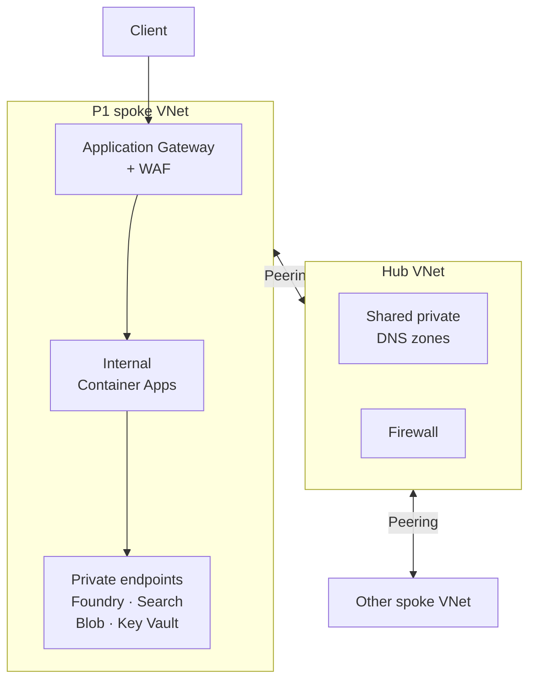

# A valid identity still needs a network path

An API can hold the right credentials and still fail to reach its database. The hostname resolves to an
unreachable address, a packet rule blocks the connection, or the application has no route into the private
network. Adding another permission will not repair any of those failures.

The opposite mistake is quieter: a dependency remains reachable from the internet after the team draws it
inside a private boundary. Network design makes that boundary real. For each connection, identify who
initiates it, which hostname they use, where that name resolves and which controls permit the traffic.
Then check what the caller is authorised to do.

## How Azure builds the path \{#how-azure-builds-the-path}

An [Azure Virtual Network (VNet)](https://learn.microsoft.com/en-us/azure/virtual-network/virtual-networks-overview)
provides private address space and connectivity. A subnet allocates part of that space to a set of resources
or a service integration. Keep address ranges distinct from networks you intend to connect later; the
application's subnet, the endpoint subnet and the organisation's other networks must fit into one address plan.

A subnet is a place to apply controls, rather than an isolation policy by itself. A
[network security group (NSG)](https://learn.microsoft.com/en-us/azure/virtual-network/network-security-groups-overview)
contains inbound and outbound allow or deny rules. They match source and destination addresses, ports and
protocol. Azure evaluates lower priority numbers first and stops at the first match within that NSG.
The rules are stateful: a permitted outbound connection does not need a separate inbound rule for its reply.

An NSG can attach to a subnet or a network interface. When both have an NSG,
[traffic must pass both sets of rules](https://learn.microsoft.com/en-us/azure/virtual-network/network-security-group-how-it-works).
An allow on one does not cancel a deny on the other. The default rules allow traffic within the
`VirtualNetwork` service tag and outbound internet traffic before the final deny rules. Creating two subnets
therefore does not automatically prevent them communicating.

Azure supplies a [system route `0.0.0.0/0` → Internet](https://learn.microsoft.com/en-us/azure/virtual-network/virtual-networks-udr-overview),
but that route and an NSG allow do not ensure public connectivity. For new VNets created using
[API versions released after 31 March 2026](https://learn.microsoft.com/en-us/azure/virtual-network/ip-services/default-outbound-access),
subnets default to private (`defaultOutboundAccess=false`). VMs there need explicit egress to reach public
endpoints: a NAT gateway, Standard Load Balancer outbound rules, a public IP, or a firewall reached through a
user-defined route (UDR). Existing VNets are unchanged. Delegated PaaS subnets are exempt; their service
manages outbound connectivity.

Managed services add another boundary. A
[private endpoint](https://learn.microsoft.com/en-us/azure/private-link/private-endpoint-overview)
is a network interface with a private IP in your subnet, connected to a supported service through Azure
Private Link. The managed service continues to run on its own infrastructure. You gain a private point of
access to it; you have not moved the service into your subnet. Connection approval and the service's public
network access setting are separate checks. Creating the endpoint does not necessarily close public access.

A [service endpoint](https://learn.microsoft.com/en-us/azure/virtual-network/virtual-network-service-endpoints-overview)
works differently. It lets a supported service recognise traffic from an allowed subnet over the Azure
backbone. Configure the endpoint on the subnet and the network rule on the service. The service hostname
still resolves to a public IP; there is no private endpoint interface to address.

DNS completes the private path. A private DNS zone holds records resolvable through its
[VNet links](https://learn.microsoft.com/en-us/azure/dns/private-dns-virtual-network-links).
For Blob Storage, the private endpoint zone is
[`privatelink.blob.core.windows.net`](https://learn.microsoft.com/en-us/azure/private-link/private-endpoint-dns).
The application keeps using the normal storage hostname; the DNS chain resolves it to the endpoint's private
address. [Do not replace the application's hostname with the `privatelink` name](https://learn.microsoft.com/en-us/azure/storage/common/storage-private-endpoints).
Custom DNS needs suitable forwarding, and peering VNets does not itself link a private DNS zone. Check name
resolution from the actual caller's network, rather than only from an administrator's laptop.

The calling application needs its own connection to the VNet. PaaS mechanisms differ:
[App Service VNet integration is outbound](https://learn.microsoft.com/en-us/azure/app-service/overview-vnet-integration),
while private inbound access uses a separate private endpoint.
[Container Apps takes a customer VNet when its environment is created](https://learn.microsoft.com/en-us/azure/container-apps/networking),
using a subnet dedicated to that environment. An internal environment has no public endpoint. Decide the
application's inbound path and its path to dependencies separately.

At a larger scale, a [hub-and-spoke topology](https://learn.microsoft.com/en-us/azure/architecture/networking/architecture/hub-spoke)
puts shared connectivity, DNS forwarding and egress inspection in a hub VNet. Each workload has a spoke.
This is the production design sketch for P1; the lab does not deploy it:



Peering connects networks, but it is
[nontransitive](https://learn.microsoft.com/en-us/azure/virtual-network/virtual-networks-faq): connecting
each spoke to the hub does not connect the spokes to each other. Nor does a hub firewall automatically
inspect every packet. Routes must direct the intended traffic through it. A single small service may need
only one VNet; adopt a hub when shared connectivity or central operations justify it.

Hub peering is not an isolation boundary: the
[`VirtualNetwork` tag includes peered VNets and connected on-premises prefixes](https://learn.microsoft.com/en-us/azure/virtual-network/service-tags-overview).
Azure's [NSG diagnosis guide confirms the peering expansion](https://learn.microsoft.com/en-us/azure/virtual-network/diagnose-network-traffic-filter-problem).
Default allows can therefore permit spoke-to-spoke traffic wherever routing supplies a path. Shared DNS
zones are managed with the hub and linked to the networks that need resolution; peering alone is insufficient.

## Choose the boundary before the product \{#choosing-boundaries}

Start with the required reachability. “Only our application network may contact this dependency” is a
different requirement from “only this identity may read its data”. Write both down before choosing an endpoint.

| Dependency access | Use when | Avoid or reconsider when |
|---|---|---|
| Public endpoint with token authentication | A lab or workload permits public reachability and enforces identity and data permissions. | The requirement explicitly prohibits public network access. |
| Service endpoint plus service network rules | A supported service should accept selected Azure subnets through its public endpoint. | You need a private destination IP or private access from connected on-premises clients. |
| Private endpoint plus private DNS | Callers need a private destination for a supported service. | Nobody owns DNS, client connectivity or the added cost; the endpoint alone will not complete the design. |

NSGs filter packets; they do not inspect an HTTP path or recognise an application user. A web application
firewall (WAF) inspects web requests, while the API still authenticates callers and checks permissions.
For ingress—the traffic arriving at your application—choose by protocol and geographical scope, using
[Azure's application delivery guide](https://learn.microsoft.com/en-us/azure/networking/design-guide/app-delivery):

| Entry point | What it handles | When not to use it |
|---|---|---|
| Azure Front Door | Global HTTP(S) edge routing, origin health and caching; WAF capabilities depend on the chosen tier. | You need raw TCP/UDP forwarding or only a simple regional lab endpoint. |
| Application Gateway | Regional HTTP(S) reverse proxy with TLS termination and host/path routing; choose a WAF configuration for web inspection. | Your requirement is global edge routing or transport-only balancing. |
| Azure Load Balancer | TCP/UDP flow distribution and health probes, without HTTP routing or WAF inspection. | You need URL routing or a web security policy. |

These services solve different problems; placing all three in front of a small API needs a specific reason.
Front Door's connection to an origin also needs scrutiny: its
[Private Link origin capability uses Premium](https://learn.microsoft.com/en-us/azure/frontdoor/billing).
A public edge does not imply that the backend must remain publicly reachable.

Typical failures occur between these choices. DNS still returns the public address after public
access is disabled; an operator lacks a route into the VNet; or a broad deny rule blocks the hosting
platform's required traffic. For private endpoints, also check the
[subnet's network policies before relying on NSG enforcement](https://learn.microsoft.com/en-us/azure/private-link/disable-private-endpoint-network-policy).
Debug in connection order: resolve the name, check the route and packet filters, then inspect the token and
service permissions. Widening access before locating the failure can conceal the original mistake.

## What this changes for the RAG service \{#in-an-ai-workload}

P1 is an ASP.NET Core minimal API on Container Apps: retrieve relevant documents, call a Foundry model
deployment and return an answer with citations. The
[retrieval lesson](/rag-agents/part-1-rag/retrieval/) owns relevance and document access filtering.
Networking determines which systems can be contacted, without deciding which documents an individual user
may see.

For a regional production deployment, the proposed request path is: client → public Application Gateway
with WAF → internal Container Apps environment → dependency private endpoints. Microsoft documents the
[Application Gateway/internal Container Apps combination](https://learn.microsoft.com/en-us/azure/container-apps/waf-app-gateway),
including private backend DNS configuration. Place the gateway in its own subnet, keep the Container Apps
environment subnet exclusive to that service, and allocate another subnet for dependency endpoints.
Define permitted flows between them instead of treating the whole spoke as trusted.

For P1, use an internal workload-profiles environment. Container Apps'
[network type cannot change after environment creation](https://learn.microsoft.com/en-us/azure/container-apps/networking),
so moving from the lab's default Azure network to this topology requires recreating the environment.
The compute lesson owns environment provisioning details.

The API's outbound calls would use separate private connections to
[Microsoft Foundry](https://learn.microsoft.com/en-us/azure/foundry/how-to/configure-private-link),
[Azure AI Search](https://learn.microsoft.com/en-us/azure/search/service-create-private-endpoint),
[Blob Storage](https://learn.microsoft.com/en-us/azure/storage/common/storage-private-endpoints) and
[Key Vault](https://learn.microsoft.com/en-us/azure/key-vault/general/private-link-service).
Give each dependency the corresponding DNS records, verify access from the API, then disable its public
access as required. The API's
[managed identity still needs the appropriate service permissions](https://learn.microsoft.com/en-us/azure/container-apps/managed-identity).

Include service-to-service paths: a Search indexer → private Blob through a
[shared private link](https://learn.microsoft.com/en-us/azure/search/search-indexer-howto-access-private),
and, if agents are added, Foundry → Search through Search's private endpoint.
[Foundry's isolation guidance](https://learn.microsoft.com/en-us/azure/foundry/how-to/configure-private-link)
requires indexer `executionEnvironment` to be `"Private"` when ingestion crosses private endpoints;
otherwise multitenant execution can fail silently and leave an empty index.

Draw the operational paths too. A document uploader must reach Blob and Search; a deployment job that tests
private data endpoints needs network connectivity to them. GitHub Actions
[OIDC removes the stored Azure credential](https://learn.microsoft.com/en-us/azure/developer/github/connect-from-azure-openid-connect),
but does not supply that connectivity. Preserve Application Insights delivery as you restrict egress;
[private Azure Monitor ingestion has its own Private Link design](https://learn.microsoft.com/en-us/azure/azure-monitor/fundamentals/private-link-security).
Record these paths alongside the Bicep and `azd` deployment design, so a later network change does not leave
the service deployable but impossible to populate or diagnose.

The course lab keeps public endpoints with keyless authentication because its learning budget is small.
[Private endpoints have hourly and data-processing charges](https://azure.microsoft.com/en-us/pricing/details/private-link/);
[Front Door has a base fee](https://learn.microsoft.com/en-us/azure/frontdoor/billing), and
[Application Gateway v2 has fixed and capacity charges](https://learn.microsoft.com/en-us/azure/application-gateway/understanding-pricing).
Search private endpoints also require
[Basic or higher](https://learn.microsoft.com/en-us/azure/search/service-create-private-endpoint).
The production topology is therefore a design exercise here. Public reachability does not mean anonymous
data access: retain token authentication, narrow data permissions and API caller authorisation.

A private topology also cannot stop an authorised API from sending retrieved text to the wrong destination.
Review egress destinations and tool permissions alongside the
[guardrails lesson](/rag-agents/part-1-rag/cross-cutting/guardrails/). Network controls limit available paths;
the application must still enforce what may travel along them.

## Try it \{#try-it}

Add the proposed production paths above to P1's design notes, including the uploader, deployment checks and
telemetry. Mark the lab's public endpoints as a deliberate budget choice. If you have no subscription yet,
stop with that design artefact; provisioning is optional.

With an active subscription and permission to create resource groups and networking resources, use a local
Bash terminal with Azure CLI installed. These commands were checked against the current CLI reference;
**they have not yet been run against a live Azure subscription**. The expected results below follow the
documentation, rather than an observed deployment.

Sign in and select your subscription using the
[`login`](https://learn.microsoft.com/en-us/cli/azure/reference-index?view=azure-cli-latest#az-login) and
[`account set`](https://learn.microsoft.com/en-us/cli/azure/account?view=azure-cli-latest#az-account-set) commands:

```bash
az login
p1_subscription='YOUR_SUBSCRIPTION_ID' # Replace with your subscription ID.
az account set --subscription "$p1_subscription"
p1_rg="rg-p1-network-$RANDOM-$RANDOM"
p1_location=westeurope
```

Create an empty address layout with a subnet-associated NSG. The `/27` subnet meets the
[workload-profiles minimum and is delegated to `Microsoft.App/environments`](https://learn.microsoft.com/en-us/azure/container-apps/custom-virtual-networks);
the legacy Consumption-only minimum is `/23`. This exercise creates no Container Apps environment and
does not size a production workload. References:
[`group create`](https://learn.microsoft.com/en-us/cli/azure/group?view=azure-cli-latest#az-group-create),
[`nsg create`](https://learn.microsoft.com/en-us/cli/azure/network/nsg?view=azure-cli-latest#az-network-nsg-create),
[`vnet create`](https://learn.microsoft.com/en-us/cli/azure/network/vnet?view=azure-cli-latest#az-network-vnet-create),
[`subnet create`](https://learn.microsoft.com/en-us/cli/azure/network/vnet/subnet?view=azure-cli-latest#az-network-vnet-subnet-create).

```bash
az group create --name "$p1_rg" --location "$p1_location" --output none
az network nsg create --resource-group "$p1_rg" --name nsg-p1-app \
  --location "$p1_location" --output none
az network vnet create --resource-group "$p1_rg" --name vnet-p1 \
  --location "$p1_location" --address-prefixes 10.42.0.0/16 --output none
az network vnet subnet create --resource-group "$p1_rg" \
  --vnet-name vnet-p1 --name snet-app --address-prefixes 10.42.0.0/27 \
  --delegations Microsoft.App/environments --network-security-group nsg-p1-app --output none
```

Inspect the [subnet association](https://learn.microsoft.com/en-us/cli/azure/network/vnet/subnet?view=azure-cli-latest#az-network-vnet-subnet-show)
and [include the default NSG rules](https://learn.microsoft.com/en-us/cli/azure/network/nsg/rule?view=azure-cli-latest#az-network-nsg-rule-list):

```bash
az network vnet subnet show --resource-group "$p1_rg" \
  --vnet-name vnet-p1 --name snet-app \
  --query networkSecurityGroup.id --output tsv
az network nsg rule list --resource-group "$p1_rg" \
  --nsg-name nsg-p1-app --include-default --output table
```

Expect the association ID to end in `/networkSecurityGroups/nsg-p1-app`, and the
[six default rules](https://learn.microsoft.com/en-us/azure/virtual-network/network-security-groups-overview):
`AllowVNetInBound`, `AllowAzureLoadBalancerInBound`, `DenyAllInBound`, `AllowVnetOutBound`,
`AllowInternetOutBound` and `DenyAllOutBound`.
Explain why those defaults do not isolate application tiers. This inspects configuration;
[`list-effective-nsg` requires a NIC on a running VM](https://learn.microsoft.com/en-us/azure/virtual-network/diagnose-network-traffic-filter-problem),
which this exercise does not create. It does not prove application connectivity.

**Cost:** Free for this empty layout:
[VNets have no usage charge](https://learn.microsoft.com/en-us/azure/virtual-network/virtual-networks-overview#pricing),
and [NSGs have no additional charge](https://learn.microsoft.com/en-us/azure/virtual-machines/overview).
The commands create no compute, private endpoints, DNS zones, peerings or paid ingress services.

**Teardown:** In the same terminal, delete the disposable group with
[`group delete`](https://learn.microsoft.com/en-us/cli/azure/group?view=azure-cli-latest#az-group-delete).
Keep your design notes for P1.

```bash
az group delete --name "$p1_rg" --yes
```

## What to take away \{#what-to-take-away}

- Check DNS, routing, packet filtering and authorisation separately. A permission grant cannot repair a missing network path.
- A private endpoint supplies a private destination; a service endpoint retains the service's public address. Public access settings need their own check.
- Choose ingress by protocol and scope, and account for uploaders, CI and telemetry before closing access.
- Sketch P1's private production topology, but keep the course lab public with keyless access to meet its budget.

**[New terms](../glossary.md#networking)**: VNet, subnet, NSG, private endpoint, service endpoint, private DNS zone, VNet integration, ingress, egress, hub-and-spoke, VNet peering, WAF.

## Sources \{#sources}

Verified as of 2026-10-17.

- **Network boundaries:** [Virtual Network](https://learn.microsoft.com/en-us/azure/virtual-network/virtual-networks-overview), [NSG rules](https://learn.microsoft.com/en-us/azure/virtual-network/network-security-groups-overview), [NSG evaluation](https://learn.microsoft.com/en-us/azure/virtual-network/network-security-group-how-it-works), [hub-and-spoke](https://learn.microsoft.com/en-us/azure/architecture/networking/architecture/hub-spoke), [VNet FAQ](https://learn.microsoft.com/en-us/azure/virtual-network/virtual-networks-faq).
- **Routing and defaults:** [System routes](https://learn.microsoft.com/en-us/azure/virtual-network/virtual-networks-udr-overview), [default outbound access](https://learn.microsoft.com/en-us/azure/virtual-network/ip-services/default-outbound-access), [service tags](https://learn.microsoft.com/en-us/azure/virtual-network/service-tags-overview), [VNet scope and address planning](https://learn.microsoft.com/en-us/azure/virtual-network/concepts-and-best-practices).
- **Endpoints and DNS:** [Private endpoints](https://learn.microsoft.com/en-us/azure/private-link/private-endpoint-overview), [service endpoints](https://learn.microsoft.com/en-us/azure/virtual-network/virtual-network-service-endpoints-overview), [private endpoint DNS zones](https://learn.microsoft.com/en-us/azure/private-link/private-endpoint-dns), [private DNS VNet links](https://learn.microsoft.com/en-us/azure/dns/private-dns-virtual-network-links), [private endpoint network policies](https://learn.microsoft.com/en-us/azure/private-link/disable-private-endpoint-network-policy).
- **Application networking:** [App Service integration](https://learn.microsoft.com/en-us/azure/app-service/overview-vnet-integration), [Container Apps networking](https://learn.microsoft.com/en-us/azure/container-apps/networking), [Container Apps VNet setup](https://learn.microsoft.com/en-us/azure/container-apps/vnet-custom), [application delivery choices](https://learn.microsoft.com/en-us/azure/networking/design-guide/app-delivery), [Application Gateway with Container Apps](https://learn.microsoft.com/en-us/azure/container-apps/waf-app-gateway).
- **Subnet and indexer configuration:** [Container Apps subnet requirements](https://learn.microsoft.com/en-us/azure/container-apps/custom-virtual-networks), [Search shared private links](https://learn.microsoft.com/en-us/azure/search/search-indexer-howto-access-private).
- **P1 dependencies and operations:** [Foundry isolation](https://learn.microsoft.com/en-us/azure/foundry/how-to/configure-private-link), [Search private access](https://learn.microsoft.com/en-us/azure/search/service-create-private-endpoint), [Storage private access](https://learn.microsoft.com/en-us/azure/storage/common/storage-private-endpoints), [Key Vault Private Link](https://learn.microsoft.com/en-us/azure/key-vault/general/private-link-service), [Container Apps managed identity](https://learn.microsoft.com/en-us/azure/container-apps/managed-identity), [GitHub Actions OIDC](https://learn.microsoft.com/en-us/azure/developer/github/connect-from-azure-openid-connect), [Azure Monitor Private Link](https://learn.microsoft.com/en-us/azure/azure-monitor/fundamentals/private-link-security).
- **Costs:** [Virtual Network pricing](https://azure.microsoft.com/en-us/pricing/details/virtual-network/), [NSG cost in the VM component table](https://learn.microsoft.com/en-us/azure/virtual-machines/overview), [Private Link pricing](https://azure.microsoft.com/en-us/pricing/details/private-link/), [Front Door billing](https://learn.microsoft.com/en-us/azure/frontdoor/billing), [Application Gateway pricing model](https://learn.microsoft.com/en-us/azure/application-gateway/understanding-pricing).
- **CLI and inspection:** [`az login`](https://learn.microsoft.com/en-us/cli/azure/reference-index?view=azure-cli-latest#az-login), [`az account`](https://learn.microsoft.com/en-us/cli/azure/account?view=azure-cli-latest), [`az group`](https://learn.microsoft.com/en-us/cli/azure/group?view=azure-cli-latest), [`az network vnet`](https://learn.microsoft.com/en-us/cli/azure/network/vnet?view=azure-cli-latest), [`az network vnet subnet`](https://learn.microsoft.com/en-us/cli/azure/network/vnet/subnet?view=azure-cli-latest), [`az network nsg`](https://learn.microsoft.com/en-us/cli/azure/network/nsg?view=azure-cli-latest), [`az network nsg rule`](https://learn.microsoft.com/en-us/cli/azure/network/nsg/rule?view=azure-cli-latest), [effective security rule diagnostics](https://learn.microsoft.com/en-us/azure/virtual-network/diagnose-network-traffic-filter-problem).
