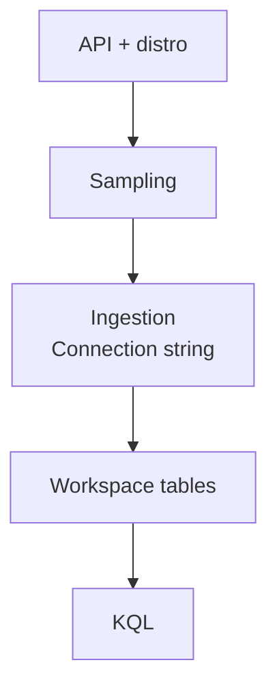

# A running service must be able to explain a slow request

The API is up, its health check passes, and a user still waits too long for an answer. A successful response
hides several possible stories: the application retried a failing dependency, retrieval took most of the
request, or the server spent time waiting somewhere you never measured. A console message saying “request
completed” cannot distinguish them. You need evidence about the work inside the request, collected before
someone asks what happened.

Observability starts with questions you expect to answer: which operation became slower, which downstream
call failed, and whether the change began with a deployment. Collecting everything is an expensive substitute
for choosing those questions. For a RAG service, there is another boundary to keep clear: knowing that an
answer arrived successfully does not establish that its citations support it.

## How it works on Azure \{#how-it-works-on-azure}

[Azure Monitor](https://learn.microsoft.com/en-us/azure/azure-monitor/fundamentals/overview) is the platform
that collects, analyzes and acts on telemetry. Application Insights is its application performance monitoring
feature. Think of Application Insights as the application view: incoming requests, outgoing dependencies,
failures and the relationships between them. You use it to investigate the behaviour of a service, rather
than starting from the infrastructure hosting it.

A **Log Analytics workspace** is the data store for log and trace tables. **Log Analytics** is the portal tool
where you query that data using Kusto Query Language, or KQL. These names describe different things: you
provision the workspace, then open the query tool to investigate its contents. An Azure Monitor workspace
[holds Prometheus and OpenTelemetry metrics, queried with PromQL](https://learn.microsoft.com/en-us/azure/azure-monitor/fundamentals/overview);
this lesson creates a Log Analytics workspace.

With [workspace-based Application Insights](https://learn.microsoft.com/en-us/azure/azure-monitor/app/create-workspace-resource),
application telemetry is stored in the linked Log Analytics workspace. Ingestion and retention are billed
there too. Creating the two resources establishes a destination; the application must still produce and
export telemetry. A missing request row can mean that instrumentation or export is broken, rather than that
no request happened.



Use this path to investigate missing rows: was the operation sampled out, did export target the right
[Application Insights connection string](https://learn.microsoft.com/en-us/azure/azure-monitor/app/opentelemetry-enable?tabs=aspnetcore),
and did the query select the right workspace tables?

**OpenTelemetry** supplies the instrumentation and export conventions. A distribution bundles an SDK,
instrumentation libraries and configuration for a destination. The
[Azure Monitor OpenTelemetry distribution for ASP.NET Core](https://learn.microsoft.com/en-us/dotnet/api/overview/azure/monitor.opentelemetry.aspnetcore-readme?view=azure-dotnet)
includes tracing for incoming ASP.NET Core requests and outgoing `HttpClient` calls, alongside metrics and
application logs. That gives you service behaviour without writing a log statement around every HTTP call.
It does not automatically describe your retrieval decisions or assess an answer.

Package guidance needs a date. Microsoft's
[current setup instructions](https://learn.microsoft.com/en-us/azure/azure-monitor/app/opentelemetry-enable?tabs=aspnetcore)
recommend Microsoft OpenTelemetry Distro for new .NET applications and say existing Azure Monitor OpenTelemetry
Distro users need no change. They also say not to initialize both distributions in one application. Choose
the distribution in [P1's instrumentation step](../part-5-projects/rag-service.md#milestones); this exercise provisions their shared destination.

## Choose what you need to investigate \{#choosing-and-tradeoffs}

Start with the distinction between an incoming request and a dependency call. One user request may make
several outgoing calls, including retries. A request can succeed after a dependency fails. If you count both
as “requests,” your traffic total and failure rate stop describing the user's experience.

| Choice | Use it for | When it is a poor fit |
|---|---|---|
| Request and dependency telemetry | Endpoint latency, failed calls and where time went | Proving that a generated answer is correct |
| Application log records | A specific event or decision that generic HTTP instrumentation cannot explain | Dumping every document, prompt and response |
| One shared workspace | Related telemetry you investigate together | Requirements that demand separate residency or administrative boundaries |
| Separate workspaces | Deliberate data-location, access or ownership boundaries | Splitting every component by habit, then needing cross-workspace investigations |

[Workspace architecture](https://learn.microsoft.com/en-us/azure/azure-monitor/logs/workspace-design) is a
boundary decision. For the learning project, one workspace is enough. In a larger service, decide who may
read the data and where it must live before consolidating it. Telemetry can contain application data, so
convenient querying is only one requirement.

Volume is the next choice. Repeated informational messages and large payloads consume ingestion without
necessarily explaining another failure. Prefer operation names, durations, result codes and deliberately
chosen diagnostic fields. Do not put access tokens or raw user questions into routine logs. Even when the
source documents are public, the person asking a question may reveal something private.

Sampling reduces trace volume by retaining only some operations. For .NET, both the
[Azure Monitor Distro](https://learn.microsoft.com/en-us/dotnet/api/overview/azure/monitor.opentelemetry.aspnetcore-readme?view=azure-dotnet#customizing-sampling-behavior)
and the [Microsoft OpenTelemetry Distro with Azure Monitor export](https://learn.microsoft.com/en-us/azure/azure-monitor/app/opentelemetry-sampling)
default to rate-limited sampling at **five traces per second**. The Microsoft distro for .NET also enables
trace-based log sampling by default, dropping logs tied to unsampled traces. Sampling therefore matters even
if nobody configured it: use `ItemCount` weights in queries. You trade detail for cost; individual failed
requests and their logs may be absent. Verify what survives before trusting a quiet failure chart. Sampled
telemetry is unsuitable as the sole record of actions you must account for individually.

Ingestion and retention solve different problems. Ingestion pays for collecting data; retention determines
how long you can investigate it. Azure Monitor Logs uses
[volume-based ingestion and retention pricing](https://learn.microsoft.com/en-us/azure/azure-monitor/logs/cost-logs),
with regional rates. Shortening retention does not undo yesterday's ingestion. Before extending it, ask whether
you need detailed interactive investigation for that entire period, or only occasional historical access.

The [retention policy](https://learn.microsoft.com/en-us/azure/azure-monitor/logs/data-retention-configure)
gives Application Insights tables, including `AppRequests` and `AppDependencies`, 90 days by default without
a retention charge. You can configure those tables individually. That allowance does not make their ingestion
free, and setting a workspace default does not establish the lifetime of every table. Check the effective
table settings when making a retention promise.

A [daily cap](https://learn.microsoft.com/en-us/azure/azure-monitor/logs/daily-cap) is a backup measure for
unexpected ingestion spikes. Reaching it stops collection for affected tables until reset, leaving a gap
exactly when something may be going wrong. Collection can exceed the threshold, and excess data is billed.
Use filtering and sampling to control routine volume; do not treat the cap as an exact spending limit.

## In an AI workload \{#in-an-ai-workload}

P1 will run an ASP.NET Core minimal API on Azure Container Apps. It will retrieve from Azure AI Search,
use a Foundry model deployment, and return citations over a small public document set. Blob Storage holds
the source documents. The telemetry resources belong beside that infrastructure in Bicep so the same
destination can be recreated with the service.

Suppose the answer endpoint becomes slow while returning successful responses. Start with the request
population, then inspect dependencies in the same period. Slow outgoing calls suggest a different next
investigation from slow requests whose measured dependencies remain fast. Do not add all dependency durations
and call the result request duration: calls can overlap, and the application can do other work between them.
Use correlation when you need to investigate one operation rather than a population.

The underlying [RAG observability lesson](/rag-agents/part-1-rag/cross-cutting/observability/) explains why
pipeline evidence matters. Here, keep the initial goal narrower: establish whether requests and outgoing
calls are visible. Model-call spans, token accounting and evaluation belong in Part III's Evaluation and
tracing lesson. Generic HTTP telemetry alone cannot tell you whether Search returned the right passage.

Choose release signals before deployment. For P1, request failures and latency should sit beside a measure
of answer quality from evaluation. The [AI SDLC rollout lesson](/ai-sdlc/part-4-platform/observability-rollout)
explains how those signals guide a release. A successful HTTP response carrying unsupported citations is a
quality failure even when the infrastructure dashboard looks healthy.

## Try it \{#try-it}

Create P1's telemetry destination in a dedicated lab resource group. Keep the Bicep file for later integration
into the project's infrastructure; tear down the lab resources after inspection. You need Azure CLI, its
Bicep tooling, an active subscription and permission to deploy these resources.

The Azure commands below were checked against the live CLI reference and have **not yet been run against a
live subscription**: no subscription was available for this lesson. The KQL was checked against the documented
schemas and operators, not executed against live data. The Bicep example was compiled with Bicep CLI 0.48.1;
compilation does not verify subscription permissions or service availability.

Save this as `observability.bicep`. The pinned resource APIs are
[workspaces `2023-09-01`](https://learn.microsoft.com/en-us/azure/templates/microsoft.operationalinsights/2023-09-01/workspaces)
and [components `2020-02-02`](https://learn.microsoft.com/en-us/azure/templates/microsoft.insights/2020-02-02/components).
The workspace uses pay-as-you-go (`PerGB2018`) and a 30-day workspace retention default; the Application Insights
table policy described above still needs separate attention.

```bicep
param location string = resourceGroup().location

resource logs 'Microsoft.OperationalInsights/workspaces@2023-09-01' = {
  name: 'rag-observability-logs'
  location: location
  properties: {
    sku: {
      name: 'PerGB2018'
    }
    retentionInDays: 30
  }
}

resource insights 'Microsoft.Insights/components@2020-02-02' = {
  name: 'rag-observability-insights'
  location: location
  kind: 'web'
  properties: {
    Application_Type: 'web'
    WorkspaceResourceId: logs.id
  }
}

output workspaceResourceId string = logs.id
output applicationInsightsResourceId string = insights.id
```

In Bash, replace the subscription placeholder and run from the directory containing the file. Use a fresh
lab group name if the example name already contains other work. The commands use the
[login](https://learn.microsoft.com/en-us/cli/azure/reference-index?view=azure-cli-latest#az-login),
[account](https://learn.microsoft.com/en-us/cli/azure/account?view=azure-cli-latest#az-account-set),
[resource group](https://learn.microsoft.com/en-us/cli/azure/group?view=azure-cli-latest) and
[deployment](https://learn.microsoft.com/en-us/cli/azure/deployment/group?view=azure-cli-latest) references.

```bash
az login
AZURE_SUBSCRIPTION_ID="<id>"
az account set --subscription "$AZURE_SUBSCRIPTION_ID"

lab_group='rg-p1-observability-lab'
lab_region='westeurope'
az group create \
  --subscription "$AZURE_SUBSCRIPTION_ID" \
  --name "$lab_group" --location "$lab_region" \
  --tags project=p1-rag environment=dev owner=learner
az deployment group create \
  --subscription "$AZURE_SUBSCRIPTION_ID" \
  --name p1-observability \
  --resource-group "$lab_group" \
  --template-file observability.bicep

az deployment group show \
  --subscription "$AZURE_SUBSCRIPTION_ID" \
  --name p1-observability \
  --resource-group "$lab_group" \
  --query properties.outputs --output json
```

On a successful [deployment](https://learn.microsoft.com/en-us/azure/azure-resource-manager/bicep/deploy-cli),
expect provisioning state `Succeeded` and outputs identifying the workspace and Application Insights resource.
In Application Insights, check that the associated workspace is `rag-observability-logs`. Its Overview page
also provides the connection string for the later application configuration step.

Open **Logs in the Log Analytics workspace** and use [KQL mode](https://learn.microsoft.com/en-us/azure/azure-monitor/logs/log-analytics-tutorial). This scope uses
[`AppRequests`](https://learn.microsoft.com/en-us/azure/azure-monitor/reference/tables/apprequests) and
[`AppDependencies`](https://learn.microsoft.com/en-us/azure/azure-monitor/reference/tables/appdependencies);
examples using the Application Insights compatibility schema may instead say `requests` and `dependencies`.
Once P1 is instrumented and serving traffic, this query estimates request and dependency counts, failures
and p95 durations:

```kusto
union withsource=Signal AppRequests, AppDependencies
| where TimeGenerated > ago(1h)
| summarize Items=sum(ItemCount),
            Failed=sumif(ItemCount, Success == false),
            P95Ms=percentilew(DurationMs, ItemCount, 95)
    by Signal, Name
| order by Failed desc
```

[`union`](https://learn.microsoft.com/en-us/kusto/query/union-operator?view=microsoft-fabric) keeps both tables
in one result, with `Signal` distinguishing them. `ItemCount` represents how many telemetry items a stored
sample stands for; [`sumif`](https://learn.microsoft.com/en-us/kusto/query/sumif-aggregation-function?view=microsoft-fabric)
adds those weights for failures. Weights can vary with load under rate-limited sampling.
[`percentilew`](https://learn.microsoft.com/en-us/kusto/query/percentilesw-aggregation-function?view=microsoft-fabric)
uses `ItemCount` to estimate p95 duration in milliseconds over the represented population. These estimates
cannot recover discarded details or compensate for broken export; sparse data still limits investigation.

This provisioning exercise supplies no application traffic. Do not expect populated tables;
[a table without application data may not be visible](https://learn.microsoft.com/en-us/azure/azure-monitor/logs/log-analytics-tutorial).
After instrumentation, the
[setup guide](https://learn.microsoft.com/en-us/azure/azure-monitor/app/opentelemetry-enable?tabs=aspnetcore)
says telemetry can take a few minutes to appear. Check the export configuration, workspace and query time
range before interpreting an empty result as healthy behaviour.

**Cost:** Creating an empty pay-as-you-go workspace is
[free until data collection begins](https://learn.microsoft.com/en-us/azure/azure-monitor/logs/quick-create-workspace).
This exercise attaches no producer and enables no paid tests or alerts. Once P1 sends telemetry, budget for
[ingestion and retention](https://azure.microsoft.com/en-us/pricing/details/monitor/); Analytics queries within
analytics retention are included. Check the regional rate before enabling collection, against the course's
USD 10 monthly learning budget.

**Teardown:** In the same Bash session, delete only the dedicated lab group, including both telemetry
resources. Keep the local Bicep file so the project can recreate them. Review the group name at the
confirmation prompt, then check that the group is gone:

```bash
az group delete --subscription "$AZURE_SUBSCRIPTION_ID" --name "$lab_group"
az group exists --subscription "$AZURE_SUBSCRIPTION_ID" --name "$lab_group" --output json
```

Expect [`false`](https://learn.microsoft.com/en-us/cli/azure/get-started-tutorial-1-prepare-environment?tabs=bash&view=azure-cli-latest).
The workspace remains [soft-deleted for 14 days](https://learn.microsoft.com/en-us/azure/azure-monitor/logs/delete-workspace).
Within that window, recreating the group and redeploying the kept Bicep with the same subscription, group,
workspace name and region recovers the old workspace and data. Reusing that workspace name and group
in a different region instead [produces an error](https://learn.microsoft.com/en-us/azure/azure-monitor/logs/quick-create-workspace#troubleshooting).

## What to take away \{#what-to-take-away}

- Application Insights provides the application view; its linked Log Analytics workspace stores the telemetry
  and carries ingestion and retention billing.
- Provisioning a telemetry destination is one step. Instrumentation, export and traffic are needed before
  request and dependency queries can explain behaviour.
- Keep requests and dependencies separate when counting failures. Sampling and missing data limit what the
  stored records can prove.
- Choose collection volume and retention deliberately. A daily cap can leave gaps and allow billed overage.
- Successful HTTP responses still need a separate answer-quality check.

**[New terms](../glossary.md#observability)**: observability, Azure Monitor, Log Analytics workspace, Log Analytics, Application Insights, OpenTelemetry distribution, request telemetry, dependency telemetry, KQL, ingestion, retention, sampling, daily cap.

## Sources \{#sources}

Verified as of 2026-10-17.

- **Platform and collection:** [Azure Monitor overview](https://learn.microsoft.com/en-us/azure/azure-monitor/fundamentals/overview), [Log Analytics overview](https://learn.microsoft.com/en-us/azure/azure-monitor/logs/log-analytics-overview), [Create and configure Application Insights](https://learn.microsoft.com/en-us/azure/azure-monitor/app/create-workspace-resource), [Azure Monitor Distro for .NET](https://learn.microsoft.com/en-us/dotnet/api/overview/azure/monitor.opentelemetry.aspnetcore-readme?view=azure-dotnet), [Current OpenTelemetry setup](https://learn.microsoft.com/en-us/azure/azure-monitor/app/opentelemetry-enable?tabs=aspnetcore).
- **Choices and cost:** [Workspace architecture](https://learn.microsoft.com/en-us/azure/azure-monitor/logs/workspace-design), [Sampling](https://learn.microsoft.com/en-us/azure/azure-monitor/app/opentelemetry-sampling), [Logs cost calculations](https://learn.microsoft.com/en-us/azure/azure-monitor/logs/cost-logs), [Retention](https://learn.microsoft.com/en-us/azure/azure-monitor/logs/data-retention-configure), [Daily cap](https://learn.microsoft.com/en-us/azure/azure-monitor/logs/daily-cap), [Workspace creation](https://learn.microsoft.com/en-us/azure/azure-monitor/logs/quick-create-workspace), [Workspace deletion and recovery](https://learn.microsoft.com/en-us/azure/azure-monitor/logs/delete-workspace), [Azure Monitor pricing](https://azure.microsoft.com/en-us/pricing/details/monitor/).
- **Resources and commands:** [Workspace API](https://learn.microsoft.com/en-us/azure/templates/microsoft.operationalinsights/2023-09-01/workspaces), [Application Insights API](https://learn.microsoft.com/en-us/azure/templates/microsoft.insights/2020-02-02/components), [CLI login](https://learn.microsoft.com/en-us/cli/azure/reference-index?view=azure-cli-latest#az-login), [CLI account](https://learn.microsoft.com/en-us/cli/azure/account?view=azure-cli-latest#az-account-set), [CLI groups](https://learn.microsoft.com/en-us/cli/azure/group?view=azure-cli-latest), [CLI environment and existence check](https://learn.microsoft.com/en-us/cli/azure/get-started-tutorial-1-prepare-environment?tabs=bash&view=azure-cli-latest), [CLI deployments](https://learn.microsoft.com/en-us/cli/azure/deployment/group?view=azure-cli-latest), [Deploy Bicep with CLI](https://learn.microsoft.com/en-us/azure/azure-resource-manager/bicep/deploy-cli).
- **Queries:** [AppRequests schema](https://learn.microsoft.com/en-us/azure/azure-monitor/reference/tables/apprequests), [AppDependencies schema](https://learn.microsoft.com/en-us/azure/azure-monitor/reference/tables/appdependencies), [Union](https://learn.microsoft.com/en-us/kusto/query/union-operator?view=microsoft-fabric), [Conditional sum](https://learn.microsoft.com/en-us/kusto/query/sumif-aggregation-function?view=microsoft-fabric), [Weighted percentiles](https://learn.microsoft.com/en-us/kusto/query/percentilesw-aggregation-function?view=microsoft-fabric).
- **Query interface and project services:** [Log Analytics tutorial](https://learn.microsoft.com/en-us/azure/azure-monitor/logs/log-analytics-tutorial), [Container Apps](https://learn.microsoft.com/en-us/azure/container-apps/overview), [Azure AI Search](https://learn.microsoft.com/en-us/azure/search/search-what-is-azure-search), [Microsoft Foundry](https://learn.microsoft.com/en-us/azure/foundry/what-is-foundry), [Blob Storage](https://learn.microsoft.com/en-us/azure/storage/blobs/storage-blobs-overview).
