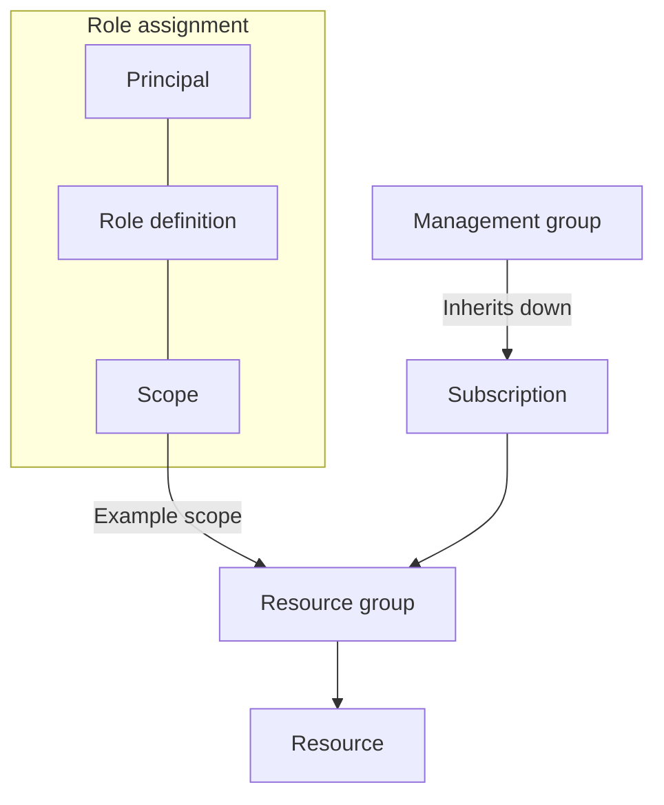

# A valid identity still needs permission to read the document

A RAG service can obtain a valid token and still fail to read a blob. Authentication establishes who is
calling; authorization decides whether that caller may perform this operation on this resource. Giving
the application a shared storage key can make the error disappear while giving it much more access than
the document read required.

For P1, the RAG service project, you need a more deliberate arrangement: the running API reads its
dependencies, ingestion updates the corpus, and CI deploys the application. Each workload gets an
identity and permissions suited to its job. Keyless access removes stored keys from those connections;
it leaves the permission design for you to do. The [secrets lesson](/ai-sdlc/part-4-platform/secrets/)
explains why keeping credential values out of the repository and coding agent's context matters.

## How Azure grants access \{#azure-mechanism}

An **Azure RBAC role assignment** joins a principal, a role definition and a scope: *who may do what,
where*. The principal can be a user, group, service principal or managed identity. A role definition
lists permitted operations; the scope identifies the resources to which the assignment applies.
[Azure RBAC](https://learn.microsoft.com/en-us/azure/role-based-access-control/overview)
evaluates those permissions when a caller requests an operation.

Scopes form a hierarchy: management group → subscription → resource group → resource. Assignments
flow down it through inheritance. Assigning `Reader` on one resource does not remove a `Contributor`
grant inherited from the subscription. Allows accumulate, subject to deny assignments and applicable
conditions. A scope can also name a supported subresource, such as a blob container. Inspect the
[scope hierarchy](https://learn.microsoft.com/en-us/azure/role-based-access-control/scope-overview)
before calling a resource-level assignment least privilege.

The **control plane** manages resources; the **data plane** uses their contents. A storage account's
settings and a blob's contents belong to different permission surfaces. Role definitions distinguish
management operations through `Actions`/`NotActions` and data operations through
`DataActions`/`NotDataActions`. Resource ownership does not automatically grant direct blob reads with
an Entra token. But management permissions can expose service keys, and an `Owner` can grant access.
Review both permission surfaces using the
[role model](https://learn.microsoft.com/en-us/azure/role-based-access-control/role-definitions).

The application also needs a way to obtain tokens. [`DefaultAzureCredential`](https://learn.microsoft.com/en-us/dotnet/azure/sdk/authentication/credential-chains) is a preconfigured chain of
credential sources, including environment settings, workload identity, managed identity and developer
tools. Your local Azure CLI login can supply the developer identity. That convenience makes the chain
useful locally. Microsoft's guidance is to
[use deterministic credentials in production environments](https://learn.microsoft.com/en-us/dotnet/azure/sdk/authentication/best-practices#use-deterministic-credentials-in-production-environments):
select a specific credential such as `ManagedIdentityCredential` and reuse its instance. Another option
is `DefaultAzureCredential` with `AZURE_TOKEN_CREDENTIALS=ManagedIdentityCredential`, which
[selects only that credential in Azure.Identity 1.15.0 and later](https://learn.microsoft.com/en-us/dotnet/azure/sdk/authentication/credential-chains#use-a-specific-credential);
[1.16.0 and later also enable its production retry mode](https://learn.microsoft.com/en-us/dotnet/azure/sdk/authentication/best-practices#resilient-mode).

This illustrative C# fragment uses the stable `Azure.Identity` 1.17.2
[API shape](https://learn.microsoft.com/en-us/dotnet/api/azure.identity.managedidentityid?view=azure-dotnet).
It was **not compiled or run against Azure**; there is no buildable example project for it yet.
`isProduction` and `runtimeClientId` come from host configuration. Keep the resulting credential for
reuse when constructing service clients.

```csharp
using Azure.Core;
using Azure.Identity;

TokenCredential credential = isProduction
    ? new ManagedIdentityCredential(
        ManagedIdentityId.FromUserAssignedClientId(runtimeClientId))
    : new DefaultAzureCredential();
```

P1 uses a user-assigned identity so its grants survive host replacement; the
[Identity I lesson](./entra-id.md) owns the identity lifecycle choices. On
[Azure Container Apps](https://learn.microsoft.com/en-us/azure/container-apps/managed-identity),
you must attach that identity to the app as well as authorize it on dependencies. Selecting its client
ID in code does neither of those things.

GitHub CI uses a different token source. With
[workload identity federation](https://learn.microsoft.com/en-us/entra/workload-id/workload-identity-federation),
Entra trusts an external issuer, subject and audience. A matching GitHub OIDC token can be exchanged
for an Entra access token without a stored client secret. The federated identity credential records
that trust; RBAC separately grants the deployment identity its permissions.



## Choosing credentials and scopes \{#choices-and-tradeoffs}

Use a developer credential locally, a managed identity on a supported Azure host, and federation for an
external workload such as GitHub Actions. A shared key is a poor shortcut when the service supports
Entra authentication: possession of the key replaces the per-workload permission decision. Where a
dependency still needs a secret, keep it in the runtime secret-delivery path described in
[Secrets](/ai-sdlc/part-4-platform/secrets/).

| Credential choice | Choose when | Avoid when |
|---|---|---|
| `DefaultAzureCredential` | Local tool sign-ins, or a chain constrained to one production credential. | An unconstrained chain could select an unintended production identity. |
| Explicit `ManagedIdentityCredential` | A supported Azure host supplies the attached identity. | The workload runs outside a host that supports managed identity. |
| OIDC federation | An external workload has a trusted token issuer, as GitHub Actions does. | You cannot constrain and verify the issuer, subject and audience. |
| Stored secret | A dependency still requires one; deliver it at runtime. | The connection supports a suitable Entra token path. |

Separate deployment and runtime identities, but assess the permissions rather than trusting the names.
[`Contributor`](https://learn.microsoft.com/en-us/azure/role-based-access-control/built-in-roles/privileged)
can manage resources but cannot assign Azure RBAC roles. Within its scope it can still
[manage identities and federation](https://learn.microsoft.com/en-us/entra/workload-id/workload-identity-federation-create-trust-user-assigned-managed-identity)
or retrieve some service keys. It is therefore not strong isolation from runtime secrets.
Constrain deployment scope, protect the allowed branch or environment, and review workflow changes.

When access fails, check the actual caller, requested operation and effective scope before adding a
larger role. Inherited grants can explain unexpected success. A listed assignment may still be
propagating: Azure AI Search documents that managed-identity permission changes
[can take several hours](https://learn.microsoft.com/en-us/azure/search/search-security-rbac#troubleshooting),
because the managed identity infrastructure
[caches tokens](https://learn.microsoft.com/en-us/entra/identity/managed-identities-azure-resources/managed-identity-best-practice-recommendations#limitation-of-using-managed-identities-for-authorization). Network restrictions
and the service's authorization model are separate checks. Repeatedly widening RBAC will not fix a
blocked network path. The
[RBAC troubleshooting guide](https://learn.microsoft.com/en-us/azure/role-based-access-control/troubleshooting)
also covers newly created principals and replication failures.

## In an AI workload \{#ai-workload}

P1 uses a **Microsoft Foundry resource** for its model deployment. Its answering API needs reads and
inference. It does not need to replace the search index. The ingestion worker needs writes, so give it a separate identity and authorize those writes on its own
dependencies. Keeping those grants off the answering API limits what an application error can change.

| Runtime dependency | Role | Intended production scope and constraint |
|---|---|---|
| Public source documents in Blob Storage | [`Storage Blob Data Reader`](https://learn.microsoft.com/en-us/azure/role-based-access-control/built-in-roles/storage#storage-blob-data-reader) | The document container; permits blob reads and listing. |
| Retrieval in Azure AI Search | [`Search Index Data Reader`](https://learn.microsoft.com/en-us/azure/search/search-security-rbac) | The Search service here; enable data-plane RBAC. Ingestion instead needs `Search Index Data Contributor`. |
| Application secrets in Key Vault | [`Key Vault Secrets User`](https://learn.microsoft.com/en-us/azure/key-vault/general/rbac-guide) | A vault dedicated to the application, using the Azure RBAC permission model. `Key Vault Reader` cannot read secret contents. |
| Model inference in Microsoft Foundry | [`Foundry User`](https://learn.microsoft.com/en-us/azure/foundry/concepts/rbac-foundry) (formerly Azure AI User) | The Foundry resource, rather than only a project; this built-in role also permits project data operations. |

The runtime identity answers whether the service may query Search. It does not answer whether the
person asking the question may see every returned document. Keep that application-level permission
check in the [retrieval design](/rag-agents/part-1-rag/retrieval/).
[Least privilege and sandboxing](/ai-sdlc/part-4-platform/least-privilege-sandboxing/) explains how
restricted permissions limit the damage a workload can cause.

The Foundry roles were renamed with their IDs unchanged. The lab uses the
[Foundry User role ID](https://learn.microsoft.com/en-us/azure/foundry/concepts/authentication-authorization-foundry#set-up-microsoft-entra-id),
`53ca6127-db72-4b80-b1b0-d745d6d5456d`, to avoid name-resolution problems during the rollout.

Later infrastructure lessons will express these identities and resource-level grants in Bicep and
deploy them through `azd`. The exercise below creates the access configuration first, without deploying
the data services.

## Try it \{#try-it}

Use local Bash and a current Azure CLI with an active subscription. Your account must be able to
create a resource group and managed identities, configure federation, and
[assign roles at that scope](https://learn.microsoft.com/en-us/azure/role-based-access-control/role-assignments-cli).

Reserve the **new, unused** group name `rg-p1-access-lab`; if it already exists, stop. Teardown deletes
that entire group. Replace the subscription placeholder and set `GH_SUBJECT` to the exact subject
preview for your intended main-branch job in GitHub's repository or organization OIDC settings. Follow
Microsoft's [subject guidance](https://learn.microsoft.com/en-us/entra/workload-id/workload-identities-github-immutable-subjects):
do not guess from the repository name, and use the preview for the job's actual branch or environment.
`westeurope` is an example location you can change.

**Cost:** this lab creates only a resource group, identities, assignments and a federation record.
[Managed identities have no additional cost](https://learn.microsoft.com/en-us/entra/fundamentals/licensing#managed-identities),
and [Azure RBAC is included free](https://learn.microsoft.com/en-us/azure/role-based-access-control/overview#license-requirements).
It creates no consumption services and executes no GitHub workflow.

```bash
az login
az account set --subscription 'REPLACE-WITH-SUBSCRIPTION-ID'
az account show --output table

LAB_RG='rg-p1-access-lab'
LOCATION='westeurope'
GH_SUBJECT='PASTE-EXACT-MAIN-BRANCH-SUBJECT'

LAB_SCOPE=$(az group create --name "$LAB_RG" --location "$LOCATION" \
  --query id --output tsv)
RUNTIME_OBJECT_ID=$(az identity create --name p1-runtime \
  --resource-group "$LAB_RG" --location "$LOCATION" \
  --query principalId --output tsv)
DEPLOY_OBJECT_ID=$(az identity create --name p1-deploy \
  --resource-group "$LAB_RG" --location "$LOCATION" \
  --query principalId --output tsv)

for ROLE in 'Storage Blob Data Reader' 'Search Index Data Reader' \
  'Key Vault Secrets User' '53ca6127-db72-4b80-b1b0-d745d6d5456d'; do
  az role assignment create --assignee-object-id "$RUNTIME_OBJECT_ID" \
    --assignee-principal-type ServicePrincipal --role "$ROLE" \
    --scope "$LAB_SCOPE" --output none
done

az role assignment create --assignee-object-id "$DEPLOY_OBJECT_ID" \
  --assignee-principal-type ServicePrincipal --role Contributor \
  --scope "$LAB_SCOPE" --output none

az identity federated-credential create --name github-main \
  --identity-name p1-deploy --resource-group "$LAB_RG" \
  --issuer 'https://token.actions.githubusercontent.com' \
  --subject "$GH_SUBJECT" --audiences 'api://AzureADTokenExchange'
```

The runtime's four resource-group grants are a **temporary learning compromise** because no data
resources exist yet. Before production use, replace them with the scopes in the table and remove these
parent grants. Adding narrower grants while leaving the resource-group grants would preserve the
broader access.

Inspect the configuration:

```bash
az role assignment list --assignee-object-id "$RUNTIME_OBJECT_ID" \
  --scope "$LAB_SCOPE" --fill-principal-name false \
  --query '[].{Role:roleDefinitionName,Scope:scope}' --output table
az role assignment list --assignee-object-id "$DEPLOY_OBJECT_ID" \
  --scope "$LAB_SCOPE" --fill-principal-name false \
  --query '[].{Role:roleDefinitionName,Scope:scope}' --output table
az identity federated-credential show --name github-main \
  --identity-name p1-deploy --resource-group "$LAB_RG"
az identity show --name p1-deploy --resource-group "$LAB_RG" \
  --query clientId --output tsv
az account show --query tenantId --output tsv
az account show --query id --output tsv
```

Expect four named runtime dependency grants at the lab group and one deployment `Contributor` grant. These
list commands show direct assignments at that scope, not an audit of inherited access. Check the
federation record's issuer, subject and audience. The last three commands return the deployment client
ID, tenant ID and subscription ID. The deployment identity's `principalId` was used for RBAC; its
`clientId` identifies the identity to Azure Login. A wrong `GH_SUBJECT` can
[be saved successfully](https://learn.microsoft.com/en-us/entra/workload-id/workload-identity-federation-create-trust-user-assigned-managed-identity#important-considerations-and-restrictions);
readback cannot establish that it matches the job. Only the future workflow's login tests that exchange.

A future GitHub workflow must request `id-token: write` and pass those three IDs to Azure Login as
`client-id`, `tenant-id` and `subscription-id`. They identify the target and are not secret
authenticators; follow the
[Azure Login storage and wiring guidance](https://learn.microsoft.com/en-us/azure/developer/github/connect-from-azure-openid-connect).
This exercise has not tested token exchange, identity attachment or any service's data authorization.

**Teardown:** remove the disposable group and wait for deletion to finish.

```bash
az group delete --name rg-p1-access-lab --yes
```

## What to take away \{#what-to-take-away}

- A role assignment joins a principal, permitted operations and a scope. Check inherited access when narrowing permissions.
- Credential selection obtains a token; role assignments authorize operations. A production credential should select the intended identity predictably.
- Give answering, ingestion and deployment their own identities, then examine what each grant permits directly and indirectly.
- Federation removes a stored client secret. Its trust configuration, the workflow's protection and Azure RBAC each need their own check.

**[New terms](../glossary.md#rbac-and-keyless-access)**: Azure RBAC, role definition, role assignment, inheritance, DefaultAzureCredential, deterministic credential, workload identity federation, federated identity credential, OIDC.

## Sources \{#sources}

Verified as of 2026-10-17.

**Authorization**

- [Azure RBAC overview and licensing](https://learn.microsoft.com/en-us/azure/role-based-access-control/overview)
- [Azure RBAC scopes](https://learn.microsoft.com/en-us/azure/role-based-access-control/scope-overview)
- [Azure role definitions](https://learn.microsoft.com/en-us/azure/role-based-access-control/role-definitions)
- [Privileged built-in roles](https://learn.microsoft.com/en-us/azure/role-based-access-control/built-in-roles/privileged)

**Credentials and federation**

- [.NET credential chains](https://learn.microsoft.com/en-us/dotnet/azure/sdk/authentication/credential-chains)
- [.NET authentication best practices](https://learn.microsoft.com/en-us/dotnet/azure/sdk/authentication/best-practices)
- [ManagedIdentityId API](https://learn.microsoft.com/en-us/dotnet/api/azure.identity.managedidentityid?view=azure-dotnet)
- [Managed identity overview](https://learn.microsoft.com/en-us/entra/identity/managed-identities-azure-resources/overview)
- [Managed identities in Container Apps](https://learn.microsoft.com/en-us/azure/container-apps/managed-identity)
- [Workload identity federation](https://learn.microsoft.com/en-us/entra/workload-id/workload-identity-federation)
- [Federation trust for a user-assigned identity](https://learn.microsoft.com/en-us/entra/workload-id/workload-identity-federation-create-trust-user-assigned-managed-identity)
- [GitHub immutable subjects](https://learn.microsoft.com/en-us/entra/workload-id/workload-identities-github-immutable-subjects)
- [GitHub Actions and Azure Login with OIDC](https://learn.microsoft.com/en-us/azure/developer/github/connect-from-azure-openid-connect)

**P1 dependencies and operation**

- [Storage Blob Data Reader](https://learn.microsoft.com/en-us/azure/role-based-access-control/built-in-roles/storage#storage-blob-data-reader)
- [Azure AI Search data-plane RBAC](https://learn.microsoft.com/en-us/azure/search/search-security-rbac)
- [Key Vault RBAC](https://learn.microsoft.com/en-us/azure/key-vault/general/rbac-guide)
- [Microsoft Foundry RBAC](https://learn.microsoft.com/en-us/azure/foundry/concepts/rbac-foundry)
- [Foundry authentication, role names and stable role IDs](https://learn.microsoft.com/en-us/azure/foundry/concepts/authentication-authorization-foundry)
- [Managed identity authorization caching](https://learn.microsoft.com/en-us/entra/identity/managed-identities-azure-resources/managed-identity-best-practice-recommendations)
- [RBAC troubleshooting](https://learn.microsoft.com/en-us/azure/role-based-access-control/troubleshooting)
- [Managed identity licensing](https://learn.microsoft.com/en-us/entra/fundamentals/licensing#managed-identities)

**Command reference**

The commands were checked against the current official CLI references, **not run against live Azure**.
Their readback checks configuration; it does not prove usable data access or successful token exchange.

- Azure CLI: [login](https://learn.microsoft.com/en-us/cli/azure/reference-index?view=azure-cli-latest#az-login), [account](https://learn.microsoft.com/en-us/cli/azure/account?view=azure-cli-latest), [group](https://learn.microsoft.com/en-us/cli/azure/group?view=azure-cli-latest), [identity](https://learn.microsoft.com/en-us/cli/azure/identity?view=azure-cli-latest), [role assignment](https://learn.microsoft.com/en-us/cli/azure/role/assignment?view=azure-cli-latest), [federated credential](https://learn.microsoft.com/en-us/cli/azure/identity/federated-credential?view=azure-cli-latest)
