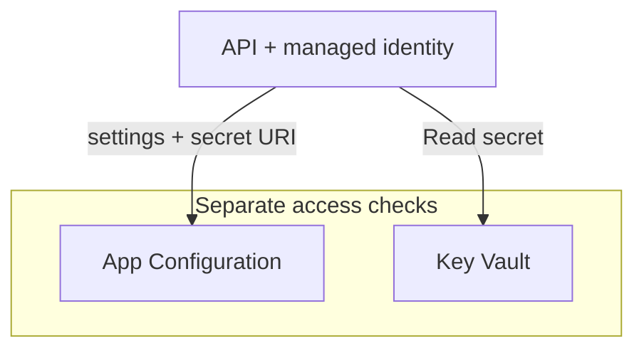

# Configuration and credentials need different lifecycles

A service needs to know where its dependencies are, which behaviour to enable, and how to authenticate.
Put all of that in one configuration file and every change becomes awkward. Adjusting a retrieval setting
requires rebuilding an image; replacing a credential requires finding every copy; two replicas quietly
run with different values. The application may be healthy while answering from the wrong index.

Start by separating settings from values that grant access. They need different permissions,
different change procedures and different recovery plans. The underlying boundary is covered in
[Secrets in AI SDLC](/ai-sdlc/part-4-platform/secrets). Here the question is how to implement that boundary
on Azure, while keeping configuration changes understandable to the engineer operating the service.

## How Azure separates settings from credentials \{#how-azure-separates-settings-from-credentials}

Azure Key Vault stores three kinds of object. A **secret** holds a sensitive value that an application
can retrieve, such as a password for an external service. A cryptographic **key** supports operations
such as signing or unwrapping an encryption key. A Key Vault **certificate** manages a certificate and
its associated key and secret. The distinction matters: an API key supplied by a vendor normally belongs
in a secret, despite having “key” in its name. These are separate
[Key Vault object types](https://learn.microsoft.com/en-us/azure/key-vault/general/about-keys-secrets-certificates),
with separate operations and permissions.

Creating a vault is a control-plane operation: you manage an Azure resource. Reading a secret is a
data-plane operation: you use the contents of that resource. Select the
[Azure RBAC permission model](https://learn.microsoft.com/en-us/azure/key-vault/general/rbac-guide)
for the vault so that role assignments govern data access. Under this model, legacy vault access policies
do not authorise requests. Changing an existing vault's model therefore needs a migration plan for its callers.

The API's runtime identity should receive **Key Vault Secrets User** at the vault's scope. That role
permits reading secret contents; it does not permit writing replacement secrets. Key Vault Reader only
reads metadata, while Key Vault Secrets Officer manages secrets. Check the
[built-in role definitions](https://learn.microsoft.com/en-us/azure/role-based-access-control/built-in-roles/security#key-vault-secrets-user)
when choosing permissions. Secrets User can also read a certificate's secret portion, so a vault containing
unrelated certificates would widen the API's access. Use a vault for the application's environment rather
than a shared collection of every team's credentials.

With a [managed identity](https://learn.microsoft.com/en-us/azure/container-apps/managed-identity),
the Container App obtains a Microsoft Entra token for the target service, which checks its role assignments.
Lessons 2 and 3 cover identity types and RBAC scopes; here, follow the token to each store.

**Azure App Configuration** holds settings and feature flags centrally. It lets you change
configuration independently of the application binary; the application uses a client or provider to load
it. A [label](https://learn.microsoft.com/en-us/azure/azure-app-configuration/concept-key-value) distinguishes
variants of the same key: `Rag:SearchIndex` with label `dev` is a different entry from that key with label
`production`. Decide explicitly which label the application selects. A label is a selection mechanism,
so it should not be treated as an access boundary between environments.

For token-based reads, grant the application identity
[App Configuration Data Reader](https://learn.microsoft.com/en-us/azure/azure-app-configuration/concept-enable-rbac)
on the store. A resource-management Reader role does not grant that data access. The same managed identity
can access both stores, but each store requires its own grant and the client requests a token for the
service it calls.



App Configuration can also hold a **Key Vault reference**. For the .NET configuration provider, that
entry contains a secret URI. The provider recognises the reference and retrieves the value from Key Vault
using the application's credentials. App Configuration does not fetch the secret on the application's
behalf: [the application authenticates to both services](https://learn.microsoft.com/en-us/azure/azure-app-configuration/use-key-vault-references-dotnet-core).
This explains a common partial failure: settings load, but resolving a referenced secret fails
because the vault grant or network route is missing.

## Choose the store and the update procedure together \{#choose-the-store-and-update-procedure}

Choose the smallest mechanism that supports the setting's lifecycle. An external configuration service
helps when several components share settings or changes must reach running applications independently
of a deployment. It also adds a startup dependency and an access boundary to operate.

| Mechanism | Use it for | Avoid it when / common failure |
|---|---|---|
| [Container App environment variables](https://learn.microsoft.com/en-us/azure/container-apps/environment-variables) | A few values released with the app, such as service endpoints. | Operators need coordinated changes across services; copies drift between deployments. |
| App Configuration | Shared settings, labelled variants and feature flags. | A small app only needs fixed deployment settings; centralisation adds unnecessary infrastructure. |
| Key Vault secret | A credential you still need because the dependency requires a password or access key. | The value is a setting, document or prompt; use the appropriate configuration or content store. |
| [Container Apps secret referencing Key Vault](https://learn.microsoft.com/en-us/azure/container-apps/manage-secrets) | P1: inject a vault credential through a Container App secret into an environment variable. | Consumers cannot tolerate revision restarts on rotation; choose application-managed refresh instead. |
| Key Vault key or certificate | Cryptographic operations or certificate lifecycle management. | You merely need to retrieve an external API credential; a secret is the matching object type. |

Microsoft's [secret security guidance](https://learn.microsoft.com/en-us/azure/key-vault/secrets/secure-secrets)
specifically separates credentials from general configuration. An encrypted store does not make every
setting a secret. Conversely, putting a password in App Configuration because it already contains the
other settings gives configuration readers access to a credential they may not need.

Central storage also does not promise immediate adoption. The
[.NET provider's refresh mechanism](https://learn.microsoft.com/en-us/azure/azure-app-configuration/reference-dotnet-provider)
requires refresh registration and a trigger; ASP.NET Core can use request-driven middleware. Configure
secret refresh separately when a Key Vault reference stays unchanged but the secret behind it rotates.
Different replicas can observe an update at different times. If a request must use a consistent group
of settings, capture that group for the request rather than rereading individual values halfway through.

Rotation must cover the credential's issuer, its stored version and its consumers. Saving a different
password in Key Vault does not change the password accepted by the external service. Microsoft's
[dual-credential rotation example](https://learn.microsoft.com/en-us/azure/key-vault/secrets/tutorial-rotation-dual)
uses an Event Grid event and a Function to regenerate an alternate credential at the source and store
it as a new secret version. The application must then load the replacement before the old credential is
retired. With [Container Apps Key Vault references](https://learn.microsoft.com/en-us/azure/container-apps/manage-secrets#key-vault-secret-uri-and-secret-rotation),
an unversioned secret URI picks up a new version within 30 minutes; active revisions using that secret
in an environment variable restart to adopt it, rather than refreshing an application provider.

Keys and certificates have their own lifecycle mechanisms. A
[key rotation policy](https://learn.microsoft.com/en-us/azure/key-vault/keys/how-to-configure-key-rotation)
can generate a new cryptographic key version; it does not rotate an arbitrary password stored as a secret.
[Certificate renewal](https://learn.microsoft.com/en-us/azure/key-vault/certificates/overview-renew-certificate)
depends on the issuer and policy, with different procedures for integrated and nonintegrated certificate
authorities. For any object, identify who creates the replacement, how consumers discover it and what
evidence permits retiring the old version.

When access fails, inspect the actual caller, its role and scope, then connectivity.
[Key Vault authentication and firewall checks](https://learn.microsoft.com/en-us/azure/key-vault/general/authentication)
are distinct. Broadening a role cannot repair a blocked network route. A successful local read under your
developer account also says nothing about the deployed managed identity's permissions.

## In an AI workload \{#in-an-ai-workload}

For the RAG service (P1), the API's model deployment name, search index name and retrieval settings are
configuration. A remaining credential for an external dependency belongs in Key Vault. Prefer managed
identity where the target supports it; creating a vault is not a reason to introduce access keys into
connections that could use tokens. P1 will use a Container Apps secret referencing Key Vault:
`keyvaultref:<secret-uri>,identityref:<identity-resource-id>`. Attach the identity to the app and grant it
[Key Vault Secrets User](https://learn.microsoft.com/en-us/azure/container-apps/manage-secrets#reference-secret-from-key-vault);
Container Apps retrieves the value and supplies it through the app's secret-backed environment variable.

A setting can be public and still be operationally dangerous. Changing top-K alters the evidence sent
to the model; selecting the wrong search index changes the document set. The
[Retrieval lesson](/rag-agents/part-1-rag/retrieval/) owns those mechanics. Treat configuration changes that
affect answers as changes to the system: review them and run the
[retrieval and generation evaluations](/rag-agents/part-1-rag/cross-cutting/evaluation/) before rollout.
Record a non-secret configuration revision with telemetry so an answer regression can be associated with
the settings that produced it. Keep credential values out of that record.

Keep secret retrieval outside the token-generation loop. Load and cache credentials in the application,
with a deliberate refresh policy, rather than reading the vault for every question or streamed token.
That follows [Key Vault's caching guidance](https://learn.microsoft.com/en-us/azure/key-vault/secrets/secure-secrets)
and prevents vault calls from becoming an unnecessary dependency of every answer. Define what happens
if initial loading fails and what happens if a later refresh fails: those are different operating states.
The runtime credential should stay in the trusted client performing the call, away from retrieved
documents, model prompts and tool results.

## Try it \{#try-it}

Practise creating P1's vault and pre-authorising its API identity. Use a new, disposable resource group so
teardown cannot remove other project resources. You need Azure CLI, a Bash shell and an Azure subscription.
You need permission to create the group, then create and delete its lab resources.

These commands were checked against the live Azure CLI reference on 2026-10-17. No Azure subscription
exists for this course yet, so they have **not been run against a live subscription**. The results below
are expected from the documented operations, not observed deployment results.

Replace the subscription placeholder before running. The Bash suffix helps choose a unique vault name;
if Azure reports a collision, choose another name. Vault names must be
[globally unique and 3–24 characters long](https://learn.microsoft.com/en-us/azure/key-vault/general/quick-create-cli).

```bash
az login
az account set --subscription "<subscription-id>"

RG="rg-p1-secrets-lab"
LOCATION="westeurope"
API_IDENTITY="id-p1-rag-api"
KV_NAME="p1-kv-$RANDOM-$RANDOM"

az group create --name "$RG" --location "$LOCATION" --output none
```

Before continuing, ensure you have role-assignment rights on this group: Owner on the group suffices;
alternatives alongside resource-management permissions include
[Role Based Access Control Administrator](https://learn.microsoft.com/en-us/azure/role-based-access-control/built-in-roles/privileged#role-based-access-control-administrator)
or [Key Vault Data Access Administrator](https://learn.microsoft.com/en-us/azure/key-vault/general/rbac-guide#managing-built-in-key-vault-data-plane-role-assignments),
which restricts assignments to specified vault data roles. Subscription-wide Owner is unnecessary.
Under RBAC, creating the vault does not grant its operator secret read/write access; that needs a
[data role](https://learn.microsoft.com/en-us/azure/key-vault/general/rbac-guide).

```bash
API_PRINCIPAL_ID=$(az identity create \
  --name "$API_IDENTITY" --resource-group "$RG" --location "$LOCATION" \
  --query principalId --output tsv)

az keyvault create \
  --name "$KV_NAME" --resource-group "$RG" --location "$LOCATION" \
  --sku standard --enable-rbac-authorization true \
  --retention-days 7 --output none

KV_ID=$(az keyvault show --name "$KV_NAME" --resource-group "$RG" \
  --query id --output tsv)

az role assignment create \
  --assignee-object-id "$API_PRINCIPAL_ID" \
  --assignee-principal-type ServicePrincipal \
  --role "4633458b-17de-408a-b874-0445c86b69e6" \
  --scope "$KV_ID" \
  --query '{principal:principalId,role:roleDefinitionId,scope:scope}' \
  --output json
```

The explicit `--enable-rbac-authorization true` matches the
[current CLI default](https://learn.microsoft.com/en-us/cli/azure/keyvault?view=azure-cli-latest#az-keyvault-create);
older access-policy guides describe a different model. This lab sets seven-day soft-delete retention
(the allowed range is 7–90 days). For production vaults, enable
[purge protection](https://learn.microsoft.com/en-us/azure/key-vault/general/key-vault-recovery), which cannot be disabled once enabled.

The GUID identifies Key Vault Secrets User. Passing the principal ID and principal type avoids a
[Microsoft Graph lookup during role assignment](https://learn.microsoft.com/en-us/cli/azure/role/assignment?view=azure-cli-latest#az-role-assignment-create).
Stop if a command fails; do not continue with empty resource or principal IDs.

Inspect the vault metadata and the identity's identifiers:

```bash
az keyvault show --name "$KV_NAME" --resource-group "$RG" \
  --query '{uri:properties.vaultUri,rbac:properties.enableRbacAuthorization}' \
  --output json

az identity show --name "$API_IDENTITY" --resource-group "$RG" \
  --query '{id:id,clientId:clientId,principalId:principalId}' --output json
```

Expect `rbac: true`, a vault URI and identity identifiers. The role-assignment response should name this
vault's resource ID as its scope and the API identity as its principal. These checks inspect management
state. They do not test secret retrieval. The vault is empty, and the identity still needs attaching to
a Container App. This lab is disposable; P1's lasting vault and identity are declared in lesson 9,
Infrastructure as code.

**Cost:** [Key Vault bills per operation, with no setup fee](https://azure.microsoft.com/en-us/pricing/details/key-vault/).
This lab creates an empty Standard vault and performs no secret operations. It creates no compute or
App Configuration store; [managed identities have no extra charge](https://learn.microsoft.com/en-us/entra/identity/managed-identities-azure-resources/overview).
A [soft-deleted Standard vault incurs no charges except for purge or recover operations](https://learn.microsoft.com/en-us/azure/key-vault/general/soft-delete-overview#billing-implications).
Check current prices for your region, currency and agreement before running the lab.

**Teardown:** Delete only the disposable group created above. This command waits for the deletion operation:

```bash
az group delete --name "$RG" --yes
```

[Soft delete](https://learn.microsoft.com/en-us/azure/key-vault/general/soft-delete-overview) keeps this vault
recoverable for seven days after deletion, reserving its name until retention expires or an authorised
operator purges it. Use a fresh name for another run. Soft-deleting a vault deletes its RBAC role
assignments; recovering the vault does not restore them. Recreate the grants before restoring service.

Optionally, with [subscription-level permission to list deleted vaults](https://learn.microsoft.com/en-us/azure/key-vault/general/key-vault-recovery#prerequisites), check the retained vault using
[`az keyvault list-deleted`](https://learn.microsoft.com/en-us/cli/azure/keyvault?view=azure-cli-latest#az-keyvault-list-deleted):

```bash
az keyvault list-deleted --output table
```

## What to take away \{#what-to-take-away}

- Put credentials in Key Vault; choose Container App environment variables or App Configuration for settings.
- Managed identity supplies authentication. Each store still needs its own data role and network path.
- Grant the API Key Vault Secrets User at the intended vault scope; keep credential-writing permissions elsewhere.
- Rotation finishes when consumers adopt the replacement and the old credential can safely be retired.
- Review and evaluate answer-changing configuration as carefully as answer-changing code.

**[New terms](../glossary.md#secrets-and-configuration)**: Key Vault secret, cryptographic key, Key Vault certificate, RBAC permission model, Key Vault Secrets User, Azure App Configuration, label (App Configuration), Key Vault reference, rotation, soft delete, purge protection.

## Sources \{#sources}

Verified as of 2026-10-17.

Key Vault mechanisms and lifecycle:

- [Keys, secrets and certificates](https://learn.microsoft.com/en-us/azure/key-vault/general/about-keys-secrets-certificates), [secret security guidance](https://learn.microsoft.com/en-us/azure/key-vault/secrets/secure-secrets)
- [RBAC guide](https://learn.microsoft.com/en-us/azure/key-vault/general/rbac-guide), [built-in security roles](https://learn.microsoft.com/en-us/azure/role-based-access-control/built-in-roles/security), [authentication](https://learn.microsoft.com/en-us/azure/key-vault/general/authentication)
- [Secret rotation with two credentials](https://learn.microsoft.com/en-us/azure/key-vault/secrets/tutorial-rotation-dual), [key rotation](https://learn.microsoft.com/en-us/azure/key-vault/keys/how-to-configure-key-rotation), [certificate renewal](https://learn.microsoft.com/en-us/azure/key-vault/certificates/overview-renew-certificate)
- [Soft delete and purge protection](https://learn.microsoft.com/en-us/azure/key-vault/general/soft-delete-overview), [CLI quickstart](https://learn.microsoft.com/en-us/azure/key-vault/general/quick-create-cli), [Key Vault pricing](https://azure.microsoft.com/en-us/pricing/details/key-vault/)

Configuration and workload identity:

- [App Configuration overview](https://learn.microsoft.com/en-us/azure/azure-app-configuration/overview), [keys and labels](https://learn.microsoft.com/en-us/azure/azure-app-configuration/concept-key-value), [data roles](https://learn.microsoft.com/en-us/azure/azure-app-configuration/concept-enable-rbac)
- [Key Vault references in ASP.NET Core](https://learn.microsoft.com/en-us/azure/azure-app-configuration/use-key-vault-references-dotnet-core), [.NET provider and refresh](https://learn.microsoft.com/en-us/azure/azure-app-configuration/reference-dotnet-provider)
- [Container Apps managed identities](https://learn.microsoft.com/en-us/azure/container-apps/managed-identity), [secrets and Key Vault references](https://learn.microsoft.com/en-us/azure/container-apps/manage-secrets), [environment variables](https://learn.microsoft.com/en-us/azure/container-apps/environment-variables)
- [Managed identity overview and cost](https://learn.microsoft.com/en-us/entra/identity/managed-identities-azure-resources/overview), [privileged RBAC roles](https://learn.microsoft.com/en-us/azure/role-based-access-control/built-in-roles/privileged), [vault recovery](https://learn.microsoft.com/en-us/azure/key-vault/general/key-vault-recovery)

Azure CLI command references (`azure-cli-latest`):

- [Login](https://learn.microsoft.com/en-us/cli/azure/reference-index?view=azure-cli-latest#az-login), [account selection](https://learn.microsoft.com/en-us/cli/azure/account?view=azure-cli-latest#az-account-set), [resource groups](https://learn.microsoft.com/en-us/cli/azure/group?view=azure-cli-latest)
- [Managed identities](https://learn.microsoft.com/en-us/cli/azure/identity?view=azure-cli-latest), [vault creation and inspection](https://learn.microsoft.com/en-us/cli/azure/keyvault?view=azure-cli-latest), [role assignment](https://learn.microsoft.com/en-us/cli/azure/role/assignment?view=azure-cli-latest)
