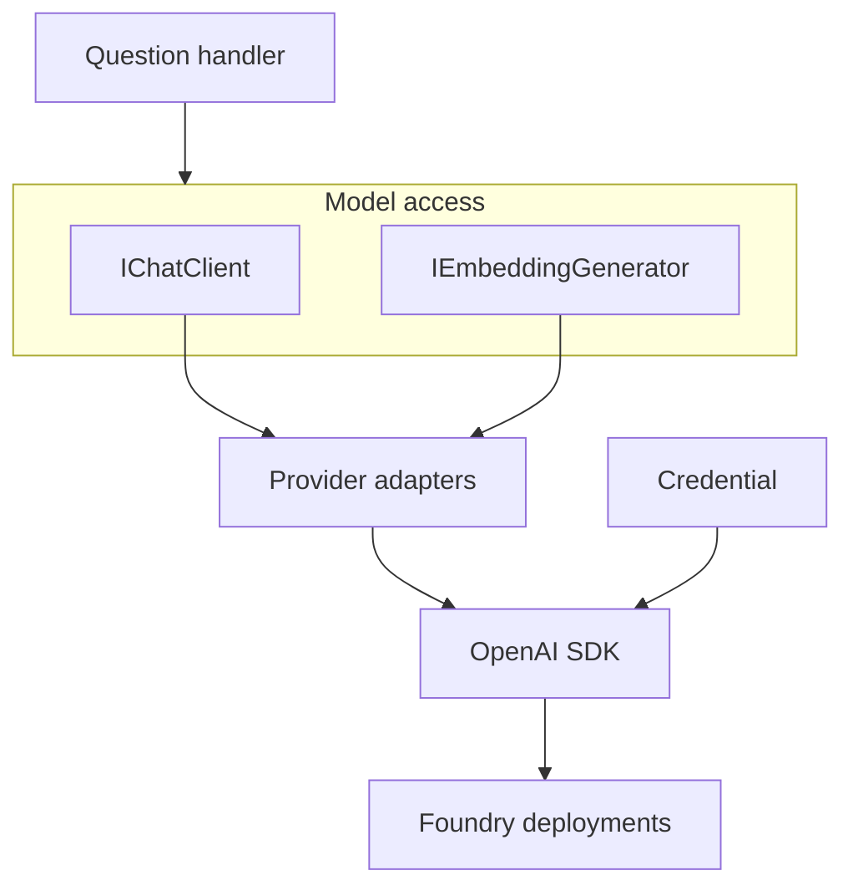

# Keep model access behind a boundary you can test

A question-answering endpoint often starts with a provider SDK call inside its request handler. Then it
needs streaming, a second model, request tracing and a way to test retrieval without paying for generation.
If every handler constructs its own client and interprets provider-specific responses, each change spreads
through the application. The HTTP endpoint has acquired responsibility for model access as well as answering
the user's question.

Give those responsibilities separate boundaries. The application needs a chat operation and an embedding
operation; retrieval needs a search client; an agent may need a tool-execution loop. These are different
jobs. A shared interface can make their connections easier to replace and inspect, but changing a model
still changes behaviour. Keep the evaluations that tell you whether the new answers are acceptable.

## How it works in .NET \{#how-it-works-in-dotnet}

This lesson targets **.NET 10**, the current LTS release, supported until **14 November 2028**. Install a
serviced .NET 10 SDK; the [support policy](https://dotnet.microsoft.com/en-us/platform/support/policy/dotnet-core)
distinguishes the support window from individual servicing releases.

[`Microsoft.Extensions.AI`](https://learn.microsoft.com/en-us/dotnet/ai/microsoft-extensions-ai) separates
contracts from implementations. Its abstractions package provides interfaces, the main package adds
composable behaviours, and provider adapters connect those contracts to an SDK. Your application can
depend on the contract while its startup code selects the provider.

[`IChatClient`](https://learn.microsoft.com/en-us/dotnet/ai/ichatclient) represents chat generation.
`GetResponseAsync` returns a `ChatResponse`; `GetStreamingResponseAsync` exposes updates as an
`IAsyncEnumerable<ChatResponseUpdate>`. Choose the latter when the HTTP response must deliver incremental
output, and carry request cancellation through the call. Consuming updates is still your application's
responsibility: the endpoint must forward them over its chosen streaming HTTP protocol.

Embeddings have a separate contract:
[`IEmbeddingGenerator<string, Embedding<float>>`](https://learn.microsoft.com/en-us/dotnet/ai/iembeddinggenerator).
Its input type says what you embed; its output type says how the vector is represented. Generation produces
vectors; storage and retrieval belong to separate components.



For P1, construct the official OpenAI .NET SDK's `OpenAIClient` with a Foundry
[`/openai/v1/` endpoint](https://learn.microsoft.com/en-us/azure/foundry/openai/api-version-lifecycle).
Microsoft documents [Entra authentication through `BearerTokenPolicy`](https://learn.microsoft.com/en-us/azure/developer/ai/how-to/switching-endpoints):
the policy receives the credential and token scope, while `OpenAIClientOptions` receives the endpoint.
Obtain chat and embedding scenario clients using the Azure *deployment names* you created. The
[`AsIChatClient`](https://learn.microsoft.com/en-us/dotnet/api/microsoft.extensions.ai.openaiclientextensions.asichatclient?view=net-10.0-pp) and
[`AsIEmbeddingGenerator`](https://learn.microsoft.com/en-us/dotnet/api/microsoft.extensions.ai.openaiclientextensions.asiembeddinggenerator?view=net-10.0-pp)
adapters expose those scenario clients through the common contracts.

Register clients through dependency injection. The
[`AddChatClient`](https://learn.microsoft.com/en-us/dotnet/api/microsoft.extensions.dependencyinjection.chatclientbuilderservicecollectionextensions.addchatclient?view=net-10.0-pp)
and
[`AddEmbeddingGenerator`](https://learn.microsoft.com/en-us/dotnet/api/microsoft.extensions.dependencyinjection.embeddinggeneratorbuilderservicecollectionextensions.addembeddinggenerator?view=net-10.0-pp)
factory overloads register singleton services by default and return pipeline builders. A delegating client pipeline
wraps model access with behaviours such as telemetry, caching or function invocation. Order matters:
tracing outside a cache observes a different set of operations from tracing only the underlying calls.
Choose what you need to observe before copying a pipeline from an example.

This construction boundary is where you pass in the credential selected in
[I.3 — RBAC and keyless access](../part-1-azure-foundations/rbac-and-keyless-access.md).
For P1's Microsoft Foundry resource, grant the calling identity
[`Foundry User`](https://learn.microsoft.com/en-us/azure/foundry/concepts/rbac-foundry)
(formerly Azure AI User) at the Foundry resource scope; I.3 uses the role ID during the rename rollout.
Constructing a credential does not grant that role.

## Choosing and tradeoffs \{#choosing-and-tradeoffs}

Choose an abstraction for the boundary you actually need. A small application can use a provider SDK
directly and keep it behind one application service. Introducing several frameworks before you have a
retrieval path makes failures harder to locate: a failed answer might come from search, model configuration,
an adapter or orchestration.

The boundary also gives tests a useful scope. Test passage selection and citation assembly with controlled
client responses, then evaluate real model behaviour separately. A test that supplies an answer can check
whether the API returns the right source identifiers; it cannot establish that the deployed model will
choose those sources. Keep those two kinds of evidence distinct when deciding whether a change is ready.

| Choice | Use it when | Avoid or reconsider it when |
|---|---|---|
| [OpenAI SDK with an Azure v1 endpoint](https://learn.microsoft.com/en-us/azure/developer/ai/how-to/switching-endpoints) (P1) | You want the standard OpenAI client with an explicit endpoint and Entra token policy. | You need an Azure-specific API outside that surface; endpoint and token-scope configuration remain yours. |
| [Azure.AI.OpenAI companion](https://learn.microsoft.com/en-us/dotnet/api/overview/azure/ai.openai-readme?view=azure-dotnet) | You need its Azure-specific SDK surface, built on the OpenAI SDK. | Check the companion's dependency versions before upgrading OpenAI alongside it; P1 avoids that extra dependency. |
| Provider SDK directly | You need provider-specific features and can contain that dependency. | SDK types have spread through handlers and tests. |
| `Microsoft.Extensions.AI` | Chat and embedding contracts, shared pipelines and replaceable clients help the application. | A required feature needs SDK-specific access; keep that access explicit. |
| `Microsoft.Extensions.VectorData` | Typed records and a common storage/search surface suit your retrieval code. | Provider-specific filtering, ranking or index control dominates the implementation. |
| Microsoft Agent Framework | You need agent sessions, tools or explicit workflows. | The workload is a fixed retrieve-then-generate request with no agent decisions. |

[`Microsoft.Extensions.VectorData`](https://learn.microsoft.com/en-us/dotnet/ai/vector-stores/overview)
addresses storage and search through `VectorStore` and `VectorStoreCollection<TKey, TRecord>`. Records
map keys, data and vectors; a provider implements the store operations. This is a separate boundary from
embedding generation. Check the selected provider's mapping and search behaviour rather than assuming a
common API makes filters or ranking equivalent.

Package status needs the same precision. The
[`Microsoft.Extensions.VectorData.Abstractions` 10.11.0 package](https://www.nuget.org/packages/Microsoft.Extensions.VectorData.Abstractions/10.11.0)
is stable. For P1's Azure AI Search integration, the [.NET vector-store overview](https://learn.microsoft.com/en-us/dotnet/ai/vector-stores/overview)
names `CommunityToolkit.VectorData.AzureAISearch`; its
[1.0.1 package](https://www.nuget.org/packages/CommunityToolkit.VectorData.AzureAISearch/1.0.1) is stable too.
That release status applies to this connector, not every provider. Check the selected package and its
supported operations before committing retrieval code to it.

[Microsoft Agent Framework](https://learn.microsoft.com/en-us/agent-framework/overview/) adds agent
sessions, tools, middleware and workflows above model access. Its
[.NET core package 1.25.0](https://www.nuget.org/packages/Microsoft.Agents.AI/1.25.0) is a stable release
and depends on `Microsoft.Extensions.AI`; additional integrations can have different release status.
Use it when orchestration is part of the problem. Keep tool permissions in application controls even
when a framework can invoke functions automatically. The
[orchestration-framework lesson](/rag-agents/part-2-agents/orchestration-frameworks/) helps decide whether
that additional layer earns its place; keep answer evaluations when changing the framework or provider.

Two smaller failures are easy to miss. A shared cache must not return one caller's private context to
another, and telemetry must not collect sensitive prompts by accident. Decide those policies before
adding the corresponding client wrappers. Abstraction makes shared behaviour convenient, which also makes
a mistaken shared policy reach every caller.

## In an AI workload \{#in-an-ai-workload}

For [P1, the RAG service](../part-5-projects/rag-service.md), the minimal API embeds a question, queries Azure AI Search, selects
source passages and sends those passages to chat generation. Blob Storage holds the public documents;
the answer must preserve citations back to them. The client registrations in this lesson prepare the
model-access boundary of that service against its Microsoft Foundry resource. Search, ingestion and citation assembly remain application work.

Keep retrieval and generation observable separately. An answer can be wrong because the relevant chunk
was never retrieved, because the selected passage was insufficient, or because the model ignored it.
The [retrieval lesson](/rag-agents/part-1-rag/retrieval/) explains search choices; the
[generation lesson](/rag-agents/part-1-rag/generation/) owns assembling evidence into an answer.
Retain chunk identifiers and source URLs through both stages so a citation refers to a retrieved source
you can inspect.

Treat embedding configuration as part of the index contract. In Azure AI Search,
[a vector field's dimensions follow the embedding model, and queries are compared within that model's embedding space](https://learn.microsoft.com/en-us/azure/search/vector-search-how-to-create-index).
Replacing an `IEmbeddingGenerator` registration can therefore require regenerating stored vectors and
rebuilding the index. Vector-space compatibility depends on the embedding configuration behind the interface.
Record which embedding deployment and model produced an index before attempting that change.

## Try it \{#try-it}

Create a local P1 wiring exercise with the .NET 10 SDK. It registers real SDK adapters but makes no
chat or embedding request. The dummy endpoint lets you inspect dependency injection without an Azure
resource or sign-in.

The code on this page was built with .NET SDK 10.0.402 and Azure.Identity 1.21.0, OpenAI 2.14.0,
Microsoft.Extensions.AI 10.11.0 and Microsoft.Extensions.AI.OpenAI 10.11.0 on 2026-10-17. The local
steps were run, including the `/wiring` request; the Azure calls were not run against a live
subscription, because this route makes none.

The [web template](https://learn.microsoft.com/en-us/dotnet/core/tools/dotnet-new-sdk-templates) creates
an ASP.NET Core Empty project. These commands use the
[.NET 10 `dotnet package add` syntax](https://learn.microsoft.com/en-us/dotnet/core/tools/dotnet-package-add)
and target these exact package versions, the latest stable releases verified on 2026-10-17:
[Azure.Identity 1.21.0](https://www.nuget.org/packages/Azure.Identity/1.21.0),
[OpenAI 2.14.0](https://www.nuget.org/packages/OpenAI/2.14.0),
[Microsoft.Extensions.AI 10.11.0](https://www.nuget.org/packages/Microsoft.Extensions.AI/10.11.0) and
[Microsoft.Extensions.AI.OpenAI 10.11.0](https://www.nuget.org/packages/Microsoft.Extensions.AI.OpenAI/10.11.0).

```bash
dotnet new web --framework net10.0 --output P1.AiWiring
cd P1.AiWiring
dotnet package add Azure.Identity --version 1.21.0
dotnet package add OpenAI --version 2.14.0
dotnet package add Microsoft.Extensions.AI --version 10.11.0
dotnet package add Microsoft.Extensions.AI.OpenAI --version 10.11.0
```

Replace `Program.cs` with this startup code. The defaults are placeholders for local wiring only;
the route resolves both interfaces and returns their implementation type names. In OpenAI 2.14.0 the
`OpenAIClient` constructor that accepts a `BearerTokenPolicy` is marked experimental, and the build
fails with error `OPENAI001` unless you suppress it. The code suppresses it only around that
constructor; recheck that diagnostic whenever you upgrade the package.

```csharp
using Azure.Identity;
using Microsoft.Extensions.AI;
using OpenAI;
using System.ClientModel.Primitives;

var builder = WebApplication.CreateBuilder(args);
var endpoint = builder.Configuration["AI:Endpoint"]
    ?? "https://p1-example.services.ai.azure.com/openai/v1/";
var chatDeployment = builder.Configuration["AI:ChatDeployment"] ?? "p1-chat";
var embeddingDeployment = builder.Configuration["AI:EmbeddingDeployment"]
    ?? "p1-embedding";

// OpenAI 2.14.0 marks the AuthenticationPolicy constructor as experimental.
#pragma warning disable OPENAI001
builder.Services.AddSingleton(_ => new OpenAIClient(
    new BearerTokenPolicy(
        new DefaultAzureCredential(), "https://cognitiveservices.azure.com/.default"),
    new OpenAIClientOptions { Endpoint = new Uri(endpoint) }));
#pragma warning restore OPENAI001
builder.Services.AddChatClient(services =>
    services.GetRequiredService<OpenAIClient>()
        .GetChatClient(chatDeployment).AsIChatClient());
builder.Services.AddEmbeddingGenerator<string, Embedding<float>>(services =>
    services.GetRequiredService<OpenAIClient>()
        .GetEmbeddingClient(embeddingDeployment).AsIEmbeddingGenerator());

var app = builder.Build();
app.MapGet("/wiring", (
    IChatClient chat,
    IEmbeddingGenerator<string, Embedding<float>> embeddings) =>
    Results.Ok(new
    {
        Chat = chat.GetType().Name,
        Embeddings = embeddings.GetType().Name
    }));
app.Run();
```

Start it using the documented
[`dotnet run` option](https://learn.microsoft.com/en-us/dotnet/core/tools/dotnet-run):

```bash
dotnet run --no-launch-profile
```

Open the printed local URL with `/wiring` appended. With these package versions the response was
`{"chat":"OpenAIChatClient","embeddings":"OpenAIEmbeddingGenerator"}`; the names are adapter internals
and can change between releases. The route demonstrates service resolution only:
there is no token acquisition, inference, retrieval or generated answer in this route.

Before connecting P1 to real deployments, remove dummy defaults, validate the three configuration values,
select the intended credential and grant its identity the resource data role. Check network access too.
Only then add a separately evaluated model call to verify authentication, authorisation and connectivity
beyond this local service-resolution check.

**Cost:** free, local only. This exercise creates no Azure resources and calls no model, so it incurs
no Azure consumption charges.

**Teardown:** stop the process with Ctrl+C, leave `P1.AiWiring`, then delete that local folder.

## What to take away \{#what-to-take-away}

- Inject chat and embedding contracts; select SDK clients, deployments and credentials at startup.
- Keep embedding generation separate from vector storage and retrieval. A model change can require an index rebuild.
- Verify release status per package and connector, including preview surfaces beside stable abstractions.
- Add agent orchestration when the workload needs it, and enforce permissions outside the model's decisions.

**[New terms](../glossary.md#ai-in-dotnet)**: Microsoft.Extensions.AI, IChatClient, IEmbeddingGenerator, provider adapter, delegating client pipeline, Microsoft.Extensions.VectorData, Microsoft Agent Framework.

## Sources \{#sources}

Verified as of 2026-10-17.

Runtime and client contracts:

- [.NET releases and support](https://learn.microsoft.com/en-us/dotnet/core/releases-and-support)
- [.NET support policy](https://dotnet.microsoft.com/en-us/platform/support/policy/dotnet-core)
- [Microsoft.Extensions.AI libraries](https://learn.microsoft.com/en-us/dotnet/ai/microsoft-extensions-ai)
- [IChatClient](https://learn.microsoft.com/en-us/dotnet/ai/ichatclient)
- [IEmbeddingGenerator](https://learn.microsoft.com/en-us/dotnet/ai/iembeddinggenerator)
- [Build an AI chat app](https://learn.microsoft.com/en-us/dotnet/ai/quickstarts/build-chat-app)
- [AsIChatClient reference](https://learn.microsoft.com/en-us/dotnet/api/microsoft.extensions.ai.openaiclientextensions.asichatclient?view=net-10.0-pp)
- [AsIEmbeddingGenerator reference](https://learn.microsoft.com/en-us/dotnet/api/microsoft.extensions.ai.openaiclientextensions.asiembeddinggenerator?view=net-10.0-pp)
- [DelegatingChatClient reference](https://learn.microsoft.com/en-us/dotnet/api/microsoft.extensions.ai.delegatingchatclient?view=net-10.0-pp)
- [AddChatClient reference](https://learn.microsoft.com/en-us/dotnet/api/microsoft.extensions.dependencyinjection.chatclientbuilderservicecollectionextensions.addchatclient?view=net-10.0-pp)
- [AddEmbeddingGenerator reference](https://learn.microsoft.com/en-us/dotnet/api/microsoft.extensions.dependencyinjection.embeddinggeneratorbuilderservicecollectionextensions.addembeddinggenerator?view=net-10.0-pp)

Azure SDKs and access:

- [Azure OpenAI .NET client library](https://learn.microsoft.com/en-us/dotnet/api/overview/azure/ai.openai-readme?view=azure-dotnet)
- [Microsoft Foundry role-based access control](https://learn.microsoft.com/en-us/azure/foundry/concepts/rbac-foundry)
- [Microsoft Foundry authentication and role IDs](https://learn.microsoft.com/en-us/azure/foundry/concepts/authentication-authorization-foundry)
- [Azure OpenAI in Foundry Models v1 API](https://learn.microsoft.com/en-us/azure/foundry/openai/api-version-lifecycle)
- [Switch between OpenAI and Azure endpoints](https://learn.microsoft.com/en-us/azure/developer/ai/how-to/switching-endpoints)

Vector data and agents:

- [Vector stores in .NET](https://learn.microsoft.com/en-us/dotnet/ai/vector-stores/overview)
- [Use vector stores](https://learn.microsoft.com/en-us/dotnet/ai/vector-stores/how-to/use-vector-stores)
- [Create an Azure AI Search vector index](https://learn.microsoft.com/en-us/azure/search/vector-search-how-to-create-index)
- [Microsoft Agent Framework overview](https://learn.microsoft.com/en-us/agent-framework/overview/)

CLI and package status:

- [dotnet new](https://learn.microsoft.com/en-us/dotnet/core/tools/dotnet-new)
- [.NET SDK templates](https://learn.microsoft.com/en-us/dotnet/core/tools/dotnet-new-sdk-templates)
- [dotnet package add](https://learn.microsoft.com/en-us/dotnet/core/tools/dotnet-package-add)
- [dotnet run](https://learn.microsoft.com/en-us/dotnet/core/tools/dotnet-run)
- [Microsoft.Extensions.AI 10.11.0](https://www.nuget.org/packages/Microsoft.Extensions.AI/10.11.0), [Abstractions 10.11.0](https://www.nuget.org/packages/Microsoft.Extensions.AI.Abstractions/10.11.0) and [OpenAI adapter 10.11.0](https://www.nuget.org/packages/Microsoft.Extensions.AI.OpenAI/10.11.0)
- [Azure.Identity 1.21.0](https://www.nuget.org/packages/Azure.Identity/1.21.0) and [OpenAI 2.14.0](https://www.nuget.org/packages/OpenAI/2.14.0)
- [Microsoft.Extensions.VectorData.Abstractions 10.11.0](https://www.nuget.org/packages/Microsoft.Extensions.VectorData.Abstractions/10.11.0)
- [CommunityToolkit.VectorData.AzureAISearch 1.0.1](https://www.nuget.org/packages/CommunityToolkit.VectorData.AzureAISearch/1.0.1)
- [Microsoft.Agents.AI 1.25.0](https://www.nuget.org/packages/Microsoft.Agents.AI/1.25.0)
