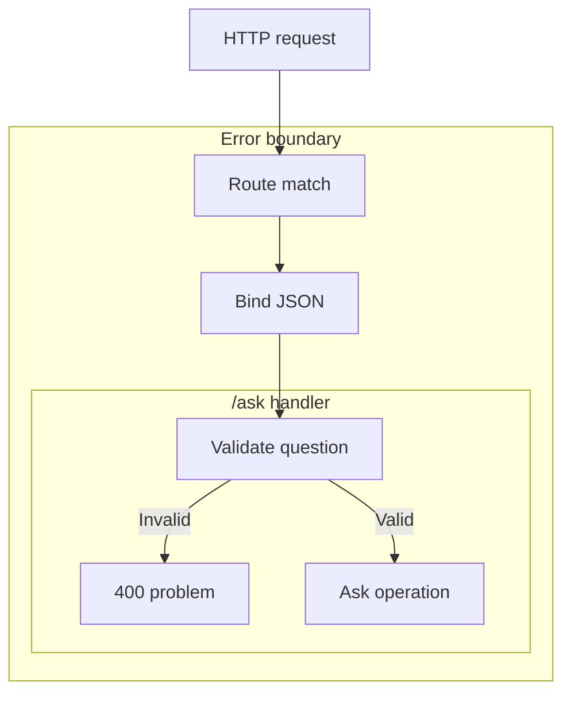

# The HTTP boundary decides what reaches the model

A question-answering service needs more than a function that calls a model. Someone will send an empty
question, malformed JSON, or a request to the wrong URL. A dependency will fail. Without a clear
HTTP contract, clients receive a mixture of strings, empty error bodies and internal exception messages,
and have to guess whether to fix their request or try again.

For a RAG service, that boundary also decides when expensive work starts. Reject a missing question before
retrieval or generation. Keep an unavailable dependency distinguishable from a successful answer that says
the documents contain no evidence. ASP.NET Core gives you a host, an ordered request pipeline and endpoint
handlers to make those decisions explicit. P1 starts with that boundary, while its retrieval path is still
unconnected.

## How it works in .NET \{#how-it-works-in-dotnet}

This lesson targets **.NET 10**, the current LTS release, supported through
[14 November 2028](https://dotnet.microsoft.com/en-us/platform/support/policy/dotnet-core).
Use the ASP.NET Core 10 documentation when checking the APIs below: advice written for older releases can
describe different validation behaviour.

The [hosting model](https://learn.microsoft.com/en-us/aspnet/core/fundamentals/?view=aspnetcore-10.0)
starts in `Program.cs`. `WebApplication.CreateBuilder(args)` prepares the application's services and
defaults. Register additional services through `builder.Services`, then call `Build()` to create the
application. Configure its pipeline and endpoints before `Run()` starts serving requests. The host brings
together configuration, logging, dependency injection, the HTTP server and application lifetime.

The server and the host have different jobs. Kestrel, the default web server, accepts HTTP traffic and
exposes each request to the application through an `HttpContext`. Your endpoint handler should not need to
know how the process was launched. This lets you develop P1 locally before packaging the same application
for its planned deployment to Azure Container Apps.

[Middleware](https://learn.microsoft.com/en-us/aspnet/core/fundamentals/middleware/?view=aspnetcore-10.0)
forms the ordered pipeline around an endpoint. Each component can work on the request, invoke the next
component, then work on the response as execution returns. It can also **short-circuit**: produce a response
without calling the next component. Response processing unwinds in reverse order. An exception handler must
therefore surround the work whose exceptions it needs to catch; putting it after that work cannot protect it.



The diagram shows a matching `/ask` request, with validation inside its handler and the error boundary
around routing, binding and execution. Later, retrieval can be added after the question check.

[Routing](https://learn.microsoft.com/en-us/aspnet/core/fundamentals/routing?view=aspnetcore-10.0)
selects an endpoint using the request and the registered route patterns. `MapPost("/ask", ...)` associates
an HTTP method and path with a handler. A
[route group](https://learn.microsoft.com/en-us/aspnet/core/fundamentals/minimal-apis/route-handlers?view=aspnetcore-10.0)
shares a prefix and endpoint conventions across related routes. Grouping `/ask` gives future question
operations one place for shared policies. A group does not protect anything by existing: an
authorisation requirement must actually be configured.

After selection, [parameter binding](https://learn.microsoft.com/en-us/aspnet/core/fundamentals/minimal-apis/parameter-binding?view=aspnetcore-10.0)
turns request data into handler arguments. A complex request type on this POST endpoint is read from the JSON
body. Binding establishes whether the data can be read into that type. Validation asks whether the resulting
value is acceptable to the application. JSON containing an empty question can bind successfully and still
be unusable.

Use [ProblemDetails](https://learn.microsoft.com/en-us/aspnet/core/fundamentals/error-handling-api?view=aspnetcore-10.0)
for a consistent error representation. Its fields identify the problem type, title and HTTP status, with
optional detail and instance information. `AddProblemDetails()` registers the supporting service;
`UseExceptionHandler()` handles unhandled downstream exceptions, while `UseStatusCodePages()` can supply a
body for otherwise empty error responses. Registration alone does not rewrite every error, and
middleware-generated bodies depend on a supported `Accept` header. Conversely, parameterless
[`UseExceptionHandler()` needs a fallback](https://learn.microsoft.com/en-us/aspnet/core/fundamentals/error-handling?view=aspnetcore-10.0#configure-useexceptionhandler-when-using-iexceptionhandler):
without `AddProblemDetails()` or a configured error path or handler, it throws at startup.

## Choosing and tradeoffs \{#choosing-and-tradeoffs}

[Minimal APIs and controllers](https://learn.microsoft.com/en-us/aspnet/core/fundamentals/apis?view=aspnetcore-10.0)
are two ways to organise endpoints in ASP.NET Core. They use the same hosting foundation. Choose according
to the API conventions you need, rather than assuming that fewer source files prove a better architecture.

| Approach | Use it when | Avoid it when / failure mode |
|---|---|---|
| Minimal APIs | A route and its handler express the operation clearly; route groups can organise related operations. | You would have to rebuild MVC binding or validation extensibility that controllers already provide. Keeping every handler in `Program.cs` also becomes an organisation problem. |
| Controllers | The service needs MVC conventions, custom model binders or its advanced validation extension points. | The class and convention structure adds no value to a small API, or a controller becomes a container for unrelated business operations. |

P1 uses minimal APIs because `/ask` is one explicit operation. That choice does not require retrieval,
prompt assembly and model access to live inside a route lambda. Keep the handler concerned with HTTP input
and output; move the RAG operation behind a service as those dependencies arrive. A controller would need
the same separation.

Put concerns that apply across requests, such as exception handling, in middleware. Keep question-specific
rules close to the endpoint or its validation mechanism. Once authentication and authorisation are added,
their [pipeline order matters](https://learn.microsoft.com/en-us/aspnet/core/fundamentals/middleware/?view=aspnetcore-10.0):
`UseAuthentication()` must establish the caller before `UseAuthorization()` evaluates access.

Do not use a [route constraint as input validation](https://learn.microsoft.com/en-us/aspnet/core/fundamentals/routing?view=aspnetcore-10.0#route-constraints).
A constraint selects between routes; a mismatch can produce 404 where the caller needs a 400 explaining
invalid input.

A deserialised object has not necessarily passed your rules. .NET 10 offers
[opt-in automatic validation](https://learn.microsoft.com/en-us/aspnet/core/fundamentals/validation?view=aspnetcore-10.0)
via `AddValidation()`, callable directly in a Web SDK project. Missing generator metadata can silently leave
validation inactive, without an exception or log entry. This exercise uses an explicit guard to keep the
rejection visible in the handler. For a plain class library, the documented setup requires a
`Microsoft.Extensions.Validation` package reference; its latest stable version is
[10.0.13](https://www.nuget.org/packages/Microsoft.Extensions.Validation/10.0.13) as of this lesson's verification date.

## In an AI workload \{#in-an-ai-workload}

The HTTP layer should decide whether work may begin before asking the RAG system to do it. For `/ask`,
require a nonblank question and choose an input-length policy. That policy is an application decision:
limiting a .NET string's length does not establish a model token budget, nor does it limit the entire HTTP
request body. Token accounting belongs alongside prompt construction, where the retrieved context and
instructions are also known.

The [retrieval lesson](/rag-agents/part-1-rag/retrieval/) owns how to select relevant, permitted context;
the [generation lesson](/rag-agents/part-1-rag/generation/) owns how to answer from it and preserve citation
metadata. Here, the important decision is what their outcomes mean at the API boundary. A caller who omitted
the question can correct a validation error. A service that cannot reach a required dependency needs a
different response. An answer that truthfully reports no supporting evidence is a successful application
outcome, provided your response contract represents that outcome clearly.

Do not catch every failure and return `200 OK` with an apologetic answer string. That makes a broken service
look like a completed generation and leaves the client unable to handle the failure reliably. Equally, do
not turn ordinary invalid input into an exception to exercise the global handler. Return a validation
problem directly, and reserve exception handling for failures that escape normal control flow.

Keep internal failure details out of public problem messages. The client needs a stable reason it can act
on, not a model credential, retrieved passage or upstream exception text. When the P1 integrations arrive,
define how each failure maps to an HTTP response. The local stub below makes no claim to have searched documents
or generated a cited answer.

## Try it \{#try-it}

Build P1's first `/ask` boundary locally. Install [.NET SDK 10.0.402](https://dotnet.microsoft.com/en-us/download/dotnet/10.0)
and use a Bash-compatible shell with `curl`. The example targets .NET and ASP.NET Core runtime **10.0.13**;
the API reference packs are
[`Microsoft.NETCore.App.Ref` 10.0.13](https://www.nuget.org/packages/Microsoft.NETCore.App.Ref/10.0.13) and
[`Microsoft.AspNetCore.App.Ref` 10.0.13](https://www.nuget.org/packages/Microsoft.AspNetCore.App.Ref/10.0.13),
the latest stable versions on NuGet at verification. The snippet adds no NuGet package references.

Choose a parent directory where `p1-ask` does not already exist. The
[`dotnet new` options](https://learn.microsoft.com/en-us/dotnet/core/tools/dotnet-new) and
[`web` template's target framework](https://learn.microsoft.com/en-us/dotnet/core/tools/dotnet-new-sdk-templates#web)
are documented by Microsoft. A [`global.json` pin](https://learn.microsoft.com/en-us/dotnet/core/tools/global-json)
with roll-forward disabled requires the exact SDK; `net10.0` alone does not select an SDK version.
`--output .` keeps the project beside `global.json`; with `--name` alone, the template creates a `P1Ask`
subfolder and `dotnet run` in `p1-ask` finds no project:

```bash
mkdir p1-ask
cd p1-ask
dotnet new globaljson --sdk-version 10.0.402 --roll-forward disable
dotnet new web --name P1Ask --framework net10.0 --output .
```

Replace the generated `Program.cs` with this complete example:

```csharp
var builder = WebApplication.CreateBuilder(args);
builder.Services.AddProblemDetails();

var app = builder.Build();
app.UseExceptionHandler();
app.UseStatusCodePages();
app.UseRouting();

var questions = app.MapGroup("/ask");
questions.MapPost("", (AskRequest request) =>
{
    if (string.IsNullOrWhiteSpace(request.Question) ||
        request.Question.Length > 2000)
    {
        return Results.ValidationProblem(new Dictionary<string, string[]>
        {
            ["question"] = ["Provide a nonblank question of at most 2,000 characters."]
        });
    }

    return Results.Problem(
        statusCode: StatusCodes.Status503ServiceUnavailable,
        title: "Retrieval is not configured.");
});

app.Run();

public sealed record AskRequest(string? Question);
```

The 2,000-character limit is an exercise policy, measured by `string.Length`.
[`Results.ValidationProblem`](https://learn.microsoft.com/en-us/dotnet/api/microsoft.aspnetcore.http.results.validationproblem?view=aspnetcore-10.0)
returns a 400 problem with an errors dictionary;
[`Results.Problem`](https://learn.microsoft.com/en-us/dotnet/api/microsoft.aspnetcore.http.results.problem?view=aspnetcore-10.0)
sets the stub's 503 for valid input. `UseRouting()` makes the placement shown in the diagram explicit;
`WebApplication` can also [add routing implicitly](https://learn.microsoft.com/en-us/aspnet/core/fundamentals/minimal-apis?view=aspnetcore-10.0).

The commands and code on this page were run on 2026-10-17 with .NET SDK 10.0.402 and the .NET and
ASP.NET Core 10.0.13 runtimes, with no NuGet packages: the project was created, built and started, and the
four requests below were sent to it. This exercise makes no Azure calls, and nothing on this page was run
against a live Azure subscription.

Start the application in the same terminal:

```bash
ASPNETCORE_ENVIRONMENT=Production ASPNETCORE_URLS=http://127.0.0.1:5080 \
  dotnet run --no-launch-profile
```

[`--no-launch-profile`](https://learn.microsoft.com/en-us/dotnet/core/tools/dotnet-run)
skips generated launch settings. The environment variables select
[Production](https://learn.microsoft.com/en-us/aspnet/core/fundamentals/environments?view=aspnetcore-10.0)
and a [local HTTP listener](https://learn.microsoft.com/en-us/aspnet/core/fundamentals/servers/kestrel/endpoints?view=aspnetcore-10.0).
This uses loopback HTTP for the local exercise; deployment transport configuration comes later.

In another terminal, send these requests:

```bash
curl --include http://127.0.0.1:5080/ask \
  --header 'Content-Type: application/json' --header 'Accept: application/json' \
  --data '{"question":""}'

curl --include http://127.0.0.1:5080/ask \
  --header 'Content-Type: application/json' --header 'Accept: application/json' \
  --data '{"question":"What do the documents say about deployment?"}'

curl --include http://127.0.0.1:5080/missing --header 'Accept: application/json'

curl --include http://127.0.0.1:5080/ask \
  --header 'Content-Type: application/json' --header 'Accept: application/json' \
  --data '{'
```

Observed with those versions: the first response is 400 with a `question` validation error; the second is
503 with the title `Retrieval is not configured.`; the third is 404 with a middleware-generated problem body;
the fourth is a **400 problem response**. The error responses use `application/problem+json`.
[Malformed JSON fails binding](https://learn.microsoft.com/en-us/aspnet/core/fundamentals/minimal-apis/parameter-binding?view=aspnetcore-10.0)
before the handler runs; the empty question reaches its validation guard.
[Status code pages](https://learn.microsoft.com/en-us/aspnet/core/fundamentals/error-handling-api?view=aspnetcore-10.0)
fill otherwise empty errors. These checks separate binding failure, invalid question content, unavailable
retrieval and an unmatched route without depending on exact generated titles or field order.

**Cost:** free, local only. No Azure resources are created and no model or search calls are made.

**Teardown:** stop the server with Ctrl+C, leave `p1-ask`, and delete that local folder. There are no cloud
resources to remove.

## What to take away \{#what-to-take-away}

- The host assembles the application; the server accepts traffic; endpoints implement HTTP operations.
- Middleware order determines which work a component surrounds. An exception boundary must precede the
  downstream work it protects.
- Routing, binding and validation answer different questions. Reject unusable input before retrieval or
  generation, and keep route constraints out of application validation.
- Choose minimal APIs or controllers for their organisation and extension points.
- Give clients distinct, consistent responses for invalid input, service failure and successful answers
  without supporting evidence.

**[New terms](../glossary.md#aspnet-core)**: host, Kestrel, middleware, short-circuiting, endpoint, minimal API, controller, route group, parameter binding, route constraint, ProblemDetails.

## Sources \{#sources}

Verified as of 2026-10-17.

Platform and request handling:

- [.NET releases and support](https://learn.microsoft.com/en-us/dotnet/core/releases-and-support), [support policy and dates](https://dotnet.microsoft.com/en-us/platform/support/policy/dotnet-core)
- [ASP.NET Core fundamentals](https://learn.microsoft.com/en-us/aspnet/core/fundamentals/?view=aspnetcore-10.0)
- [Middleware](https://learn.microsoft.com/en-us/aspnet/core/fundamentals/middleware/?view=aspnetcore-10.0) and [routing](https://learn.microsoft.com/en-us/aspnet/core/fundamentals/routing?view=aspnetcore-10.0)
- [API approaches](https://learn.microsoft.com/en-us/aspnet/core/fundamentals/apis?view=aspnetcore-10.0), [Minimal APIs reference](https://learn.microsoft.com/en-us/aspnet/core/fundamentals/minimal-apis?view=aspnetcore-10.0), [route handlers and groups](https://learn.microsoft.com/en-us/aspnet/core/fundamentals/minimal-apis/route-handlers?view=aspnetcore-10.0)
- [Parameter binding](https://learn.microsoft.com/en-us/aspnet/core/fundamentals/minimal-apis/parameter-binding?view=aspnetcore-10.0) and [validation](https://learn.microsoft.com/en-us/aspnet/core/fundamentals/validation?view=aspnetcore-10.0)
- [API error handling](https://learn.microsoft.com/en-us/aspnet/core/fundamentals/error-handling-api?view=aspnetcore-10.0), [`Results.ValidationProblem`](https://learn.microsoft.com/en-us/dotnet/api/microsoft.aspnetcore.http.results.validationproblem?view=aspnetcore-10.0), [`Results.Problem`](https://learn.microsoft.com/en-us/dotnet/api/microsoft.aspnetcore.http.results.problem?view=aspnetcore-10.0)
- [Exception-handler fallback configuration](https://learn.microsoft.com/en-us/aspnet/core/fundamentals/error-handling?view=aspnetcore-10.0#configure-useexceptionhandler-when-using-iexceptionhandler)
- [Validation package 10.0.13](https://www.nuget.org/packages/Microsoft.Extensions.Validation/10.0.13)
- [Azure Container Apps overview](https://learn.microsoft.com/en-us/azure/container-apps/overview)

Local exercise:

- [`dotnet new`](https://learn.microsoft.com/en-us/dotnet/core/tools/dotnet-new) and [SDK templates](https://learn.microsoft.com/en-us/dotnet/core/tools/dotnet-new-sdk-templates)
- [.NET 10 SDK and runtime downloads](https://dotnet.microsoft.com/en-us/download/dotnet/10.0), [`global.json`](https://learn.microsoft.com/en-us/dotnet/core/tools/global-json)
- [ASP.NET Core reference pack 10.0.13](https://www.nuget.org/packages/Microsoft.AspNetCore.App.Ref/10.0.13), [.NET reference pack 10.0.13](https://www.nuget.org/packages/Microsoft.NETCore.App.Ref/10.0.13)
- [`dotnet run`](https://learn.microsoft.com/en-us/dotnet/core/tools/dotnet-run)
- [Runtime environments](https://learn.microsoft.com/en-us/aspnet/core/fundamentals/environments?view=aspnetcore-10.0) and [Kestrel endpoints](https://learn.microsoft.com/en-us/aspnet/core/fundamentals/servers/kestrel/endpoints?view=aspnetcore-10.0)
