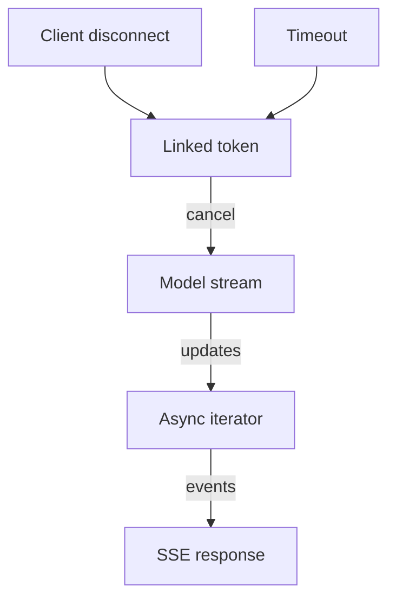

# A streamed answer needs a way to stop

A user asks a question, waits for an answer and closes the page. The service keeps generating. Nothing
is wrong with the model call: it is doing exactly what the application asked. The application never
connected the lifetime of that work to the person waiting for it.

Long model calls expose two separate design problems. You want to show useful output before the whole
answer is ready, and you want unwanted work to stop when the client leaves or its time budget expires.
Streaming addresses the first. Cancellation addresses the second. In P1, the RAG service, both need to
reach from the HTTP endpoint to the model client.

## How it works in .NET \{#how-it-works-in-dotnet}

This lesson targets [.NET 10, the current LTS](https://learn.microsoft.com/en-us/dotnet/core/releases-and-support),
[supported through 14 November 2028](https://learn.microsoft.com/en-us/lifecycle/products/microsoft-net-and-net-core).
The application has three boundaries: an asynchronous operation, a sequence of updates and an HTTP
response. Keeping them distinct makes the cancellation path easier to follow.

A **task** represents an operation that will complete, fail or be cancelled. `Task<T>` also provides a
result. When an asynchronous I/O operation is incomplete, `await` lets the method suspend without
blocking its thread until completion. It does not make the model generate faster or turn sequential
work into parallel work. Microsoft's [async programming guide](https://learn.microsoft.com/en-us/dotnet/csharp/asynchronous-programming/)
explains that execution model. In a request handler, use the asynchronous model API directly; blocking
on `.Result` or `.Wait()` consumes a thread while waiting. Wrapping blocking I/O in `Task.Run` still
leaves a thread blocked, as the [ASP.NET Core guidance](https://learn.microsoft.com/en-us/aspnet/core/fundamentals/best-practices?view=aspnetcore-10.0)
warns.

An **async stream**, `IAsyncEnumerable<T>`, provides successive items with asynchronous waits between
them. An async iterator produces items with `yield return`; a consumer reads them with `await foreach`.
For a model, an item might be a text fragment rather than a complete answer. The sequence is an
application contract: it does not itself choose an HTTP format. The
[async-streams guide](https://learn.microsoft.com/en-us/dotnet/csharp/asynchronous-programming/generate-consume-asynchronous-stream)
covers production, consumption and cancellation of that sequence.

**Server-sent events (SSE)** carry event messages from server to client over an HTTP connection.
ASP.NET Core 10's [`TypedResults.ServerSentEvents`](https://learn.microsoft.com/en-us/dotnet/api/microsoft.aspnetcore.http.typedresults.serversentevents?view=aspnetcore-10.0)
accepts an `IAsyncEnumerable<SseItem<T>>`; each item carries a payload and can name its event type.
Returning a sequence as ordinary JSON does not give it the same event protocol; the
[response guide](https://learn.microsoft.com/en-us/aspnet/core/fundamentals/minimal-apis/responses?view=aspnetcore-10.0)
shows the distinct result types.



Cancellation travels towards the producer; answer fragments travel back towards the client.

In a minimal API, a `CancellationToken` handler parameter binds to
[`HttpContext.RequestAborted`](https://learn.microsoft.com/en-us/aspnet/core/fundamentals/use-http-context?view=aspnetcore-10.0#requestaborted).
Pass that signal onwards. A **cancellation token source** requests cancellation; its token lets each
operation observe the request. Cancellation is
[cooperative](https://learn.microsoft.com/en-us/dotnet/standard/threading/cancellation-in-managed-threads):
accepting a token parameter is insufficient if the implementation never checks it or passes it to
awaited I/O.

Create a [linked source](https://learn.microsoft.com/en-us/dotnet/api/system.threading.cancellationtokensource.createlinkedtokensource?view=net-10.0)
from the request token and call
[`CancelAfter`](https://learn.microsoft.com/en-us/dotnet/api/system.threading.cancellationtokensource.cancelafter?view=net-10.0)
once to add an elapsed-time budget. Either request cancellation or the timer can then stop downstream
work. Calling `CancelAfter` again resets its countdown: resetting after every fragment implements an
idle timeout, which bounds silence between updates, rather than total generation time.

Keep the linked source [alive throughout enumeration](https://learn.microsoft.com/en-us/dotnet/csharp/language-reference/statements/yield#using-statements-in-iterators). The SSE result consumes the iterator after the
handler returns, so a source created in a handler-level `using` would be disposed too early. Put it
inside the iterator and dispose it when enumeration ends. `[EnumeratorCancellation]` connects the
consumer's enumeration token to that iterator's token parameter; [`WithCancellation(token)`](https://learn.microsoft.com/en-us/dotnet/api/system.threading.tasks.taskasyncenumerableextensions.withcancellation?view=net-10.0) supplies
such a token when consuming another async sequence. Neither replaces passing cancellation into the
actual model operation.

## Choosing and tradeoffs \{#choosing-and-tradeoffs}

Choose the response contract from what the client can safely use while generation is still underway.

| Choice | Use it when | Avoid it when / failure mode |
|---|---|---|
| Buffered JSON with `Task<T>` | The client needs one complete, validated answer. | Long silent waits are unacceptable; buffering delays all visible output. |
| SSE from `IAsyncEnumerable<T>` | The client can display provisional fragments. | Every byte must pass whole-answer validation before release; already-delivered text cannot be withdrawn. |
| Durable background job | The result must survive the caller leaving. | A short interactive answer is enough; persistence and result retrieval add work. |

A timeout on the *wait* is another common trap.
[`Task.WaitAsync`](https://learn.microsoft.com/en-us/dotnet/api/system.threading.tasks.task.waitasync?view=net-10.0)
can stop awaiting an operation when its timeout or cancellation fires. That alone does not pass a stop
signal into the original operation. It can keep running, and any
[later exception still needs observing](https://devblogs.microsoft.com/dotnet/how-do-i-cancel-non-cancelable-async-operations/).
Give the producer the linked token. Work that must continue independently needs a separately owned
lifecycle, not an unobserved task launched from a request.

Streaming also changes error handling. Once the response body starts, ASP.NET Core
[cannot change its status code or headers](https://learn.microsoft.com/en-us/aspnet/core/fundamentals/best-practices?view=aspnetcore-10.0).
A model failure halfway through an answer cannot become a fresh JSON problem response with a different
status. Define completion at the application level. P1 will use `delta`, `citation` and `done` event
types; these are our protocol choices. A closed stream without `done` means an incomplete answer.
A production client should expose that state instead of quietly presenting the partial text as final.

Check the deployed route's delivery behaviour. Reading an async sequence
incrementally does not establish how quickly a proxy forwards each event or how much a provider
buffers internally. Verify first-content delivery and cancellation through the deployed route. The
local exercise only establishes the intended application structure.

## In an AI workload \{#in-an-ai-workload}

For P1, retrieve the permitted document context before starting answer generation. Preserve the source
identifiers used for citations as the answer streams. The
[Generation lesson](/rag-agents/part-1-rag/generation/) owns grounding and citation design; changing the
transport does not make an answer more faithful to its documents. If your safety policy requires
checking the complete answer before disclosure, choose buffering even when the model supports streaming.

Give retrieval and generation an explicit overall budget. If retrieval consumes most of it, starting
generation with a fresh full timeout makes the user's wait longer than the original budget. The lab
below starts its timer at answer enumeration because it has no retrieval stage. In the complete P1
request, start the budget before retrieval and retain it until streaming ends.

At the model boundary,
[`IChatClient.GetStreamingResponseAsync`](https://learn.microsoft.com/en-us/dotnet/api/microsoft.extensions.ai.ichatclient.getstreamingresponseasync?view=net-10.0-pp)
accepts a cancellation token and returns response updates as an async sequence. Forward the same
budget token into that call. Test the selected provider's behaviour under cancellation; a local token
does not prove that remote generation stops immediately, rolls back work or stops further charges.

Record time to first answer content, total duration and why the stream ended. Separate client
disconnects, elapsed budgets and provider failures; combining them into one error count makes a slow
model difficult to distinguish from an impatient caller. The
[Observability lesson](/rag-agents/part-1-rag/cross-cutting/observability/) explains the wider trace.
Avoid automatically replaying a generation after partial text has reached the user: without an explicit
replacement protocol, a retry can append a second answer to the first.

## Try it \{#try-it}

Build P1's answer transport locally with a simulated model. It yields fixed text and a citation
placeholder, so you can exercise completion and cancellation without a deployment or credentials.
Both snippets target [.NET SDK 10.0.402](https://dotnet.microsoft.com/en-us/download/dotnet/10.0).
Install that SDK and curl, and keep local port 5050 free. The simulated lab needs no added NuGet packages.

The code on this page was built with .NET SDK 10.0.402 and Microsoft.Extensions.AI.Abstractions
10.11.0 on 2026-10-17. The local lab was run as written, including the disconnect and the timeout
variant, and the results described below are from that run. The adapter snippet was compiled and
exercised with a local stand-in chat client; it was not run against a live model provider or Azure
subscription.

Create a scratch project outside your existing P1 checkout. The
[`web` template and CLI options](https://learn.microsoft.com/en-us/dotnet/core/tools/dotnet-new-sdk-templates)
create an empty ASP.NET Core application:

```bash
dotnet new web --framework net10.0 --output P1StreamingLab
cd P1StreamingLab
```

Replace `Program.cs` with this local example:

```csharp
using System.Net.ServerSentEvents;
using System.Runtime.CompilerServices;

var builder = WebApplication.CreateBuilder(args);
var app = builder.Build();

app.MapGet("/answer", (CancellationToken requestAborted) =>
    TypedResults.ServerSentEvents(AnswerAsync(requestAborted)));

app.Run("http://localhost:5050");

static async IAsyncEnumerable<SseItem<string>> AnswerAsync(
    [EnumeratorCancellation] CancellationToken requestAborted = default)
{
    using var budget = CancellationTokenSource.CreateLinkedTokenSource(requestAborted);
    budget.CancelAfter(TimeSpan.FromSeconds(10));

    try
    {
        await foreach (var text in ModelAsync(budget.Token))
            yield return new SseItem<string>(text, eventType: "delta");

        budget.Token.ThrowIfCancellationRequested();
        yield return new SseItem<string>("public-document-1#section-2", "citation");
        yield return new SseItem<string>("complete", "done");
    }
    finally
    {
        Console.WriteLine("Answer enumeration ended.");
    }
}

static async IAsyncEnumerable<string> ModelAsync(
    [EnumeratorCancellation] CancellationToken cancellationToken = default)
{
    string[] fragments = ["The ", "answer ", "comes ", "from ", "public ", "documents."];
    foreach (var fragment in fragments)
    {
        await Task.Delay(500, cancellationToken);
        yield return fragment;
    }
}
```

The ten-second budget is a lab setting, not a platform limit. The
[`Task.Delay` token overload](https://learn.microsoft.com/en-us/dotnet/api/system.threading.tasks.task.delay?view=net-10.0)
makes the simulated wait cancellable. For this isolated lab,
[`app.Run` sets the local address](https://learn.microsoft.com/en-us/aspnet/core/fundamentals/minimal-apis/webapplication?view=aspnetcore-10.0).
Start it with [`--no-launch-profile`](https://learn.microsoft.com/en-us/dotnet/core/tools/dotnet-run)
so a generated launch profile does not configure the run:

```bash
dotnet run --no-launch-profile
```

In a second terminal, request the stream. curl's
[`--no-buffer`](https://curl.se/docs/manpage.html#-N) disables its output buffering:

```bash
curl --no-buffer http://localhost:5050/answer
```

Expect named `delta` events carrying the strings, followed by `citation` and `done` events. Strings
are [sent as raw payloads](https://learn.microsoft.com/en-us/dotnet/api/microsoft.aspnetcore.http.typedresults.serversentevents?view=aspnetcore-10.0),
without JSON quotes. Request again and press Ctrl+C in the curl terminal after the first fragment.
Once the server observes the disconnect, the request token should cancel the simulated wait, and
the server should print `Answer enumeration ended.` It prints the same message after success because
it is in the iterator's [`finally` block](https://learn.microsoft.com/en-us/dotnet/csharp/language-reference/statements/yield).
The cancellation check is that the run stops early and no `done` event arrives.

Then stop the server, change `Task.Delay(500, cancellationToken)` to
`Task.Delay(2000, cancellationToken)`, restart and request again. Generation now exceeds the budget:
expect about four `delta` events, then closure around ten seconds without `done`. curl reports
`curl: (18) transfer closed with outstanding read data remaining`;
[code 18 means an incomplete transfer](https://curl.se/libcurl/c/libcurl-errors.html).
The server prints `Answer enumeration ended.`, then a `fail: Microsoft.AspNetCore.Server.Kestrel[13]`
log saying “An unhandled exception was thrown by the application.” with a `TaskCanceledException`
stack trace. The sample deliberately lets cancellation propagate: cancelling
[`Task.Delay`](https://learn.microsoft.com/en-us/dotnet/api/system.threading.tasks.task.delay?view=net-10.0)
throws that exception, and Kestrel records the uncaught failure as
[application-error event 13](https://github.com/dotnet/aspnetcore/blob/main/src/Servers/Kestrel/Core/src/Internal/Infrastructure/KestrelTrace.General.cs).
This is expected for this lab's timeout variant. It does not emit an SSE error event. In production,
catch budget-only cancellation and log it as a timeout. Check whether the request or budget was
cancelled; do not classify every `OperationCanceledException` as a timeout.

For the later Foundry integration, keep `AnswerAsync`'s lifetime handling and replace the simulated
producer with this second snippet. Its package target is
[`Microsoft.Extensions.AI.Abstractions` 10.11.0](https://www.nuget.org/packages/Microsoft.Extensions.AI.Abstractions/10.11.0),
the latest stable version as of this page's verification date. That package supplies `IChatClient` and
[`ChatResponseUpdate`](https://learn.microsoft.com/en-us/dotnet/api/microsoft.extensions.ai.chatresponseupdate?view=net-10.0-pp);
no other package is needed for these abstractions. The adapter requires an already configured client.

Add `using Microsoft.Extensions.AI;` to the **top of `Program.cs`**, before its top-level statements,
as the [using-directive rules](https://learn.microsoft.com/en-us/dotnet/csharp/language-reference/compiler-messages/using-directive-errors)
require. Keep `using System.Runtime.CompilerServices;` there too for
[`EnumeratorCancellation`](https://learn.microsoft.com/en-us/dotnet/api/system.runtime.compilerservices.enumeratorcancellationattribute?view=net-10.0).
Replace the simulated `ModelAsync` function below the statements. Pass the configured client and
grounded messages into `AnswerAsync`, then call `ModelAsync(chat, messages, budget.Token)` there:

```csharp
static async IAsyncEnumerable<string> ModelAsync(
    IChatClient chat, IEnumerable<ChatMessage> messages,
    [EnumeratorCancellation] CancellationToken cancellationToken = default)
{
    await foreach (var update in chat.GetStreamingResponseAsync(
        messages, cancellationToken: cancellationToken))
    {
        if (!string.IsNullOrEmpty(update.Text))
            yield return update.Text;
    }
}
```

Provider registration belongs to P1's model integration and [II.8, AI in .NET](./ai-in-dotnet.md). This adapter shows where
the cancellation signal enters the model call; the transport need not know which provider supplies it.

**Cost:** free (local only, no Azure resources). The exercise makes no external model calls.

**Teardown:** stop the local server with Ctrl+C, leave `P1StreamingLab` and delete that local folder.

## What to take away \{#what-to-take-away}

- Await model I/O without blocking a request thread. A task represents one operation; an async stream supplies successive updates.
- Use an explicit SSE result to turn updates into HTTP events, and define a completion event so partial answers stay distinguishable.
- Link request cancellation with an elapsed-time budget and pass the token through every layer to the model call.
- Keep cancellation sources alive until enumeration ends. Cancellation is cooperative and cannot retract text already delivered.

**[New terms](../glossary.md#async-streaming-cancellation)**: task, async stream, server-sent events (SSE), cooperative cancellation, cancellation token, cancellation token source, request cancellation, linked cancellation, elapsed-time budget, idle timeout.

## Sources \{#sources}

Verified as of 2026-10-17.

- [.NET releases and support](https://learn.microsoft.com/en-us/dotnet/core/releases-and-support), [Microsoft .NET lifecycle dates](https://learn.microsoft.com/en-us/lifecycle/products/microsoft-net-and-net-core) and [.NET 10 SDK downloads](https://dotnet.microsoft.com/en-us/download/dotnet/10.0)
- [Asynchronous programming](https://learn.microsoft.com/en-us/dotnet/csharp/asynchronous-programming/), [generate and consume async streams](https://learn.microsoft.com/en-us/dotnet/csharp/asynchronous-programming/generate-consume-asynchronous-stream), [EnumeratorCancellation](https://learn.microsoft.com/en-us/dotnet/api/system.runtime.compilerservices.enumeratorcancellationattribute?view=net-10.0) and [WithCancellation](https://learn.microsoft.com/en-us/dotnet/api/system.threading.tasks.taskasyncenumerableextensions.withcancellation?view=net-10.0)
- [ASP.NET Core best practices](https://learn.microsoft.com/en-us/aspnet/core/fundamentals/best-practices?view=aspnetcore-10.0) and [use HttpContext](https://learn.microsoft.com/en-us/aspnet/core/fundamentals/use-http-context?view=aspnetcore-10.0)
- [Minimal API responses](https://learn.microsoft.com/en-us/aspnet/core/fundamentals/minimal-apis/responses?view=aspnetcore-10.0), [TypedResults.ServerSentEvents](https://learn.microsoft.com/en-us/dotnet/api/microsoft.aspnetcore.http.typedresults.serversentevents?view=aspnetcore-10.0) and [SseItem constructor](https://learn.microsoft.com/en-us/dotnet/api/system.net.serversentevents.sseitem-1.-ctor?view=net-10.0)
- [Cancellation in managed threads](https://learn.microsoft.com/en-us/dotnet/standard/threading/cancellation-in-managed-threads), [CreateLinkedTokenSource](https://learn.microsoft.com/en-us/dotnet/api/system.threading.cancellationtokensource.createlinkedtokensource?view=net-10.0) and [CancelAfter](https://learn.microsoft.com/en-us/dotnet/api/system.threading.cancellationtokensource.cancelafter?view=net-10.0)
- [Task.WaitAsync](https://learn.microsoft.com/en-us/dotnet/api/system.threading.tasks.task.waitasync?view=net-10.0), [cancelling a wait versus cancelling work](https://devblogs.microsoft.com/dotnet/how-do-i-cancel-non-cancelable-async-operations/) and [Task.Delay](https://learn.microsoft.com/en-us/dotnet/api/system.threading.tasks.task.delay?view=net-10.0)
- [Iterator execution and resource lifetime](https://learn.microsoft.com/en-us/dotnet/csharp/language-reference/statements/yield)
- [IChatClient streaming method](https://learn.microsoft.com/en-us/dotnet/api/microsoft.extensions.ai.ichatclient.getstreamingresponseasync?view=net-10.0-pp), [ChatResponseUpdate.Text](https://learn.microsoft.com/en-us/dotnet/api/microsoft.extensions.ai.chatresponseupdate.text?view=net-10.0-pp) and [use IChatClient](https://learn.microsoft.com/dotnet/ai/ichatclient)
- [Microsoft.Extensions.AI.Abstractions 10.11.0](https://www.nuget.org/packages/Microsoft.Extensions.AI.Abstractions/10.11.0) and [using-directive placement](https://learn.microsoft.com/en-us/dotnet/csharp/language-reference/compiler-messages/using-directive-errors)
- [Kestrel application-error logging](https://github.com/dotnet/aspnetcore/blob/main/src/Servers/Kestrel/Core/src/Internal/Infrastructure/KestrelTrace.General.cs) and [curl error codes](https://curl.se/libcurl/c/libcurl-errors.html)
- [dotnet new](https://learn.microsoft.com/en-us/dotnet/core/tools/dotnet-new), [SDK templates](https://learn.microsoft.com/en-us/dotnet/core/tools/dotnet-new-sdk-templates), [dotnet run](https://learn.microsoft.com/en-us/dotnet/core/tools/dotnet-run) and [WebApplication configuration](https://learn.microsoft.com/en-us/aspnet/core/fundamentals/minimal-apis/webapplication?view=aspnetcore-10.0)
- [curl manual: --no-buffer](https://curl.se/docs/manpage.html#-N)
