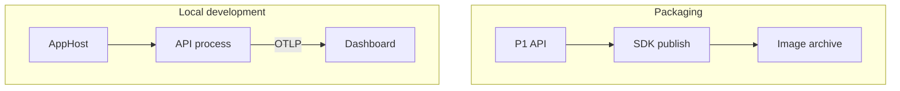

# An image ships the service; telemetry explains a request

An API can work on your laptop while nobody else can start it reliably. One developer has the right
runtime; another has different environment variables. A third starts the API before its dependencies
are ready. Shipping the application and reproducing its development environment are related problems,
but solving one leaves the other open.

For a question-answering service, getting every process running is only the beginning. A slow response
might come from retrieval, a model call or application code between them. Separate terminal windows tell
you which processes are alive; they rarely explain what happened to one request. You need a deployable
artifact, an explicit description of the local application and telemetry from the code doing the work.

## How it works in .NET \{#how-it-works-in-dotnet}

Use **.NET 10**, the current LTS release, supported through **14 November 2028** according to the
[.NET support policy](https://dotnet.microsoft.com/en-us/platform/support/policy). Three pieces divide
the work: the SDK packages the API, Aspire starts the local application, and instrumentation supplies
the evidence you inspect.

The SDK's [`PublishContainer` target](https://learn.microsoft.com/en-us/dotnet/core/containers/sdk-publish)
creates a container image without a Dockerfile. It combines published application files with a base
image and the configuration needed to start the application. For a framework-dependent ASP.NET Core
project, the SDK normally infers the `aspnet` base image and a tag from the target framework;
[container publish properties](https://learn.microsoft.com/en-us/dotnet/core/containers/publish-configuration)
let you select the base, repository and image tag explicitly. A container image packages the runtime
boundary; endpoints and credentials for external services still belong in runtime configuration.

Creating an image does not necessarily require Docker. The default publish destination is a local
container runtime, which must be running. Publishing to an archive or directly to a registry avoids
that dependency. Running a container still needs a container runtime. This distinction matters in CI:
a build job that only produces an archive has different prerequisites from a job that starts containers.

**Aspire**, [formerly .NET Aspire](https://aspire.dev/whats-new/aspire-13/), starts the local application.
This lesson uses the 13.6 line, with [13.6.1 the latest stable CLI package as of 2026-10-17](https://www.nuget.org/packages/Aspire.Cli/13.6.1),
and pins [the project templates to 13.6.1](https://www.nuget.org/packages/Aspire.ProjectTemplates/13.6.1).
New C# AppHosts set `AspireUseCliBundle=true`: running them with `dotnet run`
[launches the Aspire CLI](https://aspire.dev/get-started/aspire-sdk/#running-with-dotnet-run), normally
from `PATH` or, if no compatible command is found, through `dnx` fetching the paired `Aspire.Cli` package
from NuGet. The exercise selects `DnxPinned` to use that paired 13.6.1 CLI regardless of `PATH`.

The [AppHost](https://aspire.dev/get-started/app-host/) describes application resources and their
relationships. A resource can be an API project, a container or another dependency. In a project-based
C# AppHost, `AddProject` registers a referenced .NET project for local execution. The API keeps its
request handlers; the AppHost holds the instructions for starting and connecting the application.



These are two uses of the same API source. `AddProject` starts the project as a process during local
development; it does not launch the image archive. Running the published image is a separate check.
A passing local request says nothing about whether the image runs correctly.

Telemetry also has an application-side component. The
[C# Service Defaults project](https://aspire.dev/get-started/csharp-service-defaults/) supplies shared
configuration for OpenTelemetry, health checks, service discovery and HTTP client resilience. Each
service references it and calls its setup methods. It is source code you can inspect and change.
Keep shared RAG models and business logic in their own libraries rather than adding them to this project.

The AppHost supplies local telemetry destinations; instrumented services export logs, traces and
metrics through **OTLP**, the OpenTelemetry Protocol. The
[dashboard](https://aspire.dev/dashboard/) displays those signals alongside application resources.
Starting an uninstrumented service under Aspire does not manufacture traces for it. A **span** records
one operation within a trace, so tracing a request's retrieval and generation separately gives you
more useful evidence than one elapsed time around the entire handler.

## Choosing and tradeoffs \{#choosing-and-tradeoffs}

Choose packaging and local orchestration separately. A plain API may benefit from an SDK-built image
long before it needs an AppHost. Conversely, you can use Aspire to develop a service locally while
its deployment pipeline uses a different packaging process.

| Choice | Use it when | When to avoid it or change approach |
|---|---|---|
| SDK container publishing | The published .NET application fits an existing base image. | You need arbitrary OS installation steps; the SDK cannot execute Dockerfile `RUN` instructions. Use a prepared base image or a Dockerfile. |
| A Dockerfile | You need explicit control of image construction beyond the SDK's publish properties. | It only duplicates packaging the SDK already handles, leaving another build recipe to maintain. |
| Plain `dotnet run` | One process and a small amount of configuration are enough. | Starting related services and correlating their behaviour has become manual work. |
| Aspire AppHost | You need an application graph, dependency configuration and a shared local dashboard. | You would add it solely to package one API, without using its orchestration or diagnostics. |
| Existing Docker Compose setup | Your team already has a useful container-based development environment. | You maintain a second, divergent description of the same environment without deciding which owns it. |

One common failure is to confuse wiring with readiness. Aspire's
[service discovery](https://aspire.dev/fundamentals/service-discovery/)
lets callers use logical service names, with endpoints supplied through configuration. `WithReference`
connects that configuration to the caller. It does not establish that a dependency is ready to accept
work; use an explicit [readiness relationship such as `WaitFor`](https://aspire.dev/fundamentals/health-checks/)
where the application needs one.
Nor does local service discovery grant permission to call a cloud service.

Another failure is treating resource health as request success. A running API can return an error
from its model dependency. A successful HTTP response can contain a poorly grounded answer. The
[Aspire telemetry guidance](https://aspire.dev/fundamentals/telemetry/) distinguishes resource health
from request traces: inspect the failed operation and correlated logs instead of stopping at a green
resource indicator.

Rebuild the image to incorporate updated application dependencies and base-image contents. Keep the
SDK and base-image choice in your release process. Image tags are mutable: the same tag can point to
new bytes after another push. Record the tested image's **manifest digest**, its content-derived
identifier, and deploy that digest when the release must use the tested artifact;
[registry tags and digests](https://learn.microsoft.com/en-us/azure/container-registry/container-registry-concepts#manifest-digest)
serve different purposes.

## In an AI workload \{#in-an-ai-workload}

P1 is a RAG API over a small public document set. Its destination is Azure Container Apps, with a
Foundry model deployment, Azure AI Search, Blob Storage and Key Vault accessed through managed identity.
The [P1 delivery work](../part-5-projects/rag-service.md) adds Bicep, azd, GitHub Actions with OIDC and Application Insights. This lesson
prepares the API artifact and local diagnostics that those steps use.

Package the service independently of the corpus and model deployment. Changing a model endpoint or
index name should be a configuration change rather than a reason to bake credentials or documents
into an image. The image holds the application; access to its dependencies is established when that
application runs. Local orchestration gives you somewhere to exercise the request path, while cloud
identity and network access still need their own verification in the deployed environment.

For a concrete debugging case, suppose an answer takes several seconds. An HTTP request span gives
you the outside duration. Retrieval and model spans can show where that time went. The
[RAG observability lesson](/rag-agents/part-1-rag/cross-cutting/observability/) owns the design of that
pipeline trace; here the task is to make your .NET service emit and display it. ASP.NET Core and HTTP
client instrumentation provide a starting point, but you must add application-specific operations and
measurements deliberately; [II.8, AI in .NET](./ai-in-dotnet.md) covers model-call instrumentation.
Do not read a generic HTTP trace as a token-usage report.

Use operation names, durations and failure information before adding payloads to telemetry. Logging
every prompt or retrieved passage makes debugging data another copy of the application's inputs.
Even with public source documents, a user's question can contain private information. Decide what
belongs in telemetry before enabling verbose capture.

The dashboard helps you investigate behaviour; answer quality still needs
[evaluation](/rag-agents/part-1-rag/cross-cutting/evaluation/). Keep a small set of questions and expected
citations as the service grows. The production feedback loop belongs to
[observability and rollout](/ai-sdlc/part-4-platform/observability-rollout): local traces prepare that
work, but do not establish that production alerts, retention or Azure Monitor export are configured.

## Try it \{#try-it}

Build a local starting point for P1: an API process under Aspire and an image archive from the same
API. The endpoint below reports that the API is running; retrieval and model calls are integrated in [P1](../part-5-projects/rag-service.md).
Use a Bash-compatible terminal with the .NET 10 SDK selected. Follow the
[Aspire prerequisites](https://aspire.dev/get-started/prerequisites/) for your development environment;
on Linux, [certificate trust can require distribution- and browser-specific steps](https://learn.microsoft.com/en-us/aspnet/core/security/enforcing-ssl?view=aspnetcore-10.0#trust-https-certificate-on-linux).

**Code status:** the code on this page was built with .NET SDK 10.0.402 on macOS (arm64),
Aspire.ProjectTemplates 13.6.1 and the package versions in the table below on 2026-10-17. The three
projects built; restoring the AppHost reports a moderate-severity `NU1902` warning for MessagePack
2.5.302, which Aspire.Hosting 13.6.1 brings in transitively. The publish step created
`artifacts/p1-api.tar.gz` without a running container runtime, and the API, run on its own, returned
`{"service":"p1-rag-api"}` from `/status`. The AppHost was built but not run: the certificate trust,
Aspire CLI fetch and dashboard results below are expected results, not recorded observations. The
archived image was not loaded or run. Nothing on this page calls Azure.

The code targets the .NET 10 SDK, `net10.0` and these exact package versions, verified on NuGet as the
latest stable releases on 2026-10-17. Update Service Defaults after generation: its template pins older
dependencies.

| Component | Target version |
|---|---|
| [Aspire.AppHost.Sdk](https://www.nuget.org/packages/Aspire.AppHost.Sdk/13.6.1), [Aspire.Hosting.AppHost](https://www.nuget.org/packages/Aspire.Hosting.AppHost/13.6.1) (implicit), [Aspire.Cli](https://www.nuget.org/packages/Aspire.Cli/13.6.1), [Aspire.ProjectTemplates](https://www.nuget.org/packages/Aspire.ProjectTemplates/13.6.1) | 13.6.1 |
| [Microsoft.Extensions.Http.Resilience](https://www.nuget.org/packages/Microsoft.Extensions.Http.Resilience/10.11.0), [Microsoft.Extensions.ServiceDiscovery](https://www.nuget.org/packages/Microsoft.Extensions.ServiceDiscovery/10.11.0) | 10.11.0 |
| [OpenTelemetry.Exporter.OpenTelemetryProtocol](https://www.nuget.org/packages/OpenTelemetry.Exporter.OpenTelemetryProtocol/1.20.0), [OpenTelemetry.Extensions.Hosting](https://www.nuget.org/packages/OpenTelemetry.Extensions.Hosting/1.20.0), [OpenTelemetry.Instrumentation.AspNetCore](https://www.nuget.org/packages/OpenTelemetry.Instrumentation.AspNetCore/1.20.0), [OpenTelemetry.Instrumentation.Http](https://www.nuget.org/packages/OpenTelemetry.Instrumentation.Http/1.20.0), [OpenTelemetry.Instrumentation.Runtime](https://www.nuget.org/packages/OpenTelemetry.Instrumentation.Runtime/1.20.0) | 1.20.0 |

Create a fresh folder. Check that `dotnet --version` reports a `10.0` SDK before continuing. Install the
pinned templates using the current
[`package@version` syntax](https://learn.microsoft.com/en-us/dotnet/core/tools/dotnet-new-install).

```bash
mkdir p1-containers
cd p1-containers
dotnet --version
dotnet new install Aspire.ProjectTemplates@13.6.1
dotnet new web --name P1Api --output P1Api --framework net10.0
dotnet new aspire-apphost --name P1AppHost --output P1AppHost --framework net10.0
dotnet new aspire-servicedefaults --name P1ServiceDefaults --output P1ServiceDefaults --framework net10.0
dotnet reference add P1ServiceDefaults/P1ServiceDefaults.csproj --project P1Api/P1Api.csproj
dotnet reference add P1Api/P1Api.csproj --project P1AppHost/P1AppHost.csproj
```

The API references Service Defaults for shared configuration; the AppHost references the API to start
it. Use [`dotnet package add`](https://learn.microsoft.com/en-us/dotnet/core/tools/dotnet-package-add)
to set the Service Defaults dependencies to the versions above:

```bash
for package in Microsoft.Extensions.Http.Resilience Microsoft.Extensions.ServiceDiscovery; do
  dotnet package add "$package" --version 10.11.0 --project P1ServiceDefaults/P1ServiceDefaults.csproj
done
for package in OpenTelemetry.Exporter.OpenTelemetryProtocol OpenTelemetry.Extensions.Hosting \
  OpenTelemetry.Instrumentation.AspNetCore OpenTelemetry.Instrumentation.Http OpenTelemetry.Instrumentation.Runtime; do
  dotnet package add "$package" --version 1.20.0 --project P1ServiceDefaults/P1ServiceDefaults.csproj
done
```

Replace `P1Api/Program.cs` with:

```csharp
var builder = WebApplication.CreateBuilder(args);
builder.AddServiceDefaults();

var app = builder.Build();
app.MapGet("/status", () => Results.Ok(new { service = "p1-rag-api" }));
app.MapDefaultEndpoints();
app.Run();
```

Replace `P1AppHost/AppHost.cs` with:

```csharp
var builder = DistributedApplication.CreateBuilder(args);
builder.AddProject<Projects.P1Api>("api");
builder.Build().Run();
```

Publish only the API. Working inside its folder makes the archive path unambiguous. The
[`dotnet publish` options](https://learn.microsoft.com/en-us/dotnet/core/tools/dotnet-publish) select
Release and Linux x64 explicitly; the archive destination avoids loading an image into a local daemon.

```bash
mkdir artifacts
cd P1Api
dotnet publish --configuration Release --os linux --arch x64 \
  /t:PublishContainer \
  -p ContainerRepository=p1-api \
  -p ContainerImageTag=lesson7 \
  -p ContainerArchiveOutputPath=../artifacts/p1-api.tar.gz
cd ..
dotnet dev-certs https --trust
dotnet run --project P1AppHost/P1AppHost.csproj --property:AspireCliInvocationMode=DnxPinned
```

The publish step should create `artifacts/p1-api.tar.gz`. The AppHost should start the API and dashboard;
open the dashboard's login link printed in the terminal. In its resource list, find `api`, open its
HTTP endpoint and append `/status`. Expect JSON containing `"service":"p1-rag-api"`. Make several
requests, then inspect the API's traces and metrics. This confirms the intended local observation path
when you run it; it does not exercise the archived image.

If the dashboard appears but no request traces arrive, check the API's ServiceDefaults reference and
`AddServiceDefaults` call, then its exporter configuration. The
[.NET OpenTelemetry reference](https://learn.microsoft.com/en-us/dotnet/core/diagnostics/observability-with-otel)
explains the instrumentation and export path. The health endpoints are less useful for this check:
the default template excludes them from tracing.

**Cost:** free (local only, no Azure resources). This exercise starts local .NET processes and creates
an image archive; it makes no model calls. It needs internet access on first run for NuGet restore,
the Aspire CLI fetch and the [base image from MCR](https://learn.microsoft.com/en-us/dotnet/core/containers/publish-configuration#containerbaseimage)
(`mcr.microsoft.com/dotnet/aspnet:10.0`), even when publishing to an archive.

**Teardown:** stop the AppHost with `Ctrl+C`, then delete the local `p1-containers` folder. Installed
project templates remain available as reusable development tooling.

## What to take away \{#what-to-take-away}

- Use `PublishContainer` to package a suitable .NET service without maintaining a Dockerfile.
- An AppHost describes the local application; `AddProject` runs the API project, independently of its published image.
- Telemetry needs instrumentation and an exporter inside the service. The dashboard displays what reaches it.
- Use traces to locate slow or failed operations, and evaluations to check retrieval and answer quality.

**[New terms](../glossary.md#containers-and-aspire)**: container image, image digest, PublishContainer, AppHost, Aspire resource, Service Defaults, OpenTelemetry, OTLP, span, service discovery.

## Sources \{#sources}

Verified as of 2026-10-17.

- **Runtime and packaging:** [.NET support policy](https://dotnet.microsoft.com/en-us/platform/support/policy), [SDK container creation](https://learn.microsoft.com/en-us/dotnet/core/containers/overview), [Containerize with dotnet publish](https://learn.microsoft.com/en-us/dotnet/core/containers/sdk-publish), [Container publish properties](https://learn.microsoft.com/en-us/dotnet/core/containers/publish-configuration), [Image tags and digests](https://learn.microsoft.com/en-us/azure/container-registry/container-registry-concepts#manifest-digest).
- **Aspire:** [Pinned package versions](https://www.nuget.org/packages/Aspire.ProjectTemplates/13.6.1), [Aspire 13 naming](https://aspire.dev/whats-new/aspire-13/), [SDK and CLI bundle](https://aspire.dev/get-started/aspire-sdk/), [Aspire 13.6](https://aspire.dev/whats-new/aspire-13-6/), [Prerequisites](https://aspire.dev/get-started/prerequisites/), [SDK templates](https://aspire.dev/get-started/aspire-sdk-templates/), [AppHost](https://aspire.dev/get-started/app-host/), [Add Aspire to an existing app](https://aspire.dev/get-started/add-aspire-existing-app/), [AppHost configuration](https://aspire.dev/app-host/configuration/), [C# launch profiles](https://aspire.dev/integrations/dotnet/launch-profiles/), [Health checks and readiness](https://aspire.dev/fundamentals/health-checks/), [Service discovery](https://aspire.dev/fundamentals/service-discovery/).
- **Telemetry and application code:** [C# Service Defaults](https://aspire.dev/get-started/csharp-service-defaults/), [Aspire telemetry](https://aspire.dev/fundamentals/telemetry/), [Dashboard](https://aspire.dev/dashboard/), [.NET OpenTelemetry](https://learn.microsoft.com/en-us/dotnet/core/diagnostics/observability-with-otel), [Minimal APIs (.NET 10)](https://learn.microsoft.com/en-us/aspnet/core/fundamentals/minimal-apis?view=aspnetcore-10.0), [Linux certificate trust](https://learn.microsoft.com/en-us/aspnet/core/security/enforcing-ssl?view=aspnetcore-10.0#trust-https-certificate-on-linux).
- **Command references:** [dotnet new](https://learn.microsoft.com/en-us/dotnet/core/tools/dotnet-new), [Built-in templates](https://learn.microsoft.com/en-us/dotnet/core/tools/dotnet-new-sdk-templates), [dotnet new install](https://learn.microsoft.com/en-us/dotnet/core/tools/dotnet-new-install), [dotnet reference add](https://learn.microsoft.com/en-us/dotnet/core/tools/dotnet-reference-add), [dotnet package add](https://learn.microsoft.com/en-us/dotnet/core/tools/dotnet-package-add), [dotnet publish](https://learn.microsoft.com/en-us/dotnet/core/tools/dotnet-publish), [dotnet run](https://learn.microsoft.com/en-us/dotnet/core/tools/dotnet-run), [dotnet dev-certs](https://learn.microsoft.com/en-us/dotnet/core/tools/dotnet-dev-certs).
