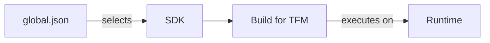

# The SDK, the target framework and the runtime are three separate decisions

A service can build on your laptop and fail before handling its first request elsewhere. The build
machine may have selected a different compiler, a dependency may require APIs the application does not
target, or the deployment may lack the runtime it needs. All three can look like “a .NET version problem”,
and no single version number fixes all three.

Before adding a model client, make the application foundation explicit: which tools build the service,
which APIs its code can use, and what executes the result. This lesson separates those decisions and
creates the local solution for P1, the RAG service. You need no Azure account to begin.

## How it works in .NET \{#how-it-works-in-dotnet}

The **runtime** executes application code. The platform supplies libraries for work such as HTTP and JSON,
and automatic memory management through garbage collection. ASP.NET Core supplies the web application
stack. These are distinct parts of [the .NET platform](https://learn.microsoft.com/en-us/dotnet/core/introduction),
even though you often install them together.

The **SDK** is the development toolchain: it includes the `dotnet` CLI, build tools and the runtime needed
for local development. Install the [SDK](https://learn.microsoft.com/en-us/dotnet/core/sdk) to create and
build projects; a runtime-only installation is for running existing applications. A server does not need
the compiler merely to execute an already built service.

Three files make the distinction concrete. `global.json` selects the SDK used by CLI commands.
`Rag.Api.csproj` declares how to build one project and which framework it targets. `RagService.slnx`
groups projects so tools can operate on the solution. A solution is a development convenience; it does
not become a running process or an Azure resource.



An SDK-style C# project with dependency locking enabled can be this small:

```xml
<Project Sdk="Microsoft.NET.Sdk.Web">
  <PropertyGroup>
    <TargetFramework>net10.0</TargetFramework>
    <Nullable>enable</Nullable>
    <ImplicitUsings>enable</ImplicitUsings>
    <RestorePackagesWithLockFile>true</RestorePackagesWithLockFile>
  </PropertyGroup>
</Project>
```

`Microsoft.NET.Sdk.Web` selects the web build rules. It does not pin the installed SDK version. The
[project SDK](https://learn.microsoft.com/en-us/dotnet/core/project-sdk/overview) imports MSBuild properties
and targets implicitly and includes ordinary source files by convention, so you do not have to list
every `.cs` file. `ImplicitUsings` supplies common namespace imports; `Nullable` enables nullable reference
analysis. Compiler warnings about nulls do not validate an incoming HTTP request.

The **target framework moniker**, or TFM, identifies the API surface available to the project.
[`net10.0` targets .NET 10](https://learn.microsoft.com/en-us/dotnet/standard/frameworks). It is neither an
SDK patch number nor a request to install a runtime. Conversely, changing `global.json` changes the
selected tools without rewriting `TargetFramework`. Keep that separation when diagnosing a build: the
question “which SDK did this command select?” comes before “which framework does this project target?”

NuGet supplies additional libraries as versioned packages. A `PackageReference` declares a direct
dependency; that package can bring **transitive dependencies**, the packages it needs in turn.
[Restore resolves this dependency graph](https://learn.microsoft.com/en-us/nuget/concepts/dependency-resolution)
and writes `obj/project.assets.json` for the build. That generated file belongs outside source control.
An application can also keep a
[`packages.lock.json` file](https://learn.microsoft.com/en-us/nuget/consume-packages/package-references-in-project-files#locking-dependencies)
to record the resolved graph, then require restore to honour it in CI.

The CLI joins these operations. `dotnet new` creates files from a template, `dotnet restore` resolves
dependencies, `dotnet build` compiles, and `dotnet run` starts the application during development.
[Commands that need restore normally perform it implicitly](https://learn.microsoft.com/en-us/dotnet/core/tools/dotnet-new#implicit-restore).
Separating restore and build in a pipeline makes failures easier to locate: a feed or dependency problem
fails before compilation starts. It also lets CI reject an unexpected dependency change rather than
silently accepting a new graph.

## Choosing a supported platform \{#choosing-a-supported-platform}

If your reference point is .NET Framework, the name changes conceal a significant platform change.
Use this table to read an old repository before deciding how much of it can move unchanged.

| Platform | What you are looking at | Decision for this service |
|---|---|---|
| .NET Framework 4.x | The Windows platform used by existing applications, including ASP.NET Web Forms; a TFM can be `net481`. | Maintain an existing application when its dependencies require it. Avoid it for this new cross-platform API. |
| .NET Core 1–3.1 | The earlier name of the cross-platform product line; `netcoreapp3.1` is a historical target. These versions are [out of support](https://dotnet.microsoft.com/en-us/platform/support/policy/dotnet-core). | Treat an inherited target as an upgrade task, not a starting point. |
| .NET 5 and later | The continuation of .NET Core, now named .NET; modern server development uses ASP.NET Core. | Choose a supported release; P1 targets .NET 10. |

Microsoft's [server platform guidance](https://learn.microsoft.com/en-us/dotnet/standard/choosing-core-framework-server)
recommends modern .NET for new server applications and describes the technologies that can keep an
existing application on Framework. A Web Forms application cannot become an ASP.NET Core service merely
by changing its TFM. Inventory dependencies and Windows assumptions first; migration work can sit behind
an API boundary while the new service develops separately.

Do not confuse .NET Standard with another runtime choice.
[It specifies a shared set of APIs](https://learn.microsoft.com/en-us/dotnet/standard/net-standard), useful
for libraries spanning implementations. P1 is an application targeting .NET 10, so its target is `net10.0`.
There is no compatibility requirement here that justifies constraining it to a .NET Standard library surface.

[Microsoft's current support policy](https://dotnet.microsoft.com/en-us/platform/support/policy/dotnet-core)
publishes a major release each November, alternating even-numbered Long Term Support (LTS) releases
with odd-numbered Standard Term Support (STS) releases. LTS receives three years of support; STS receives
two. These are support windows, not different quality grades. As of this lesson's verification date,
.NET 10 is the current LTS, supported through **November 14, 2028**. Both .NET 8 LTS and .NET 9 STS reach
end of support on **November 10, 2026**. Starting P1 on either would immediately create an upgrade deadline.

LTS suits this course's service because it gives the application a longer supported baseline while the
projects grow. An actively maintained service can also choose STS when a newer release supplies something
it needs and the team can meet its upgrade deadline. Do not select an older LTS simply because “LTS”
appears beside its name; compare the remaining support dates.

An SDK pin makes tool selection explicit. For an application using package lock files,
[set `rollForward` to `disable`](https://learn.microsoft.com/en-us/dotnet/core/tools/global-json#rollforward)
so developers and CI use the exact SDK version. For some project types, the SDK adds implicit
`PackageReference` items: a different SDK can change those package versions and
[make locked-mode restore fail](https://learn.microsoft.com/en-us/nuget/consume-packages/package-references-in-project-files#locking-dependencies).
Update the SDK pin and regenerate affected lock files together, then rebuild and test.

When you are **not using a lock file**, `latestPatch` is an alternative: it accepts newer installed
patches within the selected SDK feature band. Feature bands group SDK updates by the hundreds portion
of the final version component; they are separate from runtime patches. Neither policy installs an SDK
for you, and `disable` fails if the exact version is missing.

Pinning is not a way to stay on one build for three years;
[support requires current servicing updates](https://learn.microsoft.com/en-us/dotnet/core/releases-and-support).
A [framework-dependent application uses an installed runtime, while a self-contained publication bundles it](https://learn.microsoft.com/en-us/dotnet/core/deploying/);
Part II.7, [Containers and Aspire](./overview.md#whats-inside), covers packaging and deployment choices.

## In an AI workload \{#in-an-ai-workload}

[P1 is the course's RAG service](../intro.md#how-a-lesson-works): a .NET API answering questions over a
small public document set, with citations.

AI client libraries change on their own release schedules, independently of .NET's LTS window:
[package release histories](https://www.nuget.org/packages/OpenAI/) show frequent
updates and prerelease versions. A supported runtime does not tell you which client-library behaviour
you deployed. Part II.8, [AI in .NET](./overview.md#whats-inside), owns library selection; this lesson
establishes how to keep the chosen dependency graph identifiable.

Suppose citations disappear after an update. First compare `global.json` and `packages.lock.json`
between the last good build and the failing one. If the SDK pin changed, check whether its implicit
packages changed too. If a client or transitive package changed, test that dependency update separately
before attributing the regression to the model. If neither file changed, you can investigate the prompt,
model deployment and retrieval index with fewer build variables in play. This is a diagnostic method,
not proof that identical dependencies produce identical answers.

Keep prompt, model-deployment and index changes identifiable alongside application releases. The SDK pin
and lock file describe the build tools and package graph; they do not freeze those remote inputs.
When adding a client library later, record its exact package version and the resulting lock file before
comparing answer quality. That gives an evaluation failure a concrete dependency change to test or rule out.

A successful build establishes only part of correctness. The
[Generation lesson](/rag-agents/part-1-rag/generation/) owns the requirement to answer from supplied context.
The [Layered gates lesson](/ai-sdlc/part-3-verification/layered-gates/) explains why compilation cannot check
that behaviour. Later P1 checks must exercise retrieval and citation handling as well as ordinary HTTP
behaviour. Keep those checks distinct so a green compiler result cannot stand in for an answer-quality result.

## Try it \{#try-it}

Create P1's solution and web project in a new local folder. Install
[.NET SDK 10.0.402](https://dotnet.microsoft.com/en-us/download/dotnet/10.0) first; it is the stable SDK
selected for this exercise as of 2026-10-17 and includes .NET and ASP.NET Core runtimes **10.0.13**.
Those are the versions this example targets; it adds no explicit NuGet packages, so there are no
package versions to pin yet. Use a Bash terminal in a directory outside another .NET checkout, so an
ancestor `global.json` does not select an unrelated SDK.

The commands and code on this page were run with .NET SDK 10.0.402 (runtimes 10.0.13) on macOS on
2026-10-17: the project built, `dotnet restore --locked-mode` succeeded and the local endpoint returned
`Hello World!`. The exercise is local only; nothing here calls Azure.

```bash
dotnet --list-sdks
mkdir p1-rag-service
cd p1-rag-service

dotnet new globaljson --sdk-version 10.0.402 --roll-forward disable
dotnet --version

dotnet new sln --name RagService
dotnet new web --name Rag.Api --output src/Rag.Api --framework net10.0 --no-restore
dotnet sln RagService.slnx add src/Rag.Api/Rag.Api.csproj
```

Before restoring, edit `src/Rag.Api/Rag.Api.csproj`: add
`<RestorePackagesWithLockFile>true</RestorePackagesWithLockFile>` inside its `PropertyGroup`, as in the
project file above. This [declarative opt-in](https://learn.microsoft.com/en-us/nuget/consume-packages/package-references-in-project-files#enabling-the-lock-file)
keeps lock-file use enabled for subsequent restores.

```bash
dotnet restore RagService.slnx
dotnet build RagService.slnx --no-restore
dotnet run --project src/Rag.Api/Rag.Api.csproj --no-build --no-launch-profile -- --urls http://127.0.0.1:5080
```

Check that the SDK list includes `10.0.402` before proceeding. Inside the folder, `dotnet --version`
should select exactly that version. The
[.NET 10 solution template creates `.slnx` by default](https://learn.microsoft.com/en-us/dotnet/core/tools/dotnet-new-sdk-templates#sln),
so the subsequent commands name `RagService.slnx` explicitly. The
[`web` template](https://learn.microsoft.com/en-us/dotnet/core/tools/dotnet-new-sdk-templates#web) creates the
project whose key properties you saw above, apart from the lock-file opt-in you added. Restore resolves
dependencies and writes `src/Rag.Api/packages.lock.json`; build compiles the solution. The lock file
is already present, but its `net10.0` section is empty: this step adds no explicit package dependencies.

The `web` template generates `Program.cs`; per the
[Minimal APIs reference](https://learn.microsoft.com/en-us/aspnet/core/fundamentals/minimal-apis?view=aspnetcore-10.0#webapplication),
it contains:

```csharp
var builder = WebApplication.CreateBuilder(args);
var app = builder.Build();

app.MapGet("/", () => "Hello World!");

app.Run();
```

With the process running, open `http://127.0.0.1:5080/` in your browser. The expected response is
`Hello World!`. The [`--no-launch-profile` option](https://learn.microsoft.com/en-us/dotnet/core/tools/dotnet-run)
skips template launch settings; everything after `--` goes to the application, where
[`--urls` selects the listening address](https://learn.microsoft.com/en-us/aspnet/core/fundamentals/servers/kestrel/endpoints?view=aspnetcore-10.0#specify-endpoints-with-urls).
This loopback HTTP endpoint is only a local development check. It does not test retrieval or Azure readiness.

Keep `global.json`, the solution and the project with the source, plus the generated `packages.lock.json`,
which starts recording entries when packages are introduced. When CI is added,
[`dotnet restore --locked-mode`](https://learn.microsoft.com/en-us/dotnet/core/tools/dotnet-restore)
can reject changes to that locked graph. Keep `rollForward: disable` with it. Leave generated `bin` and
`obj` output out of source control.

**Cost:** Free: [.NET is free](https://learn.microsoft.com/en-us/dotnet/core/introduction), and this exercise
creates no Azure resources and makes no model calls.

**Teardown:** Stop the process with Ctrl+C, then delete the local `p1-rag-service` folder. If you keep it
for the next P1 step, stopping the process leaves only local files.

## What to take away \{#what-to-take-away}

- Select the SDK with `global.json` and the application's API surface with `TargetFramework`; they answer different questions.
- Target `net10.0` for P1's supported LTS baseline, and keep servicing updates on the maintenance schedule.
- Enable dependency locking in the project, keep the generated lock file with an exact SDK pin, and require CI to honour it when the pipeline arrives.
- An SDK pin makes builds easier to explain; a successful build still needs separate checks for grounded answers and citations.

**[New terms](../glossary.md#dotnet-platform)**: runtime, SDK, SDK-style project, target framework moniker (TFM), global.json, SDK feature band, LTS, STS, NuGet, PackageReference, transitive dependency, restore, dependency lock file, solution.

## Sources \{#sources}

Verified as of 2026-10-17.

Platform and support:

- [Introduction to .NET](https://learn.microsoft.com/en-us/dotnet/core/introduction) · [.NET SDK](https://learn.microsoft.com/en-us/dotnet/core/sdk)
- [Project SDK overview](https://learn.microsoft.com/en-us/dotnet/core/project-sdk/overview) · [Target frameworks](https://learn.microsoft.com/en-us/dotnet/standard/frameworks) · [global.json](https://learn.microsoft.com/en-us/dotnet/core/tools/global-json)
- [Choose .NET or .NET Framework for server apps](https://learn.microsoft.com/en-us/dotnet/standard/choosing-core-framework-server) · [.NET Standard](https://learn.microsoft.com/en-us/dotnet/standard/net-standard)
- [Releases, patches and support](https://learn.microsoft.com/en-us/dotnet/core/releases-and-support) · [Official support policy and dates](https://dotnet.microsoft.com/en-us/platform/support/policy/dotnet-core) · [.NET 10 SDK downloads](https://dotnet.microsoft.com/en-us/download/dotnet/10.0)
- [NuGet PackageReference and lock files](https://learn.microsoft.com/en-us/nuget/consume-packages/package-references-in-project-files) · [Dependency resolution](https://learn.microsoft.com/en-us/nuget/concepts/dependency-resolution) · [Application publishing](https://learn.microsoft.com/en-us/dotnet/core/deploying/)

Exercise references:

- [dotnet](https://learn.microsoft.com/en-us/dotnet/core/tools/dotnet) · [dotnet new](https://learn.microsoft.com/en-us/dotnet/core/tools/dotnet-new) · [SDK templates](https://learn.microsoft.com/en-us/dotnet/core/tools/dotnet-new-sdk-templates) · [dotnet sln](https://learn.microsoft.com/en-us/dotnet/core/tools/dotnet-sln)
- [dotnet restore](https://learn.microsoft.com/en-us/dotnet/core/tools/dotnet-restore) · [dotnet build](https://learn.microsoft.com/en-us/dotnet/core/tools/dotnet-build) · [dotnet run](https://learn.microsoft.com/en-us/dotnet/core/tools/dotnet-run)
- [Minimal APIs reference](https://learn.microsoft.com/en-us/aspnet/core/fundamentals/minimal-apis?view=aspnetcore-10.0#webapplication) · [Kestrel endpoint URLs](https://learn.microsoft.com/en-us/aspnet/core/fundamentals/servers/kestrel/endpoints?view=aspnetcore-10.0#specify-endpoints-with-urls)

AI dependency release evidence:

- [AI client package version history](https://www.nuget.org/packages/OpenAI/) — cadence and prerelease examples only; this lesson installs no AI package.
