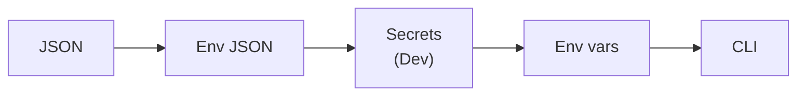

# Make dependencies, settings and diagnostics explicit

A service can have correct retrieval code and still answer from the wrong index. One component reads a
setting from a file, another keeps an old value, and a third constructs its own client with a different
endpoint. When an answer goes wrong, the logs contain sentences about what happened but no fields you
can use to find the affected requests.

The underlying problem is ownership: who constructs an object, how long it lives, where its settings
come from and how its work becomes visible. These decisions belong in the application's setup. For the
P1 RAG service, making them explicit lets you distinguish a retrieval problem from a service wired to
the wrong deployment before you start changing prompts.

## How it works in .NET \{#how-it-works-in-dotnet}

`Microsoft.Extensions` is a family of libraries for shared application concerns, including dependency
injection, configuration, options and logging. In an ASP.NET Core minimal API,
[`WebApplication.CreateBuilder(args)`](https://learn.microsoft.com/en-us/aspnet/core/fundamentals/?view=aspnetcore-10.0)
sets up the application host with these mechanisms available. You register dependencies before building
the application; handlers and classes receive them when needed.

This lesson targets [.NET 10, the current long-term support (LTS) release](https://learn.microsoft.com/en-us/dotnet/core/releases-and-support),
[supported until 14 November 2028](https://learn.microsoft.com/en-us/lifecycle/products/microsoft-net-and-net-core).
The examples target the [.NET 10 SDK 10.0.402](https://dotnet.microsoft.com/en-us/download?initial-os=linux)
and `net10.0`.

**Dependency injection** means that a component receives its dependencies instead of constructing them
internally. Registration supplies the construction rule. Resolution asks the container to supply the
object and its dependencies. Keeping registrations together makes the application's composition
reviewable: a retrieval component cannot quietly select its own configuration source simply because it
needs a client.

A registration also chooses a lifetime. In an HTTP API, a scoped object belongs to one request; a
singleton is shared through the container. That is a concurrency decision as well as an allocation
decision. Sharing a stateless client can be appropriate. Sharing a mutable list of the current
request's citations would let unrelated requests touch the same state.

Configuration supplies values separately from object construction. A **configuration provider** reads
key-value settings from a source. With the minimal hosting defaults, application settings have this
[priority, from lower to higher](https://learn.microsoft.com/en-us/aspnet/core/fundamentals/configuration/?view=aspnetcore-10.0#default-app-configuration-sources):
`appsettings.json`, `appsettings.{Environment}.json`, user secrets in Development, environment variables,
then command-line arguments. The higher-priority source wins for a matching key.



Read left to right: later sources override earlier ones per key; user secrets participate only in Development.

The override applies to individual keys. If JSON supplies the search endpoint and deployment name,
an environment variable can replace just the endpoint. The deployment value still comes from JSON.
Treat that merging as part of the deployment contract: an unexpected value may be a valid override,
not a failed file read.

Hierarchical settings use keys such as `Rag:SearchEndpoint`. In environment variables,
[`Rag__SearchEndpoint` maps to that key](https://learn.microsoft.com/en-us/dotnet/core/extensions/configuration-providers#environment-variable-configuration-provider).
The double underscore works across platforms. Providers you add yourself also participate in ordering;
appending a remote provider can change which source wins. Decide precedence deliberately when adding
another store. Key Vault and App Configuration belong to
[Secrets and configuration](../part-1-azure-foundations/secrets-and-configuration.md).

The **options pattern** turns a group of settings into a typed object. Rather than letting every class
ask `IConfiguration` for string keys, bind the `Rag` section to `RagOptions` and inject an options
interface. Public writable properties describe the values being bound. Binding supplies values;
validation supplies rules about whether those values are acceptable.

[Options validation](https://learn.microsoft.com/en-us/dotnet/core/extensions/options#options-validation)
can reject a blank deployment name or a search endpoint that is not an absolute HTTPS URI.
`ValidateOnStart()` moves that check to application startup instead of waiting for the first consumer.
It validates the rules you wrote: a well-formed endpoint could still be unreachable, and a nonblank
name could still identify no deployment. Authentication, authorisation and connectivity need separate
checks.

`ILogger<T>` gives a component a logging category, while a provider sends
records to an output. Use a stable
[message template with named placeholders](https://learn.microsoft.com/en-us/aspnet/core/fundamentals/logging/?view=aspnetcore-10.0#log-message-template)
and pass values separately. A provider can preserve those values as fields, so you can query a
deployment identifier without parsing a sentence. Interpolating everything into one string loses that
separation. Configure levels by category to keep routine framework traffic from obscuring application
events.
For high-volume paths, Microsoft recommends
[`[LoggerMessage]` source-generated logging](https://learn.microsoft.com/en-us/dotnet/core/extensions/logging/high-performance-logging),
which generates logging methods at compile time.

## Choosing lifetimes and settings behaviour \{#choosing-and-tradeoffs}

Choose a [service lifetime](https://learn.microsoft.com/en-us/dotnet/core/extensions/dependency-injection/service-lifetimes)
from what the object owns and who may use it concurrently:

| Lifetime | Container behaviour | Suitable P1 use | Avoid when |
|---|---|---|---|
| Transient | New instance for each resolution | Small, stateless formatting helper | You expect one shared instance throughout a request |
| Scoped | One instance per HTTP request scope | Request orchestration and citation state | A singleton would retain it |
| Singleton | One shared instance per container | Thread-safe SDK client with fixed construction settings | It holds mutable request or user state |

A **captive dependency** occurs when a longer-lived object retains a dependency intended to live for
less time. Injecting a scoped retrieval session into a singleton does not give the singleton a fresh
session for every request. It retains the captured object. Keep request work inside its scope; a
background worker that needs scoped services should create and dispose an explicit scope for each
unit of work. Do not make everything singleton merely to avoid allocations.

The default provider's
[scope validation](https://learn.microsoft.com/en-us/aspnet/core/fundamentals/dependency-injection?view=aspnetcore-10.0#scope-validation)
rejects scoped services injected into singletons in Development. It is off by default in Production,
so an invalid dependency graph can appear to work locally if you run outside Development.

Options have [lifetime rules of their own](https://learn.microsoft.com/en-us/aspnet/core/fundamentals/configuration/options?view=aspnetcore-10.0#options-interfaces):

| Interface | Behaviour | Use when | Avoid when |
|---|---|---|---|
| `IOptions<T>` | Singleton wrapper; cached value, no later configuration updates | Settings stay fixed for this process | You require runtime changes |
| `IOptionsSnapshot<T>` | Scoped; computed on first access and cached within the scope | Request work needs one settings view | The consumer is a singleton |
| `IOptionsMonitor<T>` | Singleton; current values and change notifications | A long-lived consumer explicitly handles updates | You expect it to rebuild dependent objects automatically |

Reload requires a provider that supports updates. Selecting a monitor does not make every source
reloadable. An options change does not reconstruct a client that was already created
with the old endpoint. For P1, start with endpoint, index and deployment settings fixed for the process,
and restart when changing them. Introduce live reload only with a defined plan for replacing affected
clients and keeping each request on a consistent set of settings.

## In an AI workload \{#in-an-ai-workload}

P1 needs a shared search client and separate request work. Microsoft recommends treating
[Azure SDK clients as singletons for a given set of constructor parameters](https://learn.microsoft.com/en-us/dotnet/azure/sdk/thread-safety).
Their input and output model objects are not thread-safe by default. Keep mutable search parameters,
retrieved results and citation assembly with the request, even when requests share the client.

With [Azure.Identity 1.21.0](https://www.nuget.org/packages/Azure.Identity/1.21.0) and
[Azure.Search.Documents 12.0.0](https://www.nuget.org/packages/Azure.Search.Documents/12.0.0),
the latest stable NuGet versions verified for this lesson, P1's registration can take this shape.
This illustrative Azure-hosted fragment uses the `RagOptions` class from the exercise below and a
[system-assigned managed identity](https://learn.microsoft.com/en-us/dotnet/api/azure.identity.managedidentityid.systemassigned?view=azure-dotnet).
Put its `using` directives at the top of `Program.cs` and its registrations before `builder.Build()`; it is
not part of the local exercise. The
[`SearchClient` constructor](https://learn.microsoft.com/en-us/dotnet/api/azure.search.documents.searchclient.-ctor?view=azure-dotnet)
accepts an endpoint, index name and token credential:

```csharp
using Azure.Identity;
using Azure.Search.Documents;
using Microsoft.Extensions.Options;

builder.Services.AddSingleton(_ =>
    new ManagedIdentityCredential(ManagedIdentityId.SystemAssigned));
builder.Services.AddSingleton<SearchClient>(services =>
{
    var settings = services.GetRequiredService<IOptions<RagOptions>>().Value;
    return new SearchClient(new Uri(settings.SearchEndpoint), settings.IndexName,
        services.GetRequiredService<ManagedIdentityCredential>());
});
```

Client registration supplies an object; it does not establish permission to query an index.
[RBAC and keyless access](../part-1-azure-foundations/rbac-and-keyless-access.md) owns credential choice
and access setup, including the
[deterministic production credential](https://learn.microsoft.com/en-us/dotnet/azure/sdk/authentication/best-practices#use-deterministic-credentials-in-production-environments)
used here. Choose the model client's lifetime against that client library's own contract; II.8,
[AI in .NET](./ai-in-dotnet.md), covers those integrations.

For several Azure clients, use
[`Microsoft.Extensions.Azure`'s `AddAzureClients`](https://learn.microsoft.com/en-us/dotnet/azure/sdk/dependency-injection):
it integrates configuration binding and a shared credential through `UseCredential`, with clients
[registered as singletons](https://github.com/Azure/azure-sdk-for-net/blob/main/sdk/extensions/Microsoft.Extensions.Azure/src/AzureClientFactoryBuilder.cs).
The explicit factory above is reasonable for one client whose constructor needs your validated options.

For diagnostics, record a request identifier, deployment identifier, retrieval duration and result
count as operational fields. These help separate an empty retrieval from a slow model call. The
[RAG observability lesson](/rag-agents/part-1-rag/cross-cutting/observability/)
owns the wider pipeline trace and its relationship to evaluation. Keep prompts, document bodies,
credentials and full configuration dumps out of routine logs; recording content requires an explicit
data-handling decision. A JSON console log is a local output, not an Application Insights integration.

## Try it \{#try-it}

Build P1's local settings boundary before adding network calls. You need the .NET 10 SDK and a Bash
or Zsh terminal. The code on this page was built with .NET SDK 10.0.402 (ASP.NET Core runtime
10.0.13), Azure.Identity 1.21.0 and Azure.Search.Documents 12.0.0 on 2026-10-17. The commands below
were run as written on macOS, and the expected results match what that run printed. The Azure
registration fragment was compiled and resolved locally; it was not run against a live subscription.

Create a disposable folder with the
[`web` template targeting `net10.0`](https://learn.microsoft.com/en-us/dotnet/core/tools/dotnet-new-sdk-templates#web);
[`--output`](https://learn.microsoft.com/en-us/dotnet/core/tools/dotnet-new) sets its destination:

```bash
dotnet new web --framework net10.0 --output p1-backbone-local
cd p1-backbone-local
```

Replace `Program.cs` with the following. The service registers one plan per request and binds the
search endpoint, index and model deployment settings. JSON console formatting uses
[`AddJsonConsole`](https://learn.microsoft.com/en-us/dotnet/core/extensions/logging/console-log-formatter).

```csharp
using Microsoft.Extensions.Options;

var builder = WebApplication.CreateBuilder(args);
builder.Logging.ClearProviders();
builder.Logging.AddJsonConsole();
builder.Services.AddOptions<RagOptions>()
    .Bind(builder.Configuration.GetSection("Rag"))
    .Validate(o => Uri.TryCreate(o.SearchEndpoint, UriKind.Absolute, out var uri)
        && uri.Scheme == Uri.UriSchemeHttps, "Rag:SearchEndpoint must be HTTPS.")
    .Validate(o => !string.IsNullOrWhiteSpace(o.IndexName), "Rag:IndexName is required.")
    .Validate(o => !string.IsNullOrWhiteSpace(o.DeploymentName),
        "Rag:DeploymentName is required.")
    .ValidateOnStart();
builder.Services.AddScoped<RagPlan>();

var app = builder.Build();
app.MapGet("/plan", (RagPlan plan) => plan.Describe());
app.Run();

public sealed class RagOptions
{
    public string SearchEndpoint { get; set; } = "";
    public string IndexName { get; set; } = "";
    public string DeploymentName { get; set; } = "";
}

public sealed class RagPlan(IOptions<RagOptions> options, ILogger<RagPlan> logger)
{
    private readonly Guid _id = Guid.NewGuid();

    public object Describe()
    {
        var settings = options.Value;
        logger.LogInformation("Prepared plan {PlanId} for deployment {DeploymentName}",
            _id, settings.DeploymentName);
        return new { PlanId = _id, settings.DeploymentName };
    }
}
```

First run with no `Rag` values configured:

```bash
dotnet run --no-launch-profile
```

These runs skip launch profiles; with neither `DOTNET_ENVIRONMENT` nor `ASPNETCORE_ENVIRONMENT` set,
they use [Production](https://learn.microsoft.com/en-us/aspnet/core/fundamentals/environments?view=aspnetcore-10.0#environment-variables-that-determine-the-runtime-environment),
so `appsettings.Development.json`, user secrets and default scope validation are inactive.

Expect the process to exit at host startup with an
[`OptionsValidationException`](https://learn.microsoft.com/en-us/dotnet/core/extensions/options#options-validation)
naming the failed `Rag:SearchEndpoint`, `Rag:IndexName` and `Rag:DeploymentName` rules.
Then supply invented local settings and a
[local listening URL](https://learn.microsoft.com/en-us/aspnet/core/fundamentals/servers/kestrel/endpoints?view=aspnetcore-10.0#specify-endpoints-with-urls):

```bash
ASPNETCORE_URLS=http://localhost:5080 \
Rag__SearchEndpoint=https://example.invalid \
Rag__IndexName=public-docs \
Rag__DeploymentName=local-demo \
dotnet run --no-launch-profile
```

Open `http://localhost:5080/plan` twice. Expect JSON containing a different `planId` for each request and
`deploymentName` equal to `local-demo`, plus a structured console record for each call. The registered
[`RagPlan` parameter is supplied through DI](https://learn.microsoft.com/en-us/aspnet/core/fundamentals/minimal-apis/parameter-binding?view=aspnetcore-10.0#parameter-binding-with-dependency-injection).
The invented endpoint passes the URI rule; nothing contacts it.

Stop with Ctrl+C, then try a command-line override:

```bash
ASPNETCORE_URLS=http://localhost:5080 \
Rag__SearchEndpoint=https://example.invalid \
Rag__IndexName=public-docs \
Rag__DeploymentName=local-demo \
dotnet run --no-launch-profile -- --Rag:DeploymentName=override-demo
```

The response and log should now identify `override-demo`. In
[`dotnet run`](https://learn.microsoft.com/en-us/dotnet/core/tools/dotnet-run), `--no-launch-profile`
skips launch settings and `--` passes the remaining arguments to the application. This checks the
configuration precedence you will later rely on when deploying P1.

**Cost:** free (local only, no Azure resources). This exercise creates no cloud resources and makes no
search or model calls.

**Teardown:** stop the process with Ctrl+C and delete the local `p1-backbone-local` folder.

## What to take away \{#what-to-take-away}

- Choose dependency lifetimes from ownership and concurrency. Share suitable clients; keep request state scoped.
- Treat provider order as deployment behaviour: a later source can replace a value without changing the file.
- Bind related settings to options and validate them at startup. Shape validation does not prove service access.
- Plan configuration reload together with client replacement; changing a setting does not rebuild a client.
- Keep log templates stable and values separate, with an explicit decision about what data may enter telemetry.

**[New terms](../glossary.md#extensions-backbone)**: dependency injection, service lifetime, transient, scoped, singleton, captive dependency, configuration provider, options pattern, startup validation, structured logging.

## Sources \{#sources}

Verified as of 2026-10-17.

- Platform: [.NET releases and support](https://learn.microsoft.com/en-us/dotnet/core/releases-and-support), [support dates](https://learn.microsoft.com/en-us/lifecycle/products/microsoft-net-and-net-core), [.NET SDK download](https://dotnet.microsoft.com/en-us/download?initial-os=linux), [ASP.NET Core fundamentals](https://learn.microsoft.com/en-us/aspnet/core/fundamentals/?view=aspnetcore-10.0).
- Dependencies and settings: [service lifetimes](https://learn.microsoft.com/en-us/dotnet/core/extensions/dependency-injection/service-lifetimes), [ASP.NET Core configuration](https://learn.microsoft.com/en-us/aspnet/core/fundamentals/configuration/?view=aspnetcore-10.0), [configuration providers](https://learn.microsoft.com/en-us/dotnet/core/extensions/configuration-providers), [options in .NET](https://learn.microsoft.com/en-us/dotnet/core/extensions/options), [options in ASP.NET Core](https://learn.microsoft.com/en-us/aspnet/core/fundamentals/configuration/options?view=aspnetcore-10.0).
- Clients and diagnostics: [Azure SDK thread safety and lifetimes](https://learn.microsoft.com/en-us/dotnet/azure/sdk/thread-safety), [SearchClient constructors](https://learn.microsoft.com/en-us/dotnet/api/azure.search.documents.searchclient.-ctor?view=azure-dotnet), [Search client library](https://learn.microsoft.com/en-us/dotnet/api/overview/azure/search.documents-readme?view=azure-dotnet), [logging](https://learn.microsoft.com/en-us/aspnet/core/fundamentals/logging/?view=aspnetcore-10.0), [console formatting](https://learn.microsoft.com/en-us/dotnet/core/extensions/logging/console-log-formatter).
- Integration and validation: [scope validation](https://learn.microsoft.com/en-us/aspnet/core/fundamentals/dependency-injection?view=aspnetcore-10.0#scope-validation), [Azure SDK dependency injection](https://learn.microsoft.com/en-us/dotnet/azure/sdk/dependency-injection), [client registration implementation](https://github.com/Azure/azure-sdk-for-net/blob/main/sdk/extensions/Microsoft.Extensions.Azure/src/AzureClientFactoryBuilder.cs), [credential best practices](https://learn.microsoft.com/en-us/dotnet/azure/sdk/authentication/best-practices), [ManagedIdentityCredential constructors](https://learn.microsoft.com/en-us/dotnet/api/azure.identity.managedidentitycredential.-ctor?view=azure-dotnet), [system-assigned identity selector](https://learn.microsoft.com/en-us/dotnet/api/azure.identity.managedidentityid.systemassigned?view=azure-dotnet), [source-generated logging](https://learn.microsoft.com/en-us/dotnet/core/extensions/logging/high-performance-logging).
- Package targets: [Azure.Identity 1.21.0](https://www.nuget.org/packages/Azure.Identity/1.21.0), [Azure.Search.Documents 12.0.0](https://www.nuget.org/packages/Azure.Search.Documents/12.0.0).
- Exercise: [dotnet new](https://learn.microsoft.com/en-us/dotnet/core/tools/dotnet-new), [SDK templates](https://learn.microsoft.com/en-us/dotnet/core/tools/dotnet-new-sdk-templates), [dotnet run](https://learn.microsoft.com/en-us/dotnet/core/tools/dotnet-run), [runtime environments](https://learn.microsoft.com/en-us/aspnet/core/fundamentals/environments?view=aspnetcore-10.0), [minimal API parameter binding](https://learn.microsoft.com/en-us/aspnet/core/fundamentals/minimal-apis/parameter-binding?view=aspnetcore-10.0#parameter-binding-with-dependency-injection), [Kestrel endpoint URLs](https://learn.microsoft.com/en-us/aspnet/core/fundamentals/servers/kestrel/endpoints?view=aspnetcore-10.0#specify-endpoints-with-urls).
