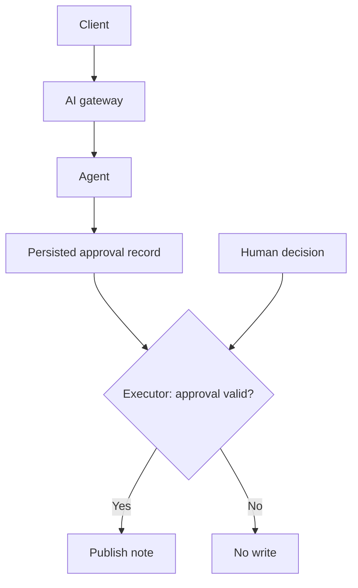

# Hosting assigns operational ownership; the executor enforces permission

A question-answering service can return a bad answer. Give it a tool that publishes a document and the
same mistake changes somebody else's working material. The hosting decision now includes where tool
code executes, who holds its credentials and what happens while a human considers a proposed action.

An approval might arrive after the request has ended or the process has restarted. If the proposed
write exists only in chat history, the application cannot reliably establish what was approved.
Choose the runtime and the durable application state together. The model can propose an action;
the system executing it must establish permission.

## How it works on Azure \{#how-it-works-on-azure}

[Foundry Agent Service](https://learn.microsoft.com/en-us/azure/foundry/agents/overview) supplies a managed
runtime. With a **prompt agent**, you configure instructions, a model and tools. With a **hosted agent**,
you supply custom agent code in a container and Foundry operates the hosting infrastructure.
[Microsoft Agent Framework](https://learn.microsoft.com/en-us/agent-framework/overview/) supplies the
agent and workflow SDK. You can run that SDK inside an application you operate, or use it to write a
Foundry hosted agent. These are separate choices: the SDK defines behaviour; the host runs it.

Tool execution has another boundary. A
[function tool](https://learn.microsoft.com/en-us/azure/foundry/agents/how-to/tools/function-calling)
describes a callable operation through its name, parameters and description. For a client-executed
function, the model requests a call; your application executes the function and sends back its result.
Registering a tool does not deploy its implementation into Foundry. This gives the application a place
to validate arguments and check permission before touching a downstream system.

**Model Context Protocol (MCP)** exposes tools through a server interface. Foundry can connect to
[remote MCP endpoints](https://learn.microsoft.com/en-us/azure/foundry/agents/how-to/tools/model-context-protocol),
restrict the exposed tools with `allowed_tools`, and require approval with `require_approval` set to
`always`. A response can contain an `mcp_approval_request`; the caller gathers the human decision and
returns an `mcp_approval_response` tied to its `approval_request_id`. The follow-up also references the
original response through `previous_response_id`. That exchange needs an application approval screen,
including the actual arguments. Automatically approving every returned request defeats the control.
The [MCP lesson](/rag-agents/part-2-agents/mcp/) owns the protocol theory.

State has several meanings here. In the
[current Foundry runtime](https://learn.microsoft.com/en-us/azure/foundry/agents/concepts/runtime-components),
a **conversation** stores messages, tool calls and outputs; a **response** is one generation result.
Older examples use threads and runs. Follow one API generation through an example rather than mixing
its object names with current conversation APIs.

A [hosted-agent session](https://learn.microsoft.com/en-us/azure/foundry/agents/how-to/manage-hosted-sessions)
holds sandbox working state such as files. Reusing its session ID alone does not replay chat history:
Responses continuity uses a conversation or `previous_response_id`. In self-hosted Agent Framework,
[`AgentSession`](https://learn.microsoft.com/en-us/agent-framework/concepts/agents/conversations/session)
holds conversation-associated state between runs, including history or a reference to it; storage depends on the implementation. Persist the state
needed after a restart and map session IDs to authenticated users and tenants before resuming them.

**Long-term memory** serves a different purpose: carrying selected information, such as preferences,
across conversations. Foundry's
[managed memory and Memory Store API are preview](https://learn.microsoft.com/en-us/azure/foundry/agents/how-to/memory-usage).
Treat remembered preferences as context. Keep authoritative approval records in application storage,
where the executor can query a specific decision about a specific write.

## Choosing a host and its responsibilities \{#choosing-a-host}

Compare operational ownership before comparing feature lists:

| Choice | Fits when | Avoid when / responsibility left with you |
|---|---|---|
| Foundry prompt agent | Configuration and the supported tools express the task. | Custom orchestration dominates; client-executed functions still need an application. |
| Foundry hosted agent | A custom research assistant needs managed scaling and persistent session files through a Responses endpoint. | Your required API cannot fit the Responses or Invocations contract; you still maintain the agent code. |
| Self-hosted Agent Framework | The agent must extend an existing .NET API while retaining its routes and deployment lifecycle. | You cannot own deployment, scaling, recovery and state persistence. |

The [hosted-agent guide](https://learn.microsoft.com/en-us/agent-framework/hosting/foundry-hosted-agent)
documents managed scaling and session persistence. Its
[runtime contract](https://learn.microsoft.com/en-us/azure/foundry/agents/concepts/hosted-agent-contract)
requires a Responses or Invocations endpoint. Keeping an existing application API is a workload reason
to self-host, rather than a claim that Foundry cannot run custom approval code.

Status belongs to each component. Foundry's
[readiness table lists core agents as GA](https://learn.microsoft.com/en-us/azure/foundry/concepts/general-availability).
[Hosted agents are also documented as GA](https://learn.microsoft.com/en-us/agent-framework/hosting/foundry-hosted-agent),
while that hosting guide still installs the .NET hosting adapter with `--prerelease`.
A supported hosting service does not establish the maturity of every SDK adapter you might add.
Check the integration you intend to ship.

For multiple agents, Agent Framework provides
[sequential, concurrent, handoff and group-chat orchestration](https://learn.microsoft.com/en-us/agent-framework/workflows/).
The [.NET graph workflow API](https://learn.microsoft.com/en-us/agent-framework/concepts/workflows/)
connects executors through edges and conditions, with checkpoints for progress. Use a sequential path
when one result feeds another; use concurrency for independent work; use a handoff when responsibility
changes. Start P2 with one agent and ordinary application code. Add another agent only when it has a
separate responsibility you can evaluate; [multi-agent design](/rag-agents/part-2-agents/multi-agent/)
explains that decision.

Do not confuse these SDK workflows with Foundry's visual **Workflows** feature. That feature is
[preview and scheduled to retire on December 1, 2026](https://learn.microsoft.com/en-us/azure/foundry/concepts/general-availability).
Microsoft directs new development to Agent Framework. A new P2 implementation should not depend on
the retiring designer.

The common failures follow the ownership boundaries. In-memory pending approvals disappear on restart.
A shared conversation ID can expose another user's history if the app skips ownership checks. A broad
MCP tool list increases the actions available to a confused agent; remote descriptions and results must
be treated as untrusted input. A workflow checkpoint records progress, but an external write still needs
a way to detect a retry. Hosting does not remove these application responsibilities.

## In an AI workload \{#in-an-ai-workload}

For **P2 — Agent behind an AI gateway**, choose self-hosted Agent Framework in the .NET application
as the course's initial implementation path, following P1's
[Container Apps](https://learn.microsoft.com/en-us/azure/container-apps/overview) hosting choice. Azure
manages the compute infrastructure; you operate the agent application. Reuse P1's model access, retrieval
and telemetry. P2 deliberately keeps recovery of pending approvals and retry-safe execution in its own
application, within P1's API and deployment lifecycle. Foundry hosted agents could run this approval code
too; this course choice keeps those operational responsibilities with the learner. A Foundry prompt
agent remains a reasonable alternative for a smaller tool set.

Place [API Management's AI gateway](https://learn.microsoft.com/en-us/azure/api-management/genai-gateway-capabilities)
in front of the agent API to authenticate and authorize callers. Configure backend access so callers
cannot bypass that gateway. Approval answers a narrower question: may this caller perform this exact
write? The executor must validate that separately. The underlying principle is
[an instruction is not a control](/ai-sdlc/part-1-foundation/rules-that-hold/).

Sketch one proposed tool: `publish_note(noteId, expectedVersion)`. The model supplies the note identifier
and expected version. The application gets caller and tenant identity from authentication, checks access,
and resolves the note's text itself. It freezes the proposed payload and records a pending request.
The human sees the destination and complete text before deciding.



This is the proposed application flow, not automatic Foundry behaviour. The write executor runs
in a separate container app with its own
[managed identity](https://learn.microsoft.com/en-us/azure/container-apps/managed-identity); the agent host must not be able to assume that identity. Only the
executor receives the future destination write grant. It checks the stored approval against the caller,
tenant, tool, frozen payload, reviewer and expiry, then rechecks destination authorization and version.
A changed note requires a new decision. Missing, denied or expired approval produces no write.

Agent Framework's
[tool approval flow](https://learn.microsoft.com/en-us/agent-framework/agents/tools/tool-approval)
returns an input request to the caller, which supplies the decision in a subsequent run. In .NET,
`ApprovalRequiredAIFunction` marks a tool for this treatment. The
[API reference explicitly leaves enforcement to the invoker](https://learn.microsoft.com/en-us/dotnet/api/microsoft.extensions.ai.approvalrequiredaifunction?view=net-10.0-pp):
the wrapper alone does not enforce approval. Use the framework flow to collect decisions and enforce
P2's persisted decision at the executor as well.

Give the operation an **idempotency key** so a resumed run cannot publish the same note twice. Persist
the operation's outcome with a retry-safe write strategy; recording success only after an unprotected
external write leaves a crash window. The [durable-runs lesson](/rag-agents/part-2-agents/durable-runs/)
owns recovery design, while [tool use](/rag-agents/part-2-agents/tool-use/) owns the action boundary.
Test denial, approval, stale versions, cross-tenant requests and crash/retry behaviour before adding tools.

## Try it \{#try-it}

Prepare P2's executor identity and an approval record with acceptance criteria. This step reserves the
identity boundary; it does not yet deploy an agent or implement the approval gate.

Use local Bash with Azure CLI, after the sign-in and subscription-selection steps in
[RBAC and keyless access](../part-1-azure-foundations/rbac-and-keyless-access.md#try-it).
You need permission to create a resource group and a managed identity; Microsoft's
[identity creation guide](https://learn.microsoft.com/en-us/entra/identity/managed-identities-azure-resources/manage-user-assigned-managed-identities-azure-cli)
specifies Managed Identity Contributor for identity creation. Use a fresh disposable group with the name
below, and change the location if your subscription's policy requires it.

The commands and flags were checked against the live
[`az group`](https://learn.microsoft.com/en-us/cli/azure/group?view=azure-cli-latest) and
[`az identity`](https://learn.microsoft.com/en-us/cli/azure/identity?view=azure-cli-latest) references.
They have **not yet been run against a live subscription**; no subscription exists for the course yet.

```bash
az group create --name rg-p2-approval-lab --location westeurope

az identity create \
  --name p2-tool-executor \
  --resource-group rg-p2-approval-lab \
  --location westeurope \
  --query '{resourceId:id,principalId:principalId,clientId:clientId}' \
  --output json
```

Expected result: the first command creates the group. The second creates a user-assigned managed
identity and prints its resource, principal and client identifiers, matching the
[documented identity output fields](https://learn.microsoft.com/en-us/azure/aks/user-assigned-managed-identity#create-a-user-assigned-managed-identity).
These commands attach it to no compute and assign no roles. They do not demonstrate an enforced approval.

Keep the selected host and executor resource ID alongside this compact approval-record template.
The values are invented; this is a proposed application record, not a Foundry API schema:

```text
approvalId: approval-001
operationId: publish-001
caller: user-17
tenant: tenant-a
tool: publish_note
noteId: note-42
expectedVersion: 3
destination: team-notes/note-42
frozenText: The maintenance window starts at 18:00 UTC.
status: pending
reviewer: null
decidedAt: null
expiresAt: 2026-10-18T18:00:00Z
outcome: null
```

The application fills caller and tenant from authentication and captures an authorized reviewer's
identity and decision time when approval arrives. It retains the exact text shown for review.
This design implements the invoker's responsibility in the
[approval API contract](https://learn.microsoft.com/en-us/dotnet/api/microsoft.extensions.ai.approvalrequiredaifunction?view=net-10.0-pp).
Keep these **design acceptance criteria**, not observed results, with the record:

- While `approval-001` is pending, denied or expired, an execution attempt publishes nothing.
- After approval, changing `frozenText` to a 19:00 window or changing the destination requires a new
  approval record and decision; the previous approval cannot authorize that payload.
- After `publish-001` succeeds, submitting that operation ID again returns the recorded outcome without
  a second publication. Reject reuse with different arguments. Verify crash/retry behaviour when implementing it.

Microsoft's [retry guidance](https://learn.microsoft.com/en-us/azure/architecture/patterns/retry#idempotency)
explains why a lost response can cause duplicate effects. The operation ID needs a retry-safe execution
strategy; the record alone does not provide one. When implementing P2, attach the identity only to
the executor and grant the narrow destination permission there. Inspect inherited permissions too.

**Cost:** free for this identity-only exercise.
[Managed identities have no extra charge](https://learn.microsoft.com/en-us/entra/identity/managed-identities-azure-resources/overview).
It creates no compute, storage, gateway or model deployment and sends no model requests.

**Teardown:** after checking that the disposable group contains only this lab's identity, delete it.
Keep the design contract; recreate the identity when building P2 rather than reusing its deleted IDs.

```bash
az group delete --name rg-p2-approval-lab --yes
```

## What to take away \{#what-to-take-away}

- Choose the SDK and host separately; Agent Framework code can run in your application or in Foundry.
- Distinguish conversation history, session working state, long-term memory and authoritative approval records.
- Bind approval to the exact proposed write and enforce it at the executor, including after a restart.
- Begin P2 with one agent, scoped tools and retry-safe writes; add orchestration for a concrete responsibility.

**[New terms](../glossary.md#agents-on-azure)**: prompt agent, hosted agent, function tool, MCP, conversation, hosted-agent session, Agent Framework session, long-term memory, approval request, idempotency key, workflow checkpoint.

## Sources \{#sources}

Verified as of 2026-10-17. Hosting criteria, session definitions and approval-design sources rechecked on 2026-10-18.

Runtime and status:

- [Foundry Agent Service overview](https://learn.microsoft.com/en-us/azure/foundry/agents/overview)
- [Container Apps hosting](https://learn.microsoft.com/en-us/azure/container-apps/overview) and [per-application managed identities](https://learn.microsoft.com/en-us/azure/container-apps/managed-identity)
- [Microsoft Agent Framework overview](https://learn.microsoft.com/en-us/agent-framework/overview/)
- [Foundry hosted agents and SDK integration](https://learn.microsoft.com/en-us/agent-framework/hosting/foundry-hosted-agent) and [runtime contract](https://learn.microsoft.com/en-us/azure/foundry/agents/concepts/hosted-agent-contract)
- [Foundry feature readiness and Workflows retirement](https://learn.microsoft.com/en-us/azure/foundry/concepts/general-availability)
- [Agent Framework workflow capabilities](https://learn.microsoft.com/en-us/agent-framework/workflows/) and [.NET workflow concepts](https://learn.microsoft.com/en-us/agent-framework/concepts/workflows/)

Tools, state and access:

- [Foundry function calling](https://learn.microsoft.com/en-us/azure/foundry/agents/how-to/tools/function-calling)
- [Remote MCP endpoints and approvals](https://learn.microsoft.com/en-us/azure/foundry/agents/how-to/tools/model-context-protocol)
- [Runtime components: conversations and responses](https://learn.microsoft.com/en-us/azure/foundry/agents/concepts/runtime-components)
- [Hosted sessions and conversations](https://learn.microsoft.com/en-us/azure/foundry/agents/how-to/manage-hosted-sessions)
- [Agent Framework sessions](https://learn.microsoft.com/en-us/agent-framework/concepts/agents/conversations/session) and [.NET AgentSession reference](https://learn.microsoft.com/en-us/dotnet/api/microsoft.agents.ai.agentsession?view=agent-framework-dotnet-latest)
- [Managed memory (preview)](https://learn.microsoft.com/en-us/azure/foundry/agents/how-to/memory-usage)
- [Function tool approval](https://learn.microsoft.com/en-us/agent-framework/agents/tools/tool-approval) and [ApprovalRequiredAIFunction reference](https://learn.microsoft.com/en-us/dotnet/api/microsoft.extensions.ai.approvalrequiredaifunction?view=net-10.0-pp)
- [Retry pattern and idempotency](https://learn.microsoft.com/en-us/azure/architecture/patterns/retry)
- [API Management AI gateway](https://learn.microsoft.com/en-us/azure/api-management/genai-gateway-capabilities)

Exercise:

- [Managed identities and cost](https://learn.microsoft.com/en-us/entra/identity/managed-identities-azure-resources/overview)
- [Create a user-assigned identity](https://learn.microsoft.com/en-us/entra/identity/managed-identities-azure-resources/manage-user-assigned-managed-identities-azure-cli) and [identity output fields](https://learn.microsoft.com/en-us/azure/aks/user-assigned-managed-identity#create-a-user-assigned-managed-identity)
- Azure CLI: [group](https://learn.microsoft.com/en-us/cli/azure/group?view=azure-cli-latest), [identity](https://learn.microsoft.com/en-us/cli/azure/identity?view=azure-cli-latest)
