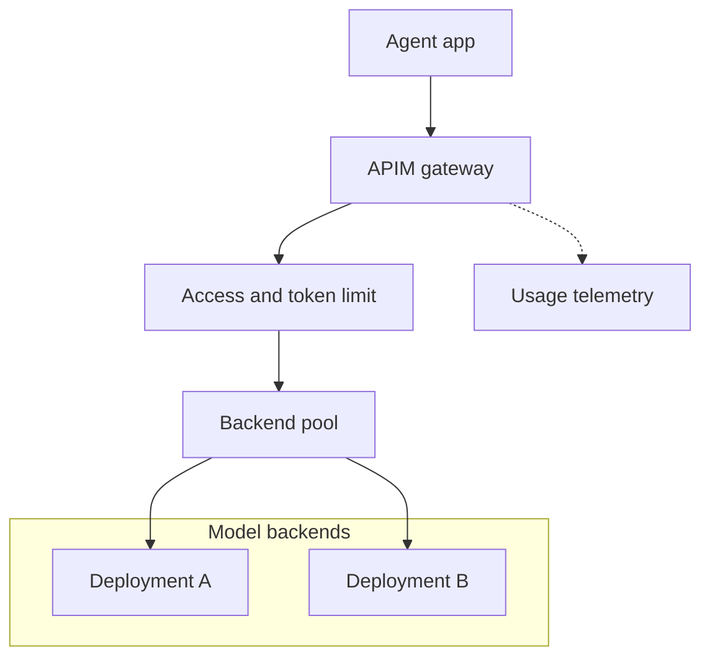

# Put model access behind a boundary you can enforce

Two applications share a model deployment. One answers short questions; the other sends whole documents and
retries whenever a response is slow. A request limit treats their calls alike. Yet a 20,000-token request
consumes a hundred times the token volume of a 200-token request. The second application can exhaust shared
capacity while remaining comfortably inside its request allowance.

Putting limits in each client leaves every client responsible for protecting everybody else. An **AI gateway**
places access checks, consumption controls and routing in the common request path. That boundary helps only
when callers actually use it: an application that retains direct model access can bypass the gateway's rules.

## How it works on Azure \{#how-it-works-on-azure}

Azure API Management (APIM) accepts the application's request, applies policies, forwards accepted traffic
and collects telemetry. Its
[AI gateway capabilities](https://learn.microsoft.com/en-us/azure/api-management/genai-gateway-capabilities)
extend that request path with model-specific controls. You still choose which policies and backend resources
to configure; deploying APIM alone does not allocate tokens between consumers.



Caller authentication and backend authentication are separate. Authenticate the application to APIM;
APIM then authenticates to the model. For Azure OpenAI, grant the gateway's managed identity
[`Cognitive Services OpenAI User` on the model resource](https://learn.microsoft.com/en-us/azure/api-management/api-management-authenticate-authorize-azure-openai).
The [`authentication-managed-identity` policy](https://learn.microsoft.com/en-us/azure/api-management/authentication-managed-identity-policy)
obtains an Entra token and sets the backend `Authorization` header. This removes the model key from the
application's configuration. It does not establish who may call the gateway; configure that separately.

The [`llm-token-limit` policy](https://learn.microsoft.com/en-us/azure/api-management/llm-token-limit-policy)
limits prompt and completion tokens by a **counter key**: the value identifying the allocation being charged.
A subscription identifier can give each subscription its own allocation. A caller-controlled header needs
validation before it can represent a tenant. Exceeding a token rate returns HTTP `429`; exceeding a period
quota returns `403`.

A **backend pool** groups model endpoints behind one routing target. APIM supports round-robin distribution,
weights and priority groups. A **circuit breaker** temporarily removes a failing backend from use; configure
it to recognise model throttling and honour `Retry-After`. Priority routing uses lower-priority groups only
when all higher-priority backends have tripped breakers. These are
[backend resource settings](https://learn.microsoft.com/en-us/azure/api-management/backends). The
[`set-backend-service` policy](https://learn.microsoft.com/en-us/azure/api-management/set-backend-service-policy)
selects the backend or pool resource through `backend-id`. A pool distributes available capacity; it creates
no additional model quota.

**Semantic caching** reuses an answer when a new prompt is sufficiently similar to a previous prompt.
[`llm-semantic-cache-lookup`](https://learn.microsoft.com/en-us/azure/api-management/llm-semantic-cache-lookup-policy)
runs before the model call, with a matching
[`llm-semantic-cache-store`](https://learn.microsoft.com/en-us/azure/api-management/llm-semantic-cache-store-policy)
afterwards. This needs an embeddings deployment and an external vector-capable cache. Microsoft's
[Azure Managed Redis recipe](https://learn.microsoft.com/en-us/azure/api-management/azure-openai-enable-semantic-caching)
requires RediSearch; APIM's built-in response cache is insufficient for that recipe.
Place request rate limiting after the cache lookup so a cache outage does not overload the model backend.

For measurements, [`llm-emit-token-metric`](https://learn.microsoft.com/en-us/azure/api-management/llm-emit-token-metric-policy)
sends token metrics to Application Insights after you configure the integration, API logging and custom
metrics with dimensions. Extended categories such as cached, reasoning and thinking tokens are **preview**.
[LLM usage logging](https://learn.microsoft.com/en-us/azure/api-management/api-management-howto-llm-logs)
instead sends request-level records to Log Analytics through diagnostic settings. Prompt and completion
content is optional; collecting usage need not mean retaining conversations.

## Choose the controls before the tier \{#choosing-and-tradeoffs}

Policy support differs even within the AI feature set. The current
[gateway matrix](https://learn.microsoft.com/en-us/azure/api-management/api-management-gateways-overview)
and individual references give this comparison for the built-in managed gateways:

| Control | Classic tiers, including Developer | v2 tiers | Consumption |
|---|---|---|---|
| [Token rate and period quota](https://learn.microsoft.com/en-us/azure/api-management/llm-token-limit-policy) | Yes | Yes | No |
| [Token metric policy](https://learn.microsoft.com/en-us/azure/api-management/llm-emit-token-metric-policy) | Yes | Yes | Yes |
| Backend pool / circuit breaker | Yes / Yes | Yes / Yes | Yes / No |
| [Semantic lookup and store](https://learn.microsoft.com/en-us/azure/api-management/llm-semantic-cache-lookup-policy), with external cache | Yes | Yes | Yes |
| Managed-identity backend policy | Yes | Yes | Yes |
| Gateway resource logs to Log Analytics | Yes | Yes | No |

The lab therefore uses **Developer**, the cheapest regular APIM tier supporting its token limit and backend
identity policies in the verified West Europe pricing. It is for evaluation and has
[no production SLA](https://azure.microsoft.com/en-us/pricing/details/api-management/). Choose a production
tier against networking, availability and traffic requirements, rather than carrying the lab SKU into service.
The separately documented [AI Gateway tier is public preview](https://learn.microsoft.com/en-us/azure/api-management/ai-gateway-overview),
with pricing still to be announced. It is outside this priced lab comparison.

A direct model connection remains reasonable for one controlled application while you establish behaviour
and demand. Add APIM when shared access policy, consumer allocations or routing justify another deployed
dependency. Do not add a semantic cache merely because the gateway supports one: embeddings, cache operation
and wrong-answer risk all need to earn their cost.

Token controls also have accounting limits.
[Concurrent requests can overshoot; streaming uses estimates; counters are independent at each gateway](https://learn.microsoft.com/en-us/azure/api-management/llm-token-limit-policy).
A token allocation therefore cannot guarantee an exact currency ceiling. Backend quota can still reject a
request APIM accepted. Keep client retries bounded and distinguish gateway rejection from backend throttling
when investigating a `429`.

Routing needs equivalent contracts, not merely reachable endpoints. Failover to a different model version
can change tool arguments or answer quality. Check both deployments against the same evaluations and ensure
that either destination meets the workload's data-placement requirements before putting them in one pool.

## In an AI workload \{#in-an-ai-workload}

P2 builds on P1's model and retrieval foundations. Its agent sends model calls through APIM, while the
application retains responsibility for tool execution and approvals. A gateway can stop a model request
after a consumption limit is reached; it cannot decide whether a proposed refund or database write has the
required approval. Keep that check on the execution path described in
[Tool use](/rag-agents/part-2-agents/tool-use/). The distinction between an instruction and an enforced
boundary is developed in [Rules that hold](/ai-sdlc/part-1-foundation/rules-that-hold).

Give the agent an iteration bound as well as a gateway allocation. Otherwise a loop can consume its entire
allowance doing useless work, then fail at the gateway before producing a useful answer. For the final P2
design, remove unnecessary direct model permissions and credentials from the application once the gateway
path works. Keyless backend authentication alone does not remove a pre-existing bypass.

Keep semantic caching disabled initially. In permissioned RAG, “What is the retention policy?” can mean
different things for different users, documents and conversation histories. Partition cache reuse by
authorisation context and content/prompt version; evaluate false matches and expiry before enabling it.
The lookup policy's [`vary-by` elements](https://learn.microsoft.com/en-us/azure/api-management/llm-semantic-cache-lookup-policy)
provide partitioning, but you must choose what belongs in the partition. Reusing a cached tool call or
approval decision is especially unsuitable for this starting design.

Use bounded labels such as application and deployment for metrics; put individual request identifiers in
logs. The [metric policy has cardinality limits](https://learn.microsoft.com/en-us/azure/api-management/llm-emit-token-metric-policy)
that can discard new series. Correlate gateway observations with the agent's model and tool spans, following
[Observability](/rag-agents/part-1-rag/cross-cutting/observability/).
[Broken streams can leave usage logs incomplete](https://learn.microsoft.com/en-us/azure/api-management/api-management-howto-llm-logs),
so reconcile costs with provider billing rather than treating gateway telemetry as a complete invoice.

## Try it \{#try-it}

Put one gateway in front of P1's existing Azure OpenAI chat deployment. Use a dedicated resource group for
the gateway and an account on which you can create role assignments. This exercise assumes the model's
public endpoint is reachable; a private endpoint needs a separate network path. Use Bash with Azure CLI,
Bicep and curl installed. Replace the uppercase values below with your subscription, existing model resource
and publisher email.

**Cost:** the [Retail Prices API](https://prices.azure.com/api/retail/prices?$filter=serviceName%20eq%20%27API%20Management%27%20and%20armRegionName%20eq%20%27westeurope%27&currencyCode=%27USD%27)
lists the West Europe `Developer Unit` at **USD 0.0658/hour**: about USD 0.26 for four hours, or USD 48.03
for 730 hours, before model usage and taxes. An idle gateway still incurs the unit charge. This exercise
creates no cache or monitoring workspace; delete the gateway afterwards to protect the course's USD 10
monthly learning budget.

The commands were checked against the current
[CLI reference](https://learn.microsoft.com/en-us/cli/azure/deployment/group?view=azure-cli-latest), but have
**not yet been run against a live subscription**. The Bicep uses the
[stable `2024-05-01` resource API](https://learn.microsoft.com/en-us/azure/templates/microsoft.apimanagement/2024-05-01/service)
and was compiled locally with [Bicep CLI](https://learn.microsoft.com/en-us/azure/azure-resource-manager/bicep/install)
`0.48.1`; compilation does not validate a live deployment.
The results below are expected from the documented behaviour, not observed Azure results.

Save this as `gateway.bicep`. The literal counter key deliberately gives the whole lab one shared allowance;
it does not provide per-tenant allocation.

```bicep
param publisherEmail string
param modelHost string
param gatewayName string = 'p2-gw-${uniqueString(resourceGroup().id)}'

resource gateway 'Microsoft.ApiManagement/service@2024-05-01' = {
  name: gatewayName
  location: resourceGroup().location
  sku: { name: 'Developer', capacity: 1 }
  identity: { type: 'SystemAssigned' }
  properties: {
    publisherName: 'P2 lab'
    publisherEmail: publisherEmail
  }
}

resource api 'Microsoft.ApiManagement/service/apis@2024-05-01' = {
  parent: gateway
  name: 'p2-model'
  properties: {
    displayName: 'P2 model'
    path: 'model'
    protocols: [ 'https' ]
    serviceUrl: 'https://${modelHost}/openai/v1'
    subscriptionRequired: true
  }
}

resource chat 'Microsoft.ApiManagement/service/apis/operations@2024-05-01' = {
  parent: api
  name: 'chat'
  properties: {
    displayName: 'Chat'
    method: 'POST'
    urlTemplate: '/chat/completions'
    templateParameters: []
  }
}

resource policy 'Microsoft.ApiManagement/service/apis/policies@2024-05-01' = {
  parent: api
  name: 'policy'
  properties: {
    format: 'rawxml'
    value: '''
<policies>
  <inbound>
    <base />
    <llm-token-limit counter-key="p2-lab" tokens-per-minute="50"
      estimate-prompt-tokens="false" remaining-tokens-header-name="X-Tokens-Left" />
    <set-header name="api-key" exists-action="delete" />
    <set-header name="Ocp-Apim-Subscription-Key" exists-action="delete" />
    <set-query-parameter name="subscription-key" exists-action="delete" />
    <authentication-managed-identity resource="https://cognitiveservices.azure.com/" />
  </inbound>
  <backend><base /></backend>
  <outbound><base /></outbound>
  <on-error><base /></on-error>
</policies>
'''
  }
}

resource access 'Microsoft.ApiManagement/service/subscriptions@2024-05-01' = {
  parent: gateway
  name: 'p2-agent'
  properties: {
    displayName: 'P2 agent'
    scope: '/apis/${api.name}'
    state: 'active'
  }
}

output principalId string = gateway.identity!.principalId
output apiBaseUrl string = '${gateway.properties.gatewayUrl}/model'
```

The backend policy uses APIM's identity rather than forwarding a model key. The API-scoped subscription
provides coarse lab access control: possession of its shareable key
[does not establish an application's or user's identity](https://learn.microsoft.com/en-us/azure/api-management/secure-api-management).
Store it as a secret. For production caller authentication, build on
[Microsoft Entra ID (English)](/azure-dotnet/part-1-azure-foundations/entra-id) and validate caller tokens at the gateway.
APIM accepts subscription credentials in a header or query string and
[forwards both by default](https://learn.microsoft.com/en-us/azure/api-management/api-management-subscriptions#use-a-subscription-key);
the policy removes both forms before calling the backend using
[`set-query-parameter`](https://learn.microsoft.com/en-us/azure/api-management/set-query-parameter-policy)
alongside `set-header`.
The model uses the [v1 Chat Completions route](https://learn.microsoft.com/en-us/azure/foundry/openai/latest),
which does not require an `api-version` parameter.

```bash
set -euo pipefail
az login
az account set --subscription 'YOUR_SUBSCRIPTION_ID'
gatewayGroup='rg-p2-gateway-lab'
modelGroup='YOUR_P1_RESOURCE_GROUP'
modelAccount='YOUR_P1_ACCOUNT_NAME'
modelHost='YOUR_P1_RESOURCE.openai.azure.com' # Host only; no scheme or path.

az group create --name "$gatewayGroup" --location westeurope --output none
az deployment group create --resource-group "$gatewayGroup" --name gateway \
  --template-file gateway.bicep \
  --parameters publisherEmail='YOUR_EMAIL' modelHost="$modelHost" \
  --query properties.outputs --output json

principalId=$(az deployment group show --resource-group "$gatewayGroup" \
  --name gateway --query properties.outputs.principalId.value --output tsv)
modelId=$(az cognitiveservices account show --resource-group "$modelGroup" \
  --name "$modelAccount" --query id --output tsv)
az role assignment create --assignee-object-id "$principalId" \
  --assignee-principal-type ServicePrincipal \
  --role 'Cognitive Services OpenAI User' --scope "$modelId" \
  --output none
```

Developer provisioning can take
[30–40 minutes](https://learn.microsoft.com/en-us/azure/api-management/get-started-create-service-instance-cli).
After provisioning and authorisation take effect, retrieve the dedicated key in the Azure portal:
your APIM instance → **APIs → Subscriptions → P2 agent → Show/hide keys**, then copy the primary key.
The [request-tracing guide](https://learn.microsoft.com/en-us/azure/api-management/api-management-howto-api-inspector)
documents this key-retrieval path.

The [portal test console supplies an all-access subscription by default](https://learn.microsoft.com/en-us/azure/api-management/openai-compatible-llm-api).
Test from Bash instead so the console cannot inject a key. These requests target the public gateway;
[`curl -q`](https://curl.se/docs/manpage.html#-q) also disables local curl configuration.

```bash
apiBaseUrl=$(az deployment group show --resource-group "$gatewayGroup" \
  --name gateway --query properties.outputs.apiBaseUrl.value --output tsv)
body='{"model":"YOUR_P1_DEPLOYMENT","messages":[{"role":"user","content":"Reply with OK."}]}'
read -r -s -p 'P2 agent primary key: ' gatewayKey
printf '\n'

curl -q --include "$apiBaseUrl/chat/completions" \
  --header 'Content-Type: application/json' \
  --header "Ocp-Apim-Subscription-Key: $gatewayKey" --data "$body"
curl -q --include "$apiBaseUrl/chat/completions" \
  --header 'Content-Type: application/json' --data "$body"
```

Expect a chat completion from the keyed request if the deployment supports this API and the identity has
access. The keyless request should return
[`401` before reaching the backend](https://learn.microsoft.com/en-us/azure/api-management/api-management-subscriptions#how-api-management-handles-requests-with-or-without-subscription-keys).
Inspect `X-Tokens-Left` on successful responses. Repeat the keyed request, consuming the shared 50-token
allowance **within its minute window**, to observe `429` and `Retry-After`. Calls spread across replenishment
windows may keep succeeding. With
[prompt estimation disabled](https://learn.microsoft.com/en-us/azure/api-management/llm-token-limit-policy),
usage is counted after the backend responds; no fixed request number is guaranteed to fail.

Configure P2 with this **P2 agent** key in `Ocp-Apim-Subscription-Key` and `apiBaseUrl` as its model base URL.
Keep approvals in the application while changing this connection.

**Teardown:** run this independent block even if deployment or role assignment failed and exited the earlier
shell. Sign in again if necessary and replace the uppercase values. It recovers the gateway identity from
deployment outputs, looks up only that identity's OpenAI User assignment at the exact P1 model scope, and
deletes it by ID if present. A failed lookup or role deletion still allows dedicated-group deletion to run.
Check any role-cleanup error afterwards; P1 remains outside the group being deleted.
The [role-assignment](https://learn.microsoft.com/en-us/cli/azure/role/assignment?view=azure-cli-latest)
and [group-deletion](https://learn.microsoft.com/en-us/cli/azure/group?view=azure-cli-latest#az-group-delete)
references document these operations.

```bash
bash <<'CLEANUP'
set +e # Continue to group deletion if role cleanup fails.
set -u
az account set --subscription 'YOUR_SUBSCRIPTION_ID' || exit 1
gatewayGroup='rg-p2-gateway-lab'
modelGroup='YOUR_P1_RESOURCE_GROUP'
modelAccount='YOUR_P1_ACCOUNT_NAME'

if principalId=$(az deployment group show --resource-group "$gatewayGroup" \
    --name gateway --query properties.outputs.principalId.value --output tsv) &&
    [ -n "$principalId" ]; then
  if modelId=$(az cognitiveservices account show --resource-group "$modelGroup" \
      --name "$modelAccount" --query id --output tsv); then
    if roleAssignmentId=$(az role assignment list --assignee-object-id "$principalId" \
        --fill-principal-name false --role 'Cognitive Services OpenAI User' \
        --scope "$modelId" --query "[?scope=='$modelId'].id | [0]" --output tsv); then
      if [ -n "$roleAssignmentId" ]; then
        az role assignment delete --ids "$roleAssignmentId" ||
          printf 'Role deletion failed; inspect this assignment: %s\n' "$roleAssignmentId" >&2
      fi
    fi
  fi
fi
az group delete --name "$gatewayGroup" --yes
CLEANUP
```

## What to take away \{#what-to-take-away}

- Put shared model access rules in a request path that applications cannot bypass.
- Allocate tokens by a validated consumer identity or subscription; a shared key proves possession, not identity.
- Choose tiers per policy: Consumption cannot run this lesson's token-limit lab.
- Keep tool approvals, cache isolation and billing reconciliation explicit when adding gateway controls.

**[New terms (English glossary)](https://nikolaisachok.com/ai-engineering-handbook/azure-dotnet/glossary#ai-gateway)**: AI gateway, token-limit policy, counter key, backend pool, circuit breaker, semantic cache, token metric.

## Sources \{#sources}

Verified as of 2026-10-17.

Repair sources below rechecked on 2026-10-18; the original verification date is retained above.

**Capabilities and policy support**

- [AI gateway capabilities](https://learn.microsoft.com/en-us/azure/api-management/genai-gateway-capabilities), [gateway feature matrix](https://learn.microsoft.com/en-us/azure/api-management/api-management-gateways-overview), [AI Gateway tier (preview)](https://learn.microsoft.com/en-us/azure/api-management/ai-gateway-overview)
- [Token limits](https://learn.microsoft.com/en-us/azure/api-management/llm-token-limit-policy), [token metrics](https://learn.microsoft.com/en-us/azure/api-management/llm-emit-token-metric-policy), [backend pools and circuit breakers](https://learn.microsoft.com/en-us/azure/api-management/backends)
- [Backend selection policy](https://learn.microsoft.com/en-us/azure/api-management/set-backend-service-policy), [query-parameter policy](https://learn.microsoft.com/en-us/azure/api-management/set-query-parameter-policy)
- [Semantic cache lookup](https://learn.microsoft.com/en-us/azure/api-management/llm-semantic-cache-lookup-policy), [semantic cache store](https://learn.microsoft.com/en-us/azure/api-management/llm-semantic-cache-store-policy), [semantic cache setup](https://learn.microsoft.com/en-us/azure/api-management/azure-openai-enable-semantic-caching), [LLM usage logs](https://learn.microsoft.com/en-us/azure/api-management/api-management-howto-llm-logs)

**Identity, deployment and cost**

- [Gateway security and caller identity](https://learn.microsoft.com/en-us/azure/api-management/secure-api-management), [key retrieval](https://learn.microsoft.com/en-us/azure/api-management/api-management-howto-api-inspector), [Developer provisioning time](https://learn.microsoft.com/en-us/azure/api-management/get-started-create-service-instance-cli), [curl reference](https://curl.se/docs/manpage.html)

- [Backend authentication](https://learn.microsoft.com/en-us/azure/api-management/api-management-authenticate-authorize-azure-openai), [managed-identity policy](https://learn.microsoft.com/en-us/azure/api-management/authentication-managed-identity-policy), [set-header policy](https://learn.microsoft.com/en-us/azure/api-management/set-header-policy), [APIM subscriptions](https://learn.microsoft.com/en-us/azure/api-management/api-management-subscriptions), [portal testing](https://learn.microsoft.com/en-us/azure/api-management/openai-compatible-llm-api)
- [Azure OpenAI Chat REST reference](https://learn.microsoft.com/en-us/azure/foundry/openai/latest), [v1 lifecycle](https://learn.microsoft.com/en-us/azure/foundry/openai/api-version-lifecycle)
- Bicep `2024-05-01`: [service](https://learn.microsoft.com/en-us/azure/templates/microsoft.apimanagement/2024-05-01/service), [API](https://learn.microsoft.com/en-us/azure/templates/microsoft.apimanagement/2024-05-01/service/apis), [operation](https://learn.microsoft.com/en-us/azure/templates/microsoft.apimanagement/2024-05-01/service/apis/operations), [policy](https://learn.microsoft.com/en-us/azure/templates/microsoft.apimanagement/2024-05-01/service/apis/policies), [subscription](https://learn.microsoft.com/en-us/azure/templates/microsoft.apimanagement/2024-05-01/service/subscriptions), [compiler installation](https://learn.microsoft.com/en-us/azure/azure-resource-manager/bicep/install)
- Azure CLI: [login](https://learn.microsoft.com/en-us/cli/azure/reference-index?view=azure-cli-latest#az-login), [account](https://learn.microsoft.com/en-us/cli/azure/account?view=azure-cli-latest), [group](https://learn.microsoft.com/en-us/cli/azure/group?view=azure-cli-latest), [deployment](https://learn.microsoft.com/en-us/cli/azure/deployment/group?view=azure-cli-latest), [model account](https://learn.microsoft.com/en-us/cli/azure/cognitiveservices/account?view=azure-cli-latest), [role assignment](https://learn.microsoft.com/en-us/cli/azure/role/assignment?view=azure-cli-latest)
- [APIM pricing and Developer restrictions](https://azure.microsoft.com/en-us/pricing/details/api-management/), [West Europe retail prices (USD)](https://prices.azure.com/api/retail/prices?$filter=serviceName%20eq%20%27API%20Management%27%20and%20armRegionName%20eq%20%27westeurope%27&currencyCode=%27USD%27)
