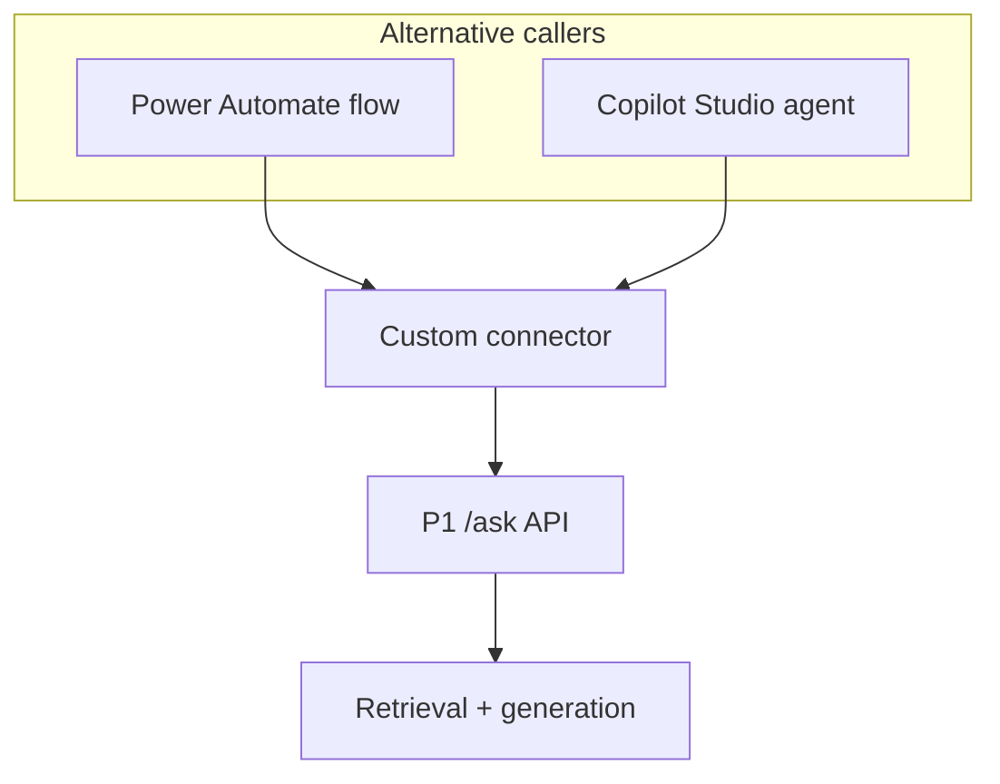

# Put the workflow around an API you can test

A question-answering service can work correctly and still be awkward to use. Someone copies a question into
a separate application, then pastes the answer and sources into a business process. A form, workflow or
conversational interface can remove that work. Rebuilding retrieval inside each interface creates several
implementations to secure and evaluate.

Keep the behaviour that needs controlled testing behind an API; let the surrounding application collect
inputs and use the result. Low-code fits familiar business steps whose owners can maintain them within
the platform's controls.

## How it works on Azure \{#how-it-works-on-azure}

Power Platform supplies several parts of that surrounding application. **Power Apps** builds the user
interface: canvas apps let you arrange screens, while model-driven apps work from a Dataverse data model.
**Power Automate** runs workflows, including cloud flows started manually, by an event or on a schedule.
**Copilot Studio** builds agents and agent flows; an agent can use a connector operation as a tool.
Microsoft's [developer introduction](https://learn.microsoft.com/en-us/power-platform/developer/get-started)
maps these responsibilities and their extension points.

**Dataverse** supplies managed business data: tables, relationships and role-based access. It could hold a
question's review status without holding the RAG service's documents or search index. Its
[table and security model](https://learn.microsoft.com/en-us/power-apps/maker/data-platform/data-platform-intro)
serves a different responsibility from document retrieval.

A [custom connector](https://learn.microsoft.com/en-us/connectors/custom-connectors/) describes your API's
operations, inputs, outputs and authentication for platform callers. A *connection* is the configured
instance used to access that service with credentials. In a solution-aware flow, a
[connection reference](https://learn.microsoft.com/en-us/power-apps/maker/data-platform/create-connection-reference)
binds an operation to that connection. The API still executes retrieval and generation.

Here, P1 means the course's RAG service project; the diagram shows two alternative callers for its API.



The response returns through the connector with the answer and citations. Callers need not know how the
API chunks documents or ranks results.

Administration is split too. A
[Power Platform environment](https://learn.microsoft.com/en-us/power-platform/admin/environments-overview)
contains platform assets such as apps, flows and connections. It is separate from the Azure resource group
hosting P1. Environment Maker permissions allow creating assets, but do not automatically grant access to
Dataverse data. A working Azure endpoint therefore does not establish that a maker has permission to build
or run its platform integration.

## Choosing the boundary \{#choosing-the-boundary}

Choose by interaction and maintenance ownership. These products can coexist with distinct responsibilities.
A Copilot Studio [topic](https://learn.microsoft.com/en-us/microsoft-copilot-studio/authoring-create-edit-topics)
defines a conversation's path through authored steps.

| Choice | Use it for | Choose another approach when |
|---|---|---|
| Power Apps | A business form, review queue or structured question screen. | The product needs a specialised interaction model that the app builder would make difficult to maintain. |
| Power Automate | Known steps around an API call: collect input, request an answer, route it for review. | Retrieval logic or complex processing would be scattered across expressions and connector actions. |
| Dataverse | Shared business records with relationships and role-based access. | You only need to call an existing API; copying its document corpus would create another source to maintain. |
| Copilot Studio | Conversation where an agent chooses tools or follows authored topics. | A fixed form already captures the request, or you need direct control of the agent runtime. |
| Custom .NET service | Retrieval, validation and application logic tested with the codebase. | The remaining requirement is a conventional departmental interface whose owners already maintain Power Platform assets. |

One common failure happens before any question reaches the model: the API description imports incorrectly.
The documented custom-connector OpenAPI import route requires
[OpenAPI 2.0, and does not support OpenAPI 3.0](https://learn.microsoft.com/en-us/connectors/custom-connectors/define-openapi-definition).
Check the format of an exported API description rather than assuming it is compatible. For one operation,
the connector wizard is another way to define the contract.

Another failure is granting a connection more authority than its users should exercise. Copilot Studio
supports [user authentication or author-provided credentials for tools](https://learn.microsoft.com/en-us/microsoft-copilot-studio/configure-enduser-authentication).
Choose user authentication where access depends on the caller. The API must still enforce its own access
rules. Signing into the conversation and authorising a tool's backend request are separate checks.

Latency also constrains the boundary. Power Automate documents a
[120-second limit for outbound synchronous requests](https://learn.microsoft.com/en-us/power-automate/limits-and-config).
Treat that as a ceiling for that request category, not a target response time or a guarantee for every
connector path. Give P1 a shorter application deadline. If the task needs lengthy processing, design job
submission and status retrieval instead of holding an interactive question open indefinitely.

Inspect the action's [retry policy](https://learn.microsoft.com/en-us/power-automate/limits-and-config#retry-policy);
defaults depend on performance profile. Retrying `/ask` can repeat
[billable model work](https://azure.microsoft.com/en-us/pricing/details/ai-foundry-models/aoai/) and
[produce a different answer](https://learn.microsoft.com/en-us/azure/foundry/openai/latest).
Where needed, define request deduplication in P1 and correlate attempts; a trace ID alone does not prevent
[duplicate execution](https://learn.microsoft.com/en-us/azure/architecture/patterns/retry#idempotency).

Low-code assets also need a release lifecycle. Power Platform
[solutions](https://learn.microsoft.com/en-us/power-platform/alm/solution-concepts-alm) package components
for movement between environments: develop in an unmanaged solution and deploy managed solutions downstream.
For a new target environment, [import the custom connector in a separate solution first](https://learn.microsoft.com/en-us/connectors/custom-connectors/customconnectorssolutions),
before its connection references and flows, or import can fail before connector registration completes.
Version the contract with P1; a renamed API field can break an unchanged flow.

## In an AI workload \{#in-an-ai-workload}

P1's ASP.NET Core minimal API on Azure Container Apps is designed to answer over public documents, using
Azure AI Search, Blob Storage and a Foundry model deployment. Keep dependency credentials inside the service. Its
[managed identity](https://learn.microsoft.com/en-us/azure/container-apps/managed-identity) serves its outbound
access to Azure resources, separately from the connector's inbound authentication.

Require a question and return a structured answer with citations. Define unsupported-question behaviour.
Preserve source metadata through to the displayed answer. If an agent rewrites it, test whether its claims
still match the sources.

The [Tool use lesson](/rag-agents/part-2-agents/tool-use/) explains why tool descriptions and argument schemas
affect a model's choices. Apply that here: describe `AskDocuments` as answering from the indexed public
document set, and say when it cannot help. Copilot Studio's
[tool configuration](https://learn.microsoft.com/en-us/microsoft-copilot-studio/copilot-plugins-enable-admin)
uses descriptions to guide tool selection. For a fixed question-and-answer path, an explicit call within
a topic can make the intended sequence easier to inspect.

For agents using the [standard harness](https://learn.microsoft.com/en-us/microsoft-copilot-studio/harnesses-overview#standard-harness),
Copilot Studio's runtime for structured conversations and agent flows, this is the
[connector-as-tool path](https://learn.microsoft.com/en-us/microsoft-copilot-studio/advanced-connectors).
Using Power Platform connectors as *knowledge sources* is a separate feature labelled **preview** in those
docs; it is not required here. Keep the distinction clear when deciding which component retrieves evidence.

Check governance before debugging the model. Classic
[data policies](https://learn.microsoft.com/en-us/power-platform/admin/dlp-connector-classification)
can classify custom connectors as Business, Non-Business or Blocked and restrict connector combinations.
A connector permitted in development may be blocked in another environment. These controls govern data
movement through connectors; P1 still needs its own authorisation for whatever documents it serves.

Evaluate answerable and unsupported questions, invalid requests and callers without permission. Check that
the frontend preserves failures. Use Application Insights and flow run history to diagnose the complete path. The
[observability lesson](/ai-sdlc/part-4-platform/observability-rollout) owns the underlying principle:
measure the behaviour users receive, including failures between otherwise healthy components.

## Try it \{#try-it}

This optional exercise adds a manual Power Automate flow to P1. Defer it until a deployed, Entra-protected
`/ask` is reachable from your environment and the following artifacts exist. The
[connector tutorial](https://learn.microsoft.com/en-us/connectors/custom-connectors/azure-active-directory-authentication)
uses Azure Resource Manager; P1 needs its own API registration and permission.

| Artifact / field | Value to prepare |
|---|---|
| P1 API registration: **Expose an API** | Its Application ID URI and an enabled delegated scope for asking questions, defined by P1's owner using the [expose-a-web-API guide](https://learn.microsoft.com/en-us/entra/identity-platform/quickstart-configure-app-expose-web-apis). No scope name is prescribed here. |
| Connector client registration: **API permissions** | Select that P1 API and delegated scope under **My APIs**, following the [client permissions guide](https://learn.microsoft.com/en-us/entra/identity-platform/quickstart-configure-app-access-web-apis); obtain user or administrator consent as required by scope and [tenant policy](https://learn.microsoft.com/en-us/entra/identity/enterprise-apps/configure-user-consent). |
| Connector security: **Client ID**, **Client secret** | The connector client's application ID and credential, distinct from P1's API registration. |
| Connector security: **Resource URL**, tenant | P1's registered Application ID URI and the intended Entra tenant, not the endpoint hostname or ARM resource. |
| Client registration: redirect URI | The connector-generated redirect URI, added after saving the connector. |

Readiness check: P1 must [validate access tokens](https://learn.microsoft.com/en-us/entra/identity-platform/access-tokens#validate-tokens)
for its audience and [enforce the required scope](https://learn.microsoft.com/en-us/entra/identity-platform/scenario-protected-web-api-verification-scope-app-roles).
Consent permits token issuance; it does not implement backend authorisation. Have an authorised test user,
a denied caller, and P1's implemented request, response and error samples ready. Otherwise defer the lab.

You need a work or school account, an administrator-approved development environment with Dataverse and
maker access, and **Power Automate Premium or an eligible premium trial**. The
[licence comparison](https://learn.microsoft.com/en-us/power-platform/admin/power-automate-licensing/types)
includes custom connectors under Premium; Free covers standard connectors. Confirm
[trial availability and tenant restrictions](https://learn.microsoft.com/en-us/power-platform/admin/pricing-billing-skus)
with your administrator. An Azure subscription alone does not supply these rights.

No Azure subscription is available for this course's execution yet. The commands below were checked against
the live CLI reference and have **not been run against a live subscription**; the connector and flow have
not been exercised either. The results below are expected checks, not observations.

1. With Azure CLI installed, replace the three values with your existing P1 deployment details:

   ```bash
   P1_SUBSCRIPTION_ID='replace-with-subscription-id'
   P1_RESOURCE_GROUP='replace-with-p1-resource-group'
   P1_APP_NAME='replace-with-p1-container-app'

   az login
   az account set --subscription "$P1_SUBSCRIPTION_ID"
   az containerapp show \
     --resource-group "$P1_RESOURCE_GROUP" \
     --name "$P1_APP_NAME" \
     --query properties.configuration.ingress.fqdn \
     --output tsv
   ```

   References: [sign-in](https://learn.microsoft.com/en-us/cli/azure/authenticate-azure-cli-interactively?view=azure-cli-latest),
   [subscription selection](https://learn.microsoft.com/en-us/cli/azure/account?view=azure-cli-latest#az-account-set),
   [app inspection](https://learn.microsoft.com/en-us/cli/azure/containerapp?view=azure-cli-latest#az-containerapp-show).
   The [documented hostname query](https://learn.microsoft.com/en-us/azure/container-apps/troubleshoot-deployment-errors)
   should return the configured ingress hostname. An empty result is a reason to check P1's deployment.

2. In Power Automate, select the development environment. In **Solutions**, create an unmanaged solution
   named `P1ConnectorLab`, then create a custom connector from blank named `P1Questions`. Following the
   [wizard](https://learn.microsoft.com/en-us/connectors/custom-connectors/define-blank), set HTTPS, the
   returned hostname and base URL `/`.

3. Configure OAuth 2.0 with the Microsoft Entra provider, labelled **Azure Active Directory** in the
   [connector tutorial](https://learn.microsoft.com/en-us/connectors/custom-connectors/azure-active-directory-authentication).
   Use the mapping above, save, then register the generated redirect URI on the connector client.
   Supply the secret only through security configuration.

4. Add action `AskDocuments` for `POST /ask`. Import a request sample and a successful response sample from
   your API's contract, with at least one citation in the sample. The proposed lesson contract is a
   `question` string in, and `answer` plus a `citations`
   array of `title` and `url` out; align these names with the implemented P1 contract. Mark the question
   required, resolve validation errors and save. In **Test**, create an authenticated connection and select
   **Test operation** with a question your corpus can answer.

5. In `P1ConnectorLab`, explicitly create a lab-owned
   [connection reference](https://learn.microsoft.com/en-us/power-apps/maker/data-platform/create-connection-reference#manually-add-a-connection-reference-using-solution-explorer)
   via **New > More > Connection Reference**. Name it `P1LabConnection`, select `P1Questions` and the tester's
   connection, then create it. Power Automate can otherwise reuse a reference from another solution.

6. In the same solution, create an
   [instant cloud flow](https://learn.microsoft.com/en-us/power-automate/create-child-flows#create-the-child-flow-in-a-solution)
   with **Manually trigger a flow** and a text input called `Question`. Add your
   [custom connector action](https://learn.microsoft.com/en-us/connectors/custom-connectors/use-custom-connector-flow),
   select `P1LabConnection` and map the input to the request field. Verify that binding before saving.
   Inspect the action's [retry settings](https://learn.microsoft.com/en-us/power-automate/guidance/coding-guidelines/error-handling#implement-a-retry-policy)
   before running the checks below.

Use the deployed P1 contract as the oracle; these are conditional acceptance criteria, not observed results.

| Check / where | Acceptance criterion |
|---|---|
| Answerable and unsupported questions / flow | Inspect run-history outputs: answer and source metadata match P1's response; its documented no-answer outcome survives. |
| Blank question / connector tester, then flow | If P1 rejects blank input, submit a whitespace-only question and compare the returned validation status and public error fields with P1's error sample. If connector validation blocks it first, check P1 directly too; a local rejection does not prove backend behaviour. |
| Denied caller / backend, then tester and flow | First verify direct P1 rejection with the prepared caller lacking access. Attempt a separate tester connection as that caller. If sign-in/consent blocks it, record that boundary; backend denial still needs the direct check. If a connection succeeds, use a temporary lab reference in a duplicate lab flow and compare its failure with P1's contract. Never reuse the authorised connection for this check. |

For failures reaching P1, require its documented rejection category and safe error details to remain
inspectable, with no generated answer. Diagnose using the failed action's
[run-history status and error](https://learn.microsoft.com/en-us/power-automate/troubleshoot-flow-errors).

Expected result: the flow exposes P1's response or an inspectable failure. Record cases and sources for
regression checks; success covers only cases tried.

For a conversational alternative, add this connector as a
[Copilot Studio tool](https://learn.microsoft.com/en-us/microsoft-copilot-studio/advanced-connectors) and
test the same cases. That requires separate Copilot Studio access; its
[trial permits test chat but not publishing](https://learn.microsoft.com/en-us/microsoft-copilot-studio/requirements-licensing-subscriptions).

**Cost:** Premium entitlement is required; an eligible trial can cover the platform experiment. This is
not a guaranteed free end-to-end lab. P1's Azure services remain separately billable, including
[Container Apps compute and requests](https://azure.microsoft.com/en-us/pricing/details/container-apps/)
and [model usage](https://azure.microsoft.com/en-us/pricing/details/ai-foundry-models/aoai/).
Check the licences above and your existing P1 deployment's cost before running it.

**Teardown:** Delete lab flows, then lab connection references, test connections and the custom connector.
Check [dependencies](https://learn.microsoft.com/en-us/power-apps/maker/data-platform/view-component-dependencies)
before deleting; remove only lab-owned dependents. Verify no lab components remain before deleting
`P1ConnectorLab`: an [unmanaged container alone does not remove them](https://learn.microsoft.com/en-us/power-apps/maker/data-platform/create-solution#delete-an-unmanaged-solution).
Remove lab-only client credentials/registrations. Follow P1's separate Azure teardown if brought online solely for this lab.

## What to take away \{#what-to-take-away}

- Assign each product a responsibility: app interface, workflow, business data or conversation. Keep retrieval
  and answer generation behind a contract you can test.
- A custom connector describes an API; a connection supplies access. Decide whose authority each call uses
  and enforce access in the backend.
- Preserve citations, unsupported-question behaviour and errors through the entire interaction. Test the
  displayed result as well as the API response.
- Check licensing, environment policies and request deadlines before choosing low-code. Version and release
  its assets with the same care as the service they call.

**[New terms](../glossary.md#copilot-studio-power-platform)**: Power Apps, Power Automate, Dataverse, Copilot Studio, Power Platform environment, custom connector, connection, connection reference, data policy, Power Platform solution.

## Sources \{#sources}

Verified as of 2026-10-17.

Platform and boundaries:

- [Introduction to Microsoft Power Platform for developers](https://learn.microsoft.com/en-us/power-platform/developer/get-started)
- [What is Microsoft Dataverse?](https://learn.microsoft.com/en-us/power-apps/maker/data-platform/data-platform-intro)
- [Power Platform environments overview](https://learn.microsoft.com/en-us/power-platform/admin/environments-overview)
- [Custom connectors overview](https://learn.microsoft.com/en-us/connectors/custom-connectors/)
- [Connector classification and custom connector policies](https://learn.microsoft.com/en-us/power-platform/admin/dlp-connector-classification)
- [Solution concepts with Power Platform](https://learn.microsoft.com/en-us/power-platform/alm/solution-concepts-alm)
- [Use a connection reference in a solution](https://learn.microsoft.com/en-us/power-apps/maker/data-platform/create-connection-reference)
- [Create custom connectors in solutions — import limitations](https://learn.microsoft.com/en-us/connectors/custom-connectors/customconnectorssolutions)
- [Delete an unmanaged solution](https://learn.microsoft.com/en-us/power-apps/maker/data-platform/create-solution#delete-an-unmanaged-solution)
- [View component dependencies](https://learn.microsoft.com/en-us/power-apps/maker/data-platform/view-component-dependencies)
- [Power Automate limits](https://learn.microsoft.com/en-us/power-automate/limits-and-config)
- [Power Automate error handling and retry settings](https://learn.microsoft.com/en-us/power-automate/guidance/coding-guidelines/error-handling)
- [Troubleshoot cloud flow errors](https://learn.microsoft.com/en-us/power-automate/troubleshoot-flow-errors)
- [Retry pattern — idempotency](https://learn.microsoft.com/en-us/azure/architecture/patterns/retry#idempotency)
- [Azure OpenAI chat reference — determinism qualification](https://learn.microsoft.com/en-us/azure/foundry/openai/latest)

Connector and agent integration:

- [Create a custom connector from an OpenAPI definition](https://learn.microsoft.com/en-us/connectors/custom-connectors/define-openapi-definition)
- [Create a custom connector from scratch](https://learn.microsoft.com/en-us/connectors/custom-connectors/define-blank)
- [Authenticate your API and connector with Microsoft Entra ID](https://learn.microsoft.com/en-us/connectors/custom-connectors/azure-active-directory-authentication)
- [Expose a web API and its scopes](https://learn.microsoft.com/en-us/entra/identity-platform/quickstart-configure-app-expose-web-apis)
- [Configure client permissions for a web API](https://learn.microsoft.com/en-us/entra/identity-platform/quickstart-configure-app-access-web-apis)
- [Configure user consent policy](https://learn.microsoft.com/en-us/entra/identity/enterprise-apps/configure-user-consent)
- [Validate access tokens](https://learn.microsoft.com/en-us/entra/identity-platform/access-tokens#validate-tokens)
- [Verify scopes in a protected web API](https://learn.microsoft.com/en-us/entra/identity-platform/scenario-protected-web-api-verification-scope-app-roles)
- [Use a custom connector from a flow](https://learn.microsoft.com/en-us/connectors/custom-connectors/use-custom-connector-flow)
- [Create an instant flow in a solution](https://learn.microsoft.com/en-us/power-automate/create-child-flows#create-the-child-flow-in-a-solution)
- [Use connectors in Copilot Studio agents](https://learn.microsoft.com/en-us/microsoft-copilot-studio/advanced-connectors)
- [Harnesses in Copilot Studio](https://learn.microsoft.com/en-us/microsoft-copilot-studio/harnesses-overview)
- [Create and edit topics](https://learn.microsoft.com/en-us/microsoft-copilot-studio/authoring-create-edit-topics)
- [Configure user authentication for tools](https://learn.microsoft.com/en-us/microsoft-copilot-studio/configure-enduser-authentication)
- [Add tools to agents](https://learn.microsoft.com/en-us/microsoft-copilot-studio/copilot-plugins-enable-admin)

Licensing and Azure inspection:

- [Types of Power Automate licences](https://learn.microsoft.com/en-us/power-platform/admin/power-automate-licensing/types)
- [Power Platform licensing overview](https://learn.microsoft.com/en-us/power-platform/admin/pricing-billing-skus)
- [Copilot Studio access, subscriptions and trial](https://learn.microsoft.com/en-us/microsoft-copilot-studio/requirements-licensing-subscriptions)
- [Azure CLI interactive sign-in](https://learn.microsoft.com/en-us/cli/azure/authenticate-azure-cli-interactively?view=azure-cli-latest)
- [Azure CLI: az account set](https://learn.microsoft.com/en-us/cli/azure/account?view=azure-cli-latest#az-account-set)
- [Azure CLI: az containerapp show](https://learn.microsoft.com/en-us/cli/azure/containerapp?view=azure-cli-latest#az-containerapp-show)
- [Container Apps ingress hostname query](https://learn.microsoft.com/en-us/azure/container-apps/troubleshoot-deployment-errors)
- [Managed identities in Container Apps](https://learn.microsoft.com/en-us/azure/container-apps/managed-identity)
- [Azure Container Apps pricing](https://azure.microsoft.com/en-us/pricing/details/container-apps/)
- [Foundry Models pricing — Azure OpenAI](https://azure.microsoft.com/en-us/pricing/details/ai-foundry-models/aoai/)
