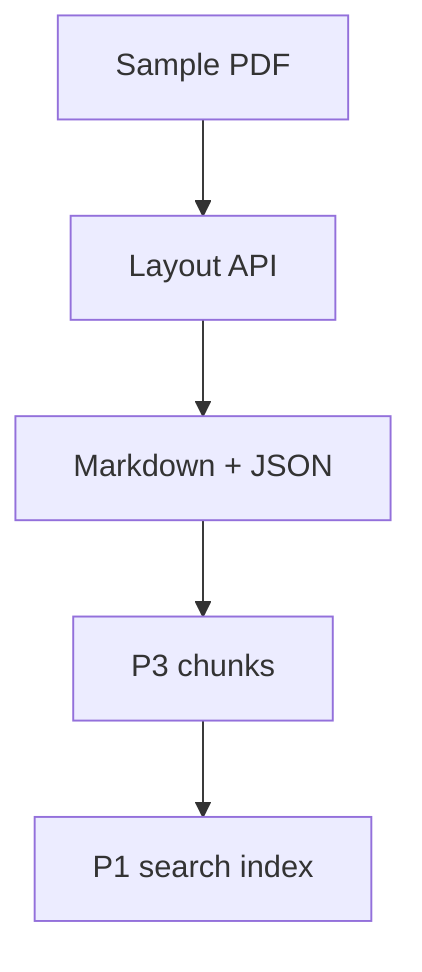

# Retrieval starts with the document's structure

A PDF can look correct on screen and become nonsense when extracted. Two columns interleave, a table loses
its headers, and a repeated footer interrupts a sentence. Once those fragments become searchable chunks,
the answering model receives damaged evidence. Changing the prompt cannot restore a missing relationship
between a price and its product.

Document ingestion therefore needs an intermediate result you can inspect: readable text, enough structure
to split it sensibly, and references back to the original pages. For the optional **P3 ingestion pipeline**,
that result sits between uploaded documents and the chunks indexed for P1. This lesson prepares that
boundary with one PDF; the upload worker and index updates come later.

## How Azure extracts content and structure \{#how-azure-extracts-content}

Optical character recognition (**OCR**) reads characters from page images. Layout analysis adds relationships:
which text forms a heading, which cells belong to a table, where a paragraph sits on a page. Field extraction
answers a different question: which value belongs in a schema field such as `InvoiceDate`? A paragraph can
be useful retrieval evidence without fitting any business schema.

Azure provides these capabilities through **Azure Document Intelligence in Foundry Tools** and **Azure
Content Understanding in Foundry Tools**, shortened here to Document Intelligence and Content Understanding.
Document Intelligence's [v4.0 model catalog](https://learn.microsoft.com/en-us/azure/ai-services/document-intelligence/model-overview?view=doc-intel-4.0.0)
lists the GA `2024-11-30` API, including `prebuilt-layout`, domain models such as invoices, and custom
extraction models. The layout model combines OCR with structure extraction; a domain model adds fields
defined for that document type.

Content Understanding uses an **analyzer**: a configuration selecting extraction behaviour and, where needed,
a field schema and generative processing. Its [current overview](https://learn.microsoft.com/en-us/azure/ai-services/content-understanding/overview)
identifies `2025-11-01` as GA and `2026-06-01-preview` as public preview. Agentic document reasoning and
signature detection are among the [preview additions](https://learn.microsoft.com/en-us/azure/ai-services/content-understanding/whats-new);
they are outside this exercise.

The [Content Understanding analyzer catalog](https://learn.microsoft.com/en-us/azure/ai-services/content-understanding/concepts/prebuilt-analyzers)
includes `prebuilt-read` and `prebuilt-layout`, which require no language or embedding model. It also includes
`prebuilt-documentSearch`, which adds semantic analysis for RAG. The read/layout names also occur in
Document Intelligence: an identifier alone does not tell you which service you are calling.

For this lab, submit a document URL to Document Intelligence's layout endpoint. Analysis is asynchronous:
the accepted request returns an operation URL, which you poll for completion. Request
[`outputContentFormat=markdown`](https://learn.microsoft.com/en-us/azure/ai-services/document-intelligence/prebuilt/layout?view=doc-intel-4.0.0)
to receive Markdown in the result's `content` property. Keep the surrounding JSON too: it contains structured
page, paragraph and table information for mapping extracted material back to the PDF.



The exercise reaches the Markdown and JSON stage. In this Document Intelligence path, chunking and indexing
are application steps downstream; a successful layout request does not mean P1 can search the document yet.
Content Understanding's [`prebuilt-documentSearch`](https://learn.microsoft.com/en-us/azure/ai-services/content-understanding/concepts/prebuilt-analyzers#prebuilt-documentsearch)
also offers chunked output for embedding and indexing, including fixed-size and layout-aware semantic chunking.

## Choose the extraction the document needs \{#choosing-extraction}

Start with the required output. If your source already supplies clean Markdown with trustworthy headings,
running OCR adds another opportunity to damage it. If the input is a scan, reading the file's encoded text
alone cannot recover the words in its pixels.

Microsoft's [current choice guide](https://learn.microsoft.com/en-us/azure/ai-services/content-understanding/choosing-right-ai-tool)
recommends Content Understanding for new OCR/layout-only choices, while retaining Document Intelligence
for standard forms and labelled custom extraction. This lab deliberately uses Document Intelligence for a
bounded F0 exercise: inspect the Markdown and JSON returned by its
[GA `2024-11-30` REST API](https://learn.microsoft.com/en-us/azure/ai-services/document-intelligence/model-overview?view=doc-intel-4.0.0)
before designing P3's splitter. Choose the production service by evaluating your corpus, including whether
Content Understanding's chunked output meets your retrieval needs.

| Option | Choose it for | Avoid it when |
|---|---|---|
| Content Understanding read/layout analyzers | Text or document structure without semantic field inference | The source already has usable structure, or you need a business-field schema |
| Document Intelligence layout | Inspectable Markdown and JSON in this F0 lab, or an existing DI integration | You expect layout alone to identify invoice totals or infer contract obligations |
| Document Intelligence domain or custom extraction models | Standard forms with known fields, or labelled examples for your document family | Your real requirement is arbitrary narrative retrieval rather than those fields |
| Content Understanding semantic or custom analyzers | Unstructured documents, inferred fields, or richer RAG preparation | Straight extraction is sufficient and generated interpretation adds no useful information |

For example, retrieving a paragraph about delivery terms needs text and section context. Posting an invoice
into an accounting workflow needs named values, types and validation. A visually plausible table is not a
validated invoice record. Conversely, extracting a handful of fields can discard the surrounding explanation
that a question-answering system needs.

Generative extraction also changes what you must check. A summary or inferred obligation is an
interpretation of the source. Store it separately from verbatim passages so a later answer does not cite
an interpretation as if the original document said it. Content Understanding's
[billing explanation](https://learn.microsoft.com/en-us/azure/ai-services/content-understanding/pricing-explainer)
also separates extraction, contextualization and connected model token charges; do not budget a semantic
analyzer as though it were an OCR-only call.

Check troublesome pages before selecting a service: skewed scans, dense tables and columns whose reading
order matters. Inspect missing text and wrong relationships separately. A parser may read every word yet
attach a number to the wrong row. Neither valid JSON nor tidy Markdown detects that failure for you.

## Turn layout into evidence for P1 \{#in-an-ai-workload}

The [Ingestion lesson](/rag-agents/part-1-rag/ingestion/) owns chunk size, overlap and embeddings. Azure's
contribution here is the extracted structure those decisions can use. Begin P3's splitter at section
boundaries, carry the heading path into each chunk, and apply the selected embedding model's token budget
after assembling the text. A page break alone is a poor boundary when a paragraph continues onto the next page.

Tables need explicit handling. Keep a small table with its caption and relevant introduction. For a large
table, split by meaningful row groups and repeat the headers needed to interpret each group. Document
Intelligence's [v4.0 Markdown format](https://learn.microsoft.com/en-us/azure/ai-services/document-intelligence/concept/markdown-elements?view=doc-intel-4.0.0)
uses HTML tables to represent features such as merged cells. A splitter that understands only pipe-table
syntax can cut straight through that structure.

Keep **provenance**, the record connecting a chunk to its source: document ID and version, page references,
section path, and the extraction configuration. A bounding region locates an extracted element on a page;
retain the JSON mappings before cleaning or rewriting the Markdown. In the
[result schema](https://learn.microsoft.com/en-us/rest/api/aiservices/document-models/get-analyze-result?view=rest-aiservices-v4.0%20(2024-11-30)),
`analyzeResult.paragraphs[*].spans` gives offsets and lengths into `analyzeResult.content`; the same
paragraph's `boundingRegions[*].pageNumber` identifies its source pages. Match a passage in the original
Markdown to a paragraph's span, then read that paragraph's page numbers. For a table, use
`analyzeResult.tables[*].spans` and its `boundingRegions`; `cells[*]` supplies the same mappings at cell
level. Respect `analyzeResult.stringIndexType` when interpreting offsets. Character offsets into the
original extraction cannot safely identify text after arbitrary edits.

For P3, store the original document version, full analysis response and derived text as separate artifacts.
Carry the document's access permissions into the index records. Build chunk IDs from a document version and
a stable chunk identifier so a retried job can replace its own output. Publish a complete replacement
version deliberately and remove obsolete chunks; otherwise P1 can retrieve both the old and corrected policy.

Evaluate this boundary with a few representative questions before experimenting with a different answering
model. Can retrieval find the table row with its headers? Does the citation open the correct page? Does a
question about the final section expose a document that was only partly processed? The
[Evaluation lesson](/rag-agents/part-1-rag/cross-cutting/evaluation/) explains the wider method; extraction
checks help you locate the failure before it becomes an answer-quality problem.

## Try it \{#try-it}

Prepare P3's first extraction artifact using Azure CLI with Bash variables, prompts and waits. You need a subscription, an interactive
user login, permission to create resources and permission to assign a role on the new resource. Replace the
subscription and globally unique account name below; choose a region allowed by your subscription.

These commands were checked against the linked CLI reference and **have not yet been run against a live
Azure subscription**; no subscription was available. The results below describe the documented API behaviour,
not an observed lab run.

Create a dedicated resource group and an F0 single-service account. The CLI kind remains
[`FormRecognizer`](https://learn.microsoft.com/en-us/dotnet/api/overview/azure/ai.formrecognizer-readme?view=azure-dotnet),
despite the product's current name. The
[`account create` reference](https://learn.microsoft.com/en-us/cli/azure/cognitiveservices/account?view=azure-cli-latest#az-cognitiveservices-account-create)
defines these provisioning flags.

```bash
az login
az account set --subscription 'YOUR-SUBSCRIPTION-ID'

ingest_rg='rg-p3-layout-lab'
ingest_name='YOUR-GLOBALLY-UNIQUE-ACCOUNT-NAME'
ingest_region='eastus'

az group create --name "$ingest_rg" --location "$ingest_region"
az cognitiveservices account create \
  --name "$ingest_name" --resource-group "$ingest_rg" \
  --kind FormRecognizer --sku F0 --location "$ingest_region" \
  --custom-domain "$ingest_name" --yes

ingest_id="$(az cognitiveservices account show \
  --name "$ingest_name" --resource-group "$ingest_rg" \
  --query id --output tsv)"
ingest_endpoint="$(az cognitiveservices account show \
  --name "$ingest_name" --resource-group "$ingest_rg" \
  --query properties.endpoint --output tsv)"
ingest_user="$(az ad signed-in-user show --query id --output tsv)"

az role assignment create --assignee-object-id "$ingest_user" \
  --assignee-principal-type User --role 'Cognitive Services User' \
  --scope "$ingest_id"
```

The custom subdomain and assigned role support
[Microsoft Entra authentication](https://learn.microsoft.com/en-us/azure/ai-services/document-intelligence/sdk-overview-v4-0?view=doc-intel-4.0.0).
Allow the role assignment to propagate before analysis; if access is rejected, check that assignment and
endpoint before retrying. If F0 provisioning is rejected, resolve the eligibility or availability issue
before continuing; changing to S0 changes the cost contract.

Submit Microsoft's [sample layout PDF](https://github.com/Azure-Samples/cognitive-services-REST-api-samples/blob/master/curl/form-recognizer/sample-layout.pdf).
This uses the [JSON URL-analysis operation](https://learn.microsoft.com/en-us/rest/api/aiservices/document-models/analyze-document?view=rest-aiservices-v4.0%20(2024-11-30)):
Azure fetches the public PDF, so you do not need a storage account for this step.

```bash
ingest_sample='https://raw.githubusercontent.com/Azure-Samples/cognitive-services-REST-api-samples/master/curl/form-recognizer/sample-layout.pdf'
ingest_api="${ingest_endpoint%/}/documentintelligence/documentModels/prebuilt-layout"

az rest --method post \
  --url "${ingest_api}:analyze?_overload=analyzeDocument&api-version=2024-11-30&outputContentFormat=markdown&pages=1-2" \
  --resource 'https://cognitiveservices.azure.com/' \
  --headers 'Content-Type=application/json' \
  --body "{\"urlSource\":\"$ingest_sample\"}" --debug
```

Expected: HTTP `202 Accepted`, with `Operation-Location` and `Retry-After` response headers.
[`--debug`](https://learn.microsoft.com/en-us/cli/azure/reference-index?view=azure-cli-latest#az-rest)
exposes response headers through the CLI's
[response logger](https://github.com/Azure/azure-cli/blob/dev/src/azure-cli-core/azure/cli/core/util.py).
Copy the operation header's complete URL, without surrounding quotes. Set the delay to at least one
second, or the response's `Retry-After` seconds if longer, **before the first GET**. F0 permits
[one GET per second](https://learn.microsoft.com/en-us/azure/ai-services/document-intelligence/service-limits?view=doc-intel-4.0.0).
The accepted response is a job receipt, without extracted Markdown. Poll the
[result operation](https://learn.microsoft.com/en-us/rest/api/aiservices/document-models/get-analyze-result?view=rest-aiservices-v4.0%20(2024-11-30)):

```bash
read -r -p 'Paste Operation-Location URL: ' ingest_operation
read -r -p 'Wait seconds (at least 1; use longer Retry-After): ' ingest_wait
sleep "$ingest_wait"
az rest --method get --url "$ingest_operation" \
  --resource 'https://cognitiveservices.azure.com/' \
  --query status --output tsv --debug
```

Inspect each GET's response headers as well as its status. While status is `notStarted` or `running`,
update `ingest_wait` using the latest headers and repeat from `sleep`. Stop on `failed` and inspect the
error. Only after `succeeded`, save the complete result and its Markdown. The prompts below apply the
same delay rule to both saving requests, using the latest response each time:

```bash
read -r -p 'Wait seconds (at least 1; use longer Retry-After): ' ingest_wait
sleep "$ingest_wait"
az rest --method get --url "$ingest_operation" \
  --resource 'https://cognitiveservices.azure.com/' \
  --output json --debug > analysis.json
read -r -p 'Wait seconds (at least 1; use longer Retry-After): ' ingest_wait
sleep "$ingest_wait"
az rest --method get --url "$ingest_operation" \
  --resource 'https://cognitiveservices.azure.com/' \
  --query analyzeResult.content --output tsv --debug > layout.md
```

Open both files. Expect extracted content in `analyzeResult.content` with `contentFormat` set to `markdown`;
compare the structure with the PDF. The following is a schematic illustration of the format, using invented
content, rather than captured output from that sample:

```markdown
# Delivery terms

Orders leave the warehouse within five working days.

<table>
<tr><th>Service</th><th>Days</th></tr>
<tr><td>Standard</td><td>5</td></tr>
</table>
```

Mark a section boundary and a table boundary in your actual result. Follow the paragraph and table spans
to their bounding-region page numbers in the JSON. Those observations define P3's next splitter fixture.
Save the two artifacts with the sample URL and
API version; they are the input to chunking and indexing, rather than a finished searchable index.

**Cost:** This exercise uses F0, whose [pricing allowance](https://azure.microsoft.com/en-us/pricing/details/document-intelligence/)
is 500 free pages per month. Stay within that allowance. F0 returns at most two pages per request and accepts
files up to 4 MB, according to the [service limits](https://learn.microsoft.com/en-us/azure/ai-services/document-intelligence/service-limits?view=doc-intel-4.0.0).
Check the returned page coverage rather than interpreting successful analysis as complete-document coverage.

**Teardown:** Delete only the dedicated lab group. Keep the local extraction artifacts for P3.

```bash
az group delete --name "$ingest_rg" --yes
```

## What to take away \{#what-to-take-away}

- Choose OCR, layout or schema extraction according to the output your application needs; they solve different problems.
- This lab uses Document Intelligence's GA `2024-11-30` API to inspect extraction before building P3's splitter; evaluate the production service on your corpus.
- Preserve Markdown, structured mappings and source versions together so chunks retain their meaning and citations.
- Check extraction and chunk boundaries before blaming the answering model; a completed request can still cover only part of a document.

**[New terms](../glossary.md#document-ingestion)**: OCR, layout analysis, field extraction, analyzer, bounding region, provenance.

## Sources \{#sources}

Verified as of 2026-10-17.

- **Service choices and status:** [Content Understanding overview](https://learn.microsoft.com/en-us/azure/ai-services/content-understanding/overview), [release notes](https://learn.microsoft.com/en-us/azure/ai-services/content-understanding/whats-new), [document processing choices](https://learn.microsoft.com/en-us/azure/ai-services/content-understanding/choosing-right-ai-tool), [prebuilt analyzers](https://learn.microsoft.com/en-us/azure/ai-services/content-understanding/concepts/prebuilt-analyzers), [Content Understanding billing](https://learn.microsoft.com/en-us/azure/ai-services/content-understanding/pricing-explainer).
- **Document Intelligence:** [models](https://learn.microsoft.com/en-us/azure/ai-services/document-intelligence/model-overview?view=doc-intel-4.0.0), [layout](https://learn.microsoft.com/en-us/azure/ai-services/document-intelligence/prebuilt/layout?view=doc-intel-4.0.0), [Markdown elements](https://learn.microsoft.com/en-us/azure/ai-services/document-intelligence/concept/markdown-elements?view=doc-intel-4.0.0), [authentication](https://learn.microsoft.com/en-us/azure/ai-services/document-intelligence/sdk-overview-v4-0?view=doc-intel-4.0.0), [REST workflow and polling](https://learn.microsoft.com/en-us/azure/ai-services/document-intelligence/how-to-guides/use-sdk-rest-api?view=doc-intel-4.0.0), [limits](https://learn.microsoft.com/en-us/azure/ai-services/document-intelligence/service-limits?view=doc-intel-4.0.0), [pricing](https://azure.microsoft.com/en-us/pricing/details/document-intelligence/).
- **REST contract:** [analyze a document URL](https://learn.microsoft.com/en-us/rest/api/aiservices/document-models/analyze-document?view=rest-aiservices-v4.0%20(2024-11-30)), [get analysis result](https://learn.microsoft.com/en-us/rest/api/aiservices/document-models/get-analyze-result?view=rest-aiservices-v4.0%20(2024-11-30)).
- **CLI:** [`az login` and `az rest`](https://learn.microsoft.com/en-us/cli/azure/reference-index?view=azure-cli-latest), [subscription selection](https://learn.microsoft.com/en-us/cli/azure/account?view=azure-cli-latest#az-account-set), [resource groups](https://learn.microsoft.com/en-us/cli/azure/group?view=azure-cli-latest), [service accounts](https://learn.microsoft.com/en-us/cli/azure/cognitiveservices/account?view=azure-cli-latest), [signed-in user](https://learn.microsoft.com/en-us/cli/azure/ad/signed-in-user?view=azure-cli-latest), [role assignment](https://learn.microsoft.com/en-us/cli/azure/role/assignment?view=azure-cli-latest), [resource-kind example](https://learn.microsoft.com/en-us/dotnet/api/overview/azure/ai.formrecognizer-readme?view=azure-dotnet).
- **Official implementation and sample:** [Azure CLI response logging](https://github.com/Azure/azure-cli/blob/dev/src/azure-cli-core/azure/cli/core/util.py), [sample PDF](https://github.com/Azure-Samples/cognitive-services-REST-api-samples/blob/master/curl/form-recognizer/sample-layout.pdf).
