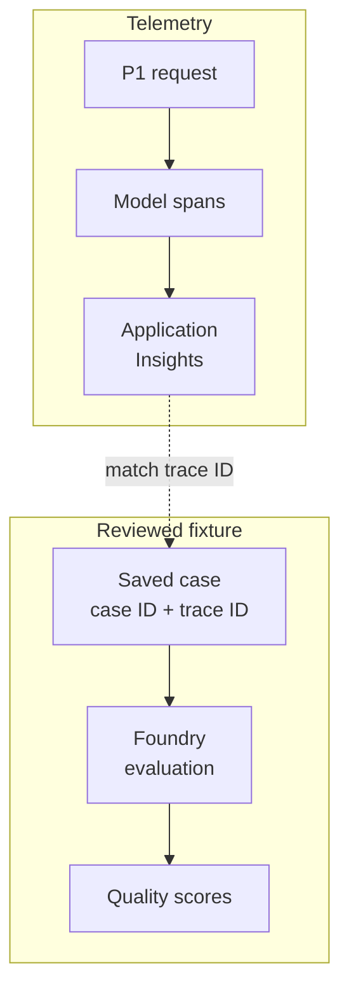

# A quality score needs an execution you can inspect

An answer endpoint can return HTTP 200 quickly and still cite a passage that does not support its answer.
Request metrics establish whether the service responded; they cannot establish whether it answered well.
The reverse problem appears when an evaluation score falls: without the execution behind that answer, you
cannot tell whether retrieval missed the evidence, generation ignored it, or the evaluation received the
wrong context.

Keep the two kinds of evidence connected. Evaluation measures a chosen property of an answer against
specified inputs. Tracing records the operations that produced it. For a RAG service, the useful result is
a failed case you can follow back to its retrieved passages and model call, then reproduce after a change.

## How it works on Azure \{#how-it-works-on-azure}

[Microsoft Foundry evaluations](https://learn.microsoft.com/en-us/azure/foundry/concepts/evaluation-overview)
apply evaluators to saved outputs, newly generated responses or production traces. A run has a target,
data, scoring criteria and results. Evaluating an existing dataset lets you score your application's
answers without asking a bare model to answer the questions again. That distinction matters for P1:
its retrieval and citation assembly are part of the behaviour under test.

The [built-in catalog](https://learn.microsoft.com/en-us/azure/foundry/concepts/built-in-evaluators)
includes quality, safety, retrieval and agent criteria. For P1, start with
[Groundedness and Relevance](https://learn.microsoft.com/en-us/azure/foundry/concepts/evaluation-evaluators/rag-evaluators):
the first checks an answer against its grounding context; the second checks it against the question.
Both use a judge model and a 1–5 scale, with thresholds producing pass/fail results. They are not labelled
preview in the current reference. Groundedness Pro is a different evaluator and **is preview**; do not
treat the similar names as interchangeable implementations.

Tracing takes another path. The application emits OpenTelemetry spans, a provider subscribes to their
sources, and an exporter sends them to Application Insights. Reuse the destination from
[Part I's Observability lesson](/part-1-azure-foundations/observability.md). Provisioning that resource
did not instrument P1's model calls.



The saved cases in this diagram are deliberate test artifacts, not an automatic copy of every trace.
The dotted link associates a saved case with its execution by trace ID; it does not copy trace content.

For new .NET instrumentation, Microsoft's
[current setup guide](https://learn.microsoft.com/en-us/azure/azure-monitor/app/opentelemetry-enable?tabs=aspnetcore)
uses Microsoft OpenTelemetry Distro. Existing Azure Monitor OpenTelemetry Distro applications need no
migration; initialise one distribution in an application. At P1's chat boundary,
[`UseOpenTelemetry`](https://learn.microsoft.com/en-us/dotnet/ai/ichatclient#use-telemetry)
wraps an `IChatClient` with model-operation spans and metrics. Its source name must match the source you
subscribe to. The [API remarks](https://learn.microsoft.com/en-us/dotnet/api/microsoft.extensions.ai.opentelemetrychatclientbuilderextensions.useopentelemetry?view=net-10.0-pp#remarks)
warn that the generative-AI semantic conventions and emitted telemetry remain experimental and may change.
Recheck fields before building queries or recurring-evaluation integrations around them.

## Choose what the evidence must answer \{#choosing-and-tradeoffs}

Offline evaluation holds a test set still while you change the service. Online evaluation examines
behaviour under actual traffic. One catches regressions on known cases; the other can reveal questions
your test author never anticipated. Neither makes the other redundant.

| Choice | Useful for | Poor fit or common failure |
|---|---|---|
| Offline dataset run | Comparing releases on saved P1 cases | Detecting a new production question pattern absent from the set |
| Continuous evaluation | Checking a sample of live interactions | Blocking an unacceptable answer before it reaches the caller |
| Built-in judge evaluator | A documented property such as groundedness | Assuming a high score proves every citation is valid |
| Custom deterministic evaluator | Citation membership, required fields, output shape | Judging whether a passage semantically supports a claim |
| Custom prompt evaluator | An application-specific semantic criterion | An ambiguous rubric that rewards plausible wording |
| Execution trace | Locating slow calls, retries and failed operations | Deciding answer correctness from successful spans |

Foundry's [recurring evaluations are preview](https://learn.microsoft.com/en-us/azure/foundry/observability/how-to/how-to-monitor-agents-dashboard).
Scheduled evaluation runs on a schedule; continuous evaluation samples live traffic. Set its sampling
and run limits deliberately. For agents hosted elsewhere, the documented path also requires onboarding
the custom agent through Foundry's control plane and AI gateway, plus compatible telemetry sent to the
project's Application Insights. Exporting spans from an arbitrary Container App does not complete that setup.
P1's exercise below stays with a single offline run.

[Custom evaluators are also preview](https://learn.microsoft.com/en-us/azure/foundry/concepts/evaluation-evaluators/custom-evaluators).
Foundry supports Python code, judge prompts and external HTTP endpoints. Code evaluators run in a sandbox
without network access; choose an endpoint when scoring needs another service. That adds an operational
dependency to the evaluation itself. For P1, a deterministic citation check could verify that each cited
source belongs to the retrieved set. A judge still has a separate job: deciding whether that source supports
the statement. Inspect the cited passage when that judgment fails.

Treat collection policy as part of the design.
[Traces can contain prompts, answers and personal data](https://learn.microsoft.com/en-us/azure/foundry/observability/concepts/trace-data).
Public source documents do not make a user's question public. Start with operation metadata; collect
reviewed text separately for the offline fixture. Decide who can read that fixture and how long it stays.
If a trace is missing, check sampling before relying on the available executions to explain a failure.

## In an AI workload \{#in-an-ai-workload}

P1's minimal API retrieves passages from Azure AI Search, calls a Foundry model deployment and returns
citations over documents stored in Blob Storage. Keep the service's existing managed-identity access and
Key Vault configuration. Telemetry adds an observation path around that work.

Record a release identifier, prompt version, index version and model deployment with each test run.
Preserve the actual context supplied to generation. Running Search again tomorrow may return different
passages, so a later query cannot stand in for yesterday's evidence. Use stable case identifiers to
compare failures across runs, even when the trace identifiers change.

Suppose a case is relevant but poorly grounded. Inspect whether its saved context includes the needed
passage, then follow the model operation in its trace. If the passage was missing, investigate retrieval;
if it was present, investigate context assembly and generation. Check the fixture's field mappings before
changing either: judging against the wrong text can produce a failure the service never made.

The [RAG evaluation lesson](/rag-agents/part-1-rag/cross-cutting/evaluation/) owns the separation of retrieval
and generation metrics. Its [deep dive](/rag-agents/part-1-rag/cross-cutting/evaluation/deep-dive)
explains judge calibration and human labels. Use those methods to choose acceptance criteria; an Azure
evaluator's available scale does not define your release threshold. Keep citation checks beside semantic
scores, and inspect individual failures before trusting an aggregate.

## Try it \{#try-it}

Connect a development P1 instance to Part I's Application Insights, then score five saved answers. You need
the working RAG endpoint, a Foundry project, an Azure OpenAI judge deployment and permission to update
the app. For model-backed evaluation,
[`Foundry User` must cover the Foundry account/resource scope](https://learn.microsoft.com/en-us/azure/foundry/observability/how-to/evaluation-permissions);
project-only access does not authorise inference. For the signed-in reader, the
[trace permissions table](https://learn.microsoft.com/en-us/azure/foundry/observability/how-to/evaluation-permissions#add-permissions-for-trace-based-workflows)
requires Log Analytics Reader on Application Insights and, for workspace-scoped queries, its linked workspace;
protected content additionally needs Privileged Monitoring Data Reader. These are human viewing permissions.
The project managed identity's trace-evaluation roles are separate; this lab uploads a dataset.

Both C# snippets were built in an ASP.NET Core harness targeting .NET 10 with .NET SDK 10.0.402,
Microsoft.OpenTelemetry 1.2.0, Microsoft.Extensions.AI 10.11.0, Microsoft.Extensions.AI.OpenAI 10.11.0,
OpenAI 2.14.0 and Azure.Identity 1.21.0 on 2026-10-18. The local run command started the harness with
configuration file watching disabled and a dummy loopback telemetry destination. Its `/ask` request
failed at credential acquisition; no five-row fixture was produced. The Azure CLI commands, telemetry
export to Azure and Foundry evaluation were not run against a live subscription. Expected cloud
outcomes below describe the documented workflow, not observed results.

Use the existing client construction from [AI in .NET](/part-2-modern-dotnet/ai-in-dotnet.md).
The illustrated dependencies are [Microsoft.OpenTelemetry 1.2.0](https://www.nuget.org/packages/Microsoft.OpenTelemetry/1.2.0)
and [Microsoft.Extensions.AI 10.11.0](https://www.nuget.org/packages/microsoft.extensions.ai/10.11.0), both stable packages.
Put the `using` directives at the file's top. Insert the remaining statements before `builder.Build()`,
replacing the existing chat registration. `builder`, `chatDeployment` and the registered `OpenAIClient`
are P1's existing startup values.
The [provider customisation](https://learn.microsoft.com/en-us/azure/azure-monitor/app/opentelemetry-add-modify?tabs=aspnetcore)
subscribes to the wrapper's source; the
[instrumentation option](https://learn.microsoft.com/en-us/dotnet/api/microsoft.opentelemetry/microsoft.opentelemetry.instrumentationoptions?view=opentelemetry-dotnet-latest)
disables overlapping direct OpenAI instrumentation.

```csharp
using Microsoft.Extensions.AI;
using Microsoft.OpenTelemetry;
using OpenAI;
using OpenTelemetry.Trace;

const string modelSource = "P1.ModelCalls";

builder.Services.ConfigureOpenTelemetryTracerProvider((_, tracing) =>
    tracing.AddSource(modelSource));
builder.UseMicrosoftOpenTelemetry(options =>
{
    options.Exporters = ExportTarget.AzureMonitor;
    options.Instrumentation.EnableOpenAIInstrumentation = false;
});

builder.Services.AddChatClient(services =>
    services.GetRequiredService<OpenAIClient>()
        .GetChatClient(chatDeployment).AsIChatClient())
    .UseOpenTelemetry(
        sourceName: modelSource,
        configure: telemetry => telemetry.EnableSensitiveData = false);
```

[`EnableSensitiveData = false`](https://learn.microsoft.com/en-us/dotnet/api/microsoft.extensions.ai.opentelemetrychatclient.enablesensitivedata?view=net-10.0-pp)
keeps raw inputs and outputs out of this wrapper's telemetry. Check other collectors separately.
Prepare the integrated image through P1's normal pipeline. Before deploying it,
[set its destination](https://learn.microsoft.com/en-us/azure/azure-monitor/app/opentelemetry-enable?tabs=aspnetcore#modify-your-application)
on the existing app, then switch images. A documentation build does not validate this integration.

In Bash, replace the placeholders with existing development resources. This assumes one container and
single-revision mode, with no previous `APPLICATIONINSIGHTS_CONNECTION_STRING` setting. The
[component reference](https://learn.microsoft.com/en-us/cli/azure/monitor/app-insights/component?view=azure-cli-latest#az-monitor-app-insights-component-show)
and [configuration guide](https://learn.microsoft.com/en-us/azure/azure-monitor/app/create-workspace-resource)
document retrieving `connectionString`; the
[Container Apps reference](https://learn.microsoft.com/en-us/cli/azure/containerapp?view=azure-cli-latest#az-containerapp-update)
documents the environment update.

```bash
az login
p1_subscription='<subscription-id>'
p1_group='<P1-resource-group>'
p1_app='<P1-container-app>'
p1_telemetry_group='<Part-I-telemetry-resource-group>'
p1_insights='<Part-I-application-insights-name>'
az account set --subscription "$p1_subscription"
az extension add --name application-insights --upgrade

p1_connection=$(az monitor app-insights component show \
  --subscription "$p1_subscription" \
  --resource-group "$p1_telemetry_group" --app "$p1_insights" \
  --query connectionString --output tsv)
az containerapp update \
  --subscription "$p1_subscription" \
  --resource-group "$p1_group" --name "$p1_app" \
  --set-env-vars "APPLICATIONINSIGHTS_CONNECTION_STRING=$p1_connection" \
  --output none
```

Deploy the prepared image now. Send a normal request and find it in Application Insights
[Search](https://learn.microsoft.com/en-us/azure/azure-monitor/app/failures-performance-transactions?tabs=transaction-search),
opening its end-to-end transaction details. Expect `P1.ModelCalls` spans after export and ingestion.
If absent, check the image, source subscription, destination and sampling.

For fixture capture, run the same P1 code locally against its Azure dependencies, using authorised developer
credentials. At the existing non-streaming answer handler's generation boundary, replace its chat call with
this block. Here `http` is its `HttpContext`, `chat` its registered `IChatClient`, `query` the question, and
`messages` its final prompt. Keep `context` as the exact grounding string inserted into those messages,
after filtering and truncation, as the [evaluator requires](https://learn.microsoft.com/en-us/azure/foundry/concepts/evaluation-evaluators/rag-evaluators#context-format).
Continue returning `answer` through P1's normal citation response; if P1 post-processes it, capture after that step.

```csharp
// Add using System.Diagnostics; and using System.Text.Json; at the file top.
var traceId = Activity.Current?.TraceId.ToHexString();
var completion = await chat.GetResponseAsync(
    messages, cancellationToken: http.RequestAborted);
var answer = completion.Text;

if (app.Environment.IsDevelopment() &&
    Environment.GetEnvironmentVariable("P1_CAPTURE_EVAL") == "1")
{
    var caseId = http.Request.Headers["X-Eval-Case-Id"].ToString();
    if (string.IsNullOrWhiteSpace(caseId) || traceId is null)
        throw new InvalidOperationException("Capture needs case and trace IDs.");
    var row = new { case_id = caseId, trace_id = traceId,
        query, response = answer, context };
    await File.AppendAllTextAsync("p1-eval.jsonl",
        JsonSerializer.Serialize(row) + "\n");
}
```

[`Activity.Current`](https://learn.microsoft.com/en-us/azure/azure-monitor/app/opentelemetry-add-modify?tabs=aspnetcore#get-the-trace-id-or-span-id)
provides the trace ID. [Compact JSON serialization](https://learn.microsoft.com/en-us/dotnet/standard/serialization/system-text-json/how-to)
and [file append](https://learn.microsoft.com/en-us/dotnet/api/system.io.file.appendalltextasync?view=net-10.0)
produce one object per line, preserving escaped newlines inside strings. Use one local process and sequential
requests. Start with a fresh fixture in the app's working directory; keep it out of source control.

In that directory, use the [development environment](https://learn.microsoft.com/en-us/aspnet/core/fundamentals/environments?view=aspnetcore-10.0)
and [run options](https://learn.microsoft.com/en-us/dotnet/core/tools/dotnet-run) below. Keep the cloud app's
normal environment; the capture flag is local only. Retain P1's existing local dependency configuration.

```bash
DOTNET_ENVIRONMENT=Development P1_CAPTURE_EVAL=1 \
  APPLICATIONINSIGHTS_CONNECTION_STRING="$p1_connection" \
  dotnet run --no-launch-profile -- --urls http://127.0.0.1:5080
```

In another terminal, send a question with [curl](https://curl.se/docs/manpage.html).
This assumes P1 accepts `POST /ask` with a `query` field; adapt the route/body and existing authentication
if yours differs. Replace the example question with one from your public documents.

```bash
curl --fail --silent --show-error http://127.0.0.1:5080/ask \
  --header 'Content-Type: application/json' \
  --header 'X-Eval-Case-Id: p1-001' \
  --data '{"query":"What does the document say about retention?"}'
```

Repeat sequentially through `p1-005`: three answerable questions, one absent answer and one misleading premise.
Expect five rows in `p1-eval.jsonl`; inspect their captured text and case/trace IDs. Use each trace ID to find
its local test request in Search. Keep release, prompt, index and deployment versions with this run.
The [JSONL dataset](https://learn.microsoft.com/en-us/azure/foundry/observability/how-to/evaluation-datasets)
contains `query`, `response`, `context` and your investigation metadata, separately from routine telemetry.

Follow the [portal evaluation workflow](https://learn.microsoft.com/en-us/azure/foundry/how-to/evaluate-generative-ai-app):

1. Open **Evaluation → Create**. Choose **Dataset** and **Individual turns**; upload/select `p1-eval.jsonl`.
2. Map `query`, `response` and `context` explicitly. Select only **Groundedness** and **Relevance** and
   configure the judge deployment. Remove preselected criteria that this exercise does not use.
3. Name the run `p1-baseline`, review and submit. Expect **Completed** on job success; **Partial** means
   some evaluators failed. Open the [individual results](https://learn.microsoft.com/en-us/azure/foundry/how-to/evaluate-results)
   and compare them with your own reading of all five answers.

Keep the configuration and failures with the fixture. Five cases check the wiring; they cannot establish
production quality. Resolve individual failures against your acceptance criteria before expanding the test set.

**Cost:** This exercise is not free. [Cloud quality evaluations with your own judge](https://azure.microsoft.com/en-us/pricing/details/foundryobservability/)
are billed for input/output tokens without an evaluation surcharge. P1 inference, hosting, Search and
[telemetry ingestion and billable retention](https://azure.microsoft.com/en-us/pricing/details/monitor/)
remain separate. Check your selected deployment's rate before submitting; context length affects judge
consumption. Keep this to one five-row run within the course's USD 10 monthly target, not a promised price.

**Teardown:** Stop the local process and test traffic; remove the capture hook and archive or delete the
local fixture. Remove this instrumentation and redeploy P1 before removing its destination setting, so
startup no longer requires it. In the same Bash session:

```bash
az containerapp update \
  --subscription "$p1_subscription" \
  --resource-group "$p1_group" --name "$p1_app" \
  --remove-env-vars APPLICATIONINSIGHTS_CONNECTION_STRING \
  --output none
unset p1_connection
```

No recurring evaluation was enabled. Previously ingested telemetry remains subject to retention; removing
the setting does not erase it. Retain Part I's shared resources for P1, and use their teardown when the
whole lab ends. The existing service's hosting and Search costs continue until that teardown.

## What to take away \{#what-to-take-away}

- Keep answer-quality scores connected to the execution and context that produced each answer.
- Use fixed offline cases for comparisons; add sampled online evaluation when its setup and cost are justified.
- Match the evaluator to the property. Citation membership, groundedness and relevance answer different questions.
- Verify instrumentation and export separately, minimise captured text, and inspect failed cases before setting a release gate.

**[New terms](/glossary.md#evaluation-and-tracing)**: evaluator, groundedness evaluator, relevance evaluator, offline evaluation, continuous evaluation, scheduled evaluation, custom evaluator, trace identifier.

## Sources \{#sources}

Verified as of 2026-10-17. Repair additions verified 2026-10-18.

- **Evaluation:** [Evaluation overview](https://learn.microsoft.com/en-us/azure/foundry/concepts/evaluation-overview), [Built-in evaluators](https://learn.microsoft.com/en-us/azure/foundry/concepts/built-in-evaluators), [RAG evaluators](https://learn.microsoft.com/en-us/azure/foundry/concepts/evaluation-evaluators/rag-evaluators), [Custom evaluators (preview)](https://learn.microsoft.com/en-us/azure/foundry/concepts/evaluation-evaluators/custom-evaluators), [Monitoring and recurring evaluation (preview)](https://learn.microsoft.com/en-us/azure/foundry/observability/how-to/how-to-monitor-agents-dashboard).
- **Offline workflow:** [Evaluation datasets](https://learn.microsoft.com/en-us/azure/foundry/observability/how-to/evaluation-datasets), [Portal evaluation](https://learn.microsoft.com/en-us/azure/foundry/how-to/evaluate-generative-ai-app), [Evaluation permissions](https://learn.microsoft.com/en-us/azure/foundry/observability/how-to/evaluation-permissions), [View results](https://learn.microsoft.com/en-us/azure/foundry/how-to/evaluate-results).
- **Tracing:** [Enable OpenTelemetry](https://learn.microsoft.com/en-us/azure/azure-monitor/app/opentelemetry-enable?tabs=aspnetcore), [Custom telemetry](https://learn.microsoft.com/en-us/azure/azure-monitor/app/opentelemetry-add-modify?tabs=aspnetcore), [IChatClient telemetry](https://learn.microsoft.com/en-us/dotnet/ai/ichatclient#use-telemetry), [Experimental telemetry shape](https://learn.microsoft.com/en-us/dotnet/api/microsoft.extensions.ai.opentelemetrychatclientbuilderextensions.useopentelemetry?view=net-10.0-pp#remarks), [Sensitive-data capture](https://learn.microsoft.com/en-us/dotnet/api/microsoft.extensions.ai.opentelemetrychatclient.enablesensitivedata?view=net-10.0-pp), [Distro instrumentation options](https://learn.microsoft.com/en-us/dotnet/api/microsoft.opentelemetry/microsoft.opentelemetry.instrumentationoptions?view=opentelemetry-dotnet-latest), [Trace data handling](https://learn.microsoft.com/en-us/azure/foundry/observability/concepts/trace-data).
- **Local capture:** [Runtime environments](https://learn.microsoft.com/en-us/aspnet/core/fundamentals/environments?view=aspnetcore-10.0), [Run options](https://learn.microsoft.com/en-us/dotnet/core/tools/dotnet-run), [Chat call](https://learn.microsoft.com/en-us/dotnet/api/microsoft.extensions.ai.ichatclient.getresponseasync?view=net-10.0-pp), [JSON serialization](https://learn.microsoft.com/en-us/dotnet/standard/serialization/system-text-json/how-to), [File append](https://learn.microsoft.com/en-us/dotnet/api/system.io.file.appendalltextasync?view=net-10.0), [curl manual](https://curl.se/docs/manpage.html).
- **Configuration and CLI:** [Application Insights configuration](https://learn.microsoft.com/en-us/azure/azure-monitor/app/create-workspace-resource), [CLI login](https://learn.microsoft.com/en-us/cli/azure/reference-index?view=azure-cli-latest#az-login), [CLI account selection](https://learn.microsoft.com/en-us/cli/azure/account?view=azure-cli-latest#az-account-set), [CLI extensions](https://learn.microsoft.com/en-us/cli/azure/extension?view=azure-cli-latest#az-extension-add), [CLI Application Insights](https://learn.microsoft.com/en-us/cli/azure/monitor/app-insights/component?view=azure-cli-latest#az-monitor-app-insights-component-show), [CLI Container Apps](https://learn.microsoft.com/en-us/cli/azure/containerapp?view=azure-cli-latest#az-containerapp-update).
- **Trace investigation:** [Search and transaction diagnostics](https://learn.microsoft.com/en-us/azure/azure-monitor/app/failures-performance-transactions?tabs=transaction-search), [.NET trace concepts and identifiers](https://learn.microsoft.com/en-us/dotnet/core/diagnostics/distributed-tracing-concepts).
- **Packages and pricing:** [Microsoft.OpenTelemetry 1.2.0](https://www.nuget.org/packages/Microsoft.OpenTelemetry/1.2.0), [Microsoft.Extensions.AI 10.11.0](https://www.nuget.org/packages/microsoft.extensions.ai/10.11.0), [Foundry observability pricing](https://azure.microsoft.com/en-us/pricing/details/foundryobservability/), [Azure Monitor pricing](https://azure.microsoft.com/en-us/pricing/details/monitor/).
