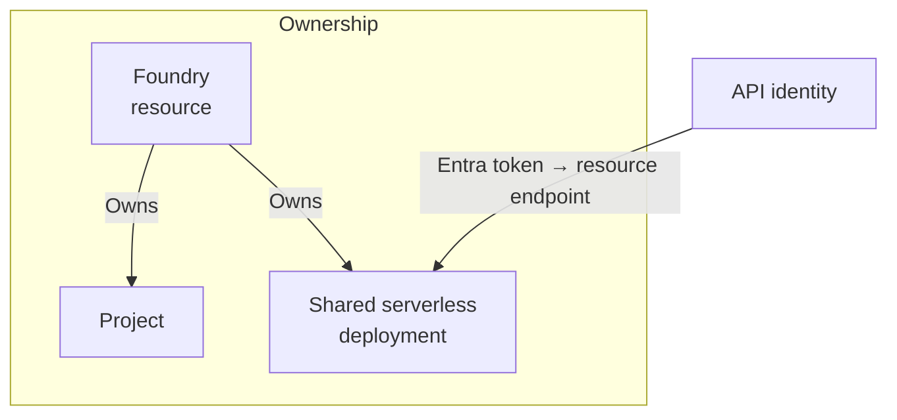

# Model access needs an owner and an identity

A model that answers in a playground can still fail when an application calls it. Before choosing one,
establish which resource owns its serving configuration, which settings workloads share, and which
identity may invoke it. Those decisions make the setup reproducible and let a deployed API work without
borrowing someone's credentials. When a request fails, check its address, model selection and permission
separately.

## How it works on Azure \{#how-it-works-on-azure}

[**Microsoft Foundry**](https://learn.microsoft.com/en-us/azure/foundry/what-is-foundry) brings together
Foundry Models and Foundry Agent Service. Its current resource model uses a Foundry resource with child
projects; older hub-based projects belong to the classic experience. Follow the documentation for your
resource model: classic hub instructions describe a different hierarchy.

A [**Foundry resource**](https://learn.microsoft.com/en-us/azure/foundry/concepts/architecture) is an Azure
resource of type `Microsoft.CognitiveServices/accounts`, with kind `AIServices`. Its projects are children
of type `Microsoft.CognitiveServices/accounts/projects`. The resource holds shared networking and security
settings. [Projects organise agents, evaluations and files](https://learn.microsoft.com/en-us/azure/foundry/how-to/create-projects),
with project access controls beneath the parent. Serverless model deployments belong to the resource;
[managed-compute deployments belong to a project](https://learn.microsoft.com/en-us/azure/foundry/concepts/deployments-overview).



The diagram shows P1's serverless deployment, with ownership arrows rather than network calls through
the project. Two projects under one resource [share its network settings and resource-level deployments](https://learn.microsoft.com/en-us/azure/foundry/how-to/create-projects).
Another project cannot supply an independent network boundary or reserve model capacity.

The **model catalog** lists offerings to assess. A [**model deployment**](https://learn.microsoft.com/en-us/azure/foundry/foundry-models/concepts/endpoints)
is a named serving configuration for a model and version; deployment-based requests select that name.
Catalog presence does not establish API compatibility or create a deployment. There is an exception:
[instant access, currently preview](https://learn.microsoft.com/en-us/azure/foundry/concepts/instant-models),
lets projects in West US 3 call supported models by model name without a deployment. P1 follows the
explicit deployment path.

The [project endpoint](https://learn.microsoft.com/en-us/azure/foundry/how-to/develop/sdk-overview) has the
form `https://<resource-name>.services.ai.azure.com/api/projects/<project-name>` and works with a project
client, including its OpenAI-compatible model client. It currently does not route embedding requests;
the resource's OpenAI v1 endpoint does. P1 therefore uses the resource inference endpoint for its model
connection. Its [v1 base URL](https://learn.microsoft.com/en-us/azure/foundry/foundry-models/concepts/endpoints)
can be `https://<resource>.openai.azure.com/openai/v1/`; the `services.ai.azure.com` form also works.
Deployment calls put the deployment name in `model`, without an `api-version` query parameter.
Choose the endpoint and client together.

Apply the [control-plane and data-plane distinction from lesson 1](../part-1-azure-foundations/how-azure-is-organised.md):
creating the setup does not authorise inference. For **keyless access**, the API's
[managed identity obtains an Entra token](https://learn.microsoft.com/en-us/entra/identity/managed-identities-azure-resources/overview)
without application-managed credentials. A user-assigned identity exists independently of compute;
attach it to the API's compute and grant access separately. The Foundry resource's identity is a different
caller. This applies the principle in [Secrets](/ai-sdlc/part-4-platform/secrets) to model access.

Microsoft's guides name two roles. The [Entra inference guide](https://learn.microsoft.com/en-us/azure/foundry/foundry-models/how-to/configure-entra-id)
uses `Cognitive Services User`; this lab follows it. The
[architecture guide](https://learn.microsoft.com/en-us/azure/foundry/concepts/architecture) recommends
`Foundry User` at resource scope for least-privilege onboarding. Formerly `Azure AI User`, it retains its
role ID during the rename. [Managed-compute Entra calls require Foundry User](https://learn.microsoft.com/en-us/azure/foundry/how-to/deploy-models-managed)
on the account. Use [role GUIDs](https://learn.microsoft.com/en-us/azure/role-based-access-control/built-in-roles/ai-machine-learning)
in automation while names roll out: `a97b65f3-24c7-4388-baec-2e87135dc908` for Cognitive Services User and
`53ca6127-db72-4b80-b1b0-d745d6d5456d` for Foundry User.

Neither role enforces keyless-only use: both [include `listkeys` and broad data permissions](https://learn.microsoft.com/en-us/azure/role-based-access-control/built-in-roles/ai-machine-learning).
The caller can fetch a key, and keys remain usable until local authentication is disabled. For production,
[set `disableLocalAuth` to `true` through Bicep or ARM](https://learn.microsoft.com/en-us/azure/ai-services/disable-local-auth)
after checking all clients' compatibility, then verify key requests fail after propagation. Using tokens
in one application alone does not impose that restriction on other callers.

## Choosing and tradeoffs \{#choosing-and-tradeoffs}

Choose the resource model first. A [standalone Azure OpenAI resource may suffice](https://learn.microsoft.com/en-us/azure/foundry/concepts/architecture)
for OpenAI completions alone, without agent hosting or evaluation. Otherwise, start with a Foundry resource.
An existing Azure OpenAI resource can [upgrade for the full Foundry model catalog](https://learn.microsoft.com/en-us/azure/foundry/concepts/deployments-overview).
Existing custom policies and RBAC actions [continue to apply](https://learn.microsoft.com/en-us/azure/foundry/concepts/architecture).

Then check the offer. [Foundry Models sold by Azure](https://learn.microsoft.com/en-us/azure/foundry/foundry-models/concepts/models-sold-directly-by-azure)
includes OpenAI and selected other-provider models, billed through Azure and supported by Microsoft.
Meta and Mistral also appear among [partner and community offers](https://learn.microsoft.com/en-us/azure/foundry/foundry-models/concepts/models-from-partners):
the provider name alone does not identify the commercial category. Check applicable terms before relying
on an Azure SLA; [managed compute is preview without an SLA](https://learn.microsoft.com/en-us/azure/foundry/concepts/deployments-overview).

Providers set Marketplace prices and licences, and purchase eligibility matters. Student, Visual Studio
Enterprise and Free credit subscriptions [cannot buy the SaaS offers described in the partner guide](https://learn.microsoft.com/en-us/azure/foundry/foundry-models/concepts/models-from-partners).
That does not prohibit all catalog use. [Claude specifically requires a paid subscription](https://learn.microsoft.com/en-us/azure/foundry/foundry-models/how-to/use-foundry-models-claude);
credit-only subscriptions are excluded, and a card on file can be charged instead of Azure credits.
Do not assume the course's free-credit budget covers every model.

Compare the serving arrangement with the offer:

| Option | Choose when | Avoid when |
|---|---|---|
| [Sold-by-Azure serverless API](https://learn.microsoft.com/en-us/azure/foundry/concepts/deployments-overview) | You need an available model billed through Azure and supported by Microsoft. | The model or API capability you need is absent from the offer. |
| [Partner or community Marketplace offer](https://learn.microsoft.com/en-us/azure/foundry/foundry-models/concepts/models-from-partners) | The provider's model, licence and purchase conditions fit your workload and subscription. | Your subscription cannot purchase the offer, or its licence does not permit your intended use. |
| [Managed compute — public preview](https://learn.microsoft.com/en-us/azure/foundry/concepts/deployments-overview) | You need dedicated GPUs and can accept the preview conditions. | You need a production deployment with an SLA; Microsoft does not recommend this preview for production. |

Serverless API supports sold-by-Azure and selected partner/community models. For managed compute,
[inspect the model card's upstream licence and deployment template](https://learn.microsoft.com/en-us/azure/foundry/how-to/deploy-models-managed);
catalog placement does not grant unrestricted use.

Finally decide what may share a resource. Projects provide separate working areas within shared settings.
Use separate resources for independent networking. Capacity depends on deployment and quota planning,
which follows in the next lesson; resource separation alone makes no capacity guarantee.

## In an AI workload \{#in-an-ai-workload}

In P1, an ASP.NET Core API on Azure Container Apps will answer questions over public documents. The API
retrieves passages, constructs the model request and returns an answer with citations. Foundry supplies
the model deployment. This is the platform implementation of the
[Generation](/rag-agents/part-1-rag/generation/) lesson; adding an agent is not a prerequisite for a
model call.

Keep the rest of P1's architecture explicit. Azure AI Search provides retrieval, Blob Storage holds
documents, Key Vault handles any remaining secrets, and Application Insights receives application
telemetry. These [remain separate resources with their own governance boundaries](https://learn.microsoft.com/en-us/azure/foundry/concepts/architecture).
A Foundry project does not create or authorise all of them for you.

This lesson establishes the Foundry resource, a project and the future API identity's resource-scoped
grant. A later step attaches that identity to Container Apps and adds a model deployment. When replacing
the model, run the existing questions and citation checks against the replacement before accepting it.
An unchanged API shape tells you nothing about answer quality. Use
[Evaluation](/rag-agents/part-1-rag/cross-cutting/evaluation/) for the method behind that check.

## Try it \{#try-it}

Create P1's ownership and identity setup with Azure CLI. This exercise ends before model deployment or
inference.

**Validation:** no Azure subscription was available in the authoring environment. These commands were
checked against the current CLI references and project-creation guide on 2026-10-17; they have not been
run against live Azure. The expected results below are documented states, not captured execution output.

You need an active subscription, [Azure CLI 2.80.0 or later](https://learn.microsoft.com/en-us/azure/foundry/how-to/create-projects),
permission to create resources and identities, and role-assignment privileges (`Owner` is sufficient).
Provider registrations and subscription policy must permit creation. On later inference calls,
[Owner or Contributor alone can yield `401 PermissionDenied`](https://learn.microsoft.com/en-us/azure/foundry/foundry-models/how-to/configure-entra-id):
assign the data role to the actual caller and allow up to five minutes for propagation.

**Cost:** no consumption, so no expected charge. The [pricing FAQ](https://azure.microsoft.com/en-us/pricing/details/microsoft-foundry/#faq)
charges consumed features individually; this lab creates no model deployment, GPU or connected billable
service and makes no inference calls. [Managed identities have no additional cost](https://learn.microsoft.com/en-us/entra/fundamentals/licensing#managed-identities).

Run all blocks in one Bash session. Replace the subscription placeholder. Use a new disposable group;
change `RG` if it belongs to other work. `eastus` follows the
[creation guide](https://learn.microsoft.com/en-us/azure/foundry/how-to/create-projects), without promising
model availability or residency. The generated name supplies a globally unique custom-domain candidate.
Enable project management at creation; it cannot be changed afterwards.

```bash
az version
az login
az account set --subscription "<your-subscription-id>"

RG="rg-p1-foundry-lab"
LOCATION="eastus"
FOUNDRY_NAME="p1-foundry-$(date +%s)-$RANDOM"
PROJECT_NAME="p1-rag"
API_IDENTITY="id-p1-rag-api"
INFERENCE_ROLE_ID="a97b65f3-24c7-4388-baec-2e87135dc908"

az group create --name "$RG" --location "$LOCATION" --output none
az cognitiveservices account create \
  --name "$FOUNDRY_NAME" --resource-group "$RG" \
  --kind AIServices --sku S0 --location "$LOCATION" \
  --custom-domain "$FOUNDRY_NAME" --assign-identity \
  --allow-project-management true --output none
az cognitiveservices account project create \
  --name "$FOUNDRY_NAME" --resource-group "$RG" \
  --project-name "$PROJECT_NAME" --location "$LOCATION" --output none

az identity create --name "$API_IDENTITY" --resource-group "$RG" \
  --location "$LOCATION" --output none
API_PRINCIPAL_ID=$(az identity show --name "$API_IDENTITY" \
  --resource-group "$RG" --query principalId --output tsv)
FOUNDRY_ID=$(az cognitiveservices account show --name "$FOUNDRY_NAME" \
  --resource-group "$RG" --query id --output tsv)

az role assignment create \
  --assignee-object-id "$API_PRINCIPAL_ID" \
  --assignee-principal-type ServicePrincipal \
  --role "$INFERENCE_ROLE_ID" --scope "$FOUNDRY_ID" --output none
```

The project uses a [system-assigned identity by default](https://learn.microsoft.com/en-us/cli/azure/cognitiveservices/account/project?view=azure-cli-latest#az-cognitiveservices-account-project-create).
`az identity create` makes the separate future API identity: its
[`principalId` identifies the RBAC assignee](https://learn.microsoft.com/en-us/cli/azure/identity?view=azure-cli-latest),
while its `clientId` selects it during authentication and its resource `id` identifies it for
[attachment to compute](https://learn.microsoft.com/en-us/entra/identity/managed-identities-azure-resources/overview).
It is not yet attached to an API.

Inspect the setup:

```bash
az cognitiveservices account show --name "$FOUNDRY_NAME" \
  --resource-group "$RG" --query properties.provisioningState --output tsv
az cognitiveservices account project show --name "$FOUNDRY_NAME" \
  --resource-group "$RG" --project-name "$PROJECT_NAME" \
  --query properties.provisioningState --output tsv
az role assignment list --scope "$FOUNDRY_ID" \
  --assignee-object-id "$API_PRINCIPAL_ID" --fill-principal-name false \
  --role "$INFERENCE_ROLE_ID" --output table
```

Expect `Succeeded` for the resource and project, and a row for the created role assignment. This checks
control-plane setup only. There is no deployment to test for inference, and the grant belongs to the
API identity, not your signed-in user. If creation fails, inspect the reported authorisation, location,
provider-registration or policy error before continuing.

**Teardown:** delete only this dedicated lab group. Save names and configuration locally if continuing
P1; later infrastructure work can recreate them. Group deletion
[soft-deletes the Foundry account and reserves its name for 48 hours](https://learn.microsoft.com/en-us/azure/ai-services/recover-purge-resources).
Purge it afterwards to release the name permanently. Purging requires
`Microsoft.CognitiveServices/locations/resourceGroups/deletedAccounts/delete`, supplied by roles such as
Cognitive Services Contributor or Contributor; Contributor must be assigned at subscription scope.

```bash
az group delete --name "$RG" --yes
az cognitiveservices account purge --location "$LOCATION" \
  --resource-group "$RG" --name "$FOUNDRY_NAME"
az group exists --name "$RG"
```

The [purge command](https://learn.microsoft.com/en-us/cli/azure/cognitiveservices/account?view=azure-cli-latest#az-cognitiveservices-account-purge)
permanently removes the deleted account. The final [group existence check](https://learn.microsoft.com/en-us/cli/azure/group?view=azure-cli-latest)
should return `false`; that check alone does not establish that purging succeeded.

## What to take away \{#what-to-take-away}

- A Foundry resource owns shared serverless deployments and network settings; projects organise work
  beneath it and own managed-compute deployments.
  Use separate resources when workloads need independent network settings; plan capacity through
  deployment and quota choices.
- A catalog entry, a deployment name, a project endpoint and an inference endpoint serve different
  purposes. Check which one your client expects.
- Give the API its own identity and an explicit inference grant. `Cognitive Services User` is a
  documented baseline with broad permissions; review it before production use.
- Successful provisioning establishes the setup. A model deployment and a real inference call remain
  separate checks, followed by evaluation of the answers your application needs.

**[New terms](../glossary.md#microsoft-foundry)**: Foundry resource, Foundry project, model catalog, model deployment, inference endpoint, keyless access.

## Sources \{#sources}

Verified as of 2026-10-17.

- Platform and ownership: [Foundry overview](https://learn.microsoft.com/en-us/azure/foundry/what-is-foundry),
  [architecture](https://learn.microsoft.com/en-us/azure/foundry/concepts/architecture),
  [projects](https://learn.microsoft.com/en-us/azure/foundry/how-to/create-projects),
  [SDK overview](https://learn.microsoft.com/en-us/azure/foundry/how-to/develop/sdk-overview) and
  [inference endpoints](https://learn.microsoft.com/en-us/azure/foundry/foundry-models/concepts/endpoints).
- Models and serving: [deployment options](https://learn.microsoft.com/en-us/azure/foundry/concepts/deployments-overview),
  [models sold by Azure](https://learn.microsoft.com/en-us/azure/foundry/foundry-models/concepts/models-sold-directly-by-azure),
  [partner and community models](https://learn.microsoft.com/en-us/azure/foundry/foundry-models/concepts/models-from-partners),
  [managed compute](https://learn.microsoft.com/en-us/azure/foundry/how-to/deploy-models-managed),
  [instant access (preview)](https://learn.microsoft.com/en-us/azure/foundry/concepts/instant-models) and
  [Claude purchase requirements](https://learn.microsoft.com/en-us/azure/foundry/foundry-models/how-to/use-foundry-models-claude).
- Identity and permissions: [Entra inference configuration](https://learn.microsoft.com/en-us/azure/foundry/foundry-models/how-to/configure-entra-id),
  [Cognitive Services User definition](https://learn.microsoft.com/en-us/azure/role-based-access-control/built-in-roles/ai-machine-learning#cognitive-services-user),
  [Foundry User definition](https://learn.microsoft.com/en-us/azure/role-based-access-control/built-in-roles/ai-machine-learning#foundry-user),
  [disabling local authentication](https://learn.microsoft.com/en-us/azure/ai-services/disable-local-auth) and
  [managed identities](https://learn.microsoft.com/en-us/entra/identity/managed-identities-azure-resources/overview).
- CLI commands: [login and version](https://learn.microsoft.com/en-us/cli/azure/reference-index?view=azure-cli-latest),
  [subscription selection](https://learn.microsoft.com/en-us/cli/azure/account?view=azure-cli-latest),
  [resource groups](https://learn.microsoft.com/en-us/cli/azure/group?view=azure-cli-latest),
  [accounts](https://learn.microsoft.com/en-us/cli/azure/cognitiveservices/account?view=azure-cli-latest),
  [projects](https://learn.microsoft.com/en-us/cli/azure/cognitiveservices/account/project?view=azure-cli-latest),
  [identities](https://learn.microsoft.com/en-us/cli/azure/identity?view=azure-cli-latest) and
  [role assignments](https://learn.microsoft.com/en-us/cli/azure/role/assignment?view=azure-cli-latest).
- Cleanup: [recover or purge deleted resources](https://learn.microsoft.com/en-us/azure/ai-services/recover-purge-resources).
- Cost: [Foundry pricing](https://azure.microsoft.com/en-us/pricing/details/microsoft-foundry/) and
  [managed identity licensing](https://learn.microsoft.com/en-us/entra/fundamentals/licensing#managed-identities).
