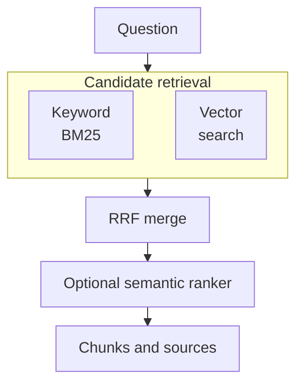

# Retrieval quality starts with the index you build

A question-answering service can call its model successfully and still answer from the wrong passage.
The document might be absent from the index, its identifier lost during chunking, or its useful paragraph
excluded from the candidates. Changing the generation prompt cannot restore evidence the retriever never
returned. You need to see where documents become searchable and how each query selects them.

Azure AI Search gives that boundary a service of its own. For P1, the RAG service project, it holds the
searchable copy of a small public document set. This lesson builds its first index and hybrid query;
[Retrieval](/rag-agents/part-1-rag/retrieval/) owns the underlying retrieval theory.

## How Azure turns an index into evidence \{#how-it-works}

An **index** is a collection of search documents governed by a schema. For a RAG service, make each
search document a chunk with a unique key, readable content and source metadata. The original file can
stay in Blob Storage. Search holds the derived representation you query, so retaining the source URL
and a stable chunk identifier is part of the design, not something to reconstruct after generation.
The [index schema](https://learn.microsoft.com/en-us/azure/search/search-what-is-an-index)
determines which operations each field supports.

Field attributes have separate jobs. `searchable` puts text into full-text search; `retrievable` permits
returning a field; `filterable` supports exact inclusion conditions. `sortable` and `facetable` support
ordering and grouped counts. A source URL usually needs retrieval, not linguistic analysis. A category
used to restrict results needs filtering. Enabling every attribute everywhere creates structures your
queries may never use.

The [REST defaults](https://learn.microsoft.com/en-us/azure/search/search-how-to-create-search-index)
enable filtering, sorting and faceting on `Edm.String`; SDK field helpers do not share those defaults.
Set capabilities explicitly. Disable all three on prose fields to avoid the **32 KB** single-term
limit those attributes impose.

A [vector field](https://learn.microsoft.com/en-us/azure/search/vector-search-how-to-create-index)
stores an embedding beside that text. The common floating-point type is `Collection(Edm.Single)`;
`dimensions` must match the embedding output, and `vectorSearchProfile` connects the field to its
algorithm configuration. HNSW supports approximate nearest-neighbour retrieval; exhaustive search is
also available. Keep the embedding model and dimensions consistent between indexing and querying.
Matching array lengths alone does not make embeddings from different models comparable.

Updating document content differs from changing its schema. Changing existing field names, types or
`searchable`, `filterable`, `sortable` and `facetable` attributes requires an
[index rebuild](https://learn.microsoft.com/en-us/azure/search/search-howto-reindex).
When changing embedding models, re-embed the corpus and switch query embeddings consistently, even if
dimensions match: the [embedding space](https://learn.microsoft.com/en-us/azure/search/vector-search-how-to-create-index)
must contain vectors from the same model.

A classic hybrid request contains a text query and a vector query. Azure runs their searches in parallel:
full-text retrieval ranks keyword matches with BM25, vector retrieval ranks nearby vectors, and
**reciprocal rank fusion (RRF)** combines the ranked lists. It does not average incompatible raw scores.
The [hybrid query documentation](https://learn.microsoft.com/en-us/azure/search/hybrid-search-overview)
shows this as one request returning one result set.



The optional **semantic ranker** then reads text from the candidates. Configure the index's title,
content and keyword fields for it, and invoke it with `queryType: "semantic"` and a semantic
configuration. It reranks at most the top **50** initial results; it cannot search the rest of the
corpus to recover a missed passage. Its captions and extractive answers come from indexed text, so
an extractive answer is different from the final LLM response. These are the documented
[semantic ranking boundaries](https://learn.microsoft.com/en-us/azure/search/semantic-search-overview).

There are also two ways to move more work into Search. **Integrated vectorization is GA**: an indexer
reads a supported source, a skillset can split and embed content, and a query vectorizer converts query
text into a vector. These are distinct indexing-time and query-time operations. A vector field alone
does neither. The [pipeline documentation](https://learn.microsoft.com/en-us/azure/search/vector-search-integrated-vectorization)
explains the components; the [FAQ confirms GA status](https://learn.microsoft.com/en-us/azure/search/search-faq-frequently-asked-questions).
The embedding endpoint still needs access, quota and compatible configuration.

**Agentic retrieval** adds a knowledge base that coordinates knowledge sources and returns grounding
content with references. Its status is feature-specific: the `2026-04-01` API supports **GA minimal,
extractive retrieval over GA knowledge-source types**. LLM query planning, answer synthesis, multi-turn
messages and non-minimal reasoning remain **preview**, using `2026-08-01-preview`. Portal-created objects
can also use preview schemas. Check the
[availability contract](https://learn.microsoft.com/en-us/azure/search/agentic-retrieval-overview)
before adopting an example. An ordinary hybrid query does not require a knowledge base or a planning LLM.

## Choose the retrieval boundary you can operate \{#choosing-and-tradeoffs}

Start with where the authoritative data lives and what the application must query. “Supports vectors”
is insufficient to choose a store. The following recommendations follow from each service's documented
mechanism; they are design guidance, not a benchmark ranking.

| Option | A good fit | When to avoid it |
|---|---|---|
| Azure AI Search | A separate retrieval layer with managed text/vector search, optional reranking and indexer pipelines. | A second searchable copy adds little value, or you need transactional joins with application state. |
| [PostgreSQL with pgvector](https://learn.microsoft.com/en-us/azure/postgresql/extensions/how-to-use-pgvector) | Embeddings belong beside relational rows, and SQL joins and database transactions matter. | You expect installing the extension to supply document extraction, ingestion orchestration and semantic reranking. Those need separate design. |
| [Cosmos DB for NoSQL vector search](https://learn.microsoft.com/en-us/azure/cosmos-db/vector-search) | The application already owns partitioned JSON documents in Cosmos and should query their vectors alongside their properties. | Its partitioning and request-unit economics do not fit your access pattern, or you mainly need an independent document-search pipeline. |

Cosmos DB also supports [hybrid full-text/vector queries with RRF](https://learn.microsoft.com/en-us/azure/cosmos-db/gen-ai/hybrid-search).
Hybrid retrieval is therefore not an exclusive reason to choose Search. For P1, Search is the course's
chosen place to practise indexing, retrieval configuration and identity separation. Another project
may reasonably keep retrieval in its existing database.

Within Search, begin with a query you can inspect. Keyword matching helps with product codes and exact
names; vectors help when wording differs. Add semantic reranking when evaluation shows that useful
candidates arrive but need better ordering. Microsoft's
[ranking model](https://learn.microsoft.com/en-us/azure/search/hybrid-search-ranking)
distinguishes the vector candidate count `k` from the final response count `top`. Increasing `top`
does not by itself expand the vector search.

Trace failures to the relevant stage. No expected chunk in the index means checking ingestion. Poor
vector candidates mean checking embeddings, filters and candidate counts. Good candidates in the wrong
order suggest ranking work. Missing citation fields mean checking the schema and response selection.
Adding a planner before diagnosing these failures makes the failing request harder to reproduce.

Choose who owns vectorization using the [embedding options](https://learn.microsoft.com/en-us/azure/search/vector-search-how-to-generate-embeddings),
[indexer contract](https://learn.microsoft.com/en-us/azure/search/search-indexer-overview) and
[integrated pipeline limits](https://learn.microsoft.com/en-us/azure/search/vector-search-integrated-vectorization):

| Ownership | Sources and refresh | Embedding dependency |
|---|---|---|
| Application supplies vectors | Any source your code can turn into search documents; your application controls push timing, batches and retries. Prefer this for custom sources or tighter refresh control. | Your code calls the model for document and query vectors and manages availability and quota failures. |
| Search indexer, skillset and query vectorizer | Supported indexer sources, such as Blob Storage; on-demand or scheduled runs with source-specific change detection. Prefer this when a connector and scheduled refresh fit. | The embedding skill and query vectorizer call the configured endpoint. Search retries cannot overcome exhausted embedding quota. |

Indexing and query ownership are independent: a [query vectorizer](https://learn.microsoft.com/en-us/azure/search/vector-search-how-to-configure-vectorizer)
can serve an index populated by your application.

For capacity, [Free is shared and cannot scale; Basic provides dedicated capacity](https://learn.microsoft.com/en-us/azure/search/search-sku-tier).
Free suits this small exercise. It is not a capacity plan for the finished service. Semantic ranking
also has its own [billing plan](https://learn.microsoft.com/en-us/azure/search/semantic-how-to-enable-disable)
and [regional availability](https://learn.microsoft.com/en-us/azure/search/search-region-support);
check the actual service tier and region before enabling it.

## In an AI workload, preserve sources and separate identities \{#in-an-ai-workload}

P1's ASP.NET Core minimal API will run on Container Apps, retrieve passages from Search and ask a
Foundry model deployment to answer with citations. Blob Storage keeps the source documents. Key Vault
access through managed identity, Application Insights, Bicep with azd, and GitHub Actions with OIDC
complete the wider project; this exercise creates only the Search service, a lab index and an API identity.

Treat each returned chunk as content plus provenance. Pass the readable text and its source identifier
through the answer path together. A score is not a citation, and the embedding array is not useful
context for a text model. [Ingestion](/rag-agents/part-1-rag/ingestion/) covers preparing that content;
[Evaluation](/rag-agents/part-1-rag/cross-cutting/evaluation/) covers checking whether retrieval supplies
the evidence needed to answer.

The API receives **Search Index Data Reader**. Index creation and ingestion use different permissions:
**Search Service Contributor** manages index definitions, while **Search Index Data Contributor** loads
documents and can query them. Ordinary Azure resource Contributor access does not automatically grant
direct document access. Keep the
[Search role matrix](https://learn.microsoft.com/en-us/azure/search/search-security-rbac)
beside the deployment design. The API's identity should not need permission to rewrite its evidence.

Consider [preview agentic query planning](https://learn.microsoft.com/en-us/azure/search/agentic-retrieval-overview)
when a question has several asks that need separate searches: the planner decomposes it into focused
subqueries. That adds retrieval latency and model calls. Retain a fixed single-query baseline to
reproduce failures and measure whether wider coverage justifies the extra work. Record retrieval
latency, returned chunk IDs and failures separately from generation so a slow or empty search does not
disappear inside one total request duration.

## Try it \{#try-it}

Create a disposable P1 Search foundation using Bash and Azure CLI. You need an Azure subscription,
an interactive user login, permission to create resources and permission to assign roles. Run in a new
local directory. Use a fresh resource group so teardown cannot delete earlier project work.

**These commands were checked against the live CLI reference and have not yet been run against a live
subscription.** Expected results below describe the documented response contract. The lab uses synthetic
three-dimensional vectors to check plumbing; it does not measure semantic relevance. Replace the lab
index with an index sized for your chosen embedding model before ingesting P1's real public documents.

Set your subscription ID. The generated service name must be globally available; choose another suffix
if creation reports a collision. France Central appears in the
[current region list](https://learn.microsoft.com/en-us/azure/search/search-region-support), though
availability for your subscription still needs checking.

```bash
az login
az account set --subscription 'YOUR-SUBSCRIPTION-ID'

lab_group="rg-p1-search-lab-$RANDOM"
search_name="p1-search-$RANDOM-$RANDOM"
location='francecentral'
az group create --name "$lab_group" --location "$location" --output none
az search service create --name "$search_name" --resource-group "$lab_group" \
  --location "$location" --sku free --disable-local-auth true --output none
search_id=$(az search service show --name "$search_name" \
  --resource-group "$lab_group" --query id --output tsv)
operator_id=$(az ad signed-in-user show --query id --output tsv)

for role in 'Search Service Contributor' 'Search Index Data Contributor'; do
  az role assignment create --assignee-object-id "$operator_id" \
    --assignee-principal-type User --role "$role" \
    --scope "$search_id" --output none
done
api_principal=$(az identity create --name id-p1-api --resource-group "$lab_group" \
  --location "$location" --query principalId --output tsv)
az role assignment create --assignee-object-id "$api_principal" \
  --assignee-principal-type ServicePrincipal --role 'Search Index Data Reader' \
  --scope "$search_id" --output none

endpoint="https://${search_name}.search.windows.net"
api_version='2025-09-01'
```

This creates the user-assigned identity to attach to the API later. It does not deploy the API or test
calls as that identity. The following requests run as your signed-in user. Roles-only authentication
works on Free, but [role assignments can take five to ten minutes to become effective](https://learn.microsoft.com/en-us/azure/search/search-security-enable-roles).
If access is denied, check the assignments and allow propagation before retrying.

Create an index with retrievable text and source fields, plus an HNSW vector field. These JSON files
are request bodies sent by [`az rest`](https://learn.microsoft.com/en-us/cli/azure/reference-index?view=azure-cli-latest#az-rest),
which obtains a token for the Search data plane. The schema follows the stable
[index API](https://learn.microsoft.com/en-us/rest/api/searchservice/indexes/create-or-update?view=rest-searchservice-2025-09-01).

```bash
cat > index.json <<'JSON'
{
  "name": "p1-chunks-lab",
  "fields": [
    {"name": "id", "type": "Edm.String", "key": true, "searchable": false,
     "retrievable": true, "filterable": false, "sortable": false, "facetable": false},
    {"name": "title", "type": "Edm.String", "searchable": true, "retrievable": true,
     "filterable": false, "sortable": false, "facetable": false},
    {"name": "content", "type": "Edm.String", "searchable": true, "retrievable": true,
     "filterable": false, "sortable": false, "facetable": false},
    {"name": "sourceUrl", "type": "Edm.String", "searchable": false, "retrievable": true,
     "filterable": false, "sortable": false, "facetable": false},
    {"name": "contentVector", "type": "Collection(Edm.Single)",
     "searchable": true, "retrievable": false, "dimensions": 3,
     "filterable": false, "sortable": false, "facetable": false,
     "vectorSearchProfile": "p1-vector"}
  ],
  "vectorSearch": {
    "algorithms": [{"name": "p1-hnsw", "kind": "hnsw",
                    "hnswParameters": {"metric": "cosine"}}],
    "profiles": [{"name": "p1-vector", "algorithm": "p1-hnsw"}]
  }
}
JSON
az rest --method put --url "$endpoint/indexes/p1-chunks-lab?api-version=$api_version" \
  --resource https://search.azure.com \
  --headers Content-Type=application/json Prefer=return=representation --body @index.json
```

Upload two author-written summaries of public Learn pages. Their vectors are deliberately hand-set
fixtures. No embedding model, vectorizer or semantic ranker is invoked.

```bash
cat > documents.json <<'JSON'
{
  "value": [
    {"@search.action": "upload", "id": "roles-1", "title": "Search permissions",
     "content": "Give a query-only application Search Index Data Reader. Use a separate identity for document uploads.",
     "sourceUrl": "https://learn.microsoft.com/en-us/azure/search/search-security-rbac",
     "contentVector": [1, 0, 0]},
    {"@search.action": "upload", "id": "auth-1", "title": "Search authentication",
     "content": "A Search service can accept Entra tokens for data requests. Disabling local authentication prevents API key access.",
     "sourceUrl": "https://learn.microsoft.com/en-us/azure/search/search-security-enable-roles",
     "contentVector": [0, 1, 0]}
  ]
}
JSON
az rest --method post \
  --url "$endpoint/indexes/p1-chunks-lab/docs/index?api-version=$api_version" \
  --resource https://search.azure.com --headers Content-Type=application/json \
  --body @documents.json

cat > query.json <<'JSON'
{
  "search": "query application permissions",
  "searchFields": "title,content",
  "vectorQueries": [{"kind": "vector", "vector": [1, 0, 0],
                     "fields": "contentVector", "k": 2}],
  "select": "id,title,content,sourceUrl",
  "top": 2
}
JSON
az rest --method post \
  --url "$endpoint/indexes/p1-chunks-lab/docs/search?api-version=$api_version" \
  --resource https://search.azure.com --headers Content-Type=application/json \
  --body @query.json
```

Expect an index definition from creation, per-document upload results with `status: true`, and a search
response containing a `value` array with selected fields and `@search.score`. Inspect every upload
status: [indexing can partially fail](https://learn.microsoft.com/en-us/rest/api/searchservice/documents/?view=rest-searchservice-2025-09-01).
Documents can take a short time to become searchable; retry the query after successful indexing if
needed. The [search API](https://learn.microsoft.com/en-us/rest/api/searchservice/documents/search-post?view=rest-searchservice-2025-09-01)
defines the response shape; no exact score or ordering is asserted here.

**Cost:** Free-tier Search has no service charge, and
[managed identities are free](https://learn.microsoft.com/en-us/entra/identity/managed-identities-azure-resources/overview).
This lab calls no paid model or enrichment feature. Only one Free Search service is allowed per
subscription; if yours is occupied, stop or deliberately plan a paid alternative using the
[tier guidance](https://learn.microsoft.com/en-us/azure/search/search-sku-tier) and
[current pricing](https://azure.microsoft.com/en-us/pricing/details/search/).

**Teardown:** Delete only the disposable group created above. It contains this Search service, its index
and the API identity. Keep the local request files as the basis for P1's later infrastructure and ingestion work.

```bash
az group delete --name "$lab_group" --yes
```

## What to take away \{#what-to-take-away}

- Design the index around readable chunks, stable identifiers and source metadata; vectors alone cannot supply citations.
- Hybrid retrieval merges keyword and vector rankings. Semantic reranking can reorder candidates, but cannot recover missing evidence.
- Integrated vectorization is GA. Agentic retrieval has a GA extractive path and preview planning capabilities; choose at the feature and API level.
- Give the API read access and ingestion its own write permissions. This lab establishes the assignments; in the deployed API exercise, verify that its identity can query but cannot upload. [Role permissions](https://learn.microsoft.com/en-us/azure/search/search-security-rbac) define that boundary.

**[New terms](https://nikolaisachok.com/ai-engineering-handbook/azure-dotnet/glossary#rag-on-ai-search)**: search index, field attributes, vector search profile, hybrid query, reciprocal rank fusion, semantic ranker, indexer, skillset, integrated vectorization, query vectorizer, knowledge base, knowledge source.

## Sources \{#sources}

Verified as of 2026-10-17.

Schema and pipeline tradeoffs rechecked on 2026-10-18.

Indexing and query execution:

- [Search indexes](https://learn.microsoft.com/en-us/azure/search/search-what-is-an-index), [schema defaults](https://learn.microsoft.com/en-us/azure/search/search-how-to-create-search-index), [update or rebuild an index](https://learn.microsoft.com/en-us/azure/search/search-howto-reindex), [vector indexes](https://learn.microsoft.com/en-us/azure/search/vector-store), [create a vector index](https://learn.microsoft.com/en-us/azure/search/vector-search-how-to-create-index), [vector queries](https://learn.microsoft.com/en-us/azure/search/vector-search-how-to-query)
- [Hybrid search](https://learn.microsoft.com/en-us/azure/search/hybrid-search-overview), [RRF ranking](https://learn.microsoft.com/en-us/azure/search/hybrid-search-ranking), [semantic ranker](https://learn.microsoft.com/en-us/azure/search/semantic-search-overview), [invoke semantic ranking](https://learn.microsoft.com/en-us/azure/search/semantic-how-to-query-request)
- [Integrated vectorization](https://learn.microsoft.com/en-us/azure/search/vector-search-integrated-vectorization), [indexers](https://learn.microsoft.com/en-us/azure/search/search-indexer-overview), [embedding generation options](https://learn.microsoft.com/en-us/azure/search/vector-search-how-to-generate-embeddings), [query vectorizers](https://learn.microsoft.com/en-us/azure/search/vector-search-how-to-configure-vectorizer), [Search FAQ](https://learn.microsoft.com/en-us/azure/search/search-faq-frequently-asked-questions), [agentic retrieval and feature availability](https://learn.microsoft.com/en-us/azure/search/agentic-retrieval-overview)

Choices, access and cost:

- [Choose a vector search service](https://learn.microsoft.com/en-us/azure/architecture/guide/technology-choices/vector-search), [PostgreSQL pgvector](https://learn.microsoft.com/en-us/azure/postgresql/extensions/how-to-use-pgvector), [Cosmos DB vector search](https://learn.microsoft.com/en-us/azure/cosmos-db/vector-search), [Cosmos DB hybrid search](https://learn.microsoft.com/en-us/azure/cosmos-db/gen-ai/hybrid-search)
- [Search roles](https://learn.microsoft.com/en-us/azure/search/search-security-rbac), [enable RBAC](https://learn.microsoft.com/en-us/azure/search/search-security-enable-roles), [managed identities](https://learn.microsoft.com/en-us/entra/identity/managed-identities-azure-resources/overview)
- [Service tiers](https://learn.microsoft.com/en-us/azure/search/search-sku-tier), [regional availability](https://learn.microsoft.com/en-us/azure/search/search-region-support), [semantic billing plans](https://learn.microsoft.com/en-us/azure/search/semantic-how-to-enable-disable), [Search pricing](https://azure.microsoft.com/en-us/pricing/details/search/)

Exercise references:

- CLI: [login and REST](https://learn.microsoft.com/en-us/cli/azure/reference-index?view=azure-cli-latest), [account](https://learn.microsoft.com/en-us/cli/azure/account?view=azure-cli-latest), [resource groups](https://learn.microsoft.com/en-us/cli/azure/group?view=azure-cli-latest), [Search service](https://learn.microsoft.com/en-us/cli/azure/search/service?view=azure-cli-latest), [signed-in user](https://learn.microsoft.com/en-us/cli/azure/ad/signed-in-user?view=azure-cli-latest), [identity](https://learn.microsoft.com/en-us/cli/azure/identity?view=azure-cli-latest), [role assignment](https://learn.microsoft.com/en-us/cli/azure/role/assignment?view=azure-cli-latest)
- REST `2025-09-01`: [create or update index](https://learn.microsoft.com/en-us/rest/api/searchservice/indexes/create-or-update?view=rest-searchservice-2025-09-01), [upload documents](https://learn.microsoft.com/en-us/rest/api/searchservice/documents/?view=rest-searchservice-2025-09-01), [search documents](https://learn.microsoft.com/en-us/rest/api/searchservice/documents/search-post?view=rest-searchservice-2025-09-01), [index loading behaviour](https://learn.microsoft.com/en-us/azure/search/search-how-to-load-search-index)
