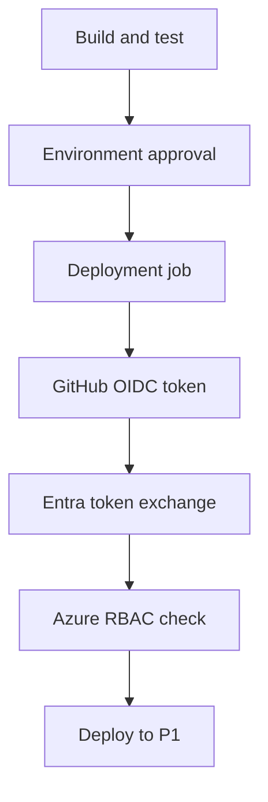

# A deployment needs permission and a release decision

A passing test suite says something about a change. It does not say which environment the change may
reach, who authorized it, or which identity will make the update. A deployment script on a developer's
laptop leaves those decisions inside a personal account. Moving the script into CI without changing
its credentials moves the same problem into a shared runner.

A delivery pipeline gives the change a repeatable route: validate the source, decide whether to release
it, then grant the deployment job the access it needs. For an AI service, that route must distinguish
software correctness from answer quality. A working HTTP endpoint can still retrieve the wrong evidence.

## How it works on Azure \{#how-it-works-on-azure}

A **workflow** describes triggered jobs; a **runner** executes their steps. GitHub Actions and Azure
DevOps Pipelines can both run the build and deployment commands. Neither requires the application itself
to run on the same machine or under the same identity as the pipeline.

With [OIDC federation](https://learn.microsoft.com/en-us/azure/developer/github/connect-from-azure-openid-connect),
the job requests an identity token from GitHub. Microsoft Entra ID validates it against a federated
identity credential on an application or user-assigned managed identity, then issues an access token.
The credential specifies the accepted issuer, subject and audience. It contains no deployment password.
Part I's [Entra ID lesson](../part-1-azure-foundations/entra-id.md) owns the identity model.

For Azure public cloud, the GitHub issuer is `https://token.actions.githubusercontent.com` and the exchange
audience is `api://AzureADTokenExchange`
([trust configuration](https://learn.microsoft.com/en-us/entra/workload-id/workload-identity-federation-create-trust-user-assigned-managed-identity)).
The subject identifies the permitted workload. With the default subject construction, a job referencing
a GitHub environment uses that environment rather than a branch. Custom templates can change the
included claims. Current
[GitHub subject formats](https://docs.github.com/en/actions/reference/security/oidc) include immutable
owner and repository IDs for newer repositories; older or customized configurations can differ.
Configure the exact subject your repository uses, including the environment name.



The controls answer different questions. GitHub's `id-token: write` lets a job request an OIDC token;
Azure RBAC determines what the authenticated identity may do. An
[environment approval](https://docs.github.com/en/actions/reference/workflows-and-actions/deployments-and-environments)
determines whether the job may start. Declaring `environment: p1-ci` in YAML does not configure a reviewer.
Create the environment's protection settings separately, and restrict its deployment branch to `main`.
An environment-bound subject alone does not impose that branch restriction.

## Choosing and tradeoffs \{#choosing-and-tradeoffs}

Choose the pipeline platform around repository ownership and the people who administer releases.
Keep the application deployment commands portable enough that this choice does not become part of the API.

| Choice | Useful when | Avoid it when / failure to watch |
|---|---|---|
| GitHub Actions | Source, pull requests and release review already live on GitHub. | Required environment protection is unavailable on the repository's plan, or nobody owns its settings. |
| Azure DevOps Pipelines | The team already manages Azure DevOps projects, service connections and release permissions. | Introducing another control plane would leave pipeline access and approvals without an owner. |
| `azd` inside either | P1 already has an application definition and Bicep infrastructure. | You expect the tool to supply tests, approval policy or an application architecture. |

In Azure Pipelines, an
[Azure Resource Manager service connection](https://learn.microsoft.com/en-us/azure/devops/pipelines/library/connect-to-azure?view=azure-devops)
records how a pipeline authenticates to Azure. Select workload identity federation and authorize the
specific pipeline to use the connection. Use a
[deployment job](https://learn.microsoft.com/en-us/azure/devops/pipelines/process/deployment-jobs?view=azure-devops)
targeting an environment, then configure
[approvals and checks](https://learn.microsoft.com/en-us/azure/devops/pipelines/process/checks?view=azure-devops)
on the environment or service connection. Resource owners manage those checks outside YAML; a YAML
condition is not a substitute for them. The job still needs Azure roles on its target resources.

The [Azure Developer CLI pipeline setup](https://learn.microsoft.com/en-us/azure/developer/azure-developer-cli/configure-devops-pipeline)
supports GitHub Actions and Azure Pipelines. Its
[`azd pipeline config` command is marked Beta](https://learn.microsoft.com/en-us/azure/developer/azure-developer-cli/reference#azd-pipeline-config).
Treat it as an account and repository operation: setup can create an identity, commit and push files,
and trigger deployment. Review its permissions and generated workflow before adopting it.

P1 uses `azd` to coordinate deployment while Bicep describes infrastructure, as covered in
[Infrastructure as code](../part-1-azure-foundations/infrastructure-as-code.md).
Keep initial provisioning and role assignments separate from routine application deployment. The latter
should not need permission to grant itself more access.

Debug failures at the boundary that rejected the operation. A rejected token suggests a mismatch in
issuer, subject or audience. An authenticated deployment denied by Azure needs a role-and-scope check.
A connection timeout needs a network investigation: federation does not give a runner a route to a
private endpoint. Do not respond to all three by granting broader roles.

## In an AI workload \{#in-an-ai-workload}

P1 combines an ASP.NET Core minimal API on Container Apps with a Foundry model deployment, Azure AI
Search, Blob Storage, Key Vault and Application Insights. Its runtime identity needs access to the
services it calls. Its delivery identity needs to publish and deploy the application. Keep them separate;
the build does not need to read documents or secrets merely because the running service does.

Run deterministic tests with controlled model and retrieval responses before requesting cloud access.
Those tests can catch a missing citation field or incorrect handling of an empty retrieval result.
They cannot establish that the live corpus produces useful answers. A live evaluation needs its own
dataset, access and token budget; [Evaluation](/rag-agents/part-1-rag/cross-cutting/evaluation/) explains
that evidence. The [AI SDLC gates](/ai-sdlc/part-3-verification/layered-gates/) explain how checks compose.

Give the release reviewer enough context to judge the AI change: source revision, prompt changes, model
deployment and version, index definition, and corpus version. A changed retrieval filter can alter
answers without changing the model. Review approval should point to those changes and their evaluation
results, rather than turn a green compiler result into a claim about answer quality.

## Try it \{#try-it}

For now, draft `.github/workflows/p1-deploy.yml` locally for the future **P1 application repository**. The
[P1 build guide is still planned](../part-5-projects/overview.md#whats-inside), so this exercise stops at
workflow authoring. Defer the Azure setup, workflow execution and deployment checks below until you have
`RagService.slnx`, VSTest-compatible tests, a pinned `global.json`, committed NuGet lock files,
`azure.yaml` with Bicep, and a provisioned `azd` environment named `p1-ci` with its original
subscription-level deployment record. The earlier storage preview alone is insufficient.

Two independent environments share the name `p1-ci` here. The
[GitHub environment](https://docs.github.com/en/actions/reference/workflows-and-actions/deployments-and-environments)
holds release protection and workflow configuration; the
[`azd` environment](https://learn.microsoft.com/en-us/azure/developer/azure-developer-cli/work-with-environments)
holds application deployment configuration, recovered below from the previous provision. Matching names
do not connect them: YAML's `environment` selects the GitHub environment, while `AZURE_ENV_NAME` selects
this workflow's `azd` environment.

**Execution status:** No Azure subscription is available yet. These commands were checked against the
live CLI references, but have not been run against a live subscription; the workflow has not been run.
The results below are expected behavior from the documentation, not a deployment report.

When P1 is ready, use an administrator account in a dedicated learning subscription to create a delivery
identity in a separate group. You need resource-creation and role-assignment permissions. Replace every
angle-bracket value; use P1's actual group and registry.

Before filling `githubSubject`, inspect the repository's OIDC settings for immutable-subject mode and
[its numeric owner and repository IDs](https://learn.microsoft.com/en-us/entra/workload-id/workload-identities-github-immutable-subjects#get-the-immutable-repository-and-owner-ids).
Read `GET /repos/OWNER/REPO/actions/oidc/customization/sub` through the
[GitHub REST API](https://docs.github.com/en/rest/actions/oidc) to inspect `use_default` and
`include_claim_keys`. For an organisation repository, also read
`GET /orgs/ORG/actions/oidc/customization/sub` and confirm whether the repository opted into that template.
Use the selected template's claim values if customised. For default construction, the immutable example is
`repo:OWNER@OWNER-ID/REPO@REPO-ID:environment:p1-ci`; the legacy example is
`repo:OWNER/REPO:environment:p1-ci`
([subject formats](https://docs.github.com/en/actions/reference/security/oidc)). Substitute the names and
IDs from settings, keeping `environment:p1-ci`. Inspect configuration without printing JWTs into logs.

The commands use the references for [sign-in](https://learn.microsoft.com/en-us/cli/azure/authenticate-azure-cli-interactively?view=azure-cli-latest),
[accounts](https://learn.microsoft.com/en-us/cli/azure/account?view=azure-cli-latest),
[groups](https://learn.microsoft.com/en-us/cli/azure/group?view=azure-cli-latest),
[identities](https://learn.microsoft.com/en-us/cli/azure/identity?view=azure-cli-latest),
[federated credentials](https://learn.microsoft.com/en-us/cli/azure/identity/federated-credential?view=azure-cli-latest),
[role assignments](https://learn.microsoft.com/en-us/cli/azure/role/assignment?view=azure-cli-latest) and
[registries](https://learn.microsoft.com/en-us/cli/azure/acr?view=azure-cli-latest).

```bash
az login
subscriptionId="<subscription-id>"
p1Group="<existing-p1-resource-group>"
registryName="<existing-p1-registry>"
githubSubject="<exact-environment-subject>"
identityGroup="rg-p1-delivery-lab"
identityName="p1-delivery"

az account set --subscription "$subscriptionId"
az group create --name "$identityGroup" --location westeurope
clientId=$(az identity create --name "$identityName" \
  --resource-group "$identityGroup" --query clientId --output tsv)
principalId=$(az identity show --name "$identityName" \
  --resource-group "$identityGroup" --query principalId --output tsv)
tenantId=$(az identity show --name "$identityName" \
  --resource-group "$identityGroup" --query tenantId --output tsv)
az identity federated-credential create --name github-p1-ci \
  --identity-name "$identityName" --resource-group "$identityGroup" \
  --issuer https://token.actions.githubusercontent.com \
  --subject "$githubSubject" --audiences api://AzureADTokenExchange

p1Scope=$(az group show --name "$p1Group" --query id --output tsv)
registryScope=$(az acr show --name "$registryName" --query id --output tsv)
readAssignment=$(az role assignment create \
  --assignee-object-id "$principalId" --assignee-principal-type ServicePrincipal \
  --role Reader --scope "/subscriptions/$subscriptionId" --query id --output tsv)
deployAssignment=$(az role assignment create \
  --assignee-object-id "$principalId" --assignee-principal-type ServicePrincipal \
  --role Contributor --scope "$p1Scope" --query id --output tsv)
pushAssignment=$(az role assignment create \
  --assignee-object-id "$principalId" --assignee-principal-type ServicePrincipal \
  --role AcrPush --scope "$registryScope" --query id --output tsv)
printf 'clientId=%s\ntenantId=%s\n' "$clientId" "$tenantId"
```

This lab grants [Contributor](https://learn.microsoft.com/en-us/azure/role-based-access-control/built-in-roles/privileged#contributor)
on P1's group for resource management, excluding role assignments; subscription-wide
[Reader](https://learn.microsoft.com/en-us/azure/role-based-access-control/built-in-roles/general#reader)
permits control-plane deployment-metadata discovery.
That read scope is broad, so use a dedicated learning subscription. The delivery identity cannot manage
its own separate identity group. The registry must use **RBAC Registry Permissions** for this `AcrPush`
example; [ABAC-enabled registries use different roles](https://learn.microsoft.com/en-us/azure/container-registry/container-registry-rbac-built-in-roles-overview).

In GitHub Settings → Environments, create `p1-ci`, restrict deployment to the `main` branch, and configure
a required reviewer. Prevent self-review if another reviewer is available. On Free, Pro and Team plans,
[required reviewers are available for public repositories](https://docs.github.com/en/actions/reference/workflows-and-actions/deployments-and-environments).
Confirm availability before using a private repository. Set environment variables `AZURE_CLIENT_ID`
and `AZURE_TENANT_ID` from the printed values, `AZURE_SUBSCRIPTION_ID`, `AZURE_ENV_NAME=p1-ci`, and
`AZURE_LOCATION` to P1's provisioned location. These are identifiers and configuration, not a client secret.

Use this workflow. The action commits are pinned; `setup-dotnet` reads P1's pinned SDK from
[`global.json`](https://github.com/actions/setup-dotnet/tree/d4c94342e560b34958eacfc5d055d21461ed1c5d).
The [`azd` authentication and deployment steps](https://learn.microsoft.com/en-us/azure/developer/azure-developer-cli/pipeline-create-definition)
use federation directly.

```yaml
name: P1 validation and deployment
on:
  pull_request:
  push:
    branches: [main]
  workflow_dispatch:
permissions:
  contents: read
defaults:
  run:
    shell: bash
jobs:
  validate:
    runs-on: ubuntu-24.04
    steps:
      - uses: actions/checkout@08c6903cd8c0fde910a37f88322edcfb5dd907a8 # v5.0.0
        with:
          persist-credentials: false
      - uses: actions/setup-dotnet@d4c94342e560b34958eacfc5d055d21461ed1c5d # v5.0.0
        with:
          global-json-file: global.json
      - run: dotnet restore RagService.slnx --locked-mode
      - run: dotnet build RagService.slnx --configuration Release --no-restore
      - run: dotnet test RagService.slnx --configuration Release --no-build
  deploy:
    needs: validate
    if: github.event_name != 'pull_request' && github.ref == 'refs/heads/main'
    runs-on: ubuntu-24.04
    environment: p1-ci
    concurrency:
      group: p1-ci-deploy
      cancel-in-progress: false
    permissions:
      contents: read
      id-token: write
    env:
      AZURE_CLIENT_ID: ${{ vars.AZURE_CLIENT_ID }}
      AZURE_TENANT_ID: ${{ vars.AZURE_TENANT_ID }}
      AZURE_SUBSCRIPTION_ID: ${{ vars.AZURE_SUBSCRIPTION_ID }}
      AZURE_ENV_NAME: ${{ vars.AZURE_ENV_NAME }}
      AZURE_LOCATION: ${{ vars.AZURE_LOCATION }}
    steps:
      - uses: actions/checkout@08c6903cd8c0fde910a37f88322edcfb5dd907a8 # v5.0.0
        with:
          persist-credentials: false
      - uses: actions/setup-dotnet@d4c94342e560b34958eacfc5d055d21461ed1c5d # v5.0.0
        with:
          global-json-file: global.json
      - uses: Azure/setup-azd@0b7e3a35ab00f2eee7080c845eb39c3f0ebfa553 # v2.4.0
        with:
          version: 1.29.0
      - name: Authenticate and deploy
        run: |
          azd auth login --client-id "$AZURE_CLIENT_ID" \
            --tenant-id "$AZURE_TENANT_ID" --federated-credential-provider github
          azd env new "$AZURE_ENV_NAME" --subscription "$AZURE_SUBSCRIPTION_ID" \
            --location "$AZURE_LOCATION" --no-prompt
          azd env refresh "$AZURE_ENV_NAME" --no-prompt
          azd deploy --environment "$AZURE_ENV_NAME" --no-prompt
```

[`restore --locked-mode`](https://learn.microsoft.com/en-us/dotnet/core/tools/dotnet-restore)
checks dependency resolution against lock files; the
[`build`](https://learn.microsoft.com/en-us/dotnet/core/tools/dotnet-build) and
[`test`](https://learn.microsoft.com/en-us/dotnet/core/tools/dotnet-test-vstest) flags reuse that restore/build.
[`env refresh`](https://learn.microsoft.com/en-us/azure/developer/azure-developer-cli/work-with-environments)
loads outputs from the previous provision; it does not create missing infrastructure.
[`--no-prompt`](https://learn.microsoft.com/en-us/azure/developer/azure-developer-cli/reference)
requires the necessary inputs to be resolvable. Keep resource IDs and endpoints in Bicep outputs, not secrets.

The result for now is a local workflow draft with validation and deployment in separate jobs. Once P1 is
provisioned and setup is complete, expect a pull request to run validation only. A successful `main` run
should wait for review before the deployment job starts. Reject one approval to check the boundary; then
approve another run and inspect the deployment result. Verify that tests actually ran. A successful deployment is not evidence of RAG
quality. This workflow packages from the same source again during deployment; promoting an identical
tested image requires an additional artifact-handling step.

**Cost:** Drafting the workflow creates no cloud resources. During later execution, managed identities have
[no extra cost](https://learn.microsoft.com/en-us/entra/fundamentals/licensing), and standard hosted
runners in public repositories are [free](https://docs.github.com/en/billing/concepts/product-billing/github-actions).
Deploying P1 is not a free exercise: check the selected
[Container Apps](https://azure.microsoft.com/en-us/pricing/details/container-apps/) and
[Search](https://azure.microsoft.com/en-us/pricing/details/search/) configurations plus P1's other
resources before approval. No subscription-backed cost measurement is available; follow the
[course budget](../intro.md#budget) and tear the lab down.

**Teardown:** Local authoring needs no cloud teardown. After later execution, disable this workflow before
removing access. In the original administrator shell, remove only these captured role assignments and the dedicated delivery group. Retain the workflow as source.
From P1's directory, using the original developer's `azd` login, remove its disposable environment with
[`azd down`](https://learn.microsoft.com/en-us/azure/developer/azure-developer-cli/reference#azd-down).
Remove the GitHub environment variables and reviewer configuration when finished.

```bash
az role assignment delete --ids "$readAssignment" "$deployAssignment" "$pushAssignment"
az group delete --name "$identityGroup" --yes
azd down --environment p1-ci --force
```

## What to take away \{#what-to-take-away}

- Federation removes the stored deployment secret; Azure roles still determine the job's authority.
- Match the repository's exact OIDC subject and configure the environment's branch restriction and reviewer.
- Keep validation without cloud credentials, and separate runtime identity from delivery identity.
- Use `azd` for repeatable deployment; carry separate evidence for infrastructure changes and answer quality.

**[New terms](../glossary.md#pipelines-to-azure)**: workflow, runner, deployment environment, required reviewer, service connection.

## Sources \{#sources}

Verified as of 2026-10-17. Identity and environment clarifications rechecked on 2026-10-18.

- **Identity and permissions:** [GitHub Actions OIDC on Azure](https://learn.microsoft.com/en-us/azure/developer/github/connect-from-azure-openid-connect), [user-assigned identity federation](https://learn.microsoft.com/en-us/entra/workload-id/workload-identity-federation-create-trust-user-assigned-managed-identity), [Contributor](https://learn.microsoft.com/en-us/azure/role-based-access-control/built-in-roles/privileged#contributor), [Reader](https://learn.microsoft.com/en-us/azure/role-based-access-control/built-in-roles/general#reader), [immutable subject IDs](https://learn.microsoft.com/en-us/entra/workload-id/workload-identities-github-immutable-subjects#get-the-immutable-repository-and-owner-ids), [registry roles](https://learn.microsoft.com/en-us/azure/container-registry/container-registry-rbac-built-in-roles-overview).
- **Pipeline platforms:** [Azure Pipelines service connections](https://learn.microsoft.com/en-us/azure/devops/pipelines/library/connect-to-azure?view=azure-devops), [deployment jobs](https://learn.microsoft.com/en-us/azure/devops/pipelines/process/deployment-jobs?view=azure-devops), [approvals and checks](https://learn.microsoft.com/en-us/azure/devops/pipelines/process/checks?view=azure-devops); GitHub's [OIDC subjects](https://docs.github.com/en/actions/reference/security/oidc), [OIDC template inspection API](https://docs.github.com/en/rest/actions/oidc), [environment protection](https://docs.github.com/en/actions/reference/workflows-and-actions/deployments-and-environments) and [workflow syntax](https://docs.github.com/en/actions/reference/workflows-and-actions/workflow-syntax).
- **Azure Developer CLI:** [pipeline setup](https://learn.microsoft.com/en-us/azure/developer/azure-developer-cli/configure-devops-pipeline), [pipeline definitions](https://learn.microsoft.com/en-us/azure/developer/azure-developer-cli/pipeline-create-definition), [environments](https://learn.microsoft.com/en-us/azure/developer/azure-developer-cli/work-with-environments), [command reference](https://learn.microsoft.com/en-us/azure/developer/azure-developer-cli/reference).
- **Azure CLI:** [sign-in](https://learn.microsoft.com/en-us/cli/azure/authenticate-azure-cli-interactively?view=azure-cli-latest), [account](https://learn.microsoft.com/en-us/cli/azure/account?view=azure-cli-latest), [group](https://learn.microsoft.com/en-us/cli/azure/group?view=azure-cli-latest), [identity](https://learn.microsoft.com/en-us/cli/azure/identity?view=azure-cli-latest), [federated credential](https://learn.microsoft.com/en-us/cli/azure/identity/federated-credential?view=azure-cli-latest), [role assignment](https://learn.microsoft.com/en-us/cli/azure/role/assignment?view=azure-cli-latest), [registry](https://learn.microsoft.com/en-us/cli/azure/acr?view=azure-cli-latest).
- **Build and tool pins:** [.NET restore](https://learn.microsoft.com/en-us/dotnet/core/tools/dotnet-restore), [build](https://learn.microsoft.com/en-us/dotnet/core/tools/dotnet-build), [VSTest](https://learn.microsoft.com/en-us/dotnet/core/tools/dotnet-test-vstest); release records for [checkout](https://github.com/actions/checkout/releases/tag/v5.0.0), [setup-dotnet](https://github.com/actions/setup-dotnet/releases/tag/v5.0.0), [setup-azd](https://github.com/Azure/setup-azd/releases/tag/v2.4.0) and [azd 1.29.0](https://github.com/Azure/azure-dev/releases/tag/azure-dev-cli_1.29.0).
- **Cost:** [Entra licensing](https://learn.microsoft.com/en-us/entra/fundamentals/licensing), [GitHub Actions billing](https://docs.github.com/en/billing/concepts/product-billing/github-actions), [Container Apps pricing](https://azure.microsoft.com/en-us/pricing/details/container-apps/), [Search pricing](https://azure.microsoft.com/en-us/pricing/details/search/).
