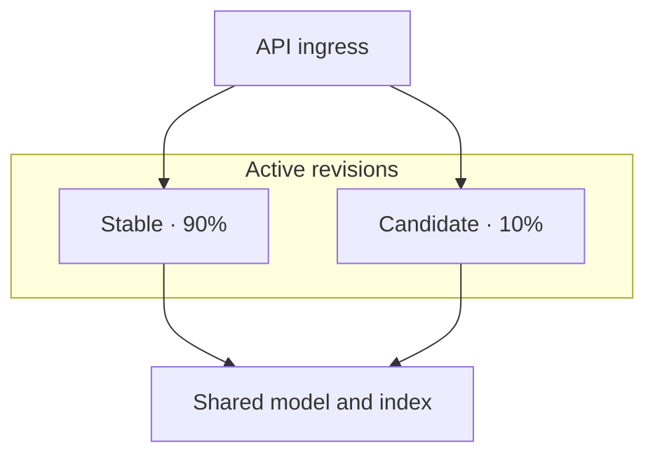

# A release needs a route back

A new service version starts, answers its health check and begins serving users. Its answers now cite
the wrong documents. Nothing crashed: the deployment succeeded, while the release made the product
worse. If replacing the running version also removed the previous one, recovery starts with another
build at the moment you most need a known result.

A controlled release keeps the previous version available, exposes the candidate to a limited audience
and uses evidence to decide whether to widen that audience. The route back must exist before the first
request reaches the candidate. It also needs a boundary: routing can restore an old application, but
cannot reconstruct data that the new application has overwritten.

## How it works on Azure \{#how-it-works-on-azure}

The [compute lesson](../part-1-azure-foundations/compute.md) chooses where P1 runs. Here the question is
how two versions coexist while you decide which should serve requests.

In App Service, a **deployment slot** is a live application with its own hostname. Deploy to a staging
slot, validate it, then swap it with production. App Service prepares the source slot before switching
routing; the staging slot then holds the former production application. Swapping the same slots again
provides a route back. Slots require a
[Standard, Premium or Isolated App Service plan](https://learn.microsoft.com/en-us/azure/app-service/deploy-staging-slots).

Configuration needs the same attention as code. App settings and connection strings can be marked to
stay with a slot, while managed identities do not swap. Check that the application will have the right
settings and permissions on the destination; staging success alone does not establish that
([swap behaviour](https://learn.microsoft.com/en-us/azure/app-service/deploy-staging-slots#which-settings-are-swapped)).

Azure Container Apps uses revisions. A revision captures an immutable application version. In
**multiple revision mode**, several revisions can remain active while ingress distributes traffic
between them. The [traffic weights must total 100%](https://learn.microsoft.com/en-us/azure/container-apps/traffic-splitting?pivots=azure-cli).
For P1, keep the known-good revision at 90% and give the candidate 10%; rollback changes those weights
to 100% and 0%. These percentages are a lab choice, not a universal safe threshold.



The shared dependency matters. Container Apps distinguishes
[revision-scoped and application-scoped changes](https://learn.microsoft.com/en-us/azure/container-apps/revisions#change-types).
Changes under `properties.template`, including container images and scale rules, create a revision.
Changes under `properties.configuration`, including ingress, secrets and registry credentials, apply
across revisions. Updating a secret does not create a revision; containers need a revision restart to
recognise its new value. Switching traffic back therefore does not restore an earlier app-wide configuration.

Use explicit revision names during a controlled release. A rule targeting `latest` follows subsequent
deployments; a rule naming the known-good revision keeps its target fixed
([named revision routing](https://learn.microsoft.com/en-us/azure/container-apps/traffic-splitting?pivots=azure-cli#rapid-iteration)).
“Newest” and “approved” are different properties.

## Choosing and tradeoffs \{#choosing-and-tradeoffs}

Choose the release mechanism for your hosting service and the failure you need to contain.

| Mechanism | Useful when | Avoid it when / common failure |
|---|---|---|
| App Service staging slot and swap | An App Service application needs validation before a production switch. | Treating a slot as an isolated load-test environment: slots share plan capacity. |
| Container Apps single revision mode | A straightforward replacement is enough; the platform waits for the new revision to be ready before moving traffic. | You need old and new versions serving weighted traffic simultaneously. Readiness cannot judge answer quality. |
| Container Apps multiple revision mode | You need a canary: limited live exposure followed by a promotion or rollback decision. | Nobody owns the observation window, or old revisions remain active without a reason. |

The platform details are documented in
[App Service plan capacity](https://learn.microsoft.com/en-us/azure/app-service/overview-hosting-plans),
[Container Apps revision modes](https://learn.microsoft.com/en-us/azure/container-apps/revisions#revision-modes)
and the [blue-green deployment guide](https://learn.microsoft.com/en-us/azure/container-apps/blue-green-deployment?pivots=azure-cli).
For either service, test rollback compatibility before release. Removing an index field or changing a
stored record's meaning can break the retained application too. Use additive changes and defer removal
until the rollback window closes. [Environments and migrations](/ai-sdlc/part-4-platform/environments-migrations-data)
explains how to sequence compatible changes.

A rollback also needs its inputs. Retain the previous image and configuration references, and make
sure the service can still retrieve them. An
[image digest](https://learn.microsoft.com/en-us/azure/container-registry/container-registry-concepts#manifest-digest)
identifies particular image content; a tag can move. Protect release tags and images against overwrite
and deletion with an explicit
[registry retention and locking policy](https://learn.microsoft.com/en-us/azure/container-registry/container-registry-image-lock).
Keeping a revision name is insufficient if its image has disappeared.

Infrastructure drift creates a different recovery problem. Someone repairs ingress in the portal,
but the next provisioning run restores the broken setting from source. Use the workflow from
[infrastructure as code](../part-1-azure-foundations/infrastructure-as-code.md): compare the last
approved Bicep definition and its parameters with live resources, then separately preview the proposed
change. Repeating that comparison on a schedule can reveal changes made between deployments.

[ARM what-if](https://learn.microsoft.com/en-us/azure/azure-resource-manager/bicep/deploy-what-if)
predicts deployment changes without applying them. It is not a complete drift inventory: unresolved
expressions and default values can produce noise, and some resources or modules can be excluded from
analysis. Investigate diagnostics and unexplained differences rather than interpreting a short report
as proof that everything matches. After an emergency fix, either preserve it in Bicep or deliberately
restore the approved configuration.

Traffic weights need an owner too. If the release job changes them while Bicep still declares an older
split, a provisioning run can undo the release decision. Define how release-time routing is passed
into the deployment configuration and reconciled afterwards.
[IV.1 — Pipelines to Azure, planned](./overview.md#whats-inside) will explain deployment identity and
approvals; here you use the resulting artefact and access.

Before that artefact receives traffic, ask three separate supply-chain questions:

- An **SBOM**, or software bill of materials, inventories the components in the image. Generate it
  during the build and retain it with the release; Microsoft's
  [image SBOM guidance](https://learn.microsoft.com/en-us/azure/architecture/guide/devsecops/devsecops-on-aks)
  describes this use. An inventory lets you find affected releases after a new advisory appears.
- Dependency scanning looks for known vulnerabilities. Cover direct and transitive NuGet packages
  using [NuGet auditing](https://learn.microsoft.com/en-us/nuget/concepts/auditing-packages), and scan
  the container image as well. [Defender for Cloud can assess images in ACR](https://learn.microsoft.com/en-us/azure/container-registry/scan-images-defender).
  Define which findings block release and how exceptions expire; a warning or a dashboard entry does
  not itself stop a deployment.
- A signature binds an artefact to a signer. Azure's
  [Notation and Key Vault workflow](https://learn.microsoft.com/en-us/azure/container-registry/container-registry-tutorial-sign-build-push)
  stores signatures alongside images in ACR and verifies them against a trust policy. Require the
  expected identity and content, and fail the release job if verification fails. Merely storing a
  signature creates no enforcement.

Tie the commit, image digest, SBOM, scan results and verification result together in the release record.
A signed image may contain a vulnerable dependency; a clean scan may accompany the wrong publisher's
image. Neither establishes that the application answers correctly. The
[AI SDLC enterprise lesson](/ai-sdlc/part-5-scale-governance/enterprise-tier/)
develops the distinction between provenance and correctness.

## In an AI workload \{#in-an-ai-workload}

P1 is an ASP.NET Core minimal API that answers questions over public documents with citations. Its
release combines an application image with a prompt, a Foundry model deployment, an Azure AI Search
index and a document set in Blob Storage. Record those identifiers together, including the deployed
model version where available. Otherwise revision comparisons can mix retrieval changes with code changes.

For this release, change only the application image. Keep the prompt, model and index fixed so a
regression has a narrower set of causes. Both revisions still use P1's existing managed-identity access
to dependencies and Key Vault. Releasing a revision is not a substitute for checking those permissions.

Before exposure, send a small, fixed question set directly to the candidate and check the expected
source documents, citation validity and refusal on unsupported questions. Use the method in
[RAG evaluation](/rag-agents/part-1-rag/cross-cutting/evaluation/).
[Readiness probes](https://learn.microsoft.com/en-us/azure/container-apps/health-probes)
establish whether a revision is ready to receive traffic; they cannot establish whether its answer
is supported by its citations.

During the canary, compare errors, high-percentile latency, token use and evaluated answer samples by release.
First, P1 must instrument each image with a distinct `release.id` span attribute, exported to
[Application Insights as `customDimensions["release.id"]`](https://learn.microsoft.com/en-us/azure/azure-monitor/app/opentelemetry-add-modify#add-a-custom-property-to-a-span),
and record request-correlated token usage and answer evaluations. This is the lab's required field,
not an automatic revision property. Confirm distinct values from both revisions before splitting traffic.
The [observability exercise](../part-1-azure-foundations/observability.md) provisions the destination;
it does not supply this instrumentation. The planned P1 milestone must add it.

Choose stop conditions and an observation window before exposure. Low traffic may be inconclusive;
add controlled requests or wait rather than promoting on silence.
[Observability and rollout](/ai-sdlc/part-4-platform/observability-rollout) explains how to make that decision.

Finally, distinguish routing rollback from undoing work. Returning new requests to the old revision
does not retract an answer already streamed to a user or reverse an index write. If the candidate
also runs ingestion, control that work separately. For this exercise, the candidate only serves
queries against unchanged shared data.

## Try it \{#try-it}

Deploy a second P1 revision, give it 10% of ingress traffic, then rehearse rollback.
**This is a later-project exercise:** the [P1 RAG service guide is planned](../part-5-projects/overview.md#whats-inside).
It becomes usable after P1 supplies a working API, a documented request with fixed citation/refusal
fixtures, and the telemetry above. Those request and fixture references are not published yet;
return here after that milestone. The compute sample is not P1.

Require one healthy active revision, HTTP ingress, registry access and a compatible candidate image
that has passed scanning and signature verification. Use a unique protected release tag and retain
its digest. For the complete cleanup below, require P1's inventory to place **all** its resources in
one dedicated resource group with nothing shared. For another layout, wait for P1's ownership and
teardown guide before running this lab.

These commands were checked against the current Azure CLI
[revision reference](https://learn.microsoft.com/en-us/cli/azure/containerapp/revision?view=azure-cli-latest)
and [traffic reference](https://learn.microsoft.com/en-us/cli/azure/containerapp/ingress/traffic?view=azure-cli-latest).
They have **not yet been run against a live subscription**; no Azure subscription is available for
this course yet. The results below are expected from the documented behaviour, not measured results.

Use Bash with an authenticated Azure CLI session targeting the P1 subscription. Run the blocks in
order; stop on any error. The mutation chain uses `&&` so a failed step blocks its dependants.
Keep the terminal open for the variables. Rollback does not require the candidate to exist.

```bash
read -r -p 'P1 resource group: ' RG
read -r -p 'P1 container app: ' APP
az containerapp revision list --name "$APP" --resource-group "$RG" --output json
az containerapp ingress traffic show --name "$APP" --resource-group "$RG"
```

Identify the healthy revision serving all traffic as `OLD`. Enter the full candidate image reference
(for example `yourregistry.azurecr.io/p1:release-2`) as `IMAGE`. Choose a fresh suffix each attempt.

```bash
read -r -p 'Known-good revision name: ' OLD
read -r -p 'Candidate image with unique release tag: ' IMAGE
read -r -p 'New revision suffix (for example safe2): ' SUFFIX
NEW="${APP}--${SUFFIX}"

az containerapp revision set-mode --name "$APP" --resource-group "$RG" --mode multiple &&
az containerapp ingress traffic set --name "$APP" --resource-group "$RG" \
  --revision-weight "$OLD=100" &&
az containerapp revision copy --name "$APP" --resource-group "$RG" \
  --from-revision "$OLD" --image "$IMAGE" --revision-suffix "$SUFFIX" &&
az containerapp revision show --name "$APP" --resource-group "$RG" --revision "$NEW"
```

Expect a second revision while the named old revision retains ingress traffic. In the
[revision details](https://learn.microsoft.com/en-us/rest/api/resource-manager/containerapps/container-apps-revisions/get-revision?view=rest-resource-manager-containerapps-2025-07-01),
require `properties.provisioningState` = `Provisioned` and `properties.healthState` = `Healthy`.
If still `Provisioning`, wait and repeat the final `revision show` command. Investigate `Failed`,
`Unhealthy` or lack of progress; do not shift traffic. Use HTTPS with `properties.fqdn` to run P1's
fixed request fixtures against the candidate's [direct endpoint](https://learn.microsoft.com/en-us/azure/container-apps/traffic-splitting?pivots=azure-cli#update-existing-revision).
Proceed only after state, answer and release-identifier checks pass.

```bash
az containerapp ingress traffic set --name "$APP" --resource-group "$RG" \
  --revision-weight "$OLD=90" "$NEW=10" &&
az containerapp ingress traffic show --name "$APP" --resource-group "$RG"
```

Expect weights of 90 and 10, though a few requests need not follow that exact ratio. Inspect release
signals, then rehearse rollback even if the candidate looks healthy:

```bash
az containerapp ingress traffic set --name "$APP" --resource-group "$RG" \
  --revision-weight "$OLD=100" &&
az containerapp ingress traffic show --name "$APP" --resource-group "$RG"
```

Expect only the known-good revision at weight 100. Confirm its answer checks still pass. On an
earlier failure, use this rollback block too; inspect errors before continuing to cleanup.

**Cost:** This exercise can incur charges. On Consumption, allocated replica CPU and memory time and
billable requests contribute to charges; two active revisions can consume resources. Check the
[current regional prices](https://azure.microsoft.com/en-us/pricing/details/container-apps/) and
[billing rules](https://learn.microsoft.com/en-us/azure/container-apps/billing) before starting.
Keep the canary brief and account for P1's existing model, search, storage, registry and telemetry
costs within the course budget. Zero traffic alone does not establish zero compute cost.

**Teardown:** After confirming rollback, deactivate the candidate:

```bash
az containerapp revision deactivate --name "$APP" --resource-group "$RG" --revision "$NEW" &&
az containerapp revision list --name "$APP" --resource-group "$RG" --all --output json
```

Expect the candidate to be inactive; [inactive revisions do not incur revision charges](https://learn.microsoft.com/en-us/azure/container-apps/revisions#inactive-status).
This is incremental cleanup: the original P1 resources still incur applicable charges. Reconcile
routing with Bicep before any further provisioning.

For complete P1 cleanup, inspect the dedicated group's identity and inventory using the
[group](https://learn.microsoft.com/en-us/cli/azure/group?view=azure-cli-latest) and
[resource](https://learn.microsoft.com/en-us/cli/azure/resource?view=azure-cli-latest) commands:

```bash
az group show --name "$RG" --output json &&
az resource list --resource-group "$RG" --output table
```

Match the subscription and every resource against P1's ownership inventory. Only if everything belongs
to this disposable P1 deployment and nothing is outside the group, delete it:

```bash
az group delete --name "$RG"
```

[Group deletion removes its resources irreversibly](https://learn.microsoft.com/en-us/azure/azure-resource-manager/management/delete-resource-group).
Confirm the CLI prompt and wait for successful completion; investigate deletion errors before leaving.

## What to take away \{#what-to-take-away}

- Keep an identified, retrievable previous version ready before exposing a candidate.
- Slots and revisions control application exposure; shared configuration and data need their own recovery plan.
- Evaluate answer quality alongside operational signals before increasing traffic.
- Treat drift previews, dependency scans and signature verification as release decisions with explicit failure conditions.

**[New terms](../glossary.md#releasing-safely)**: deployment slot, slot swap, multiple revision mode, traffic weight, canary release, rollback, SBOM, artefact signature, dependency scanning.

## Sources \{#sources}

Verified as of 2026-10-17. Release procedure, state checks, telemetry and cleanup rechecked 2026-10-18.

Release mechanisms:

- [App Service deployment slots](https://learn.microsoft.com/en-us/azure/app-service/deploy-staging-slots)
- [App Service plans and shared capacity](https://learn.microsoft.com/en-us/azure/app-service/overview-hosting-plans)
- [Container Apps revisions and change scopes](https://learn.microsoft.com/en-us/azure/container-apps/revisions)
- [Container Apps traffic splitting](https://learn.microsoft.com/en-us/azure/container-apps/traffic-splitting?pivots=azure-cli)
- [Container Apps blue-green deployment](https://learn.microsoft.com/en-us/azure/container-apps/blue-green-deployment?pivots=azure-cli)
- [Container Apps health probes](https://learn.microsoft.com/en-us/azure/container-apps/health-probes)
- [Azure CLI revision commands](https://learn.microsoft.com/en-us/cli/azure/containerapp/revision?view=azure-cli-latest)
- [Azure CLI traffic commands](https://learn.microsoft.com/en-us/cli/azure/containerapp/ingress/traffic?view=azure-cli-latest)
- [Revision details and endpoint schema](https://learn.microsoft.com/en-us/rest/api/resource-manager/containerapps/container-apps-revisions/get-revision?view=rest-resource-manager-containerapps-2025-07-01)

Infrastructure and supply chain:

- [Bicep deployment what-if](https://learn.microsoft.com/en-us/azure/azure-resource-manager/bicep/deploy-what-if)
- [Container Registry concepts and image digests](https://learn.microsoft.com/en-us/azure/container-registry/container-registry-concepts)
- [Lock Container Registry images](https://learn.microsoft.com/en-us/azure/container-registry/container-registry-image-lock)
- [DevSecOps image SBOM guidance](https://learn.microsoft.com/en-us/azure/architecture/guide/devsecops/devsecops-on-aks)
- [NuGet dependency auditing](https://learn.microsoft.com/en-us/nuget/concepts/auditing-packages)
- [Container Registry vulnerability scanning](https://learn.microsoft.com/en-us/azure/container-registry/scan-images-defender)
- [Sign and verify images with Notation and Key Vault](https://learn.microsoft.com/en-us/azure/container-registry/container-registry-tutorial-sign-build-push)

Cost:

- [Container Apps billing](https://learn.microsoft.com/en-us/azure/container-apps/billing)
- [Container Apps pricing](https://azure.microsoft.com/en-us/pricing/details/container-apps/)

Telemetry and cleanup:

- [Add OpenTelemetry custom properties](https://learn.microsoft.com/en-us/azure/azure-monitor/app/opentelemetry-add-modify#add-a-custom-property-to-a-span)
- [Resource group deletion](https://learn.microsoft.com/en-us/azure/azure-resource-manager/management/delete-resource-group)
- [Azure CLI resource group commands](https://learn.microsoft.com/en-us/cli/azure/group?view=azure-cli-latest)
- [Azure CLI resource inventory](https://learn.microsoft.com/en-us/cli/azure/resource?view=azure-cli-latest)
- [Bash AND-list execution](https://www.gnu.org/s/bash/manual/html_node/Lists.html)
