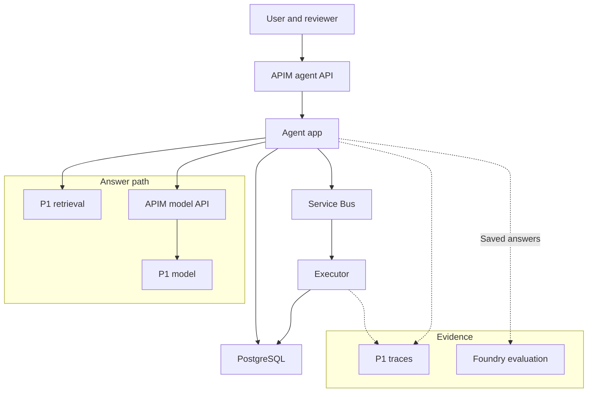

# Let the agent propose a write; make the executor prove permission

Build an assistant for a team maintaining public technical notes. It answers questions through P1's
retrieval service, proposes `publish_note(noteId, expectedVersion)`, shows the exact proposed publication
to a reviewer, and publishes only after approval. A caller can leave and return later to inspect the
outcome. API Management controls entry to the agent and its access to the model; PostgreSQL preserves
decisions while Service Bus carries work beyond an HTTP request.

**Verification:** These steps were checked against current Microsoft Learn and Azure CLI references,
but have **not yet been run against a live subscription**. No subscription exists for this course yet.
The compilation disclosures below record the local checks performed. The checks in
this guide are expected results and acceptance criteria, not a report of a completed deployment.

:::note[Draft: prerequisite unavailable]

The integrated P1 RAG service guide is not yet available. The individual lesson exercises do not
provide its deployed baseline. This page remains a draft integration plan; publication as a usable
build guide is deferred until P1 ships and the checks below can be exercised from that baseline.

:::

## Goal and architecture \{#goal-and-architecture}

Keep P1's model deployments, Search index, source blobs, Key Vault, Container Apps environment and
Application Insights. Extend the P1 application source and delivery configuration. For a disposable
exercise, deploy that extended API as `p2-agent` alongside a separate `p2-tool-executor` worker in a
P2 resource group, referencing the existing environment. Keep P1's deployed `/ask` as the comparison
baseline. This adds hosts for agent responsibilities without duplicating P1's dependencies.



| Component | Azure service / .NET piece | Lesson continued |
|---|---|---|
| Agent host | Container Apps; Microsoft Agent Framework over `IChatClient` | [Agents on Azure](../part-3-llms-on-azure/agents-on-azure.md#try-it) |
| Conversation, approvals, notes | PostgreSQL Flexible Server; EF Core | [Data access](../part-2-modern-dotnet/data-access.md#try-it) |
| Deferred execution | Service Bus queue; separate .NET worker | [Messaging](../part-1-azure-foundations/messaging.md#try-it) |
| Caller and model boundaries | One APIM instance, two API definitions | [The AI gateway](../part-3-llms-on-azure/ai-gateway.md#try-it) |
| Retrieval and configuration | Existing P1 Search, Blob Storage and Key Vault | [Data](../part-1-azure-foundations/data.md#try-it), [AI in .NET](../part-2-modern-dotnet/ai-in-dotnet.md#try-it) |
| Evidence | Existing telemetry; Foundry dataset evaluation | [Evaluation and tracing](../part-3-llms-on-azure/evaluation-and-tracing.md#try-it) |

The two APIM boxes represent separate paths through the same instance. A user token establishes who
may use the agent. The agent's model-access credential establishes which application may consume model
capacity. Neither establishes approval for a particular note.

## Milestones \{#milestones}

### 1. Preserve a working P1 baseline

Continue [Infrastructure as code](../part-1-azure-foundations/infrastructure-as-code.md#try-it),
[Compute](../part-1-azure-foundations/compute.md#try-it) and
[Pipelines to Azure](../part-4-ai-delivery/pipelines-to-azure.md#try-it). Start only after P1 answers a
question with citations. Record its resource IDs, deployment names, index version, image digest and
one representative answer. Keep the existing budget alerts from the [introduction](../intro.md#budget).

Reserve `rg-p2-gateway-lab` for this project, matching the gateway lesson. If it already contains another
exercise, choose a fresh name throughout. Recreate the agent lesson's `p2-tool-executor` identity in
this group rather than retaining the disposable `rg-p2-approval-lab`. Create a separate `p2-agent`
identity. Attach each only to its corresponding host. These
[identity operations](https://learn.microsoft.com/en-us/cli/azure/identity?view=azure-cli-latest)
do not grant data access.

Keep a local `p2-role-assignments.txt` containing the ID of every new grant outside the P2 group.
Capture `--query id --output tsv` from each
[`az role assignment create`](https://learn.microsoft.com/en-us/cli/azure/role/assignment?view=azure-cli-latest)
and append it to that file. It is the teardown inventory, including retrieval and image-pull grants.

**Check:** P1's saved question still produces a cited answer. The resource inventory distinguishes
shared P1 dependencies from P2-owned hosts, identities, database and queue. No P1 dependency is recreated.

### 2. Turn the local store into a durable approval boundary

Continue [Data access](../part-2-modern-dotnet/data-access.md#try-it) from `P2.Store` and its
`InitialAgentStore` migration. Provision PostgreSQL in the P2 group using the
[Flexible Server quickstart](https://learn.microsoft.com/en-us/azure/postgresql/configure-maintain/quickstart-create-server):
choose Burstable B1ms and 32 GiB provisioned storage, subject to regional availability. For this public-endpoint
lab, allow TCP 5432 from both hosts' reported
[`properties.outboundIpAddresses`](https://learn.microsoft.com/en-us/rest/api/resource-manager/containerapps/container-apps/get?view=rest-resource-manager-containerapps-2025-01-01).
Read them with `az containerapp show --resource-group rg-p2-gateway-lab --name HOST --query properties.outboundIpAddresses --output tsv`.
Add each address as an equal start/end
[PostgreSQL firewall rule](https://learn.microsoft.com/en-us/azure/postgresql/security/security-firewall-rules);
repeat the readback after deployments and repair changed rules. Do not use the broad `0.0.0.0` Azure-service rule.
Connect using the server FQDN and `SSL Mode=VerifyFull`. Configure Entra authentication,
create database principals for the two identities and grant their SQL privileges following the
[managed-identity guide](https://learn.microsoft.com/en-us/azure/postgresql/security/security-connect-with-managed-identity).
An Azure role assignment alone does not create those database privileges.

Build one Npgsql data source per host with
[`UsePeriodicPasswordProvider`](https://www.npgsql.org/doc/security.html).
Its callback obtains a token for `https://ossrdbms-aad.database.windows.net/.default` using that host's
managed identity; set a refresh interval shorter than token validity and a short failure retry.
Inject that data source into EF; do not freeze a startup token in a connection string.
Extend the schema with caller, reviewer, decision time, expiry, operation ID, frozen text and destination;
persist the framework session alongside the tenant-owned conversation. Add draft and published-note tables.
Only the executor's database principal may change published notes or execution outcomes. The API may
create proposals and record authorised decisions, but cannot perform publication.

Use a unique operation ID and concurrency checks for approval transitions. Keep the approved payload
immutable. Generate and review the additional migration before applying it with the deployment
identity; [EF supports reviewable migration scripts](https://learn.microsoft.com/en-us/ef/core/managing-schemas/migrations/applying):

```bash
# In the existing P2.Store directory, after extending the model.
dotnet ef migrations add ApprovalExecution
dotnet ef migrations script --idempotent --output p2-migration.sql
```

**Compilation:** These commands were run on a representative extension of the linked `P2.Store`
exercise with .NET SDK 10.0.402, Npgsql.EntityFrameworkCore.PostgreSQL 10.0.3,
Microsoft.EntityFrameworkCore.Design 10.0.13 and dotnet-ef 10.0.13 on 2026-10-19.
The project built and generated the migration and idempotent SQL locally; the SQL was not applied
and the integrated approval service was not run against PostgreSQL or live Azure.

Add incoming authentication before testing these handlers; the Entra lesson's identity exercise does
not register an API. In Entra App registrations, create single-tenant `p2-notes-api`, set manifest
[`api.requestedAccessTokenVersion` to `2`](https://learn.microsoft.com/en-us/entra/identity-platform/identifier-uri-restrictions), and
[expose](https://learn.microsoft.com/en-us/entra/identity-platform/quickstart-configure-app-expose-web-apis)
`api://API_CLIENT_ID/agent.use`. Add a user
[app role](https://learn.microsoft.com/en-us/entra/identity-platform/howto-add-app-roles-in-apps)
`Notes.Reviewer`; assign the lab reviewer under Enterprise applications → Users and groups.
Create `p2-notes-cli`, enable
[public client flows](https://learn.microsoft.com/en-us/entra/identity-platform/scenario-desktop-app-registration),
add the API's delegated permission and grant consent. Record both new application client IDs for teardown.

Use this configuration contract; names other than framework options are application choices:

| Setting | Value / consumer |
|---|---|
| `P2:ReviewerObjectId` | Assigned reviewer's object ID; copy into each proposal from server configuration |
| `P2:TenantId`, `P2:ApiClientId`, `P2:ClientId` | Directory ID, API client ID, CLI client ID; API, APIM and token client |
| JWT authority / audience | `https://login.microsoftonline.com/TENANT_ID/v2.0` / API client ID GUID for these [v2 tokens](https://learn.microsoft.com/en-us/entra/identity-platform/access-token-claims-reference) |
| Database | Server FQDN, database, host-specific principal name; no stored password |
| Managed identity | Each host's assigned client ID; select it explicitly for token acquisition |
| Queue | Namespace FQDN and `publish`; API sends, executor receives |
| Model | Gateway base URL, chat/embedding deployment names, host-secret subscription key |

In ASP.NET Core, register
[`AddAuthentication().AddJwtBearer`](https://learn.microsoft.com/en-us/aspnet/core/security/authentication/configure-jwt-bearer-authentication?view=aspnetcore-10.0)
with that authority/audience and `MapInboundClaims=false`. Call `UseAuthentication()` then
`UseAuthorization()` before handlers. Require authenticated `scp` containing the space-delimited
`agent.use` value on every route; decisions additionally require `roles` containing `Notes.Reviewer`.
Use validated `tid` and `oid` for tenant/caller. Require ownership for turns; allow the owner or assigned
reviewer to read a proposal/status, and only that reviewer to decide it. A changed draft needs a new proposal.

**Check:** After deploying both hosts, confirm database connectivity and token renewal beyond the initial
token lifetime. Use the authenticated requests in milestone 5 against the local host first, with a synthetic
proposal handler replacing the model. Restart before deciding; the pending record must survive.
Denial writes no published note; another tenant has no access. Competing decisions accept one transition.

### 3. Publish approved work through a queue

Adapt [Messaging](../part-1-azure-foundations/messaging.md#try-it): its `ingest` exercise prepares P3;
here the queue is `publish`. Keep its Basic tier and five-minute lock. In Bash, after selecting your
subscription, use the existing P2 group:

```bash
p2Group='rg-p2-gateway-lab'
p2Bus="sb-p2-$(date +%s)-$RANDOM"
az servicebus namespace create --resource-group "$p2Group" --name "$p2Bus" \
  --location westeurope --sku Basic --disable-local-auth true --output none
az servicebus queue create --resource-group "$p2Group" --namespace-name "$p2Bus" \
  --name publish --lock-duration PT5M --output none
```

The [namespace](https://learn.microsoft.com/en-us/cli/azure/servicebus/namespace?view=azure-cli-latest)
and [queue](https://learn.microsoft.com/en-us/cli/azure/servicebus/queue?view=azure-cli-latest)
references document these flags. Grant the API identity
[`Azure Service Bus Data Sender` and the executor `Azure Service Bus Data Receiver`](https://learn.microsoft.com/en-us/azure/service-bus-messaging/service-bus-managed-service-identity)
at the queue scope. Avoid carrying the manual Explorer exercise's Data Owner grant into application identities.

When approval succeeds, save its transition and a pending-dispatch row in one database transaction.
A dispatcher in the API host polls these rows, sends the operation ID and approval ID, then marks the row sent.
A crash between send and marking may send twice. Set `template.scale.minReplicas: 1` on **both** hosts
in the deployment definition: [HTTP scaling can otherwise reach zero](https://learn.microsoft.com/en-us/azure/container-apps/scale-app).
The dispatcher must run without requests. Never hold a message lock or database transaction while waiting for a human.
[Durable runs](/rag-agents/part-2-agents/durable-runs/) explains the ownership of authoritative state.

Build the executor as a queue worker with no HTTP ingress. Reuse P1's container build and deployment
pattern, with the executor's own identity. Set a finite processing deadline and renew locks when necessary.

On receipt, load authoritative records by operation ID. Recheck tenant, caller permission, reviewer,
expiry, tool, frozen payload and expected note version. In one short
[database transaction](https://learn.microsoft.com/en-us/ef/core/saving/transactions), conditionally
update the published note and record the operation's outcome. An existing successful operation returns
that outcome; reuse with a different payload fails. Competing workers must resolve a concurrency conflict
by reloading, not by repeating the write. This atomicity applies because publication stays in PostgreSQL;
an external destination would need its own retry-safe protocol.

**Check:** Approve a synthetic proposal and observe its published note through the status API. Kill
the worker after commit but before message completion. On
[PeekLock redelivery](https://learn.microsoft.com/en-us/azure/service-bus-messaging/service-bus-message-loss-and-duplicates),
expect the same outcome and no second version increment. Complete only after commit. Also commit approval,
stop HTTP traffic, fail/restart the dispatcher before send, and expect recovery from the pending row. Repeat denial, expiry and stale-version cases; malformed work goes to the dead-letter queue.

### 4. Let one agent request approval

Continue [Agents on Azure](../part-3-llms-on-azure/agents-on-azure.md#try-it) and
[AI in .NET](../part-2-modern-dotnet/ai-in-dotnet.md#try-it). Keep the .NET 10 target and existing P1
package pins; pin [Microsoft.Agents.AI to 1.13.0](https://www.nuget.org/packages/Microsoft.Agents.AI/1.13.0)
for this integration. This **illustrative factory** shows the registration shape;
supply P1's chat client, retrieval function and the callback described below:

```csharp
using Microsoft.Agents.AI;
using Microsoft.Extensions.AI;

public static class NoteAgent
{
    public static AIAgent Create(
        IChatClient chat, AIFunction retrieve, AIFunction publishNote)
        => chat.AsAIAgent(
            name: "NoteAgent",
            instructions: "Answer from retrieved notes with citations. " +
                "Request approval before publishing a note.",
            tools: [retrieve, new ApprovalRequiredAIFunction(publishNote)]);
}
```

**Compilation:** This factory was built unchanged for `net10.0` with .NET SDK 10.0.402,
Microsoft.Agents.AI 1.13.0 and its resolved Microsoft.Extensions.AI 10.6.0 dependency on 2026-10-19.
It was compiled only; no agent turn or live Azure call was run.

The [`AsAIAgent` contract](https://learn.microsoft.com/en-us/dotnet/api/microsoft.extensions.ai.chatclientextensions.asaiagent?view=agent-framework-dotnet-latest)
accepts these tools. The [tool-use lesson](/rag-agents/part-2-agents/tool-use/)
owns the runtime's execution boundary. Use the following application mapping:

| Step | Persisted binding / effect |
|---|---|
| Agent returns `ToolApprovalRequestContent` | Resolve [`FunctionCallContent.CallId`](https://learn.microsoft.com/en-us/dotnet/api/microsoft.extensions.ai.functioncallcontent?view=net-10.0-pp), function name and exact arguments. Freeze resolved note text/destination/version; atomically save the session snapshot, serialised approval request and new proposal/operation IDs. Unique key: tenant + conversation + call ID. Return these application IDs, never an approval flag supplied by the model. |
| Decision endpoint | Compare pending proposal revision, tenant, ownership, assigned reviewer, payload and expiry. One transaction records approved/denied and, **only for approval**, inserts the unique pending-dispatch row. This is the sole enqueue transition, including milestone 3's synthetic handler. |
| Framework resumption | Restore the saved request and same session; call `request.CreateResponse(approved)` inside a user `ChatMessage`, then `agent.RunAsync(message, session)`. Persist resumption progress; retry after crashes under a per-conversation concurrency guard. |
| Resumed publish callback | Bind the execution context to the stored call ID and operation; compare arguments, load the approved record and return its operation ID/status. It neither enqueues nor publishes. Replay returns the same operation. |

The [documented loop](https://learn.microsoft.com/en-us/agent-framework/agents/tools/tool-approval)
supplies the framework response mechanism; this table supplies the application's durable contract.
Inspect every run for further approval requests; persist each before displaying its complete text and destination.
[Session persistence](https://learn.microsoft.com/en-us/agent-framework/concepts/agents/conversations/session)
must survive restart. Bound iterations and propagate cancellation without discarding committed work.

**Check:** A read-only question returns citations. A publication request returns a pending proposal
and performs no write. Restart the API, reject the proposal and verify no publication. Approve a new
proposal, then retrieve the worker's outcome. Altering its arguments after approval must fail closed.

### 5. Enforce both gateway paths

Continue [The AI gateway](../part-3-llms-on-azure/ai-gateway.md#try-it) and
[Microsoft Entra ID](../part-1-azure-foundations/entra-id.md#try-it). Deploy its `gateway.bicep` as
deployment `gateway` in the P2 group. Reuse P1's chat deployment and the lesson's API-scoped **P2 agent**
subscription. Record the new APIM identity's model-resource grant in the teardown inventory.

For outbound calls, set the agent's model base URL to the deployment's `apiBaseUrl`; have its HTTP
transport supply `Ocp-Apim-Subscription-Key`. Store that key as a P2 host secret. APIM strips the
subscription credential and uses its own
[managed identity for the backend](https://learn.microsoft.com/en-us/azure/api-management/api-management-authenticate-authorize-ai-apis).
The new agent identity needs no direct model grant or model key.

Preserve query embeddings: add a `POST /embeddings` operation to `p2-model` using the same v1 backend.
Move `llm-token-limit` from API scope to the chat operation, keeping credential stripping and backend
authentication at API scope. Configure the embedding adapter to use the same gateway base URL and key.
The [token policy documents Chat Completions and Responses schemas](https://learn.microsoft.com/en-us/azure/api-management/llm-token-limit-policy),
not embeddings. Track embedding consumption separately. Keep the lesson's shared 50-token limit only
for its isolated throttle probe; choose an explicit larger allocation before testing complete agent turns.

For inbound calls, add `p2-agent-api` at `/agent`, mapping the application's routes to its backend URL.
Disable subscription-key authentication here. Create APIM named values `p2-tenant-id` and
`p2-api-client-id` from milestone 2, then add this
[inbound policy](https://learn.microsoft.com/en-us/azure/api-management/validate-azure-ad-token-policy)
inside the API's `<inbound>` section after `<base />`:

```xml
<validate-azure-ad-token tenant-id="{{p2-tenant-id}}" header-name="Authorization"
    failed-validation-httpcode="401">
  <audiences><audience>{{p2-api-client-id}}</audience></audiences>
  <required-claims>
    <claim name="scp" match="all" separator=" "><value>agent.use</value></claim>
  </required-claims>
</validate-azure-ad-token>
```

Forward the bearer token unchanged; the API independently validates it and applies milestone 2's checks.
A [subscription key establishes possession, not user identity](https://learn.microsoft.com/en-us/azure/api-management/api-management-subscriptions).

Acquire separate caller/reviewer tokens using `p2-notes-cli` with
[MSAL device-code acquisition](https://learn.microsoft.com/en-us/dotnet/api/microsoft.identity.client.publicclientapplication.acquiretokenwithdevicecode?view=msal-dotnet-latest):
construct `PublicClientApplicationBuilder.Create(ClientId).WithTenantId(TenantId).Build()`, then
`AcquireTokenWithDeviceCode(["api://API_CLIENT_ID/agent.use"], callback).ExecuteAsync()`.
The callback displays `DeviceCodeResult.Message`; save each result's `AccessToken` in the corresponding
shell variable below. Use the assigned reviewer account for the second login. These are access tokens
for this API, not Azure CLI's management token. The application's HTTP contract is:

| Route | Required behaviour |
|---|---|
| `POST /conversations` | Create a tenant/caller-owned conversation; return `id`. |
| `POST /conversations/{id}/turns` | Accept `text`; return an answer or pending `proposalId`, `revision`, `operationId`, frozen `text`, destination and expiry. |
| `GET /proposals/{id}` | Owner/assigned reviewer reads the authoritative frozen proposal, string `revision` and expiry. |
| `POST /proposals/{id}/decision` | Accept only `revision` and boolean `approve`; validate reviewer and atomically transition. Return `operationId` and status. Stale/conflicting decisions return `409`. |
| `GET /operations/{id}` | Authorised owner/reviewer sees pending, denied, queued, succeeded or failed and the saved outcome. |

Seed a draft named `lab-note` at version 1, with its reviewer taken from server configuration.
With `curl` and `jq`, exercise the contract (use local `base` for milestones 2–4):

```bash
set -euo pipefail
base='https://YOUR_GATEWAY.azure-api.net/agent'
# Set callerToken and reviewerToken from the two MSAL results; do not log them.
conversation=$(curl --fail-with-body -sS -X POST "$base/conversations" \
  -H "Authorization: Bearer $callerToken" | jq -er .id)
proposal=$(curl --fail-with-body -sS "$base/conversations/$conversation/turns" \
  -H "Authorization: Bearer $callerToken" -H 'Content-Type: application/json' \
  --data '{"text":"Propose publishing note lab-note at version 1."}')
proposalId=$(jq -er .proposalId <<< "$proposal")
operationId=$(jq -er .operationId <<< "$proposal")
proposal=$(curl --fail-with-body -sS "$base/proposals/$proposalId" \
  -H "Authorization: Bearer $reviewerToken")
revision=$(jq -er .revision <<< "$proposal")
jq '{text,destination,expiresAt}' <<< "$proposal" # Reviewer inspects the frozen payload.
# Submit only after that inspection; use false to test denial on a fresh proposal.
curl --fail-with-body -sS "$base/proposals/$proposalId/decision" \
  -H "Authorization: Bearer $reviewerToken" -H 'Content-Type: application/json' \
  --data "$(jq -n --arg revision "$revision" '{revision:$revision,approve:true}')"
curl --fail-with-body -sS "$base/operations/$operationId" \
  -H "Authorization: Bearer $callerToken"
```

Block direct access to `p2-agent`: allow only the classic Developer gateway's
[dedicated public IPv4 addresses](https://learn.microsoft.com/en-us/azure/api-management/api-management-howto-ip-addresses)
in the Container App's [ingress allow rules](https://learn.microsoft.com/en-us/azure/container-apps/ip-restrictions).
Retrieve them from the APIM overview, add one `/32` rule per address and remove unrelated allow rules.
Carry these settings into your infrastructure definition. Keep semantic caching disabled for this project.

**Check:** Through `/agent`, a valid authorised user can answer and approve. Missing or wrong-audience
tokens fail before the handler. The direct Container App URL is denied from your workstation. On
`/model`, the lesson's keyless probe returns `401`; consuming the rate allocation produces `429` with
`Retry-After`, without guaranteeing a fixed number of successful requests. Run a cited question after
switching both chat and embedding clients; this catches an accidentally broken retrieval path.

### 6. Capture evidence and evaluate saved answers

Continue [Evaluation and tracing](../part-3-llms-on-azure/evaluation-and-tracing.md#try-it) and
[Releasing safely](../part-4-ai-delivery/releasing-safely.md#try-it). Reuse the telemetry destination
and `P1.ModelCalls` source, adding operation IDs to correlate API, dispatch and worker records. Keep
raw note text out of routine telemetry. Run the application acceptance cases separately from quality scoring.

Create a disposable `p2-evaluation` child project under the existing Foundry account using the
[project CLI](https://learn.microsoft.com/en-us/cli/azure/cognitiveservices/account/project?view=azure-cli-latest).
Use a fresh project name if that one already exists, and update teardown accordingly:

```bash
az cognitiveservices account project create \
  --resource-group 'YOUR_P1_FOUNDRY_GROUP' --name 'YOUR_P1_FOUNDRY_ACCOUNT' \
  --project-name p2-evaluation --location westeurope --output none
```

Use the account's existing judge deployment and the
[evaluation permissions](https://learn.microsoft.com/en-us/azure/foundry/observability/how-to/evaluation-permissions);
project-only permission does not grant judge inference at account scope. This isolates P2's uploaded
dataset and run for teardown.

Capture five answers with `query`, `response`, exact retrieval `context`, case ID and trace ID as the
lesson does. Include an ordinary answer, an absent answer, a misleading premise, a denied publication
and an approved publication's final response. In the
[portal evaluation workflow](https://learn.microsoft.com/en-us/azure/foundry/how-to/evaluate-generative-ai-app),
choose Dataset and Individual turns, map the fields, and select Groundedness and Relevance only. Name
the run `p2-baseline`; save its configuration and per-case results alongside the separate execution checks.

**Check:** A successful evaluation is Completed; Partial requires investigating evaluator failures.
Inspect each answer and its trace. A good language-model score cannot establish that a denied operation
made no write: verify database outcomes directly. Five cases demonstrate the wiring, not production quality.

## Cost \{#cost}

Plan a short lab session. The course's USD 10 monthly target does not establish that this full stack
fits continuous operation. An idle Developer gateway and both hosts
with minimum replicas of one can incur charges. Check regional rates before provisioning and delete the extension afterwards.

| Resource | SKU / tier | Pricing unit | Free allowance / offer | Bill driver |
|---|---|---|---|---|
| [APIM](https://azure.microsoft.com/en-us/pricing/details/api-management/) | Developer, one unit | Unit time | No free Developer allowance assumed; no production SLA | Provisioned lifetime, including idle time |
| [Container Apps](https://azure.microsoft.com/en-us/pricing/details/container-apps/) | Consumption; agent plus worker | vCPU-seconds, GiB-seconds, requests | Monthly per subscription: 180,000 vCPU-seconds, 360,000 GiB-seconds, 2 million requests; shared with P1 | Active/idle allocation; agent/dispatcher and executor each have a minimum of one replica |
| [PostgreSQL](https://azure.microsoft.com/en-us/pricing/details/postgresql/flexible-server/) | Burstable B1ms; 32 GiB provisioned | Compute time, storage and excess backup GiB-month | [Eligible new accounts](https://azure.microsoft.com/en-us/pricing/purchase-options/azure-account): 750 hours, 32 GB storage and 32 GB backup monthly for 12 months (offer wording; billing uses GiB) | Server lifetime and retained storage; eligibility matters |
| [Service Bus](https://azure.microsoft.com/en-us/pricing/details/service-bus/) | Basic | Messaging operations | No free Basic allowance assumed | Sends, receives, settlement and retries; no Standard hourly base charge |
| [P1 models](https://azure.microsoft.com/en-us/pricing/details/azure-openai/) | Existing deployment types | Input/output tokens at model-specific rates | No general inference grant assumed | Chat turns, embeddings and judge calls |
| [Foundry evaluation](https://azure.microsoft.com/en-us/pricing/details/foundryobservability/) | Dataset quality evaluation | Selected judge's tokens | No evaluation surcharge for this quality path; inference still billed | Dataset/context size and selected criteria |
| [P1 telemetry](https://azure.microsoft.com/en-us/pricing/details/monitor/) | Application Insights / Analytics Logs | Ingested GB and billable retention | First 5 GB/month per billing account in this log tier | Added spans/logs and retention |
| [P1 Search](https://azure.microsoft.com/en-us/pricing/details/search/) | Existing dedicated tier | Paid tiers: search-unit time | [Free tier](https://learn.microsoft.com/en-us/azure/search/search-limits-quotas-capacity): one service/subscription, 50 MB; no second grant for P2 | Existing provisioned capacity; optional features remain separately priced |
| [P1 Blob Storage](https://azure.microsoft.com/en-us/pricing/details/storage/blobs/) | Existing account and access tier | Stored GB-month, operations, applicable transfer/retrieval | No numeric account allowance assumed here | Retained source documents and reads |
| [P1 Key Vault](https://azure.microsoft.com/en-us/pricing/details/key-vault/) | Existing Standard vault | Secret operations per 10,000 transactions | No new entitlement assumed | P1 secret access; no P2 secret is added to this vault |
| [P1 registry](https://azure.microsoft.com/en-us/pricing/details/container-registry/) | Existing tier | Registry time, excess storage and applicable transfer | [Eligible new accounts](https://azure.microsoft.com/en-us/pricing/purchase-options/azure-account): one Standard registry with 100 GB for 12 months | Two extra image repositories; no second registry |

P1's existing resources keep their own costs and entitlements. P2 creates no replacement for them.
Keep their original teardown for the end of
the entire course lab; this project's teardown preserves the baseline.

## Teardown \{#teardown}

Stop requests and dispatch, wait for or cancel the evaluation, and export evidence you want to keep.
Use distinct image repositories `p2-agent-lab` and `p2-executor-lab` in P1's registry when building the
two hosts. Keep P2 secrets on those hosts. The evaluation child project, cross-group grants and
two Entra registrations need separate cleanup; other new Azure resources belong to the P2 group.

Run this Bash script from the directory containing your role inventory. Replace placeholders and set
`gatewayName` to the name emitted by the gateway deployment. It uses documented
[group deletion](https://learn.microsoft.com/en-us/cli/azure/group?view=azure-cli-latest),
[role deletion](https://learn.microsoft.com/en-us/cli/azure/role/assignment?view=azure-cli-latest),
[project deletion](https://learn.microsoft.com/en-us/cli/azure/cognitiveservices/account/project?view=azure-cli-latest)
and [APIM soft-delete cleanup](https://learn.microsoft.com/en-us/azure/api-management/soft-delete).
The [registry CLI](https://learn.microsoft.com/en-us/cli/azure/acr/repository?view=azure-cli-latest)
deletes the two dedicated image repositories, including their unshared layers.
The [application CLI](https://learn.microsoft.com/en-us/cli/azure/ad/app?view=azure-cli-latest)
removes only the two recorded P2 registrations. The script fails on any removal/readback error or
unexpected remaining resource; an empty error response never counts as absence.

```bash
set -u
az account set --subscription 'YOUR_SUBSCRIPTION_ID' || exit 1
p2Group='rg-p2-gateway-lab'
p1FoundryGroup='YOUR_P1_FOUNDRY_GROUP'
p1FoundryAccount='YOUR_P1_FOUNDRY_ACCOUNT'
p1Registry='YOUR_P1_REGISTRY_NAME'
gatewayName='YOUR_P2_GATEWAY_NAME'
p2ApiClientId='YOUR_P2_API_CLIENT_ID'
p2ClientId='YOUR_P2_CLI_CLIENT_ID'
failed=0

check_readback() {
  local expected="$1" label="$2" actual
  shift 2
  if actual=$("$@"); then
    if [ "$actual" != "$expected" ]; then
      printf 'Unexpected remaining resource: %s (%s)\n' "$label" "$actual" >&2
      failed=1
    fi
  else
    printf 'Readback failed: %s\n' "$label" >&2
    failed=1
  fi
}

az cognitiveservices account project delete --resource-group "$p1FoundryGroup" \
  --name "$p1FoundryAccount" --project-name p2-evaluation || failed=1

if [ -f p2-role-assignments.txt ]; then
  while IFS= read -r assignmentId || [ -n "$assignmentId" ]; do
    [ -z "$assignmentId" ] && continue
    az role assignment delete --ids "$assignmentId" || failed=1
  done < p2-role-assignments.txt
else
  printf 'Missing role inventory: inspect P1 scopes for P2 grants.\n' >&2
  failed=1
fi

az group delete --name "$p2Group" --yes || failed=1
# Classic APIM retains a recoverable service after deletion; purge only this lab.
az apim deletedservice purge --service-name "$gatewayName" \
  --location westeurope || failed=1
for imageRepository in p2-agent-lab p2-executor-lab; do
  az acr repository delete --name "$p1Registry" \
    --repository "$imageRepository" --yes || failed=1
done
for appId in "$p2ApiClientId" "$p2ClientId"; do
  az ad app delete --id "$appId" || failed=1
  check_readback 0 "Entra app $appId" az ad app list \
    --filter "appId eq '$appId'" --query 'length(@)' --output tsv
done
check_readback false 'P2 group' az group exists --name "$p2Group" --output tsv
check_readback 0 'evaluation project' az cognitiveservices account project list \
  --resource-group "$p1FoundryGroup" --name "$p1FoundryAccount" \
  --query "length([?name=='p2-evaluation' || ends_with(name, '/p2-evaluation')])" --output tsv
check_readback 0 'deleted gateway' az apim deletedservice list \
  --query "length([?name=='$gatewayName'])" --output tsv
check_readback 0 'P2 image repositories' az acr repository list --name "$p1Registry" \
  --query "length([?@=='p2-agent-lab' || @=='p2-executor-lab'])" --output tsv
if [ -f p2-role-assignments.txt ]; then
  while IFS= read -r assignmentId || [ -n "$assignmentId" ]; do
    [ -z "$assignmentId" ] && continue
    check_readback 0 "$assignmentId" az role assignment list --all \
      --fill-principal-name false --fill-role-definition-name false \
      --query "length([?id=='$assignmentId'])" --output tsv
  done < p2-role-assignments.txt
fi
exit "$failed"
```

Success requires group existence `false` and zero matching projects, deleted gateways, role IDs, image
repositories and Entra applications. Investigate failures before discarding the inventory. Remove local
fixtures and credentials after exporting your evidence. Existing P1 telemetry follows its retention policy; teardown does not erase it.
P1's original cited question should still work.

## What you can explain afterwards \{#what-you-can-explain-afterwards}

- Why do caller authentication, model access and tool approval require separate checks?
- Which identity can publish, and how does [an instruction become an enforced control](/ai-sdlc/part-1-foundation/rules-that-hold)?
- How is approval bound to a tenant, reviewer, exact payload, version and expiry after a restart?
- What happens if the database commits but Service Bus never receives message completion?
- How does [sender-side duplicate suppression](https://learn.microsoft.com/en-us/azure/service-bus-messaging/duplicate-detection) differ from executor retry safety after commit-before-completion redelivery?
- How would an external publication destination change the transaction and recovery design?
- Why do token limits and budget alerts fail to guarantee an exact currency ceiling?
- Which failures can Foundry quality evaluations detect, and which require execution-state assertions?

## Sources \{#sources}

Verified as of 2026-10-19.

- [Agent construction API](https://learn.microsoft.com/en-us/dotnet/api/microsoft.extensions.ai.chatclientextensions.asaiagent?view=agent-framework-dotnet-latest), [tool approvals](https://learn.microsoft.com/en-us/agent-framework/agents/tools/tool-approval), [invoker responsibility](https://learn.microsoft.com/en-us/dotnet/api/microsoft.extensions.ai.approvalrequiredaifunction?view=net-10.0-pp), [sessions](https://learn.microsoft.com/en-us/agent-framework/concepts/agents/conversations/session), [function-call identity](https://learn.microsoft.com/en-us/dotnet/api/microsoft.extensions.ai.functioncallcontent?view=net-10.0-pp)
- [EF migrations](https://learn.microsoft.com/en-us/ef/core/managing-schemas/migrations/applying), [transactions](https://learn.microsoft.com/en-us/ef/core/saving/transactions), [concurrency](https://learn.microsoft.com/en-us/ef/core/saving/concurrency)
- [Incoming API registration](https://learn.microsoft.com/en-us/entra/identity-platform/quickstart-configure-app-expose-web-apis), [delegated client permission](https://learn.microsoft.com/en-us/entra/identity-platform/quickstart-configure-app-access-web-apis), [reviewer roles](https://learn.microsoft.com/en-us/entra/identity-platform/howto-add-app-roles-in-apps), [public client configuration](https://learn.microsoft.com/en-us/entra/identity-platform/scenario-desktop-app-registration), [token version configuration](https://learn.microsoft.com/en-us/entra/identity-platform/identifier-uri-restrictions), [access-token claims](https://learn.microsoft.com/en-us/entra/identity-platform/access-token-claims-reference), [JWT bearer validation](https://learn.microsoft.com/en-us/aspnet/core/security/authentication/configure-jwt-bearer-authentication?view=aspnetcore-10.0), [MSAL device code](https://learn.microsoft.com/en-us/dotnet/api/microsoft.identity.client.publicclientapplication.acquiretokenwithdevicecode?view=msal-dotnet-latest)
- [Npgsql token rotation and TLS](https://www.npgsql.org/doc/security.html), [PostgreSQL firewall](https://learn.microsoft.com/en-us/azure/postgresql/security/security-firewall-rules), [Container App network properties](https://learn.microsoft.com/en-us/rest/api/resource-manager/containerapps/container-apps/get?view=rest-resource-manager-containerapps-2025-01-01), [scaling](https://learn.microsoft.com/en-us/azure/container-apps/scale-app), [application registration CLI](https://learn.microsoft.com/en-us/cli/azure/ad/app?view=azure-cli-latest)
- [PostgreSQL creation](https://learn.microsoft.com/en-us/azure/postgresql/configure-maintain/quickstart-create-server), [managed-identity access](https://learn.microsoft.com/en-us/azure/postgresql/security/security-connect-with-managed-identity)
- [Service Bus identity](https://learn.microsoft.com/en-us/azure/service-bus-messaging/service-bus-managed-service-identity), [delivery and duplicate processing](https://learn.microsoft.com/en-us/azure/service-bus-messaging/service-bus-message-loss-and-duplicates)
- [APIM token limits](https://learn.microsoft.com/en-us/azure/api-management/llm-token-limit-policy), [subscriptions](https://learn.microsoft.com/en-us/azure/api-management/api-management-subscriptions), [backend authentication](https://learn.microsoft.com/en-us/azure/api-management/api-management-authenticate-authorize-ai-apis), [Entra validation](https://learn.microsoft.com/en-us/azure/api-management/validate-azure-ad-token-policy), [IP addresses](https://learn.microsoft.com/en-us/azure/api-management/api-management-howto-ip-addresses), [soft delete](https://learn.microsoft.com/en-us/azure/api-management/soft-delete)
- [Container Apps identities](https://learn.microsoft.com/en-us/azure/container-apps/managed-identity), [IP restrictions](https://learn.microsoft.com/en-us/azure/container-apps/ip-restrictions)
- [Foundry evaluations](https://learn.microsoft.com/en-us/azure/foundry/how-to/evaluate-generative-ai-app), [datasets](https://learn.microsoft.com/en-us/azure/foundry/observability/how-to/evaluation-datasets), [permissions](https://learn.microsoft.com/en-us/azure/foundry/observability/how-to/evaluation-permissions)
- Azure CLI: [groups](https://learn.microsoft.com/en-us/cli/azure/group?view=azure-cli-latest), [identities](https://learn.microsoft.com/en-us/cli/azure/identity?view=azure-cli-latest), [role assignments](https://learn.microsoft.com/en-us/cli/azure/role/assignment?view=azure-cli-latest), [Service Bus namespace](https://learn.microsoft.com/en-us/cli/azure/servicebus/namespace?view=azure-cli-latest), [queue](https://learn.microsoft.com/en-us/cli/azure/servicebus/queue?view=azure-cli-latest), [Foundry project](https://learn.microsoft.com/en-us/cli/azure/cognitiveservices/account/project?view=azure-cli-latest), [APIM](https://learn.microsoft.com/en-us/cli/azure/apim?view=azure-cli-latest), [image repositories](https://learn.microsoft.com/en-us/cli/azure/acr/repository?view=azure-cli-latest)
