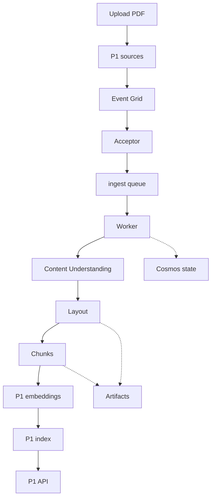

# Turn uploaded documents into searchable, traceable chunks

Build P3, the optional ingestion service for P1. You upload a document to P1's existing `sources`
container; the pipeline extracts its structure, produces chunks and embeddings, and updates P1's
existing retrieval index. You can then ask P1 a question whose answer cites the
new document. Cosmos DB records how far each job has progressed so an interrupted delivery can resume.

No Azure subscription was available: these steps were checked against Microsoft Learn and the Azure
CLI references, **not run against a live subscription**. The illustrative C# fragment was built and run
in a local harness with .NET SDK 10.0.402 and .NET runtime 10.0.13 on 2026-10-19; it needs no NuGet packages.
Checks below describe expected results, not a completed deployment.

:::caution[Prerequisite: P1]

Complete the [P1 RAG-service guide](./rag-service.md) first. The separate labs do not produce that service.
Do not deploy P3 until P1 supplies the contract below; this guide extends P1 rather than building it.

:::

## Goal and architecture \{#goal-and-architecture}

The first version accepts immutable uploads. Give each document version a new blob path; do not
overwrite a file while a worker is reading it. Start with one small public PDF whose extraction you can
inspect. Require these outputs from [P1](./rag-service.md) before milestone 1:

| P1 output | Required contract |
|---|---|
| Storage | Resource ID, region, account name, private `sources` container; Entra data access enabled |
| Search | Resource ID, endpoint, index name; `id` key, `title`, `content`, `sourceUrl`, `contentVector`; real-vector dimension and query configuration |
| Embeddings | Resource ID, endpoint, deployment, model/version and dimensions; same configuration for chunks and queries |
| API | URL and authentication procedure; a query over existing documents returns an answer with source/page citations |
| Identities | Actual API principal and its existing reader grants; permission to add P3's separate writer grants |



| Component | Azure service / .NET piece | Lesson continued |
|---|---|---|
| Input and artifacts | Existing Blob Storage; separate P3 containers | [Data](../part-1-azure-foundations/data.md#try-it) |
| Notification and durable work | Event Grid, Functions isolated worker, Service Bus `ingest` | [Messaging](../part-1-azure-foundations/messaging.md#try-it), [compute](../part-1-azure-foundations/compute.md#try-it) |
| Extraction and splitting | Content Understanding; your structure-aware splitter | [Document ingestion](../part-3-llms-on-azure/document-ingestion.md#try-it) |
| Progress records | Cosmos DB for NoSQL; conditional updates | [Data](../part-1-azure-foundations/data.md#try-it) |
| Retrieval updates | P1 embedding deployment and Azure AI Search push API | [RAG on AI Search](../part-3-llms-on-azure/rag-on-ai-search.md#try-it) |
| Deployment and evidence | P3 infrastructure definition; Application Insights | [Infrastructure](../part-1-azure-foundations/infrastructure-as-code.md#try-it), [observability](../part-1-azure-foundations/observability.md#try-it) |

## Milestones \{#milestones}

### 1. Bind P3 to P1 without replacing P1's resources \{#1-bind-p3-to-p1-without-replacing-p1s-resources}

Continue the **Try it** steps in [data](../part-1-azure-foundations/data.md#try-it),
[compute](../part-1-azure-foundations/compute.md#try-it) and
[infrastructure as code](../part-1-azure-foundations/infrastructure-as-code.md#try-it).
Check P1 against the output contract. The Search lesson's dimension-three fixture cannot hold your
model's real vectors. Use P1's actual API identity, not both disposable lab identities.

Use Bash and Azure CLI, with `curl` and `jq` installed. Keep local configuration and cleanup manifests
outside the public document set. Supply the values in angle brackets:

```bash
set -euo pipefail
az account set --subscription '<subscription-id>'
p3_suffix="$(date +%s)-$RANDOM"
p3_group="rg-p3-ingestion-$p3_suffix"
region='<supported-functions-and-content-understanding-region>'
p1_group='<existing-storage-resource-group>'
p1_storage='<existing-storage-account-name>'
p1_storage_id='<existing-storage-resource-id>'
search_endpoint='https://<existing-search-service>.search.windows.net'
search_index='<existing-real-vector-index>'
p3_prefix="p3/$p3_suffix/"
p3_subscription="p3-$p3_suffix"
p3_owns_topic=0
p3_topic=''
az group create --name "$p3_group" --location "$region" --output none
mkdir -p p3-local
: > p3-local/shared-role-ids.txt
: > p3-local/operator-role-ids.txt
for setting in p3_group region p1_group p1_storage p1_storage_id \
  search_endpoint search_index p3_prefix p3_subscription p3_owns_topic p3_topic; do
  printf '%s=%q\n' "$setting" "${!setting}"
done > p3-local/environment.sh
```

In that group, follow the [keyless Functions quickstart](https://learn.microsoft.com/en-us/azure/azure-functions/create-first-function-cli-csharp)
to create a **Flex Consumption** app using **.NET 10 isolated**, its user-assigned storage identity and
host/deployment storage. Use no always-ready instances. Attach a separate user-assigned application
identity for document processing; select it explicitly in your Azure clients. Keep the quickstart's
identity-based host-storage settings and roles: deployment storage access alone does not configure
`AzureWebJobsStorage`. Check [Functions runtime support](https://learn.microsoft.com/en-us/azure/azure-functions/dotnet-isolated-process-guide)
and [Flex setup](https://learn.microsoft.com/en-us/azure/azure-functions/flex-consumption-how-to)
when choosing the region and runtime.

Use the data lesson's StorageV2, `Standard_LRS`, Hot configuration for P3 storage; create private
`artifacts` and `deadletter` containers there. Retain disabled anonymous access and Shared Key access.
Use the quickstart-created Application Insights and its workspace as P3's single telemetry destination;
apply the observability lesson's retention and collection choices there. Record every new resource in
your infrastructure definition rather than copying P1's deployment.

**Check:** Inspect the resource IDs and group contents. P1's existing query still returns its previous
answer; P3 has not uploaded documents or changed the index.

### 2. Make one durable job survive another delivery \{#2-make-one-durable-job-survive-another-delivery}

Continue [messaging's Try it](../part-1-azure-foundations/messaging.md#try-it). Create the same Basic
queue boundary in P3's group, retaining the lesson's `ingest` name and `PT5M` lock:

```bash
p3_namespace="sb-p3-$p3_suffix"
az servicebus namespace create --resource-group "$p3_group" \
  --name "$p3_namespace" --location "$region" --sku Basic \
  --disable-local-auth true --output none
az servicebus queue create --resource-group "$p3_group" \
  --namespace-name "$p3_namespace" --name ingest --lock-duration PT5M --output none
```

Create a Cosmos DB for NoSQL account in P3's group through the portal. Choose **provisioned throughput**,
manual scaling, database `p3`, container `jobs`, partition key `/documentId`. Enable the
[free tier](https://learn.microsoft.com/en-us/azure/cosmos-db/free-tier) during account creation only
if your subscription is eligible; it is unavailable for serverless. Give the worker **Cosmos DB Built-in
Data Contributor** at the `jobs` container's
[data-plane scope](https://learn.microsoft.com/en-us/azure/cosmos-db/how-to-connect-role-based-access-control).
An Azure resource-management role does not grant item access.

Add an Event Grid-triggered function named `AcceptBlob` and a Service Bus-triggered function consuming
`ingest`. Set `ServiceBusConnection__fullyQualifiedNamespace` to the namespace host,
`ServiceBusConnection__credential` to `managedidentity`, and
`ServiceBusConnection__clientId` to the selected application identity's client ID; use
`ServiceBusConnection` as the trigger's connection name. Follow the current
[identity binding settings](https://learn.microsoft.com/en-us/azure/azure-functions/manage-connections?pivots=functions-auth-identity&tabs=bindings).
Grant that identity **Azure Service Bus Data Sender** and **Azure Service Bus Data Receiver** on the queue,
**Storage Blob Data Reader** on P1's `sources` container and **Storage Blob Data Contributor** on P3's
artifact containers. Record only newly created shared-scope assignment IDs; preserve pre-existing grants.
With `p3_principal` set to the application identity's principal object ID, first inspect effective grants
using [role assignment list](https://learn.microsoft.com/en-us/cli/azure/role/assignment?view=azure-cli-latest#az-role-assignment-list).
Run this only if the required access is absent:

```bash
az role assignment create --assignee-object-id "$p3_principal" \
  --assignee-principal-type ServicePrincipal --role 'Storage Blob Data Reader' \
  --scope "$p1_storage_id/blobServices/default/containers/sources" \
  --query id --output tsv >> p3-local/shared-role-ids.txt
```

Use the [isolated-worker settlement example](https://learn.microsoft.com/en-us/azure/azure-functions/functions-bindings-service-bus-trigger#example):
a single `ServiceBusReceivedMessage`, `ServiceBusMessageActions`, and
`[ServiceBusTrigger("ingest", Connection = "ServiceBusConnection", AutoCompleteMessages = false)]`.
Functions otherwise completes successful invocations automatically. Call `CompleteMessageAsync` only
after durable effects; use `DeadLetterMessageAsync` with a reason for invalid commands and abandon
transient failures. In `host.json`, set `functionTimeout` to `00:04:00` and
`extensions.serviceBus.maxAutoLockRenewalDuration` to `00:05:00`. That
[renewal budget](https://learn.microsoft.com/en-us/azure/azure-functions/functions-bindings-service-bus#hostjson-settings)
is independently five minutes by default; the queue's `PT5M` sets each lock's duration. Apply a
three-minute application deadline, persist progress, then abandon for resumption; never poll indefinitely.
Pass cancellation through all calls so work stops before the
[host timeout](https://learn.microsoft.com/en-us/azure/azure-functions/functions-host-json#functiontimeout).

Send a manual command containing `documentId`, immutable `blobUrl`, `sourceVersion`, and the extraction,
chunking and embedding configuration IDs. Derive its operation ID from that complete input, for example:

```csharp
using System.Security.Cryptography;
using System.Text;
using System.Text.Json;

static string OperationId(string blobUrl, string sourceVersion, string extraction,
    string chunking, string embedding) =>
    Convert.ToHexString(SHA256.HashData(Encoding.UTF8.GetBytes(
        JsonSerializer.Serialize(new[] { blobUrl, sourceVersion, extraction, chunking, embedding }))));
```

Illustrative C#; built and run in a local harness with .NET SDK 10.0.402 and .NET runtime 10.0.13
on 2026-10-19; no NuGet packages; not run against Azure.

This uses .NET 10's [SHA256](https://learn.microsoft.com/en-us/dotnet/api/system.security.cryptography.sha256.hashdata?view=net-10.0)
and [JSON serializer](https://learn.microsoft.com/en-us/dotnet/api/system.text.json.jsonserializer.serialize?view=net-10.0).
Store one job item per operation: `kind: "job"`, `runId` equal to `p3_prefix`, document ID, stage,
`id` equal to the operation ID, artifacts, error and an initially empty `chunkKeys` array. Retain every job and attempted key until teardown.
Use [optimistic concurrency](../glossary.md#data-access): read the item's **ETag**, its version token,
then supply it as `If-Match` when claiming work. Cosmos rejects a stale token with
[HTTP 412](https://learn.microsoft.com/en-us/azure/cosmos-db/database-transactions-optimistic-concurrency);
reload instead of overwriting another claimant. Store `claimOwner` and `claimUntilUtc`; this application
claim expires after 60 seconds, with conditional renewal every 20 seconds. Stop external writes if
renewal fails. Only an owner with a current claim advances stages; recovery conditionally claims expired
work. This application claim is separate from the Service Bus lock. Keep a document-head record in the same
partition identifying its active operation and retired versions. Check it before each external write.
Basic has
[no sessions or duplicate detection](https://azure.microsoft.com/en-us/pricing/details/service-bus/),
so neither Message ID nor arrival order protects the index. Initially accept only new logical documents.

**Check:** Deliver the same manual command twice. Both deliveries resolve to one operation record;
the completed first stage is reused. Invalid commands reach the queue's dead-letter subqueue with a reason.

### 3. Extract a private source and retain its structure \{#3-extract-a-private-source-and-retain-its-structure}

Continue [document ingestion's Try it](../part-3-llms-on-azure/document-ingestion.md#try-it).
Keep its Document Intelligence result as a splitter fixture. For this pipeline, provision a Content
Understanding-capable Foundry resource in P3's group using the
[REST quickstart](https://learn.microsoft.com/en-us/azure/ai-services/content-understanding/quickstart/use-rest-api).
Use GA API **`2025-11-01`** and `prebuilt-layout`; this analyzer requires
[no language or embedding model](https://learn.microsoft.com/en-us/azure/ai-services/content-understanding/concepts/prebuilt-analyzers).
Grant the worker **Cognitive Services Content Understanding Reader** on that resource, following
[secure communications](https://learn.microsoft.com/en-us/azure/ai-services/content-understanding/concepts/secure-communications).

The worker reads the private blob using its identity, then sends its bytes to
[analyzeBinary](https://learn.microsoft.com/en-us/rest/api/contentunderstanding/content-analyzers/analyze-binary?view=rest-contentunderstanding-2025-11-01).
There is no public blob ACL or SAS in this path. To inspect the same request locally as an authorised
operator, first require these grants for your signed-in user; worker grants do not authorise local commands:

| Operator access | Scope and purpose |
|---|---|
| Cognitive Services Content Understanding Reader | P3 Foundry resource; analyse and poll ([roles](https://learn.microsoft.com/en-us/azure/ai-services/content-understanding/concepts/secure-communications)) |
| Search Index Data Contributor | P1 Search service; local push and deletion ([roles](https://learn.microsoft.com/en-us/azure/search/search-security-rbac)) |
| Storage Blob Data Contributor | P1 `sources` container; fixture upload/download and cleanup ([roles](https://learn.microsoft.com/en-us/azure/storage/blobs/assign-azure-role-data-access)) |
| Cosmos DB Built-in Data Reader | P3 `jobs` container; export cleanup manifests ([data roles](https://learn.microsoft.com/en-us/azure/cosmos-db/how-to-connect-role-based-access-control)) |

Have an authorised role administrator supply missing grants; Cosmos uses its native data-role procedure.
For the other roles, use the assignment pattern above with your
user's object ID and `--assignee-principal-type User`; record only new shared grants in
`p3-local/operator-role-ids.txt`, keeping them available for cleanup retries. Allow
[RBAC propagation](https://learn.microsoft.com/en-us/azure/role-based-access-control/troubleshooting#role-assignment-changes-are-not-being-detected),
refresh tokens and retry a data operation before proceeding; an issued token alone proves no access.
Download your fixture with `az storage blob download --auth-mode login`, then use an Entra token:

```bash
cu_endpoint='https://<your-content-understanding-endpoint>'
cu_token="$(az account get-access-token \
  --resource https://cognitiveservices.azure.com/ --query accessToken --output tsv)"
curl --fail-with-body --silent --show-error --dump-header p3-local/analysis.headers \
  --request POST \
  --url "${cu_endpoint%/}/contentunderstanding/analyzers/prebuilt-layout:analyzeBinary?api-version=2025-11-01" \
  --header "Authorization: Bearer $cu_token" \
  --header 'Content-Type: application/pdf' --data-binary @fixture.pdf
unset cu_token
```

Persist the returned `Operation-Location` before polling it; respect `Retry-After` and stop on a terminal
failure. Resume a stored operation after a crash. A crash between submission and saving that URL can
cause another paid analysis; the job ID alone does not prevent it.

Save the full response and derived chunks separately under the operation ID in `artifacts`. Adapt the
Content Understanding response's `result.contents[].markdown` and structured mappings; the lesson's
Document Intelligence `analyzeResult.content` path is a different schema. Split at section and table
boundaries, retaining source version and page provenance; [Ingestion](/rag-agents/part-1-rag/ingestion/)
explains that splitting policy. Feed chunk text to P1's existing embedding
deployment with its existing model settings. Grant the worker
[Cognitive Services OpenAI User](https://learn.microsoft.com/en-us/azure/foundry/openai/how-to/embeddings?tabs=csharp)
on P1's model resource and record this shared-scope assignment ID too.

**Check:** Compare a section and a table with the PDF. Each chunk maps back to the source, and its vector
length matches P1's actual index field. A second delivery resumes from saved analysis or chunk artifacts.

### 4. Publish chunks into the existing retrieval path \{#4-publish-chunks-into-the-existing-retrieval-path}

Continue [RAG on AI Search's Try it](../part-3-llms-on-azure/rag-on-ai-search.md#try-it).
Grant the worker **Search Index Data Contributor** on P1's existing Search service; use the same role
assignment command with that service's resource ID and append its returned ID to the cleanup manifest.
P1's query identity keeps its reader role. Map each chunk to the existing `id`, `title`,
`content`, `sourceUrl` and `contentVector` fields. Keep operation metadata in Cosmos rather than assuming
extra fields exist in P1's schema. Use P1's citation convention for `sourceUrl`, retaining a page reference.

Build each chunk key from the operation ID and a stable chunk ordinal. Before any Search attempt,
durably append every intended key to the job's `chunkKeys`; never remove keys after replacement or an
ambiguous failure. Both manual and automatic indexing use this rule. Cosmos is the cleanup inventory;
a deployed worker cannot update a learner-local file. Teardown exports these manifests before deleting them.

Write a small fixture's complete upload batch to `p3-local/upload-chunks.json`, then exercise the
[stable push API](https://learn.microsoft.com/en-us/azure/search/search-how-to-load-search-index):

```bash
az rest --method post \
  --url "$search_endpoint/indexes/$search_index/docs/index?api-version=2025-09-01" \
  --resource https://search.azure.com --headers Content-Type=application/json \
  --body @p3-local/upload-chunks.json > p3-local/index-results.json
jq -e 'all(.value[]; .status == true)' p3-local/index-results.json
```

Inspect every per-key result and retry only failed keys. Mark the job indexed only when every intended
chunk succeeds. Complete the Service Bus message after those effects and the metadata update, within milestone 2's
deadline and automatic-renewal budget. A redelivery after indexing repeats safe writes with the same keys.
The Cosmos update and Search writes are separate operations.

**Check:** After Search makes the updates visible, query the new subject through P1. Retrieve a new chunk
and check the answer's citation against the source page. An HTTP success alone does not establish this.

### 5. Connect uploads, then exercise replacement and recovery \{#5-connect-uploads-then-exercise-replacement-and-recovery}

Return to [messaging](../part-1-azure-foundations/messaging.md#try-it). Only now enable automatic intake.
Event Grid allows [one system topic per source](https://learn.microsoft.com/en-us/azure/event-grid/system-topics):
reuse P1 storage's existing topic if present. Otherwise
[create a named P3 topic](https://learn.microsoft.com/en-us/azure/event-grid/create-view-manage-system-topics-cli)
for that storage account in its region, recording ownership. Use the current
[`--mi-system-assigned` flag](https://learn.microsoft.com/en-us/cli/azure/eventgrid/system-topic?view=azure-cli-latest#az-eventgrid-system-topic-create):

```bash
# Run only when this storage account has no system topic.
p3_topic="topic-p3-$p3_suffix"
az eventgrid system-topic create --name "$p3_topic" --resource-group "$p1_group" \
  --location '<P1-storage-region>' --source "$p1_storage_id" \
  --topic-type microsoft.storage.storageaccounts --mi-system-assigned --output none
p3_owns_topic=1
printf 'p3_topic=%q\np3_owns_topic=%q\n' "$p3_topic" "$p3_owns_topic" \
  >> p3-local/environment.sh
```

Place a newly created topic in P1's resource group and track it explicitly. For a reused topic, require
an already-enabled system-assigned identity, leave `p3_owns_topic=0` and preserve its configuration during
teardown. Resolve that shared prerequisite before creating the subscription.

Deploy both functions first. Set `accept_function_id` to the deployed `AcceptBlob` function's full Azure
resource ID, then use the [subscription CLI](https://learn.microsoft.com/en-us/cli/azure/eventgrid/event-subscription?view=azure-cli-latest):

```bash
az eventgrid event-subscription create --name "$p3_subscription" \
  --source-resource-id "$p1_storage_id" --endpoint-type azurefunction \
  --endpoint "$accept_function_id" --included-event-types Microsoft.Storage.BlobCreated \
  --subject-begins-with "/blobServices/default/containers/sources/blobs/$p3_prefix"
```

`AcceptBlob` validates the storage host, container and path, parses the document/version from your immutable
path convention, and durably sends the command before returning. Keep extraction in the queue worker:
Event Grid has a [30-second response window and can redeliver out of order](https://learn.microsoft.com/en-us/azure/event-grid/delivery-and-retry).
Upload `sources/<p3_prefix><documentId>/<version>.pdf` using Entra authentication. Grant the topic's
system-assigned identity **Storage Blob Data Contributor** on P3's `deadletter` container. In the event
subscription's **Additional Features**, select that container and system identity for
[dead-letter delivery](https://learn.microsoft.com/en-us/azure/event-grid/managed-service-identity).

For the teaching version, replace a document during maintenance: delete P3's event subscription to stop
intake, drain accepted work, suspend
P1 queries, retire the old operation in its document-head record, delete its old chunk keys, publish the
replacement, verify retrieval, then reopen queries
and recreate the subscription for intake. Search does not atomically publish a set of chunks. Do not infer a document's current version
from event timestamps. Treat deletion as an explicit administrative command that removes the recorded
chunk keys and updates metadata; a BlobCreated-only subscription does not implement deletion.

**Check:** A fresh upload becomes searchable through P1. Duplicate its command, interrupt a partial index
write, and submit an invalid PDF. Verify resumed progress, bounded failure and an inspectable dead-letter
reason. After replacement, a stale command must not restore retired chunks.

### 6. Leave evidence that distinguishes acceptance from completion \{#6-leave-evidence-that-distinguishes-acceptance-from-completion}

Continue [observability](../part-1-azure-foundations/observability.md#try-it) and
[testing](../part-2-modern-dotnet/testing.md#try-it). Correlate event ID, operation ID, document ID and
Service Bus delivery through extraction, embedding and each indexing attempt. Record stage durations,
oldest queued work and dead-letter counts. Keep document text and access tokens out of logs. Alert on
stalled progress as well as exceptions: a function invocation can succeed while downstream work remains.

Add fixtures for a duplicate command, changed chunking configuration, partial Search failure and stale
replacement job. Replay dead-lettered work only after repairing its cause, preserving the original
operation identity. Limit worker concurrency and fixture page counts before a cloud trial; retries can
repeat extraction and embedding charges. Build and fixture checks establish local behaviour, while the
upload-to-P1-citation check remains a separate deployment test; see
[Layered gates](/ai-sdlc/part-3-verification/layered-gates/) for what each proves.

**Check:** Follow one operation from upload to queryable chunks, then explain a failed operation using its
record and telemetry. Label that evidence as expected until you have actually run the cloud test.

## Cost \{#cost}

Plan this extension against the [course budget](../intro.md#budget). These allowances are shared and
conditional; they do not establish a project total. Check your region, offer and remaining allowance
before deployment. Cosmos provisioned capacity can incur a bill while no documents are arriving.

| Resource | SKU/tier and pricing unit | Verified allowance | Bill driver |
|---|---|---|---|
| P1 inputs and P3 storage | Standard_LRS Hot; GB-month, operations and transfer | Eligible free accounts: 5 GB Hot LRS block storage, 20,000 reads and 10,000 writes monthly for 12 months; shared, not per account. Host queues/tables are separate meters. [Storage](https://azure.microsoft.com/en-us/pricing/details/storage/blobs/), [offer](https://azure.microsoft.com/en-us/free/) | Source, analysis and chunk retention; reads, writes and retries |
| Event Grid | Basic system topic; operations in 64 KB units | 100,000 operations/month. [Pricing](https://azure.microsoft.com/en-us/pricing/details/event-grid/) | Publications, deliveries and retries |
| Functions | Flex Consumption on demand; executions and GB-seconds | Eligible pay-as-you-go subscriptions: 250,000 executions and 100,000 GB-seconds/month; no always-ready grant. [Pricing](https://azure.microsoft.com/en-us/pricing/details/functions/) | Processing duration, memory and repeated work |
| Service Bus | Basic; operations per million | No recurring Basic grant listed; the free-account Standard offer is a different SKU. [Pricing](https://azure.microsoft.com/en-us/pricing/details/service-bus/) | Sends, receives, settlements and retries |
| Content Understanding | Pay as you go; document extraction per 1,000 pages | No recurring grant assumed. [Pricing](https://azure.microsoft.com/en-us/pricing/details/content-understanding/), [billing](https://learn.microsoft.com/en-us/azure/ai-services/content-understanding/pricing-explainer) | Pages analysed, including repeated submissions |
| Cosmos DB | Manual provisioned throughput; RU/s-hour and GB-month | Opt-in free tier: 1,000 RU/s and 25 GB for one eligible account per subscription. [Pricing](https://azure.microsoft.com/en-us/pricing/details/cosmos-db/standard-provisioned/), [conditions](https://learn.microsoft.com/en-us/azure/cosmos-db/free-tier) | Provisioned capacity and stored job records |
| Existing P1 Search | Existing Free, or paid search-unit-hours | Free has no service charge; do not create another service to claim another allowance. [Pricing](https://azure.microsoft.com/en-us/pricing/details/search/) | Existing tier/capacity, chunk and vector storage |
| Existing P1 embeddings | P1's selected model/deployment; input-token units | No recurring grant assumed. [Pricing](https://azure.microsoft.com/en-us/pricing/details/cognitive-services/openai-service/) | Chunk tokens and repeated embeddings |
| Application Insights / Logs | Pay-as-you-go Analytics; GB ingested and retention | 5 GB/month ingestion grant per billing account; retention conditions vary. [Pricing](https://azure.microsoft.com/en-us/pricing/details/monitor/), [FAQ](https://learn.microsoft.com/en-us/azure/azure-monitor/app/application-insights-faq) | Telemetry volume and retention |

## Teardown \{#teardown}

Save this as `p3-local/teardown.sh`. Stop fixture uploads. The script deletes P3's subscription,
then [stops its Functions apps](https://learn.microsoft.com/en-us/cli/azure/functionapp?view=azure-cli-latest#az-functionapp-stop).
Keep them stopped, including during retries; wait until in-flight invocations and outbound writes have
ceased before exporting. Pending queue messages can then be discarded with P3's group.

At the prompt, [export the full Cosmos `jobs` container](https://learn.microsoft.com/en-us/azure/cosmos-db/vscode-extension/import-export-data#export-documents-from-a-container)
as a JSON array to `p3-local/jobs.json`. Include failed, retired and unfinished jobs, with no filters.
Run `SELECT VALUE COUNT(1) FROM c WHERE c.kind = "job"` separately; save its scalar result to
`p3-local/job-count.txt`. The script checks job count and key arrays, reconciles every attempted key,
then verifies Search deletion before removing metadata. Do not substitute an empty local inventory.
Run with the operator's data grants plus resource-deletion and role-management permissions.

```bash
set -euo pipefail
source p3-local/environment.sh
remove_grants() {
  while IFS= read -r role_id; do
    if test -n "$role_id"; then
      # ARM returns 204 when the assignment is already absent.
      az rest --method delete \
        --url "https://management.azure.com${role_id}?api-version=2022-04-01"
    fi
  done < "$1"
}
# This marker is written only after all shared effects and P3 resources are checked.
if ! test -f p3-local/resources-removed; then
  subscriptions=$(az eventgrid event-subscription list --source-resource-id "$p1_storage_id" -o json)
  if jq -e --arg n "$p3_subscription" 'any(.[]; .name == $n)' <<< "$subscriptions" >/dev/null; then
    az eventgrid event-subscription delete --name "$p3_subscription" \
      --source-resource-id "$p1_storage_id"
  fi
  p3_exists=$(az group exists --name "$p3_group")
  if test "$p3_exists" = true; then
    apps=$(az functionapp list --resource-group "$p3_group" --query '[].name' -o tsv)
    for app in $apps; do
      az functionapp stop --resource-group "$p3_group" --name "$app"
    done
    read -r -p 'No invocations/writes remain; full export and count saved? Type exported: ' confirmation
    test "$confirmation" = exported
  fi
  # Keep these files for reruns even after Cosmos has been deleted.
  jq -e --arg run "$p3_prefix" --argjson count "$(cat p3-local/job-count.txt)" '
    type == "array" and
    ([.[] | select(.kind == "job")] | length == $count) and
    ([.[] | select(.kind == "job") | [.documentId, .id]] | unique | length == $count) and
    all(.[] | select(.kind == "job");
      .runId == $run and (.chunkKeys | type == "array") and
      all(.chunkKeys[]; type == "string" and test("^[A-Za-z0-9_-]+$")))
  ' p3-local/jobs.json >/dev/null
  jq '{value: ([.[] | select(.kind == "job") | .chunkKeys[]] | unique |
    map({"@search.action":"delete", id:.}))}' p3-local/jobs.json > p3-local/delete-chunks.json
  count=$(jq '.value | length' p3-local/delete-chunks.json)
  for ((first=0; first<count; first+=100)); do
    jq --argjson first "$first" '{value:.value[$first:($first+100)]}' \
      p3-local/delete-chunks.json > p3-local/delete-batch.json
    az rest --method post \
      --url "$search_endpoint/indexes/$search_index/docs/index?api-version=2025-09-01" \
      --resource https://search.azure.com --headers Content-Type=application/json \
      --body @p3-local/delete-batch.json > p3-local/delete-results.json
    jq -e --slurpfile batch p3-local/delete-batch.json '
      (.value | length) == ($batch[0].value | length) and
      all(.value[]; .status == true) and
      ([.value[].key] | sort) == ([$batch[0].value[].id] | sort)
    ' p3-local/delete-results.json >/dev/null
  done
  search_token=$(az account get-access-token --resource https://search.azure.com --query accessToken -o tsv)
  while IFS= read -r key; do
    code=$(curl --silent --show-error --output p3-local/lookup.json --write-out '%{http_code}' \
      --header "Authorization: Bearer $search_token" \
      "$search_endpoint/indexes/$search_index/docs/$key?api-version=2025-09-01")
    case "$code" in
      404) ;; # Only a missing document counts as removed.
      200) echo "Still visible: $key; wait for Search visibility, then rerun." >&2; exit 1 ;;
      *) cat p3-local/lookup.json >&2; exit 1 ;;
    esac
  done < <(jq -r '.value[].id' p3-local/delete-chunks.json)
  unset search_token
  az storage blob delete-batch --account-name "$p1_storage" --source sources \
    --pattern "${p3_prefix}*" --auth-mode login
  remove_grants p3-local/shared-role-ids.txt
  if test "$p3_owns_topic" = 1; then
    topics=$(az eventgrid system-topic list --resource-group "$p1_group" -o json)
    if jq -e --arg n "$p3_topic" 'any(.[]; .name == $n)' <<< "$topics" >/dev/null; then
      remaining=$(az eventgrid system-topic event-subscription list \
        --resource-group "$p1_group" --system-topic-name "$p3_topic" --query 'length(@)' -o tsv)
      if test "$remaining" = 0; then
        az eventgrid system-topic delete --resource-group "$p1_group" --name "$p3_topic"
      else
        echo "Preserving shared topic $p3_topic; continuing P3 group cleanup."
      fi
    fi
  fi
  if test "$p3_exists" = true; then
    az group delete --name "$p3_group" --yes
  fi
  test "$(az group exists --name "$p3_group")" = false
  subscriptions=$(az eventgrid event-subscription list --source-resource-id "$p1_storage_id" -o json)
  jq -e --arg n "$p3_subscription" 'all(.[]; .name != $n)' <<< "$subscriptions" >/dev/null
  blobs=$(az storage blob list --account-name "$p1_storage" --container-name sources \
    --prefix "$p3_prefix" --num-results '*' --auth-mode login --query 'length(@)' -o tsv)
  test "$blobs" = 0
  read -r -p 'P1 still answers over its earlier documents? Type verified: ' confirmation
  test "$confirmation" = verified
  : > p3-local/resources-removed
fi
# A rerun after partial grant removal resumes here without needing Search access again.
remove_grants p3-local/operator-role-ids.txt
az group exists --name "$p3_group"
```

On failure, repair the reported cause and rerun `bash p3-local/teardown.sh` from the same directory;
retain the export, count and environment. Successful list/exists calls establish absence; authentication
or network errors stop the script. [Role deletion](https://learn.microsoft.com/en-us/rest/api/authorization/role-assignments/delete-by-id?view=rest-authorization-2022-04-01)
also accepts already-removed assignments. A topic with another subscriber is preserved while cleanup continues.
The final step removes only the operator grants recorded in `operator-role-ids.txt`; the completion
marker lets an interrupted grant cleanup resume without repeating data operations.

Expect `false` for the group. Confirm P3's subscription and source prefix are absent and P1's older
documents remain queryable. Keep the inventory until those checks succeed.

## What you can explain afterwards \{#what-you-can-explain-afterwards}

- Why does the Event Grid function enqueue work before returning instead of waiting for extraction?
- Which inputs define an operation's identity, and what happens if analysis succeeds before its URL is saved?
- How do source version and page provenance survive extraction, chunking and indexing?
- Why do queue redelivery and Cosmos conditional updates still require safe Search writes?
- How does a multi-chunk replacement affect queries, and why does this version use maintenance?
- Which permissions belong to P3's worker rather than P1's query API?
- What proves that a document is retrievable, and which resources can still cost money while idle?

**[New terms](../glossary.md#ingestion-pipeline)**: ETag.

## Sources \{#sources}

Verified as of 2026-10-19.

- [Event Grid system topics](https://learn.microsoft.com/en-us/azure/event-grid/system-topics), [system-topic CLI workflow](https://learn.microsoft.com/en-us/azure/event-grid/create-view-manage-system-topics-cli), [delivery and retry](https://learn.microsoft.com/en-us/azure/event-grid/delivery-and-retry), [event filtering](https://learn.microsoft.com/en-us/azure/event-grid/event-filtering), [subscription CLI](https://learn.microsoft.com/en-us/cli/azure/eventgrid/event-subscription?view=azure-cli-latest).
- [Functions C# CLI quickstart](https://learn.microsoft.com/en-us/azure/azure-functions/create-first-function-cli-csharp), [isolated worker](https://learn.microsoft.com/en-us/azure/azure-functions/dotnet-isolated-process-guide), [Flex Consumption setup](https://learn.microsoft.com/en-us/azure/azure-functions/flex-consumption-how-to), [Event Grid trigger](https://learn.microsoft.com/en-us/azure/azure-functions/functions-bindings-event-grid-trigger), [Service Bus bindings](https://learn.microsoft.com/en-us/azure/azure-functions/functions-bindings-service-bus).
- [Service Bus worker settlement example](https://learn.microsoft.com/en-us/azure/azure-functions/functions-bindings-service-bus-trigger#example), [host timeout](https://learn.microsoft.com/en-us/azure/azure-functions/functions-host-json#functiontimeout), [Functions CLI](https://learn.microsoft.com/en-us/cli/azure/functionapp?view=azure-cli-latest).
- [Cosmos export](https://learn.microsoft.com/en-us/azure/cosmos-db/vscode-extension/import-export-data), [blob data roles](https://learn.microsoft.com/en-us/azure/storage/blobs/assign-azure-role-data-access), [RBAC propagation](https://learn.microsoft.com/en-us/azure/role-based-access-control/troubleshooting#role-assignment-changes-are-not-being-detected), [role deletion REST](https://learn.microsoft.com/en-us/rest/api/authorization/role-assignments/delete-by-id?view=rest-authorization-2022-04-01).
- [Functions identity connections](https://learn.microsoft.com/en-us/azure/azure-functions/manage-connections?pivots=functions-auth-identity&tabs=bindings), [Event Grid managed identities and dead-lettering](https://learn.microsoft.com/en-us/azure/event-grid/managed-service-identity), [system-topic CLI](https://learn.microsoft.com/en-us/cli/azure/eventgrid/system-topic?view=azure-cli-latest), [system-topic subscriptions CLI](https://learn.microsoft.com/en-us/cli/azure/eventgrid/system-topic/event-subscription?view=azure-cli-latest).
- [Service Bus authentication](https://learn.microsoft.com/en-us/azure/service-bus-messaging/authenticate-application), [locks and settlement](https://learn.microsoft.com/en-us/azure/service-bus-messaging/message-transfers-locks-settlement), [namespace CLI](https://learn.microsoft.com/en-us/cli/azure/servicebus/namespace?view=azure-cli-latest), [queue CLI](https://learn.microsoft.com/en-us/cli/azure/servicebus/queue?view=azure-cli-latest).
- [Content Understanding REST quickstart](https://learn.microsoft.com/en-us/azure/ai-services/content-understanding/quickstart/use-rest-api), [prebuilt analyzers](https://learn.microsoft.com/en-us/azure/ai-services/content-understanding/concepts/prebuilt-analyzers), [binary analysis API](https://learn.microsoft.com/en-us/rest/api/contentunderstanding/content-analyzers/analyze-binary?view=rest-contentunderstanding-2025-11-01), [secure communications](https://learn.microsoft.com/en-us/azure/ai-services/content-understanding/concepts/secure-communications).
- [Cosmos DB free tier](https://learn.microsoft.com/en-us/azure/cosmos-db/free-tier), [data-plane roles](https://learn.microsoft.com/en-us/azure/cosmos-db/how-to-connect-role-based-access-control), [optimistic concurrency](https://learn.microsoft.com/en-us/azure/cosmos-db/database-transactions-optimistic-concurrency).
- [Search document lookup](https://learn.microsoft.com/en-us/rest/api/searchservice/documents/get?view=rest-searchservice-2025-09-01), [Cosmos COUNT query](https://learn.microsoft.com/en-us/cosmos-db/query/count).
- [Loading a Search index](https://learn.microsoft.com/en-us/azure/search/search-how-to-load-search-index), [document REST API](https://learn.microsoft.com/en-us/rest/api/searchservice/documents/?view=rest-searchservice-2025-09-01), [Search roles](https://learn.microsoft.com/en-us/azure/search/search-security-rbac).
- [Embedding generation and permissions](https://learn.microsoft.com/en-us/azure/foundry/openai/how-to/embeddings?tabs=csharp), [.NET SHA256.HashData](https://learn.microsoft.com/en-us/dotnet/api/system.security.cryptography.sha256.hashdata?view=net-10.0), [JSON serialisation](https://learn.microsoft.com/en-us/dotnet/api/system.text.json.jsonserializer.serialize?view=net-10.0), [CLI token acquisition](https://learn.microsoft.com/en-us/cli/azure/account?view=azure-cli-latest), [CLI REST requests](https://learn.microsoft.com/en-us/cli/azure/reference-index?view=azure-cli-latest).
- [Resource-group CLI](https://learn.microsoft.com/en-us/cli/azure/group?view=azure-cli-latest), [role-assignment CLI](https://learn.microsoft.com/en-us/cli/azure/role/assignment?view=azure-cli-latest), [blob CLI](https://learn.microsoft.com/en-us/cli/azure/storage/blob?view=azure-cli-latest). Pricing pages are linked in the cost table.
