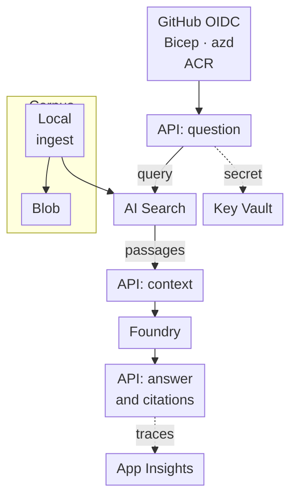

# Build a question-answering service whose citations you can check

Build an ASP.NET Core API that answers questions about three public documents and returns citations to
their original pages. Follow each request through retrieval and generation, then test it again after deployment.
This guide joins the course exercises; you write the application and infrastructure files.

This project has not been run end to end against a live Azure subscription. The C# helper and a local
API/ingestion harness were compiled, and the local checks are recorded below. Cloud checks describe
acceptance criteria, not observed results.

## Goal and architecture \{#goal-and-architecture}

Keep the first version small: one buffered `POST /ask`, a manually ingested corpus and no tool actions.
The request body is `{"question":"Which role lets an application query Search?"}`. A successful reply
contains `answer` and `citations`, with each citation shaped as `{id,title,url}`. An unsupported question
returns HTTP 200 with `answer` equal to `I cannot answer from these documents.` and an empty citation
array. A missing dependency must never produce a plausible substitute answer.



The API-labelled boxes are stages of one Container App. It assembles retrieved passages into the model request. Ingestion runs locally with developer
credentials; there is no hosted ingestion worker.
Blob snapshots are private to the storage account, while answer citations use public Microsoft Learn
URLs. Public Azure endpoints follow the [networking lab](../part-1-azure-foundations/networking.md#try-it).
Restrict HTTP ingress to your tester IP for this short lab using
[Container Apps IP restrictions](https://learn.microsoft.com/en-us/azure/container-apps/ip-restrictions).
Complete caller authentication before sharing the service more widely: downstream managed identity
does not authenticate an HTTP caller.

| Component | Service or .NET piece | Lesson |
|---|---|---|
| HTTP contract and tests | ASP.NET Core, test doubles | [Testing](../part-2-modern-dotnet/testing.md#try-it) |
| Retrieval and generation | Azure AI Search, `Microsoft.Extensions.AI`, Foundry | [RAG on Azure AI Search](../part-3-llms-on-azure/rag-on-ai-search.md#try-it) |
| Source snapshots | Blob Storage, local ingestion | [Data](../part-1-azure-foundations/data.md#try-it) |
| Runtime identity and secret reference | Managed identity, Key Vault | [Secrets and configuration](../part-1-azure-foundations/secrets-and-configuration.md#try-it) |
| Host and telemetry | Container Apps, Application Insights | [Compute](../part-1-azure-foundations/compute.md#try-it), [Evaluation and tracing](../part-3-llms-on-azure/evaluation-and-tracing.md#try-it) |
| Provisioning and delivery | Bicep, `azd`, GitHub Actions OIDC | [Pipelines to Azure](../part-4-ai-delivery/pipelines-to-azure.md#try-it) |

## Milestones \{#milestones}

### 1. Establish one resource boundary and two model deployments

One application group owns the lab. Build on [How Azure is organised](../part-1-azure-foundations/how-azure-is-organised.md#try-it),
[RBAC and keyless access](../part-1-azure-foundations/rbac-and-keyless-access.md#try-it),
[Infrastructure as code](../part-1-azure-foundations/infrastructure-as-code.md#try-it),
[Microsoft Foundry](../part-3-llms-on-azure/microsoft-foundry.md#try-it) and
[Deployments, quotas and cost](../part-3-llms-on-azure/deployments-quotas-cost.md#try-it).
Use one dedicated group, `rg-p1-rag-p1-ci`. Choose a region after checking model availability, quota and subscription
policy. Use deployment names `p1-chat-lab` and `p1-embed-lab`; record the underlying model versions.
The lesson choices, `gpt-5-mini` version `2025-08-07` and `text-embedding-3-small` version `1`, remain
listed in the [availability tables](https://learn.microsoft.com/en-us/azure/foundry/foundry-models/concepts/models-sold-directly-by-azure-region-availability);
check their [retirement schedule](https://learn.microsoft.com/en-us/azure/foundry/openai/concepts/model-retirement-schedule)
before provisioning.

Replace the IaC lesson's group-scoped entry point with this subscription-scoped `infra/main.bicep`, using
the [resource-group API](https://learn.microsoft.com/en-us/azure/templates/microsoft.resources/2022-09-01/resourcegroups):

```bicep
targetScope = 'subscription'
param environmentName string
param location string
param chatCapacity int
param embeddingCapacity int

resource appGroup 'Microsoft.Resources/resourceGroups@2022-09-01' = {
  name: 'rg-p1-rag-${environmentName}'
  location: location
  tags: {
    project: 'p1-rag'
    workload: 'p1-rag'
    environment: environmentName
    'azd-env-name': environmentName
    owner: 'learner'
  }
}
module resources './modules/p1-resources.bicep' = {
  name: 'p1-resources'
  scope: appGroup
  params: {
    location: location
    tags: appGroup.tags
    chatCapacity: chatCapacity
    embeddingCapacity: embeddingCapacity
  }
}
output AZURE_RESOURCE_GROUP string = appGroup.name
output P1_DELETION_INVENTORY string = string(resources.outputs.deletionInventory)
// Forward the remaining module outputs listed below unchanged.
```

The original wrapper compiled with [Bicep 0.48.1](https://github.com/Azure/bicep/releases/tag/v0.48.1)
against the lesson's storage-only module. The added output and extended contracts below are uncompiled;
compile them separately before provisioning. That earlier check validates no Azure deployment.

Extend `p1-resources.bicep` using these **module contracts**. All modules are group-scoped and accept `location` and common `tags`, and emit `id` and `name`; additional inputs/outputs are listed.
Use `uniqueString(resourceGroup().id)` as the shared suffix. Implement these files against the linked schemas.

| Module / pinned resource contract | Inputs and wiring | Additional outputs |
|---|---|---|
| `storage.bicep`: [Storage@2026-06-01](https://learn.microsoft.com/en-us/azure/templates/microsoft.storage/2026-06-01/storageaccounts) + [Blob container@2026-06-01](https://learn.microsoft.com/en-us/azure/templates/microsoft.storage/storageaccounts/blobservices/containers) | Move the existing Storage declaration here unchanged; add blob service `default`, child container `sources`, `publicAccess: 'None'`; set account `accessTier: 'Hot'` | `sourcesId` |
| `identity.bicep`: [userAssignedIdentities@2023-01-31](https://learn.microsoft.com/en-us/azure/templates/microsoft.managedidentity/2023-01-31/userassignedidentities) | Name `id-p1-rag-api` | `clientId`, `principalId` |
| `models.bicep`: [accounts@2025-06-01](https://learn.microsoft.com/en-us/azure/templates/microsoft.cognitiveservices/2025-06-01/accounts), [projects](https://learn.microsoft.com/en-us/azure/templates/microsoft.cognitiveservices/2025-06-01/accounts/projects), [deployments](https://learn.microsoft.com/en-us/azure/templates/microsoft.cognitiveservices/2025-06-01/accounts/deployments) at the same version | Account `kind: 'AIServices'`, SKU `S0`, system identity, unique `customSubDomainName`, `allowProjectManagement: true`, `disableLocalAuth: true`; child project `p1-rag` with system identity; child deployments use the model pins above, `format: 'OpenAI'`, SKU `GlobalStandard`; accept quota-approved `chatCapacity`, `embeddingCapacity` integers | `endpoint` = `https://<customSubDomainName>.openai.azure.com/openai/v1/` |
| `search.bicep`: [searchServices@2025-05-01](https://learn.microsoft.com/en-us/azure/templates/microsoft.search/2025-05-01/searchservices) | Unique name, SKU `free`, `disableLocalAuth: true`; omit incompatible `authOptions` | `endpoint` |
| `vault.bicep`: [vaults@2024-11-01](https://learn.microsoft.com/en-us/azure/templates/microsoft.keyvault/2024-11-01/vaults) | Unique name, tenant `tenant().tenantId`, SKU family `A`/name `standard`, `enableRbacAuthorization: true`, empty `accessPolicies` | `vaultUri` |
| `registry.bicep`: [registries@2025-11-01](https://learn.microsoft.com/en-us/azure/templates/microsoft.containerregistry/2025-11-01/registries) | Unique alphanumeric name, SKU `Basic`, `adminUserEnabled: false`, `roleAssignmentMode: 'LegacyRegistryPermissions'` | `loginServer` |
| `telemetry.bicep`: [workspaces@2023-09-01](https://learn.microsoft.com/en-us/azure/templates/microsoft.operationalinsights/2023-09-01/workspaces) + [components@2020-02-02](https://learn.microsoft.com/en-us/azure/templates/microsoft.insights/2020-02-02/components) | Workspace SKU `PerGB2018`; Insights `kind: 'web'`, `Application_Type: 'web'`, `WorkspaceResourceId: workspace.id` | `workspaceName`, `workspaceId`, `connectionString` |
| `host.bicep`: [managedEnvironments@2025-01-01](https://learn.microsoft.com/en-us/azure/templates/microsoft.app/2025-01-01/managedenvironments) | Accept `workspaceName`; reference that existing workspace and wire `appLogsConfiguration.destination: 'log-analytics'` and `logAnalyticsConfiguration: {customerId: workspace.properties.customerId, sharedKey: workspace.listKeys().primarySharedKey}`; workload profile name/type `Consumption` | Environment `id`, `name` |

In `p1-resources.bicep`, declare/forward both capacity parameters to `models`. Use module symbols matching filenames; pass `telemetry.outputs.workspaceName` to `host`, which creates an
implicit dependency:

```bicep
module telemetry './telemetry.bicep' = {
  name: 'telemetry'
  params: { location: location, tags: tags }
}
module host './host.bicep' = {
  name: 'host'
  params: {
    location: location
    tags: tags
    workspaceName: telemetry.outputs.workspaceName
  }
}
```

Within modules, use `parent: account` for project/deployments and symbolic workspace
references for Insights. Deploy the chat and embedding resources sequentially if the provider rejects
concurrent account updates. Forward every output in the settings table in milestone 5 **from this first
provision**, including the future app name `ca-p1-rag-api`. Globally unique names use the suffix. Export this additional parent output using those module symbols:

```bicep
output deletionInventory object = {
  subscription: subscription().subscriptionId
  group: resourceGroup().name
  vault: { name: vault.outputs.name, id: vault.outputs.id, location: location }
  foundry: { name: models.outputs.name, id: models.outputs.id, location: location }
  workspace: { name: telemetry.outputs.workspaceName, id: telemetry.outputs.workspaceId }
}
```

Create role assignments after provisioning, once `artifacts/` exists, before ingestion or API deployment. Use the following
matrix with the [role-assignment command](https://learn.microsoft.com/en-us/cli/azure/role/assignment?view=azure-cli-latest);
`scope` is the emitted resource ID, never the application group for data roles. The operator is the
signed-in developer; the runtime principal is `identity.principalId`. Save assignment IDs in the inventory.

| Principal | Role | Scope |
|---|---|---|
| Runtime | [Search Index Data Reader](https://learn.microsoft.com/en-us/azure/search/search-security-rbac) | Search service |
| Runtime and operator, separately | [Foundry User](https://learn.microsoft.com/en-us/azure/foundry/concepts/rbac-foundry), `53ca6127-db72-4b80-b1b0-d745d6d5456d` | Foundry account |
| Runtime | [Key Vault Secrets User](https://learn.microsoft.com/en-us/azure/key-vault/general/rbac-guide) | Vault |
| Runtime | AcrPull | Registry |
| Operator | [Storage Blob Data Contributor](https://learn.microsoft.com/en-us/azure/role-based-access-control/built-in-roles/storage) | `sources` container |
| Operator | Search Service Contributor; Search Index Data Contributor, separately | Search service |
| Operator | Key Vault Secrets Officer | Vault |

For each row, substitute its principal, role and scope, then run:

```bash
az role assignment create --assignee-object-id '<principal-id>' \
  --assignee-principal-type '<User-or-ServicePrincipal>' \
  --role '<role-name-or-id>' --scope '<resource-id>' \
  --query id --output tsv >> artifacts/data-role-ids.txt
```

Persist each returned ID before continuing; verify access after RBAC propagation. Runtime receives no Blob role because its request path reads Search. Keep Storage Shared Key and anonymous access disabled and
service authentication keyless, as in [Enterprise AI](../part-3-llms-on-azure/enterprise-ai.md#try-it).

In `infra/main.parameters.json`, bind `environmentName` to `${AZURE_ENV_NAME}` and `location` to
`${AZURE_LOCATION}`; bind `chatCapacity`/`embeddingCapacity` to `${P1_CHAT_CAPACITY}`/`${P1_EMBED_CAPACITY}`
using the [azd parameter convention](https://learn.microsoft.com/en-us/azure/developer/azure-developer-cli/explore-edit-templates).
Add an `azure.yaml` named `p1-rag` with the service mapping below; provisioning the foundation does not
require deploying that service yet.

```yaml
name: p1-rag
services:
  api:
    project: ./src/Rag.Api
    language: csharp
    host: containerapp
    module: api
```

After completing the module, use Bash to select the subscription and region, compile, preview and provision.
The [Bicep CLI](https://learn.microsoft.com/en-us/cli/azure/bicep?view=azure-cli-latest) and
[azd reference](https://learn.microsoft.com/en-us/azure/developer/azure-developer-cli/reference)
define these commands. Replace both placeholders before running:

```bash
az login
az account set --subscription '<subscription-id>'
azd auth login
azd env new p1-ci --subscription '<subscription-id>' --location '<chosen-region>'
read -r -p 'Quota-approved chat capacity: ' chat_capacity
read -r -p 'Quota-approved embedding capacity: ' embed_capacity
azd env set P1_CHAT_CAPACITY "$chat_capacity" --environment p1-ci
azd env set P1_EMBED_CAPACITY "$embed_capacity" --environment p1-ci
az bicep build --file infra/main.bicep --stdout
azd provision --environment p1-ci --preview
# Inspect the preview before running the next command.
mkdir -p artifacts
# Save a recovery boundary even if provisioning only partly succeeds.
az account show --query '{subscription:id}' --output json |
  jq '. + {group:"rg-p1-rag-p1-ci"}' > artifacts/p1-cleanup.json
azd provision --environment p1-ci
azd env get-value P1_DELETION_INVENTORY --environment p1-ci \
  > artifacts/p1-cleanup.json.tmp
jq -e . artifacts/p1-cleanup.json.tmp > /dev/null
mv artifacts/p1-cleanup.json.tmp artifacts/p1-cleanup.json
az resource list --resource-group rg-p1-rag-p1-ci --output json \
  > artifacts/p1-resources.json
```

Preserve deployment history for `azd env refresh`; map [environment values](https://learn.microsoft.com/en-us/azure/developer/azure-developer-cli/work-with-environments) to app settings explicitly.

**Check:** inspect provisioning, role assignments and saved deletion identifiers before moving on.
Verify the environment discovery tag with
`az group list --tag azd-env-name=p1-ci --query '[].name' --output tsv`;
expect this lab's group ([discovery convention](https://learn.microsoft.com/en-us/azure/developer/azure-developer-cli/tooling-environment-faq#how-does-azd-find-the-azure-resource-to-deploy-my-code-to)). After a failed partial provision, retain the saved boundary and use teardown's
recovery step. No inference has been checked yet.

### 2. Make the local HTTP boundary testable

Make the local API testable. Join [.NET platform](../part-2-modern-dotnet/dotnet-platform.md#try-it),
[ASP.NET Core](../part-2-modern-dotnet/aspnet-core.md#try-it),
[Extensions backbone](../part-2-modern-dotnet/extensions-backbone.md#try-it) and
[Testing](../part-2-modern-dotnet/testing.md#try-it). Integrate their exercises into `RagService.slnx`
and `src/Rag.Api/Rag.Api.csproj`; move the test fixture into this solution instead of maintaining a
second API. Retain SDK `10.0.402`, runtime `10.0.13`, `net10.0`, disabled SDK roll-forward and package
lock files. These pins match the [.NET download](https://dotnet.microsoft.com/en-us/download/dotnet/10.0).

Keep the `question` field. Reject blank input or more than 2,000 characters with HTTP 400; the initial
valid-request stub returns 503. Then retain the fixed-document/model-double tests while adding the
completed answer contract. Carry cancellation and deadlines from
[Async, streaming and cancellation](../part-2-modern-dotnet/async-streaming-cancellation.md#try-it)
through every dependency call; keep this baseline buffered.

**Check:** run [restore](https://learn.microsoft.com/en-us/dotnet/core/tools/dotnet-restore),
[build](https://learn.microsoft.com/en-us/dotnet/core/tools/dotnet-build) and
[VSTest](https://learn.microsoft.com/en-us/dotnet/core/tools/dotnet-test-vstest):

```bash
dotnet restore RagService.slnx --locked-mode
dotnet build RagService.slnx -c Release --no-restore
dotnet test RagService.slnx -c Release --no-build
```

Inspect discovered
tests and responses: validation fails before a model call, and the fixed-document answer has `doc-1`
as its citation. Azure credentials must not be required by these tests.

### 3. Turn public snapshots into searchable chunks

The ingestion checkpoint ends with searchable passages. Build on [Data](../part-1-azure-foundations/data.md#try-it) and
[RAG on Azure AI Search](../part-3-llms-on-azure/rag-on-ai-search.md#try-it). Save small snapshots of
the official [Search role matrix](https://learn.microsoft.com/en-us/azure/search/search-security-rbac),
[Search role configuration](https://learn.microsoft.com/en-us/azure/search/search-security-enable-roles)
and [Container Apps managed identity](https://learn.microsoft.com/en-us/azure/container-apps/managed-identity)
pages under `corpus/`. Use a manifest array with `{id,file,title,url,retrievedAt,heading}` per passage.
Record it in `corpus/manifest.json`. Split by heading
into short passages and assign stable `doc-N` IDs; preserve their title and public `sourceUrl`.

Upload the Markdown snapshots to `sources` using
[Entra-authenticated Blob operations](https://learn.microsoft.com/en-us/azure/storage/blobs/authorize-data-operations-cli):

```bash
read -r -p 'Storage account from the inventory: ' storage
az storage blob upload-batch --account-name "$storage" --destination sources \
  --source corpus --pattern '*.md' --auth-mode login
```

Create the console entry point `tools/Rag.Ingest/Rag.Ingest.csproj` using the lesson's embedding and
[Search upload](https://learn.microsoft.com/en-us/dotnet/api/azure.search.documents.searchclient.uploaddocumentsasync?view=azure-dotnet)
clients. Implement `--manifest`, `--index` and `--out`: read the manifest/local passages, create or update
the index, embed, upload, and write `{id,succeeded,errorMessage}` results. Exit nonzero for any failure.
Use the operator grants from milestone 1. The underlying retrieval choices are explained in
[Retrieval](/rag-agents/part-1-rag/retrieval/).

Create `public-docs` from the lesson schema, replacing its synthetic three-dimensional vectors with
real embeddings and `contentVector` dimensions `1536`. Verify every embedding's length and use the
same model/version/dimensions for queries; the [index contract](https://learn.microsoft.com/en-us/azure/search/vector-search-how-to-create-index)
requires matching dimensions. Save the index definition as `infra/search-index.json` and ingestion
results as `artifacts/ingestion.json`.

Run with the same `AI`/`Rag` settings listed below:

```bash
dotnet run --project tools/Rag.Ingest -- \
  --manifest corpus/manifest.json --index infra/search-index.json \
  --out artifacts/ingestion.json
jq -e 'length > 0 and all(.[]; .succeeded == true)' artifacts/ingestion.json
```

**Check:** retrieve a known manifest ID and its text.
Require a hybrid query to return selected source fields. There is no promised ranking or score.

### 4. Join retrieval to generation and validate citations

An answer now needs retrieved evidence and validated citations. Join [AI in .NET](../part-2-modern-dotnet/ai-in-dotnet.md#try-it),
[RAG on Azure AI Search](../part-3-llms-on-azure/rag-on-ai-search.md#try-it),
[Platform safety](../part-3-llms-on-azure/platform-safety.md#try-it) and the citation task in
[Coding agents for .NET](../part-4-ai-delivery/coding-agents-dotnet.md#try-it).
Retain their exact package pins: [Azure.Identity `1.21.0`](https://www.nuget.org/packages/Azure.Identity/1.21.0),
[OpenAI `2.14.0`](https://www.nuget.org/packages/OpenAI/2.14.0),
[Microsoft.Extensions.AI `10.11.0`](https://www.nuget.org/packages/Microsoft.Extensions.AI/10.11.0),
[its OpenAI adapter `10.11.0`](https://www.nuget.org/packages/Microsoft.Extensions.AI.OpenAI/10.11.0) and
[Azure.Search.Documents `12.0.0`](https://www.nuget.org/packages/Azure.Search.Documents/12.0.0). Preserve the lesson's narrowly
scoped `OPENAI001` suppression when constructing the bearer-token client.

Add this retrieval helper as `src/Rag.Api/P1Retrieval.cs`. The
[`GenerateVectorAsync`](https://learn.microsoft.com/en-us/dotnet/api/microsoft.extensions.ai.embeddinggeneratorextensions.generatevectorasync?view=net-10.0-pp)
and [`VectorizedQuery`](https://learn.microsoft.com/en-us/dotnet/api/azure.search.documents.models.vectorizedquery?view=azure-dotnet)
APIs connect the two SDKs; `k=5` and response size 3 are exercise choices.

```csharp
using Azure.Search.Documents;
using Azure.Search.Documents.Models;
using Microsoft.Extensions.AI;

public static class P1Retrieval
{
    public static async Task<List<SearchDocument>> FindAsync(
        SearchClient search,
        IEmbeddingGenerator<string, Embedding<float>> embeddings,
        string question,
        CancellationToken cancellationToken)
    {
        var vector = await embeddings.GenerateVectorAsync(
            question, cancellationToken: cancellationToken);
        if (vector.Length != 1536)
            throw new InvalidOperationException("Embedding dimensions changed.");

        var options = new SearchOptions
        {
            Size = 3,
            Select = { "id", "title", "content", "sourceUrl" },
            SearchFields = { "title", "content" },
            VectorSearch = new VectorSearchOptions
            {
                Queries =
                {
                    new VectorizedQuery(vector)
                    {
                        KNearestNeighborsCount = 5,
                        Fields = { "contentVector" }
                    }
                }
            }
        };
        var response = await search.SearchAsync<SearchDocument>(
            question, options, cancellationToken);
        var documents = new List<SearchDocument>();
        await foreach (var result in response.Value.GetResultsAsync()
            .WithCancellation(cancellationToken))
            documents.Add(result.Document);
        return documents;
    }
}
```

The C# helper above was built unchanged in a minimal project and in a local API/ingestion harness with
.NET SDK 10.0.402, .NET and ASP.NET Core 10.0.13, Azure.Identity 1.21.0, OpenAI 2.14.0,
Microsoft.Extensions.AI 10.11.0, Microsoft.Extensions.AI.OpenAI 10.11.0, Azure.Search.Documents 12.0.0
and Microsoft.OpenTelemetry 1.2.0 on 2026-10-19. Locked restore, Release build and 13 local tests passed.
The local API started; ingestion and `/ask` with the real adapters failed at credential acquisition.
Replay and five-row capture passed with local test doubles. These checks used a scratch implementation
of the capstone tasks; no Azure calls, deployment, export or evaluation were run against a live subscription.

Assemble context with `[doc-N]` labels and instruct the model to answer only from those passages.
Validate markers against retrieved IDs, then construct `{id,title,url}` from those same selected Search
fields (`sourceUrl` becomes `url`). Only the ingestion operator writes this lab index; validate manifest
URLs at ingestion. The API needs no runtime manifest or Blob access ([selected fields](https://learn.microsoft.com/en-us/azure/search/search-query-create)). See
[Generation](/rag-agents/part-1-rag/generation/) for citation and faithfulness limits. Require an allowed citation for an answer; use the refusal when none is supplied.
Preserve the lesson's empty HTTP 502 for an invented citation ID. If retrieval is empty or
evidence is insufficient, use the fixed refusal. Keep safety blocks, failed safety execution and dependency
failures distinct using the safety lesson's problem contracts; do not return exception details.

**Check:** preserve positive, negative and mixed-citation tests. Create `fixtures/ask.jsonl` with five
cases shaped as below, choosing expected IDs after inspecting your snapshots. This refusal example is an
expected contract, not a recorded model result:

```json
{"name":"outside-corpus","question":"What is the weather tomorrow?","refusal":true,"allowedIds":[]}
```

For that request, `POST /ask` with `Content-Type: application/json` and body
`{"question":"What is the weather tomorrow?"}` must return HTTP 200 with
`{"answer":"I cannot answer from these documents.","citations":[]}`.
For answerable cases set `refusal:false` and `allowedIds:["doc-1"]` (use your actual IDs).
Save this as `scripts/replay.sh`; it uses [curl](https://curl.se/docs/manpage.html) to check status, shape, citation IDs and metadata without fixing generated wording:

```bash
#!/usr/bin/env bash
set -euo pipefail
base=${1:?Pass the API base URL}
mkdir -p artifacts/replay
while IFS= read -r case; do
  name=$(jq -r .name <<< "$case")
  output="artifacts/replay/$name.json"
  code=$(jq '{question}' <<< "$case" | curl -sS -o "$output" -w '%{http_code}' \
    -H "X-Eval-Case-Id: $name" \
    -H 'Content-Type: application/json' --data-binary @- "$base/ask")
  test "$code" = 200
  jq -e --argjson c "$case" --slurpfile m corpus/manifest.json '
    (.answer | type == "string") and (.citations | type == "array") and
    (if $c.refusal then
       .answer == "I cannot answer from these documents." and .citations == []
     else (.answer | length > 0) and (.citations | length > 0) and
       all(.citations[]; . as $x |
         ($c.allowedIds | index($x.id)) != null and
         any($m[0][]; .id == $x.id and .title == $x.title and .url == $x.url))
     end)' "$output"
done < fixtures/ask.jsonl
```

Start the local API with [`dotnet run`](https://learn.microsoft.com/en-us/dotnet/core/tools/dotnet-run): `dotnet run --project src/Rag.Api --no-launch-profile --urls http://localhost:5080`
and run `bash scripts/replay.sh http://localhost:5080` in another terminal with Azure configuration loaded.

### 5. Deploy the API with identity, settings and traces

Deployment should preserve the same HTTP contract. Apply [Compute](../part-1-azure-foundations/compute.md#try-it),
[Secrets and configuration](../part-1-azure-foundations/secrets-and-configuration.md#try-it),
[Containers and Aspire](../part-2-modern-dotnet/containers-and-aspire.md#try-it) and
[Observability](../part-1-azure-foundations/observability.md#try-it). Choose [revision-based azd deployment](https://learn.microsoft.com/en-us/azure/developer/azure-developer-cli/container-apps-workflows#revision-based-deployment-strategy):
`infra/main.bicep` provisions only the foundation; `infra/api.bicep` declares the app at deploy time.
The first `azd deploy` builds/pushes the real API image and supplies `SERVICE_API_IMAGE_NAME`; no initial
placeholder is needed. Reprovisioning the foundation never resets the app image. Put app settings,
probes and image in that service module, with [Container App API `2025-01-01`](https://learn.microsoft.com/en-us/azure/templates/microsoft.app/2025-01-01/containerapps):
Consumption, minimum 0/maximum 1 replica, initially 0.25 vCPU/0.5 GiB, target port 8080, explicit
liveness/readiness routes matching your API and a `testerCidr` Allow ingress rule. Tag it `azd-service-name=api` for
[azd discovery](https://learn.microsoft.com/en-us/azure/developer/azure-developer-cli/container-apps-workflows).
Attach `id-p1-rag-api`, configure registry authentication with its resource ID and grant
[`AcrPull`](https://learn.microsoft.com/en-us/azure/container-apps/managed-identity-image-pull).

Use `DefaultAzureCredential` locally; in Azure explicitly select
[`ManagedIdentityCredential`](https://learn.microsoft.com/en-us/dotnet/azure/sdk/authentication/user-assigned-managed-identity)
by client ID. Grant Key Vault Secrets User to its principal ID. An authorised operator with Secrets
Officer seeds a synthetic `p1-integration-marker`; configure a Container App secret using its
`keyVaultUrl` and identity resource ID, then an environment `secretRef`. Check presence without
returning the value. This exercises [Key Vault delivery](https://learn.microsoft.com/en-us/azure/container-apps/manage-secrets)
without introducing API keys for Azure services.

Forward these outputs from milestone 1; map settings explicitly and use them locally; remove the backbone
exercise's duplicate `Rag:DeploymentName` property/validation in favour of validated `AI` options.

| Bicep output | Application setting or purpose |
|---|---|
| `AI_ENDPOINT` | `AI__Endpoint`, actual `/openai/v1/` endpoint |
| `AI_CHAT_DEPLOYMENT`, `AI_EMBEDDING_DEPLOYMENT` | `AI__ChatDeployment`, `AI__EmbeddingDeployment` |
| `SEARCH_ENDPOINT`, `SEARCH_INDEX_NAME` | `Rag__SearchEndpoint`, `Rag__IndexName=public-docs` |
| `API_IDENTITY_CLIENT_ID` | Runtime credential selector |
| `APPLICATIONINSIGHTS_CONNECTION_STRING` | Same-named exporter setting |
| `AZURE_CONTAINER_REGISTRY_ENDPOINT`, `AZURE_CONTAINER_REGISTRY_NAME` | `azd` image build/push |
| `AZURE_RESOURCE_GROUP`, `AZURE_CONTAINER_APP_NAME` | Resource discovery and checks |
| `STORAGE_ACCOUNT_NAME`, `KEY_VAULT_NAME`, `FOUNDRY_NAME`, `LOG_WORKSPACE_NAME` | Ingestion and deletion inventory |
| `AZURE_CONTAINER_ENVIRONMENT_NAME`, `SERVICE_API_IDENTITY_ID` | Deploy-time resource references |
| `P1_DELETION_INVENTORY` | JSON names/IDs/locations, saved at first provision |

Map `infra/api.parameters.json` below, extending it with the settings table and `testerCidr`.
Declare matching string parameters in `api.bicep`; reference existing resources:

```json
{
  "$schema": "https://schema.management.azure.com/schemas/2019-04-01/deploymentParameters.json#",
  "contentVersion": "1.0.0.0",
  "parameters": {
    "environmentName": {"value":"${AZURE_ENV_NAME}"},
    "location": {"value":"${AZURE_LOCATION}"},
    "containerRegistryName": {"value":"${AZURE_CONTAINER_REGISTRY_NAME}"},
    "containerAppsEnvironmentName": {"value":"${AZURE_CONTAINER_ENVIRONMENT_NAME}"},
    "identityId": {"value":"${SERVICE_API_IDENTITY_ID}"},
    "imageName": {"value":"${SERVICE_API_IMAGE_NAME}"},
    "testerCidr": {"value":"${P1_TESTER_CIDR}"},
    "aiEndpoint": {"value":"${AI_ENDPOINT}"},
    "chatDeployment": {"value":"${AI_CHAT_DEPLOYMENT}"},
    "embeddingDeployment": {"value":"${AI_EMBEDDING_DEPLOYMENT}"},
    "searchEndpoint": {"value":"${SEARCH_ENDPOINT}"},
    "indexName": {"value":"${SEARCH_INDEX_NAME}"},
    "clientId": {"value":"${API_IDENTITY_CLIENT_ID}"},
    "insightsConnectionString": {"value":"${APPLICATIONINSIGHTS_CONNECTION_STRING}"},
    "vaultName": {"value":"${KEY_VAULT_NAME}"}
  }
}
```

Set `containers[0].image: imageName`, `configuration.activeRevisionsMode: 'Single'` and baseline ingress
traffic `[{latestRevision:true,weight:100}]`. Use the settings table to build the container `env` array;
map `API_IDENTITY_CLIENT_ID` to the credential configuration your application reads. Supply the registry
login server and `identityId` in `configuration.registries`; attach that same ID under
`identity.userAssignedIdentities`. App tags merge the common tags with `'azd-service-name': 'api'`.
Do not include `api.bicep` as a module in `main.bicep`.

Set `P1_TESTER_CIDR` with `azd env set P1_TESTER_CIDR '<your-public-ip>/32' --environment p1-ci`.

Before packaging, integrate the
[Evaluation and tracing](../part-3-llms-on-azure/evaluation-and-tracing.md#try-it) instrumentation with
[Microsoft.OpenTelemetry `1.2.0`](https://www.nuget.org/packages/Microsoft.OpenTelemetry/1.2.0):
one `P1.ModelCalls` path, sensitive data disabled, no overlapping Aspire export. Keep the telemetry
resources inside this application group. Run `azd deploy --environment p1-ci` with this instrumented API;
repeat provisioning only when foundation definitions change.

**Check:** require a healthy revision and working probes. Verify service discovery with
`az resource list -g rg-p1-rag-p1-ci --tag azd-service-name=api --query '[].name' -o tsv`;
expect `ca-p1-rag-api`. Run `bash scripts/replay.sh https://<app-fqdn>` from the allowed tester IP.
Its manifest comparison also checks deployed citation metadata, despite the container having no manifest. Follow a request
trace through search and model calls in Application Insights; check that routine telemetry contains no
raw passages or questions. Refresh the resource inventory after provisioning.

### 6. Capture five answers and inspect their evaluation

Five saved responses make evaluation inspectable. Follow [Evaluation and tracing](../part-3-llms-on-azure/evaluation-and-tracing.md#try-it). Run the
same API locally in Development with `P1_CAPTURE_EVAL=1`; send five sequential fixture requests using
`question`, via `bash scripts/replay.sh http://localhost:5080`. The script sends each fixture's name as
`X-Eval-Case-Id`, required by the linked capture block. Start with an empty capture file.
The evaluation principles live in [Evaluation](/rag-agents/part-1-rag/cross-cutting/evaluation/). Capture the final question as JSONL `query`, the
returned answer as `response` and the exact supplied passages as `context` in `p1-eval.jsonl`. Keep
case/trace IDs and release, prompt, index and deployment versions alongside it.

Use the existing Foundry project and an authorised judge deployment for the lesson's Groundedness and
Relevance run, following the [portal evaluation workflow](https://learn.microsoft.com/en-us/azure/foundry/how-to/evaluate-generative-ai-app).
Keep capture disabled in Azure. **Check:** require five well-formed rows, inspect every
answer yourself, then compare individual evaluation results and failures. A completed job and five cases
check the integration; they do not establish production quality.
[Judge tokens add consumption](https://azure.microsoft.com/en-us/pricing/details/foundryobservability/).

### 7. Deliver through OIDC and rehearse rollback

Continue [Pipelines to Azure](../part-4-ai-delivery/pipelines-to-azure.md#try-it) and
[Releasing safely](../part-4-ai-delivery/releasing-safely.md#try-it). Reuse the SHA-pinned workflow,
updating paths to this solution. Provision resources and RBAC as an administrator first; the workflow
runs `azd deploy`, not provisioning. Create its dedicated `p1-delivery` identity in
`rg-p1-delivery-lab`. Grant application-group Contributor, registry AcrPush and subscription Reader
for deployment discovery. Record each role-assignment ID immediately in `artifacts/delivery-role-ids.txt`.

Inspect the actual GitHub issuer, subject and audience before creating federation. Configure the GitHub
`p1-ci` environment's variables and approval rule separately from the `azd` environment. The workflow
repackages the source during deployment; it does not promote an identical tested image.

**Check:** a PR runs tests without deploying; an eligible main run waits at the configured approval
boundary. After deployment, replay fixtures and inspect traces. Follow the release lesson's candidate
checks, brief 90/10 split and rollback to the known-good revision, then deactivate the candidate.
Use candidate deactivation for incremental cleanup and teardown below for complete deletion.
After normal Single-mode deployment, temporarily switch to Multiple
using the release exercise, create the candidate and assign explicit revision weights. Run no `azd deploy`
during the split: the service template resets Single/100%. Restore the known-good image and baseline
configuration before the next deployment. Foundation provisioning leaves app revisions untouched.

## Cost \{#cost}

Use the [course budget](../intro.md#budget), inspect regional meters before provisioning and delete the
lab after the exercise. Free-account offers depend on eligibility and time; recurring free-tier allowances differ. A scaled-to-zero API still leaves registry and other resources.
There is no measured project total or guaranteed monthly price here.

| Resource / tier | Meter | Applicable allowance | Bill driver / live pricing |
|---|---|---|---|
| Container Apps Consumption | vCPU-seconds, GiB-seconds, requests | Per subscription/month: 180,000 vCPU-s, 360,000 GiB-s, 2 million requests | Replica time, memory and traffic; [pricing](https://azure.microsoft.com/en-us/pricing/details/container-apps/) |
| Azure AI Search Free | Shared service | One/subscription; 50 MB, three indexes; no semantic ranker | Free service; paid tiers introduce capacity charges; [tiers](https://learn.microsoft.com/en-us/azure/search/search-sku-tier), [pricing](https://azure.microsoft.com/en-us/pricing/details/search/) |
| Foundry Global Standard models | Input/output tokens; embedding input tokens | No standing token grant assumed | Ingestion, queries, answers and judge calls; [model pricing](https://azure.microsoft.com/en-us/pricing/details/ai-foundry-models/aoai/) |
| Blob Hot, Standard LRS | GB-month, operations, transfer | Eligible new-account 12-month offer: 5 GB, 20,000 reads and 10,000 writes/month | Snapshots, operations and transfer; [pricing](https://azure.microsoft.com/en-us/pricing/details/storage/blobs/), [offer table](https://azure.microsoft.com/en-au/pricing/free-services) |
| Key Vault Standard | Secret operations per 10,000 | Eligible new-account 12-month offer: 10,000 Standard secret/RSA-2048 operations/month | Secret retrieval/refresh; [pricing](https://azure.microsoft.com/en-us/pricing/details/key-vault/), [offer table](https://azure.microsoft.com/en-au/pricing/free-services) |
| ACR Basic | Registry-day, additional storage/build/transfer | Includes 10 GB; no applicable always-free grant. The eligible 12-month Standard offer is a different tier | Registry persists at API scale zero; [pricing](https://azure.microsoft.com/en-us/pricing/details/container-registry/), [account offer](https://azure.microsoft.com/en-us/pricing/purchase-options/azure-account) |
| Application Insights / Log Analytics Analytics PAYG | Ingested GB, retained GB-month | First 5 GB/month per billing account; Application Insights data includes 90-day retention | Trace volume, retention and other workspace data; [Monitor pricing](https://azure.microsoft.com/en-us/pricing/details/monitor/) |
| Managed identities, ARM | Identity/control plane | No additional identity charge; ARM always free | Connected services retain their own meters; [identity](https://learn.microsoft.com/en-us/entra/identity/managed-identities-azure-resources/overview), [account table](https://azure.microsoft.com/en-us/pricing/purchase-options/azure-account) |

## Teardown \{#teardown}

Disable workflows and stop ingestion, requests and evaluation. Run this Bash script as the original
administrator with `az` and `jq`. It reads `artifacts/p1-cleanup.json`, saved at the first provision;
no milestone-5 outputs or live resource `show` calls are required. While the group exists, it refreshes
that inventory, covering partial provisioning too. Inspect the saved names before deletion.

The [workspace permanent-delete step](https://learn.microsoft.com/en-us/azure/azure-monitor/logs/delete-workspace)
runs before group deletion. [Foundry](https://learn.microsoft.com/en-us/azure/ai-services/recover-purge-resources?tabs=azure-cli)
and [vault](https://learn.microsoft.com/en-us/azure/key-vault/general/soft-delete-overview) purges then use saved
IDs and locations. If a purge fails, resolve privileges or wait for purge protection to expire and rerun
the same script; it skips absent live groups. Already soft-deleted workspaces must be recovered before
permanent deletion. The existing subscription budget is retained.

```bash
#!/usr/bin/env bash
set -euo pipefail
inventory=artifacts/p1-cleanup.json
subscription=$(jq -er .subscription "$inventory")
group=$(jq -er .group "$inventory")
delivery_group=rg-p1-delivery-lab
az account set --subscription "$subscription"
test "$group" = rg-p1-rag-p1-ci

if [[ $(az group exists --name "$group") == true ]]; then
  az resource list --resource-group "$group" --output json > artifacts/p1-live.json
  jq --slurpfile live artifacts/p1-live.json '
    def item($t): first($live[0][] | select((.type|ascii_downcase) == $t) |
      {name,id,location}) // null;
    .vault = (item("microsoft.keyvault/vaults") // .vault) |
    .foundry = (item("microsoft.cognitiveservices/accounts") // .foundry) |
    .workspace = (item("microsoft.operationalinsights/workspaces") // .workspace)
  ' "$inventory" > "$inventory.tmp"
  mv "$inventory.tmp" "$inventory"
  cat "$inventory"
  workspace=$(jq -r 'first(.[] | select((.type|ascii_downcase) ==
    "microsoft.operationalinsights/workspaces") | .name) // empty' artifacts/p1-live.json)
  if [[ -n "$workspace" ]]; then
    az monitor log-analytics workspace delete --resource-group "$group" \
      --workspace-name "$workspace" --force true --yes
  fi
fi

# Saved grant IDs survive deletion of the delivery identity/group.
if [[ -f artifacts/delivery-role-ids.txt ]]; then
  az role assignment list --all --output json > artifacts/current-roles.json
  while IFS= read -r assignment; do
    [[ -n "$assignment" ]] || continue
    if jq -e --arg id "$assignment" 'any(.[]; .id == $id)' \
      artifacts/current-roles.json > /dev/null; then
      az role assignment delete --ids "$assignment"
    fi
  done < artifacts/delivery-role-ids.txt
fi
if [[ $(az group exists --name "$delivery_group") == true ]]; then
  az group delete --name "$delivery_group" --yes
fi
if [[ $(az group exists --name "$group") == true ]]; then
  az group delete --name "$group" --yes
fi

vault_id=$(jq -r '.vault.id // empty' "$inventory")
foundry_id=$(jq -r '.foundry.id // empty' "$inventory")
az keyvault list-deleted --output json > artifacts/deleted-vaults.json
az cognitiveservices account list-deleted --output json > artifacts/deleted-foundry.json
if [[ -n "$vault_id" ]] && jq -e --arg id "$vault_id" \
  'any(.[]; (.properties.vaultId|ascii_downcase) == ($id|ascii_downcase))' \
  artifacts/deleted-vaults.json > /dev/null; then
  az keyvault purge --name "$(jq -r .vault.name "$inventory")" \
    --location "$(jq -r .vault.location "$inventory")"
fi
if [[ -n "$foundry_id" ]] && jq -e --arg id "$foundry_id" \
  'any(.[]; (.id|ascii_downcase) == ($id|ascii_downcase))' \
  artifacts/deleted-foundry.json > /dev/null; then
  az cognitiveservices account purge --name "$(jq -r .foundry.name "$inventory")" \
    --resource-group "$group" --location "$(jq -r .foundry.location "$inventory")"
fi
# Refresh after purge; a failure here means cleanup is still incomplete.
az keyvault list-deleted --output json > artifacts/deleted-vaults-after.json
az cognitiveservices account list-deleted --output json > artifacts/deleted-foundry-after.json
jq -e --arg id "$vault_id" \
  'all(.[]; (.properties.vaultId|ascii_downcase) != ($id|ascii_downcase))' \
  artifacts/deleted-vaults-after.json
jq -e --arg id "$foundry_id" \
  'all(.[]; (.id|ascii_downcase) != ($id|ascii_downcase))' \
  artifacts/deleted-foundry-after.json
test "$(az group exists --name "$group")" = false
test "$(az group exists --name "$delivery_group")" = false
if [[ -f artifacts/delivery-role-ids.txt ]]; then
  az role assignment list --all --output json > artifacts/remaining-roles.json
  while IFS= read -r assignment; do
    [[ -z "$assignment" ]] || jq -e --arg id "$assignment" \
      'all(.[]; .id != $id)' artifacts/remaining-roles.json
  done < artifacts/delivery-role-ids.txt
fi
echo 'Owned groups, saved delivery grants and owned soft deletes are absent.'
```

Remove GitHub environment configuration afterwards. Retain source, fixtures and inventory as learning artefacts. Review Cost Management after usage
records arrive; group absence establishes resource deletion, not an immediate final invoice.

## What you can explain afterwards \{#what-you-can-explain-afterwards}

- Why do runtime, ingestion and delivery need different identities and roles?
- How do the model version and embedding dimensions constrain an index update?
- What does hybrid retrieval combine, and why are `k` and returned result count different?
- How do you reject invented citations without claiming that every cited statement is correct?
- Which request failures produce a refusal, a dependency problem or the empty citation-error response?
- What do five evaluated answers and a successful deployment each prove?
- Which resources still cost money when the API has no replicas, and which deletion states remain recoverable?

## Sources \{#sources}

Verified as of 2026-10-19.

- [.NET 10 downloads](https://dotnet.microsoft.com/en-us/download/dotnet/10.0)
- [Resource-group Bicep API](https://learn.microsoft.com/en-us/azure/templates/microsoft.resources/2022-09-01/resourcegroups) and [Bicep CLI](https://learn.microsoft.com/en-us/cli/azure/bicep?view=azure-cli-latest)
- [Foundry resource configuration](https://learn.microsoft.com/en-us/azure/foundry/how-to/upgrade-azure-openai) and [OpenAI v1 endpoint formats](https://learn.microsoft.com/en-us/azure/foundry/openai/api-version-lifecycle)
- [Foundry RBAC](https://learn.microsoft.com/en-us/azure/foundry/concepts/rbac-foundry)
- [Model availability](https://learn.microsoft.com/en-us/azure/foundry/foundry-models/concepts/models-sold-directly-by-azure-region-availability) and [retirement schedule](https://learn.microsoft.com/en-us/azure/foundry/openai/concepts/model-retirement-schedule)
- [Search RBAC](https://learn.microsoft.com/en-us/azure/search/search-security-rbac), [role configuration](https://learn.microsoft.com/en-us/azure/search/search-security-enable-roles), [vector indexes](https://learn.microsoft.com/en-us/azure/search/vector-search-how-to-create-index) and [hybrid queries](https://learn.microsoft.com/en-us/azure/search/hybrid-search-how-to-query)
- [azd Container Apps deployment strategies](https://learn.microsoft.com/en-us/azure/developer/azure-developer-cli/container-apps-workflows), [resource discovery](https://learn.microsoft.com/en-us/azure/developer/azure-developer-cli/tooling-environment-faq#how-does-azd-find-the-azure-resource-to-deploy-my-code-to) and [traffic splitting](https://learn.microsoft.com/en-us/azure/container-apps/traffic-splitting)
- [azd schema](https://learn.microsoft.com/en-us/azure/developer/azure-developer-cli/azd-schema), [template conventions](https://learn.microsoft.com/en-us/azure/developer/azure-developer-cli/explore-edit-templates), [environments](https://learn.microsoft.com/en-us/azure/developer/azure-developer-cli/work-with-environments) and [CLI reference](https://learn.microsoft.com/en-us/azure/developer/azure-developer-cli/reference)
- [Role assignment CLI](https://learn.microsoft.com/en-us/cli/azure/role/assignment?view=azure-cli-latest)
- [Container Apps managed identities](https://learn.microsoft.com/en-us/azure/container-apps/managed-identity), [image pulls](https://learn.microsoft.com/en-us/azure/container-apps/managed-identity-image-pull), [secrets](https://learn.microsoft.com/en-us/azure/container-apps/manage-secrets) and [IP restrictions](https://learn.microsoft.com/en-us/azure/container-apps/ip-restrictions)
- [User-assigned managed identity in .NET](https://learn.microsoft.com/en-us/dotnet/azure/sdk/authentication/user-assigned-managed-identity)
- [Azure Monitor OpenTelemetry](https://learn.microsoft.com/en-us/azure/azure-monitor/app/opentelemetry-enable?tabs=aspnetcore)
- [GenerateVectorAsync](https://learn.microsoft.com/en-us/dotnet/api/microsoft.extensions.ai.embeddinggeneratorextensions.generatevectorasync?view=net-10.0-pp) and [VectorizedQuery](https://learn.microsoft.com/en-us/dotnet/api/azure.search.documents.models.vectorizedquery?view=azure-dotnet)
- [Portal evaluation workflow](https://learn.microsoft.com/en-us/azure/foundry/how-to/evaluate-generative-ai-app) and [evaluation pricing](https://azure.microsoft.com/en-us/pricing/details/foundryobservability/)
- [GitHub OIDC to Azure](https://learn.microsoft.com/en-us/azure/developer/github/connect-from-azure-openid-connect) and [azd pipeline configuration](https://learn.microsoft.com/en-us/azure/developer/azure-developer-cli/pipeline-create-definition)
- [Blob CLI reference](https://learn.microsoft.com/en-us/cli/azure/storage/blob?view=azure-cli-latest) and [role-authorised Blob operations](https://learn.microsoft.com/en-us/azure/storage/blobs/authorize-data-operations-cli)
- [Foundry deleted-account response schema](https://learn.microsoft.com/en-us/rest/api/aifoundry/accountmanagement/deleted-accounts/list?view=rest-aifoundry-accountmanagement-2025-06-01)
- [Resource groups CLI](https://learn.microsoft.com/en-us/cli/azure/group?view=azure-cli-latest), [Key Vault CLI](https://learn.microsoft.com/en-us/cli/azure/keyvault?view=azure-cli-latest) and [Cognitive Services account CLI](https://learn.microsoft.com/en-us/cli/azure/cognitiveservices/account?view=azure-cli-latest)
- [Foundry deletion and purge](https://learn.microsoft.com/en-us/azure/ai-services/recover-purge-resources?tabs=azure-cli), [Key Vault soft delete](https://learn.microsoft.com/en-us/azure/key-vault/general/soft-delete-overview) and [permanent workspace deletion](https://learn.microsoft.com/en-us/azure/azure-monitor/logs/delete-workspace)
- [Azure free-services offers](https://azure.microsoft.com/en-au/pricing/free-services) and [account offer](https://azure.microsoft.com/en-us/pricing/purchase-options/azure-account); resource pricing is linked in the cost table.
