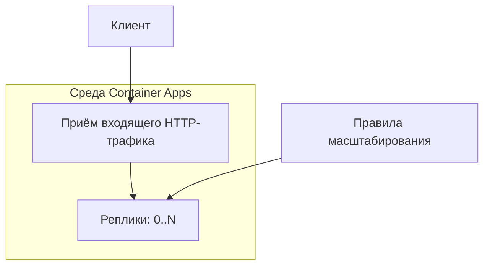

# От выбора среды зависит, кто платит за простой и восстанавливает машины

Сервис может почти ничего не стоить без запросов, а с ростом популярности стать дорогим. Даже если счёт за инфраструктуру невелик, на обновления, настройку сети и неудачные развёртывания могут уходить дни. Выбирая среду для запуска приложения, ты решаешь, какие расходы принять, как выделять ресурсы для новых запросов или задач и кто будет восстанавливать машины после сбоев.

Начни с характера рабочей нагрузки (workload shape). API держит соединения открытыми, обработчик очереди разбирает накопившиеся сообщения, а пакетная задача запускается, отрабатывает и завершается. Даже если они используют общий код, запускать их в одной среде необязательно. Для RAG-сервиса P1 нужно разместить API на .NET, которое вызывает модель и ищет документы. Это уже сужает выбор среди вычислительных сервисов Azure.

## Как Azure выделяет ресурсы для выполнения кода \{#how-azure-compute-works}

В Azure платформа может взять на себя разную долю работы по обслуживанию машин. В [App Service](https://learn.microsoft.com/ru-ru/azure/app-service/overview) ты развёртываешь веб-приложение как код или контейнер; вычислительные ресурсы предоставляет план App Service (App Service plan). В [Container Apps](https://learn.microsoft.com/ru-ru/azure/container-apps/compare-options) передаёшь образ контейнера и настройки приложения. Functions запускает функции по триггерам, AKS даёт доступ к Kubernetes, а виртуальная машина — к операционной системе (ОС), которую ты настраиваешь самостоятельно. От того, что именно ты развёртываешь, зависит, с какими объектами платформы придётся иметь дело при выпуске приложения.

Для P1 используй Container Apps. [Среда Container Apps (Container Apps environment)](https://learn.microsoft.com/ru-ru/azure/container-apps/environment) объединяет приложения с общими настройками сети и журналирования. Обновлением ОС и распределением ресурсов внутри среды занимается Azure. Профиль рабочей нагрузки (workload profile) определяет, какие вычислительные ресурсы доступны приложению. В актуальной среде с профилями рабочей нагрузки можно использовать [профиль Consumption](https://learn.microsoft.com/ru-ru/azure/container-apps/workload-profiles-overview).



Если включён [приём входящего HTTP-трафика (HTTP ingress)](https://learn.microsoft.com/ru-ru/azure/container-apps/ingress-overview), приложение получает конечную точку. Azure завершает TLS-соединения и направляет запросы к работающим экземплярам — репликам (replicas).

Каждая реплика запускается из [ревизии (revision)](https://learn.microsoft.com/ru-ru/azure/container-apps/revisions) — неизменяемого снимка образа контейнера и настроек масштабирования. Container Apps меняет число реплик по [декларативным правилам масштабирования (scale rules), используя KEDA](https://learn.microsoft.com/ru-ru/azure/container-apps/scale-app). Правила связывают HTTP-запросы, события и другие поддерживаемые сигналы с нужным числом реплик в заданных пределах. Ты настраиваешь правила; обслуживать кластер Kubernetes для этого не нужно.

Если минимум равен `0` и выбран подходящий триггер, при простое платформа уменьшает число реплик до нуля. Когда это масштабирование до нуля (scale to zero) завершено, работающих реплик не остаётся. Следующий запрос может потребовать выделения ресурсов, подготовки образа и запуска приложения — возникает [холодный старт (cold start)](https://learn.microsoft.com/ru-ru/azure/container-apps/cold-start). Заложи эту задержку в допустимое время ответа. Маленький образ помогает, но если при инициализации приложение скачивает большой набор данных, первый запрос всё равно может оказаться медленным.

Считай реплики заменяемыми. Если история разговора хранится только в памяти процесса, при его остановке она исчезнет, а другая реплика не сможет её прочитать. Документы и историю, которую нужно сохранять, держи вне вычислительной среды приложения. В локальной памяти оставляй лишь то, что можно восстановить. Масштабирование до нуля помогает обнаружить эту зависимость заранее, до обычного перезапуска в рабочей среде.

## Выбирай по рабочей нагрузке, масштабированию и затратам на эксплуатацию \{#choosing-and-tradeoffs}

Используй таблицу при архитектурном ревью, чтобы сопоставить варианты размещения с требованиями приложения. [Рекомендации Azure по выбору вычислительного сервиса](https://learn.microsoft.com/ru-ru/azure/architecture/guide/technology-choices/compute-decision-tree) предлагают оценивать компоненты по отдельности.

| Среда | Характер рабочей нагрузки | Масштабирование и оплата | Когда стоит выбрать другое |
|---|---|---|---|
| [App Service](https://learn.microsoft.com/ru-ru/azure/app-service/overview-hosting-plans) | Веб-приложение или API в виде кода либо контейнера. | Экземпляры плана предоставляют вычислительные ресурсы. Выделенные мощности оплачиваются и без запросов; возможности масштабирования зависят от тарифного уровня. | Основные требования — контейнерный обработчик очереди или доступ к Kubernetes API. |
| [Container Apps](https://learn.microsoft.com/ru-ru/azure/container-apps/scale-app) | Контейнерное API или фоновый обработчик; задания для задач с ограниченным временем выполнения. | Запросы и события управляют числом реплик. Профиль Consumption допускает масштабирование до нуля. Ты отвечаешь за образ и конфигурацию приложения. | Нужен контроль над Kubernetes на уровне кластера либо холодный старт неприемлем, а оплачивать заранее запущенные экземпляры не планируешь. |
| [Functions — Flex Consumption](https://learn.microsoft.com/ru-ru/azure/azure-functions/flex-consumption-plan) | Обработчики триггеров и конечные точки для событий. | Linux, оплата выполнения по запросу, масштабирование до нуля; при необходимости — оплачиваемые постоянно готовые экземпляры (always-ready instances). | Нужен собственный контейнер или произвольный сервер, который непрерывно слушает входящие соединения. |
| [AKS](https://learn.microsoft.com/ru-ru/azure/aks/core-aks-concepts) | Приложению нужны Kubernetes API и оркестрация Kubernetes. | Поды размещаются на узлах. Масштабирование приложения и доступные ресурсы узлов — разные задачи; обязанности по эксплуатации зависят от режима кластера. | Для небольшого API нет требований, специфичных для Kubernetes, и у команды нет причин заниматься настройками платформы. |
| [Virtual Machines](https://learn.microsoft.com/ru-ru/azure/virtual-machines/overview) | ПО требует контроля над ОС или зависит от существующей конфигурации машин. | Ты настраиваешь и обслуживаешь гостевую ОС и приложение. [VM Scale Sets](https://learn.microsoft.com/ru-ru/azure/virtual-machine-scale-sets/overview) позволяют масштабировать группу машин. | Управляемый сервис удовлетворяет требованиям и снимает с команды работу по обслуживанию машин. |

Для обычного веб-API стоит рассмотреть App Service. Если в существующем плане хватает подходящих ресурсов, это дополнительный довод в его пользу. Проверь, какие ещё приложения используют план: внутри него они конкурируют за общие мощности. Не путай [автомасштабирование по метрикам (autoscale) и автоматическое масштабирование по HTTP-запросам (automatic scaling)](https://learn.microsoft.com/ru-ru/azure/app-service/manage-automatic-scaling). При автоматическом масштабировании сохраняется как минимум один постоянно готовый экземпляр. Поэтому расходы во время простоя нельзя оценивать так же, как для Container Apps с нулём реплик.

Functions подходит для задач, которые удобно выполнять обработчиком по триггеру. В Flex Consumption функции масштабируются по отдельности, но HTTP-функции масштабируются вместе; то же относится к некоторым другим группам триггеров. В [матрице вариантов размещения](https://learn.microsoft.com/ru-ru/azure/azure-functions/functions-scale) Flex Consumption отмечен как общедоступный, без поддержки собственных контейнеров. Выбирай его для обработчика загрузки документов, если подходит модель выполнения. Разбивать существующее API на функции только ради бессерверной тарификации не стоит.

В AKS ты получаешь Kubernetes и возможность его настраивать. [За плоскость управления (control plane) отвечает Azure в обоих режимах — Automatic и Standard](https://learn.microsoft.com/ru-ru/azure/aks/core-aks-concepts). Манифесты приложения и его восстановление остаются за командой в обоих случаях. Рабочие узлы объединяются в пулы узлов (node pools). В Standard команда также проектирует эти пулы, настраивает кластер и принимает решения об обновлениях. В Automatic для этих операций чаще используются настройки по умолчанию, которыми управляет Azure. Ни один режим не напишет за тебя проверки готовности и запросы ресурсов для приложения.

В случае виртуальной машины на тебе остаётся больше работы. Зависимость от конкретной ОС может оправдывать такой выбор. А знакомство с SSH — слабый довод в пользу того, чтобы взять на себя установку исправлений и восстановление машин.

Фоновому обработчику без приёма входящего трафика нужен триггер, который запустит его из нуля. Цикл опроса внутри остановленного процесса не сможет запустить этот процесс.

[Правила по CPU и памяти не поддерживают масштабирование до нуля](https://learn.microsoft.com/ru-ru/azure/container-apps/tutorial-scaling). Выбирай сигнал, который показывает, сколько запросов или задач ожидает обработки. Низкая загрузка CPU может означать, что API ждёт ответа от перегруженной зависимости, а не что оно способно принять сколько угодно запросов.

Затраты на эксплуатацию (operational cost) включают диагностику сбоев и обновление зависимостей. Считай расходы на заранее запущенные экземпляры, сервисы данных и телеметрию, а также работу, которая остаётся у команды. Сравнить стоимость вариантов размещения можно лишь с учётом профиля рабочей нагрузки и требований ко времени ответа.

## Что это меняет для AI-сервиса \{#in-an-ai-workload}

В P1 используется минимальное API ASP.NET Core. Оно выполняет поиск через Azure AI Search, вызывает модель в Foundry и возвращает ответ со ссылками на источники.

Дополнительные реплики API не увеличивают пропускную способность модели. Например, у [развёртываний Azure OpenAI есть ограничения на частоту запросов и число токенов](https://learn.microsoft.com/ru-ru/azure/foundry/openai/how-to/quota); при их превышении сервис может вернуть HTTP 429. Увеличение числа реплик API может привести к тому, что запросы чаще будут упираться в ту же квоту. Помимо пределов числа реплик, настрой число параллельных вызовов, политику повторных попыток и допуск запросов (admission control). Максимальное число реплик не задаёт ни точного предела запросов, ни предела расходов на токены.

Container Apps также предлагает [бессерверные профили рабочей нагрузки с GPU](https://learn.microsoft.com/ru-ru/azure/container-apps/gpu-serverless-overview). Проект P1 не предусматривает самостоятельного размещения модели; компромиссы собственного инференс-сервера разобраны в уроке [«Serving — сервинг на FastAPI и Docker»](/rag-agents/part-3-production/serving/).

Долгие вызовы модели влияют на время ответа. Измеряй отдельно [время до первого токена (TTFT)](/rag-agents/part-3-production/serving/) и время до получения полного ответа. Даже если приложение уже запущено, модели всё равно нужно время на генерацию. Документация Container Apps сейчас указывает [тайм-аут HTTP-запроса 240 секунд](https://learn.microsoft.com/ru-ru/azure/container-apps/ingress-overview). Прежде чем проектировать долгий синхронный запрос, проверь ограничения на всём пути от клиента до модели. Если обработка не укладывается в допустимое время запроса, используй интерфейс асинхронных заданий.

Отделяй загрузку документов от ответов на вопросы, если у неё другой профиль рабочей нагрузки или поведение при сбоях. Пакетный импорт не должен исчерпывать ресурсы, нужные для интерактивных ответов. Как опираться на найденные документы и указывать источники, объясняет урок [«Generation — генерация ответа»](/rag-agents/part-1-rag/generation/). Выбранная среда должна позволять приложению сохранять это поведение и под рабочей нагрузкой. Когда P1 можно будет запустить, проверь его по сигналам из урока [«Наблюдаемость, выкатка и аварийный стоп»](/ai-sdlc/part-4-platform/observability-rollout).

## Попробуй \{#try-it}

Разверни общедоступный пример Microsoft в среде Container Apps, выбранной для P1. Понадобятся Bash, установленная актуальная версия Azure CLI и действующая подписка (subscription) с правами регистрировать поставщиков ресурсов (resource providers) и создавать ресурсы.

Подставь свой идентификатор вместо `<YOUR_SUBSCRIPTION_ID>`. Создай новую группу ресурсов (resource group) только для этого упражнения. `eastus` — пример региона; доступность региона и свободные мощности могут ограничить выбор в твоей подписке.

**Команды сверены с актуальной документацией Azure CLI, но не выполнялись в действующей подписке: у курса пока нет подписки Azure.** Ниже описаны ожидаемые результаты по документации, а не результаты наблюдаемого развёртывания.

Войди в Azure, выбери подписку, установи или обнови стабильное расширение `containerapp` и зарегистрируй `Microsoft.App`. Затем задай переменные и создай отдельную группу. Справочники CLI: [вход](https://learn.microsoft.com/ru-ru/cli/azure/reference-index?view=azure-cli-latest#az-login), [выбор подписки](https://learn.microsoft.com/ru-ru/cli/azure/account?view=azure-cli-latest#az-account-set), [установка расширения](https://learn.microsoft.com/ru-ru/cli/azure/extension?view=azure-cli-latest#az-extension-add), [регистрация поставщика](https://learn.microsoft.com/ru-ru/cli/azure/provider?view=azure-cli-latest#az-provider-register).

```bash
az login
az account set --subscription "<YOUR_SUBSCRIPTION_ID>"
az extension add --name containerapp --upgrade --allow-preview false
az provider register --namespace Microsoft.App --wait

RESOURCE_GROUP="rg-p1-compute-lab"
LOCATION="eastus"
ENVIRONMENT="p1-compute-env"
APP="p1-compute-sample"

az group create --name "$RESOURCE_GROUP" --location "$LOCATION"
```

Создай среду с профилями рабочей нагрузки и явно выбери для приложения Consumption. [Справочник команды создания среды](https://learn.microsoft.com/ru-ru/cli/azure/containerapp/env?view=azure-cli-latest#az-containerapp-env-create) допускает `--logs-destination none`: в этом коротком упражнении рабочая область Log Analytics (Log Analytics workspace) не используется. Настройка телеметрии предусмотрена в следующих уроках. Образ и порт взяты из [краткого руководства Microsoft](https://learn.microsoft.com/ru-ru/azure/container-apps/get-started?tabs=bash), параметры ресурсов и масштабирования — из [справочника команды создания приложения](https://learn.microsoft.com/ru-ru/cli/azure/containerapp?view=azure-cli-latest#az-containerapp-create).

```bash
az containerapp env create \
  --name "$ENVIRONMENT" --resource-group "$RESOURCE_GROUP" \
  --location "$LOCATION" --enable-workload-profiles true \
  --logs-destination none

az containerapp create \
  --name "$APP" --resource-group "$RESOURCE_GROUP" \
  --environment "$ENVIRONMENT" --workload-profile-name Consumption \
  --image mcr.microsoft.com/k8se/quickstart:latest \
  --target-port 80 --ingress external \
  --cpu 0.25 --memory 0.5Gi \
  --min-replicas 0 --max-replicas 1 \
  --scale-rule-name http-rule --scale-rule-type http \
  --scale-rule-http-concurrency 10

az containerapp show \
  --name "$APP" --resource-group "$RESOURCE_GROUP" \
  --query '{host:properties.configuration.ingress.fqdn,min:properties.template.scale.minReplicas,max:properties.template.scale.maxReplicas}' \
  --output json
```

Команда должна вывести имя хоста и настроенные границы `min: 0`, `max: 1`. Открой в браузере `https://<имя хоста>`, подставив полученное имя: после успешного развёртывания должна появиться страница примера. Приём входящего HTTP-трафика извне (`--ingress external`) делает пример общедоступным.

Вывод команды подтверждает настройки, а не фактическое число работающих реплик. Перестань отправлять запросы, чтобы приложение могло уменьшить число реплик до нуля после [периода ожидания, описанного в документации](https://learn.microsoft.com/ru-ru/azure/container-apps/scale-app#scale-behavior). Минимум `0` не означает немедленную остановку. В HTTP-правиле масштабирования задан порог `10` параллельных запросов. Этот параметр влияет на масштабирование, а не задаёт правило отказа в приёме запросов.

**Стоимость:** в Consumption оплачиваются выделенные CPU и память, пока работают реплики, а также HTTP-запросы. В этой среде используется только Consumption, поэтому платы за управление планом нет. При добавлении профиля Dedicated такая [плата появляется](https://learn.microsoft.com/ru-ru/azure/container-apps/billing#dedicated-plan). На [странице цен](https://azure.microsoft.com/en-us/pricing/details/container-apps/) указаны бесплатные месячные объёмы на подписку: 180 000 vCPU-секунд, 360 000 GiB-секунд и два миллиона запросов. Если эти объёмы ещё не израсходованы, упражнение может в них уложиться, но бесплатное развёртывание не гарантировано. До создания ресурсов проверь на этой странице платные тарифы для своего региона и типа предложения, по которому оформлена подписка. При нуле реплик [платы за потребление вычислительных ресурсов нет](https://learn.microsoft.com/ru-ru/azure/container-apps/billing). Однако общедоступная конечная точка может получать запросы и после того, как ты прекратишь работу, поэтому ресурсы всё равно нужно удалить.

**Удаление ресурсов:** в той же оболочке проверь значение `$RESOURCE_GROUP`. Следующая команда удалит группу и всё её содержимое; в ней должны находиться только ресурсы упражнения.

```bash
az group delete --name "$RESOURCE_GROUP" --yes
az group exists --name "$RESOURCE_GROUP"
```

После завершения удаления ожидаемый ответ — `false`. Подробности — в [справочнике команд для групп ресурсов](https://learn.microsoft.com/ru-ru/cli/azure/group?view=azure-cli-latest). Сохрани команды для дальнейшего описания инфраструктуры P1. Тег образа `latest` удобен для знакомства с сервисом, но содержимое по этому тегу может меняться. Поэтому такой тег не обеспечивает воспроизводимость выпуска приложения.

## Что перенести в свою практику \{#what-to-take-away}

- От характера рабочей нагрузки зависит, что развёртывать и по какому сигналу масштабировать. API, обработчику загрузки документов и пакетному импорту могут понадобиться разные среды.
- Container Apps позволяет разместить контейнер P1 без эксплуатации платформы Kubernetes. Данные, которые должны пережить замену реплики, храни вне неё.
- Масштабирование до нуля снижает расходы на простаивающие вычислительные ресурсы ценой задержки при запуске. Для заранее запущенных экземпляров отдельно планируй расходы и обосновывай их измерениями.
- Пропускная способность API и пропускная способность модели — отдельные ограничения. Прежде чем добавлять реплики, ограничь число параллельных вызовов и следи, не ограничивают ли зависимости частоту запросов.
- При сравнении полной стоимости учитывай работу по эксплуатации, которая остаётся у команды. После упражнения удаляй ресурсы, даже если бесплатные объёмы ещё не израсходованы.

**[Новые термины](../glossary.md#compute)**: план App Service, среда Container Apps, профиль рабочей нагрузки, реплика, ревизия, масштабирование до нуля, холодный старт, правило масштабирования, постоянно готовый экземпляр, пул узлов.

## Источники \{#sources}

Проверено на 17.10.2026.

**Размещение и масштабирование**

- [Выбор вычислительного сервиса Azure](https://learn.microsoft.com/ru-ru/azure/architecture/guide/technology-choices/compute-decision-tree).
- App Service: [обзор](https://learn.microsoft.com/ru-ru/azure/app-service/overview), [планы](https://learn.microsoft.com/ru-ru/azure/app-service/overview-hosting-plans), [автоматическое масштабирование](https://learn.microsoft.com/ru-ru/azure/app-service/manage-automatic-scaling).
- Container Apps: [варианты размещения контейнеров](https://learn.microsoft.com/ru-ru/azure/container-apps/compare-options), [среды](https://learn.microsoft.com/ru-ru/azure/container-apps/environment), [профили рабочей нагрузки](https://learn.microsoft.com/ru-ru/azure/container-apps/workload-profiles-overview).
- Container Apps: [масштабирование](https://learn.microsoft.com/ru-ru/azure/container-apps/scale-app), [практическое руководство по масштабированию](https://learn.microsoft.com/ru-ru/azure/container-apps/tutorial-scaling), [холодный старт](https://learn.microsoft.com/ru-ru/azure/container-apps/cold-start), [приём входящего HTTP-трафика](https://learn.microsoft.com/ru-ru/azure/container-apps/ingress-overview), [ресурсы контейнеров](https://learn.microsoft.com/ru-ru/azure/container-apps/containers), [бессерверные GPU](https://learn.microsoft.com/ru-ru/azure/container-apps/gpu-serverless-overview).
- [Ревизии Container Apps](https://learn.microsoft.com/ru-ru/azure/container-apps/revisions).
- Functions: [Flex Consumption](https://learn.microsoft.com/ru-ru/azure/azure-functions/flex-consumption-plan), [варианты размещения](https://learn.microsoft.com/ru-ru/azure/azure-functions/functions-scale).
- [Основные понятия AKS](https://learn.microsoft.com/ru-ru/azure/aks/core-aks-concepts), [обзор Virtual Machines](https://learn.microsoft.com/ru-ru/azure/virtual-machines/overview), [VM Scale Sets](https://learn.microsoft.com/ru-ru/azure/virtual-machine-scale-sets/overview).
- [Квота развёртывания Azure OpenAI](https://learn.microsoft.com/ru-ru/azure/foundry/openai/how-to/quota).

**Упражнение и оплата**

- Container Apps: [краткое руководство](https://learn.microsoft.com/ru-ru/azure/container-apps/get-started?tabs=bash), [начисление платы](https://learn.microsoft.com/ru-ru/azure/container-apps/billing), [цены](https://azure.microsoft.com/en-us/pricing/details/container-apps/).
- CLI: [вход](https://learn.microsoft.com/ru-ru/cli/azure/reference-index?view=azure-cli-latest#az-login), [учётная запись](https://learn.microsoft.com/ru-ru/cli/azure/account?view=azure-cli-latest#az-account-set), [расширение](https://learn.microsoft.com/ru-ru/cli/azure/extension?view=azure-cli-latest#az-extension-add), [поставщик ресурсов](https://learn.microsoft.com/ru-ru/cli/azure/provider?view=azure-cli-latest#az-provider-register), [группы ресурсов](https://learn.microsoft.com/ru-ru/cli/azure/group?view=azure-cli-latest).
- CLI: [среды Container Apps](https://learn.microsoft.com/ru-ru/cli/azure/containerapp/env?view=azure-cli-latest), [создание и просмотр приложения](https://learn.microsoft.com/ru-ru/cli/azure/containerapp?view=azure-cli-latest).
