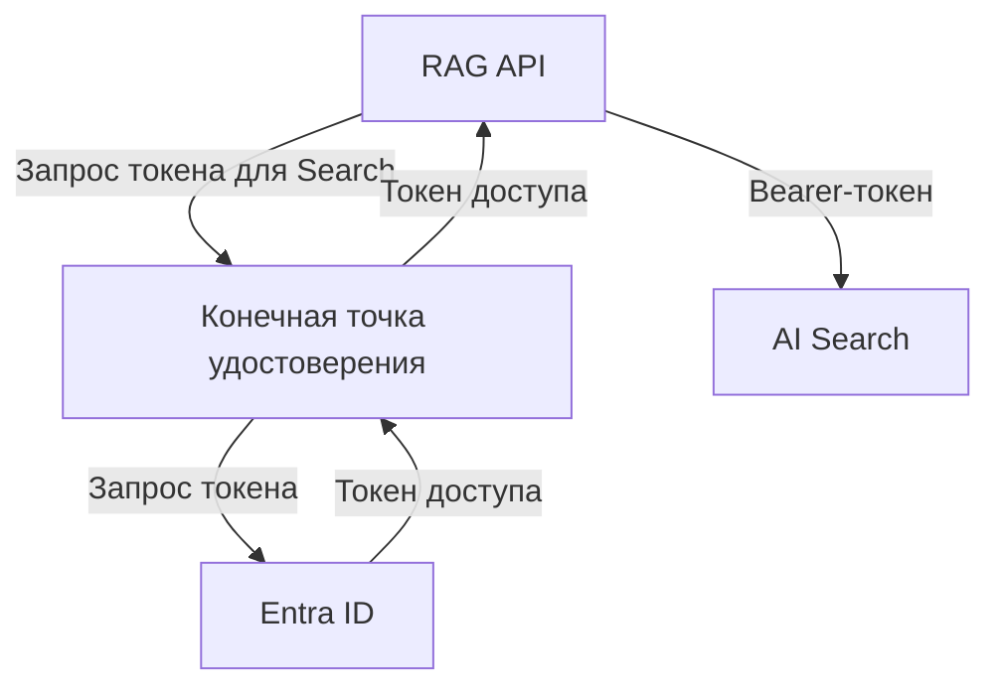

# Сервису нужно собственное удостоверение

RAG API должно обращаться к модели, искать в индексе и читать документы, даже когда твой ноутбук закрыт. Для работы в проде ему не подходит твой интерактивный вход. Можно скопировать в приложение общий ключ, но тогда кому-то придётся передавать, защищать и заменять этот секрет. Другие сервисы должны распознавать работающее API по его собственному удостоверению и решать, что ему разрешено.

Для каждого вызова определи, от чьего имени он выполняется. Когда пользователь отправляет запрос в твоё API, а оно обращается к поисковому индексу, получатели видят разных участников: сначала пользователя, затем API. Это различие сохраняется, даже если обращение к индексу вызвано запросом пользователя.

## Как это работает в Azure \{#how-it-works-on-azure}

Для работы с удостоверениями Azure использует сервис **Microsoft Entra ID**. **Тенант (tenant)** — отдельный каталог с пользователями, группами и приложениями. Он определяет границы, в которых существуют эти объекты, но не служит средой выполнения кода.

**Пользователь (user)** — удостоверение человека в каталоге. **Группа безопасности (security group)** объединяет участников, чтобы управлять их доступом через членство. Например, нового инженера добавляют в группу команды, и ему не приходится выдавать те же права по отдельности. В группу безопасности могут входить и субъекты-службы.

При **регистрации приложения (app registration)** в его домашнем тенанте создаётся объект приложения (application object). Это конфигурация удостоверения приложения с глобально уникальным **идентификатором клиента (client ID)**.

**Субъект-служба (service principal)** представляет приложение локально, в конкретном тенанте. Однотенантное приложение имеет один такой субъект в домашнем тенанте. У многотенантного приложения субъекты-службы могут существовать и в тенантах, где его используют. Эти разные объекты можно увидеть в разделах портала *App registrations* и *Enterprise applications*. Регистрация приложения не развёртывает его код.

**Управляемое удостоверение (managed identity)** — особый субъект-служба без связанного объекта приложения. Его учётными данными (credentials) управляет Azure. Включи такое удостоверение на поддерживаемом вычислительном ресурсе Azure или подключи его к этому ресурсу — тогда рабочая нагрузка сможет запрашивать токены через платформу, на которой работает. Создавать секрет клиента и копировать его в конфигурацию приложения не требуется.

Защищённому сервису приложение предъявляет **токен доступа (access token)**, обычно в заголовке `Authorization: Bearer …`. При обычной регистрации приложение получает токен от собственного имени, пройдя аутентификацию настроенным способом — например, с помощью секрета, сертификата или федеративных учётных данных. При управляемом удостоверении работу с учётными данными для получения токена берёт на себя Azure.



*Один вызов Search от имени приложения. [Конечную точку удостоверения предоставляет Container Apps](https://learn.microsoft.com/ru-ru/azure/container-apps/managed-identity). AI Search проверяет токен, предъявленный RAG API, и права этого API.*

При **аутентификации (authentication)** сервис устанавливает, кто к нему обращается, а при **авторизации (authorisation)** решает, какие операции разрешены этому участнику. Удостоверение может существовать и получать действительные токены, но не иметь права читать BLOB-объекты или выполнять запросы к индексу. Когда ты создаёшь удостоверение, права ему не назначаются. Аутентификацию входящих запросов к твоему API тоже нужно настраивать отдельно.

Проверять токен должно принимающее API. Если твоё API принимает токены доступа в формате JWT, оно проверяет подпись, издателя (`iss`), аудиторию (`aud`) и период действия (`nbf`, `exp`), а затем выполняет авторизацию. **Аудитория (audience)** указывает, какому API предназначен токен. Токен для одного API нельзя подставить при обращении к другому. Простого декодирования JWT недостаточно, чтобы признать токен действительным.

Если твой код вызывает другой сервис, передавай ему токен доступа как непрозрачное значение. Сведения о сроке действия бери из метаданных библиотеки, через которую получен токен. Не разбирай его содержимое и не рассчитывай на фиксированный срок действия. **Токен идентификации (ID token)** сообщает клиенту об аутентификации пользователя и не предназначен для вызова API. Эти токены используются для аутентификации и доступа; они не связаны с токенами, которыми измеряют входной и выходной текст языковой модели.

## Как выбрать удостоверение и его жизненный цикл \{#choosing-an-identity}

При выборе удостоверения учитывай, от чьего имени будут выполняться вызовы и после каких изменений оно должно сохраниться. Два вида управляемых удостоверений различаются прежде всего жизненным циклом и способом подключения к ресурсам.

| Вариант | Когда подходит | Когда лучше выбрать другое |
|---|---|---|
| Пользователь | Инженер работает интерактивно. | API в проде должно работать без участия человека и не может зависеть от его входа. |
| Регистрация приложения и субъект-служба типа «приложение» | Нужно предоставить API, защищённое Entra, или настроить вход пользователей. | Рабочая нагрузка на вычислительном ресурсе Azure с поддержкой управляемых удостоверений обращается к другим сервисам: создавать ради этого регистрацию и секрет не стоит. |
| Управляемое удостоверение, назначаемое системой (system-assigned managed identity) | Удостоверение принадлежит одному ресурсу и удаляется вместе с ним. | Удостоверение должно сохраниться при замене ресурса. |
| Управляемое удостоверение, назначаемое пользователем (user-assigned managed identity) | Нужен отдельный ресурс Azure, который удаляют явно и могут подключать к нескольким поддерживаемым ресурсам. | Рабочим нагрузкам нужны разные права: с общим удостоверением у них будут одинаковые права. |

Одно API может одновременно использовать регистрацию приложения и управляемое удостоверение для разных направлений доступа. Через регистрацию ты настраиваешь удостоверение API, которое принимает запросы под защитой Entra. С управляемым удостоверением код приложения проходит аутентификацию при обращении к другим сервисам. Для входящего доступа по-прежнему нужна регистрация.

С удостоверением, назначаемым системой, проще определить, какому ресурсу оно принадлежит: удостоверение и ресурс существуют и удаляются вместе. Удостоверение, назначаемое пользователем, можно создать и наделить правами ещё до появления вычислительного ресурса, а затем сохранить при его замене. Для учебного проекта это удобно: инфраструктура будет появляться поэтапно.

Все рабочие нагрузки, к которым подключено одно удостоверение, могут пользоваться его правами. Код на вычислительном ресурсе может использовать доступные там удостоверения. Поэтому управляемое удостоверение не делает безопасным ресурс с избыточными правами. Если рабочим нагрузкам нужен разный доступ, выделяй им отдельные удостоверения, следуя [принципу наименьших привилегий](/ai-sdlc/part-4-platform/least-privilege-sandboxing/).

У удостоверения, назначаемого пользователем, есть три идентификатора с разным назначением:

| Поле CLI | Для чего нужно |
|---|---|
| `clientId` | Выбрать удостоверение, от имени которого приложение получает токен. |
| `principalId` | Указать, какой субъект-служба получает права. Поле содержит идентификатор его объекта в тенанте (идентификатор субъекта, principal ID). |
| `id` | Подключить удостоверение к поддерживаемому вычислительному ресурсу. Это идентификатор ресурса Azure (Azure resource ID). |

Эти идентификаторы не являются секретами и не служат доказательством подлинности. Один только client ID не позволяет пройти аутентификацию. Выдачу прав и выбор учётных данных подробнее разберём в следующем уроке об удостоверениях.

При диагностике отделяй ошибки аутентификации от ошибок авторизации. Для API с bearer-аутентификацией [код 401 означает, что токен отсутствует или недействителен, в том числе из-за неверной аудитории; код 403 обычно означает, что токен действителен, но нужного разрешения нет](https://learn.microsoft.com/ru-ru/aspnet/core/security/authentication/configure-jwt-bearer-authentication?view=aspnetcore-10.0). Затем проверь, какое удостоверение запрашивает токен. Если при обращении к конечной точке Container Apps не выбрать удостоверение, назначаемое пользователем, платформа попытается использовать удостоверение, назначаемое системой, которого может вообще не быть. В конфигурации Azure Identity нужно [явно указать client ID удостоверения, назначаемого пользователем](https://learn.microsoft.com/ru-ru/azure/container-apps/managed-identity#connect-to-azure-services-in-app-code).

## В AI-приложении \{#in-an-ai-workload}

В P1 минимальное RAG API на .NET будет работать в Azure Container Apps. Во время работы API будет использовать одно управляемое удостоверение, назначаемое пользователем, для доступа к модели в Microsoft Foundry, к индексу Azure AI Search, к хранилищу Blob Storage и к Key Vault. Доступ настраивается отдельно для каждого сервиса: [Foundry](https://learn.microsoft.com/ru-ru/azure/foundry/foundry-models/how-to/configure-entra-id), [Search](https://learn.microsoft.com/ru-ru/azure/search/search-security-rbac), [Blob](https://learn.microsoft.com/ru-ru/azure/storage/blobs/authorize-access-azure-active-directory) и [Key Vault](https://learn.microsoft.com/ru-ru/azure/key-vault/general/authentication).

При обращении к каждому сервису API запрашивает токен именно для него, а сервис самостоятельно проверяет права удостоверения. Общее удостоверение не даёт универсального токена или одного разрешения на все четыре сервиса. Чтобы [настроить его использование в Container Apps](https://learn.microsoft.com/ru-ru/azure/container-apps/managed-identity), подключи удостоверение по идентификатору ресурса `id`, а в конфигурации Azure Identity в приложении явно выбери его по `clientId`.

Документы учебного проекта общедоступны, поэтому ограничивать доступ к ним для отдельных пользователей не нужно. Для работы с корпусом достаточно одного набора прав, выданного удостоверению рабочей нагрузки. При этом P1 будет защищать входящие запросы через Entra с помощью [регистрации приложения для API](https://learn.microsoft.com/ru-ru/entra/identity-platform/scenario-protected-web-api-app-configuration) и проверять права пользователей по собственным правилам. Когда ты создаёшь управляемое удостоверение, эти проверки не настраиваются.

Если документы закрытые, право API читать индекс ещё не определяет, какие документы можно показать конкретному пользователю. В таком случае приложение должно проверять доступ к документам на [пути поиска](/rag-agents/part-1-rag/retrieval/). Аутентификацию пользователя и решение о его правах на входе в API нужно рассматривать отдельно от удостоверения, с которым API обращается к другим сервисам от собственного имени.

Для развёртывания предусмотрим отдельное удостоверение. Конвейер, который меняет инфраструктуру, и API, которое отвечает на вопросы, выполняют разную работу. Разделение прав ограничит возможности работающего кода менять инфраструктуру. При управляемом удостоверении в конфигурации приложения также не нужно хранить учётные данные. Это помогает соблюдать правило из урока [«Секреты»](/ai-sdlc/part-4-platform/secrets): учётным данным не место в репозитории и контексте агента, который пишет код.

## Попробуй \{#try-it}

Создай отдельное удостоверение для P1 и посмотри его свойства. Вычислительного ресурса пока нет, поэтому подключать удостоверение не к чему. На этом шаге ты не выдаёшь ему доступ к другим сервисам.

Понадобятся локальный Bash, установленный Azure CLI и подписка Azure (subscription). Нужны права на создание и удаление учебной группы ресурсов (resource group), а также на управление удостоверениями, назначаемыми пользователем. Например, роли [`Contributor`](https://learn.microsoft.com/ru-ru/azure/role-based-access-control/built-in-roles/general#contributor) на уровне подписки хватит для упражнения, хотя она даёт больше прав, чем требуется. Одной роли `Managed Identity Contributor` недостаточно для всех операций с группой ресурсов; см. [требования для управления удостоверениями](https://learn.microsoft.com/ru-ru/entra/identity/managed-identities-azure-resources/manage-user-assigned-managed-identities-azure-cli).

**Стоимость:** за управляемые удостоверения [не взимается дополнительная плата](https://learn.microsoft.com/ru-ru/entra/identity/managed-identities-azure-resources/overview). В упражнении создаются только группа ресурсов и удостоверение — без ресурсов для запуска кода, хранения данных или работы модели.

Команды и флаги сверены с актуальным справочником Azure CLI; синтаксис Bash проверен. **В Azure эти команды не выполнялись.** Замени значения для тенанта и подписки своими. `westeurope` — пример региона; допустимые регионы зависят от политик подписки.

```bash
P1_TENANT_ID="replace-with-your-tenant-id"
P1_SUBSCRIPTION_ID="replace-with-your-subscription-id"
P1_LOCATION=westeurope
P1_GROUP=rg-p1-identity
P1_IDENTITY=id-p1-rag-api

az login --tenant "$P1_TENANT_ID"
az account set --subscription "$P1_SUBSCRIPTION_ID"
az account show \
  --query '{subscriptionId:id,tenantId:tenantId,name:name}' \
  --output json
```

Прежде чем продолжать, проверь, что вывод показывает нужные подписку и тенант. Локальный CLI сейчас работает от твоего имени, а не от имени нового управляемого удостоверения. Справочники: [вход](https://learn.microsoft.com/ru-ru/cli/azure/reference-index?view=azure-cli-latest#az-login) и [выбор учётной записи](https://learn.microsoft.com/ru-ru/cli/azure/account?view=azure-cli-latest#az-account-set).

Создай группу ресурсов, затем удостоверение и выведи его идентификаторы.

```bash
az group create \
  --name "$P1_GROUP" \
  --location "$P1_LOCATION" \
  --output none

az identity create \
  --name "$P1_IDENTITY" \
  --resource-group "$P1_GROUP" \
  --location "$P1_LOCATION" \
  --output none

az identity show \
  --name "$P1_IDENTITY" \
  --resource-group "$P1_GROUP" \
  --query '{resourceId:id,clientId:clientId,principalId:principalId}' \
  --output json
```

Команды создания и просмотра описаны в справочниках [групп ресурсов](https://learn.microsoft.com/ru-ru/cli/azure/group?view=azure-cli-latest#az-group-create) и [удостоверений](https://learn.microsoft.com/ru-ru/cli/azure/identity?view=azure-cli-latest#az-identity-create). Проверь, что в выводе есть три непустых значения. Пример ниже показывает структуру результата: вместо значений в угловых скобках ты увидишь свои идентификаторы. Регистр букв в идентификаторе ресурса может отличаться; например, в [примере из справочника удостоверений](https://learn.microsoft.com/ru-ru/rest/api/managedidentity/user-assigned-identities/get?view=rest-managedidentity-2024-11-30#examples) используется строчное `resourcegroups`.

```json
{
  "clientId": "<application-client-id>",
  "principalId": "<service-principal-object-id>",
  "resourceId": "/subscriptions/<subscription-id>/resourceGroups/<lab-group>/providers/Microsoft.ManagedIdentity/userAssignedIdentities/id-p1-rag-api"
}
```

Одних идентификаторов недостаточно, чтобы ноутбук прошёл аутентификацию от имени этого удостоверения. Когда ты подключишь удостоверение к поддерживаемому вычислительному ресурсу, код на нём сможет получать токены через платформу.

**Удаление ресурсов:** само удостоверение бесплатно; удали его, чтобы не оставлять учебные ресурсы. Удаляй только отдельную группу из этого упражнения. Если терминал уже закрыт, сначала восстанови значение `P1_GROUP`:

```bash
P1_GROUP=rg-p1-identity
az group delete --name "$P1_GROUP" --yes
```

Команда [`az group delete`](https://learn.microsoft.com/ru-ru/cli/azure/group?view=azure-cli-latest#az-group-delete) удаляет группу вместе с её ресурсами. При последующем развёртывании ты снова создашь удостоверение теми же командами. Тогда ещё раз запроси его идентификаторы, чтобы получить актуальные значения.

## Что перенести в свою практику \{#what-to-take-away}

- Для каждого вызова определяй, от чьего имени он выполняется. Аутентификацию и права доступа продумывай отдельно для входящего запроса пользователя и для вызова другого сервиса от имени API.
- Различай объект приложения и его локальное представление в тенанте — субъект-служба. Управляемое удостоверение — особый субъект-служба без объекта приложения; его учётными данными управляет Azure.
- Учитывай, должно ли удостоверение сохраниться при замене ресурса. Удостоверение, назначаемое системой, существует и удаляется вместе с одним ресурсом; назначаемое пользователем существует независимо. Если подключить его к нескольким рабочим нагрузкам, каждая сможет пользоваться его правами.
- Предъявляй токен доступа, предназначенный нужному сервису. Идентификаторы не заменяют учётные данные, а действительный токен не отменяет проверку прав на стороне получателя.

**[Новые термины](../glossary.md#entra-id)**: Microsoft Entra ID, пользователь (user), группа безопасности (security group), регистрация приложения (app registration), субъект-служба (service principal), управляемое удостоверение (managed identity), управляемое удостоверение, назначаемое системой (system-assigned managed identity), управляемое удостоверение, назначаемое пользователем (user-assigned managed identity), идентификатор клиента (client ID), идентификатор субъекта (principal ID), идентификатор ресурса Azure (Azure resource ID), токен доступа (access token), аудитория (audience), токен идентификации (ID token), аутентификация (authentication), авторизация (authorisation).

## Источники \{#sources}

Проверено на 17.10.2026.

### Объекты удостоверений

- [Основы безопасности удостоверений](https://learn.microsoft.com/ru-ru/entra/architecture/secure-fundamentals)
- [Группы и управление доступом](https://learn.microsoft.com/ru-ru/entra/fundamentals/concept-learn-about-groups)
- [Объекты приложений и субъекты-службы](https://learn.microsoft.com/ru-ru/entra/identity-platform/app-objects-and-service-principals)
- [Настройка защищённого веб-API](https://learn.microsoft.com/ru-ru/entra/identity-platform/scenario-protected-web-api-app-configuration)
- [Регистрация приложения](https://learn.microsoft.com/ru-ru/entra/identity-platform/quickstart-register-app)
- [Обзор управляемых удостоверений](https://learn.microsoft.com/ru-ru/entra/identity/managed-identities-azure-resources/overview)
- [Рекомендации по работе с управляемыми удостоверениями](https://learn.microsoft.com/ru-ru/entra/identity/managed-identities-azure-resources/managed-identity-best-practice-recommendations)
- [Управляемые удостоверения в Container Apps](https://learn.microsoft.com/ru-ru/azure/container-apps/managed-identity)
- [Обзор управляемых удостоверений для разработчика](https://learn.microsoft.com/ru-ru/entra/identity/managed-identities-azure-resources/overview-for-developers)
- [Получение ресурса удостоверения, назначаемого пользователем: REST 2024-11-30](https://learn.microsoft.com/ru-ru/rest/api/managedidentity/user-assigned-identities/get?view=rest-managedidentity-2024-11-30)
- [Выбор удостоверения, назначаемого пользователем, в .NET](https://learn.microsoft.com/ru-ru/dotnet/azure/sdk/authentication/user-assigned-managed-identity)

### Токены

- [Токены доступа](https://learn.microsoft.com/ru-ru/entra/identity-platform/access-tokens)
- [Справочник утверждений токена доступа](https://learn.microsoft.com/ru-ru/entra/identity-platform/access-token-claims-reference)
- [Проверка утверждений](https://learn.microsoft.com/ru-ru/entra/identity-platform/claims-validation)
- [Токены идентификации](https://learn.microsoft.com/ru-ru/entra/identity-platform/id-tokens)
- [Поток с учётными данными клиента](https://learn.microsoft.com/ru-ru/entra/identity-platform/v2-oauth2-client-creds-grant-flow)
- [Bearer-аутентификация и ответы 401/403 в ASP.NET Core 10](https://learn.microsoft.com/ru-ru/aspnet/core/security/authentication/configure-jwt-bearer-authentication?view=aspnetcore-10.0)

### Сервисы проекта

- [Настройка Entra ID для Foundry Models](https://learn.microsoft.com/ru-ru/azure/foundry/foundry-models/how-to/configure-entra-id)
- [Доступ на основе ролей в Azure AI Search](https://learn.microsoft.com/ru-ru/azure/search/search-security-rbac)
- [Авторизация доступа к BLOB-объектам через Entra ID](https://learn.microsoft.com/ru-ru/azure/storage/blobs/authorize-access-azure-active-directory)
- [Аутентификация в Key Vault](https://learn.microsoft.com/ru-ru/azure/key-vault/general/authentication)

### Упражнение с CLI

- [Azure CLI: создание и просмотр удостоверения](https://learn.microsoft.com/ru-ru/cli/azure/identity?view=azure-cli-latest)
- [Azure CLI: вход](https://learn.microsoft.com/ru-ru/cli/azure/reference-index?view=azure-cli-latest#az-login)
- [Azure CLI: выбор и просмотр учётной записи](https://learn.microsoft.com/ru-ru/cli/azure/account?view=azure-cli-latest)
- [Azure CLI: создание и удаление группы ресурсов](https://learn.microsoft.com/ru-ru/cli/azure/group?view=azure-cli-latest)
- [Встроенная роль Contributor](https://learn.microsoft.com/ru-ru/azure/role-based-access-control/built-in-roles/general#contributor)
- [Управление удостоверениями, назначаемыми пользователем, через Azure CLI](https://learn.microsoft.com/ru-ru/entra/identity/managed-identities-azure-resources/manage-user-assigned-managed-identities-azure-cli)
