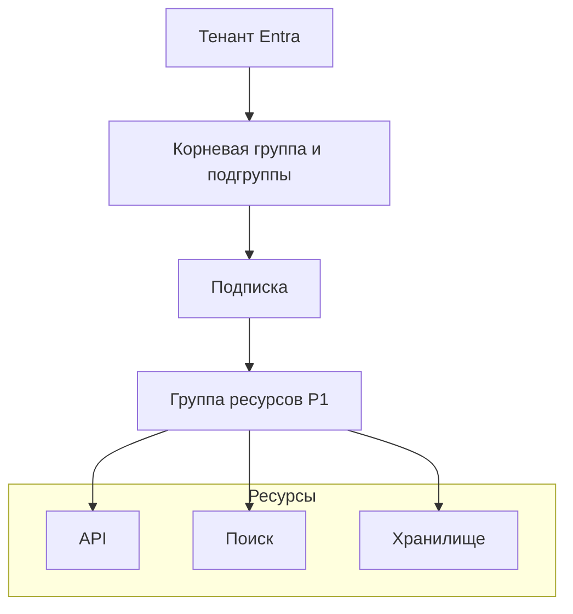

# От границ ресурсов зависит, кто может менять сервис и на чей счёт идут расходы

Облачное приложение быстро перестаёт быть одним целым: код выполняется в одном сервисе, документы хранятся в другом, поисковый индекс и конечная точка модели управляются отдельно. Мастер создания ресурсов поможет их запустить, но за тебя не решит, какому проекту принадлежит учётная запись хранения, кому разрешено менять развёртывание модели и за что продолжат начислять плату после демонстрации.

До первого развёртывания продумай, как разграничить доступ, учитывать расходы и удалять эксперименты, не затрагивая общий сервис. В Azure ты закрепляешь эти границы в иерархии ресурсов, чтобы платформа обеспечивала их соблюдение. От устройства иерархии будут зависеть права доступа и расходы RAG-сервиса, который ты соберёшь в курсе.

## Как это устроено в Azure \{#how-it-works-on-azure}

**Тенант (tenant)** — экземпляр Microsoft Entra ID, в котором хранятся пользователи, группы и регистрации приложений (app registrations). Каждая **подписка (subscription)** [доверяет ровно одному тенанту](https://learn.microsoft.com/ru-ru/entra/fundamentals/how-subscriptions-associated-directory), а одному тенанту могут доверять несколько подписок. При входе Azure определяет, кто ты. Есть ли у тебя право управлять конкретной подпиской — отдельный вопрос.

Тенант предоставляет удостоверения для работы с Azure. Под тенантом расположены четыре уровня управления: группы управления, подписки, группы ресурсов и отдельные ресурсы. Регион в эту иерархию не входит: его выбирают отдельно, когда решают, где разместить ресурсы.



**Группы управления (management groups)** нужны, когда на несколько подписок должны распространяться общие правила. Все подписки находятся под [корневой группой управления](https://learn.microsoft.com/ru-ru/azure/governance/management-groups/overview#root-management-group-for-each-directory); её идентификатор совпадает с идентификатором тенанта. Дополнительные группы образуют ветви дерева. Например, если назначить ограничение допустимых регионов группе управления, объединяющей несколько подписок, оно будет действовать во всех этих подписках. Так [группы управления](https://learn.microsoft.com/ru-ru/azure/governance/management-groups/overview) избавляют от повторения одних и тех же настроек в каждой подписке. Для одной учебной подписки строить отдельное дерево не нужно.

Подписка — область администрирования, в рамках которой создаются сервисы и накапливаются начисления за их использование. В **группе ресурсов (resource group)** ты объединяешь объекты, которые будешь развёртывать, менять и удалять вместе. **Ресурс (resource)** — отдельный объект, которым управляет Azure: например, учётная запись хранения или среда для запуска приложения. Операции с ним обрабатывает соответствующая служба Azure — **поставщик ресурсов (resource provider)**. Большинство ресурсов приложения входят в группу ресурсов, хотя [некоторые типы ресурсов создаются на более высоких уровнях](https://learn.microsoft.com/ru-ru/azure/azure-resource-manager/management/overview).

Настройки управления назначаются на **область действия (scope)**. Например, [назначение роли Azure RBAC](https://learn.microsoft.com/ru-ru/azure/role-based-access-control/scope-overview) на подписку даёт права на входящие в неё ресурсы, а назначение на одну группу ресурсов распространяется только на ресурсы этой группы. Azure Policy тоже использует области действия, но решает другую задачу: ограничивает допустимую конфигурацию. [Политика разрешённых регионов](https://learn.microsoft.com/ru-ru/azure/governance/policy/overview) может отклонить развёртывание, даже если у пользователя есть право создавать ресурсы. Права определяют, кто может действовать; политика — что ему разрешено создать.

Подписка связывает потребление сервисов с оплатой. При этом [учётные записи для выставления счетов (billing accounts) и договоры](https://learn.microsoft.com/ru-ru/azure/cost-management-billing/understand/understand-billing-tenant-relationship) образуют отдельную коммерческую структуру. Группы ресурсов помогают отнести расходы внутри подписки к конкретному проекту, но не создают отдельного договора об оплате.

Когда ты создаёшь учётную запись хранения через портал, Azure CLI или шаблон инфраструктуры, запрос в любом случае получает **Azure Resource Manager (ARM)**. Это общий слой развёртывания и управления: ARM проверяет запрос и направляет его нужному поставщику ресурсов. Поэтому ты не обойдёшь права доступа к подписке или политики развёртывания, просто выбрав другой инструмент.

Создание, настройка и удаление ресурсов относятся к **плоскости управления (control plane)**. Использование сервиса относится к **плоскости данных (data plane)**: при чтении документа из Blob Storage запрос идёт к конечной точке хранилища. У этих двух плоскостей [разные операции и требования к доступу](https://learn.microsoft.com/ru-ru/azure/azure-resource-manager/management/control-plane-and-data-plane). Возможность увидеть ресурс на портале ещё не означает, что приложение сможет прочитать его данные.

**Регион (region)** — [географическая область с центрами обработки данных Azure и обслуживающей инфраструктурой](https://learn.microsoft.com/ru-ru/azure/reliability/regions-overview). Выбирай регион с учётом задержки для пользователей, требований к данным и доступности нужных сервисов. Расположение группы ресурсов определяет, где хранятся её метаданные управления. В одной группе могут находиться ресурсы из разных регионов. Если перенести ресурс в группу с именем `europe`, его данные останутся на прежнем месте. Тем не менее Microsoft рекомендует [размещать группу и её ресурсы в одном регионе](https://learn.microsoft.com/ru-ru/azure/azure-resource-manager/management/overview#which-location-should-i-use-for-my-resource-group) по двум причинам: запросы плоскости управления проходят через регион группы; размещение группы рядом с ресурсами уменьшает последствия регионального сбоя. Группу P1 размести там, где будет работать P1.

Внутри региона **зоны доступности (availability zones)** — отдельные группы центров обработки данных. Каждая зона независима от других по электропитанию, охлаждению и сети. **Зональный ресурс (zonal resource)** размещается в выбранной зоне. Если сервис сам реплицирует или распределяет ресурс по нескольким зонам, это **ресурс с избыточностью между зонами (zone-redundant resource)**. [Поддержка зон и нужные настройки зависят от сервиса, региона и уровня обслуживания](https://learn.microsoft.com/ru-ru/azure/reliability/availability-zones-overview). Сам выбор региона с зонами не гарантирует, что каждый ресурс переживёт отказ зоны. Зоны также не обеспечивают восстановление после отказа всего региона.

## Как разделить ресурсы, чтобы безопасно удалить проект \{#choosing-boundaries}

Начни с одной учебной подписки и одной группы для ресурсов первого проекта, которые можно удалить после работы. Усложняй эту схему, когда действительно различаются ответственные, правила использования или жизненные циклы. Если маленькому приложению выделить по группе на каждый сервис, удалять его будет сложнее. Если собрать все эксперименты в одной группе, удаление затронет слишком многое.

| Как разделить | Когда это нужно | Какой ошибки избегать |
|---|---|---|
| Группа управления | Нескольким подпискам нужны общие назначения политик или прав доступа. | Копировать оргструктуру, когда общие правила для подписок не нужны. |
| Отдельная подписка | Средам нужны разные администраторы, политики или контроль расходов. | Создавать новый тенант только ради раздельного учёта расходов проектов. |
| Группа ресурсов | Ресурсы развёртывают, обслуживают и выводят из эксплуатации вместе. | Помещать общее хранилище документов в группу временного демо. |
| Теги | Нужно помечать ресурсы по проекту, среде и ответственному. | Считать тег границей доступа. |

Проверь выбранное разделение простым вопросом: можно ли завершить проект, удалив его группу целиком? Если вместе с ней исчезнут данные другого приложения, границы нужно пересмотреть. Ресурсы из разных групп могут взаимодействовать друг с другом. Поэтому [объединяй их по жизненному циклу](https://learn.microsoft.com/ru-ru/azure/cloud-adoption-framework/ready/azure-setup-guide/organize-resources), как рекомендует Microsoft.

**Теги (tags)** дополняют имена ресурсов: используй небольшой согласованный набор, например `project=p1-rag`, `environment=dev`, `owner=learner`. Ресурсы [не наследуют теги группы автоматически](https://learn.microsoft.com/ru-ru/azure/azure-resource-manager/management/tag-resources); назначай их самим ресурсам через код инфраструктуры или политику. Отдельная функция [наследования тегов в Cost Management (tag inheritance)](https://learn.microsoft.com/ru-ru/azure/cost-management-billing/costs/enable-tag-inheritance) при включении применяет теги подписки и группы к записям об использовании дочерних ресурсов, не меняя теги самих ресурсов. Эта функция доступна только для учётных записей для выставления счетов с Enterprise Agreement (EA), Microsoft Customer Agreement (MCA) или Microsoft Partner Agreement (MPA). Для MPA дополнительно нужны подписки Azure plan.

Для небольшого сервиса удобнее выбрать один подходящий регион и разместить там же зависимости: так меньше межрегиональных связей, которые придётся учитывать. Для прода проверяй поддержку зон по всей цепочке. API с избыточностью между зонами не ответит на вопрос, если единственный сервис поиска недоступен. Несколько регионов дают дополнительные варианты восстановления, но тебе придётся продумать репликацию, маршрутизацию и переключение при сбое. Выбирай количество регионов исходя из требований к восстановлению.

**Бюджет (budget)** нужен, чтобы видеть расходы. Он [отправляет уведомления и не останавливает ресурсы](https://learn.microsoft.com/ru-ru/azure/cost-management-billing/costs/tutorial-acm-create-budgets). Данные о расходах обычно поступают в течение **8–24 часов**; бюджет проверяется каждые **24 часа**, а письмо обычно приходит **в течение часа после проверки**. На уведомление должен отреагировать человек. Чтобы уложиться в **10** долларов США в месяц, отведённые на упражнения, заранее планируй расходы и удаляй ресурсы после работы.

## Что это меняет для AI-сервиса \{#in-an-ai-workload}

В P1 предстоит соединить minimal API на ASP.NET Core в Azure Container Apps, развёртывание модели (model deployment) в [Microsoft Foundry](https://learn.microsoft.com/ru-ru/azure/foundry/what-is-foundry), Azure AI Search и документы в Blob Storage. Приложение будет обращаться к Key Vault через управляемое удостоверение (managed identity) и отправлять телеметрию в Application Insights. Bicep и `azd` будут описывать и создавать инфраструктуру; GitHub Actions с OIDC — доставлять изменения. Сейчас ты только подготовишь подписку, уведомления о расходах и группу ресурсов.

Подготовка документов и построение индекса разобраны в уроке [«Ingestion — индексация»](/rag-agents/part-1-rag/ingestion/). Здесь нужно решить, должны ли данные и индекс пережить удаление приложения. В лабораторной работе с общедоступными документами индекс можно построить заново, поэтому его допустимо удалять вместе с приложением. Если позднее будешь использовать общий корпус документов, который должен сохраниться после удаления приложения, управляй жизненным циклом хранилища отдельно и явно учитывай эту зависимость.

API не получает доступ к модели, документам или секретам автоматически, даже если все они находятся в одной группе. Заранее продумай, какие права нужно выдать приложению. Урок [«Секреты»](/ai-sdlc/part-4-platform/secrets) объясняет, почему для доступа во время выполнения не стоит передавать секретные значения через исходный код или контекст агента.

Регион P1 выбирай после проверки [доступности модели и типа развёртывания](https://learn.microsoft.com/ru-ru/azure/foundry/foundry-models/concepts/deployment-types), а также [доступной квоты](https://learn.microsoft.com/ru-ru/azure/foundry/openai/quotas-limits#regional-quota-capacity-limits). Эти условия могут различаться по регионам. Правила объединения квот меняются: для некоторых моделей квота уже общая для подписки или зоны данных. Проверяй условия выбранной модели — ещё один регион не обязательно даст дополнительную квоту. Затем задай этот же регион для группы P1.

Отдельно проверь, где будут обрабатываться промпты и ответы. Microsoft рекомендует начинать с [Global Standard](https://learn.microsoft.com/ru-ru/azure/foundry/foundry-models/concepts/deployment-types): при этом типе развёртывания обработка может выполняться в любом регионе Azure. Для типов Data Zone обработка ограничена указанной зоной данных. При Standard промпты и ответы обрабатываются в пределах географической области Azure, которую ты выбрал; в неё могут входить несколько регионов. Зафиксируй выбранный тип развёртывания до отправки документов и промптов.

## Попробуй \{#try-it}

Понадобятся существующая учебная подписка и Bash: локально с [установленной Azure CLI](https://learn.microsoft.com/ru-ru/cli/azure/install-azure-cli) либо во [временной сессии Azure Cloud Shell](https://learn.microsoft.com/ru-ru/azure/cloud-shell/get-started/ephemeral). Команды рассчитаны на Bash, не на PowerShell. Для этого урока проверены справочники CLI и документация портала; команды и действия на портале в действующей подписке не выполнялись.

Начиная с [Azure CLI 2.61.0 при входе предлагается выбрать подписку](https://learn.microsoft.com/ru-ru/cli/azure/authenticate-azure-cli-interactively#subscription-selector), если доступно несколько. Всё равно укажи её явно через [`az account set`](https://learn.microsoft.com/ru-ru/cli/azure/account?view=azure-cli-latest#az-account-set). Замени `<id>` идентификатором учебной подписки:

```bash
az login
az account list --output table
AZURE_SUBSCRIPTION_ID="<id>"
az account set --subscription "$AZURE_SUBSCRIPTION_ID"
az account show --output json
```

Прежде чем продолжать, проверь в выводе идентификаторы подписки и тенанта.

На портале открой выбранную подписку, затем **Budgets → Add** и [создай бюджет](https://learn.microsoft.com/ru-ru/azure/cost-management-billing/costs/tutorial-acm-create-budgets) с именем `learning-monthly`. Область действия — вся подписка, без фильтров; дата окончания — позже предполагаемого завершения учёбы. Выбери **Monthly**, чтобы считать расходы по календарным месяцам — так в курсе задан месячный ориентир. Если доступен вариант **Billing month**, он привязывает период к выставлению счетов.

Задай сумму **10** USD или эквивалентную целевую сумму в валюте, которую показывает портал. Настрой уведомления по электронной почте: они должны приходить, когда фактические расходы достигнут **50 %, 80 % и 100 %** заданной суммы. Перед сохранением проверь адрес получателя.

Для создания бюджета нужна роль [Owner, Contributor или Cost Management Contributor](https://learn.microsoft.com/ru-ru/azure/cost-management-billing/costs/tutorial-acm-create-budgets#prerequisites). После создания подписки Cost Management может стать доступен с задержкой до **48 часов**. Если сейчас настроить бюджет не получается, вернись к нему до развёртывания платных сервисов.

Создай пустую группу P1 с тегами. Случайный суффикс уменьшит вероятность совпадения имён. Замени `westeurope` регионом, в котором разрешено запускать P1. Посмотреть список расположений можно командой `az account list-locations --output table`. Команды создания и просмотра описаны в [справочнике `az group`](https://learn.microsoft.com/ru-ru/cli/azure/group?view=azure-cli-latest):

```bash
AZURE_RESOURCE_GROUP="rg-p1-rag-dev-$RANDOM"
az group create \
  --subscription "$AZURE_SUBSCRIPTION_ID" \
  --name "$AZURE_RESOURCE_GROUP" \
  --location westeurope \
  --tags project=p1-rag environment=dev owner=learner
az group show \
  --subscription "$AZURE_SUBSCRIPTION_ID" \
  --name "$AZURE_RESOURCE_GROUP" \
  --output json
```

Полный **идентификатор ресурса (resource ID)** внутри группы [содержит путь](https://learn.microsoft.com/ru-ru/azure/role-based-access-control/scope-overview#scope-format) вида `/subscriptions/{id}/resourceGroups/{name}/providers/{namespace}/{type}/{name}`. В выводе `az group show` поле `id` заканчивается на `/resourceGroups/{name}`: это идентификатор самой группы, поэтому пути к поставщику и отдельному ресурсу в нём нет.

Ожидаемый результат: JSON с идентификатором группы, выбранным расположением и тремя тегами; на портале — бюджет с заданными порогами уведомлений. Сервисы приложения пока не созданы. Не трать деньги только ради проверки уведомления.

**Стоимость:** это упражнение бесплатно: ты создаёшь только пустую группу через [бесплатный Resource Manager](https://azure.microsoft.com/en-us/pricing/purchase-options/azure-account), а также [бюджет Azure и уведомления, которые тоже бесплатны](https://azure.microsoft.com/en-us/pricing/details/cost-management/). Модель, вычислительные ресурсы и хранилище в упражнении не создаются.

**Удаление ресурсов:** удали группу сейчас; при развёртывании P1 ты создашь её заново. Используй ту же сессию Bash и сохранённые переменные:

```bash
az group delete \
  --subscription "$AZURE_SUBSCRIPTION_ID" \
  --name "$AZURE_RESOURCE_GROUP" \
  --yes
az group exists \
  --subscription "$AZURE_SUBSCRIPTION_ID" \
  --name "$AZURE_RESOURCE_GROUP"
```

Команда проверки существования должна вернуть `false`. Бюджет подписки оставь для следующих упражнений. Если прекращаешь работу с курсом, удали и его через портал.

В следующих лабораторных работах [удалению группы могут помешать блокировки, защищённые резервные данные или зависимости между группами](https://learn.microsoft.com/ru-ru/azure/azure-resource-manager/management/delete-resource-group). Проверяй, завершилось ли удаление. После удаления группы [Key Vault](https://learn.microsoft.com/ru-ru/azure/key-vault/general/soft-delete-overview) и [учётные записи Microsoft Foundry и Azure AI services](https://learn.microsoft.com/ru-ru/azure/ai-services/recover-purge-resources) остаются в состоянии обратимого удаления (soft delete). Имена этих ресурсов могут оставаться занятыми до окончательного удаления ресурсов, если оно разрешено, либо до истечения срока хранения. Другие группы остаются на месте, а уже начисленную плату всё равно нужно оплатить.

## Что перенести в свою практику \{#what-to-take-away}

- Удостоверения предоставляет тенант. Под ним — группы управления, подписки, группы ресурсов и ресурсы: на каждом уровне область действия правил сужается. У договоров об оплате своя иерархия.
- Через ARM ты управляешь ресурсами в общей плоскости управления; для работы с их данными нужен отдельный доступ.
- Для временного проекта выбирай группу, которую можно удалить целиком, не потеряв данные другого проекта. Объединяй ресурсы по жизненному циклу и явно назначай теги самим ресурсам.
- Место размещения задаётся регионом. Изоляция сбоев внутри региона зависит от того, поддерживают ли сервисы зоны и настроены ли они для их использования. По имени группы нельзя судить ни о размещении ресурсов, ни об устойчивости к отказу зоны.
- До платного развёртывания настрой уведомления бюджета, после работы проверь, что ресурсы удалены. Сам бюджет потребление не ограничит.

**[Новые термины](../glossary.md#how-azure-is-organised)**: тенант, группа управления, подписка, группа ресурсов, ресурс, поставщик ресурсов, область действия, идентификатор ресурса, Azure Resource Manager, плоскость управления, плоскость данных, регион, зона доступности, зональный ресурс, ресурс с избыточностью между зонами, тег, бюджет.

## Источники \{#sources}

Проверено на 17.10.2026.

- **Удостоверения и иерархия:** [тенанты Microsoft Entra](https://learn.microsoft.com/ru-ru/entra/identity-platform/quickstart-create-new-tenant); [связь подписок и каталогов](https://learn.microsoft.com/ru-ru/entra/fundamentals/how-subscriptions-associated-directory); [группы управления](https://learn.microsoft.com/ru-ru/azure/governance/management-groups/overview); [обзор Resource Manager](https://learn.microsoft.com/ru-ru/azure/azure-resource-manager/management/overview); [области действия Azure RBAC](https://learn.microsoft.com/ru-ru/azure/role-based-access-control/scope-overview); [Azure Policy](https://learn.microsoft.com/ru-ru/azure/governance/policy/overview); [выставление счетов и тенанты](https://learn.microsoft.com/ru-ru/azure/cost-management-billing/understand/understand-billing-tenant-relationship).
- **Жизненный цикл и размещение:** [организация ресурсов](https://learn.microsoft.com/ru-ru/azure/cloud-adoption-framework/ready/azure-setup-guide/organize-resources); [плоскости управления и данных](https://learn.microsoft.com/ru-ru/azure/azure-resource-manager/management/control-plane-and-data-plane); [расположение группы ресурсов](https://learn.microsoft.com/ru-ru/azure/azure-resource-manager/management/overview#which-location-should-i-use-for-my-resource-group); [регионы](https://learn.microsoft.com/ru-ru/azure/reliability/regions-overview); [имена регионов](https://learn.microsoft.com/ru-ru/azure/reliability/regions-list); [зоны доступности](https://learn.microsoft.com/ru-ru/azure/reliability/availability-zones-overview); [теги](https://learn.microsoft.com/ru-ru/azure/azure-resource-manager/management/tag-resources); [наследование тегов в Cost Management](https://learn.microsoft.com/ru-ru/azure/cost-management-billing/costs/enable-tag-inheritance); [удаление группы](https://learn.microsoft.com/ru-ru/azure/azure-resource-manager/management/delete-resource-group); [обратимое удаление Key Vault](https://learn.microsoft.com/ru-ru/azure/key-vault/general/soft-delete-overview); [восстановление и окончательное удаление ресурсов Microsoft Foundry](https://learn.microsoft.com/ru-ru/azure/ai-services/recover-purge-resources).
- **Модели:** [Microsoft Foundry](https://learn.microsoft.com/ru-ru/azure/foundry/what-is-foundry); [типы развёртывания моделей](https://learn.microsoft.com/ru-ru/azure/foundry/foundry-models/concepts/deployment-types); [квоты и ограничения моделей](https://learn.microsoft.com/ru-ru/azure/foundry/openai/quotas-limits).
- **Упражнение:** [установка Azure CLI](https://learn.microsoft.com/ru-ru/cli/azure/install-azure-cli); [интерактивная аутентификация CLI](https://learn.microsoft.com/ru-ru/cli/azure/authenticate-azure-cli-interactively); [`az login`](https://learn.microsoft.com/ru-ru/cli/azure/reference-index?view=azure-cli-latest#az-login); [временные сессии Cloud Shell](https://learn.microsoft.com/ru-ru/azure/cloud-shell/get-started/ephemeral); [`az account`](https://learn.microsoft.com/ru-ru/cli/azure/account?view=azure-cli-latest); [`az group`](https://learn.microsoft.com/ru-ru/cli/azure/group?view=azure-cli-latest); [создание бюджетов и управление ими](https://learn.microsoft.com/ru-ru/azure/cost-management-billing/costs/tutorial-acm-create-budgets); [бесплатные сервисы Azure](https://azure.microsoft.com/en-us/pricing/free-services); [таблица бесплатных сервисов учётной записи Azure](https://azure.microsoft.com/en-us/pricing/purchase-options/azure-account); [стоимость Cost Management](https://azure.microsoft.com/en-us/pricing/details/cost-management/).
