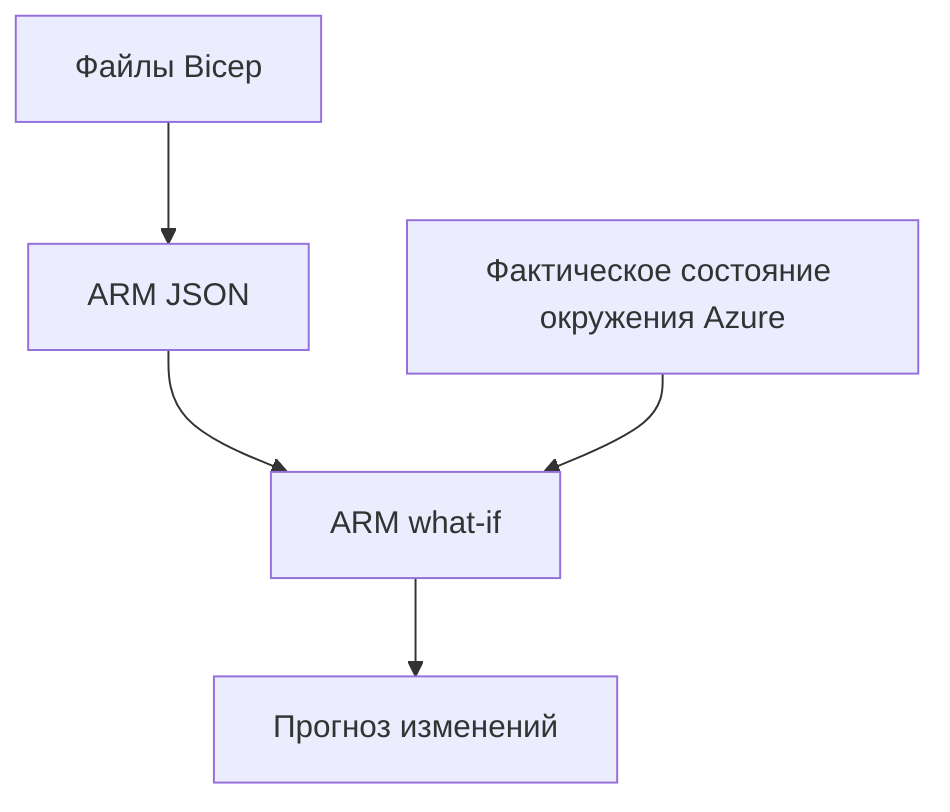

# Окружению нужно описание, которое можно проверить

Сервис работает в одном окружении. Чтобы поднять второе, приходится вспоминать, какие ресурсы понадобились, какие настройки менялись и какими правами удалось устранить последнюю ошибку доступа. Снимок экрана показывает, как выглядит окружение, но по нему не восстановить решений, из которых оно сложилось.

Инфраструктура как код (infrastructure as code, IaC) позволяет описать желаемую конфигурацию ресурсов в файлах, хранить их версии и обсуждать изменения на ревью. Изменение доступа к хранилищу следует проводить через тот же инженерный процесс, что и изменение API, которое читает из него данные. По такому описанию можно воссоздать задуманное окружение и до применения изменений объяснить, чем оно будет отличаться от текущего.

## Как это работает в Azure \{#how-it-works-on-azure}

[Azure Resource Manager (ARM)](https://learn.microsoft.com/ru-ru/azure/azure-resource-manager/management/overview) — слой развёртывания и управления в Azure. Он проверяет подлинность вызывающей стороны и её права, затем направляет запрос на управление нужному сервису. Шаблон ARM (ARM template) — декларативный документ JSON, который описывает ресурсы и их желаемые свойства. Ты передаёшь его в ARM: документ задаёт конфигурацию для развёртывания, а ARM выполняет операции управления.

[Bicep](https://learn.microsoft.com/ru-ru/azure/azure-resource-manager/bicep/overview) — язык для написания таких описаний. В нём ты задаёшь символические имена ресурсов, их типы, версии API и свойства, а компилятор преобразует файл в шаблон ARM JSON. Ссылки на ресурсы определяют зависимости, по которым ARM выстраивает порядок развёртывания. Если перенести объявление выше по файлу, ресурс не начнёт развёртываться раньше только из-за этого.

Один файл Bicep можно вызвать из основного файла как [модуль (module)](https://learn.microsoft.com/ru-ru/azure/azure-resource-manager/bicep/modules). Модуль объединяет связанные ресурсы, принимает параметры и возвращает выходные значения; при компиляции получается вложенное развёртывание. Например, модуль хранилища документов P1 может принимать расположение и теги, а возвращать идентификатор ресурса (resource ID), нужный другим частям системы. Для подключения такого модуля не должно требоваться разбираться во всех настройках хранилища.

Компиляция проверяет описание локально. [Операция what-if](https://learn.microsoft.com/ru-ru/azure/azure-resource-manager/bicep/deploy-what-if) обращается к Azure: сопоставляет предлагаемое развёртывание с фактическим окружением и показывает ожидаемые изменения, не применяя их.



Для предварительного просмотра нужны оба входа: предлагаемое описание и фактическое состояние окружения в Azure. Разница между версиями исходных файлов не покажет изменений, которые кто-то уже внёс в Azure. Предварительный просмотр может обнаружить расхождение даже при неизменном коде, но только для объявленных ресурсов. Ресурсы за пределами шаблона получают статус `Ignore`; их расхождения так не видны. В выводе what-if бывает и шум: например, свойства со значениями по умолчанию могут быть показаны как удалённые, хотя на деле они не удаляются. Любое показанное отличие нужно исследовать, учитывая [ограничения what-if и смысл его результатов](https://learn.microsoft.com/ru-ru/azure/azure-resource-manager/bicep/deploy-what-if).

## Что выбрать и какие ограничения учитывать \{#choosing-and-tradeoffs}

Выбирая язык, ты определяешь, как описывать ресурсы и управлять их жизненным циклом. Отдельно нужно выбрать инструменты для упаковки и развёртывания самого приложения.

| Инструмент | Когда подходит | Когда не подходит и каких затрат требует |
|---|---|---|
| ARM JSON | Нужно поддерживать существующие шаблоны или разбирать результат компиляции Bicep. | Изменения в новых шаблонах, написанных вручную на JSON, читать труднее, чем в эквивалентном Bicep. |
| Bicep | Ресурсы находятся в Azure, нужна семантика развёртывания ARM, а отдельный клиентский файл состояния не нужен. | Плохо подходит, если одной конфигурацией нужно управлять ресурсами разных платформ. |
| Terraform | Команда уже работает с Terraform или ей нужны провайдеры для нескольких платформ. | Даже для небольшого сервиса нужно определить, кто отвечает за состояние и его хранилище (backend), как их защищать и восстанавливать. |
| Azure Developer CLI (`azd`) | Нужен повторяемый процесс работы с кодом приложения и IaC. | Не заменяет описание ресурсов и ревью того, какие ресурсы будут созданы. |

Состояние Terraform (Terraform state) хранит соответствия между конфигурацией и реальными ресурсами; оно может храниться локально или удалённо. Bicep использует механизм развёртывания Azure: отдельный файл состояния Bicep команда не обслуживает. Это различие разобрано в [сравнении Bicep и Terraform](https://learn.microsoft.com/ru-ru/azure/developer/terraform/comparing-terraform-and-bicep). Для каждого ресурса выбери один инструмент, который им управляет. Если один ресурс одновременно ведут оба инструмента, становится трудно разобраться, к чему приведёт следующее изменение.

[Azure Developer CLI](https://learn.microsoft.com/ru-ru/azure/developer/azure-developer-cli/overview) работает с проектами, где инфраструктура описана на Bicep или Terraform. Файл `azure.yaml` описывает сервисы приложения, каталог `infra` содержит инфраструктуру. В [этом процессе](https://learn.microsoft.com/ru-ru/azure/developer/azure-developer-cli/azd-commands) команда `azd provision` создаёт и настраивает инфраструктуру, `azd deploy` развёртывает приложение, а `azd up` объединяет упаковку приложения, подготовку инфраструктуры и развёртывание.

В плане P1 за описание ресурсов отвечает Bicep, за координацию работы с приложением — `azd`. Когда в P1 появится конфигурация проекта для `azd`, команда [`azd provision --preview`](https://learn.microsoft.com/ru-ru/azure/developer/azure-developer-cli/reference#azd-provision) позволит запускать Bicep what-if в рамках этого процесса.

Расхождение конфигурации (configuration drift) возникает, когда фактические настройки окружения отличаются от описанных в исходных файлах. Иногда без срочной правки через портал не обойтись, но если не отразить её в коде, следующее развёртывание может её перезаписать. Реши, сохранить ли исправление в коде или вернуть объявленную конфигурацию. Файл Bicep сам по себе не следит за настройками, поэтому там, где это нужно, запланируй проверки или предварительный просмотр изменений.

[Инкрементное развёртывание (incremental deployment)](https://learn.microsoft.com/ru-ru/azure/azure-resource-manager/templates/deployment-modes) — режим ARM по умолчанию. В этом режиме ресурсы, которых нет в шаблоне, остаются на месте. Свойства объявленных ресурсов применяются заново: пропущенное свойство может вернуться к значению по умолчанию. Поэтому шаблон должен задавать желаемую итоговую конфигурацию ресурса, включая настройки, отличающиеся от стандартных. Если убрать объявление из файла, ресурс не удалится. Когда нужно управляемое удаление ресурсов, актуальное руководство рекомендует использовать стеки развёртывания (deployment stacks), а не переходить в полный режим (`Complete`) ради быстрой очистки.

У what-if есть и другие [ограничения](https://learn.microsoft.com/ru-ru/azure/azure-resource-manager/bicep/deploy-what-if). Если операция не может вычислить `reference()`, в результат могут попасть мнимые изменения. Если не удаётся вычислить выражения ресурса или модуля, what-if может исключить его из анализа. Прежде чем продолжать, прочитай диагностику и разберись с необъяснимыми изменениями.

`Ignore` означает, что ресурс не оценивался: его нет в шаблоне либо what-if упёрся в лимит при раскрытии вложенных шаблонов. Лимиты — 500 шаблонов, 800 групп ресурсов (resource groups) или пять минут. По статусу `Ignore` нельзя судить, менялись ли настройки ресурса. У `NoChange` другой смысл: для свойств объявленного ресурса изменений не ожидается.

## Что это меняет для AI-сервиса \{#in-an-ai-workload}

По плану P1 объединит минимальные API ASP.NET Core в Container Apps, развёртывание модели Foundry, Azure AI Search и Blob Storage. Доступ к Key Vault будет идти через управляемое удостоверение (managed identity), телеметрия — в Application Insights. Для CI/CD будут использоваться Bicep, `azd` и GitHub Actions с OIDC.

Если сразу поместить всю систему в один огромный шаблон, даже первое изменение хранилища будет трудно разобрать на ревью. Начни с модуля, назначение которого можешь объяснить. Затем добавляй модули для поиска, вычислений и удостоверений по мере того, как проясняются их интерфейсы.

Bicep может [создать сам сервис Search](https://learn.microsoft.com/ru-ru/azure/search/search-get-started-bicep), но не все объекты внутри него. [Индексы и наборы навыков](https://learn.microsoft.com/ru-ru/rest/api/searchservice/), а также [векторные поля индексов](https://learn.microsoft.com/ru-ru/azure/search/vector-search-how-to-create-index) относятся к плоскости данных (data plane) и не объявляются как обычные ресурсы Bicep. Храни их определения в коде загрузки документов или в скриптах, вызывающих API Search.

Развёртывание модели Foundry или Azure OpenAI, напротив, — дочерний ресурс ARM [`Microsoft.CognitiveServices/accounts/deployments`](https://learn.microsoft.com/ru-ru/azure/templates/microsoft.cognitiveservices/2026-07-01/accounts/deployments). Укажи в шаблоне `properties.model.version`, `properties.versionUpgradeOption`, `sku.name` и `sku.capacity`. Тогда ревью инфраструктуры будет включать и версию модели, и порядок её обновления, и выбранную ёмкость.

Описание инфраструктуры обеспечивает лишь часть того, что нужно для воспроизводимости. Даже если настройки ресурсов в двух окружениях совпадают, исходные документы, содержимое индексов и поведение поиска могут различаться. Для каждого релиза фиксируй корпус и конфигурацию загрузки документов: повторное создание учётной записи хранения (storage account) не восстановит сами документы. Как документы попадают в индекс, объясняет урок [«Ingestion — индексация»](/rag-agents/part-1-rag/ingestion/).

Предварительный просмотр конфигурации не определит, ссылаются ли ответы на верные источники. Работоспособность инфраструктуры и качество ответов нужно подтверждать отдельными проверками: даже после успешного развёртывания RAG-сервис с пустым индексом вполне может не работать. Если изменение инфраструктуры может повлиять на поведение системы, после него выполни проверки поиска и генерации из урока [Evaluation](/rag-agents/part-1-rag/cross-cutting/evaluation/).

Модуль должен возвращать только нужные потребителям значения, например идентификаторы ресурсов. Правило о ссылках на секреты и значениях, доступных во время выполнения, разобрано в уроке [«Секреты»](/ai-sdlc/part-4-platform/secrets). [Рекомендации Storage](https://learn.microsoft.com/ru-ru/azure/storage/common/storage-account-keys-manage) предлагают авторизацию на основе удостоверений. Если вернуть из модуля ключ учётной записи хранения, секрет распространится по инструментам развёртывания. Выдай приложению удостоверение и необходимые права доступа.

## Попробуй \{#try-it}

Напиши первый модуль P1 для содержимого группы ресурсов: учётную запись хранения для документов из открытых источников. В этом упражнении ты только посмотришь, как будет создана учётная запись хранения. Контейнеры, доступ к данным и остальные части сервиса появятся позже. Работай в каталоге проекта P1, в Bash или zsh, с установленным Azure CLI.

Оба приведённых файла скомпилированы локально компилятором [Bicep 0.48.1](https://github.com/Azure/bicep/releases/tag/v0.48.1) — актуальным выпуском на 17.10.2026. Для работы над курсом подписка Azure пока недоступна. Команды Azure и их флаги сверены с действующим справочником CLI, но **ещё не запускались в реальной подписке**. Результаты облачных шагов ниже — ожидаемое поведение по документации; фактическое развёртывание не проверялось.

Создай каталог и установи закреплённую версию компилятора с помощью [команд Bicep CLI](https://learn.microsoft.com/ru-ru/cli/azure/bicep?view=azure-cli-latest):

```bash
mkdir -p infra/modules
az bicep install --version v0.48.1
az bicep version
```

Сохрани модуль в `infra/modules/p1-resources.bicep`. Версия API, SKU и свойства взяты из [справочника Storage API](https://learn.microsoft.com/ru-ru/azure/templates/microsoft.storage/2026-06-01/storageaccounts). Учётная запись хранения `StorageV2` использует `Standard_LRS`, принимает только HTTPS, требует как минимум `TLS1_2` и запрещает анонимный доступ к BLOB-объектам и авторизацию Shared Key. Такое описание не создаёт частную конечную точку сети и никому не выдаёт доступ к данным. На выходе — идентификатор ресурса хранилища.

```bicep
targetScope = 'resourceGroup'

param location string
param tags object

resource documents 'Microsoft.Storage/storageAccounts@2026-06-01' = {
  name: 'p1docs${uniqueString(resourceGroup().id)}'
  location: location
  tags: tags
  kind: 'StorageV2'
  sku: {
    name: 'Standard_LRS'
  }
  properties: {
    supportsHttpsTrafficOnly: true
    minimumTlsVersion: 'TLS1_2'
    allowBlobPublicAccess: false
    allowSharedKeyAccess: false
  }
}

output storageResourceId string = documents.id
```

Сохрани вызывающий файл в `infra/main.bicep`. Он рассчитан на уже существующую группу ресурсов и не создаёт её. Функция в модуле даёт [детерминированное имя](https://learn.microsoft.com/ru-ru/azure/azure-resource-manager/bicep/bicep-functions-string#uniquestring): для одного и того же идентификатора группы получится одно и то же имя. Это не гарантирует, что имя свободно глобально.

```bicep
targetScope = 'resourceGroup'

param environmentName string = 'iac-lab'
param location string = resourceGroup().location

module p1 './modules/p1-resources.bicep' = {
  name: '${deployment().name}-p1'
  params: {
    location: location
    tags: {
      environment: environmentName
      workload: 'p1-rag'
    }
  }
}

output storageResourceId string = p1.outputs.storageResourceId
```

Скомпилируй оба файла. Параметр [`--stdout`](https://learn.microsoft.com/ru-ru/cli/azure/bicep?view=azure-cli-latest#az-bicep-build) выводит шаблоны JSON, не создавая их рядом с исходными файлами. Ресурсы Azure при компиляции не создаются.

```bash
az bicep build --file infra/modules/p1-resources.bicep --stdout
az bicep build --file infra/main.bicep --stdout
```

Когда появится подписка (subscription), понадобятся права на создание группы ресурсов и развёртывание предлагаемых ресурсов. При уровне валидации [`Provider`, используемом по умолчанию](https://learn.microsoft.com/ru-ru/cli/azure/deployment/group?view=azure-cli-latest#az-deployment-group-what-if), Azure также проверяет права на развёртывание.

[Войди в Azure](https://learn.microsoft.com/ru-ru/cli/azure/authenticate-azure-cli-interactively?view=azure-cli-latest), выведи список подписок и [выбери нужную](https://learn.microsoft.com/ru-ru/cli/azure/account?view=azure-cli-latest): вместо `<id>` подставь её идентификатор из списка, затем проверь результат выбора. Придумай новое имя группы, выделенной только для упражнения. Если политика Azure Policy в твоей подписке запрещает расположение `westeurope`, замени его на разрешённое. После создания пустой [группы](https://learn.microsoft.com/ru-ru/cli/azure/group?view=azure-cli-latest) запусти [what-if](https://learn.microsoft.com/ru-ru/cli/azure/deployment/group?view=azure-cli-latest):

```bash
az login
az account list --output table
subscriptionId="<id>"
az account set --subscription "$subscriptionId"
az account show --output table

rg="rg-p1-iac-lab"
location="westeurope"
az group create --name "$rg" --location "$location"

az deployment group what-if \
  --name p1-preview \
  --resource-group "$rg" \
  --template-file infra/main.bicep \
  --parameters environmentName=iac-lab
```

Если валидация прошла успешно, в пустой группе ожидается предложение создать учётную запись хранения — `Create`, с учётом документированных ограничений what-if. В полном результате проверь имя, расположение, теги и настройки доступа. Затем сравни его со сводкой, где есть только ресурсы, — [`--result-format ResourceIdOnly`](https://learn.microsoft.com/ru-ru/cli/azure/deployment/group?view=azure-cli-latest#az-deployment-group-what-if):

```bash
az deployment group what-if \
  --name p1-preview \
  --resource-group "$rg" \
  --template-file infra/main.bicep \
  --parameters environmentName=iac-lab \
  --result-format ResourceIdOnly
```

Первый предварительный просмотр не развёртывал учётную запись хранения, поэтому второй по-прежнему должен предлагать `Create`. В режиме `ResourceIdOnly` нет подробностей о свойствах. Для ревью настроек доступа используй режим по умолчанию `FullResourcePayloads`: по списку идентификаторов нельзя понять, правильно ли они заданы. Ни один из двух просмотров не покажет, разошлась ли конфигурация уже развёрнутого ресурса.

**Стоимость:** компиляция Bicep выполняется локально; Azure относит [Resource Manager к всегда бесплатным сервисам](https://azure.microsoft.com/en-us/pricing/purchase-options/azure-account). Облачные шаги создают только пустую группу ресурсов и предварительный просмотр развёртывания. Они не создают ресурсы Storage, Search, вычислений или развёртывание модели. В указанных границах упражнение бесплатно.

**Удаление ресурсов:** в той же сессии оболочки удали выделенную для упражнения группу. Исходные файлы сохрани как отправную точку для дальнейшей работы. Когда P1 перейдёт на `azd`, область действия (scope) и структура файлов могут измениться: [стандартный процесс `azd` создаёт группу ресурсов, а развёртывание в уже существующую группу пока находится в предварительной версии (beta)](https://learn.microsoft.com/ru-ru/azure/developer/azure-developer-cli/resource-group-scoped-deployments).

```bash
az group delete --name "$rg" --yes
```

## Что перенести в свою практику \{#what-to-take-away}

- Храни желаемую конфигурацию окружения в файлах, доступных для ревью. Вноси срочные изменения обратно в это описание.
- ARM выполняет операции управления Azure. Bicep компилируется в шаблоны ARM, а модули принимают параметры и возвращают выходные значения.
- Выбирая Bicep или Terraform, явно определи, кто управляет каждым ресурсом и как обслуживается состояние. Используй `azd` для координации работы с приложением.
- До применения изменений разбирай диагностику what-if и семантику инкрементного развёртывания. Пропуск ресурса в шаблоне — ненадёжный способ его удалить.
- Версионируй инфраструктуру вместе с остальными входными данными AI-релиза. Качество поиска и ответов проверяй отдельно.

**[Новые термины](../glossary.md#infrastructure-as-code)**: инфраструктура как код, шаблон ARM, Bicep, состояние Terraform, модуль, what-if, расхождение конфигурации, инкрементное развёртывание, Azure Developer CLI (`azd`).

## Источники \{#sources}

Проверено на 17.10.2026.

- **Механизм и выбор инструментов:** [Azure Resource Manager](https://learn.microsoft.com/ru-ru/azure/azure-resource-manager/management/overview), [Обзор Bicep](https://learn.microsoft.com/ru-ru/azure/azure-resource-manager/bicep/overview), [Модули](https://learn.microsoft.com/ru-ru/azure/azure-resource-manager/bicep/modules), [Bicep и Terraform](https://learn.microsoft.com/ru-ru/azure/developer/terraform/comparing-terraform-and-bicep), [Режимы развёртывания](https://learn.microsoft.com/ru-ru/azure/azure-resource-manager/templates/deployment-modes), [Поведение и ограничения what-if](https://learn.microsoft.com/ru-ru/azure/azure-resource-manager/bicep/deploy-what-if).
- **Работа с приложением:** [Обзор Azure Developer CLI](https://learn.microsoft.com/ru-ru/azure/developer/azure-developer-cli/overview), [Команды Azure Developer CLI](https://learn.microsoft.com/ru-ru/azure/developer/azure-developer-cli/azd-commands), [Справочник azd provision](https://learn.microsoft.com/ru-ru/azure/developer/azure-developer-cli/reference#azd-provision), [Области действия развёртываний azd](https://learn.microsoft.com/ru-ru/azure/developer/azure-developer-cli/resource-group-scoped-deployments).
- **Границы AI-ресурсов:** [Создание Search через Bicep](https://learn.microsoft.com/ru-ru/azure/search/search-get-started-bicep), [API плоскости данных Search](https://learn.microsoft.com/ru-ru/rest/api/searchservice/), [Схема векторного индекса](https://learn.microsoft.com/ru-ru/azure/search/vector-search-how-to-create-index), [API развёртывания модели 2026-07-01](https://learn.microsoft.com/ru-ru/azure/templates/microsoft.cognitiveservices/2026-07-01/accounts/deployments).
- **Упражнение:** [Справочник Bicep CLI](https://learn.microsoft.com/ru-ru/cli/azure/bicep?view=azure-cli-latest), [Установка закреплённой версии компилятора](https://learn.microsoft.com/ru-ru/azure/azure-resource-manager/bicep/bicep-cli), [Выпуск Bicep v0.48.1](https://github.com/Azure/bicep/releases/tag/v0.48.1), [Интерактивный вход](https://learn.microsoft.com/ru-ru/cli/azure/authenticate-azure-cli-interactively?view=azure-cli-latest), [Команды учётной записи](https://learn.microsoft.com/ru-ru/cli/azure/account?view=azure-cli-latest), [Команды групп](https://learn.microsoft.com/ru-ru/cli/azure/group?view=azure-cli-latest), [Команды развёртывания](https://learn.microsoft.com/ru-ru/cli/azure/deployment/group?view=azure-cli-latest), [Storage API 2026-06-01](https://learn.microsoft.com/ru-ru/azure/templates/microsoft.storage/2026-06-01/storageaccounts), [Строковые функции](https://learn.microsoft.com/ru-ru/azure/azure-resource-manager/bicep/bicep-functions-string#uniquestring), [Рекомендации по авторизации Storage](https://learn.microsoft.com/ru-ru/azure/storage/common/storage-account-keys-manage).
- **Стоимость:** [Каталог бесплатных сервисов Azure](https://azure.microsoft.com/en-us/pricing/purchase-options/azure-account).
