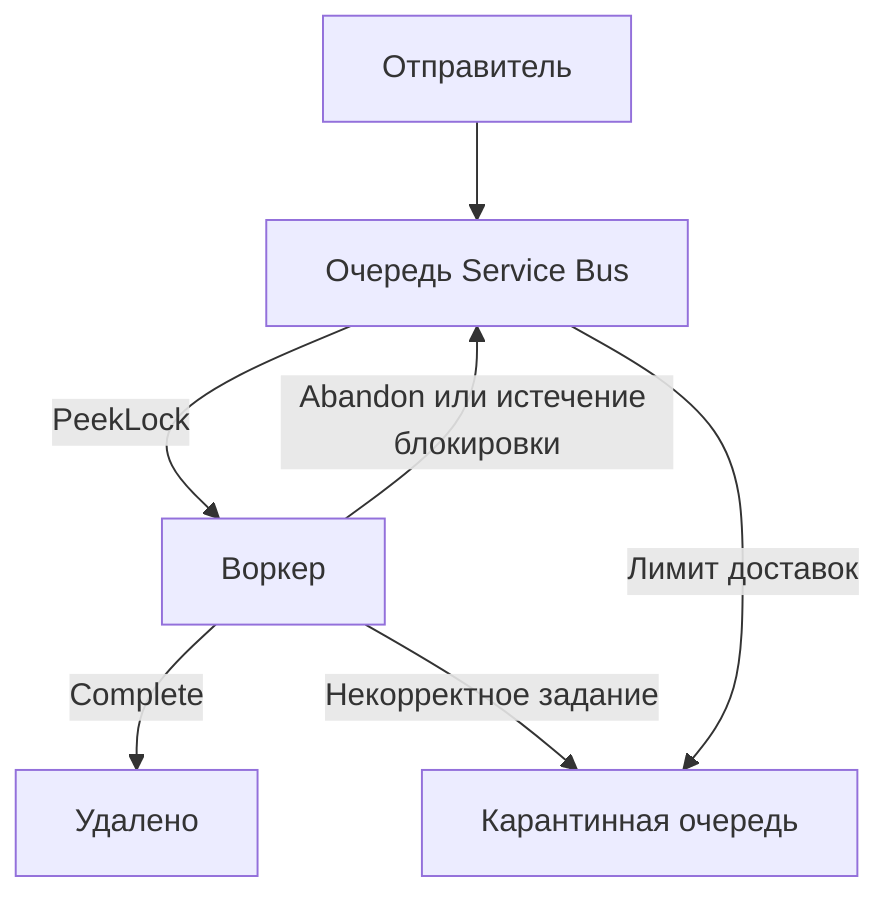

# Принять задание ещё не значит выполнить его

Допустим, при загрузке документа сервис сразу разбирает его содержимое, вычисляет эмбеддинги и обновляет индекс. Пока все эти этапы выполняются внутри запроса загрузки, клиент ждёт ответа от каждой зависимости. Всплеск загрузок оборачивается всплеском вызовов модели. А когда запрос завершается по тайм-ауту, клиенту неизвестно, что произошло: работа могла не начаться, индекс мог обновиться частично или обработка могла закончиться за мгновение до разрыва соединения. Повторный запрос рискует запустить уже выполненную работу ещё раз.

Обмен сообщениями позволяет отправителю передать задание брокеру, который надёжно его хранит, и продолжить работу, не дожидаясь воркера (worker). После ответа «принято» система должна дать возможность узнать, чем задание закончилось. Поэтому сначала выбери контракт обмена сообщениями, а затем сервис. Теперь нужно явно ответить на вопросы, которые раньше скрывал успешный HTTP-ответ: кто отвечает за незавершённую работу, что с ней произойдёт после падения воркера и может ли старая версия документа заменить новую?

## Как это устроено в Azure \{#how-it-works-on-azure}

Сначала различи три [вида сообщений по их назначению](https://learn.microsoft.com/ru-ru/azure/architecture/guide/technology-choices/messaging):

- **Команда (command)** просит потребителя, который отвечает за обработку, выполнить операцию: например, `IndexDocument`.
- **Событие (event)** сообщает об уже произошедшем изменении: например, `DocumentUploaded`.
- **Поток событий (event stream)** хранит последовательность наблюдений, которые потребители затем читают и анализируют.

Эти три контракта обмена сообщениями описывают намерение отправителя: поручить работу, сообщить о произошедшем или передать последовательность наблюдений для анализа. Одно лишь содержимое JSON не позволяет определить, какой из трёх контрактов используется.

### Service Bus хранит задание, пока получатель не сообщит результат \{#service-bus-holds-work-until-a-receiver-settles-it}

В Service Bus **пространство имён (namespace)** [содержит объекты обмена сообщениями и предоставляет конечную точку для доступа к ним](https://learn.microsoft.com/ru-ru/azure/service-bus-messaging/service-bus-messaging-overview). В **очереди (queue)** задания разбирают конкурирующие воркеры. Каждый дополнительный воркер забирает часть накопившейся работы, а не получает копию каждого сообщения.

Для рассылки копий нескольким независимым получателям служат **тема и подписка (topic and subscription)**. Тема направляет копии в именованные подписки, а фильтры определяют, какие сообщения попадут в каждую из них. Подписка хранит свои сообщения, и у неё свои получатели. Они [читают из подписки, а не непосредственно из темы](https://learn.microsoft.com/ru-ru/azure/service-bus-messaging/service-bus-queues-topics-subscriptions).

Получение сообщения не обязательно удаляет его. В режиме **PeekLock** брокер временно закрепляет сообщение за получателем, блокируя получение другими потребителями. После успешной обработки получатель вызывает `Complete`, и брокер удаляет сообщение. Вызов `Abandon` освобождает сообщение для новой попытки; если блокировка истечёт, сообщение тоже может быть доставлено повторно. Действия, которыми получатель сообщает брокеру результат обработки, называются **согласованием результата обработки (settlement)**. В режиме `ReceiveAndDelete` [сообщение удаляется уже при получении](https://learn.microsoft.com/ru-ru/azure/service-bus-messaging/message-transfers-locks-settlement): если воркер упадёт до конца обработки, незавершённая работа может потеряться.



У каждой очереди и подписки на тему есть **карантинная очередь (dead-letter queue, DLQ)** — подочередь для сообщений, исключённых из обычной доставки. Потребитель может сам отправить туда сообщение с некорректным содержимым. Сообщение также попадает в DLQ, если неудачные попытки доставки превысят лимит, [который по умолчанию равен 10](https://learn.microsoft.com/ru-ru/azure/service-bus-messaging/service-bus-dead-letter-queues#maximum-delivery-count).

DLQ сохраняет проблемное сообщение для разбора, но сама не исправляет его и не запускает повторную обработку. В Service Bus [нет автоматической очистки DLQ](https://learn.microsoft.com/ru-ru/azure/service-bus-messaging/service-bus-dead-letter-queues). Назначь ответственного: кто разберёт ошибку, устранит причину и решит, отправлять сообщение заново или удалять.

### Event Grid направляет уведомления, Event Hubs хранит потоки \{#event-grid-routes-notifications-event-hubs-retains-streams}

Event Grid направляет события от источников к обработчикам, которым эти события нужны. Например, Blob Storage [может сообщить о создании BLOB-объекта через системную тему (system topic)](https://learn.microsoft.com/ru-ru/azure/event-grid/system-topics). Подписка на события (event subscription) определяет, какие уведомления направлять обработчику. При доставке по инициативе Event Grid учитывай дубликаты и нарушение порядка поступления. Число попыток ограничено; при некоторых ошибках повторных попыток не будет. Если неудавшиеся уведомления нужно сохранить, [настрой их отправку в карантин](https://learn.microsoft.com/ru-ru/azure/event-grid/delivery-and-retry).

Event Hubs хранит журнал событий, в который можно только добавлять записи. Журнал разбит на **секции (partitions)**: порядок сохраняется внутри каждой секции, а общего порядка для всего Event Hubs нет. **Группы потребителей (consumer groups)** позволяют разным приложениям независимо читать один поток. Если срок хранения ограничен по времени, [до его истечения уже прочитанное событие могут прочитать другие потребители или повторно прочитать тот же потребитель](https://learn.microsoft.com/ru-ru/azure/event-hubs/event-hubs-features).

**Контрольная точка (checkpoint)** [сохраняет позицию, до которой потребитель обработал события в секции](https://learn.microsoft.com/ru-ru/azure/event-hubs/event-processor-balance-partition-load#checkpoint), чтобы после перезапуска продолжить с неё. Сохраняй эту позицию после успешной обработки: если записать её до окончания работы, при перезапуске потребитель может пропустить необработанные события.

## Сначала контракт, затем гарантии \{#choosing-and-tradeoffs}

| Сервис | Когда выбирать | Когда не подходит |
|---|---|---|
| Service Bus | Воркер должен выполнить команду; либо брокер должен надёжно хранить копии для независимых подписчиков, а получатели — сообщать ему результат обработки. | Нужна история телеметрии для многократного анализа: после `Complete` сообщение удаляется. |
| Event Grid | Об изменении состояния нужно уведомить подписанные обработчики, а отправитель не указывает, какие именно. | Уведомления должны поступать в порядке бизнес-изменений либо нужны неограниченные попытки доставки. |
| Event Hubs | Несколько приложений независимо читают сохраняемый поток, каждое со своей позицией; например, анализируют телеметрию обработки документов. | Каждое задание нужно отдельно подтверждать и удалять из очереди, а для проблемных заданий нужна встроенная DLQ. |

Обычно выбор становится понятнее, если сопоставить [гарантии доставки и обработки](https://learn.microsoft.com/ru-ru/azure/service-bus-messaging/compare-messaging-services), а не форматы данных. Все три сервиса могут работать в одной системе. При каждой дополнительной передаче сообщения придётся отдельно обрабатывать возможные сбои.

**Ограничивай повторные попытки.** После временного сетевого сбоя повтори операцию с увеличивающейся задержкой, ограничив число попыток. Некорректный документ от следующей доставки корректным не станет. Если каждый слой независимо повторяет запросы, во время аварии нагрузка может многократно вырасти. Разделяй повторы транспортной операции и попытки выполнить задание целиком; определи, какой слой запускает следующую попытку, а задания с постоянными ошибками направляй на разбор. Учитывай также, что [повтор может ещё раз изменить состояние](https://learn.microsoft.com/ru-ru/azure/architecture/patterns/retry), даже если исходная операция уже прошла успешно.

**Задай ключ, в пределах которого нужен порядок.** Два воркера могут получить сообщения последовательно, а закончить их обработку в обратном порядке. **Сеанс сообщений (message session)** в Service Bus объединяет сообщения по `SessionId` и даёт одному получателю исключительную блокировку сеанса. Если обновления одного документа нужно обрабатывать последовательно, используй идентификатор документа как ключ сеанса и выполняй работу внутри этого сеанса строго по очереди. Разные документы смогут обрабатываться независимо. Сеанс сохраняет порядок сообщений у брокера только внутри своей группы и не исправит порядок версий, если его нарушил отправитель. Сеансы [доступны в Standard и Premium, но не в Basic](https://learn.microsoft.com/ru-ru/azure/service-bus-messaging/message-sessions).

**Обеспечь идемпотентность (idempotency) там, где меняются данные.** Допустим, запись в индекс прошла успешно, а воркер упал до `Complete`. Брокер доставит сообщение повторно — так и должно быть. Потребитель должен [распознать уже выполненную операцию или записать данные так, чтобы повторная запись не меняла результат первого успешного выполнения](https://learn.microsoft.com/ru-ru/azure/service-bus-messaging/service-bus-message-loss-and-duplicates). Идентификатор операции, сохраняемый между попытками, может включать идентификатор документа, версию источника и конфигурацию конвейера приёма документов (ingestion pipeline). Если поставить отметку «обработано» до записи в индекс, работа может потеряться. Если поставить её после записи, сбой всё ещё возможен между записью и отметкой. Предусмотри восстановление на случай такого сбоя, а не рассчитывай, что его удастся избежать.

Вычисление большой партии эмбеддингов может занять больше времени, чем действует блокировка. Продлевай блокировку, только пока обработка действительно продвигается, и обрабатывай повторную доставку, если продление не удалось.

**Обнаружение дубликатов (duplicate detection)** решает другую задачу: отправитель может не получить подтверждение и отправить сообщение ещё раз. В пределах настроенного интервала брокер отбрасывает повторные отправки с тем же ключом сообщения: [для объектов без секционирования это `MessageId`, с секционированием — `MessageId` вместе с `PartitionKey`](https://learn.microsoft.com/ru-ru/azure/service-bus-messaging/duplicate-detection). Функция [доступна в Standard и Premium](https://learn.microsoft.com/ru-ru/azure/service-bus-messaging/duplicate-detection). Брокер при этом не знает, прошла ли запись во внешний индекс. Ни сеансы, ни обнаружение дубликатов не гарантируют, что внешние изменения произойдут ровно один раз.

## Что это меняет для AI-сервиса \{#in-an-ai-workload}

Пока P1 остаётся синхронным: RAG-сервис с минимальными API ASP.NET Core в Container Apps отвечает на вопрос с помощью поискового индекса и развёртывания модели в Foundry. Если помещать каждый вопрос в очередь, придётся менять контракт с клиентом: как ждать ответ, отменять запрос и получать результат. Добавляй эту сложность, только если продукту нужны асинхронные ответы.

Обмен сообщениями пригодится в необязательном P3 — **конвейере приёма документов**. Его можно устроить так: событие о создании BLOB-объекта сообщает о новом входном документе; обработчик проверяет его и отправляет команду индексации в Service Bus. Другой вариант — [направить событие из Event Grid прямо в очередь Service Bus](https://learn.microsoft.com/ru-ru/azure/event-grid/handler-service-bus). Тогда промежуточный обработчик не нужен, а проверять входные данные будет воркер. Воркер независимо от запроса загрузки разбирает документ, делит его на чанки, вычисляет эмбеддинги и обновляет Azure AI Search. Так может выглядеть P3; упражнение ниже не создаёт весь этот конвейер. Решения о чанкинге и метаданных разбираются в уроке [«Ingestion — индексация»](/rag-agents/part-1-rag/ingestion).

Передавай в задании ссылку на BLOB-объект, версию источника, идентификатор операции и идентификатор корреляции (correlation ID). Сам документ оставляй в хранилище, откуда воркер сможет забрать нужную версию. Включай конфигурацию конвейера приёма документов в идентификатор операции, чтобы после смены модели эмбеддингов или правил чанкинга можно было намеренно обработать документ заново. Перед публикацией результата проверяй версии источника, чтобы задержавшееся задание не заменило новые данные старыми. Один только порядок сообщений в сеансе не защитит от устаревших обновлений, если уведомления изначально пришли не по порядку.

Даже при идемпотентной итоговой записи в индекс повторная обработка может снова вызвать платную модель. Где это оправданно, сохраняй промежуточные результаты для повторного использования. Не запускай больше параллельных задач, чем способны обработать зависимости. Сохраняй состояния заданий и различай «принято», «обрабатывается», «проиндексировано» и «ошибка». Следи за тем, сколько времени задания ждут в очереди, как растёт DLQ и с какой скоростью завершается обработка. API может успешно проходить проверки работоспособности, даже если задания в конвейере приёма документов перестали выполняться. Связать эти наблюдения с решениями о релизе поможет урок [«Наблюдаемость, выкатка и аварийный стоп»](/ai-sdlc/part-4-platform/observability-rollout).

## Попробуй \{#try-it}

Создай очередь, которая понадобится P3, и вручную сообщи брокеру результаты двух попыток: успешной и неудачной. Понадобятся локальная оболочка Bash и установленный Azure CLI. Войди под учётной записью пользователя, которому разрешено создавать ресурсы и [назначать роли](https://learn.microsoft.com/ru-ru/azure/role-based-access-control/role-assignments-cli). Вход и настройка `AZURE_SUBSCRIPTION_ID` описаны в [блоке «Попробуй» первого урока](./how-azure-is-organised.md#try-it). Выполняй команды в одной сессии Bash и не закрывай её до удаления ресурсов.

Эти команды **ещё не запускались в действующей подписке Azure**. На 17.10.2026 они сверены с актуальным справочником CLI; шаги в портале и ожидаемые результаты составлены по документации Microsoft.

```bash
msg_suffix="$(date +%s)-$RANDOM"
AZURE_RESOURCE_GROUP="rg-p1-rag-dev-$RANDOM"
msg_namespace="sb-rag-$msg_suffix"
msg_location="westeurope"

az group create \
  --subscription "$AZURE_SUBSCRIPTION_ID" \
  --name "$AZURE_RESOURCE_GROUP" --location "$msg_location" \
  --tags project=p1-rag environment=dev owner=learner --output none

msg_namespace_id=$(az servicebus namespace create \
  --resource-group "$AZURE_RESOURCE_GROUP" --name "$msg_namespace" \
  --location "$msg_location" --sku Basic --disable-local-auth true \
  --query id --output tsv)

az servicebus queue create \
  --resource-group "$AZURE_RESOURCE_GROUP" --namespace-name "$msg_namespace" \
  --name ingest --lock-duration PT5M --output none

msg_user_id=$(az ad signed-in-user show --query id --output tsv)
az role assignment create \
  --assignee-object-id "$msg_user_id" --assignee-principal-type User \
  --role "Azure Service Bus Data Owner" \
  --scope "$msg_namespace_id" --output none
```

Параметр [`--sku Basic`](https://learn.microsoft.com/ru-ru/cli/azure/servicebus/namespace?view=azure-cli-latest#az-servicebus-namespace-create) задан явно: по умолчанию команда создания пространства имён выбирает Standard. Для упражнения с одной очередью самый дешёвый уровень — Basic, но [темы, сеансы и обнаружение дубликатов в нём недоступны](https://azure.microsoft.com/en-us/pricing/details/service-bus/). Значение [`PT5M`](https://learn.microsoft.com/ru-ru/cli/azure/servicebus/queue?view=azure-cli-latest#az-servicebus-queue-create) даёт пять минут, чтобы вручную сообщить брокеру результат обработки, вместо [одной минуты по умолчанию](https://learn.microsoft.com/ru-ru/azure/service-bus-messaging/message-transfers-locks-settlement#renew-locks).

В пространстве имён отключена локальная аутентификация по ключам; используется [аутентификация через Microsoft Entra](https://learn.microsoft.com/ru-ru/azure/service-bus-messaging/authenticate-application). После назначения роли доступа к данным [до вступления разрешений в силу может пройти до пяти минут](https://learn.microsoft.com/ru-ru/azure/service-bus-messaging/authenticate-application#resource-scope). Войди в Azure portal с той же учётной записью и выбери ту же подписку, что и в CLI. Открой созданное пространство имён, затем **Queues → ingest → Service Bus Explorer**. Выполни [операции Explorer](https://learn.microsoft.com/ru-ru/azure/service-bus-messaging/explorer) в следующем порядке:

1. В **Settings** выбери аутентификацию **Microsoft Entra ID** и сохрани настройку.
2. В **Send messages** выбери **Application/Json**, укажи содержимое `{"documentId":"guide-1","version":"v1"}` и задай **Message ID** равным `guide-1-v1` в **Broker properties**. Отключи повторную отправку и отправь сообщение.
3. Переключись в **Receive Mode → Receive messages**, выбери `PeekLock` и получи одно сообщение. Выдели его и нажми **Complete**, пока действует блокировка.
4. Отправь сообщение `{"documentId":"invalid-example"}` с **Message ID** `invalid-example`. Получи его в режиме `PeekLock`, выдели и нажми **Dead-letter**, пока действует блокировка.
5. Выбери подочередь **DeadLetter**, затем **Peek Mode → Peek from start**.

Ожидаемый результат: после **Complete** первое сообщение удалено, а второе видно в **DeadLetter**. Просмотр без извлечения (peek) оставляет сообщение в подочереди. В упражнении не выполняется индексация и нет вызовов модели. Если блокировка истечёт до выбора действия, получи сообщение заново и только затем сообщи результат обработки.

**Стоимость:** в Basic ты платишь за операции; почасовой базовой платы, как в Standard, нет. На 17.10.2026 [розничный счётчик Basic для West Europe](https://prices.azure.com/api/retail/prices?%24filter=serviceName%20eq%20%27Service%20Bus%27%20and%20armRegionName%20eq%20%27westeurope%27%20and%20skuName%20eq%20%27Basic%27&currencyCode=USD) указывает цену 0,05 доллара США за миллион операций. В этом небольшом упражнении операции обмена сообщениями, скорее всего, обойдутся в доли цента. Это оценка, а не гарантия итогового счёта: действия в портале и повторные попытки влияют на число операций. Проверь [цены](https://azure.microsoft.com/en-us/pricing/details/service-bus/) для своих условий оплаты и валюты.

**Удаление ресурсов:** удали отдельную группу ресурсов этого упражнения — вместе с пространством имён и DLQ — и [проверь, что группы больше нет](https://learn.microsoft.com/ru-ru/cli/azure/group?view=azure-cli-latest#az-group-exists):

```bash
az group delete \
  --subscription "$AZURE_SUBSCRIPTION_ID" \
  --name "$AZURE_RESOURCE_GROUP" --yes
az group exists \
  --subscription "$AZURE_SUBSCRIPTION_ID" \
  --name "$AZURE_RESOURCE_GROUP"
```

Ожидаемый ответ последней команды — `false`.

## Что перенести в свою практику \{#what-to-take-away}

- Определи, нужно ли довести работу до конца, сообщить об изменении или анализировать поток наблюдений. От этого зависит выбор сервиса.
- Вызывай `Complete` после успеха. Сделай изменения во внешней системе безопасными при повторной доставке сообщения.
- Задавай порядок по бизнес-ключу и проверяй версии. Сеансы сохраняют порядок у брокера внутри группы; проверка версий защищает от устаревших обновлений.
- Ограничивай повторные попытки и назначай ответственного за задания в DLQ. Приём задания лишь начинает его жизненный цикл — завершение ещё нужно отследить.

**[Новые термины](../glossary.md#messaging)**: команда, событие, поток событий, пространство имён Service Bus, очередь, тема и подписка, согласование результата обработки, PeekLock, карантинная очередь, сеанс сообщений, идемпотентность, обнаружение дубликатов, секция, группа потребителей, контрольная точка.

## Источники \{#sources}

Проверено на 17.10.2026.

Контракты и механизмы обмена сообщениями:

- [Asynchronous messaging options](https://learn.microsoft.com/ru-ru/azure/architecture/guide/technology-choices/messaging)
- [Compare Azure messaging services](https://learn.microsoft.com/ru-ru/azure/service-bus-messaging/compare-messaging-services)
- [Service Bus overview](https://learn.microsoft.com/ru-ru/azure/service-bus-messaging/service-bus-messaging-overview)
- [Queues, topics and subscriptions](https://learn.microsoft.com/ru-ru/azure/service-bus-messaging/service-bus-queues-topics-subscriptions)
- [Message transfers, locks and settlement](https://learn.microsoft.com/ru-ru/azure/service-bus-messaging/message-transfers-locks-settlement)
- [Dead-letter queues](https://learn.microsoft.com/ru-ru/azure/service-bus-messaging/service-bus-dead-letter-queues)
- [Message sessions](https://learn.microsoft.com/ru-ru/azure/service-bus-messaging/message-sessions)
- [Duplicate detection](https://learn.microsoft.com/ru-ru/azure/service-bus-messaging/duplicate-detection)
- [Prevent message loss and duplicate processing](https://learn.microsoft.com/ru-ru/azure/service-bus-messaging/service-bus-message-loss-and-duplicates)
- [Retry pattern](https://learn.microsoft.com/ru-ru/azure/architecture/patterns/retry)
- [Event Grid system topics](https://learn.microsoft.com/ru-ru/azure/event-grid/system-topics)
- [Event Grid delivery and retry](https://learn.microsoft.com/ru-ru/azure/event-grid/delivery-and-retry)
- [Service Bus queues and topics as Event Grid handlers](https://learn.microsoft.com/ru-ru/azure/event-grid/handler-service-bus)
- [Event Hubs features and terminology](https://learn.microsoft.com/ru-ru/azure/event-hubs/event-hubs-features)
- [Partition load balancing for event processing](https://learn.microsoft.com/ru-ru/azure/event-hubs/event-processor-balance-partition-load)

Упражнение, доступ и стоимость:

- [CLI resource groups](https://learn.microsoft.com/ru-ru/cli/azure/group?view=azure-cli-latest)
- [CLI namespaces](https://learn.microsoft.com/ru-ru/cli/azure/servicebus/namespace?view=azure-cli-latest), [queues](https://learn.microsoft.com/ru-ru/cli/azure/servicebus/queue?view=azure-cli-latest), [signed-in user](https://learn.microsoft.com/ru-ru/cli/azure/ad/signed-in-user?view=azure-cli-latest), [role assignments](https://learn.microsoft.com/ru-ru/cli/azure/role/assignment?view=azure-cli-latest)
- [Assign roles with CLI](https://learn.microsoft.com/ru-ru/azure/role-based-access-control/role-assignments-cli)
- [Service Bus Entra authentication](https://learn.microsoft.com/ru-ru/azure/service-bus-messaging/authenticate-application)
- [Service Bus Explorer](https://learn.microsoft.com/ru-ru/azure/service-bus-messaging/explorer)
- [Service Bus pricing](https://azure.microsoft.com/en-us/pricing/details/service-bus/), [Retail Prices API](https://learn.microsoft.com/ru-ru/rest/api/cost-management/retail-prices/azure-retail-prices)
