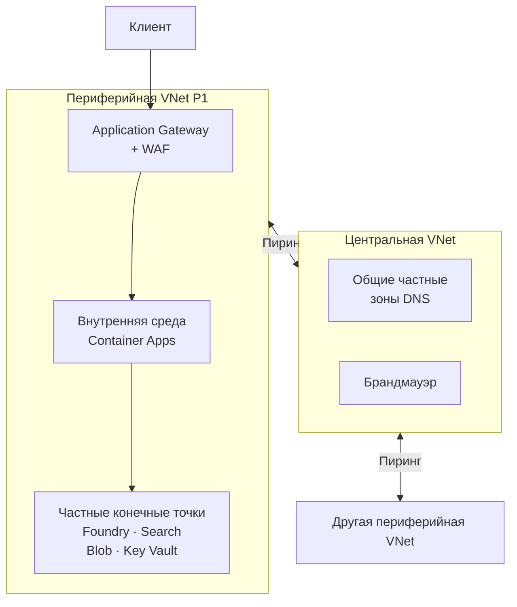

# Даже с верным удостоверением нужен сетевой путь

API может предъявлять верные учётные данные и всё равно не подключаться к базе данных. Имя сервиса разрешается в недоступный адрес, правила блокируют пакеты или до частной сети нет маршрута. Дополнительные права ни одну из этих проблем не исправят.

Бывает и обратная ситуация: на схеме зависимость находится внутри частного контура, а в действительности доступна из интернета. Границу доступа задаёт конфигурация сети. Для каждого соединения выясни, кто его начинает, к какому имени обращается, в какой адрес оно разрешается и какие правила действуют для трафика. Затем проверь, имеет ли вызывающая сторона право выполнить нужную операцию.

## Как Azure прокладывает сетевой путь \{#how-azure-builds-the-path}

[Azure Virtual Network (VNet, виртуальная сеть)](https://learn.microsoft.com/ru-ru/azure/virtual-network/virtual-networks-overview) даёт ресурсам частное адресное пространство и возможность взаимодействовать по сети. Подсеть (subnet) выделяет часть этого пространства для ресурсов или интеграции с сервисом. Планируй адреса сразу для подсети приложения, подсети конечных точек и сетей организации: диапазоны не должны пересекаться с сетями, которые ты собираешься подключать в будущем.

К подсети можно привязать средства сетевой защиты, но сама подсеть ресурсы не изолирует. [Группа безопасности сети (NSG)](https://learn.microsoft.com/ru-ru/azure/virtual-network/network-security-groups-overview) разрешает или запрещает входящие и исходящие пакеты по адресам отправителя и получателя, портам и протоколу. Azure проверяет правила в порядке возрастания числового приоритета и останавливается на первом совпадении внутри этой NSG. Правила учитывают состояние соединения: для ответа на разрешённое исходящее соединение отдельное входящее правило не нужно.

NSG можно привязать к подсети или сетевому интерфейсу. Если действуют обе группы, [трафик должен пройти оба набора правил](https://learn.microsoft.com/ru-ru/azure/virtual-network/network-security-group-how-it-works): разрешение в одной не отменяет запрет в другой. Стандартные правила разрешают трафик с тегом `VirtualNetwork` и исходящий трафик в интернет до заключительных запрещающих правил, поэтому разделение на две подсети само по себе не мешает им обмениваться трафиком.

Azure создаёт [системный маршрут `0.0.0.0/0` с типом следующего перехода (next hop type) `Internet`](https://learn.microsoft.com/ru-ru/azure/virtual-network/virtual-networks-udr-overview). Однако ни наличие маршрута, ни разрешение в NSG не гарантируют выход в публичную сеть. Если новая VNet создана через [версию API, вышедшую после 31 марта 2026 года](https://learn.microsoft.com/ru-ru/azure/virtual-network/ip-services/default-outbound-access), её подсети по умолчанию частные: `defaultOutboundAccess=false`. Виртуальным машинам в них нужен явно настроенный выход к публичным конечным точкам: шлюз NAT, исходящие правила Standard Load Balancer, публичный IP-адрес или брандмауэр, через который пользовательский маршрут (user-defined route, UDR) направляет трафик. Это правило не меняет существующие VNet и не распространяется на делегированные подсети PaaS, где исходящие соединения организует сам сервис.

[Частная конечная точка (private endpoint)](https://learn.microsoft.com/ru-ru/azure/private-link/private-endpoint-overview) — сетевой интерфейс с частным IP-адресом в твоей подсети, через который доступен поддерживаемый сервис по Azure Private Link. Ты получаешь частную точку доступа к управляемому сервису, а сам он продолжает работать на инфраструктуре Microsoft, за пределами твоей подсети. Одобрение подключения и настройку публичного сетевого доступа проверяй отдельно: создание частной конечной точки не обязательно закрывает публичный доступ.

[Конечная точка службы (service endpoint)](https://learn.microsoft.com/ru-ru/azure/virtual-network/virtual-network-service-endpoints-overview) устроена иначе. Она позволяет поддерживаемому сервису распознавать трафик разрешённой подсети, который идёт по магистральной сети Azure. Нужно включить конечную точку в подсети и настроить сетевое правило на стороне сервиса. Имя сервиса по-прежнему разрешается в публичный IP-адрес; сетевой интерфейс с частным адресом не создаётся.

Частная зона DNS (private DNS zone) хранит записи, доступные через [связи с VNet](https://learn.microsoft.com/ru-ru/azure/dns/private-dns-virtual-network-links). Для частной конечной точки Blob Storage используется зона [`privatelink.blob.core.windows.net`](https://learn.microsoft.com/ru-ru/azure/private-link/private-endpoint-dns). В приложении сохраняется обычное имя хранилища: цепочка разрешения DNS приводит к частному IP-адресу конечной точки. [Не заменяй обычное имя сервиса в конфигурации приложения на имя с `privatelink`](https://learn.microsoft.com/ru-ru/azure/storage/common/storage-private-endpoints). Если используешь собственный DNS, настрой пересылку нужных запросов. Пиринг VNet (VNet peering) сам по себе не связывает сеть с частной зоной DNS. Проверяй разрешение имён из сети, где работает вызывающая сторона, а не только со своего ноутбука.

Приложению, которое обращается к частным зависимостям, тоже нужно подключение к VNet. Возможности интеграции с VNet (VNet integration) зависят от сервиса размещения. [Интеграция App Service подключает приложение к VNet для исходящих вызовов](https://learn.microsoft.com/ru-ru/azure/app-service/overview-vnet-integration); для частного входящего доступа нужна отдельная частная конечная точка. В [Container Apps собственную VNet выбирают при создании среды](https://learn.microsoft.com/ru-ru/azure/container-apps/networking), выделяя среде отдельную подсеть. У внутренней среды Container Apps публичной конечной точки нет. Поэтому отдельно решай, как запросы приходят в приложение и как оно обращается к зависимостям.

[Топология hub-and-spoke (центральная сеть и периферийные сети)](https://learn.microsoft.com/ru-ru/azure/architecture/networking/architecture/hub-spoke) объединяет общие подключения, пересылку DNS и проверку исходящего трафика в центральной VNet; каждой рабочей нагрузке выделяют периферийную VNet. Ниже — проектная схема для P1 в проде. В учебном упражнении она не развёртывается.



[Пиринг нетранзитивен](https://learn.microsoft.com/ru-ru/azure/virtual-network/virtual-networks-faq): если две периферийные сети связаны с центральной, это ещё не создаёт связи между ними. Наличие брандмауэра в центральной сети тоже не означает, что он проверяет каждый пакет: нужный трафик должны направлять через него маршруты. Для одного небольшого сервиса может хватить одной VNet. Центральная сеть оправдана, когда нужны общие подключения или централизованная эксплуатация.

Схема пиринга не гарантирует изоляцию. [Тег `VirtualNetwork` включает сети, подключённые пирингом, и префиксы подключённых локальных сетей](https://learn.microsoft.com/ru-ru/azure/virtual-network/service-tags-overview); это же описано в [руководстве по диагностике NSG](https://learn.microsoft.com/ru-ru/azure/virtual-network/diagnose-network-traffic-filter-problem). Если маршрут существует, стандартные разрешающие правила могут пропустить трафик между периферийными сетями. Общие зоны DNS администрируют вместе с центральной сетью и явно связывают с сетями, которым нужно разрешать эти имена: пиринг таких связей не создаёт.

## Сначала определи границу доступа, затем выбирай продукт \{#choosing-boundaries}

Сначала определи, откуда должна быть доступна зависимость. «К зависимости можно обратиться только из сети приложения» и «данные может читать только указанное удостоверение» — разные требования. Запиши оба до выбора конечной точки.

| Доступ к зависимости | Когда подходит | Когда отказаться или пересмотреть выбор |
|---|---|---|
| Публичная конечная точка с аутентификацией по токену | Требования к упражнению или рабочей нагрузке допускают доступ к зависимости из интернета, а доступ к данным ограничен удостоверениями и правами. | Требования прямо запрещают публичный сетевой доступ. |
| Конечная точка службы и сетевые правила сервиса | Поддерживаемый сервис должен принимать обращения из выбранных подсетей Azure через свой публичный адрес. | Нужен частный IP-адрес назначения или частный доступ из подключённых локальных сетей. |
| Частная конечная точка и частный DNS | Для поддерживаемого сервиса нужен частный адрес назначения. | Нет ответственного за DNS, подключение клиентов или дополнительные расходы, а без этого схема соединения остаётся неполной. |

NSG фильтрует пакеты: она не проверяет путь в HTTP-запросе и не распознаёт пользователя приложения. Брандмауэр веб-приложений (web application firewall, WAF) проверяет веб-запросы, но API по-прежнему должно аутентифицировать вызывающие стороны и проверять их права. Для входящего трафика (ingress) выбирай точку входа по протоколу и географическому охвату. [Руководство Azure по доставке приложений](https://learn.microsoft.com/ru-ru/azure/networking/design-guide/app-delivery) сравнивает три варианта:

| Точка входа | Что обрабатывает | Когда не подходит |
|---|---|---|
| Azure Front Door | Глобальная маршрутизация HTTP(S) на периферии сети, проверка работоспособности серверов-источников и кэширование. Возможности WAF зависят от выбранного уровня. | Нужны TCP/UDP без HTTP или простая региональная точка входа для упражнения. |
| Application Gateway | Региональный обратный прокси HTTP(S): завершение TLS, маршрутизация по имени хоста и пути. Проверка веб-запросов доступна при настройке WAF. | Нужна глобальная периферийная точка входа или только балансировка на транспортном уровне. |
| Azure Load Balancer | Распределение потоков TCP/UDP и пробы работоспособности. Маршрутизации HTTP и WAF нет. | Нужны маршрутизация по URL или правила защиты веб-приложения. |

Эти сервисы решают разные задачи, поэтому для всех трёх перед небольшим API нужна конкретная причина. Отдельно проверь соединение Front Door с сервером-источником: для подключения через Private Link [требуется уровень Premium](https://learn.microsoft.com/ru-ru/azure/frontdoor/billing). В общем случае публичная точка входа не требует, чтобы сервер за ней оставался доступен из интернета.

Типичные причины сбоя: публичный доступ уже отключён, а DNS всё ещё возвращает публичный адрес; у инженера нет маршрута к VNet; слишком широкое запрещающее правило блокирует трафик, необходимый платформе. Прежде чем полагаться на NSG для частной конечной точки, проверь [сетевые политики её подсети](https://learn.microsoft.com/ru-ru/azure/private-link/disable-private-endpoint-network-policy). При диагностике сначала проверь разрешение имени, затем маршрут и фильтрацию пакетов, после — токен и права в сервисе. Если сразу расширить доступ, можно скрыть исходную ошибку.

## Что это меняет для AI-сервиса \{#in-an-ai-workload}

В P1 сервис на минимальных API ASP.NET Core работает в Container Apps: находит подходящие документы, обращается к развёртыванию модели в Foundry и возвращает ответ со ссылками на источники. Релевантность и фильтрация документов по правам пользователя разобраны в [уроке о поиске](/rag-agents/part-1-rag/retrieval/). Сеть определяет, с какими системами можно связаться; какие документы вправе видеть конкретный пользователь, решается отдельно.

Для регионального размещения в проде предлагается такая цепочка запросов: клиент → публичный Application Gateway с WAF → внутренняя среда Container Apps → частные конечные точки зависимостей. Microsoft описывает [сочетание Application Gateway и внутренней среды Container Apps](https://learn.microsoft.com/ru-ru/azure/container-apps/waf-app-gateway), включая частный DNS для серверной части. Выдели шлюзу отдельную подсеть, среде Container Apps — подсеть только для этого сервиса, а конечным точкам зависимостей — ещё одну. Явно укажи разрешённые потоки между ними, не считая всю периферийную сеть доверенной.

Для этой схемы P1 выбери внутреннюю среду с профилями рабочих нагрузок (workload profiles). [Сетевой тип среды Container Apps нельзя изменить после её создания](https://learn.microsoft.com/ru-ru/azure/container-apps/networking). Учебная среда использует сеть Azure по умолчанию, поэтому для перехода к предложенной схеме её придётся создать заново. Как создать среду, разобрано в уроке о вычислительной среде.

В предлагаемой схеме исходящие вызовы API будут идти по отдельным частным подключениям к [Microsoft Foundry](https://learn.microsoft.com/ru-ru/azure/foundry/how-to/configure-private-link), [Azure AI Search](https://learn.microsoft.com/ru-ru/azure/search/service-create-private-endpoint), [Blob Storage](https://learn.microsoft.com/ru-ru/azure/storage/common/storage-private-endpoints) и [Key Vault](https://learn.microsoft.com/ru-ru/azure/key-vault/general/private-link-service). Для каждой зависимости настрой нужные записи DNS, проверь доступ из API и затем отключи публичный доступ, если этого требуют условия. Управляемому удостоверению (managed identity) API [по-прежнему нужны соответствующие права в каждом сервисе](https://learn.microsoft.com/ru-ru/azure/container-apps/managed-identity).

Включи в проект и соединения между сервисами: индексатор Search должен читать частный Blob через [общий частный канал (shared private link)](https://learn.microsoft.com/ru-ru/azure/search/search-indexer-howto-access-private). Если позже добавишь агентов, доступ Foundry к Search пойдёт через частную конечную точку Search. [Руководство по изоляции Foundry](https://learn.microsoft.com/ru-ru/azure/foundry/how-to/configure-private-link) требует задать индексатору `executionEnvironment` со значением `"Private"`, когда загрузка документов идёт через частные конечные точки. Иначе выполнение в мультитенантной среде может молча не сработать и оставить индекс пустым.

Доступ нужен и эксплуатационным процессам. Загрузчик документов должен обращаться к Blob и Search. Заданию развёртывания, которое проверяет частные конечные точки данных, тоже нужно сетевое соединение с ними. [OIDC в GitHub Actions избавляет от хранимых учётных данных Azure](https://learn.microsoft.com/ru-ru/azure/developer/github/connect-from-azure-openid-connect), но не обеспечивает сетевой доступ. Ограничивая исходящий трафик (egress), сохрани доставку телеметрии в Application Insights; для частного приёма данных Azure Monitor предусмотрена [отдельная схема с Private Link](https://learn.microsoft.com/ru-ru/azure/azure-monitor/fundamentals/private-link-security). Запиши эти соединения рядом со схемой развёртывания (Bicep, `azd`). Иначе после изменения сети сервис удастся развернуть, но наполнить его документами или диагностировать сбой уже не получится.

В учебном проекте используются публичные конечные точки и доступ без ключей (keyless access), чтобы уложиться в небольшой учебный бюджет. У [частных конечных точек есть почасовая плата и плата за обработку данных](https://azure.microsoft.com/en-us/pricing/details/private-link/), у [Front Door — базовая плата](https://learn.microsoft.com/ru-ru/azure/frontdoor/billing), у [Application Gateway v2 — фиксированная плата и плата за используемую ёмкость](https://learn.microsoft.com/ru-ru/azure/application-gateway/understanding-pricing). Для частных конечных точек [Search нужен уровень Basic или выше](https://learn.microsoft.com/ru-ru/azure/search/service-create-private-endpoint). Поэтому схему для прода ты здесь только проектируешь. Даже если сервис доступен из интернета, данные не должны быть доступны анонимно: сохраняй аутентификацию по токенам, ограниченные права на данные и проверку прав вызывающей стороны в API.

Даже частная сеть не помешает API с необходимыми правами отправить найденный текст не тому получателю. Проверяй разрешённые адреса назначения для исходящего трафика и права инструментов; дополни эту проверку материалом [урока об ограничителях безопасности](/rag-agents/part-1-rag/cross-cutting/guardrails/). Сетевые правила ограничивают доступные соединения, а приложение должно определять, какие данные можно по ним передавать.

## Попробуй \{#try-it}

Дополни архитектурные заметки P1 предложенной схемой для прода. Покажи запрос пользователя, загрузку документов, проверки при развёртывании и отправку телеметрии. Отметь, что публичные конечные точки в учебном проекте — осознанный выбор ради учебного бюджета. Если подписки Azure нет, на этой схеме можно остановиться: создание ресурсов необязательно.

Для необязательной практики с ресурсами понадобятся активная подписка, права на создание группы ресурсов и сетевых ресурсов, локальный терминал Bash и установленный Azure CLI. **Эти команды ещё не запускались в действующей подписке Azure.** Они проверены по актуальному справочнику CLI; ожидаемые результаты ниже взяты из документации, а не из наблюдений за развёртыванием.

Войди через [`login`](https://learn.microsoft.com/ru-ru/cli/azure/reference-index?view=azure-cli-latest#az-login) и выбери подписку через [`account set`](https://learn.microsoft.com/ru-ru/cli/azure/account?view=azure-cli-latest#az-account-set). Вместо `YOUR_SUBSCRIPTION_ID` укажи идентификатор своей подписки. Переменные понадобятся и для удаления ресурсов в том же терминале.

```bash
az login
p1_subscription='YOUR_SUBSCRIPTION_ID' # Replace with your subscription ID.
az account set --subscription "$p1_subscription"
p1_rg="rg-p1-network-$RANDOM-$RANDOM"
p1_location=westeurope
```

Создай пустую сеть: группу ресурсов, NSG, VNet с диапазоном `10.42.0.0/16` и подсеть приложения `10.42.0.0/27`, привязанную к NSG. Размер `/27` [соответствует минимуму для среды с профилями рабочих нагрузок; подсеть делегируется `Microsoft.App/environments`](https://learn.microsoft.com/ru-ru/azure/container-apps/custom-virtual-networks). Для прежней среды Consumption-only минимум — `/23`. Саму среду Container Apps эти команды не создают; это упражнение не определяет размер подсети для рабочей нагрузки в проде.

Справочник команд: [`group create`](https://learn.microsoft.com/ru-ru/cli/azure/group?view=azure-cli-latest#az-group-create), [`nsg create`](https://learn.microsoft.com/ru-ru/cli/azure/network/nsg?view=azure-cli-latest#az-network-nsg-create), [`vnet create`](https://learn.microsoft.com/ru-ru/cli/azure/network/vnet?view=azure-cli-latest#az-network-vnet-create), [`subnet create`](https://learn.microsoft.com/ru-ru/cli/azure/network/vnet/subnet?view=azure-cli-latest#az-network-vnet-subnet-create).

```bash
az group create --name "$p1_rg" --location "$p1_location" --output none
az network nsg create --resource-group "$p1_rg" --name nsg-p1-app \
  --location "$p1_location" --output none
az network vnet create --resource-group "$p1_rg" --name vnet-p1 \
  --location "$p1_location" --address-prefixes 10.42.0.0/16 --output none
az network vnet subnet create --resource-group "$p1_rg" \
  --vnet-name vnet-p1 --name snet-app --address-prefixes 10.42.0.0/27 \
  --delegations Microsoft.App/environments --network-security-group nsg-p1-app --output none
```

Проверь [привязку NSG к подсети](https://learn.microsoft.com/ru-ru/cli/azure/network/vnet/subnet?view=azure-cli-latest#az-network-vnet-subnet-show) и выведи [правила вместе со стандартными](https://learn.microsoft.com/ru-ru/cli/azure/network/nsg/rule?view=azure-cli-latest#az-network-nsg-rule-list):

```bash
az network vnet subnet show --resource-group "$p1_rg" \
  --vnet-name vnet-p1 --name snet-app \
  --query networkSecurityGroup.id --output tsv
az network nsg rule list --resource-group "$p1_rg" \
  --nsg-name nsg-p1-app --include-default --output table
```

Идентификатор NSG у подсети должен заканчиваться на `/networkSecurityGroups/nsg-p1-app`. В списке должно быть [шесть стандартных правил](https://learn.microsoft.com/ru-ru/azure/virtual-network/network-security-groups-overview): `AllowVNetInBound`, `AllowAzureLoadBalancerInBound`, `DenyAllInBound`, `AllowVnetOutBound`, `AllowInternetOutBound`, `DenyAllOutBound`. Объясни в заметках, почему они не изолируют уровни приложения друг от друга.

Для [`list-effective-nsg` нужен сетевой интерфейс (NIC) работающей виртуальной машины (VM)](https://learn.microsoft.com/ru-ru/azure/virtual-network/diagnose-network-traffic-filter-problem); в упражнении такой машины нет. Здесь ты проверяешь только конфигурацию. Работоспособность соединений приложения эта проверка не подтверждает.

**Стоимость:** эта пустая сеть бесплатна: [за использование VNet плата не взимается](https://learn.microsoft.com/ru-ru/azure/virtual-network/virtual-networks-overview#pricing), [NSG не требует дополнительной платы](https://learn.microsoft.com/ru-ru/azure/virtual-machines/overview). Команды не создают вычислительные ресурсы, частные конечные точки, зоны DNS, пиринговые соединения или платные сервисы для входящего трафика.

**Удаление ресурсов:** в том же терминале удали временную группу через [`group delete`](https://learn.microsoft.com/ru-ru/cli/azure/group?view=azure-cli-latest#az-group-delete). Архитектурные заметки P1 сохрани.

```bash
az group delete --name "$p1_rg" --yes
```

## Что перенести в свою практику \{#what-to-take-away}

- Проверяй DNS, маршруты, фильтрацию пакетов и права доступа отдельно. Если сетевого соединения нет, дополнительные права его не создадут.
- Частная конечная точка даёт частный адрес назначения; конечная точка службы использует публичный адрес сервиса. Настройку публичного доступа проверяй отдельно.
- Выбирай точку входа по протоколу и географическому охвату. Прежде чем закрывать доступ, учти загрузчик документов, CI и телеметрию.
- Спроектируй частную сеть P1 для прода. В учебном проекте оставь публичный доступ с аутентификацией без ключей ради учебного бюджета.

**[Новые термины](../glossary.md#networking)**: VNet, подсеть, NSG, частная конечная точка, конечная точка службы, частная зона DNS, интеграция с VNet, входящий трафик, исходящий трафик, топология hub-and-spoke, пиринг VNet, WAF.

## Источники \{#sources}

Проверено 17.10.2026.

- **Границы сети:** [Virtual Network](https://learn.microsoft.com/ru-ru/azure/virtual-network/virtual-networks-overview), [Правила NSG](https://learn.microsoft.com/ru-ru/azure/virtual-network/network-security-groups-overview), [Проверка правил NSG](https://learn.microsoft.com/ru-ru/azure/virtual-network/network-security-group-how-it-works), [Hub-and-spoke](https://learn.microsoft.com/ru-ru/azure/architecture/networking/architecture/hub-spoke), [Вопросы и ответы о VNet](https://learn.microsoft.com/ru-ru/azure/virtual-network/virtual-networks-faq).
- **Маршрутизация и настройки по умолчанию:** [Системные маршруты](https://learn.microsoft.com/ru-ru/azure/virtual-network/virtual-networks-udr-overview), [Исходящий доступ по умолчанию](https://learn.microsoft.com/ru-ru/azure/virtual-network/ip-services/default-outbound-access), [Теги служб](https://learn.microsoft.com/ru-ru/azure/virtual-network/service-tags-overview), [Границы VNet и планирование адресов](https://learn.microsoft.com/ru-ru/azure/virtual-network/concepts-and-best-practices).
- **Конечные точки и DNS:** [Частные конечные точки](https://learn.microsoft.com/ru-ru/azure/private-link/private-endpoint-overview), [Конечные точки служб](https://learn.microsoft.com/ru-ru/azure/virtual-network/virtual-network-service-endpoints-overview), [Зоны DNS для частных конечных точек](https://learn.microsoft.com/ru-ru/azure/private-link/private-endpoint-dns), [Связи частного DNS с VNet](https://learn.microsoft.com/ru-ru/azure/dns/private-dns-virtual-network-links), [Сетевые политики частных конечных точек](https://learn.microsoft.com/ru-ru/azure/private-link/disable-private-endpoint-network-policy).
- **Сеть приложения:** [Интеграция App Service](https://learn.microsoft.com/ru-ru/azure/app-service/overview-vnet-integration), [Сеть Container Apps](https://learn.microsoft.com/ru-ru/azure/container-apps/networking), [Настройка VNet для Container Apps](https://learn.microsoft.com/ru-ru/azure/container-apps/vnet-custom), [Выбор сервисов доставки приложений](https://learn.microsoft.com/ru-ru/azure/networking/design-guide/app-delivery), [Application Gateway с Container Apps](https://learn.microsoft.com/ru-ru/azure/container-apps/waf-app-gateway).
- **Настройка подсети и индексатора:** [Требования к подсети Container Apps](https://learn.microsoft.com/ru-ru/azure/container-apps/custom-virtual-networks), [Общие частные каналы Search](https://learn.microsoft.com/ru-ru/azure/search/search-indexer-howto-access-private).
- **Зависимости и эксплуатация P1:** [Изоляция Foundry](https://learn.microsoft.com/ru-ru/azure/foundry/how-to/configure-private-link), [Частный доступ к Search](https://learn.microsoft.com/ru-ru/azure/search/service-create-private-endpoint), [Частный доступ к Storage](https://learn.microsoft.com/ru-ru/azure/storage/common/storage-private-endpoints), [Private Link для Key Vault](https://learn.microsoft.com/ru-ru/azure/key-vault/general/private-link-service), [Управляемое удостоверение Container Apps](https://learn.microsoft.com/ru-ru/azure/container-apps/managed-identity), [OIDC в GitHub Actions](https://learn.microsoft.com/ru-ru/azure/developer/github/connect-from-azure-openid-connect), [Private Link для Azure Monitor](https://learn.microsoft.com/ru-ru/azure/azure-monitor/fundamentals/private-link-security).
- **Стоимость:** [Цены Virtual Network](https://azure.microsoft.com/en-us/pricing/details/virtual-network/), [Стоимость NSG в таблице компонентов VM](https://learn.microsoft.com/ru-ru/azure/virtual-machines/overview), [Цены Private Link](https://azure.microsoft.com/en-us/pricing/details/private-link/), [Тарификация Front Door](https://learn.microsoft.com/ru-ru/azure/frontdoor/billing), [Модель оплаты Application Gateway](https://learn.microsoft.com/ru-ru/azure/application-gateway/understanding-pricing).
- **CLI и проверка конфигурации:** [`az login`](https://learn.microsoft.com/ru-ru/cli/azure/reference-index?view=azure-cli-latest#az-login), [`az account`](https://learn.microsoft.com/ru-ru/cli/azure/account?view=azure-cli-latest), [`az group`](https://learn.microsoft.com/ru-ru/cli/azure/group?view=azure-cli-latest), [`az network vnet`](https://learn.microsoft.com/ru-ru/cli/azure/network/vnet?view=azure-cli-latest), [`az network vnet subnet`](https://learn.microsoft.com/ru-ru/cli/azure/network/vnet/subnet?view=azure-cli-latest), [`az network nsg`](https://learn.microsoft.com/ru-ru/cli/azure/network/nsg?view=azure-cli-latest), [`az network nsg rule`](https://learn.microsoft.com/ru-ru/cli/azure/network/nsg/rule?view=azure-cli-latest), [Диагностика действующих правил безопасности](https://learn.microsoft.com/ru-ru/azure/virtual-network/diagnose-network-traffic-filter-problem).
