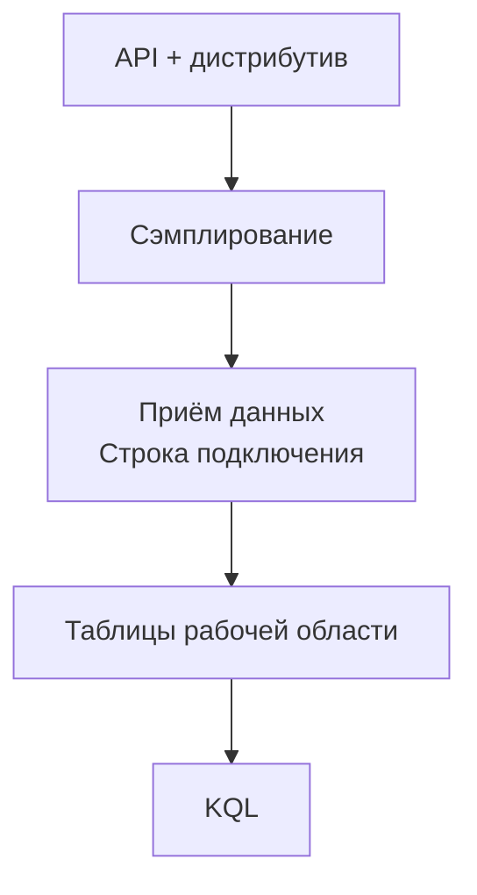

# Работающий сервис должен давать данные для разбора медленных запросов

API может проходить проверку работоспособности, оставаться доступным и возвращать успешные ответы, а пользователь при этом ждёт слишком долго. Возможно, приложение повторяет неудачные вызовы другого сервиса. Возможно, почти всё время уходит на поиск. Или сервер чего-то ждёт, а это ожидание никто не измеряет. Сообщение в консоли «Запрос завершён» не поможет различить эти причины. Данные о работе внутри запроса нужно собрать до того, как понадобится выяснять, что произошло.

**Наблюдаемость (observability)** начинается с вопросов, на которые ты рассчитываешь получить ответ: какая операция замедлилась, какой вызов другого сервиса завершился ошибкой, началось ли это после развёртывания новой версии? Собирая всё подряд, ты дорого платишь за попытку обойтись без выбора этих вопросов. Для RAG-сервиса есть ещё одно ограничение: даже если ответ успешно получен, это само по себе не доказывает, что приведённые источники подтверждают его утверждения.

## Как это устроено в Azure \{#how-it-works-on-azure}

[Azure Monitor](https://learn.microsoft.com/ru-ru/azure/azure-monitor/fundamentals/overview) собирает и анализирует телеметрию приложений и инфраструктуры и позволяет реагировать на обнаруженные проблемы. В него входит Application Insights — средство мониторинга производительности приложений. В Application Insights ты исследуешь входящие запросы, исходящие вызовы зависимостей, ошибки и связи между ними. Разбор начинается с поведения сервиса, а не с инфраструктуры, на которой он работает.

**Рабочая область Log Analytics (Log Analytics workspace)** — ресурс Azure, в котором хранятся таблицы журналов и трейсов (traces). Сначала ты создаёшь эту рабочую область, затем открываешь Log Analytics — инструмент портала для запросов к её данным.

Запросы пишут на KQL (Kusto Query Language). Рабочая область Azure Monitor (Azure Monitor workspace) — другой тип ресурса: она [хранит метрики Prometheus и OpenTelemetry, к которым обращаются через PromQL](https://learn.microsoft.com/ru-ru/azure/azure-monitor/fundamentals/overview). В упражнении нужна рабочая область Log Analytics.

У [Application Insights на основе рабочей области](https://learn.microsoft.com/ru-ru/azure/azure-monitor/app/create-workspace-resource) телеметрия хранится в связанной рабочей области Log Analytics. Там же начисляется плата за приём данных (ingestion) и хранение.

Создание этих ресурсов лишь подготавливает место для телеметрии. Приложение ещё должно формировать телеметрию и отправлять её в хранилище — выполнять экспорт (export). Отсутствие строки о запросе может объясняться неполадкой в инструментировании (instrumentation) или экспорте, а не тем, что запроса не было.



Когда записи не находятся, проверь весь путь: не исключило ли сэмплирование (sampling) нужную операцию, указывает ли [строка подключения Application Insights (connection string)](https://learn.microsoft.com/ru-ru/azure/azure-monitor/app/opentelemetry-enable?tabs=aspnetcore) на нужный ресурс, к таблицам какой рабочей области обращается запрос.

OpenTelemetry задаёт общие правила инструментирования и экспорта телеметрии. Дистрибутив OpenTelemetry (OpenTelemetry distribution) объединяет SDK, библиотеки инструментирования и настройки отправки данных. Например, [Azure Monitor OpenTelemetry distribution for ASP.NET Core](https://learn.microsoft.com/ru-ru/dotnet/api/overview/azure/monitor.opentelemetry.aspnetcore-readme?view=azure-dotnet) собирает трейсы входящих запросов ASP.NET Core и исходящих вызовов `HttpClient`, а также метрики и журналы приложения. Благодаря этому не приходится вручную добавлять записи в журнал до и после каждого HTTP-вызова. Но такое инструментирование не объяснит автоматически, почему поиск выбрал конкретные фрагменты, и не оценит ответ модели.

У рекомендации по выбору дистрибутива должна быть дата. На 17.10.2026 [руководство Microsoft по настройке](https://learn.microsoft.com/ru-ru/azure/azure-monitor/app/opentelemetry-enable?tabs=aspnetcore) рекомендует Microsoft OpenTelemetry Distro для новых приложений .NET. В нём же сказано, что тем, кто уже использует Azure Monitor OpenTelemetry Distro, менять его не требуется, а инициализировать оба дистрибутива в одном приложении не следует. В [P1](../part-5-projects/rag-service.md#milestones) выбери дистрибутив на шаге инструментирования; сейчас ты создаёшь ресурсы для приёма телеметрии, общие для обоих вариантов.

## Какие данные нужны для диагностики \{#choosing-and-tradeoffs}

Один пользовательский запрос может вызвать несколько исходящих обращений, включая повторные попытки, поэтому считай их отдельно. Различай телеметрию запросов (request telemetry) — записи о входящих операциях приложения — и телеметрию зависимостей (dependency telemetry) — записи об исходящих вызовах. Вызов зависимости может завершиться ошибкой, а запрос в итоге — успешно. Если считать обе категории пользовательскими запросами, общий объём обращений и доля ошибок не будут отражать то, что видит пользователь.

| Что выбрать | Для каких задач | Когда не подходит |
|---|---|---|
| Телеметрия запросов и зависимостей | Найти медленные конечные точки, неудачные вызовы и понять, на что уходит время | Когда нужно доказать правильность сгенерированного ответа |
| Записи журнала приложения | Зафиксировать конкретное событие или решение, которое не видно при обычном инструментировании HTTP | Когда в журнал собираются целиком отправлять все документы, промпты и ответы |
| Общая рабочая область | Совместно исследовать связанную телеметрию | Когда требования к месту хранения данных или администрированию различаются |
| Отдельные рабочие области | Разделить данные по месту хранения, доступу и ответственности | Когда рабочие области создают для каждого компонента по привычке, а затем собирают данные из нескольких рабочих областей для одного разбора |

Выбирая [архитектуру рабочих областей](https://learn.microsoft.com/ru-ru/azure/azure-monitor/logs/workspace-design), ты определяешь границы хранения, доступа и ответственности за данные. Для учебного проекта достаточно одной рабочей области. В крупном сервисе сначала определи, кто вправе читать телеметрию и где она должна храниться, и лишь затем решай, что объединять. В телеметрию могут попадать данные приложения, поэтому удобство запросов — только одно из требований.

Повторяющиеся сообщения уровня Information и большие объекты увеличивают объём принимаемых данных, но не обязательно помогают объяснить очередной сбой. Сохраняй названия операций, длительности, коды результата и осознанно выбранные диагностические поля. Токенам доступа и исходному тексту пользовательских вопросов в обычных журналах места нет. Даже если документы взяты из открытых источников, вопрос к ним может раскрывать личные сведения.

Сэмплирование сохраняет телеметрию лишь для части операций и тем самым уменьшает объём трейсов. В обоих дистрибутивах для .NET по умолчанию используется отбор с ограничением частоты: пять трейсов в секунду. Это описано для [Azure Monitor Distro](https://learn.microsoft.com/ru-ru/dotnet/api/overview/azure/monitor.opentelemetry.aspnetcore-readme?view=azure-dotnet#customizing-sampling-behavior) и [Microsoft OpenTelemetry Distro с экспортом в Azure Monitor](https://learn.microsoft.com/ru-ru/azure/azure-monitor/app/opentelemetry-sampling). В Microsoft OpenTelemetry Distro для .NET по умолчанию также действует отбор записей журнала по трейсам: записи, связанные с отброшенными трейсами, тоже отбрасываются. Поэтому в запросах к данным нужно учитывать вес `ItemCount`, даже если ты явно не настраиваешь сэмплирование.

Меньший объём данных обходится дешевле, но отдельного неудачного запроса и его записей в журнале может не оказаться среди сохранённых данных. Прежде чем доверять графику, на котором нет ошибок, выясни, какие данные вообще дошли до хранилища. Если каждое действие должно быть учтено отдельно, телеметрия с сэмплированием не годится как единственный источник записей.

Приём и хранение данных решают разные задачи. За приём ты платишь при сборе, а срок хранения (retention) определяет, как долго данные будут доступны для разбора. В Azure Monitor Logs [плата и за приём, и за хранение зависит от объёма данных](https://learn.microsoft.com/ru-ru/azure/azure-monitor/logs/cost-logs); тарифы различаются по регионам. Сокращение срока хранения не отменит плату за уже принятые данные. Прежде чем продлевать его, реши, нужен ли подробный интерактивный анализ за весь период или достаточно изредка обращаться к старым данным.

Для таблиц Application Insights, включая `AppRequests` и `AppDependencies`, [по умолчанию предусмотрено 90 дней без платы за хранение](https://learn.microsoft.com/ru-ru/azure/azure-monitor/logs/data-retention-configure). Настройки можно менять для каждой таблицы отдельно. Это не освобождает от платы за приём данных. Значение по умолчанию для рабочей области не определяет срок хранения всех её таблиц: проверь фактические настройки каждой, прежде чем обещать, как долго будут доступны записи.

[Дневной лимит приёма данных (daily cap)](https://learn.microsoft.com/ru-ru/azure/azure-monitor/logs/daily-cap) пригодится как запасная мера при неожиданном скачке объёма. Когда порог достигнут, сбор для затронутых таблиц останавливается до сброса лимита. Данные могут перестать поступать как раз во время сбоя. Объём собранных данных может превысить порог, и превышение оплачивается. Для обычного регулирования объёма используй фильтрацию и сэмплирование; дневной лимит не гарантирует точного ограничения расходов.

## Что это меняет для AI-сервиса \{#in-an-ai-workload}

В проекте P1 ты создашь сервис с минимальными API на ASP.NET Core в Azure Container Apps. Сервис будет искать фрагменты через Azure AI Search, обращаться к развёртыванию модели в Microsoft Foundry и отвечать со ссылками на небольшой набор документов из открытых источников. Исходные документы будут храниться в Blob Storage. Опиши ресурсы для телеметрии в Bicep рядом с остальной инфраструктурой: так при повторном создании сервиса ты получишь те же ресурсы для приёма данных.

Допустим, конечная точка ответа работает медленно, хотя запросы завершаются успешно. Сначала оцени входящие запросы за выбранный период в целом, затем — исходящие вызовы за тот же период. Если медленны сами исходящие вызовы, начни с зависимостей. Если измеренные вызовы быстрые, а входящие запросы всё равно медленные, направление разбора будет другим. Складывать длительности зависимостей и считать сумму длительностью запроса нельзя: вызовы могут идти параллельно, а между ними приложение может выполнять другую работу. Для разбора одной операции сопоставь относящиеся к ней записи по идентификаторам корреляции.

Зачем собирать данные о шагах конвейера, объясняет урок [Observability](/rag-agents/part-1-rag/cross-cutting/observability/) курса RAG & Agents. В этом уроке достаточно выяснить, видны ли входящие запросы и исходящие вызовы. Спаны (spans) вызовов модели, учёт токенов и оценка качества относятся к уроку «Оценка качества и трассировка» в Части III. По обычной HTTP-телеметрии нельзя установить, верные ли фрагменты вернул Azure AI Search.

Ещё до развёртывания реши, на какие показатели будешь опираться при выкатке новой версии. Для P1 нужны ошибки запросов, задержка и результат оценки качества ответов. Как использовать такие показатели при выпуске, разбирает урок [«Наблюдаемость, выкатка и аварийный стоп»](/ai-sdlc/part-4-platform/observability-rollout) курса AI SDLC. Успешный HTTP-ответ со ссылками, которые не подтверждают утверждения, остаётся ошибкой качества, даже когда инфраструктурные панели не показывают проблем.

## Попробуй \{#try-it}

Создай ресурсы для приёма телеметрии P1 в отдельной учебной группе ресурсов (resource group). После проверки удали их, а файл Bicep сохрани: позже его можно будет включить в инфраструктуру проекта. Для упражнения нужны Azure CLI, инструменты Bicep, активная подписка (subscription) и права на развёртывание ресурсов.

Команды Azure сверены с актуальным справочником CLI, но не выполнялись в действующей подписке: доступной подписки для проверки не было. Запрос KQL проверен по документированным схемам таблиц и операторам, без выполнения на реальных данных. Пример Bicep скомпилирован с Bicep CLI `0.48.1`. Успешная компиляция не подтверждает наличие прав в подписке или доступность сервисов.

Сохрани файл `observability.bicep`. В нём закреплены версии API: [workspaces `2023-09-01`](https://learn.microsoft.com/ru-ru/azure/templates/microsoft.operationalinsights/2023-09-01/workspaces) и [components `2020-02-02`](https://learn.microsoft.com/ru-ru/azure/templates/microsoft.insights/2020-02-02/components). Для рабочей области выбран тариф с оплатой по мере использования (pay-as-you-go), SKU `PerGB2018`, и срок хранения по умолчанию 30 дней. Политику таблиц Application Insights всё равно нужно проверять отдельно. Шаблон выводит идентификаторы обоих ресурсов.

```bicep
param location string = resourceGroup().location

resource logs 'Microsoft.OperationalInsights/workspaces@2023-09-01' = {
  name: 'rag-observability-logs'
  location: location
  properties: {
    sku: {
      name: 'PerGB2018'
    }
    retentionInDays: 30
  }
}

resource insights 'Microsoft.Insights/components@2020-02-02' = {
  name: 'rag-observability-insights'
  location: location
  kind: 'web'
  properties: {
    Application_Type: 'web'
    WorkspaceResourceId: logs.id
  }
}

output workspaceResourceId string = logs.id
output applicationInsightsResourceId string = insights.id
```

Замени `<id>` идентификатором своей подписки и выполни команды в Bash из каталога с файлом. Если группа с таким именем уже содержит другую работу, выбери для упражнения новое имя группы. Справочники команд: [вход](https://learn.microsoft.com/ru-ru/cli/azure/reference-index?view=azure-cli-latest#az-login), [выбор подписки](https://learn.microsoft.com/ru-ru/cli/azure/account?view=azure-cli-latest#az-account-set), [группа ресурсов](https://learn.microsoft.com/ru-ru/cli/azure/group?view=azure-cli-latest), [развёртывание](https://learn.microsoft.com/ru-ru/cli/azure/deployment/group?view=azure-cli-latest).

```bash
az login
AZURE_SUBSCRIPTION_ID="<id>"
az account set --subscription "$AZURE_SUBSCRIPTION_ID"

lab_group='rg-p1-observability-lab'
lab_region='westeurope'
az group create \
  --subscription "$AZURE_SUBSCRIPTION_ID" \
  --name "$lab_group" --location "$lab_region" \
  --tags project=p1-rag environment=dev owner=learner
az deployment group create \
  --subscription "$AZURE_SUBSCRIPTION_ID" \
  --name p1-observability \
  --resource-group "$lab_group" \
  --template-file observability.bicep

az deployment group show \
  --subscription "$AZURE_SUBSCRIPTION_ID" \
  --name p1-observability \
  --resource-group "$lab_group" \
  --query properties.outputs --output json
```

После успешного [развёртывания](https://learn.microsoft.com/ru-ru/azure/azure-resource-manager/bicep/deploy-cli) ты увидишь состояние `Succeeded`, а в выходных значениях — идентификаторы рабочей области и ресурса Application Insights. Открой Application Insights в портале и убедись, что к нему привязана рабочая область `rag-observability-logs`. На странице Overview находится строка подключения, которая позже понадобится приложению.

В рабочей области Log Analytics открой Logs и выбери [режим KQL](https://learn.microsoft.com/ru-ru/azure/azure-monitor/logs/log-analytics-tutorial). В запросах к этой рабочей области таблицы называются [`AppRequests`](https://learn.microsoft.com/ru-ru/azure/azure-monitor/reference/tables/apprequests) и [`AppDependencies`](https://learn.microsoft.com/ru-ru/azure/azure-monitor/reference/tables/appdependencies). В примерах со схемой совместимости Application Insights могут встречаться имена `requests` и `dependencies`. Когда в P1 появится инструментирование и пойдут запросы к приложению, выполни следующий запрос KQL. Он оценит, сколько было входящих операций и исходящих вызовов, сколько из них завершилось ошибкой и каков 95-й процентиль длительности (p95) для каждой группы:

```kusto
union withsource=Signal AppRequests, AppDependencies
| where TimeGenerated > ago(1h)
| summarize Items=sum(ItemCount),
            Failed=sumif(ItemCount, Success == false),
            P95Ms=percentilew(DurationMs, ItemCount, 95)
    by Signal, Name
| order by Failed desc
```

Оператор [`union`](https://learn.microsoft.com/ru-ru/kusto/query/union-operator?view=microsoft-fabric) объединяет данные двух таблиц, а столбец `Signal` позволяет различать их в результате. `ItemCount` показывает, сколько элементов представляет сохранённая запись; [`sumif`](https://learn.microsoft.com/ru-ru/kusto/query/sumif-aggregation-function?view=microsoft-fabric) складывает эти веса для неудачных операций. При сэмплировании с ограничением частоты веса могут меняться вместе с нагрузкой. Функция [`percentilew`](https://learn.microsoft.com/ru-ru/kusto/query/percentilesw-aggregation-function?view=microsoft-fabric) учитывает веса `ItemCount` и оценивает p95 длительности в миллисекундах для операций, которые представляют сохранённые записи. Эти оценки не вернут подробности отброшенных операций и не исправят ошибку экспорта, а при малом объёме данных разобраться в работе сервиса будет трудно.

Само упражнение только создаёт ресурсы и не отправляет запросы к приложению, поэтому заполненных таблиц пока не будет. [Таблица без данных приложения может вообще не отображаться](https://learn.microsoft.com/ru-ru/azure/azure-monitor/logs/log-analytics-tutorial). В [руководстве по настройке](https://learn.microsoft.com/ru-ru/azure/azure-monitor/app/opentelemetry-enable?tabs=aspnetcore) указано, что после инструментирования телеметрия может появиться через несколько минут. Если запрос ничего не возвращает, сначала проверь настройки экспорта, выбранную рабочую область и временной диапазон запроса. Пустой результат ещё не говорит, что сервис работает без ошибок.

**Стоимость:** пустая рабочая область с оплатой по мере использования [ничего не стоит, пока в неё не начнут поступать данные](https://learn.microsoft.com/ru-ru/azure/azure-monitor/logs/quick-create-workspace). В этом упражнении к ней не подключено приложение, отправляющее телеметрию, и не включены платные тесты или оповещения. Когда P1 начнёт отправлять данные, учитывай расходы на [приём и хранение](https://azure.microsoft.com/en-us/pricing/details/monitor/). Запросы к таблицам Analytics включены в стоимость, пока данные доступны для интерактивного анализа. До начала сбора проверь региональный тариф и сопоставь его с учебным бюджетом в 10 долларов США в месяц.

**Удаление ресурсов:** в той же сессии Bash удали только отдельную учебную группу вместе с обоими ресурсами телеметрии. Локальный файл Bicep оставь для повторного создания. Перед подтверждением удаления проверь имя группы:

```bash
az group delete --subscription "$AZURE_SUBSCRIPTION_ID" --name "$lab_group"
az group exists --subscription "$AZURE_SUBSCRIPTION_ID" --name "$lab_group" --output json
```

Проверка существования группы должна вернуть [`false`](https://learn.microsoft.com/ru-ru/cli/azure/get-started-tutorial-1-prepare-environment?tabs=bash&view=azure-cli-latest). Для рабочей области действует [обратимое удаление (soft delete) в течение 14 дней](https://learn.microsoft.com/ru-ru/azure/azure-monitor/logs/delete-workspace). За это время можно восстановить рабочую область и её данные: заново создать группу и развернуть сохранённый Bicep в той же подписке, с теми же именами группы и рабочей области и в том же регионе (region). То же имя рабочей области в той же группе, но в другом регионе [приведёт к ошибке](https://learn.microsoft.com/ru-ru/azure/azure-monitor/logs/quick-create-workspace#troubleshooting).

## Что перенести в свою практику \{#what-to-take-away}

- Application Insights помогает исследовать поведение приложения; связанная рабочая область хранит данные, и в ней учитывается плата за приём и хранение.
- После создания ресурсов нужны инструментирование, экспорт и обращения к приложению. Без них разбирать запросы и вызовы зависимостей пока нечего.
- Ошибки входящих запросов и исходящих вызовов считай отдельно. Сэмплирование и пропуски в данных ограничивают выводы, которые можно сделать.
- Осознанно выбирай объём данных и срок хранения. При достижении дневного лимита возможны пробелы в телеметрии, а превышение порога всё равно оплачивается.
- Успешный HTTP-ответ требует отдельной проверки качества ответа модели.

**[Новые термины](../glossary.md#observability)**: наблюдаемость, Azure Monitor, рабочая область Log Analytics, Log Analytics, Application Insights, дистрибутив OpenTelemetry, телеметрия запросов, телеметрия зависимостей, KQL, приём данных, срок хранения, сэмплирование, дневной лимит приёма данных.

## Источники \{#sources}

Проверено на 17.10.2026.

- **Платформа и сбор данных:** [Обзор Azure Monitor](https://learn.microsoft.com/ru-ru/azure/azure-monitor/fundamentals/overview), [Обзор Log Analytics](https://learn.microsoft.com/ru-ru/azure/azure-monitor/logs/log-analytics-overview), [Создание и настройка Application Insights](https://learn.microsoft.com/ru-ru/azure/azure-monitor/app/create-workspace-resource), [Azure Monitor Distro для .NET](https://learn.microsoft.com/ru-ru/dotnet/api/overview/azure/monitor.opentelemetry.aspnetcore-readme?view=azure-dotnet), [Актуальная настройка OpenTelemetry](https://learn.microsoft.com/ru-ru/azure/azure-monitor/app/opentelemetry-enable?tabs=aspnetcore).
- **Выбор настроек и стоимость:** [Архитектура рабочих областей](https://learn.microsoft.com/ru-ru/azure/azure-monitor/logs/workspace-design), [Сэмплирование](https://learn.microsoft.com/ru-ru/azure/azure-monitor/app/opentelemetry-sampling), [Расчёт стоимости журналов](https://learn.microsoft.com/ru-ru/azure/azure-monitor/logs/cost-logs), [Хранение данных](https://learn.microsoft.com/ru-ru/azure/azure-monitor/logs/data-retention-configure), [Дневной лимит](https://learn.microsoft.com/ru-ru/azure/azure-monitor/logs/daily-cap), [Создание рабочей области](https://learn.microsoft.com/ru-ru/azure/azure-monitor/logs/quick-create-workspace), [Удаление и восстановление рабочей области](https://learn.microsoft.com/ru-ru/azure/azure-monitor/logs/delete-workspace), [Цены Azure Monitor](https://azure.microsoft.com/en-us/pricing/details/monitor/).
- **Ресурсы и команды:** [API рабочей области](https://learn.microsoft.com/ru-ru/azure/templates/microsoft.operationalinsights/2023-09-01/workspaces), [API Application Insights](https://learn.microsoft.com/ru-ru/azure/templates/microsoft.insights/2020-02-02/components), [Вход через CLI](https://learn.microsoft.com/ru-ru/cli/azure/reference-index?view=azure-cli-latest#az-login), [Выбор подписки в CLI](https://learn.microsoft.com/ru-ru/cli/azure/account?view=azure-cli-latest#az-account-set), [Группы ресурсов в CLI](https://learn.microsoft.com/ru-ru/cli/azure/group?view=azure-cli-latest), [Окружение CLI и проверка существования](https://learn.microsoft.com/ru-ru/cli/azure/get-started-tutorial-1-prepare-environment?tabs=bash&view=azure-cli-latest), [Развёртывания через CLI](https://learn.microsoft.com/ru-ru/cli/azure/deployment/group?view=azure-cli-latest), [Развёртывание Bicep через CLI](https://learn.microsoft.com/ru-ru/azure/azure-resource-manager/bicep/deploy-cli).
- **Запросы:** [Схема AppRequests](https://learn.microsoft.com/ru-ru/azure/azure-monitor/reference/tables/apprequests), [Схема AppDependencies](https://learn.microsoft.com/ru-ru/azure/azure-monitor/reference/tables/appdependencies), [Объединение таблиц](https://learn.microsoft.com/ru-ru/kusto/query/union-operator?view=microsoft-fabric), [Условная сумма](https://learn.microsoft.com/ru-ru/kusto/query/sumif-aggregation-function?view=microsoft-fabric), [Взвешенные процентили](https://learn.microsoft.com/ru-ru/kusto/query/percentilesw-aggregation-function?view=microsoft-fabric).
- **Интерфейс запросов и сервисы проекта:** [Работа с Log Analytics](https://learn.microsoft.com/ru-ru/azure/azure-monitor/logs/log-analytics-tutorial), [Container Apps](https://learn.microsoft.com/ru-ru/azure/container-apps/overview), [Azure AI Search](https://learn.microsoft.com/ru-ru/azure/search/search-what-is-azure-search), [Microsoft Foundry](https://learn.microsoft.com/ru-ru/azure/foundry/what-is-foundry), [Blob Storage](https://learn.microsoft.com/ru-ru/azure/storage/blobs/storage-blobs-overview).
