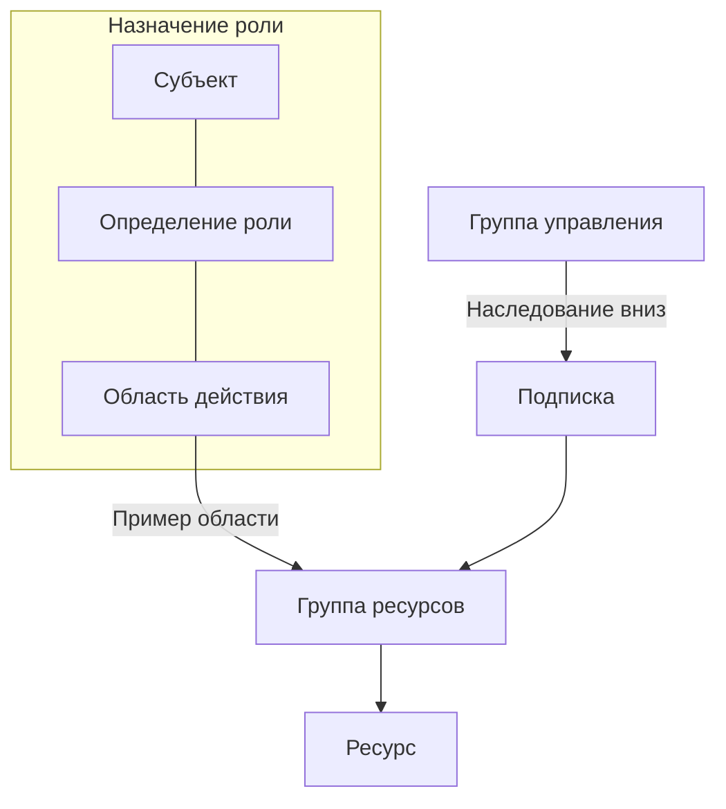

# Даже с действительным токеном нужны права на чтение документа

RAG-сервис может получить действительный токен и всё равно столкнуться с отказом при чтении BLOB-объекта. Аутентификация устанавливает, кто обращается к сервису. Авторизация определяет, разрешена ли этому субъекту конкретная операция с конкретным ресурсом. Если подставить общий ключ хранилища, ошибка, возможно, исчезнет. Но вместе с доступом к нужному документу приложение может получить гораздо больше прав.

В проекте P1 у API, которое отвечает на вопросы, обработчика загрузки документов и CI разные задачи: API читает данные из зависимых сервисов, обработчик обновляет корпус, CI развёртывает приложение. Каждой рабочей нагрузке нужны собственное удостоверение и права, соответствующие её задачам. Доступ без ключей (keyless access) убирает хранимые ключи из этих подключений; разрешения для каждого компонента тебе всё равно нужно продумать. Урок [«Секреты»](/ai-sdlc/part-4-platform/secrets/) объясняет, почему значения учётных данных нужно держать вне репозитория и контекста программирующего агента.

## Как Azure предоставляет доступ \{#azure-mechanism}

В [Azure RBAC](https://learn.microsoft.com/ru-ru/azure/role-based-access-control/overview), системе управления доступом на основе ролей (role-based access control), **назначение роли (role assignment)** связывает три элемента:

- **Субъект безопасности** — пользователь, группа, субъект-служба или управляемое удостоверение, которому предоставляют права.
- **Определение роли (role definition)** — перечень разрешённых операций.
- **Область действия (scope)** — ресурсы, на которые распространяется назначение.

Когда субъект запрашивает операцию, Azure RBAC проверяет его разрешения.

[Иерархия областей действия](https://learn.microsoft.com/ru-ru/azure/role-based-access-control/scope-overview) устроена так: группа управления → подписка → группа ресурсов → ресурс. Права наследуются сверху вниз. Роль `Reader` на отдельном ресурсе не отменяет `Contributor`, унаследованную от подписки. Разрешения суммируются с учётом назначений запрета и применимых условий. Для поддерживаемых типов вложенных ресурсов можно задать ещё более узкую область — например, контейнер BLOB-объектов. Прежде чем считать права на отдельный ресурс минимально необходимыми, проверь, что унаследовано от родительских уровней.

Плоскость управления (control plane) охватывает управление ресурсом, а плоскость данных (data plane) — работу с его содержимым.

Настройка учётной записи хранения (storage account) и чтение BLOB-объектов требуют разных разрешений. В [определении роли](https://learn.microsoft.com/ru-ru/azure/role-based-access-control/role-definitions) операции управления задаются через `Actions` и `NotActions`, операции с данными — через `DataActions` и `NotDataActions`. Владение ресурсом само по себе не даёт права напрямую читать BLOB-объекты по токену Entra. Однако с правами управления можно получить ключи некоторых сервисов, а с ролью `Owner` — предоставить доступ. При проверке прав учитывай обе плоскости и косвенные способы добраться до данных.

Приложению ещё нужен источник токена. [`DefaultAzureCredential`](https://learn.microsoft.com/ru-ru/dotnet/azure/sdk/authentication/credential-chains) перебирает заранее настроенную цепочку источников: среди них переменные среды, удостоверение рабочей нагрузки, управляемое удостоверение и инструменты разработчика. Локально это удобно: приложение может использовать удостоверение, с которым ты входишь через Azure CLI.

Для прода Microsoft рекомендует [детерминированные учётные данные (deterministic credential)](https://learn.microsoft.com/ru-ru/dotnet/azure/sdk/authentication/best-practices#use-deterministic-credentials-in-production-environments): выбери конкретный источник токена, например `ManagedIdentityCredential`, и используй один и тот же экземпляр повторно.

Можно оставить `DefaultAzureCredential`, ограничив цепочку переменной `AZURE_TOKEN_CREDENTIALS=ManagedIdentityCredential`. Начиная с `Azure.Identity` [1.15.0 цепочка использует только этот источник](https://learn.microsoft.com/ru-ru/dotnet/azure/sdk/authentication/credential-chains#use-a-specific-credential), а начиная с версии [1.16.0 дополнительно включается режим повторных попыток для прода](https://learn.microsoft.com/ru-ru/dotnet/azure/sdk/authentication/best-practices#resilient-mode).

Ниже показано, как выбрать учётные данные на C# с [API `Azure.Identity` 1.17.2 — стабильной версии пакета](https://learn.microsoft.com/ru-ru/dotnet/api/azure.identity.managedidentityid?view=azure-dotnet). Фрагмент собран для `net10.0` с .NET SDK 10.0.402 и пакетом `Azure.Identity` 1.17.2; проверено 19.10.2026. Оба варианта создания объекта учётных данных выполнены локально на .NET 10.0.13. Токены не запрашивались, обращения к реальной подписке Azure не выполнялись. Значения `isProduction` и `runtimeClientId` поступают из конфигурации среды выполнения. Сохрани полученный объект учётных данных и повторно используй его при создании клиентов сервисов.

```csharp
using Azure.Core;
using Azure.Identity;

TokenCredential credential = isProduction
    ? new ManagedIdentityCredential(
        ManagedIdentityId.FromUserAssignedClientId(runtimeClientId))
    : new DefaultAzureCredential();
```

В P1 используется управляемое удостоверение, назначаемое пользователем (user-assigned): так назначения ролей сохраняются при замене среды выполнения. Варианты жизненного цикла разобраны в уроке [«Удостоверения I»](./entra-id.md). Для [Azure Container Apps](https://learn.microsoft.com/ru-ru/azure/container-apps/managed-identity) нужно и подключить удостоверение к приложению, и предоставить ему права на зависимые сервисы. Если ты просто укажешь в коде идентификатор клиента этого удостоверения, оно не подключится к приложению и не получит прав.

Для CI в GitHub токен поступает иначе. При [федерации удостоверений рабочей нагрузки (workload identity federation)](https://learn.microsoft.com/ru-ru/entra/workload-id/workload-identity-federation) в Entra настраивается доверие к внешнему издателю, субъекту токена и аудитории.

Если значения этих полей совпадают с настройками доверия, токен GitHub, выданный по протоколу OIDC (OpenID Connect), можно обменять на токен доступа Entra без хранения секрета клиента. Учётные данные федеративного удостоверения (federated identity credential) сохраняют условия доверия; права на развёртывание отдельно предоставляются через RBAC.



## Как выбирать учётные данные и области действия \{#choices-and-tradeoffs}

Локально используй учётные данные разработчика, в поддерживаемой среде Azure — управляемое удостоверение, для внешней рабочей нагрузки вроде GitHub Actions — федерацию. Если сервис поддерживает подходящую аутентификацию через Entra, общий ключ — неудачный способ обойти настройку доступа: доступ получает любой владелец ключа, без отдельных разрешений для каждой рабочей нагрузки. Если зависимому сервису всё ещё нужен секрет, передавай его запущенному приложению так, как описано в уроке [«Секреты»](/ai-sdlc/part-4-platform/secrets/).

| Вариант учётных данных | Когда выбирать | Когда избегать |
|---|---|---|
| `DefaultAzureCredential` | Локальная работа с входом через инструменты разработчика; в проде — цепочка, ограниченная одним источником | Неограниченная цепочка в проде может выбрать непредусмотренное удостоверение |
| Явно заданный `ManagedIdentityCredential` | Поддерживаемая среда Azure, к которой подключено удостоверение | Среда выполнения не поддерживает управляемые удостоверения |
| Федерация через OIDC | Внешняя рабочая нагрузка с доверенным издателем, например GitHub Actions | Нельзя ограничить и проверить издателя, субъект токена и аудиторию |
| Хранимый секрет | Зависимый сервис всё ещё требует секрет; его значение передаётся приложению во время выполнения | Доступна подходящая аутентификация по токену Entra |

Разделяй удостоверения для развёртывания и работающего приложения, но проверяй их реальные возможности. С ролью [`Contributor`](https://learn.microsoft.com/ru-ru/azure/role-based-access-control/built-in-roles/privileged) можно управлять ресурсами, но нельзя назначать роли Azure RBAC. В пределах её области действия можно [управлять удостоверениями и федерацией](https://learn.microsoft.com/ru-ru/entra/workload-id/workload-identity-federation-create-trust-user-assigned-managed-identity) или получать ключи некоторых сервисов. Поэтому отдельное удостоверение CI не обеспечивает строгой изоляции от секретов приложения. Ограничивай область развёртывания, защищай разрешённую ветку или окружение и проверяй изменения рабочего процесса CI.

Если доступ не работает, прежде чем выдать более широкую роль, выясни, кто фактически выполняет запрос, какая операция запрашивается и на какую область действия распространяется доступ с учётом унаследованных назначений. Унаследованные права могут объяснить и неожиданно успешный запрос. Назначение уже может отображаться в списке, пока изменения ещё распространяются. В Azure AI Search обновление прав управляемого удостоверения [может занять несколько часов](https://learn.microsoft.com/ru-ru/azure/search/search-security-rbac#troubleshooting), поскольку инфраструктура управляемых удостоверений [кэширует токены](https://learn.microsoft.com/ru-ru/entra/identity/managed-identities-azure-resources/managed-identity-best-practice-recommendations#limitation-of-using-managed-identities-for-authorization). Отдельно проверяй сетевые ограничения и модель авторизации сервиса: более широкая роль не исправит заблокированное сетевое соединение. В [руководстве по диагностике RBAC](https://learn.microsoft.com/ru-ru/azure/role-based-access-control/troubleshooting) также разобраны случаи с недавно созданными субъектами безопасности и сбои репликации.

## Что это меняет для AI-сервиса \{#ai-workload}

В P1 для развёртывания модели (model deployment) используется ресурс Microsoft Foundry. API, которое отвечает на вопросы, нужны чтение и инференс; заменять поисковый индекс ему незачем. Обработчику загрузки документов выдай отдельное удостоверение с правами записи в сервисы, с которыми он работает. Оставь эти права записи у обработчика загрузки, чтобы ограничить ущерб от ошибки в API.

| Зависимый сервис работающего приложения | Роль | Область действия в проде и ограничения |
|---|---|---|
| Документы из открытых источников в Blob Storage | [`Storage Blob Data Reader`](https://learn.microsoft.com/ru-ru/azure/role-based-access-control/built-in-roles/storage#storage-blob-data-reader) | Контейнер с документами: чтение BLOB-объектов и получение их списка |
| Поиск в Azure AI Search | [`Search Index Data Reader`](https://learn.microsoft.com/ru-ru/azure/search/search-security-rbac) | Здесь — сервис Search; включи RBAC для плоскости данных. Обработчику загрузки вместо этой роли нужна `Search Index Data Contributor` |
| Секреты приложения в Key Vault | [`Key Vault Secrets User`](https://learn.microsoft.com/ru-ru/azure/key-vault/general/rbac-guide) | Отдельное хранилище приложения с моделью разрешений Azure RBAC. `Key Vault Reader` не даёт читать значения секретов |
| Инференс через Microsoft Foundry | [`Foundry User`](https://learn.microsoft.com/ru-ru/azure/foundry/concepts/rbac-foundry), раньше `Azure AI User` | Ресурс Foundry, а не только проект. Эта встроенная роль также разрешает операции с данными проекта |

Удостоверение работающего приложения определяет, может ли сервис обращаться к Search. Права пользователя, задавшего вопрос, нужно проверять отдельно: доступ сервиса к Search ещё не означает, что пользователь вправе видеть каждый найденный документ. Предусмотри эту проверку в приложении при [проектировании поиска](/rag-agents/part-1-rag/retrieval/). Урок [«Наименьшие привилегии и песочница»](/ai-sdlc/part-4-platform/least-privilege-sandboxing/) объясняет, как ограничение прав рабочей нагрузки уменьшает возможный ущерб.

При переименовании ролей Foundry их идентификаторы не изменились. В упражнении используется [идентификатор роли `Foundry User`](https://learn.microsoft.com/ru-ru/azure/foundry/concepts/authentication-authorization-foundry#set-up-microsoft-entra-id) — `53ca6127-db72-4b80-b1b0-d745d6d5456d`. Так можно избежать ошибок при сопоставлении имени роли с её идентификатором, пока переименование ещё не завершилось.

В следующих уроках по инфраструктуре ты опишешь удостоверения и назначения прав на отдельные ресурсы в Bicep и развернёшь их через `azd`. В этом упражнении ты сначала настроишь доступ, без развёртывания сервисов для работы с данными.

## Попробуй \{#try-it}

Понадобятся локальный Bash, актуальная версия Azure CLI и активная подписка. У твоей учётной записи должны быть права на создание группы ресурсов и управляемых удостоверений, настройку федерации и [назначение ролей в этой области действия](https://learn.microsoft.com/ru-ru/azure/role-based-access-control/role-assignments-cli).

Для отдельной учебной группы ресурсов зарезервируй **новое, ещё не использованное** имя `rg-p1-access-lab`. Если группа с таким именем уже существует, остановись: при удалении ресурсов будет удалена вся группа. Подставь идентификатор своей подписки. В `GH_SUBJECT` скопируй точное значение субъекта токена из предварительного просмотра в настройках OIDC репозитория или организации GitHub — для задания, которое будет запускаться из ветки main. Значение должно соответствовать реальной ветке или окружению задания; не составляй его по имени репозитория. Сверься с [руководством по субъекту токена](https://learn.microsoft.com/ru-ru/entra/workload-id/workload-identities-github-immutable-subjects). Регион `westeurope` дан для примера, его можно заменить.

**Стоимость:** упражнение создаёт только группу ресурсов, удостоверения, назначения ролей и запись федерации. За [управляемые удостоверения нет дополнительной платы](https://learn.microsoft.com/ru-ru/entra/fundamentals/licensing#managed-identities), а [Azure RBAC входит в подписку бесплатно](https://learn.microsoft.com/ru-ru/azure/role-based-access-control/overview#license-requirements). Сервисы, тарифицируемые по потреблению, не создаются; рабочий процесс GitHub не запускается.

```bash
az login
az account set --subscription 'REPLACE-WITH-SUBSCRIPTION-ID'
az account show --output table

LAB_RG='rg-p1-access-lab'
LOCATION='westeurope'
GH_SUBJECT='PASTE-EXACT-MAIN-BRANCH-SUBJECT'

LAB_SCOPE=$(az group create --name "$LAB_RG" --location "$LOCATION" \
  --query id --output tsv)
RUNTIME_OBJECT_ID=$(az identity create --name p1-runtime \
  --resource-group "$LAB_RG" --location "$LOCATION" \
  --query principalId --output tsv)
DEPLOY_OBJECT_ID=$(az identity create --name p1-deploy \
  --resource-group "$LAB_RG" --location "$LOCATION" \
  --query principalId --output tsv)

for ROLE in 'Storage Blob Data Reader' 'Search Index Data Reader' \
  'Key Vault Secrets User' '53ca6127-db72-4b80-b1b0-d745d6d5456d'; do
  az role assignment create --assignee-object-id "$RUNTIME_OBJECT_ID" \
    --assignee-principal-type ServicePrincipal --role "$ROLE" \
    --scope "$LAB_SCOPE" --output none
done

az role assignment create --assignee-object-id "$DEPLOY_OBJECT_ID" \
  --assignee-principal-type ServicePrincipal --role Contributor \
  --scope "$LAB_SCOPE" --output none

az identity federated-credential create --name github-main \
  --identity-name p1-deploy --resource-group "$LAB_RG" \
  --issuer 'https://token.actions.githubusercontent.com' \
  --subject "$GH_SUBJECT" --audiences 'api://AzureADTokenExchange'
```

Четыре назначения для `p1-runtime` на всю группу ресурсов — **временное учебное упрощение**: самих ресурсов для работы с данными пока нет. Перед использованием в проде создай назначения с областями действия из таблицы выше и удали исходные назначения на родительской группе. Если просто добавить более узкие назначения, широкие унаследованные права сохранятся.

Проверь сохранённые настройки:

```bash
az role assignment list --assignee-object-id "$RUNTIME_OBJECT_ID" \
  --scope "$LAB_SCOPE" --fill-principal-name false \
  --query '[].{Role:roleDefinitionName,Scope:scope}' --output table
az role assignment list --assignee-object-id "$DEPLOY_OBJECT_ID" \
  --scope "$LAB_SCOPE" --fill-principal-name false \
  --query '[].{Role:roleDefinitionName,Scope:scope}' --output table
az identity federated-credential show --name github-main \
  --identity-name p1-deploy --resource-group "$LAB_RG"
az identity show --name p1-deploy --resource-group "$LAB_RG" \
  --query clientId --output tsv
az account show --query tenantId --output tsv
az account show --query id --output tsv
```

Ожидаются четыре роли из таблицы зависимых сервисов для `p1-runtime` и одна роль `Contributor` для `p1-deploy` на учебной группе. Команды выводят прямые назначения в указанной области; аудит унаследованного доступа они не выполняют. Проверь также издателя, субъект токена и аудиторию в записи федерации. Последние три команды выводят идентификатор клиента удостоверения для развёртывания, идентификатор тенанта и идентификатор подписки. Для назначения прав удостоверению развёртывания RBAC использует его `principalId`, а Azure Login выбирает это удостоверение по `clientId`.

Запись с неверным `GH_SUBJECT` [может успешно сохраниться](https://learn.microsoft.com/ru-ru/entra/workload-id/workload-identity-federation-create-trust-user-assigned-managed-identity#important-considerations-and-restrictions). По сохранённым настройкам нельзя установить, совпадает ли субъект токена со значением в реальном задании. Только выполнив вход из будущего рабочего процесса, ты проверишь, проходит ли обмен токенами.

В будущем рабочем процессе GitHub нужно запросить `id-token: write` и передать три идентификатора в Azure Login как `client-id`, `tenant-id` и `subscription-id`. Эти значения указывают, куда и от имени какого удостоверения выполняется вход; сами по себе они не являются секретами для аутентификации. Следуй [руководству Azure Login](https://learn.microsoft.com/ru-ru/azure/developer/github/connect-from-azure-openid-connect), когда будешь сохранять эти значения и указывать их в настройках входа. Это упражнение не проверяет, проходит ли обмен токенами, подключено ли удостоверение к приложению и разрешает ли какой-либо сервис операции с данными.

**Удаление ресурсов:** удали учебную группу целиком и дождись завершения удаления.

```bash
az group delete --name rg-p1-access-lab --yes
```

## Что перенести в свою практику \{#what-to-take-away}

- Назначение роли связывает субъекта, разрешённые операции и область действия. При сужении доступа проверяй права, унаследованные от родительских областей.
- Учётные данные позволяют получить токен, назначение роли разрешает операцию. В проде явно выбирай источник токена, чтобы приложение использовало ожидаемое удостоверение.
- API, которое отвечает на вопросы, обработчику загрузки и процессу развёртывания нужны отдельные удостоверения. Проверяй как прямые, так и косвенные возможности выданных им ролей.
- Федерация избавляет от хранимого секрета клиента. Условия доверия, защиту рабочего процесса и назначения Azure RBAC проверяй по отдельности.

**[Новые термины](../glossary.md#rbac-and-keyless-access)**: Azure RBAC, определение роли, назначение роли, наследование прав, DefaultAzureCredential, детерминированные учётные данные, федерация удостоверений рабочей нагрузки, учётные данные федеративного удостоверения, OIDC.

## Источники \{#sources}

Проверено 17.10.2026.

**Авторизация**

- [Обзор Azure RBAC и условия лицензирования](https://learn.microsoft.com/ru-ru/azure/role-based-access-control/overview)
- [Области действия Azure RBAC](https://learn.microsoft.com/ru-ru/azure/role-based-access-control/scope-overview)
- [Определения ролей Azure](https://learn.microsoft.com/ru-ru/azure/role-based-access-control/role-definitions)
- [Привилегированные встроенные роли](https://learn.microsoft.com/ru-ru/azure/role-based-access-control/built-in-roles/privileged)

**Учётные данные и федерация**

- [Цепочки учётных данных в .NET](https://learn.microsoft.com/ru-ru/dotnet/azure/sdk/authentication/credential-chains)
- [Рекомендации по аутентификации в .NET](https://learn.microsoft.com/ru-ru/dotnet/azure/sdk/authentication/best-practices)
- [API ManagedIdentityId](https://learn.microsoft.com/ru-ru/dotnet/api/azure.identity.managedidentityid?view=azure-dotnet)
- [Обзор управляемых удостоверений](https://learn.microsoft.com/ru-ru/entra/identity/managed-identities-azure-resources/overview)
- [Управляемые удостоверения в Container Apps](https://learn.microsoft.com/ru-ru/azure/container-apps/managed-identity)
- [Федерация удостоверений рабочей нагрузки](https://learn.microsoft.com/ru-ru/entra/workload-id/workload-identity-federation)
- [Настройка доверия для удостоверения, назначаемого пользователем](https://learn.microsoft.com/ru-ru/entra/workload-id/workload-identity-federation-create-trust-user-assigned-managed-identity)
- [Неизменяемые значения субъекта токена в GitHub](https://learn.microsoft.com/ru-ru/entra/workload-id/workload-identities-github-immutable-subjects)
- [GitHub Actions и Azure Login с OIDC](https://learn.microsoft.com/ru-ru/azure/developer/github/connect-from-azure-openid-connect)

**Зависимые сервисы P1 и эксплуатация**

- [Storage Blob Data Reader](https://learn.microsoft.com/ru-ru/azure/role-based-access-control/built-in-roles/storage#storage-blob-data-reader)
- [RBAC для плоскости данных Azure AI Search](https://learn.microsoft.com/ru-ru/azure/search/search-security-rbac)
- [RBAC в Key Vault](https://learn.microsoft.com/ru-ru/azure/key-vault/general/rbac-guide)
- [RBAC в Microsoft Foundry](https://learn.microsoft.com/ru-ru/azure/foundry/concepts/rbac-foundry)
- [Аутентификация в Foundry, названия ролей и их стабильные идентификаторы](https://learn.microsoft.com/ru-ru/azure/foundry/concepts/authentication-authorization-foundry)
- [Кэширование при авторизации через управляемое удостоверение](https://learn.microsoft.com/ru-ru/entra/identity/managed-identities-azure-resources/managed-identity-best-practice-recommendations)
- [Диагностика RBAC](https://learn.microsoft.com/ru-ru/azure/role-based-access-control/troubleshooting)
- [Лицензирование управляемых удостоверений](https://learn.microsoft.com/ru-ru/entra/fundamentals/licensing#managed-identities)

**Справочник команд**

Команды сверены с актуальной официальной документацией Azure CLI, но не выполнялись в Azure. Чтение настроек подтверждает сохранённую конфигурацию, а не реальный доступ к данным или успешный обмен токенами.

- Azure CLI: [login](https://learn.microsoft.com/ru-ru/cli/azure/reference-index?view=azure-cli-latest#az-login), [account](https://learn.microsoft.com/ru-ru/cli/azure/account?view=azure-cli-latest), [group](https://learn.microsoft.com/ru-ru/cli/azure/group?view=azure-cli-latest), [identity](https://learn.microsoft.com/ru-ru/cli/azure/identity?view=azure-cli-latest), [role assignment](https://learn.microsoft.com/ru-ru/cli/azure/role/assignment?view=azure-cli-latest), [federated credential](https://learn.microsoft.com/ru-ru/cli/azure/identity/federated-credential?view=azure-cli-latest)
