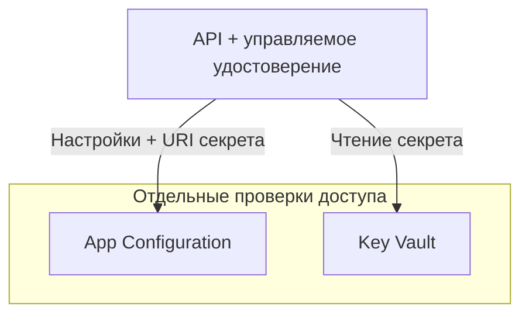

# У настроек и учётных данных разный жизненный цикл

Сервису нужно знать адреса зависимостей, какие функции включить и как пройти аутентификацию. Если собрать всё в один файл конфигурации, менять значения станет неудобно: изменение параметра поиска потребует пересборки образа, а замена учётных данных — поиска всех их копий. Две реплики могут незаметно работать с разными значениями, а внешне исправное приложение — отвечать по документам из неверного индекса.

Сначала отдели настройки от учётных данных, которые дают доступ к зависимостям. Для них нужны разные права, процедуры изменения и планы восстановления. Эта граница разбирается в уроке [«Секреты»](/ai-sdlc/part-4-platform/secrets) курса AI SDLC. Здесь ты разберёшь, как провести её средствами Azure так, чтобы инженеру, который эксплуатирует сервис, было понятно, что меняется в конфигурации.

## Как Azure разделяет настройки и учётные данные \{#how-azure-separates-settings-from-credentials}

В Azure Key Vault есть три типа объектов. Секрет (secret) хранит конфиденциальное значение, которое приложение может получить: например, пароль к внешнему сервису. Криптографический ключ (cryptographic key) служит для криптографических операций — например, создания подписи или распаковки ключа шифрования.

Объект типа «сертификат» (certificate) позволяет управлять самим сертификатом, а также связанными с ним ключом и секретом. API-ключ поставщика обычно относится к секретам, несмотря на слово «ключ» в названии. У этих [типов объектов Key Vault](https://learn.microsoft.com/ru-ru/azure/key-vault/general/about-keys-secrets-certificates) разные операции и разрешения.

Создание хранилища относится к плоскости управления (control plane), а чтение содержимого секрета — к плоскости данных (data plane).

Выбери для хранилища [модель разрешений Azure RBAC (RBAC permission model)](https://learn.microsoft.com/ru-ru/azure/key-vault/general/rbac-guide), чтобы доступ к данным определялся назначениями ролей Azure. Прежние политики доступа хранилища в этой модели не предоставляют доступ. Перед переключением существующего хранилища спланируй, как перенести права всех приложений и других субъектов, которые к нему обращаются.

Удостоверению, под которым работает API, назначай Key Vault Secrets User на уровне нужного хранилища. Эта роль позволяет читать содержимое секретов, но не записывать новые значения. Key Vault Reader читает только метаданные, а Key Vault Secrets Officer управляет секретами. Key Vault Secrets User может читать и секретную часть сертификата. Если хранить рядом посторонние сертификаты, API получит доступ и к ним. Выделяй хранилище для приложения в конкретной среде, а не собирай в нём учётные данные всех команд. Точный состав разрешений смотри в [определениях встроенных ролей](https://learn.microsoft.com/ru-ru/azure/role-based-access-control/built-in-roles/security#key-vault-secrets-user).

Управляемое удостоверение (managed identity) позволяет Container App получить токен Microsoft Entra для целевого сервиса. Сервис проверяет назначения ролей этого удостоверения. Типы удостоверений и области действия (scope) RBAC разбираются в уроках 2 и 3; здесь достаточно проследить, как приложение получает доступ к каждому хранилищу. Механизм для Container Apps описан в [документации об управляемых удостоверениях](https://learn.microsoft.com/ru-ru/azure/container-apps/managed-identity).

Azure App Configuration централизованно хранит настройки приложения и флаги функций (feature flags). Клиент или поставщик конфигурации загружает значения, которые можно менять без пересборки приложения. [Метка (label)](https://learn.microsoft.com/ru-ru/azure/azure-app-configuration/concept-key-value) различает варианты одного ключа: значение `Rag:SearchIndex` с меткой `dev` отличается от значения того же ключа с меткой `production`. Приложение должно явно выбрать метку. Метка служит для выбора значений, поэтому не считай её границей доступа между средами.

Чтобы приложение читало данные App Configuration по токену, назначь его удостоверению роль [App Configuration Data Reader](https://learn.microsoft.com/ru-ru/azure/azure-app-configuration/concept-enable-rbac) на уровне этого хранилища. Роль Reader для управления ресурсом такого доступа не даёт. Одно удостоверение может обращаться и к App Configuration, и к Key Vault, но каждому хранилищу нужны своё назначение роли и токен для соответствующего сервиса.



В App Configuration можно сохранить ссылку на Key Vault: URI секрета вместо самих учётных данных. Поставщик конфигурации .NET распознаёт ссылку и обращается к Key Vault с учётными данными приложения. App Configuration не получает секрет за приложение — [приложение проходит аутентификацию в обоих сервисах](https://learn.microsoft.com/ru-ru/azure/azure-app-configuration/use-key-vault-references-dotnet-core). Поэтому настройки могут загрузиться успешно, а чтение секрета — завершиться ошибкой: например, из-за отсутствия назначения роли на уровне хранилища или сетевого пути к нему.

## Где хранить значение и как его обновлять \{#choose-the-store-and-update-procedure}

Начни с самого простого механизма, который подходит для жизненного цикла настройки. Внешний сервис конфигурации полезен, когда настройки общие для нескольких компонентов или изменения должны доходить до уже работающих приложений без нового развёртывания. Вместе с ним появляется зависимость при запуске и ещё одна граница доступа, за которой придётся следить.

| Механизм | Для чего подходит | Когда выбрать другое решение или где возможна ошибка |
|---|---|---|
| [Переменные среды Container App](https://learn.microsoft.com/ru-ru/azure/container-apps/environment-variables) | Небольшое число значений, которые меняются вместе с релизом приложения: например, адреса сервисов | Если изменение нужно согласованно применить в нескольких сервисах, отдельные копии могут разойтись между развёртываниями. |
| App Configuration | Общие настройки, варианты значений с метками и флаги функций | Для небольшого приложения с фиксированными настройками на время развёртывания централизация добавляет лишнюю инфраструктуру. |
| Секрет Key Vault | Учётные данные для сервиса, который по-прежнему требует пароль или ключ доступа | Для обычных настроек выбери подходящее хранилище конфигурации, а для документов и промптов — хранилище контента. |
| [Секрет Container Apps со ссылкой на Key Vault](https://learn.microsoft.com/ru-ru/azure/container-apps/manage-secrets) | Передача учётных данных из Key Vault через секрет Container App в переменную среды; этот вариант предусмотрен в P1 | Если при ротации нельзя перезапускать ревизии, организуй обновление средствами приложения. |
| Ключ или сертификат Key Vault | Криптографические операции или управление жизненным циклом сертификата | Для получения учётных данных внешнего API нужен объект типа «секрет». |

В [рекомендациях Microsoft](https://learn.microsoft.com/ru-ru/azure/key-vault/secrets/secure-secrets) учётные данные отделены от обычной конфигурации. Шифрование хранилища само по себе не превращает произвольную настройку в секрет. А если положить пароль рядом с настройками в App Configuration, доступ к нему получат все, кто читает конфигурацию, хотя пароль им может быть не нужен.

Центральное хранилище не гарантирует, что приложения сразу применят новое значение. Для [обновления через поставщик .NET](https://learn.microsoft.com/ru-ru/azure/azure-app-configuration/reference-dotnet-provider) нужно зарегистрировать обновляемые параметры и указать, что будет запускать обновление. В ASP.NET Core для этого можно использовать промежуточное ПО, которое срабатывает при запросах. Если URI ссылки остаётся прежним, а секрет под ним меняется, обновление секрета настраивается отдельно. Реплики могут увидеть изменения в разное время. Если для запроса нужна согласованная группа настроек, сохрани её для этого запроса и используй до его завершения, не перечитывая отдельные значения по ходу работы.

При ротации (rotation) нужно согласовать замену учётных данных в сервисе, который их выдаёт, обновление сохранённой версии и переход приложений на новые учётные данные. Запись нового пароля в Key Vault не меняет пароль, принимаемый внешним сервисом. В [примере Microsoft с двумя наборами учётных данных](https://learn.microsoft.com/ru-ru/azure/key-vault/secrets/tutorial-rotation-dual) событие Event Grid запускает Function, которая перевыпускает запасные учётные данные в исходном сервисе и сохраняет новую версию секрета. Приложение должно загрузить замену до того, как прежние учётные данные будут отозваны.

Если [ссылка в Container Apps](https://learn.microsoft.com/ru-ru/azure/container-apps/manage-secrets#key-vault-secret-uri-and-secret-rotation) указывает на URI секрета без версии, сервис подхватывает новую версию в течение 30 минут. Активные ревизии, использующие этот секрет в переменной среды, перезапускаются, чтобы применить новое значение. Это поведение Container Apps отличается от обновления через поставщик конфигурации внутри приложения.

[Политика ротации ключа](https://learn.microsoft.com/ru-ru/azure/key-vault/keys/how-to-configure-key-rotation) может создать новую версию криптографического ключа, но не заменит произвольный пароль в секрете. [Продление сертификата](https://learn.microsoft.com/ru-ru/azure/key-vault/certificates/overview-renew-certificate) зависит от издателя и политики: процедуры для интегрированных и неинтегрированных центров сертификации различаются. Для каждого объекта определи, кто создаёт замену, как приложения узнают о ней и чем ты подтвердишь, что прежнюю версию можно безопасно отключить.

При ошибке доступа сначала установи, от чьего имени идёт запрос, затем проверь роль и её область действия, после этого — сетевую связность. [Проверки аутентификации Key Vault и проверки брандмауэра](https://learn.microsoft.com/ru-ru/azure/key-vault/general/authentication) решают разные задачи. Более широкая роль не откроет заблокированный сетевой путь. Если секрет читается локально под твоей учётной записью, это ничего не говорит о правах управляемого удостоверения, под которым работает развёрнутое приложение.

## Что это меняет для AI-сервиса \{#in-an-ai-workload}

В RAG API проекта P1 имя развёртывания модели (model deployment), имя поискового индекса и параметры поиска относятся к конфигурации. Учётные данные для внешнего сервиса, если они всё ещё нужны, пойдут в Key Vault. Если зависимость поддерживает токены, предпочти управляемое удостоверение: наличие хранилища не повод заводить ключ доступа.

В P1 предусмотрен секрет Container Apps со ссылкой на Key Vault в формате `keyvaultref:<secret-uri>,identityref:<identity-resource-id>`. Для этого нужно прикрепить удостоверение к приложению и назначить ему [Key Vault Secrets User](https://learn.microsoft.com/ru-ru/azure/container-apps/manage-secrets#reference-secret-from-key-vault). Container Apps получит значение и передаст его приложению через переменную среды, связанную с секретом.

Несекретная настройка тоже может нарушить работу сервиса. Изменение top-K меняет набор фрагментов, который получает модель; неверное имя индекса меняет сам набор документов. Механика разобрана в уроке [«Retrieval — поиск»](/rag-agents/part-1-rag/retrieval/). Считай изменения конфигурации, которые влияют на ответы, изменениями системы: проверяй их на ревью и прогоняй через [оценку поиска и генерации](/rag-agents/part-1-rag/cross-cutting/evaluation/) до выкатки. Записывай в телеметрию версию конфигурации без секретных значений: так просадку качества ответа можно будет связать с настройками, при которых он получен. Сами учётные данные в телеметрию попадать не должны.

Загружай и кэшируй учётные данные вне цикла генерации токенов, с заранее выбранной политикой обновления. Обращение к хранилищу на каждый вопрос или каждый передаваемый токен создаёт лишнюю зависимость при формировании ответа; смотри [рекомендации Key Vault по кэшированию](https://learn.microsoft.com/ru-ru/azure/key-vault/secrets/secure-secrets). Отдельно определи поведение при неудачной первоначальной загрузке и при сбое последующего обновления. Учётные данные для вызова должны оставаться у доверенного клиента, который этот вызов выполняет, и не попадать в найденные документы, промпты модели или результаты инструментов.

## Попробуй \{#try-it}

Создай хранилище для упражнения P1 и заранее дай удостоверению API право читать секреты. Используй новую временную группу ресурсов (resource group), чтобы при удалении не затронуть другие ресурсы проекта. Понадобятся Azure CLI, оболочка Bash, подписка Azure, права на создание группы, а также на создание и удаление ресурсов упражнения.

Команды сверены со справочником Azure CLI по состоянию на 17.10.2026. У курса пока нет подписки Azure, поэтому команды **не запускались в реальной подписке**. Результаты ниже — ожидаемые по документации, а не наблюдения после развёртывания.

Перед запуском замени `<subscription-id>`. Случайный суффикс из `$RANDOM` помогает выбрать уникальное имя хранилища, но не гарантирует его: если имя занято, выбери другое. [Имя должно быть уникальным во всём Azure и содержать от 3 до 24 символов](https://learn.microsoft.com/ru-ru/azure/key-vault/general/quick-create-cli).

```bash
az login
az account set --subscription "<subscription-id>"

RG="rg-p1-secrets-lab"
LOCATION="westeurope"
API_IDENTITY="id-p1-rag-api"
KV_NAME="p1-kv-$RANDOM-$RANDOM"

az group create --name "$RG" --location "$LOCATION" --output none
```

Прежде чем продолжать, проверь, есть ли у тебя право назначать роли на уровне этой группы ресурсов. Достаточно роли Owner на уровне группы ресурсов; назначать её на уровне всей подписки не требуется. Другой вариант — права на управление ресурсами вместе с ролью [Role Based Access Control Administrator](https://learn.microsoft.com/ru-ru/azure/role-based-access-control/built-in-roles/privileged#role-based-access-control-administrator) или [Key Vault Data Access Administrator](https://learn.microsoft.com/ru-ru/azure/key-vault/general/rbac-guide#managing-built-in-key-vault-data-plane-role-assignments). Последняя разрешает назначать лишь определённые роли доступа к данным Key Vault. При модели RBAC создание хранилища не даёт создателю права читать или записывать секреты: для этого нужно явное назначение [роли плоскости данных](https://learn.microsoft.com/ru-ru/azure/key-vault/general/rbac-guide).

Создай управляемое удостоверение, назначаемое пользователем (user-assigned), хранилище Standard и назначение роли для API на уровне этого хранилища:

```bash
API_PRINCIPAL_ID=$(az identity create \
  --name "$API_IDENTITY" --resource-group "$RG" --location "$LOCATION" \
  --query principalId --output tsv)

az keyvault create \
  --name "$KV_NAME" --resource-group "$RG" --location "$LOCATION" \
  --sku standard --enable-rbac-authorization true \
  --retention-days 7 --output none

KV_ID=$(az keyvault show --name "$KV_NAME" --resource-group "$RG" \
  --query id --output tsv)

az role assignment create \
  --assignee-object-id "$API_PRINCIPAL_ID" \
  --assignee-principal-type ServicePrincipal \
  --role "4633458b-17de-408a-b874-0445c86b69e6" \
  --scope "$KV_ID" \
  --query '{principal:principalId,role:roleDefinitionId,scope:scope}' \
  --output json
```

Флаг `--enable-rbac-authorization true` выбран явно и соответствует [текущему значению по умолчанию в CLI](https://learn.microsoft.com/ru-ru/cli/azure/keyvault?view=azure-cli-latest#az-keyvault-create). Старые руководства с политиками доступа описывают другую модель. В упражнении задано семь дней хранения после обратимого удаления (soft delete); допустимый диапазон — 7–90 дней. Для хранилищ в проде включай [защиту от окончательного удаления (purge protection)](https://learn.microsoft.com/ru-ru/azure/key-vault/general/key-vault-recovery). После включения её нельзя отключить.

GUID в команде обозначает роль Key Vault Secrets User. Параметры с идентификатором субъекта и его типом позволяют [обойтись без запроса к Microsoft Graph при назначении роли](https://learn.microsoft.com/ru-ru/cli/azure/role/assignment?view=azure-cli-latest#az-role-assignment-create). Если команда завершилась ошибкой, остановись: нельзя продолжать с пустым идентификатором ресурса (resource ID) или субъекта.

Посмотри URI и модель доступа хранилища, а также идентификаторы удостоверения:

```bash
az keyvault show --name "$KV_NAME" --resource-group "$RG" \
  --query '{uri:properties.vaultUri,rbac:properties.enableRbacAuthorization}' \
  --output json

az identity show --name "$API_IDENTITY" --resource-group "$RG" \
  --query '{id:id,clientId:clientId,principalId:principalId}' --output json
```

В ответе для хранилища ожидаются `rbac: true` и URI, а в ответе для удостоверения — `id`, `clientId` и `principalId`. Результат назначения роли должен указывать идентификатор этого хранилища в `scope`, а удостоверение API — в качестве субъекта.

Эти проверки показывают состояние плоскости управления. Они не проверяют чтение секрета: хранилище пусто, а удостоверение ещё нужно прикрепить к Container App. Ресурсы упражнения временные. Постоянные хранилище и удостоверение P1 будут описаны в уроке 9 «Инфраструктура как код».

**Стоимость:** [Key Vault тарифицируется по операциям; разовой платы за создание хранилища нет](https://azure.microsoft.com/en-us/pricing/details/key-vault/). В упражнении создаётся пустое хранилище Standard, без операций с секретами, вычислительных ресурсов и хранилища App Configuration. За [управляемые удостоверения дополнительная плата не взимается](https://learn.microsoft.com/ru-ru/entra/identity/managed-identities-azure-resources/overview). Для [обратимо удалённого хранилища Standard оплачиваются только операции окончательного удаления и восстановления](https://learn.microsoft.com/ru-ru/azure/key-vault/general/soft-delete-overview#billing-implications). До запуска проверь текущие цены для своего региона, валюты и соглашения.

**Удаление ресурсов:** удали только временную группу, созданную выше. Команда завершится только после удаления группы:

```bash
az group delete --name "$RG" --yes
```

После [обратимого удаления](https://learn.microsoft.com/ru-ru/azure/key-vault/general/soft-delete-overview) хранилище можно восстановить в течение семи дней. Имя остаётся занятым до конца этого срока, если только кто-то с нужными правами не удалит хранилище окончательно. Для повторного упражнения используй новое имя. При обратимом удалении хранилища назначения ролей RBAC удаляются. Восстановление хранилища не восстановит их: заново назначь роли, прежде чем возвращать сервис в работу.

Если у тебя есть [право просматривать удалённые хранилища на уровне подписки](https://learn.microsoft.com/ru-ru/azure/key-vault/general/key-vault-recovery#prerequisites), можешь дополнительно проверить сохранённое хранилище командой [`az keyvault list-deleted`](https://learn.microsoft.com/ru-ru/cli/azure/keyvault?view=azure-cli-latest#az-keyvault-list-deleted). Предыдущие шаги упражнения этого права не предоставляют.

```bash
az keyvault list-deleted --output table
```

## Что перенести в свою практику \{#what-to-take-away}

- Учётные данные храни в Key Vault, настройки — в переменных среды Container App или App Configuration.
- Управляемое удостоверение обеспечивает аутентификацию. Каждому хранилищу всё равно нужны своё назначение роли доступа к данным и доступный сетевой путь.
- API назначай Key Vault Secrets User на уровне нужного хранилища. Права на запись учётных данных оставь другим субъектам.
- Ротация завершена, когда приложения используют замену и прежние учётные данные можно безопасно отозвать.
- Конфигурацию, которая меняет ответы, проверяй на ревью и оценивай так же тщательно, как изменения кода, которые так же влияют на ответы.

**[Новые термины](../glossary.md#secrets-and-configuration)**: секрет Key Vault, криптографический ключ, сертификат Key Vault, модель разрешений RBAC, Key Vault Secrets User, Azure App Configuration, метка App Configuration, ссылка на Key Vault, ротация, обратимое удаление, защита от окончательного удаления.

## Источники \{#sources}

Проверено на 17.10.2026.

Механизмы Key Vault и жизненный цикл объектов:

- [Ключи, секреты и сертификаты](https://learn.microsoft.com/ru-ru/azure/key-vault/general/about-keys-secrets-certificates), [рекомендации по защите секретов](https://learn.microsoft.com/ru-ru/azure/key-vault/secrets/secure-secrets)
- [Руководство по RBAC](https://learn.microsoft.com/ru-ru/azure/key-vault/general/rbac-guide), [встроенные роли безопасности](https://learn.microsoft.com/ru-ru/azure/role-based-access-control/built-in-roles/security), [аутентификация](https://learn.microsoft.com/ru-ru/azure/key-vault/general/authentication)
- [Ротация секрета с двумя наборами учётных данных](https://learn.microsoft.com/ru-ru/azure/key-vault/secrets/tutorial-rotation-dual), [ротация ключей](https://learn.microsoft.com/ru-ru/azure/key-vault/keys/how-to-configure-key-rotation), [продление сертификатов](https://learn.microsoft.com/ru-ru/azure/key-vault/certificates/overview-renew-certificate)
- [Обратимое удаление и защита от окончательного удаления](https://learn.microsoft.com/ru-ru/azure/key-vault/general/soft-delete-overview), [краткое руководство по CLI](https://learn.microsoft.com/ru-ru/azure/key-vault/general/quick-create-cli), [цены Key Vault](https://azure.microsoft.com/en-us/pricing/details/key-vault/)

Конфигурация и удостоверения рабочих нагрузок:

- [Обзор App Configuration](https://learn.microsoft.com/ru-ru/azure/azure-app-configuration/overview), [ключи и метки](https://learn.microsoft.com/ru-ru/azure/azure-app-configuration/concept-key-value), [роли доступа к данным](https://learn.microsoft.com/ru-ru/azure/azure-app-configuration/concept-enable-rbac)
- [Ссылки на Key Vault в ASP.NET Core](https://learn.microsoft.com/ru-ru/azure/azure-app-configuration/use-key-vault-references-dotnet-core), [поставщик .NET и обновление](https://learn.microsoft.com/ru-ru/azure/azure-app-configuration/reference-dotnet-provider)
- [Управляемые удостоверения Container Apps](https://learn.microsoft.com/ru-ru/azure/container-apps/managed-identity), [секреты и ссылки на Key Vault](https://learn.microsoft.com/ru-ru/azure/container-apps/manage-secrets), [переменные среды](https://learn.microsoft.com/ru-ru/azure/container-apps/environment-variables)
- [Обзор и стоимость управляемых удостоверений](https://learn.microsoft.com/ru-ru/entra/identity/managed-identities-azure-resources/overview), [привилегированные роли RBAC](https://learn.microsoft.com/ru-ru/azure/role-based-access-control/built-in-roles/privileged), [восстановление хранилища](https://learn.microsoft.com/ru-ru/azure/key-vault/general/key-vault-recovery)

Справочник команд Azure CLI (`azure-cli-latest`):

- [Вход](https://learn.microsoft.com/ru-ru/cli/azure/reference-index?view=azure-cli-latest#az-login), [выбор подписки](https://learn.microsoft.com/ru-ru/cli/azure/account?view=azure-cli-latest#az-account-set), [группы ресурсов](https://learn.microsoft.com/ru-ru/cli/azure/group?view=azure-cli-latest)
- [Управляемые удостоверения](https://learn.microsoft.com/ru-ru/cli/azure/identity?view=azure-cli-latest), [создание и проверка хранилища](https://learn.microsoft.com/ru-ru/cli/azure/keyvault?view=azure-cli-latest), [назначение роли](https://learn.microsoft.com/ru-ru/cli/azure/role/assignment?view=azure-cli-latest)
