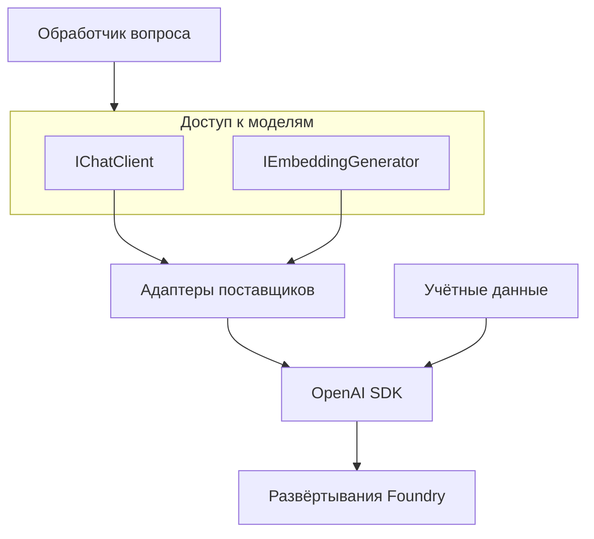

# Выдели доступ к модели в тестируемый компонент

Первый вызов модели легко написать прямо в обработчике HTTP-запроса. Затем понадобится передавать ответ по мере генерации, подключить вторую модель, добавить трассировку или проверить поиск, не платя за генерацию. Если каждый обработчик сам создаёт клиент SDK и разбирает его ответы, изменения придётся вносить по всему приложению. Код, который должен отвечать на вопросы, постепенно обрастёт деталями работы с моделью.

Раздели эти задачи. Приложению нужны операции чата и генерации эмбеддингов, для поиска нужен поисковый клиент, а агенту может понадобиться цикл вызова инструментов. Общий интерфейс может упростить замену компонентов и проверку их взаимодействий. Но другая модель будет вести себя иначе, поэтому проверки качества её ответов всё равно нужны.

## Как это устроено в .NET \{#how-it-works-in-dotnet}

Урок рассчитан на .NET 10 — текущую LTS-версию с поддержкой до 14 ноября 2028 года. Установи SDK для .NET 10 с актуальными обновлениями. В [политике поддержки](https://dotnet.microsoft.com/en-us/platform/support/policy/dotnet-core) срок поддержки версии и отдельные выпуски обновлений рассматриваются раздельно.

В библиотеках [`Microsoft.Extensions.AI`](https://learn.microsoft.com/ru-ru/dotnet/ai/microsoft-extensions-ai) контракты отделены от реализаций. Пакет абстракций предоставляет интерфейсы, основной пакет добавляет компоненты, которые можно сочетать друг с другом, а адаптер поставщика (provider adapter) связывает контракт с клиентом из SDK поставщика. Код приложения зависит от контракта; конкретного поставщика выбираешь при запуске.

[`IChatClient`](https://learn.microsoft.com/ru-ru/dotnet/ai/ichatclient) представляет генерацию ответов в чате. Метод `GetResponseAsync` возвращает готовый `ChatResponse`, а `GetStreamingResponseAsync` — последовательность `IAsyncEnumerable<ChatResponseUpdate>`. Если HTTP API должен отдавать ответ по мере генерации, выбери второй метод и передай в вызов модели сигнал отмены HTTP-запроса. За чтение обновлений и их отправку клиенту отвечает код приложения: обработчик должен передавать их по выбранному потоковому протоколу HTTP.

Для эмбеддингов есть отдельный контракт — [`IEmbeddingGenerator<string, Embedding<float>>`](https://learn.microsoft.com/ru-ru/dotnet/ai/iembeddinggenerator). Входной тип задаёт, что преобразуется в эмбеддинг, выходной — как представлен вектор. Генератор создаёт векторы, а за их хранение и поиск отвечают другие компоненты.



В P1 клиент `OpenAIClient` из официального OpenAI SDK для .NET будет обращаться к [конечной точке Foundry `/openai/v1/`](https://learn.microsoft.com/ru-ru/azure/foundry/openai/api-version-lifecycle). Для [аутентификации через Entra](https://learn.microsoft.com/ru-ru/azure/developer/ai/how-to/switching-endpoints) в `BearerTokenPolicy` передаются учётные данные (credentials) и область действия токена, а в `OpenAIClientOptions` — адрес конечной точки. Для клиентов чата и эмбеддингов укажи имена развёртываний моделей (model deployment), созданных в Azure. Методы [`AsIChatClient`](https://learn.microsoft.com/ru-ru/dotnet/api/microsoft.extensions.ai.openaiclientextensions.asichatclient?view=net-10.0-pp) и [`AsIEmbeddingGenerator`](https://learn.microsoft.com/ru-ru/dotnet/api/microsoft.extensions.ai.openaiclientextensions.asiembeddinggenerator?view=net-10.0-pp) адаптируют эти клиенты к общим интерфейсам.

Зарегистрируй клиенты в контейнере внедрения зависимостей. Перегрузки [`AddChatClient`](https://learn.microsoft.com/ru-ru/dotnet/api/microsoft.extensions.dependencyinjection.chatclientbuilderservicecollectionextensions.addchatclient?view=net-10.0-pp) и [`AddEmbeddingGenerator`](https://learn.microsoft.com/ru-ru/dotnet/api/microsoft.extensions.dependencyinjection.embeddinggeneratorbuilderservicecollectionextensions.addembeddinggenerator?view=net-10.0-pp), принимающие фабрику, по умолчанию регистрируют сервисы как singleton и возвращают объекты для построения клиентских конвейеров. Конвейер делегирующих клиентов (delegating client pipeline) позволяет добавлять к обращениям к модели, например, телеметрию, кэширование или вызов функций. Порядок обёрток влияет на то, что именно увидит трассировка: снаружи кэша она наблюдает не тот набор операций, что при трассировке только вызовов базового клиента. Реши, что хочешь наблюдать, прежде чем копировать конвейер из примера.

При создании клиента используй учётные данные, выбранные в [I.3 — «Удостоверения II — RBAC и доступ без ключей»](../part-1-azure-foundations/rbac-and-keyless-access.md). Сам объект учётных данных не выдаёт права: удостоверению, от имени которого выполняется вызов, нужна роль [`Foundry User`](https://learn.microsoft.com/ru-ru/azure/foundry/concepts/rbac-foundry) с назначением на уровне ресурса Microsoft Foundry проекта P1. Раньше роль называлась `Azure AI User`; в период переименования в I.3 используется идентификатор роли.

## Как выбрать подход и учесть компромиссы \{#choosing-and-tradeoffs}

Выбирай абстракцию по тому, какую часть работы нужно отделить от остального приложения. Небольшому приложению может хватить прямых обращений к SDK поставщика из одного сервиса приложения. Если подключить несколько фреймворков ещё до того, как заработает поиск, будет сложнее выяснить, почему ответ оказался неверным: из-за поиска, конфигурации модели, адаптера или оркестрации.

Если доступ к модели выделен в отдельный компонент, приложение можно тестировать с заглушкой, которая возвращает заранее заданные ответы. Так можно проверить выбор фрагментов (chunks), сборку ссылок и идентификаторы источников, которые возвращает API. Поведение настоящей модели оценивай отдельно: тест с заданным ответом не доказывает, что развёрнутая модель выберет те же источники. Решая, готово ли изменение к выпуску, различай результаты таких тестов и результаты оценки настоящей модели.

| Вариант | Когда подходит | Когда лучше отказаться или пересмотреть выбор |
|---|---|---|
| [OpenAI SDK с конечной точкой Azure v1](https://learn.microsoft.com/ru-ru/azure/developer/ai/how-to/switching-endpoints) — вариант P1 | Нужен стандартный клиент OpenAI с явно заданными конечной точкой и политикой токенов Entra. | Нужен API Azure, которого нет в этом клиенте. Настроить конечную точку и область действия токена всё равно должен код приложения. |
| [Дополнительная библиотека Azure.AI.OpenAI](https://learn.microsoft.com/ru-ru/dotnet/api/overview/azure/ai.openai-readme?view=azure-dotnet) | Нужны возможности SDK, доступные только в Azure и реализованные поверх OpenAI SDK. | Перед обновлением OpenAI проверь совместимые версии зависимостей этой библиотеки. P1 обходится без дополнительной зависимости. |
| SDK поставщика напрямую | Нужны собственные возможности поставщика, а зависимость можно удержать внутри одного компонента. | Типы SDK начинают распространяться по обработчикам и тестам. |
| `Microsoft.Extensions.AI` | Полезны контракты чата и эмбеддингов, общие конвейеры и возможность заменить клиент. | Нужная возможность доступна только через SDK. Оставь обращение к SDK явным. |
| `Microsoft.Extensions.VectorData` | Для поиска подходят типизированные записи и общий интерфейс хранения и поиска. | Основную роль играют особенности фильтрации, ранжирования или управления индексом у конкретного поставщика. |
| Microsoft Agent Framework | Нужны сеансы агента, инструменты или явно заданные рабочие процессы. | Запрос всегда выполняет поиск, затем генерацию, без решений со стороны агента. |

[`Microsoft.Extensions.VectorData`](https://learn.microsoft.com/ru-ru/dotnet/ai/vector-stores/overview) отвечает за хранение и поиск, а не за создание эмбеддингов. Абстракции `VectorStore` и `VectorStoreCollection<TKey, TRecord>` позволяют работать с типизированными записями, в которых выделены ключи, данные и векторы. Операции хранилища реализует поставщик. Проверь, как выбранная реализация сопоставляет записи с полями хранилища и выполняет поиск: общий API не гарантирует одинаковых фильтров и ранжирования.

Пакет [`Microsoft.Extensions.VectorData.Abstractions` 10.11.0](https://www.nuget.org/packages/Microsoft.Extensions.VectorData.Abstractions/10.11.0) — стабильный. В [обзоре векторных хранилищ .NET](https://learn.microsoft.com/ru-ru/dotnet/ai/vector-stores/overview) для Azure AI Search, который будет использоваться в P1, указан пакет `CommunityToolkit.VectorData.AzureAISearch`; его [версия 1.0.1](https://www.nuget.org/packages/CommunityToolkit.VectorData.AzureAISearch/1.0.1) тоже стабильная. Этот статус относится к данному коннектору, а не ко всем реализациям. Прежде чем завязывать код поиска на выбранный пакет, проверь его статус и поддерживаемые операции.

Если нужна оркестрация, [`Microsoft Agent Framework`](https://learn.microsoft.com/ru-ru/agent-framework/overview/) добавляет над доступом к модели сеансы, инструменты, middleware и рабочие процессы. Основной пакет .NET [`Microsoft.Agents.AI` 1.25.0](https://www.nuget.org/packages/Microsoft.Agents.AI/1.25.0) стабилен и зависит от `Microsoft.Extensions.AI`, но статус отдельных интеграций может отличаться. Прежде чем добавлять этот слой, сверь задачу с уроком [«Что библиотека добавляет поверх голого цикла»](/rag-agents/part-2-agents/orchestration-frameworks/). Автоматический вызов функций не заменяет проверку прав на инструменты в приложении. При смене поставщика или фреймворка сохраняй и проверки качества ответов.

Правила кэширования и сбора телеметрии нужно определить до подключения общих обёрток. Кэш не должен отдавать приватный контекст одного вызывающего клиента другому, а телеметрия — случайно собирать конфиденциальные промпты. Абстракция упрощает совместное использование такого поведения, но вместе с ним на всех вызывающих клиентов распространяются и ошибки в общих правилах.

## Что это меняет для AI-сервиса \{#in-an-ai-workload}

Планируемый RAG-сервис P1 на минимальных API будет получать эмбеддинг вопроса, выполнять поиск в Azure AI Search, выбирать фрагменты источников и передавать их для генерации ответа в чате. Документы из открытых источников будут храниться в Blob Storage, а ответ должен сохранять ссылки на эти документы. Регистрации клиентов из этого урока подготовят доступ к моделям через ресурс Microsoft Foundry этого сервиса. Поиск, загрузка документов и сборка ссылок останутся задачами приложения.

Наблюдай за поиском и генерацией отдельно. Неверный ответ может означать, что поиск не нашёл нужный фрагмент, что выбранного фрагмента не хватило для ответа или что модель его проигнорировала. Варианты поиска разбираются в уроке [«Как найти нужный контекст под запрос»](/rag-agents/part-1-rag/retrieval/), а сборка ответа по найденным материалам — в уроке [«Обоснованный ответ из найденного контекста»](/rag-agents/part-1-rag/generation/). На обоих этапах сохраняй идентификаторы фрагментов и URL источников, чтобы по ссылке в ответе можно было проверить найденный материал.

Конфигурация эмбеддингов — часть контракта индекса. В Azure AI Search [размерность векторного поля зависит от модели эмбеддингов, а векторы запросов сравниваются в пространстве этой модели](https://learn.microsoft.com/ru-ru/azure/search/vector-search-how-to-create-index). Замена регистрации `IEmbeddingGenerator` может потребовать пересчитать эмбеддинги сохранённых данных и перестроить индекс. Совместимость векторов зависит от конфигурации эмбеддингов за этим интерфейсом. До замены зафиксируй, какое развёртывание и какая модель использовались для создания индекса.

## Попробуй \{#try-it}

Подготовь локальный проект P1 с SDK .NET 10 и проверь регистрацию клиентов. В упражнении используются настоящие адаптеры SDK и фиктивная конечная точка. Ресурсы Azure, вход в учётную запись и запросы к моделям для него не нужны: приложение только создаёт клиенты и получает их из контейнера зависимостей.

Пример скомпилирован с .NET SDK 10.0.402 и пакетами `Azure.Identity 1.21.0`, `OpenAI 2.14.0`, `Microsoft.Extensions.AI 10.11.0` и `Microsoft.Extensions.AI.OpenAI 10.11.0`. Локальные шаги, включая обращение к `/wiring`, выполнены 17.10.2026. Вызовы Azure не проверялись на реальной подписке: этот маршрут их не выполняет.

Создай проект ASP.NET Core Empty из [шаблона `web`](https://learn.microsoft.com/ru-ru/dotnet/core/tools/dotnet-new-sdk-templates) и добавь пакеты с помощью [синтаксиса `dotnet package add` для .NET 10](https://learn.microsoft.com/ru-ru/dotnet/core/tools/dotnet-package-add). Здесь зафиксированы последние стабильные версии, проверенные на 17.10.2026: [Azure.Identity 1.21.0](https://www.nuget.org/packages/Azure.Identity/1.21.0), [OpenAI 2.14.0](https://www.nuget.org/packages/OpenAI/2.14.0), [Microsoft.Extensions.AI 10.11.0](https://www.nuget.org/packages/Microsoft.Extensions.AI/10.11.0) и [Microsoft.Extensions.AI.OpenAI 10.11.0](https://www.nuget.org/packages/Microsoft.Extensions.AI.OpenAI/10.11.0).

```bash
dotnet new web --framework net10.0 --output P1.AiWiring
cd P1.AiWiring
dotnet package add Azure.Identity --version 1.21.0
dotnet package add OpenAI --version 2.14.0
dotnet package add Microsoft.Extensions.AI --version 10.11.0
dotnet package add Microsoft.Extensions.AI.OpenAI --version 10.11.0
```

Замени содержимое `Program.cs` кодом ниже. Значения по умолчанию — только локальные заглушки. Обработчик `/wiring` получает реализации обоих интерфейсов из контейнера зависимостей и возвращает имена их типов. В OpenAI 2.14.0 конструктор `OpenAIClient`, принимающий `BearerTokenPolicy`, помечен как экспериментальный: без подавления диагностики `OPENAI001` сборка завершится ошибкой. В коде ниже она подавлена только для строк с вызовом этого конструктора. После обновления пакета проверь эту диагностику ещё раз.

```csharp
using Azure.Identity;
using Microsoft.Extensions.AI;
using OpenAI;
using System.ClientModel.Primitives;

var builder = WebApplication.CreateBuilder(args);
var endpoint = builder.Configuration["AI:Endpoint"]
    ?? "https://p1-example.services.ai.azure.com/openai/v1/";
var chatDeployment = builder.Configuration["AI:ChatDeployment"] ?? "p1-chat";
var embeddingDeployment = builder.Configuration["AI:EmbeddingDeployment"]
    ?? "p1-embedding";

// OpenAI 2.14.0 marks the AuthenticationPolicy constructor as experimental.
#pragma warning disable OPENAI001
builder.Services.AddSingleton(_ => new OpenAIClient(
    new BearerTokenPolicy(
        new DefaultAzureCredential(), "https://cognitiveservices.azure.com/.default"),
    new OpenAIClientOptions { Endpoint = new Uri(endpoint) }));
#pragma warning restore OPENAI001
builder.Services.AddChatClient(services =>
    services.GetRequiredService<OpenAIClient>()
        .GetChatClient(chatDeployment).AsIChatClient());
builder.Services.AddEmbeddingGenerator<string, Embedding<float>>(services =>
    services.GetRequiredService<OpenAIClient>()
        .GetEmbeddingClient(embeddingDeployment).AsIEmbeddingGenerator());

var app = builder.Build();
app.MapGet("/wiring", (
    IChatClient chat,
    IEmbeddingGenerator<string, Embedding<float>> embeddings) =>
    Results.Ok(new
    {
        Chat = chat.GetType().Name,
        Embeddings = embeddings.GetType().Name
    }));
app.Run();
```

Запусти приложение без профиля запуска — для этого служит [параметр `dotnet run`](https://learn.microsoft.com/ru-ru/dotnet/core/tools/dotnet-run):

```bash
dotnet run --no-launch-profile
```

К локальному URL, который появится в выводе, добавь `/wiring` и открой получившийся адрес. С указанными версиями пакетов маршрут возвращает `{"chat":"OpenAIChatClient","embeddings":"OpenAIEmbeddingGenerator"}`. Внутренние имена адаптеров могут меняться между выпусками. Этот результат подтверждает только то, что контейнер зависимостей может предоставить оба сервиса. Получение токена, вызов модели, поиск и генерация ответа здесь не проверяются.

Перед подключением к настоящим развёртываниям P1 убери фиктивные значения по умолчанию, проверь `AI:Endpoint`, `AI:ChatDeployment` и `AI:EmbeddingDeployment`, выбери нужные учётные данные, назначь удостоверению роль доступа к данным ресурса и проверь сетевой доступ. После этого добавь отдельный вызов модели с оценкой ответа: он позволит проверить аутентификацию, авторизацию и соединение, которых локальная проверка регистрации не затрагивает.

**Стоимость:** упражнение бесплатно и выполняется локально. Ресурсы Azure не создаются, запросы к моделям не отправляются, поэтому платы за потребление Azure нет.

**Удаление ресурсов:** останови процесс сочетанием `Ctrl+C`, выйди из каталога `P1.AiWiring` и удали эту локальную папку.

## Что перенести в свою практику \{#what-to-take-away}

- Внедряй в код приложения контракты чата и эмбеддингов. Клиенты SDK, развёртывания и учётные данные выбирай при запуске.
- Отделяй генерацию эмбеддингов от хранения векторов и поиска. Смена модели может потребовать перестройки индекса.
- Проверяй статус каждого пакета и подключения отдельно: рядом со стабильными абстракциями могут оставаться возможности в preview или экспериментальные API.
- Добавляй оркестрацию агентов, когда этого требует рабочая нагрузка. Права на инструменты проверяй в коде приложения независимо от того, что решила модель.

**[Новые термины](../glossary.md#ai-in-dotnet)**: Microsoft.Extensions.AI, IChatClient, IEmbeddingGenerator, адаптер поставщика, конвейер делегирующих клиентов, Microsoft.Extensions.VectorData, Microsoft Agent Framework.

## Источники \{#sources}

Проверено на 17.10.2026.

Среда выполнения и клиентские контракты:

- [.NET releases and support](https://learn.microsoft.com/ru-ru/dotnet/core/releases-and-support)
- [.NET support policy](https://dotnet.microsoft.com/en-us/platform/support/policy/dotnet-core)
- [Microsoft.Extensions.AI libraries](https://learn.microsoft.com/ru-ru/dotnet/ai/microsoft-extensions-ai)
- [IChatClient](https://learn.microsoft.com/ru-ru/dotnet/ai/ichatclient)
- [IEmbeddingGenerator](https://learn.microsoft.com/ru-ru/dotnet/ai/iembeddinggenerator)
- [Build an AI chat app](https://learn.microsoft.com/ru-ru/dotnet/ai/quickstarts/build-chat-app)
- [AsIChatClient reference](https://learn.microsoft.com/ru-ru/dotnet/api/microsoft.extensions.ai.openaiclientextensions.asichatclient?view=net-10.0-pp)
- [AsIEmbeddingGenerator reference](https://learn.microsoft.com/ru-ru/dotnet/api/microsoft.extensions.ai.openaiclientextensions.asiembeddinggenerator?view=net-10.0-pp)
- [DelegatingChatClient reference](https://learn.microsoft.com/ru-ru/dotnet/api/microsoft.extensions.ai.delegatingchatclient?view=net-10.0-pp)
- [AddChatClient reference](https://learn.microsoft.com/ru-ru/dotnet/api/microsoft.extensions.dependencyinjection.chatclientbuilderservicecollectionextensions.addchatclient?view=net-10.0-pp)
- [AddEmbeddingGenerator reference](https://learn.microsoft.com/ru-ru/dotnet/api/microsoft.extensions.dependencyinjection.embeddinggeneratorbuilderservicecollectionextensions.addembeddinggenerator?view=net-10.0-pp)

SDK Azure и доступ:

- [Azure OpenAI .NET client library](https://learn.microsoft.com/ru-ru/dotnet/api/overview/azure/ai.openai-readme?view=azure-dotnet)
- [Microsoft Foundry role-based access control](https://learn.microsoft.com/ru-ru/azure/foundry/concepts/rbac-foundry)
- [Microsoft Foundry authentication and role IDs](https://learn.microsoft.com/ru-ru/azure/foundry/concepts/authentication-authorization-foundry)
- [Azure OpenAI in Foundry Models v1 API](https://learn.microsoft.com/ru-ru/azure/foundry/openai/api-version-lifecycle)
- [Switch between OpenAI and Azure endpoints](https://learn.microsoft.com/ru-ru/azure/developer/ai/how-to/switching-endpoints)

Векторные данные и агенты:

- [Vector stores in .NET](https://learn.microsoft.com/ru-ru/dotnet/ai/vector-stores/overview)
- [Use vector stores](https://learn.microsoft.com/ru-ru/dotnet/ai/vector-stores/how-to/use-vector-stores)
- [Create an Azure AI Search vector index](https://learn.microsoft.com/ru-ru/azure/search/vector-search-how-to-create-index)
- [Microsoft Agent Framework overview](https://learn.microsoft.com/ru-ru/agent-framework/overview/)

CLI и статус пакетов:

- [dotnet new](https://learn.microsoft.com/ru-ru/dotnet/core/tools/dotnet-new)
- [.NET SDK templates](https://learn.microsoft.com/ru-ru/dotnet/core/tools/dotnet-new-sdk-templates)
- [dotnet package add](https://learn.microsoft.com/ru-ru/dotnet/core/tools/dotnet-package-add)
- [dotnet run](https://learn.microsoft.com/ru-ru/dotnet/core/tools/dotnet-run)
- [Microsoft.Extensions.AI 10.11.0](https://www.nuget.org/packages/Microsoft.Extensions.AI/10.11.0), [Abstractions 10.11.0](https://www.nuget.org/packages/Microsoft.Extensions.AI.Abstractions/10.11.0) и [OpenAI adapter 10.11.0](https://www.nuget.org/packages/Microsoft.Extensions.AI.OpenAI/10.11.0)
- [Azure.Identity 1.21.0](https://www.nuget.org/packages/Azure.Identity/1.21.0) и [OpenAI 2.14.0](https://www.nuget.org/packages/OpenAI/2.14.0)
- [Microsoft.Extensions.VectorData.Abstractions 10.11.0](https://www.nuget.org/packages/Microsoft.Extensions.VectorData.Abstractions/10.11.0)
- [CommunityToolkit.VectorData.AzureAISearch 1.0.1](https://www.nuget.org/packages/CommunityToolkit.VectorData.AzureAISearch/1.0.1)
- [Microsoft.Agents.AI 1.25.0](https://www.nuget.org/packages/Microsoft.Agents.AI/1.25.0)
