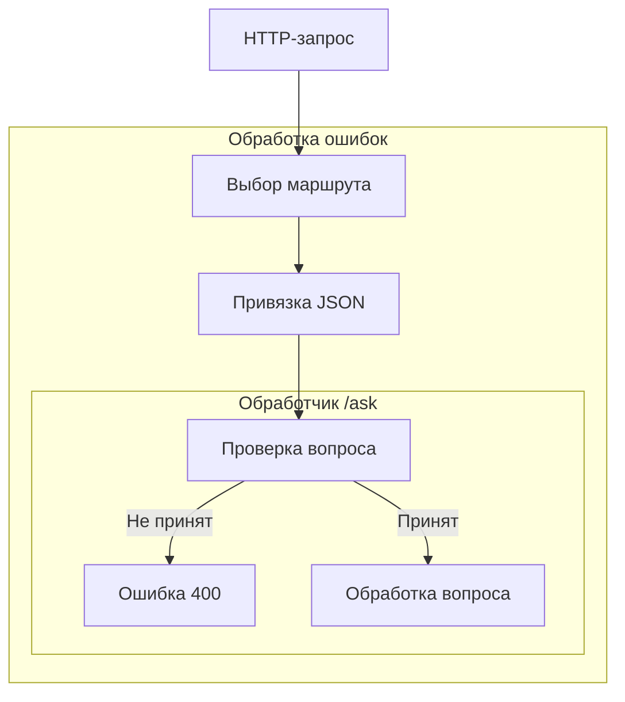

# На уровне HTTP решается, какие запросы дойдут до модели

Сервису ответов на вопросы нужна не только функция вызова модели. Клиент может прислать пустой вопрос, некорректный JSON или запрос по неверному URL. Сервис, от которого зависит ответ, может оказаться недоступен. Без ясного HTTP-контракта клиент получает то строку, то ошибку без тела, то текст внутреннего исключения — и должен сам угадывать, исправлять запрос или повторять его позже.

В RAG-сервисе на уровне HTTP решается ещё и то, когда начинать дорогие этапы обработки — поиск и генерацию. Отклоняй запрос без вопроса до их запуска. Недоступность зависимости и успешный ответ «подтверждений в документах нет» тоже должны различаться в HTTP API. В ASP.NET Core для этих решений есть хост, упорядоченный конвейер обработки запросов и обработчики конечных точек. Разработка P1 начинается с приёма запросов и формирования HTTP-ответов, а поиск пока не подключён.

## Как это устроено в .NET \{#how-it-works-in-dotnet}

Урок рассчитан на .NET 10. На 17.10.2026 это текущая версия LTS с поддержкой до [14 ноября 2028 года](https://dotnet.microsoft.com/en-us/platform/support/policy/dotnet-core). Сверяй используемые API с документацией ASP.NET Core 10: в рекомендациях для старых версий поведение проверки входных данных может отличаться.

Запуск приложения описывается в `Program.cs`. Вызов `WebApplication.CreateBuilder(args)` подготавливает службы и настройки по умолчанию; через `builder.Services` ты регистрируешь дополнительные службы. Затем `Build()` создаёт приложение. После настройки конвейера и конечных точек вызов `Run()` запускает обработку запросов. **Хост (host)** объединяет конфигурацию, журналирование, внедрение зависимостей, HTTP-сервер и управление временем жизни приложения. Этот порядок разбирается в [обзоре основ ASP.NET Core](https://learn.microsoft.com/ru-ru/aspnet/core/fundamentals/?view=aspnetcore-10.0).

Хост и сервер отвечают за разные задачи. Kestrel — веб-сервер по умолчанию — принимает HTTP-трафик и передаёт запрос приложению в виде `HttpContext`. Обработчику запроса не нужно знать, как запускается процесс. Поэтому P1 можно сначала разрабатывать локально, а затем упаковать то же приложение, чтобы развернуть его в Azure Container Apps.

**[Компоненты промежуточного ПО (middleware)](https://learn.microsoft.com/ru-ru/aspnet/core/fundamentals/middleware/?view=aspnetcore-10.0)** образуют упорядоченный конвейер вокруг конечной точки. Компонент может обработать запрос, вызвать следующий компонент, а после его завершения обработать ответ. Можно и сразу вернуть ответ, не вызывая оставшуюся часть конвейера: это **досрочное завершение обработки (short-circuiting)**. При возврате из вызовов компоненты обрабатывают ответ в обратном порядке. Поэтому обработчик исключений должен охватывать все этапы, на которых требуется перехватывать исключения, включая выполнение конечной точки. Для этого он должен стоять перед соответствующей частью конвейера: если поставить его после неё, он не сможет перехватить её исключения.



На схеме показан запрос, для которого найден маршрут `/ask`. Обработчик исключений охватывает выбор маршрута, привязку JSON и выполнение обработчика. Проверка вопроса предшествует основной операции; позже за ней можно будет добавить поиск.

[Маршрутизация](https://learn.microsoft.com/ru-ru/aspnet/core/fundamentals/routing?view=aspnetcore-10.0) выбирает **конечную точку (endpoint)** по запросу и зарегистрированным шаблонам маршрутов. Например, `MapPost("/ask", ...)` связывает HTTP-метод и путь с обработчиком. **[Группа маршрутов (route group)](https://learn.microsoft.com/ru-ru/aspnet/core/fundamentals/minimal-apis/route-handlers?view=aspnetcore-10.0)** позволяет задать общий префикс и соглашения для связанных конечных точек. В группе `/ask` потом можно будет задать общие правила для операций с вопросами. Само объединение в группу не защищает эти операции: для контроля доступа нужно задать требования авторизации.

После выбора конечной точки [привязка параметров (parameter binding)](https://learn.microsoft.com/ru-ru/aspnet/core/fundamentals/minimal-apis/parameter-binding?view=aspnetcore-10.0) преобразует данные запроса в аргументы обработчика. В примере с POST сложный тип заполняется из JSON в теле запроса. При привязке данные преобразуются в нужный тип, а при проверке входных данных определяется, допустимо ли полученное значение для приложения. JSON с пустым вопросом может успешно пройти привязку, хотя такой вопрос непригоден для обработки.

[ProblemDetails](https://learn.microsoft.com/ru-ru/aspnet/core/fundamentals/error-handling-api?view=aspnetcore-10.0) задаёт единый формат описания HTTP-ошибок: тип проблемы, поле `title` с кратким описанием проблемы, код статуса и необязательные сведения — подробности и идентификатор конкретного случая. Вызов `AddProblemDetails()` регистрирует нужную службу. Компонент `UseExceptionHandler()` обрабатывает неперехваченные исключения из последующей части конвейера, а `UseStatusCodePages()` может добавить тело к ответу об ошибке, у которого тела ещё нет.

Сама по себе регистрация службы не преобразует все ошибки автоматически. Чтобы промежуточное ПО сформировало тело ответа, заголовок `Accept` должен допускать поддерживаемый формат. Для вызова [`UseExceptionHandler()` без параметров нужна настройка обработки ошибки](https://learn.microsoft.com/ru-ru/aspnet/core/fundamentals/error-handling?view=aspnetcore-10.0#configure-useexceptionhandler-when-using-iexceptionhandler): `AddProblemDetails()`, путь обработки ошибки или обработчик. Если не настроен ни один из этих вариантов, приложение выбросит исключение при запуске.

## Как выбрать подход \{#choosing-and-tradeoffs}

[Минимальные API (minimal APIs) и контроллеры (controllers)](https://learn.microsoft.com/ru-ru/aspnet/core/fundamentals/apis?view=aspnetcore-10.0) — два способа организовать конечные точки поверх одного и того же хоста. Выбирай по нужным соглашениям API: меньшее количество файлов само по себе не означает лучшую архитектуру.

| Подход | Когда удобен | Чего избегать |
|---|---|---|
| Минимальные API | Операция ясно выражается маршрутом и обработчиком, а связанные операции удобно объединить в группы. | Заново реализовывать возможности расширения привязки или проверки данных, которые уже есть у контроллеров MVC. Если все обработчики скапливаются в `Program.cs`, стоит пересмотреть организацию кода. |
| Контроллеры | Нужны соглашения MVC, собственные механизмы привязки моделей или гибко расширяемая проверка данных. | Добавлять классы и соглашения без пользы для небольшого API или собирать в одном контроллере несвязанные бизнес-операции. |

Для P1 подходят минимальные API: `/ask` — одна явно заданная операция. Этот выбор не обязывает помещать поиск, сборку промпта и обращение к модели внутрь лямбда-выражения обработчика маршрута. Оставь в HTTP-обработчике приём входных данных и формирование ответа. По мере подключения зависимостей вынеси RAG-операцию в отдельный сервисный класс и вызывай его из обработчика. При выборе контроллера обязанности нужно было бы разделить так же.

Промежуточное ПО подходит для задач, общих для запросов, например обработки исключений. Правила, относящиеся к самому вопросу, размещай в конечной точке или в используемом ею механизме проверки данных. Когда добавишь аутентификацию и авторизацию, соблюдай [порядок компонентов](https://learn.microsoft.com/ru-ru/aspnet/core/fundamentals/middleware/?view=aspnetcore-10.0): `UseAuthentication()` устанавливает, кто обращается к сервису, до того, как `UseAuthorization()` проверит право доступа.

**Ограничение маршрута (route constraint)** нужно для выбора между маршрутами. Не [подменяй им проверку входных данных](https://learn.microsoft.com/ru-ru/aspnet/core/fundamentals/routing?view=aspnetcore-10.0#route-constraints): несовпадение с ограничением может привести к 404 там, где клиенту нужен ответ 400 с объяснением ошибки.

Успешная десериализация не означает, что объект прошёл проверку по правилам приложения. В .NET 10 можно явно подключить [автоматическую проверку данных через `AddValidation()`](https://learn.microsoft.com/ru-ru/aspnet/core/fundamentals/validation?view=aspnetcore-10.0). В проекте с Web SDK этот метод доступен напрямую. Если нужные метаданные генератора отсутствуют, проверка может не выполняться — без исключения и записи в журнале. Поэтому в упражнении условие явно записано в обработчике: видно, где отклоняется вопрос. Для обычной библиотеки классов по документации нужна ссылка на пакет `Microsoft.Extensions.Validation`; на дату проверки урока его последняя стабильная версия — [10.0.13](https://www.nuget.org/packages/Microsoft.Extensions.Validation/10.0.13).

## Что это меняет для AI-сервиса \{#in-an-ai-workload}

Прежде чем передать запрос в RAG-систему, HTTP-слой должен решить, допустим ли он для обработки. Для `/ask` требуй непустой вопрос и задай ограничение его длины. Это правило самого приложения: ограничение на `string.Length` не задаёт ни лимита токенов модели, ни максимального размера всего тела HTTP-запроса. Токены нужно считать при сборке промпта, когда известны также найденный контекст и инструкции.

В уроке [Retrieval](/rag-agents/part-1-rag/retrieval/) разбирается выбор релевантного контекста, к которому разрешён доступ; в уроке [Generation](/rag-agents/part-1-rag/generation/) — ответ по этому контексту с сохранением метаданных источников. В этом уроке нужно определить, как различать эти исходы в ответах API. Отсутствующий вопрос — ошибка проверки входных данных, которую может исправить клиент. Недоступная обязательная зависимость требует другого ответа. Честное сообщение об отсутствии подтверждений может быть успешным результатом работы приложения, если контракт явно описывает такой исход.

Не перехватывай все сбои, чтобы возвращать `200 OK` со строкой извинения. Так неработающий сервис будет выглядеть так, будто генерация завершилась успешно, и клиент не сможет надёжно обрабатывать сбои. Для обычных недопустимых данных возвращай результат проверки напрямую. Не превращай их в исключение только ради глобального обработчика: он нужен для сбоев, которые вышли за пределы нормального выполнения.

В публичном описании проблемы указывай причину сбоя так, чтобы её формулировка не менялась и клиент мог понять, что делать дальше. Не включай туда учётные данные модели, найденные фрагменты документов или текст исключения из внешнего сервиса. Когда подключишь зависимости P1, определи HTTP-ответ для каждого типа сбоя. Пока локальная заглушка не ищет документы и не генерирует ответ с источниками.

## Попробуй \{#try-it}

Создай локально первую точку входа P1 для HTTP-запросов — `/ask`. Понадобятся [.NET SDK 10.0.402](https://dotnet.microsoft.com/en-us/download/dotnet/10.0), оболочка с поддержкой синтаксиса Bash и `curl`. Пример рассчитан на среды выполнения .NET и ASP.NET Core 10.0.13. Пакеты ссылочных сборок [`Microsoft.NETCore.App.Ref` 10.0.13](https://www.nuget.org/packages/Microsoft.NETCore.App.Ref/10.0.13) и [`Microsoft.AspNetCore.App.Ref` 10.0.13](https://www.nuget.org/packages/Microsoft.AspNetCore.App.Ref/10.0.13) — последние стабильные версии в NuGet на дату проверки. Дополнительных ссылок на пакеты NuGet в примере нет.

Выбери родительский каталог, в котором ещё нет каталога `p1-ask`. Команды ниже создадут `p1-ask` и разместят в нём проект. Файл [`global.json` с отключённым roll-forward](https://learn.microsoft.com/ru-ru/dotnet/core/tools/global-json) закрепляет точную версию SDK, а указание целевого фреймворка `net10.0` версию SDK не выбирает. Параметр [`--output .`](https://learn.microsoft.com/ru-ru/dotnet/core/tools/dotnet-new) размещает проект рядом с `global.json`, а [`--framework net10.0`](https://learn.microsoft.com/ru-ru/dotnet/core/tools/dotnet-new-sdk-templates#web) задаёт целевой фреймворк шаблона `web`. Если указать только `--name`, проект попадёт во вложенный каталог `P1Ask`, и `dotnet run` из `p1-ask` его не найдёт.

```bash
mkdir p1-ask
cd p1-ask
dotnet new globaljson --sdk-version 10.0.402 --roll-forward disable
dotnet new web --name P1Ask --framework net10.0 --output .
```

Полностью замени сгенерированный `Program.cs`:

```csharp
var builder = WebApplication.CreateBuilder(args);
builder.Services.AddProblemDetails();

var app = builder.Build();
app.UseExceptionHandler();
app.UseStatusCodePages();
app.UseRouting();

var questions = app.MapGroup("/ask");
questions.MapPost("", (AskRequest request) =>
{
    if (string.IsNullOrWhiteSpace(request.Question) ||
        request.Question.Length > 2000)
    {
        return Results.ValidationProblem(new Dictionary<string, string[]>
        {
            ["question"] = ["Provide a nonblank question of at most 2,000 characters."]
        });
    }

    return Results.Problem(
        statusCode: StatusCodes.Status503ServiceUnavailable,
        title: "Retrieval is not configured.");
});

app.Run();

public sealed record AskRequest(string? Question);
```

В упражнении допустима строка длиной до 2 000 символов по `string.Length`. Вызов [`Results.ValidationProblem`](https://learn.microsoft.com/ru-ru/dotnet/api/microsoft.aspnetcore.http.results.validationproblem?view=aspnetcore-10.0) возвращает 400 с описанием проблемы и словарём ошибок; [`Results.Problem`](https://learn.microsoft.com/ru-ru/dotnet/api/microsoft.aspnetcore.http.results.problem?view=aspnetcore-10.0) возвращает 503 для допустимого вопроса, поскольку поиск ещё не настроен. Вызов `UseRouting()` явно размещает маршрутизацию в конвейере, как на схеме. `WebApplication` умеет [добавлять её и неявно](https://learn.microsoft.com/ru-ru/aspnet/core/fundamentals/minimal-apis?view=aspnetcore-10.0).

Проверено 17.10.2026: проект создан, собран и запущен с .NET SDK 10.0.402 и средами выполнения .NET и ASP.NET Core 10.0.13, без дополнительных пакетов NuGet. Выполнены четыре запроса ниже. Обращений к Azure не было; примеры страницы не запускались в действующей подписке Azure.

В том же терминале запусти приложение:

```bash
ASPNETCORE_ENVIRONMENT=Production ASPNETCORE_URLS=http://127.0.0.1:5080 \
  dotnet run --no-launch-profile
```

Флаг [`--no-launch-profile`](https://learn.microsoft.com/ru-ru/dotnet/core/tools/dotnet-run) отключает сгенерированные настройки запуска. Переменные среды задают [среду `Production`](https://learn.microsoft.com/ru-ru/aspnet/core/fundamentals/environments?view=aspnetcore-10.0) и [локальный HTTP-адрес для приёма запросов](https://learn.microsoft.com/ru-ru/aspnet/core/fundamentals/servers/kestrel/endpoints?view=aspnetcore-10.0). HTTP через loopback используется для локального упражнения; настройка транспорта при развёртывании будет отдельной задачей.

Оставь сервер работающим, открой другой терминал и выполни запросы по порядку:

```bash
curl --include http://127.0.0.1:5080/ask \
  --header 'Content-Type: application/json' --header 'Accept: application/json' \
  --data '{"question":""}'

curl --include http://127.0.0.1:5080/ask \
  --header 'Content-Type: application/json' --header 'Accept: application/json' \
  --data '{"question":"What do the documents say about deployment?"}'

curl --include http://127.0.0.1:5080/missing --header 'Accept: application/json'

curl --include http://127.0.0.1:5080/ask \
  --header 'Content-Type: application/json' --header 'Accept: application/json' \
  --data '{'
```

Что получилось при запуске с .NET SDK 10.0.402 и средами выполнения .NET и ASP.NET Core 10.0.13:

1. 400 с ошибкой проверки поля `question`.
2. 503 со значением `Retrieval is not configured.` в поле `title`.
3. 404 с описанием проблемы в теле ответа, сформированным промежуточным ПО.
4. 400 с описанием проблемы.

У этих ответов об ошибках тип содержимого — `application/problem+json`. [Некорректный JSON не проходит привязку](https://learn.microsoft.com/ru-ru/aspnet/core/fundamentals/minimal-apis/parameter-binding?view=aspnetcore-10.0) и не попадает в обработчик, а пустой вопрос доходит до явного условия проверки. [Компонент `UseStatusCodePages()`](https://learn.microsoft.com/ru-ru/aspnet/core/fundamentals/error-handling-api?view=aspnetcore-10.0) добавляет тело к ответам об ошибках, которые иначе остались бы пустыми. Эти проверки позволяют различить недопустимое содержимое вопроса (первый запрос), недоступный поиск (второй), отсутствие подходящего маршрута (третий) и ошибку привязки данных (четвёртый). Проверки не зависят от точных значений автоматически сформированного поля `title` и порядка полей.

**Стоимость:** упражнение бесплатное и полностью локальное. Ресурсы Azure не создаются, вызовов модели и поиска нет.

**Удаление ресурсов:** останови сервер сочетанием `Ctrl+C`, выйди из каталога `p1-ask` и удали только этот локальный каталог. Облачных ресурсов для удаления нет.

## Что перенести в свою практику \{#what-to-take-away}

- Хост объединяет механизмы приложения, сервер принимает HTTP-трафик, а конечные точки реализуют HTTP-операции.
- Порядок компонентов промежуточного ПО определяет, какие этапы обработки охватывает компонент. Обработчик исключений должен предшествовать той части конвейера, которую защищает.
- Выбор маршрута, привязка параметров и проверка входных данных решают разные задачи. Отклоняй непригодные данные до поиска и генерации; ограничения маршрутов не заменяют проверку данных.
- Выбирай между минимальными API и контроллерами по организации кода и нужным возможностям расширения.
- Всегда различай в ответах API недопустимые входные данные, сбой сервиса и успешный ответ без подтверждений в источниках.

**[Новые термины](../glossary.md#aspnet-core)**: хост, Kestrel, промежуточное ПО, досрочное завершение обработки, конечная точка, минимальное API, контроллер, группа маршрутов, привязка параметров, ограничение маршрута, ProblemDetails.

## Источники \{#sources}

Проверено на 17.10.2026.

Платформа и обработка запросов:

- [Выпуски и поддержка .NET](https://learn.microsoft.com/ru-ru/dotnet/core/releases-and-support), [политика и сроки поддержки](https://dotnet.microsoft.com/en-us/platform/support/policy/dotnet-core)
- [Основы ASP.NET Core](https://learn.microsoft.com/ru-ru/aspnet/core/fundamentals/?view=aspnetcore-10.0)
- [Промежуточное ПО](https://learn.microsoft.com/ru-ru/aspnet/core/fundamentals/middleware/?view=aspnetcore-10.0) и [маршрутизация](https://learn.microsoft.com/ru-ru/aspnet/core/fundamentals/routing?view=aspnetcore-10.0)
- [Подходы к созданию API](https://learn.microsoft.com/ru-ru/aspnet/core/fundamentals/apis?view=aspnetcore-10.0), [справочник по минимальным API](https://learn.microsoft.com/ru-ru/aspnet/core/fundamentals/minimal-apis?view=aspnetcore-10.0), [обработчики и группы маршрутов](https://learn.microsoft.com/ru-ru/aspnet/core/fundamentals/minimal-apis/route-handlers?view=aspnetcore-10.0)
- [Привязка параметров](https://learn.microsoft.com/ru-ru/aspnet/core/fundamentals/minimal-apis/parameter-binding?view=aspnetcore-10.0) и [проверка данных](https://learn.microsoft.com/ru-ru/aspnet/core/fundamentals/validation?view=aspnetcore-10.0)
- [Обработка ошибок API](https://learn.microsoft.com/ru-ru/aspnet/core/fundamentals/error-handling-api?view=aspnetcore-10.0), [`Results.ValidationProblem`](https://learn.microsoft.com/ru-ru/dotnet/api/microsoft.aspnetcore.http.results.validationproblem?view=aspnetcore-10.0), [`Results.Problem`](https://learn.microsoft.com/ru-ru/dotnet/api/microsoft.aspnetcore.http.results.problem?view=aspnetcore-10.0)
- [Настройка резервного способа обработки исключений](https://learn.microsoft.com/ru-ru/aspnet/core/fundamentals/error-handling?view=aspnetcore-10.0#configure-useexceptionhandler-when-using-iexceptionhandler)
- [Пакет для проверки данных 10.0.13](https://www.nuget.org/packages/Microsoft.Extensions.Validation/10.0.13)
- [Обзор Azure Container Apps](https://learn.microsoft.com/ru-ru/azure/container-apps/overview)

Локальное упражнение:

- [`dotnet new`](https://learn.microsoft.com/ru-ru/dotnet/core/tools/dotnet-new) и [шаблоны SDK](https://learn.microsoft.com/ru-ru/dotnet/core/tools/dotnet-new-sdk-templates)
- [Загрузка SDK и среды выполнения .NET 10](https://dotnet.microsoft.com/en-us/download/dotnet/10.0), [`global.json`](https://learn.microsoft.com/ru-ru/dotnet/core/tools/global-json)
- [Пакет ссылочных сборок ASP.NET Core 10.0.13](https://www.nuget.org/packages/Microsoft.AspNetCore.App.Ref/10.0.13), [пакет ссылочных сборок .NET 10.0.13](https://www.nuget.org/packages/Microsoft.NETCore.App.Ref/10.0.13)
- [`dotnet run`](https://learn.microsoft.com/ru-ru/dotnet/core/tools/dotnet-run)
- [Среды ASP.NET Core](https://learn.microsoft.com/ru-ru/aspnet/core/fundamentals/environments?view=aspnetcore-10.0) и [конечные точки Kestrel](https://learn.microsoft.com/ru-ru/aspnet/core/fundamentals/servers/kestrel/endpoints?view=aspnetcore-10.0)
