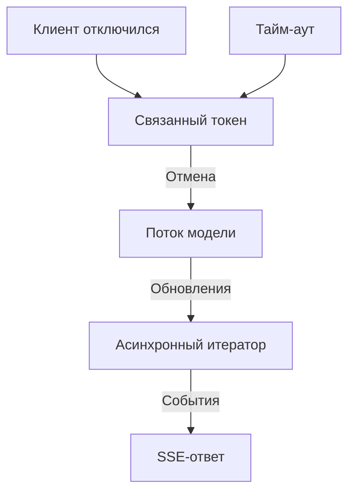

# Потоковую генерацию ответа нужно уметь останавливать

Пользователь задаёт вопрос, ждёт ответа и закрывает страницу, а сервис продолжает генерировать. С вызовом модели всё в порядке: он делает именно то, что поручило приложение. Но приложение не связало время жизни этой работы с присутствием пользователя, который ждёт ответа.

При долгих вызовах модели нужно решить две отдельные задачи. Первая — показать полезную часть ответа до завершения генерации; для этого нужна потоковая передача. Вторая — остановить ненужную работу, когда клиент отключился или истекло отведённое время; для этого нужна отмена. В RAG-сервисе P1 оба механизма должны работать на всём пути от HTTP-обработчика до клиента модели.

## Как это устроено в .NET \{#how-it-works-in-dotnet}

Урок рассчитан на [.NET 10 — текущую LTS-версию](https://learn.microsoft.com/ru-ru/dotnet/core/releases-and-support), [поддержка которой продлится до 14 ноября 2028 года](https://learn.microsoft.com/ru-ru/lifecycle/products/microsoft-net-and-net-core). Чтобы разобраться с отменой, разделяй три вещи: асинхронную операцию, последовательность обновлений и HTTP-ответ.

**Задача (task)** описывает операцию, которая завершится успешно, с ошибкой или отменой. `Task<T>` также предоставляет её результат. Если асинхронная операция ввода-вывода пока не завершена, `await` приостанавливает метод, не блокируя поток на время ожидания. Модель от этого не начнёт генерировать быстрее, а последовательные действия не станут параллельными. Этот механизм описан в [руководстве по асинхронному программированию](https://learn.microsoft.com/ru-ru/dotnet/csharp/asynchronous-programming/).

В обработчике запроса вызывай асинхронное API модели напрямую. При `.Result` или `.Wait()` поток занят ожиданием. Если обернуть блокирующий ввод-вывод в `Task.Run`, блокироваться всё равно будет один из потоков. См. [рекомендации ASP.NET Core](https://learn.microsoft.com/ru-ru/aspnet/core/fundamentals/best-practices?view=aspnetcore-10.0).

**Асинхронный поток (async stream)** — это последовательность `IAsyncEnumerable<T>`. Ты читаешь её элементы по очереди, асинхронно дожидаясь следующего. Асинхронный итератор выдаёт элементы через `yield return`, а потребитель читает их через `await foreach`. При генерации ответа моделью отдельным элементом может быть фрагмент (chunk) текста, а не готовый ответ. Эта последовательность задаёт контракт внутри приложения, но не определяет формат передачи по HTTP. В [руководстве по асинхронным потокам](https://learn.microsoft.com/ru-ru/dotnet/csharp/asynchronous-programming/generate-consume-asynchronous-stream) разобраны создание, чтение и отмена таких последовательностей.

**Server-sent events (SSE, события от сервера)** передают последовательные сообщения от сервера клиенту по одному HTTP-соединению. В ASP.NET Core 10 метод [`TypedResults.ServerSentEvents`](https://learn.microsoft.com/ru-ru/dotnet/api/microsoft.aspnetcore.http.typedresults.serversentevents?view=aspnetcore-10.0) принимает `IAsyncEnumerable<SseItem<T>>`: элемент содержит данные и при необходимости имя типа события. Обычный JSON-ответ с последовательностью элементов сам по себе не задаёт протокол SSE. Варианты результатов описаны в [руководстве по ответам минимальных API](https://learn.microsoft.com/ru-ru/aspnet/core/fundamentals/minimal-apis/responses?view=aspnetcore-10.0).



Сигнал отмены идёт к операции, которая генерирует ответ, а фрагменты ответа — к клиенту.

В минимальных API параметр обработчика `CancellationToken` привязывается к [`HttpContext.RequestAborted`](https://learn.microsoft.com/ru-ru/aspnet/core/fundamentals/use-http-context?view=aspnetcore-10.0#requestaborted). Передавай этот сигнал отмены запроса (request cancellation) дальше по цепочке вызовов.

**Источник токена отмены (cancellation token source)** подаёт сигнал отмены, а через токен отмены (cancellation token) операция узнаёт об этом сигнале.

При [кооперативной отмене (cooperative cancellation)](https://learn.microsoft.com/ru-ru/dotnet/standard/threading/cancellation-in-managed-threads) мало принять токен как параметр: реализация должна проверять его или передавать в операцию ввода-вывода, завершения которой ждёт через `await`.

Для связанной отмены (linked cancellation) создай [источник, связанный с токеном запроса](https://learn.microsoft.com/ru-ru/dotnet/api/system.threading.cancellationtokensource.createlinkedtokensource?view=net-10.0), и один раз вызови [`CancelAfter`](https://learn.microsoft.com/ru-ru/dotnet/api/system.threading.cancellationtokensource.cancelafter?view=net-10.0). Так ты задашь ограничение общего времени выполнения (elapsed-time budget). И прерывание HTTP-запроса, и таймер смогут остановить работу дальше по цепочке вызовов, вплоть до модели.

Повторный вызов `CancelAfter` запускает отсчёт заново. Если вызывать его после каждого фрагмента, получится тайм-аут простоя (idle timeout): он ограничивает паузу между обновлениями, а не общую длительность генерации.

SSE-результат перечисляет элементы итератора уже после возврата из обработчика. Если объявить связанный источник через `using` в самом обработчике, он будет освобождён слишком рано. Создай источник внутри итератора, [сохраняй его до конца перечисления](https://learn.microsoft.com/ru-ru/dotnet/csharp/language-reference/statements/yield#using-statements-in-iterators) и освободи, когда перечисление закончится.

Атрибут `[EnumeratorCancellation]` связывает токен, переданный потребителем при перечислении, с параметром токена в итераторе. При чтении другой асинхронной последовательности передавай такой токен через [`WithCancellation(token)`](https://learn.microsoft.com/ru-ru/dotnet/api/system.threading.tasks.taskasyncenumerableextensions.withcancellation?view=net-10.0). В обоих случаях токен нужно передать и в саму операцию вызова модели.

## Как выбрать подход и учесть ограничения \{#choosing-and-tradeoffs}

Начни с того, какие данные клиенту допустимо использовать, пока генерация ещё продолжается. От этого зависит контракт ответа.

| Вариант | Когда использовать | Когда не подходит или что может пойти не так |
|---|---|---|
| Полный JSON-ответ через `Task<T>` с буферизацией | Клиенту нужен один законченный, проверенный ответ. | Пока ответ не готов, клиент ничего не видит. Не подходит, если долгое молчание неприемлемо. |
| SSE из `IAsyncEnumerable<T>` | Клиент может получать предварительные фрагменты по мере генерации. | Не подходит, если весь ответ нужно проверить до выдачи любой его части. Уже переданный текст отозвать нельзя. |
| Фоновое задание с сохранением состояния | Работа и её результат должны сохраняться после ухода клиента. | Нужно организовать хранение состояния и получение результата. Для короткого интерактивного ответа это лишняя сложность. |

Частая ловушка — ограничить время ожидания, оставив саму работу без отмены. [`Task.WaitAsync`](https://learn.microsoft.com/ru-ru/dotnet/api/system.threading.tasks.task.waitasync?view=net-10.0) прекращает ожидание по тайм-ауту или сигналу отмены, но сам по себе не передаёт сигнал остановки исходной операции. Работа может продолжиться, а если позже возникнет исключение, [его всё ещё нужно будет обработать](https://devblogs.microsoft.com/dotnet/how-do-i-cancel-non-cancelable-async-operations/). Передавай связанный токен в операцию, которая производит результат. Не оставляй без наблюдения задачу, запущенную из обработчика. Если работа должна продолжаться независимо от запроса, явно определи, кто ею управляет и когда она завершается.

При потоковой передаче меняется и обработка ошибок. После начала отправки тела ответа ASP.NET Core [не может изменить код состояния или заголовки](https://learn.microsoft.com/ru-ru/aspnet/core/fundamentals/best-practices?view=aspnetcore-10.0). Если модель выдаст ошибку посреди генерации, заменить начатый ответ новым JSON-описанием ошибки с другим статусом уже не получится. Определи на уровне приложения, что считать завершением ответа. В P1 для этого будут использоваться события `delta`, `citation` и `done`; это выбор протокола приложения. Закрытие потока без `done` означает, что ответ неполный. Клиент в проде должен явно показывать это состояние, чтобы пользователь не принимал частичный текст за окончательный ответ.

Проверь, как события доходят до клиента в развёрнутом сервисе. Даже если приложение читает последовательность по мере появления элементов, это ещё не показывает, как быстро прокси пересылает каждое событие и сколько данных буферизует провайдер. Измерь время до первого содержательного фрагмента и проверь работу отмены через ту же сетевую цепочку, по которой идут запросы к развёрнутому сервису. Локальное упражнение ниже проверяет только логику приложения.

## Что это меняет для AI-сервиса \{#in-an-ai-workload}

В P1 сначала найди разрешённый контекст из документов, затем начинай генерацию ответа. При передаче ответа частями сохраняй идентификаторы источников, нужные для ссылок. Как опираться на контекст и оформлять ссылки, разобрано в уроке [«Обоснованный ответ из найденного контекста»](/rag-agents/part-1-rag/generation/). Смена транспорта не поможет модели точнее передавать содержание документов. Если правила безопасности требуют проверить весь ответ до выдачи, сначала собери его в буфере, даже когда модель поддерживает потоковую генерацию.

На поиск и генерацию задай одно общее ограничение времени. Если поиск израсходует почти всё отведённое время, а генерация получит новый тайм-аут полной длительности, пользователь будет ждать дольше, чем предполагалось. В упражнении отсчёт начинается при перечислении элементов ответа: этапа поиска там нет. В полном P1 запускай отсчёт до поиска и сохраняй общее ограничение до конца потокового ответа.

Метод [`IChatClient.GetStreamingResponseAsync`](https://learn.microsoft.com/ru-ru/dotnet/api/microsoft.extensions.ai.ichatclient.getstreamingresponseasync?view=net-10.0-pp) принимает токен отмены и возвращает асинхронную последовательность обновлений ответа. Передавай в вызов модели тот же токен, которым ограничено время работы. Проверь, как выбранный провайдер реагирует на отмену. По локальному токену нельзя судить, остановит ли провайдер удалённую генерацию немедленно, откатит ли уже выполненную работу и перестанет ли начислять плату.

Записывай время до первого содержательного фрагмента ответа, общую длительность и причину завершения потока. Различай отключение клиента, истечение отведённого времени и сбой провайдера. Если объединить их в один счётчик, будет трудно отличить медленную модель от клиента, которому надоело ждать. Более полная трассировка разобрана в уроке [«Видеть, что система делает в проде»](/rag-agents/part-1-rag/cross-cutting/observability/).

Не запускай генерацию повторно автоматически после выдачи части текста, если протокол явно не предусматривает замену ответа. Иначе к началу первого ответа может дописаться второй.

## Попробуй \{#try-it}

Собери локальный механизм передачи ответа для P1. Вместо модели он будет выдавать фиксированный текст и заглушку ссылки на источник. Так можно проверить нормальное завершение и отмену без развёртывания в облаке и учётных данных. Для обоих фрагментов кода нужен [.NET SDK 10.0.402](https://dotnet.microsoft.com/en-us/download/dotnet/10.0); установи его и curl, а также освободи локальный порт 5050. Для имитации модели добавлять пакеты NuGet не требуется.

Код страницы собран с .NET SDK 10.0.402 и `Microsoft.Extensions.AI.Abstractions` 10.11.0; проверено 17.10.2026. Локальное упражнение запущено в приведённом виде, включая отключение клиента и вариант с тайм-аутом; наблюдения ниже получены в этих запусках. Адаптер из последнего фрагмента скомпилирован и проверен с локальной тестовой заглушкой клиента чата. Вызовы реального провайдера модели и работа с подпиской Azure не проверялись.

Создай временное приложение ASP.NET Core вне существующего каталога проекта P1. [Шаблон `web` и параметры команды](https://learn.microsoft.com/ru-ru/dotnet/core/tools/dotnet-new-sdk-templates) создадут пустое приложение:

```bash
dotnet new web --framework net10.0 --output P1StreamingLab
cd P1StreamingLab
```

Замени содержимое `Program.cs`:

```csharp
using System.Net.ServerSentEvents;
using System.Runtime.CompilerServices;

var builder = WebApplication.CreateBuilder(args);
var app = builder.Build();

app.MapGet("/answer", (CancellationToken requestAborted) =>
    TypedResults.ServerSentEvents(AnswerAsync(requestAborted)));

app.Run("http://localhost:5050");

static async IAsyncEnumerable<SseItem<string>> AnswerAsync(
    [EnumeratorCancellation] CancellationToken requestAborted = default)
{
    using var budget = CancellationTokenSource.CreateLinkedTokenSource(requestAborted);
    budget.CancelAfter(TimeSpan.FromSeconds(10));

    try
    {
        await foreach (var text in ModelAsync(budget.Token))
            yield return new SseItem<string>(text, eventType: "delta");

        budget.Token.ThrowIfCancellationRequested();
        yield return new SseItem<string>("public-document-1#section-2", "citation");
        yield return new SseItem<string>("complete", "done");
    }
    finally
    {
        Console.WriteLine("Answer enumeration ended.");
    }
}

static async IAsyncEnumerable<string> ModelAsync(
    [EnumeratorCancellation] CancellationToken cancellationToken = default)
{
    string[] fragments = ["The ", "answer ", "comes ", "from ", "public ", "documents."];
    foreach (var fragment in fragments)
    {
        await Task.Delay(500, cancellationToken);
        yield return fragment;
    }
}
```

Ограничение в 10 секунд выбрано для упражнения; это не предел платформы. Перегрузка [`Task.Delay` с токеном](https://learn.microsoft.com/ru-ru/dotnet/api/system.threading.tasks.task.delay?view=net-10.0) делает ожидание в имитации модели отменяемым. В этом изолированном упражнении адрес локального приложения задаётся через [`app.Run`](https://learn.microsoft.com/ru-ru/aspnet/core/fundamentals/minimal-apis/webapplication?view=aspnetcore-10.0). Запусти сервер с [`--no-launch-profile`](https://learn.microsoft.com/ru-ru/dotnet/core/tools/dotnet-run), чтобы сгенерированный профиль запуска не задавал настройки:

```bash
dotnet run --no-launch-profile
```

Во втором терминале отправь запрос:

```bash
curl --no-buffer http://localhost:5050/answer
```

Флаг [`--no-buffer`](https://curl.se/docs/manpage.html#-N) отключает буферизацию вывода curl. При успешном запросе появятся именованные события `delta` со строками, затем `citation` и `done`. Строки [передаются как есть](https://learn.microsoft.com/ru-ru/dotnet/api/microsoft.aspnetcore.http.typedresults.serversentevents?view=aspnetcore-10.0), без кавычек JSON.

Отправь запрос ещё раз и после первого фрагмента нажми Ctrl+C в терминале с curl. Когда сервер обнаружит отключение клиента, токен запроса должен отменить ожидание в имитации модели, а сервер — вывести `Answer enumeration ended.`. Это сообщение печатается и при успехе, потому что находится в [блоке `finally`](https://learn.microsoft.com/ru-ru/dotnet/csharp/language-reference/statements/yield). Проверь, что перечисление закончилось раньше времени и события `done` не было.

Теперь останови сервер, замени `Task.Delay(500, cancellationToken)` на `Task.Delay(2000, cancellationToken)`, запусти сервер снова и повтори запрос. Генерация не уложится в отведённое время: ожидай примерно четыре события `delta`, затем закрытие потока примерно через 10 секунд без `done`. Curl сообщит `curl: (18) transfer closed with outstanding read data remaining`: [код 18 означает неполную передачу](https://curl.se/libcurl/c/libcurl-errors.html).

На сервере после `Answer enumeration ended.` появятся `fail: Microsoft.AspNetCore.Server.Kestrel[13]`, `An unhandled exception was thrown by the application.` и трассировка стека `TaskCanceledException`. Пример намеренно не перехватывает отмену: отменённый [`Task.Delay`](https://learn.microsoft.com/ru-ru/dotnet/api/system.threading.tasks.task.delay?view=net-10.0) выбрасывает `TaskCanceledException`, а Kestrel записывает неперехваченное исключение как [ошибку приложения с номером события 13](https://github.com/dotnet/aspnetcore/blob/main/src/Servers/Kestrel/Core/src/Internal/Infrastructure/KestrelTrace.General.cs). Для варианта с тайм-аутом это ожидаемое поведение; SSE-события об ошибке пример не отправляет.

В проде перехватывай только ту отмену, которую вызвало истечение отведённого времени, и записывай тайм-аут в журнал. Чтобы определить причину, проверяй отдельно отмену запроса и истечение времени: нельзя считать любое `OperationCanceledException` тайм-аутом.

При последующем подключении Foundry сохрани управление временем жизни в `AnswerAsync`, а имитацию модели замени адаптером ниже. Ему нужен пакет [`Microsoft.Extensions.AI.Abstractions` 10.11.0](https://www.nuget.org/packages/Microsoft.Extensions.AI.Abstractions/10.11.0) — последняя стабильная версия на дату проверки. Пакет предоставляет `IChatClient` и [`ChatResponseUpdate`](https://learn.microsoft.com/ru-ru/dotnet/api/microsoft.extensions.ai.chatresponseupdate?view=net-10.0-pp); других пакетов для этих абстракций не требуется. Клиент к этому моменту должен быть настроен.

Добавь `using Microsoft.Extensions.AI;` в начало `Program.cs`, перед инструкциями верхнего уровня, согласно [правилам размещения директив `using`](https://learn.microsoft.com/ru-ru/dotnet/csharp/language-reference/compiler-messages/using-directive-errors). Сохрани `using System.Runtime.CompilerServices;`: он нужен для [`EnumeratorCancellation`](https://learn.microsoft.com/ru-ru/dotnet/api/system.runtime.compilerservices.enumeratorcancellationattribute?view=net-10.0). Замени функцию `ModelAsync`, расположенную после инструкций верхнего уровня. Передай настроенный клиент и сообщения с контекстом из документов в `AnswerAsync`, а внутри вызывай `ModelAsync(chat, messages, budget.Token)`:

```csharp
static async IAsyncEnumerable<string> ModelAsync(
    IChatClient chat, IEnumerable<ChatMessage> messages,
    [EnumeratorCancellation] CancellationToken cancellationToken = default)
{
    await foreach (var update in chat.GetStreamingResponseAsync(
        messages, cancellationToken: cancellationToken))
    {
        if (!string.IsNullOrEmpty(update.Text))
            yield return update.Text;
    }
}
```

Регистрация провайдера — часть подключения модели в P1; она разобрана в уроке [II.8 «AI в .NET»](./ai-in-dotnet.md). Адаптер показывает, куда передать сигнал отмены при вызове модели; коду передачи ответа не нужно знать, какой провайдер используется.

**Стоимость:** бесплатно. Всё выполняется локально, без ресурсов Azure и вызовов внешней модели.

**Удаление ресурсов:** останови локальный сервер сочетанием Ctrl+C, выйди из каталога `P1StreamingLab` и удали эту локальную папку.

## Что перенести в свою практику \{#what-to-take-away}

- Дождись ввода-вывода модели через `await`, не блокируя поток обработки запроса. За задачей стоит одна операция, а асинхронный поток выдаёт последовательные обновления.
- Для HTTP-событий используй явный SSE-результат и событие завершения, чтобы клиент отличал частичный ответ от полного.
- Объедини отмену запроса с общим ограничением времени и передавай токен через все слои до вызова модели.
- Сохраняй источники токенов до конца перечисления. Отмена работает, только если операции реагируют на её сигнал; уже переданный клиенту текст отозвать нельзя.

**[Новые термины](../glossary.md#async-streaming-cancellation)**: задача, асинхронный поток, server-sent events (SSE), кооперативная отмена, токен отмены, источник токена отмены, отмена запроса, связанная отмена, ограничение общего времени выполнения, тайм-аут простоя.

## Источники \{#sources}

Проверено на 17.10.2026.

- [Версии и поддержка .NET](https://learn.microsoft.com/ru-ru/dotnet/core/releases-and-support), [Сроки поддержки Microsoft .NET](https://learn.microsoft.com/ru-ru/lifecycle/products/microsoft-net-and-net-core) и [Загрузка .NET 10 SDK](https://dotnet.microsoft.com/en-us/download/dotnet/10.0)
- [Асинхронное программирование](https://learn.microsoft.com/ru-ru/dotnet/csharp/asynchronous-programming/), [Создание и чтение асинхронных потоков](https://learn.microsoft.com/ru-ru/dotnet/csharp/asynchronous-programming/generate-consume-asynchronous-stream), [EnumeratorCancellation](https://learn.microsoft.com/ru-ru/dotnet/api/system.runtime.compilerservices.enumeratorcancellationattribute?view=net-10.0) и [WithCancellation](https://learn.microsoft.com/ru-ru/dotnet/api/system.threading.tasks.taskasyncenumerableextensions.withcancellation?view=net-10.0)
- [Рекомендации ASP.NET Core](https://learn.microsoft.com/ru-ru/aspnet/core/fundamentals/best-practices?view=aspnetcore-10.0) и [Работа с HttpContext](https://learn.microsoft.com/ru-ru/aspnet/core/fundamentals/use-http-context?view=aspnetcore-10.0)
- [Ответы минимальных API](https://learn.microsoft.com/ru-ru/aspnet/core/fundamentals/minimal-apis/responses?view=aspnetcore-10.0), [TypedResults.ServerSentEvents](https://learn.microsoft.com/ru-ru/dotnet/api/microsoft.aspnetcore.http.typedresults.serversentevents?view=aspnetcore-10.0) и [Конструктор SseItem](https://learn.microsoft.com/ru-ru/dotnet/api/system.net.serversentevents.sseitem-1.-ctor?view=net-10.0)
- [Отмена в управляемых потоках](https://learn.microsoft.com/ru-ru/dotnet/standard/threading/cancellation-in-managed-threads), [CreateLinkedTokenSource](https://learn.microsoft.com/ru-ru/dotnet/api/system.threading.cancellationtokensource.createlinkedtokensource?view=net-10.0) и [CancelAfter](https://learn.microsoft.com/ru-ru/dotnet/api/system.threading.cancellationtokensource.cancelafter?view=net-10.0)
- [Task.WaitAsync](https://learn.microsoft.com/ru-ru/dotnet/api/system.threading.tasks.task.waitasync?view=net-10.0), [Отмена ожидания и отмена работы](https://devblogs.microsoft.com/dotnet/how-do-i-cancel-non-cancelable-async-operations/) и [Task.Delay](https://learn.microsoft.com/ru-ru/dotnet/api/system.threading.tasks.task.delay?view=net-10.0)
- [Выполнение итератора и время жизни ресурсов](https://learn.microsoft.com/ru-ru/dotnet/csharp/language-reference/statements/yield)
- [Метод потокового ответа IChatClient](https://learn.microsoft.com/ru-ru/dotnet/api/microsoft.extensions.ai.ichatclient.getstreamingresponseasync?view=net-10.0-pp), [ChatResponseUpdate.Text](https://learn.microsoft.com/ru-ru/dotnet/api/microsoft.extensions.ai.chatresponseupdate.text?view=net-10.0-pp) и [Работа с IChatClient](https://learn.microsoft.com/ru-ru/dotnet/ai/ichatclient)
- [Microsoft.Extensions.AI.Abstractions 10.11.0](https://www.nuget.org/packages/Microsoft.Extensions.AI.Abstractions/10.11.0) и [Размещение директив using](https://learn.microsoft.com/ru-ru/dotnet/csharp/language-reference/compiler-messages/using-directive-errors)
- [Журналирование ошибок приложения в Kestrel](https://github.com/dotnet/aspnetcore/blob/main/src/Servers/Kestrel/Core/src/Internal/Infrastructure/KestrelTrace.General.cs) и [Коды ошибок curl](https://curl.se/libcurl/c/libcurl-errors.html)
- [dotnet new](https://learn.microsoft.com/ru-ru/dotnet/core/tools/dotnet-new), [Шаблоны SDK](https://learn.microsoft.com/ru-ru/dotnet/core/tools/dotnet-new-sdk-templates), [dotnet run](https://learn.microsoft.com/ru-ru/dotnet/core/tools/dotnet-run) и [Конфигурация WebApplication](https://learn.microsoft.com/ru-ru/aspnet/core/fundamentals/minimal-apis/webapplication?view=aspnetcore-10.0)
- [Руководство curl: --no-buffer](https://curl.se/docs/manpage.html#-N)
