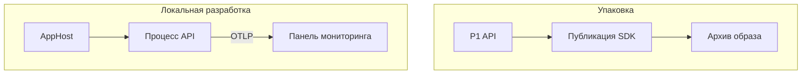

# Упаковать сервис в образ и разобраться в его работе по телеметрии

API работает на одном ноутбуке. Как добиться того, чтобы его могли надёжно запустить остальные? У одного разработчика другая среда выполнения, у другого не хватает переменных окружения, у третьего нужный сервис уже запускается, но ещё не готов принимать запросы. Для поставки приложения нужен воспроизводимый артефакт, а для разработки — воспроизводимое окружение. Эти задачи связаны, но у каждой своё решение.

При разработке сервиса ответов на вопросы мало запустить все процессы. Если ответ приходит медленно, причина может быть в поиске, вызове модели или коде между ними. В отдельных окнах терминала обычно видно, что процессы живы, но трудно понять, что происходило с конкретным запросом. Поэтому понадобятся три вещи: артефакт для развёртывания, явное описание локального приложения и телеметрия, которую формирует его код.

## Как это устроено в .NET \{#how-it-works-in-dotnet}

На 17.10.2026 актуальная LTS-версия — .NET 10; её [поддержка заканчивается 14 ноября 2028 года](https://dotnet.microsoft.com/en-us/platform/support/policy). SDK упаковывает API, Aspire запускает локальное приложение, а инструментирование кода даёт данные для диагностики.

Цель [`PublishContainer`](https://learn.microsoft.com/ru-ru/dotnet/core/containers/sdk-publish) создаёт образ контейнера (container image) без Dockerfile. SDK объединяет опубликованные файлы приложения, базовый образ и настройки запуска. Для проекта ASP.NET Core, который использует установленную среду выполнения .NET, SDK обычно выбирает образ `aspnet`, а тег определяет по целевой версии платформы. Базовый образ, репозиторий и тег можно задать явно через [свойства публикации контейнера](https://learn.microsoft.com/ru-ru/dotnet/core/containers/publish-configuration). Образ задаёт окружение выполнения самого приложения; адреса внешних сервисов и учётные данные по-прежнему задаются при запуске.

Для создания образа Docker нужен не всегда. По умолчанию SDK отправляет образ в локальную среду выполнения контейнеров, и она должна быть запущена. Если публиковать образ в архив или сразу в реестр, можно обойтись без неё. Для запуска контейнера среда выполнения уже потребуется. Значит, у задачи CI, которая только создаёт архив, и у задачи, которая запускает контейнер, разные требования к окружению.

[Aspire раньше назывался .NET Aspire](https://aspire.dev/whats-new/aspire-13/). Здесь используется ветка 13.6: на 17.10.2026 последняя стабильная версия [пакета CLI — 13.6.1](https://www.nuget.org/packages/Aspire.Cli/13.6.1), и [шаблоны проектов тоже закреплены на 13.6.1](https://www.nuget.org/packages/Aspire.ProjectTemplates/13.6.1). В новых проектах AppHost на C# задано `AspireUseCliBundle=true`, поэтому [`dotnet run` запускает Aspire CLI](https://aspire.dev/get-started/aspire-sdk/#running-with-dotnet-run). Обычно выбирается совместимая команда из `PATH`; если её нет, `dnx` загружает соответствующий пакет `Aspire.Cli` из NuGet. В упражнении режим `DnxPinned` принудительно выбирает CLI версии 13.6.1, соответствующий AppHost, независимо от содержимого `PATH`.

[AppHost](https://aspire.dev/get-started/app-host/) описывает ресурсы приложения и связи между ними. Ресурс Aspire (Aspire resource) может представлять проект API, контейнер или другую зависимость. В AppHost, созданном как проект на C#, ты регистрируешь .NET-проекты для локального запуска через `AddProject`. Для этого AppHost должен ссылаться на регистрируемый проект. Обработчики запросов остаются в API; AppHost задаёт, как запускать компоненты и соединять их.



`AddProject` запускает проект как локальный процесс и не использует архив образа. Работу приложения из опубликованного образа проверь отдельно: успешный запрос к локальному процессу API не подтверждает, что приложение из образа работает корректно.

[Service Defaults](https://aspire.dev/get-started/csharp-service-defaults/) — общий C#-проект с настройками OpenTelemetry, проверок работоспособности, обнаружения служб (service discovery) и устойчивости HTTP-клиента к сбоям. Каждый сервис должен добавить ссылку на этот проект и вызвать методы настройки. Это исходный код: его можно изучать и менять. Общие модели RAG и бизнес-логика должны находиться в отдельных библиотеках.

AppHost задаёт локальные адреса для отправки телеметрии. Сервисы с настроенным инструментированием экспортируют журналы, трейсы (traces) и метрики по протоколу OTLP (OpenTelemetry Protocol). [Панель мониторинга](https://aspire.dev/dashboard/) показывает полученные данные рядом с ресурсами приложения. Если сервис не формирует трейсы, один только запуск через Aspire их не добавит.

Спан (span) описывает одну операцию в трейсе: отдельные спаны поиска и генерации дадут больше полезных сведений, чем общее время обработчика.

## Как выбрать инструменты и учесть компромиссы \{#choosing-and-tradeoffs}

Способ упаковки и способ локального запуска выбираются независимо. Для простого API может быть полезен образ, собранный SDK, ещё до появления потребности в AppHost. Можно и разрабатывать приложение с Aspire, а для поставки упаковывать его другим способом.

| Вариант | Когда подходит | Когда лучше отказаться или изменить подход |
|---|---|---|
| Публикация образа средствами SDK | Опубликованное .NET-приложение может работать на существующем базовом образе. | Нужны произвольные шаги установки компонентов ОС: SDK не выполняет инструкции `RUN` из Dockerfile. Подготовь базовый образ или используй Dockerfile. |
| Dockerfile | Нужен контроль над сборкой образа, которого не дают свойства публикации SDK. | Файл лишь повторяет упаковку, с которой уже справляется SDK, а сопровождать приходится ещё один сценарий сборки. |
| Обычный `dotnet run` | Хватает одного процесса и небольшого числа настроек. | Запуск связанных сервисов и сопоставление их поведения требуют всё больше ручной работы. |
| Aspire AppHost | Нужны граф приложения, настройки зависимостей и общая локальная панель мониторинга. | Единственная цель — упаковать одно API, а оркестрация и диагностика не используются. |
| Существующее окружение на Docker Compose | У команды уже есть удобное контейнерное окружение для разработки. | Появляется второе описание того же окружения, оба расходятся, а какое из них считать основным — не определено. |

[Обнаружение служб](https://aspire.dev/fundamentals/service-discovery/) позволяет обращаться к ним по логическим именам: реальные адреса поступают из конфигурации. `WithReference` передаёт вызывающему сервису настройки зависимости, но не подтверждает, что зависимость готова обрабатывать запросы. Если приложению нужно дождаться готовности, задай явную связь, например [`WaitFor`](https://aspire.dev/fundamentals/health-checks/). Локальное обнаружение служб также не предоставляет прав на вызов облачного сервиса.

Работающее API может вернуть ошибку из-за сбоя при вызове модели. Даже при успешном HTTP-ответе сгенерированный текст может быть плохо подкреплён источниками. [Состояние ресурса и трейсы запросов](https://aspire.dev/fundamentals/telemetry/) дают разные сведения: при разборе ошибки ищи неудавшуюся операцию и связанные записи журнала, даже если индикатор ресурса зелёный.

Чтобы в образ попали обновлённые зависимости приложения или содержимое базового образа, его нужно пересобрать. В процессе выпуска учитывай версию SDK и выбранный базовый образ. После следующей отправки в реестр тот же тег может указывать уже на другие байты. [Дайджест образа (image digest)](https://learn.microsoft.com/ru-ru/azure/container-registry/container-registry-concepts#manifest-digest) идентифицирует образ по содержимому его манифеста. Если в релиз должен попасть именно проверенный артефакт, сохрани его дайджест и используй этот дайджест при развёртывании.

## Что это меняет для AI-сервиса \{#in-an-ai-workload}

P1 — RAG API для небольшого набора документов из открытых источников. Его предстоит разместить в Azure Container Apps и подключить к развёртыванию модели (model deployment) в Foundry, Azure AI Search, Blob Storage и Key Vault через управляемое удостоверение (managed identity). На следующих этапах поставки появятся Bicep, `azd`, GitHub Actions с OIDC и Application Insights. В этом уроке ты соберёшь артефакт API и настроишь локальную диагностику, которые понадобятся на следующих этапах.

Упаковывай сервис отдельно от корпуса документов и развёртывания модели. Смена адреса модели или имени индекса должна сводиться к изменению конфигурации; документы и учётные данные не должны попадать в образ. В образе находится приложение, а доступ к зависимостям оно получает при выполнении. Локальная оркестрация позволяет проверить обработку запроса, но удостоверение и сетевой доступ в облаке нужно отдельно проверять в развёрнутом окружении.

Допустим, ответ приходит через несколько секунд. Спан HTTP-запроса покажет общую длительность, а спаны поиска и вызова модели помогут понять, на что ушло время. Как устроить трейсы RAG-конвейера, объясняет урок [Observability](/rag-agents/part-1-rag/cross-cutting/observability/); здесь задача — формировать эти данные в .NET и видеть их локально. Инструментирование ASP.NET Core и HTTP-клиента даёт отправную точку, а операции и измерения, специфичные для приложения, нужно добавлять явно. Инструментирование вызовов модели появится в уроке II.8 «AI в .NET» 🚧. Обычный HTTP-трейс не является отчётом о расходе токенов.

Начни с имён операций, длительности и сведений об ошибках. Если записывать все промпты и найденные фрагменты, появится ещё одна копия входных данных приложения. Даже при работе с документами из открытых источников вопрос пользователя может содержать частные сведения. Прежде чем записывать в телеметрию промпты и найденные фрагменты, реши, какие данные допустимо сохранять.

С помощью панели мониторинга ты можешь разобраться в поведении сервиса. Для проверки качества ответов нужна [оценка](/rag-agents/part-1-rag/cross-cutting/evaluation/). По мере развития сервиса сохраняй небольшой набор вопросов с ожидаемыми ссылками на источники. Обратная связь из прода разобрана в уроке [«Наблюдаемость, выкатка и аварийный стоп»](/ai-sdlc/part-4-platform/observability-rollout). Работа с трейсами в локальном окружении поможет тебе подготовиться к настройке наблюдаемости в проде. Сами локальные трейсы не подтверждают, что в проде настроены оповещения, сроки хранения данных и экспорт в Azure Monitor.

## Попробуй \{#try-it}

Собери локальную заготовку P1: процесс API под управлением Aspire и архив образа из того же API. Конечная точка лишь сообщает, что API работает; поиск и вызовы модели появятся позже. Нужны терминал с поддержкой Bash, выбранный .NET 10 SDK и окружение, соответствующее [требованиям Aspire](https://aspire.dev/get-started/prerequisites/). В Linux при добавлении сертификата в доверенные могут потребоваться [дополнительные действия, зависящие от дистрибутива и браузера](https://learn.microsoft.com/ru-ru/aspnet/core/security/enforcing-ssl?view=aspnetcore-10.0#trust-https-certificate-on-linux).

**Проверка кода:** 17.10.2026 пример собран с .NET SDK 10.0.402 на macOS (arm64), шаблонами Aspire.ProjectTemplates 13.6.1 и версиями из таблицы ниже. Все три проекта собраны. При восстановлении зависимостей AppHost появилось предупреждение `NU1902`: транзитивная зависимость MessagePack 2.5.302, которую подключает Aspire.Hosting 13.6.1, содержит уязвимость средней серьёзности. Публикация создала `artifacts/p1-api.tar.gz` без запущенной среды выполнения контейнеров. При отдельном запуске API запрос к `/status` вернул `{"service":"p1-rag-api"}`. AppHost собран, но не запускался. Добавление сертификата в доверенные и загрузка Aspire CLI не проверялись; результаты этих действий и работы панели мониторинга ниже указаны как ожидаемые. Образ из архива не загружался в среду выполнения и не запускался. Вызовов Azure в этом примере нет.

Код рассчитан на .NET 10 SDK, `net10.0` и точные версии зависимостей из таблицы. На 17.10.2026 это последние стабильные версии, проверенные в NuGet. В шаблоне зафиксированы более старые версии зависимостей Service Defaults, поэтому обнови их после создания проекта.

| Компонент | Целевая версия |
|---|---|
| [Aspire.AppHost.Sdk](https://www.nuget.org/packages/Aspire.AppHost.Sdk/13.6.1), [Aspire.Hosting.AppHost](https://www.nuget.org/packages/Aspire.Hosting.AppHost/13.6.1) (неявная зависимость), [Aspire.Cli](https://www.nuget.org/packages/Aspire.Cli/13.6.1), [Aspire.ProjectTemplates](https://www.nuget.org/packages/Aspire.ProjectTemplates/13.6.1) | 13.6.1 |
| [Microsoft.Extensions.Http.Resilience](https://www.nuget.org/packages/Microsoft.Extensions.Http.Resilience/10.11.0), [Microsoft.Extensions.ServiceDiscovery](https://www.nuget.org/packages/Microsoft.Extensions.ServiceDiscovery/10.11.0) | 10.11.0 |
| [OpenTelemetry.Exporter.OpenTelemetryProtocol](https://www.nuget.org/packages/OpenTelemetry.Exporter.OpenTelemetryProtocol/1.20.0), [OpenTelemetry.Extensions.Hosting](https://www.nuget.org/packages/OpenTelemetry.Extensions.Hosting/1.20.0), [OpenTelemetry.Instrumentation.AspNetCore](https://www.nuget.org/packages/OpenTelemetry.Instrumentation.AspNetCore/1.20.0), [OpenTelemetry.Instrumentation.Http](https://www.nuget.org/packages/OpenTelemetry.Instrumentation.Http/1.20.0), [OpenTelemetry.Instrumentation.Runtime](https://www.nuget.org/packages/OpenTelemetry.Instrumentation.Runtime/1.20.0) | 1.20.0 |

Создай новую папку и перейди в неё. Прежде чем продолжать после `dotnet --version`, убедись, что выбрана версия SDK `10.0`. Установка шаблона использует [синтаксис `package@version`](https://learn.microsoft.com/ru-ru/dotnet/core/tools/dotnet-new-install).

```bash
mkdir p1-containers
cd p1-containers
dotnet --version
dotnet new install Aspire.ProjectTemplates@13.6.1
dotnet new web --name P1Api --output P1Api --framework net10.0
dotnet new aspire-apphost --name P1AppHost --output P1AppHost --framework net10.0
dotnet new aspire-servicedefaults --name P1ServiceDefaults --output P1ServiceDefaults --framework net10.0
dotnet reference add P1ServiceDefaults/P1ServiceDefaults.csproj --project P1Api/P1Api.csproj
dotnet reference add P1Api/P1Api.csproj --project P1AppHost/P1AppHost.csproj
```

API ссылается на Service Defaults ради общих настроек, а AppHost — на API, чтобы его запускать. Обнови зависимости Service Defaults командой [`dotnet package add`](https://learn.microsoft.com/ru-ru/dotnet/core/tools/dotnet-package-add) до версий из таблицы:

```bash
for package in Microsoft.Extensions.Http.Resilience Microsoft.Extensions.ServiceDiscovery; do
  dotnet package add "$package" --version 10.11.0 --project P1ServiceDefaults/P1ServiceDefaults.csproj
done
for package in OpenTelemetry.Exporter.OpenTelemetryProtocol OpenTelemetry.Extensions.Hosting \
  OpenTelemetry.Instrumentation.AspNetCore OpenTelemetry.Instrumentation.Http OpenTelemetry.Instrumentation.Runtime; do
  dotnet package add "$package" --version 1.20.0 --project P1ServiceDefaults/P1ServiceDefaults.csproj
done
```

Замени содержимое `P1Api/Program.cs`:

```csharp
var builder = WebApplication.CreateBuilder(args);
builder.AddServiceDefaults();

var app = builder.Build();
app.MapGet("/status", () => Results.Ok(new { service = "p1-rag-api" }));
app.MapDefaultEndpoints();
app.Run();
```

Замени содержимое `P1AppHost/AppHost.cs`:

```csharp
var builder = DistributedApplication.CreateBuilder(args);
builder.AddProject<Projects.P1Api>("api");
builder.Build().Run();
```

Опубликуй только API. Команда выполняется из его папки, чтобы путь к архиву был однозначным. [Параметры `dotnet publish`](https://learn.microsoft.com/ru-ru/dotnet/core/tools/dotnet-publish) задают конфигурацию Release, Linux x64, цель `PublishContainer`, репозиторий `p1-api`, тег `lesson7` и архив `../artifacts/p1-api.tar.gz`. Благодаря выбору архива образ не загружается в локальную среду выполнения контейнеров. Затем вернись в родительскую папку, добавь HTTPS-сертификат для разработки в доверенные и запусти AppHost с режимом `DnxPinned`:

```bash
mkdir artifacts
cd P1Api
dotnet publish --configuration Release --os linux --arch x64 \
  /t:PublishContainer \
  -p ContainerRepository=p1-api \
  -p ContainerImageTag=lesson7 \
  -p ContainerArchiveOutputPath=../artifacts/p1-api.tar.gz
cd ..
dotnet dev-certs https --trust
dotnet run --project P1AppHost/P1AppHost.csproj --property:AspireCliInvocationMode=DnxPinned
```

Публикация должна создать `artifacts/p1-api.tar.gz`. AppHost должен запустить API и панель мониторинга; открой ссылку для входа в неё, которую напечатает терминал. Найди ресурс `api`, открой его HTTP-адрес и добавь `/status`: ожидается JSON с `"service":"p1-rag-api"`. Отправь несколько запросов и посмотри трейсы и метрики API. Так ты проверишь локальное получение телеметрии. Запуск образа из архива потребует отдельной проверки.

Если панель открывается, но трейсов запросов нет, сначала проверь ссылку API на ServiceDefaults и вызов `AddServiceDefaults`, затем — настройки экспортёра. В [документации по .NET и OpenTelemetry](https://learn.microsoft.com/ru-ru/dotnet/core/diagnostics/observability-with-otel) разобрано, как формируются и отправляются данные. В стандартном шаблоне конечные точки проверки работоспособности исключены из трейсинга, поэтому для этой проверки они менее полезны.

**Стоимость:** бесплатно, только локальная работа. Упражнение запускает процессы .NET и создаёт архив образа; ресурсы Azure не создаются, вызовов модели нет. При первом запуске нужен интернет для восстановления пакетов NuGet, загрузки Aspire CLI и [базового образа из MCR](https://learn.microsoft.com/ru-ru/dotnet/core/containers/publish-configuration#containerbaseimage) — `mcr.microsoft.com/dotnet/aspnet:10.0`. Публикация в архив тоже требует загрузки базового образа.

**Удаление ресурсов:** останови AppHost сочетанием `Ctrl+C`, затем удали локальную папку `p1-containers`. Установленные шаблоны проектов останутся доступными для дальнейшей разработки.

## Что перенести в свою практику \{#what-to-take-away}

- Если .NET-сервис подходит для публикации через `PublishContainer`, упакуй его в образ этим способом — поддерживать отдельный Dockerfile не придётся.
- AppHost описывает локальное приложение. `AddProject` запускает проект API независимо от опубликованного образа.
- Для телеметрии нужны инструментирование и экспортёр внутри сервиса. Панель мониторинга показывает поступившие данные.
- Трейсы помогают найти медленные операции и сбои; оценка проверяет качество поиска и ответов.

**[Новые термины](../glossary.md#containers-and-aspire)**: образ контейнера, дайджест образа, `PublishContainer`, AppHost, ресурс Aspire, Service Defaults, OpenTelemetry, OTLP, спан, обнаружение служб.

## Источники \{#sources}

Проверено на 17.10.2026.

- **Среда выполнения и упаковка:** [.NET support policy](https://dotnet.microsoft.com/en-us/platform/support/policy), [SDK container creation](https://learn.microsoft.com/ru-ru/dotnet/core/containers/overview), [Containerize with dotnet publish](https://learn.microsoft.com/ru-ru/dotnet/core/containers/sdk-publish), [Container publish properties](https://learn.microsoft.com/ru-ru/dotnet/core/containers/publish-configuration), [Image tags and digests](https://learn.microsoft.com/ru-ru/azure/container-registry/container-registry-concepts#manifest-digest).
- **Aspire:** [Pinned package versions](https://www.nuget.org/packages/Aspire.ProjectTemplates/13.6.1), [Aspire 13 naming](https://aspire.dev/whats-new/aspire-13/), [SDK and CLI bundle](https://aspire.dev/get-started/aspire-sdk/), [Aspire 13.6](https://aspire.dev/whats-new/aspire-13-6/), [Prerequisites](https://aspire.dev/get-started/prerequisites/), [SDK templates](https://aspire.dev/get-started/aspire-sdk-templates/), [AppHost](https://aspire.dev/get-started/app-host/), [Add Aspire to an existing app](https://aspire.dev/get-started/add-aspire-existing-app/), [AppHost configuration](https://aspire.dev/app-host/configuration/), [C# launch profiles](https://aspire.dev/integrations/dotnet/launch-profiles/), [Health checks and readiness](https://aspire.dev/fundamentals/health-checks/), [Service discovery](https://aspire.dev/fundamentals/service-discovery/).
- **Телеметрия и код приложения:** [C# Service Defaults](https://aspire.dev/get-started/csharp-service-defaults/), [Aspire telemetry](https://aspire.dev/fundamentals/telemetry/), [Dashboard](https://aspire.dev/dashboard/), [.NET OpenTelemetry](https://learn.microsoft.com/ru-ru/dotnet/core/diagnostics/observability-with-otel), [Minimal APIs (.NET 10)](https://learn.microsoft.com/ru-ru/aspnet/core/fundamentals/minimal-apis?view=aspnetcore-10.0), [Linux certificate trust](https://learn.microsoft.com/ru-ru/aspnet/core/security/enforcing-ssl?view=aspnetcore-10.0#trust-https-certificate-on-linux).
- **Справочник команд:** [dotnet new](https://learn.microsoft.com/ru-ru/dotnet/core/tools/dotnet-new), [Built-in templates](https://learn.microsoft.com/ru-ru/dotnet/core/tools/dotnet-new-sdk-templates), [dotnet new install](https://learn.microsoft.com/ru-ru/dotnet/core/tools/dotnet-new-install), [dotnet reference add](https://learn.microsoft.com/ru-ru/dotnet/core/tools/dotnet-reference-add), [dotnet package add](https://learn.microsoft.com/ru-ru/dotnet/core/tools/dotnet-package-add), [dotnet publish](https://learn.microsoft.com/ru-ru/dotnet/core/tools/dotnet-publish), [dotnet run](https://learn.microsoft.com/ru-ru/dotnet/core/tools/dotnet-run), [dotnet dev-certs](https://learn.microsoft.com/ru-ru/dotnet/core/tools/dotnet-dev-certs).
