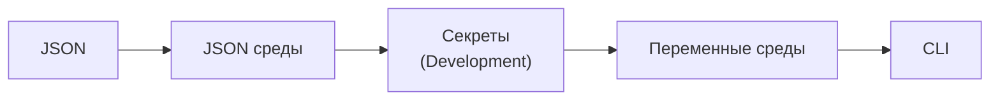

# Определи, кто создаёт объекты, откуда берутся настройки и что попадает в журнал

Код поиска может быть правильным, а RAG-сервис всё равно будет отвечать по чужому индексу. Один компонент читает настройки из файла, другой хранит старые значения, третий создаёт клиент со своим адресом сервиса. Если в журнале остаются только текстовые сообщения без полезных полей, найти затронутые запросы трудно.

При настройке приложения определи, кто создаёт объекты, сколько они живут, откуда получают настройки и как можно наблюдать за их работой. Для P1 это поможет разобраться, где ошибка: в поиске или в подключении к неверному развёртыванию, прежде чем менять промпт.

## Как это устроено в .NET \{#how-it-works-in-dotnet}

Семейство `Microsoft.Extensions` объединяет общие механизмы приложения: внедрение зависимостей, конфигурацию, работу с типизированными настройками и журналирование. В минимальном API ASP.NET Core вызов [`WebApplication.CreateBuilder(args)`](https://learn.microsoft.com/ru-ru/aspnet/core/fundamentals/?view=aspnetcore-10.0) настраивает хост, в котором эти механизмы уже доступны. Зависимости регистрируют до сборки приложения, а обработчики и классы получают их по мере необходимости.

Урок рассчитан на [.NET 10 — текущий выпуск с долгосрочной поддержкой (LTS)](https://learn.microsoft.com/ru-ru/dotnet/core/releases-and-support) на дату проверки. Его [поддержка заканчивается 14 ноября 2028 года](https://learn.microsoft.com/ru-ru/lifecycle/products/microsoft-net-and-net-core). В примерах используются [.NET 10 SDK 10.0.402](https://dotnet.microsoft.com/en-us/download?initial-os=linux) и целевая платформа `net10.0`.

При внедрении зависимостей (dependency injection, DI) компонент получает нужные ему объекты извне, вместо того чтобы создавать их внутри себя. Регистрация задаёт контейнеру правило создания объекта. Когда объект запрашивают у контейнера, тот предоставляет его вместе с зависимостями. Собрав регистрации в одном месте, ты сможешь проверить устройство приложения. Поисковый компонент получает клиент извне и не выбирает источник настроек самостоятельно.

Регистрация также определяет время жизни сервиса (service lifetime). От него зависит не только выделение памяти, но и одновременный доступ к объекту.

В HTTP API экземпляр сервиса со временем жизни scoped (экземпляр в пределах области DI) относится к одному запросу, а экземпляр со временем жизни singleton (общий экземпляр контейнера) используется совместно в пределах контейнера. Клиент без состояния может подходить для совместного использования; изменяемый список цитат текущего запроса при таком подходе рискует оказаться общим для несвязанных запросов.

Значения настроек поступают отдельно от правил создания объектов. Поставщик конфигурации (configuration provider) читает пары «ключ — значение» из своего источника. При стандартной настройке минимального хостинга [приоритет источников растёт в таком порядке](https://learn.microsoft.com/ru-ru/aspnet/core/fundamentals/configuration/?view=aspnetcore-10.0#default-app-configuration-sources):



Слева направо: `appsettings.json`, затем `appsettings.{Environment}.json`, пользовательские секреты только в `Development`, переменные среды и аргументы командной строки. Если один ключ встречается в нескольких источниках, побеждает значение из более позднего источника.

Например, JSON задаёт адрес сервиса и имя развёртывания модели, а переменная среды переопределяет только адрес. Приложение получит адрес из переменной среды и имя развёртывания из JSON. Порядок источников нужно учитывать при развёртывании: неожиданное итоговое значение может означать, что сработало переопределение, хотя файл прочитан правильно.

Иерархический ключ `Rag:SearchEndpoint` можно задать переменной среды [`Rag__SearchEndpoint`](https://learn.microsoft.com/ru-ru/dotnet/core/extensions/configuration-providers#environment-variable-configuration-provider). Двойное подчёркивание работает на разных платформах. Поставщики, добавленные вручную, тоже участвуют в выборе значения: если дописать в конец списка удалённый источник, итоговые настройки могут измениться. Поэтому для каждого нового хранилища нужно осознанно выбрать приоритет. Key Vault и App Configuration разобраны в уроке [«Секреты и конфигурация»](../part-1-azure-foundations/secrets-and-configuration.md).

Паттерн Options (options pattern) позволяет собрать связанные настройки в типизированный объект. Вместо обращения к строковым ключам `IConfiguration` из каждого класса привяжи раздел `Rag` к `RagOptions` и передавай потребителям интерфейс Options. Привязка записывает значения в открытые свойства с сеттерами, а отдельные правила проверки определяют, допустимы ли эти значения.

Например, можно запретить пустое имя развёртывания или адрес, который не является абсолютным URI со схемой HTTPS. Вызов `ValidateOnStart()` запускает [проверку при запуске (startup validation)](https://learn.microsoft.com/ru-ru/dotnet/core/extensions/options#options-validation), до первого обращения потребителя к настройкам. Приложение проверит только заданные правила: корректный URI может вести к недоступному сервису, а непустое имя — к несуществующему развёртыванию. Аутентификацию, авторизацию и сетевую связность нужно проверять отдельно.

При структурированном журналировании (structured logging) передавай [стабильный шаблон сообщения с именованными подстановками](https://learn.microsoft.com/ru-ru/aspnet/core/fundamentals/logging/?view=aspnetcore-10.0#log-message-template), а значения — отдельными аргументами. Поставщик журналирования сможет сохранить их в виде полей, по которым можно искать, например по идентификатору развёртывания. Если заранее собрать одну строку интерполяцией, разделение шаблона и значений потеряется.

`ILogger<T>` задаёт категорию компонента, а поставщик журналирования определяет, куда попадёт запись. Настрой уровни журналирования по категориям, чтобы обычные сообщения фреймворка не мешали находить события приложения. Для участков кода, которые порождают много записей, Microsoft рекомендует [методы журналирования с `[LoggerMessage]`, генерируемые при компиляции](https://learn.microsoft.com/ru-ru/dotnet/core/extensions/logging/high-performance-logging).

## Как выбрать время жизни и способ чтения настроек \{#choosing-and-tradeoffs}

Выбирай [время жизни](https://learn.microsoft.com/ru-ru/dotnet/core/extensions/dependency-injection/service-lifetimes) по состоянию, за которое отвечает объект, и по тому, кто будет обращаться к нему одновременно.

| Время жизни | Как работает контейнер | Подходящий пример в P1 | Когда не подходит |
|---|---|---|---|
| Transient (новый экземпляр при каждом обращении) | При каждом обращении за сервисом контейнер создаёт новый экземпляр. | Небольшой форматтер без состояния. | Нужен один общий экземпляр на весь HTTP-запрос. |
| Scoped — экземпляр в пределах области DI | Один экземпляр повторно используется в области DI; у каждого HTTP-запроса своя область. | Объект, который координирует обработку запроса и хранит цитаты для этого запроса. | Singleton будет удерживать этот объект. |
| Singleton — общий экземпляр контейнера | Один экземпляр используется всё время жизни контейнера. | Потокобезопасный клиент SDK с фиксированными настройками конструктора. | Объект хранит изменяемое состояние запроса или пользователя. |

Если потребитель удерживает зависимость дольше, чем ей положено жить, возникает захваченная зависимость (captive dependency). Singleton, который получил поисковую сессию со временем жизни scoped, будет хранить её дальше; новая сессия для каждого запроса у него не появится. Не регистрируй все сервисы как singleton только ради экономии на создании объектов. Обработку запроса организуй в его области DI. Если фоновому обработчику нужны scoped-сервисы, для каждой порции работы рекомендуется явно создавать область DI и освобождать её после завершения этой работы.

Стандартный поставщик DI в среде `Development` включает [проверку областей DI](https://learn.microsoft.com/ru-ru/aspnet/core/fundamentals/dependency-injection?view=aspnetcore-10.0#scope-validation) и отклоняет внедрение scoped-сервисов в singleton. В `Production` по умолчанию эта проверка выключена. Поэтому ошибочная схема зависимостей может выглядеть рабочей даже при локальном запуске, если среда — не `Development`.

У интерфейсов Options есть [собственные правила времени жизни и обновления значений](https://learn.microsoft.com/ru-ru/aspnet/core/fundamentals/configuration/options?view=aspnetcore-10.0#options-interfaces):

| Интерфейс | Поведение | Когда использовать | Когда не подходит |
|---|---|---|---|
| `IOptions<T>` | Обёртка singleton; значение кэшируется, последующие изменения конфигурации не читаются. | Настройки фиксированы на всё время работы процесса. | Значения должны меняться без перезапуска. |
| `IOptionsSnapshot<T>` | Scoped; значение вычисляется при первом обращении и кэшируется внутри области. | В рамках одного запроса нужен один набор настроек. | Потребитель — singleton. |
| `IOptionsMonitor<T>` | Singleton; предоставляет текущие значения и уведомления об изменениях. | Долгоживущий потребитель явно обрабатывает обновления. | Ожидается автоматическое пересоздание зависимых объектов. |

Для обновления конфигурации без перезапуска сам источник должен поддерживать обновления. Один лишь `IOptionsMonitor<T>` не добавляет эту возможность любому источнику. И новое значение настройки не пересоздаёт клиент, в конструктор которого уже передали старый адрес сервиса.

Для начала в P1 зафиксируй адрес сервиса, имя индекса и имя развёртывания модели на время работы процесса. После изменения этих настроек перезапускай приложение. Если позже понадобится обновление без перезапуска, заранее определи, как заменять клиенты и сохранять согласованный набор настроек для каждого запроса.

## Что это меняет для AI-сервиса \{#in-an-ai-workload}

В P1 нужен общий поисковый клиент; объекты для обработки каждого запроса должны быть отдельными. Microsoft рекомендует [регистрировать клиенты Azure SDK как singleton для одного набора параметров конструктора](https://learn.microsoft.com/ru-ru/dotnet/azure/sdk/thread-safety). Объекты моделей данных, которые SDK принимает и возвращает, по умолчанию не потокобезопасны. Поэтому изменяемые параметры поиска, выдачу и сборку цитат оставляй в пределах запроса, даже если клиент общий.

На дату проверки последние стабильные версии пакетов — [Azure.Identity 1.21.0](https://www.nuget.org/packages/Azure.Identity/1.21.0) и [Azure.Search.Documents 12.0.0](https://www.nuget.org/packages/Azure.Search.Documents/12.0.0). Ниже — пример регистрации для приложения в Azure, отдельно от локальной практики. Он использует класс `RagOptions` из упражнения и [управляемое удостоверение, назначаемое системой](https://learn.microsoft.com/ru-ru/dotnet/api/azure.identity.managedidentityid.systemassigned?view=azure-dotnet). [Конструктор `SearchClient`](https://learn.microsoft.com/ru-ru/dotnet/api/azure.search.documents.searchclient.-ctor?view=azure-dotnet) получает адрес сервиса, имя индекса и объект учётных данных для получения токена. Директивы `using` помести в начало `Program.cs`, а регистрации — до `builder.Build()`:

```csharp
using Azure.Identity;
using Azure.Search.Documents;
using Microsoft.Extensions.Options;

builder.Services.AddSingleton(_ =>
    new ManagedIdentityCredential(ManagedIdentityId.SystemAssigned));
builder.Services.AddSingleton<SearchClient>(services =>
{
    var settings = services.GetRequiredService<IOptions<RagOptions>>().Value;
    return new SearchClient(new Uri(settings.SearchEndpoint), settings.IndexName,
        services.GetRequiredService<ManagedIdentityCredential>());
});
```

Такая регистрация создаёт объект клиента, но не даёт права выполнять запросы к индексу. Настройка доступа разобрана в уроке [«Удостоверения II — RBAC и доступ без ключей»](../part-1-azure-foundations/rbac-and-keyless-access.md), включая [явный выбор способа получения учётных данных в проде](https://learn.microsoft.com/ru-ru/dotnet/azure/sdk/authentication/best-practices#use-deterministic-credentials-in-production-environments), который используется здесь. Время жизни клиента модели выбирай по контракту конкретной библиотеки; интеграции будут разобраны в уроке II.8 [«AI в .NET»](./ai-in-dotnet.md).

Когда клиентов Azure несколько, используй [`AddAzureClients` из `Microsoft.Extensions.Azure`](https://learn.microsoft.com/ru-ru/dotnet/azure/sdk/dependency-injection): этот механизм объединяет привязку конфигурации, общие учётные данные через `UseCredential` и [регистрацию клиентов как singleton](https://github.com/Azure/azure-sdk-for-net/blob/main/sdk/extensions/Microsoft.Extensions.Azure/src/AzureClientFactoryBuilder.cs). Для одного клиента, которому нужны проверенные настройки в конструкторе, явная фабрика из примера выше тоже подходит.

Записывай идентификаторы запроса и развёртывания модели, длительность поиска и число найденных результатов. Эти поля помогают отличить пустую выдачу от долгого вызова модели. В уроке [Observability](/rag-agents/part-1-rag/cross-cutting/observability/) курса RAG & Agents разобрано, как трассировать весь конвейер и как такая трассировка связана с оценкой RAG-системы.

В обычные журналы не должны попадать промпты, содержимое документов, учётные данные и полные выгрузки конфигурации. Прежде чем записывать содержимое, явно определи, как будешь обрабатывать эти данные. Вывод JSON в консоль в упражнении ниже остаётся локальным выводом; он не подключает Application Insights.

## Попробуй \{#try-it}

Сначала собери локальную часть P1, которая получает и проверяет настройки, без сетевых вызовов. Понадобятся .NET 10 SDK и Bash или Zsh.

17.10.2026 код страницы собран с .NET SDK 10.0.402, средой выполнения ASP.NET Core 10.0.13, Azure.Identity 1.21.0 и Azure.Search.Documents 12.0.0. Команды выполнены в приведённом виде на macOS; ожидаемые результаты совпали с выводом. Фрагмент с клиентом Azure скомпилирован, объекты локально получены через DI; с действующей подпиской Azure он не запускался.

Создай временный проект по [шаблону `web` с целевой платформой `net10.0`](https://learn.microsoft.com/ru-ru/dotnet/core/tools/dotnet-new-sdk-templates#web). Параметр [`--output`](https://learn.microsoft.com/ru-ru/dotnet/core/tools/dotnet-new) задаёт папку `p1-backbone-local`, а следующая команда переводит в неё:

```bash
dotnet new web --framework net10.0 --output p1-backbone-local
cd p1-backbone-local
```

Замени `Program.cs` кодом ниже. Сервис регистрирует отдельный план для каждого запроса и привязывает настройки адреса поискового сервиса, индекса и развёртывания модели. Для вывода журналов в консоль в формате JSON используется [`AddJsonConsole`](https://learn.microsoft.com/ru-ru/dotnet/core/extensions/logging/console-log-formatter).

```csharp
using Microsoft.Extensions.Options;

var builder = WebApplication.CreateBuilder(args);
builder.Logging.ClearProviders();
builder.Logging.AddJsonConsole();
builder.Services.AddOptions<RagOptions>()
    .Bind(builder.Configuration.GetSection("Rag"))
    .Validate(o => Uri.TryCreate(o.SearchEndpoint, UriKind.Absolute, out var uri)
        && uri.Scheme == Uri.UriSchemeHttps, "Rag:SearchEndpoint must be HTTPS.")
    .Validate(o => !string.IsNullOrWhiteSpace(o.IndexName), "Rag:IndexName is required.")
    .Validate(o => !string.IsNullOrWhiteSpace(o.DeploymentName),
        "Rag:DeploymentName is required.")
    .ValidateOnStart();
builder.Services.AddScoped<RagPlan>();

var app = builder.Build();
app.MapGet("/plan", (RagPlan plan) => plan.Describe());
app.Run();

public sealed class RagOptions
{
    public string SearchEndpoint { get; set; } = "";
    public string IndexName { get; set; } = "";
    public string DeploymentName { get; set; } = "";
}

public sealed class RagPlan(IOptions<RagOptions> options, ILogger<RagPlan> logger)
{
    private readonly Guid _id = Guid.NewGuid();

    public object Describe()
    {
        var settings = options.Value;
        logger.LogInformation("Prepared plan {PlanId} for deployment {DeploymentName}",
            _id, settings.DeploymentName);
        return new { PlanId = _id, settings.DeploymentName };
    }
}
```

Сначала запусти приложение, не задавая значения `Rag`:

```bash
dotnet run --no-launch-profile
```

Параметр `--no-launch-profile` отключает профили запуска. Если не заданы ни `DOTNET_ENVIRONMENT`, ни `ASPNETCORE_ENVIRONMENT`, средой будет [`Production`](https://learn.microsoft.com/ru-ru/aspnet/core/fundamentals/environments?view=aspnetcore-10.0#environment-variables-that-determine-the-runtime-environment). Тогда не используются `appsettings.Development.json`, пользовательские секреты и стандартная проверка областей DI.

**Ожидаемый результат:** при запуске хоста приложение завершается с [`OptionsValidationException`](https://learn.microsoft.com/ru-ru/dotnet/core/extensions/options#options-validation). Ошибка перечисляет все три нарушенных правила: `Rag:SearchEndpoint`, `Rag:IndexName` и `Rag:DeploymentName`.

Теперь задай вымышленные значения и [локальный адрес, на котором приложение принимает запросы](https://learn.microsoft.com/ru-ru/aspnet/core/fundamentals/servers/kestrel/endpoints?view=aspnetcore-10.0#specify-endpoints-with-urls):

```bash
ASPNETCORE_URLS=http://localhost:5080 \
Rag__SearchEndpoint=https://example.invalid \
Rag__IndexName=public-docs \
Rag__DeploymentName=local-demo \
dotnet run --no-launch-profile
```

Открой `http://localhost:5080/plan` дважды. **Ожидаемый результат:** каждый запрос возвращает новый `planId`, значение `deploymentName` равно `local-demo`, а в консоли появляется структурированная запись для каждого вызова. [Параметр обработчика типа `RagPlan` передаётся через DI](https://learn.microsoft.com/ru-ru/aspnet/core/fundamentals/minimal-apis/parameter-binding?view=aspnetcore-10.0#parameter-binding-with-dependency-injection). Вымышленный адрес `https://example.invalid` проходит проверку URI, но приложение к нему не обращается.

Останови процесс через `Ctrl+C` и повтори запуск, переопределив имя развёртывания аргументом командной строки:

```bash
ASPNETCORE_URLS=http://localhost:5080 \
Rag__SearchEndpoint=https://example.invalid \
Rag__IndexName=public-docs \
Rag__DeploymentName=local-demo \
dotnet run --no-launch-profile -- --Rag:DeploymentName=override-demo
```

**Ожидаемый результат:** в ответе и журнале появится `override-demo` вместо `local-demo`. В команде [`dotnet run`](https://learn.microsoft.com/ru-ru/dotnet/core/tools/dotnet-run) флаг `--no-launch-profile` отключает настройки профиля запуска, а `--` передаёт оставшиеся аргументы приложению. Так ты проверишь приоритет источников, который будет влиять на настройки при дальнейшем развёртывании P1.

**Стоимость:** бесплатно; всё выполняется локально. Упражнение не создаёт ресурсы Azure и не вызывает поиск или модель.

**Удаление ресурсов:** останови процесс через `Ctrl+C` и удали локальную папку `p1-backbone-local`.

## Что перенести в свою практику \{#what-to-take-away}

- Выбирай время жизни по тому, кому принадлежит состояние и кто обращается к нему одновременно. Используй один экземпляр подходящего клиента в нескольких запросах, а состояние каждого запроса храни в его области DI.
- Учитывай порядок поставщиков конфигурации при развёртывании. Более поздний источник может заменить значение, даже если файл не менялся.
- Собирай связанные настройки в типизированный объект и проверяй их при запуске. Такая проверка выявляет нарушения заданных правил, но не подтверждает доступ к сервису.
- Планируй обновление конфигурации вместе с заменой клиентов. Изменившееся значение настройки само по себе не пересоздаёт объект.
- Передавай в журнал стабильные шаблоны и отдельные значения. Явно решай, какие данные допустимо сохранять в телеметрии.

**[Новые термины](../glossary.md#extensions-backbone)**: внедрение зависимостей, время жизни сервиса, transient, scoped, singleton, захваченная зависимость, поставщик конфигурации, паттерн Options, проверка при запуске, структурированное журналирование.

## Источники \{#sources}

Проверено на 17.10.2026.

- Платформа: [выпуски и поддержка .NET](https://learn.microsoft.com/ru-ru/dotnet/core/releases-and-support), [сроки поддержки](https://learn.microsoft.com/ru-ru/lifecycle/products/microsoft-net-and-net-core), [загрузка .NET SDK](https://dotnet.microsoft.com/en-us/download?initial-os=linux), [основы ASP.NET Core](https://learn.microsoft.com/ru-ru/aspnet/core/fundamentals/?view=aspnetcore-10.0).
- Зависимости и настройки: [время жизни сервисов](https://learn.microsoft.com/ru-ru/dotnet/core/extensions/dependency-injection/service-lifetimes), [конфигурация ASP.NET Core](https://learn.microsoft.com/ru-ru/aspnet/core/fundamentals/configuration/?view=aspnetcore-10.0), [поставщики конфигурации](https://learn.microsoft.com/ru-ru/dotnet/core/extensions/configuration-providers), [Options в .NET](https://learn.microsoft.com/ru-ru/dotnet/core/extensions/options), [Options в ASP.NET Core](https://learn.microsoft.com/ru-ru/aspnet/core/fundamentals/configuration/options?view=aspnetcore-10.0).
- Клиенты и диагностика: [потокобезопасность и время жизни Azure SDK](https://learn.microsoft.com/ru-ru/dotnet/azure/sdk/thread-safety), [конструкторы SearchClient](https://learn.microsoft.com/ru-ru/dotnet/api/azure.search.documents.searchclient.-ctor?view=azure-dotnet), [библиотека клиента поиска](https://learn.microsoft.com/ru-ru/dotnet/api/overview/azure/search.documents-readme?view=azure-dotnet), [журналирование](https://learn.microsoft.com/ru-ru/aspnet/core/fundamentals/logging/?view=aspnetcore-10.0), [форматирование консольного вывода](https://learn.microsoft.com/ru-ru/dotnet/core/extensions/logging/console-log-formatter).
- Интеграция и проверки: [проверка областей DI](https://learn.microsoft.com/ru-ru/aspnet/core/fundamentals/dependency-injection?view=aspnetcore-10.0#scope-validation), [внедрение зависимостей Azure SDK](https://learn.microsoft.com/ru-ru/dotnet/azure/sdk/dependency-injection), [реализация регистрации клиентов](https://github.com/Azure/azure-sdk-for-net/blob/main/sdk/extensions/Microsoft.Extensions.Azure/src/AzureClientFactoryBuilder.cs), [рекомендации по учётным данным](https://learn.microsoft.com/ru-ru/dotnet/azure/sdk/authentication/best-practices), [конструкторы ManagedIdentityCredential](https://learn.microsoft.com/ru-ru/dotnet/api/azure.identity.managedidentitycredential.-ctor?view=azure-dotnet), [выбор удостоверения, назначаемого системой](https://learn.microsoft.com/ru-ru/dotnet/api/azure.identity.managedidentityid.systemassigned?view=azure-dotnet), [генерация методов журналирования](https://learn.microsoft.com/ru-ru/dotnet/core/extensions/logging/high-performance-logging).
- Версии пакетов: [Azure.Identity 1.21.0](https://www.nuget.org/packages/Azure.Identity/1.21.0), [Azure.Search.Documents 12.0.0](https://www.nuget.org/packages/Azure.Search.Documents/12.0.0).
- Упражнение: [dotnet new](https://learn.microsoft.com/ru-ru/dotnet/core/tools/dotnet-new), [шаблоны SDK](https://learn.microsoft.com/ru-ru/dotnet/core/tools/dotnet-new-sdk-templates), [dotnet run](https://learn.microsoft.com/ru-ru/dotnet/core/tools/dotnet-run), [среды выполнения приложения](https://learn.microsoft.com/ru-ru/aspnet/core/fundamentals/environments?view=aspnetcore-10.0), [привязка параметров минимального API](https://learn.microsoft.com/ru-ru/aspnet/core/fundamentals/minimal-apis/parameter-binding?view=aspnetcore-10.0#parameter-binding-with-dependency-injection), [адреса конечных точек Kestrel](https://learn.microsoft.com/ru-ru/aspnet/core/fundamentals/servers/kestrel/endpoints?view=aspnetcore-10.0#specify-endpoints-with-urls).
