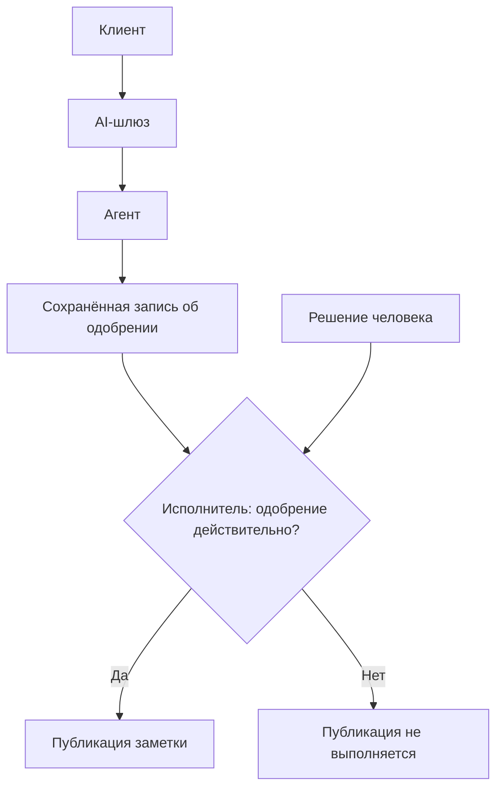

# Кто отвечает за эксплуатацию агента и проверку права на действие

Если сервис только отвечает на вопросы, ошибка обернётся неверным ответом. Дай ему инструмент для публикации — и та же ошибка уже может изменить чужие рабочие материалы. Поэтому при выборе среды запуска нужно решить, где выполняется код, какой компонент хранит учётные данные и что происходит, пока приложение ждёт решения человека.

Одобрение может прийти, когда исходный запрос уже завершён или процесс перезапущен. Если предложение осталось только в истории чата, приложение не сможет надёжно определить, какую именно операцию публикации одобрил человек. Выбирай среду выполнения вместе со способом сохранять состояние приложения: модель может предложить действие, а исполнитель обязан проверить право его выполнить.

## Как это работает в Azure \{#how-it-works-on-azure}

[Foundry Agent Service](https://learn.microsoft.com/ru-ru/azure/foundry/agents/overview) предоставляет управляемую среду выполнения. Промпт-агент (prompt agent) задаётся инструкциями, моделью и инструментами. Для размещаемого агента (hosted agent) ты поставляешь собственный код в контейнере, а инфраструктурой управляет Foundry.

[Microsoft Agent Framework](https://learn.microsoft.com/ru-ru/agent-framework/overview/) — SDK для агентов и рабочих процессов. Его можно использовать в собственном приложении или написать с его помощью размещаемого агента для Foundry. SDK определяет поведение агента, а выбранная платформа запускает его; эти решения принимаются отдельно.

[Инструмент-функция (function tool)](https://learn.microsoft.com/ru-ru/azure/foundry/agents/how-to/tools/function-calling) задаёт доступную для вызова операцию: модели сообщаются её имя, параметры и описание. Если функция выполняется на стороне клиента, модель запрашивает вызов, а приложение выполняет функцию и возвращает результат. Регистрация инструмента не развёртывает его реализацию в Foundry. Поскольку функцию выполняет приложение, оно может проверить аргументы и права до обращения к внешней системе.

MCP (Model Context Protocol) предоставляет доступ к инструментам через серверный интерфейс. Foundry умеет подключаться к [удалённым конечным точкам MCP](https://learn.microsoft.com/ru-ru/azure/foundry/agents/how-to/tools/model-context-protocol), ограничивать набор доступных инструментов через `allowed_tools` и требовать одобрения, если для `require_approval` задано значение `always`.

В ответе может появиться запрос на одобрение (approval request) — `mcp_approval_request`. Вызывающая сторона получает решение человека и отправляет `mcp_approval_response`, связанный с запросом через `approval_request_id`; продолжение ссылается на исходный ответ через `previous_response_id`. Приложению нужен экран одобрения, на котором видны реальные аргументы вызова. Если вызывающий код автоматически одобряет все запросы, этот контроль теряет смысл. Устройство протокола разобрано в уроке [«MCP и протоколы агентов»](/rag-agents/part-2-agents/mcp/).

В [текущем API Foundry](https://learn.microsoft.com/ru-ru/azure/foundry/agents/concepts/runtime-components) беседа (conversation) хранит сообщения, вызовы инструментов и их результаты, а response — результат одной генерации. В старых примерах встречаются threads и runs. В пределах одного примера придерживайся одного поколения API.

[Сеанс размещаемого агента (hosted-agent session)](https://learn.microsoft.com/ru-ru/azure/foundry/agents/how-to/manage-hosted-sessions) хранит рабочее состояние песочницы, например файлы. Повторное использование его идентификатора само по себе не восстанавливает историю чата. Для продолжения взаимодействия через Responses нужна беседа или ссылка на предыдущий ответ в `previous_response_id`.

При самостоятельном размещении сеанс Agent Framework (Agent Framework session), представленный объектом [`AgentSession`](https://learn.microsoft.com/ru-ru/agent-framework/concepts/agents/conversations/session), хранит связанное с беседой состояние между запусками. Это может быть сама история или ссылка на историю во внешнем хранилище; способ хранения зависит от реализации. Сохраняй всё, что понадобится после перезапуска. До возобновления работы проверяй связь идентификатора сеанса с пользователем, прошедшим аутентификацию, и клиентом приложения.

Долговременная память (long-term memory) сохраняет отдельные сведения, например предпочтения, для других бесед. [Управляемая память Foundry и Memory Store API доступны в предварительной версии](https://learn.microsoft.com/ru-ru/azure/foundry/agents/how-to/memory-usage). Предпочтения используй как контекст. Записи об одобрении сохраняй в хранилище приложения как основание для разрешения действий, чтобы исполнитель мог запросить решение по конкретной операции публикации.

## Как выбрать место запуска и распределить ответственность \{#choosing-a-host}

Начни с того, какие обязанности по эксплуатации останутся у тебя, и только потом сравнивай возможности.

| Вариант | Когда подходит | Когда не подходит или что остаётся на твоей стороне |
|---|---|---|
| Промпт-агент Foundry | Задачу можно выразить конфигурацией и поддерживаемыми инструментами. | Если основную логику составляет собственная оркестрация, этот вариант неудобен. Для функций, выполняемых на стороне клиента, всё равно нужно приложение. |
| Размещаемый агент Foundry | Ты пишешь помощника для исследовательской работы, которому нужны управляемое масштабирование и сохранение файлов сеанса через конечную точку Responses. | Не подходит, если нужное API нельзя согласовать с контрактом Responses или Invocations. Поддержка кода агента остаётся у тебя. |
| Agent Framework в собственном приложении | Агент должен расширить существующее API на .NET, сохранив его маршруты и цикл развёртывания. | Развёртывание, масштабирование, восстановление и сохранение состояния придётся организовать самостоятельно. Не выбирай этот вариант, если некому отвечать за эти задачи. |

[Руководство по размещаемым агентам](https://learn.microsoft.com/ru-ru/agent-framework/hosting/foundry-hosted-agent) описывает управляемое масштабирование и сохранение состояния сеансов. [Контракт среды выполнения](https://learn.microsoft.com/ru-ru/azure/foundry/agents/concepts/hosted-agent-contract) требует конечную точку Responses или Invocations. Если рабочая нагрузка требует сохранить существующее API приложения, это повод выбрать самостоятельное размещение. Возможность выполнять собственный код одобрения действий в Foundry от этого не меняется.

Проверяй готовность каждого компонента отдельно. В [таблице готовности Foundry основные агенты отмечены как GA](https://learn.microsoft.com/ru-ru/azure/foundry/concepts/general-availability). [Для размещаемых агентов также указан статус GA](https://learn.microsoft.com/ru-ru/agent-framework/hosting/foundry-hosted-agent), но в примере из этого руководства адаптер размещения для .NET по-прежнему устанавливается с флагом `--prerelease`. Поддержка сервиса размещения не определяет зрелость каждого SDK-адаптера: проверяй именно ту интеграцию, которую собираешься использовать.

Agent Framework поддерживает [последовательную и параллельную оркестрацию, передачу управления и групповой чат](https://learn.microsoft.com/ru-ru/agent-framework/workflows/). [Графовое API рабочих процессов для .NET](https://learn.microsoft.com/ru-ru/agent-framework/concepts/workflows/) задаёт исполнителей, связи, условия и чекпоинты рабочего процесса (workflow checkpoints), в которых сохраняется ход выполнения.

Если шагу нужен результат предыдущего, выбирай последовательное выполнение. Независимую работу можно выполнять параллельно; передачу управления используй, когда ответственность за работу переходит к другому агенту. Начни P2 с одного агента и обычного кода приложения. Добавляй другого агента только для самостоятельной задачи, результат выполнения которой ты можешь оценить; подробнее — в уроке [«Мультиагентные системы»](/rag-agents/part-2-agents/multi-agent/).

Визуальная функция Workflows в Foundry — отдельный механизм, который не следует путать с рабочими процессами SDK. Она находится [в предварительной версии, а её вывод из эксплуатации назначен на 1 декабря 2026 года](https://learn.microsoft.com/ru-ru/azure/foundry/concepts/general-availability). Microsoft направляет новую разработку в Agent Framework, поэтому новый P2 не стоит строить на выводимом из эксплуатации визуальном редакторе.

Ошибки возникают там, где приложение не выполняет свои обязанности. Запросы на одобрение, оставленные в памяти процесса, пропадут после перезапуска. Общий идентификатор беседы без проверки владельца может открыть чужую историю. Широкий список MCP-инструментов даёт ошибающемуся агенту больше возможных действий, а описания и результаты удалённых инструментов остаются недоверенным вводом. Чекпоинт сохраняет ход выполнения, но для записи во внешнюю систему всё ещё нужно распознавать повторные попытки. Выбор сервиса размещения не снимает эти обязанности с приложения.

## Что это меняет для AI-сервиса \{#in-an-ai-workload}

Для **P2 — Агента за AI-шлюзом** курс сначала выбирает Agent Framework в собственном приложении на .NET, продолжая использовать [Container Apps](https://learn.microsoft.com/ru-ru/azure/container-apps/overview) из P1. Azure управляет вычислительной инфраструктурой, а ты отвечаешь за работу приложения с агентом. P2 повторно использует доступ к моделям, поиск и телеметрию P1. В P2 ты реализуешь в приложении восстановление запросов, ожидающих одобрения, и защиту от повторного выполнения операций, сохраняя API и цикл развёртывания P1.

Размещаемые агенты Foundry тоже могут исполнять код одобрения. При выбранном в курсе размещении за эксплуатацию приложения отвечаешь ты; для более узкого набора инструментов промпт-агент остаётся разумной альтернативой.

Поставь [AI-шлюз (AI gateway) API Management](https://learn.microsoft.com/ru-ru/azure/api-management/genai-gateway-capabilities) перед API агента для аутентификации пользователей и сервисов, отправляющих запросы, и проверки их доступа. Настрой серверную часть так, чтобы к ней нельзя было обратиться в обход шлюза. Для одобрения нужно отдельно установить, имеет ли отправивший запрос пользователь или сервис право выполнить именно эту операцию публикации. Исполнитель обязан проверить это право. Здесь действует принцип [«Инструкция — это не контроль»](/ai-sdlc/part-1-foundation/rules-that-hold/).

Для предполагаемого инструмента `publish_note(noteId, expectedVersion)` модель передаёт идентификатор заметки и ожидаемую версию. Приложение получает из данных аутентификации сведения о пользователе или сервисе, отправившем запрос, и клиенте приложения, проверяет доступ и само загружает текст заметки. Затем оно фиксирует содержимое операции и сохраняет запрос, ожидающий одобрения. Прежде чем принять решение, человек должен увидеть место публикации и полный текст.

Схема показывает предлагаемый порядок работы приложения; Foundry не выполняет его автоматически.



Вынеси исполнителя операций публикации в отдельное приложение Container Apps с [собственным управляемым удостоверением (managed identity)](https://learn.microsoft.com/ru-ru/azure/container-apps/managed-identity). Технически исключи возможность использовать это удостоверение из среды, в которой работает агент. Когда дойдёшь до выдачи прав, предоставь право записи в место назначения только исполнителю.

Исполнитель должен проверить, что в сохранённой записи об одобрении указаны те же пользователь или сервис, клиент приложения, инструмент и зафиксированное содержимое, что и в текущем вызове. Отдельно он проверяет полномочия человека, одобрившего публикацию, и срок действия одобрения. Затем заново проверяет право записи в место назначения и версию заметки. Если заметка изменилась, нужно новое решение. Если одобрение отсутствует, отклонено или срок его действия истёк, исполнитель ничего не публикует.

[Механизм одобрения инструментов в Agent Framework](https://learn.microsoft.com/ru-ru/agent-framework/agents/tools/tool-approval) возвращает вызывающей стороне запрос на ввод, а решение поступает при следующем запуске. В .NET обёртка `ApprovalRequiredAIFunction` помечает инструмент как требующий одобрения. [Справочник API прямо возлагает проверку на вызывающий код](https://learn.microsoft.com/ru-ru/dotnet/api/microsoft.extensions.ai.approvalrequiredaifunction?view=net-10.0-pp); сама обёртка её не обеспечивает. Получай решение человека через фреймворк, а исполнителю поручай проверку сохранённого решения P2.

Дай операции ключ идемпотентности (idempotency key), чтобы после возобновления работы та же заметка не публиковалась дважды. Сохраняй результат способом, который защищает запись от повторного выполнения. Если сначала записать данные во внешнюю систему без такой защиты, а потом отметить успех, между этими действиями остаётся возможность сбоя. Восстановление разобрано в уроке [«Устойчивые прогоны»](/rag-agents/part-2-agents/durable-runs/), а выполнение действий — в уроке [«Использование инструментов»](/rag-agents/part-2-agents/tool-use/). Прежде чем расширять набор инструментов, проверь отказ и одобрение, устаревшую версию, обращение к данным другого клиента приложения и повтор после сбоя.

## Попробуй \{#try-it}

Подготовь удостоверение исполнителя, запись об одобрении и критерии приёмки для P2. Упражнение только резервирует отдельное удостоверение: развёртывание агента и реализация проверки одобрения будут позже.

Понадобятся локальные Bash и Azure CLI. Сначала войди в Azure и выбери подписку по инструкции из [урока о RBAC и доступе без ключей](../part-1-azure-foundations/rbac-and-keyless-access.md#try-it). Нужны права на создание группы ресурсов и управляемого удостоверения; [руководство по созданию удостоверения](https://learn.microsoft.com/ru-ru/entra/identity/managed-identities-azure-resources/manage-user-assigned-managed-identities-azure-cli) называет роль `Managed Identity Contributor`. Используй новую временную группу `rg-p2-approval-lab`. Если политика подписки требует другого региона, замени `westeurope`.

Команды и флаги сверены с актуальными справочниками [`az group`](https://learn.microsoft.com/ru-ru/cli/azure/group?view=azure-cli-latest) и [`az identity`](https://learn.microsoft.com/ru-ru/cli/azure/identity?view=azure-cli-latest). В действующей подписке эти команды не запускались: у курса пока нет подписки.

```bash
az group create --name rg-p2-approval-lab --location westeurope

az identity create \
  --name p2-tool-executor \
  --resource-group rg-p2-approval-lab \
  --location westeurope \
  --query '{resourceId:id,principalId:principalId,clientId:clientId}' \
  --output json
```

Ожидаемый результат: первая команда создаст группу ресурсов, вторая — назначаемое пользователем управляемое удостоверение и выведет `resourceId`, `principalId` и `clientId`. Эти [поля описаны в документации](https://learn.microsoft.com/ru-ru/azure/aks/user-assigned-managed-identity#create-a-user-assigned-managed-identity). Команды не прикрепляют удостоверение к вычислительным ресурсам, не назначают ему роли и не демонстрируют работающую проверку одобрения.

Сохрани выбранный вариант размещения и идентификатор ресурса исполнителя рядом с шаблоном ниже. В нём предложена запись об одобрении для приложения; значения вымышлены. Это не схема API Foundry.

```text
approvalId: approval-001
operationId: publish-001
caller: user-17
tenant: tenant-a
tool: publish_note
noteId: note-42
expectedVersion: 3
destination: team-notes/note-42
frozenText: The maintenance window starts at 18:00 UTC.
status: pending
reviewer: null
decidedAt: null
expiresAt: 2026-10-18T18:00:00Z
outcome: null
```

Приложение должно заполнять `caller` и `tenant` из данных аутентификации. При одобрении оно сохраняет удостоверение человека, имеющего право принять решение, и время решения, а также точный текст, показанный этому человеку. Так приложение выполняет обязанность вызывающего кода, описанную в [контракте API одобрения](https://learn.microsoft.com/ru-ru/dotnet/api/microsoft.extensions.ai.approvalrequiredaifunction?view=net-10.0-pp).

Сохрани рядом с записью три критерия приёмки. Это требования к будущей реализации, а не результаты проведённых тестов:

1. Пока `approval-001` ожидает решения, а также при отказе или истечении срока одобрения попытка выполнения ничего не публикует.
2. Если после одобрения изменить `frozenText`, перенеся начало окна на `19:00`, или изменить `destination`, нужны новая запись об одобрении и новое решение. Прежнее одобрение не разрешает публикацию изменённого содержимого.
3. После успешного выполнения `publish-001` повтор с тем же идентификатором операции возвращает сохранённый результат без второй публикации. Тот же идентификатор с другими аргументами отклоняется. Когда будешь реализовывать этот механизм, проверь его поведение при сбое и повторной попытке.

[Рекомендации Microsoft по повторным попыткам](https://learn.microsoft.com/ru-ru/azure/architecture/patterns/retry#idempotency) объясняют, почему при потере ответа повторная попытка может привести к повторной публикации. Поэтому вместе с идентификатором операции нужен способ выполнения, исключающий повторную публикацию; одна запись в хранилище этого не обеспечивает. При реализации P2 прикрепи удостоверение только к исполнителю и выдай ему узкое право записи в место назначения. Проверь также унаследованные разрешения.

**Стоимость:** упражнение только с удостоверением бесплатно. За [управляемые удостоверения нет дополнительной платы](https://learn.microsoft.com/ru-ru/entra/identity/managed-identities-azure-resources/overview). Здесь не создаются вычислительные ресурсы, хранилище, шлюз или развёртывание модели и не отправляются запросы к модели.

**Удаление ресурсов:** сначала убедись, что в группе `rg-p2-approval-lab` есть только удостоверение этого упражнения. Затем удали временную группу:

```bash
az group delete --name rg-p2-approval-lab --yes
```

Сохрани описание требований к одобрению. Когда будешь собирать P2, создай удостоверение заново: идентификаторы удалённого удостоверения повторно использовать нельзя.

## Что перенести в свою практику \{#what-to-take-away}

- Выбирай SDK и место запуска отдельно. Код на Agent Framework может работать в твоём приложении или в Foundry.
- Различай историю беседы, рабочее состояние сеанса, долговременную память и записи об одобрении, на основании которых разрешаются действия.
- Связывай одобрение с конкретной предлагаемой операцией публикации и проверяй его в исполнителе, в том числе после перезапуска.
- Начни P2 с одного агента, ограниченного набора инструментов и защиты от повторной публикации. Добавляй оркестрацию для конкретной задачи.

**[Новые термины](../glossary.md#agents-on-azure)**: промпт-агент, размещаемый агент, инструмент-функция, MCP, беседа, сеанс размещаемого агента, сеанс Agent Framework, долговременная память, запрос на одобрение, ключ идемпотентности, чекпоинт рабочего процесса.

## Источники \{#sources}

Проверено на 17.10.2026. Критерии выбора места запуска, определения сеансов и источники по проектированию одобрения повторно проверены 18.10.2026.

Среда выполнения и статус:

- [Foundry Agent Service overview](https://learn.microsoft.com/ru-ru/azure/foundry/agents/overview)
- [Container Apps hosting](https://learn.microsoft.com/ru-ru/azure/container-apps/overview) и [per-application managed identities](https://learn.microsoft.com/ru-ru/azure/container-apps/managed-identity)
- [Microsoft Agent Framework overview](https://learn.microsoft.com/ru-ru/agent-framework/overview/)
- [Foundry hosted agents and SDK integration](https://learn.microsoft.com/ru-ru/agent-framework/hosting/foundry-hosted-agent) и [runtime contract](https://learn.microsoft.com/ru-ru/azure/foundry/agents/concepts/hosted-agent-contract)
- [Foundry feature readiness and Workflows retirement](https://learn.microsoft.com/ru-ru/azure/foundry/concepts/general-availability)
- [Agent Framework workflow capabilities](https://learn.microsoft.com/ru-ru/agent-framework/workflows/) и [.NET workflow concepts](https://learn.microsoft.com/ru-ru/agent-framework/concepts/workflows/)

Инструменты, состояние и доступ:

- [Foundry function calling](https://learn.microsoft.com/ru-ru/azure/foundry/agents/how-to/tools/function-calling)
- [Remote MCP endpoints and approvals](https://learn.microsoft.com/ru-ru/azure/foundry/agents/how-to/tools/model-context-protocol)
- [Runtime components: conversations and responses](https://learn.microsoft.com/ru-ru/azure/foundry/agents/concepts/runtime-components)
- [Hosted sessions and conversations](https://learn.microsoft.com/ru-ru/azure/foundry/agents/how-to/manage-hosted-sessions)
- [Agent Framework sessions](https://learn.microsoft.com/ru-ru/agent-framework/concepts/agents/conversations/session) и [.NET AgentSession reference](https://learn.microsoft.com/ru-ru/dotnet/api/microsoft.agents.ai.agentsession?view=agent-framework-dotnet-latest)
- [Managed memory (preview)](https://learn.microsoft.com/ru-ru/azure/foundry/agents/how-to/memory-usage)
- [Function tool approval](https://learn.microsoft.com/ru-ru/agent-framework/agents/tools/tool-approval) и [ApprovalRequiredAIFunction reference](https://learn.microsoft.com/ru-ru/dotnet/api/microsoft.extensions.ai.approvalrequiredaifunction?view=net-10.0-pp)
- [Retry pattern and idempotency](https://learn.microsoft.com/ru-ru/azure/architecture/patterns/retry)
- [API Management AI gateway](https://learn.microsoft.com/ru-ru/azure/api-management/genai-gateway-capabilities)

Упражнение:

- [Managed identities and cost](https://learn.microsoft.com/ru-ru/entra/identity/managed-identities-azure-resources/overview)
- [Create a user-assigned identity](https://learn.microsoft.com/ru-ru/entra/identity/managed-identities-azure-resources/manage-user-assigned-managed-identities-azure-cli) и [identity output fields](https://learn.microsoft.com/ru-ru/azure/aks/user-assigned-managed-identity#create-a-user-assigned-managed-identity)
- Azure CLI: [group](https://learn.microsoft.com/ru-ru/cli/azure/group?view=azure-cli-latest), [identity](https://learn.microsoft.com/ru-ru/cli/azure/identity?view=azure-cli-latest)
