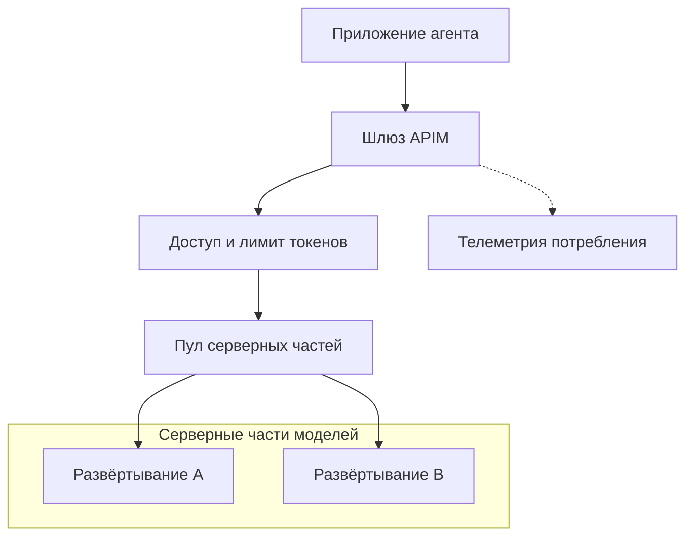

# Сделай общие правила доступа к модели обязательными

Два приложения используют одно развёртывание модели (model deployment). Одно отвечает на короткие вопросы, другое отправляет целые документы и повторяет запрос, если ответ задерживается. При ограничении по числу запросов их вызовы учитываются одинаково, хотя запрос на 20 000 токенов расходует в 100 раз больше токенов, чем запрос на 200. Приложение с документами может исчерпать общую мощность, оставаясь в пределах разрешённого числа запросов.

Если ограничивать потребление только в клиентах, каждый из них должен заботиться об остальных. AI-шлюз (AI gateway) проверяет доступ, ограничивает потребление и маршрутизирует запросы там, где проходят все вызовы модели. Чтобы эти правила действовали, приложения должны обращаться через шлюз: сохранив прямой доступ к модели, они смогут их обойти.

## Как это устроено в Azure \{#how-it-works-on-azure}

В Azure роль такого шлюза выполняет Azure API Management (APIM). APIM принимает запрос, применяет политики, передаёт разрешённый трафик дальше и собирает телеметрию. Его [возможности AI-шлюза](https://learn.microsoft.com/ru-ru/azure/api-management/genai-gateway-capabilities) позволяют дополнительно контролировать обращения к моделям. Развёртывание APIM само по себе не распределяет токены между потребителями: нужно выбрать политики и настроить ресурсы серверных частей.



Приложение проходит аутентификацию в APIM, а APIM — в сервисе модели. Для Azure OpenAI назначь управляемому удостоверению (managed identity) шлюза роль [`Cognitive Services OpenAI User` на ресурсе модели](https://learn.microsoft.com/ru-ru/azure/api-management/api-management-authenticate-authorize-azure-openai). Политика [`authentication-managed-identity`](https://learn.microsoft.com/ru-ru/azure/api-management/authentication-managed-identity-policy) получает токен Entra и устанавливает заголовок `Authorization` для обращения к серверной части. Ключ модели больше не нужен в конфигурации приложения. Доступ к самому шлюзу настраивается отдельно: удостоверение для вызова модели не определяет, кому разрешено вызывать APIM.

Политика ограничения токенов (token-limit policy) [`llm-token-limit`](https://learn.microsoft.com/ru-ru/azure/api-management/llm-token-limit-policy) ограничивает число токенов промпта и ответа по ключу счётчика (counter key). Ключ определяет, из какого остатка вычесть потраченные токены.

Например, идентификатор подписки APIM позволяет выделить каждой подписке своё количество токенов. Если вызывающая сторона сама задаёт заголовок, его значение можно использовать как идентификатор клиента приложения (tenant) только после проверки.

При превышении допустимой скорости расходования токенов шлюз возвращает HTTP `429`, а при превышении квоты (quota) за период — `403`.

Пул серверных частей (backend pool) позволяет направлять запросы к нескольким конечным точкам как к одному ресурсу. APIM поддерживает циклическое распределение запросов, веса и группы с разными приоритетами. Прерыватель цепи (circuit breaker) временно прекращает отправку запросов к серверной части со сбоями; настрой его так, чтобы он распознавал ограничение частоты со стороны модели и учитывал `Retry-After`. Запросы переходят к группе с меньшим приоритетом, только когда прерыватели сработали у всех серверных частей с более высоким приоритетом. Правила распределения и прерывания задаются в [настройках ресурса серверной части](https://learn.microsoft.com/ru-ru/azure/api-management/backends), а политика [`set-backend-service`](https://learn.microsoft.com/ru-ru/azure/api-management/set-backend-service-policy) выбирает серверную часть или пул через `backend-id`. Пул распределяет доступную мощность, но не увеличивает квоту модели.

Семантический кэш (semantic cache) позволяет повторно использовать ответ, если новый промпт достаточно близок к прежнему по смыслу. Политика [`llm-semantic-cache-lookup`](https://learn.microsoft.com/ru-ru/azure/api-management/llm-semantic-cache-lookup-policy) ищет ответ до вызова модели, а соответствующая ей [`llm-semantic-cache-store`](https://learn.microsoft.com/ru-ru/azure/api-management/llm-semantic-cache-store-policy) сохраняет его после вызова. Для этого нужны развёртывание модели эмбеддингов (embeddings) и внешний кэш с поддержкой векторов. В [инструкции Microsoft для Azure Managed Redis](https://learn.microsoft.com/ru-ru/azure/api-management/azure-openai-enable-semantic-caching) требуется RediSearch; встроенный кэш ответов APIM для этого варианта не подходит. Ограничение частоты запросов размести после поиска в кэше, чтобы при отказе кэша запросы не перегрузили серверную часть модели.

Политика [`llm-emit-token-metric`](https://learn.microsoft.com/ru-ru/azure/api-management/llm-emit-token-metric-policy) отправляет метрики токенов (token metrics) в Application Insights: нужно настроить интеграцию, журналирование API и пользовательские метрики с измерениями. Расширенные категории для кэшированных токенов, токенов рассуждения и обдумывания доступны в режиме preview. Отдельный механизм — [журналирование потребления LLM](https://learn.microsoft.com/ru-ru/azure/api-management/api-management-howto-llm-logs): через параметры диагностики он отправляет записи о каждом запросе в Log Analytics. Содержимое промптов и ответов собирать необязательно, поэтому учёт потребления не требует сохранять разговоры.

## Сначала выбери средства контроля, затем тарифный уровень \{#choosing-and-tradeoffs}

Поддержка AI-возможностей зависит от конкретной политики. В таблице ниже сведены данные из [матрицы возможностей шлюзов](https://learn.microsoft.com/ru-ru/azure/api-management/api-management-gateways-overview) и справочников отдельных политик. Сравнение относится к встроенным управляемым шлюзам.

| Средство контроля | Уровни Classic, включая Developer | Уровни v2 | Consumption |
|---|---|---|---|
| [Ограничение скорости расходования токенов и квота за период](https://learn.microsoft.com/ru-ru/azure/api-management/llm-token-limit-policy) | Да | Да | Нет |
| [Политика метрик токенов](https://learn.microsoft.com/ru-ru/azure/api-management/llm-emit-token-metric-policy) | Да | Да | Да |
| Пул серверных частей; прерыватель цепи | Да; да | Да; да | Да; нет |
| [Поиск и сохранение в семантическом кэше](https://learn.microsoft.com/ru-ru/azure/api-management/llm-semantic-cache-lookup-policy) с внешним кэшем | Да | Да | Да |
| Политика доступа к серверной части через управляемое удостоверение | Да | Да | Да |
| Журналы ресурсов шлюза в Log Analytics | Да | Да | Нет |

Для упражнения выбран Developer. По проверенным ценам для West Europe это самый дешёвый из обычных уровней APIM, поддерживающих нужные политики ограничения токенов и доступа через удостоверение. Developer предназначен для ознакомления и [не имеет SLA для промышленной эксплуатации](https://azure.microsoft.com/en-us/pricing/details/api-management/). Для прода не переноси выбор из упражнения: подбери тарифный уровень с учётом требований к сети, доступности и нагрузке. Отдельно документированный [уровень AI Gateway находится в public preview](https://learn.microsoft.com/ru-ru/azure/api-management/ai-gateway-overview), его цены ещё не объявлены; в сравнение стоимости упражнения он не включён.

Пока с моделью работает одно приложение под твоим контролем и ты выясняешь его поведение и потребности, прямое подключение остаётся разумным вариантом. APIM добавляет ещё одну зависимость, которую нужно развернуть; общие правила доступа, необходимость выделять токены отдельным потребителям или требования к маршрутизации могут оправдать этот шаг. Наличие семантического кэша в шлюзе само по себе не повод его включать: польза должна оправдывать затраты на эмбеддинги и эксплуатацию кэша, а также риск вернуть неподходящий ответ.

Токенные ограничения не задают точного потолка расходов в валюте. [Параллельные запросы могут превысить лимит; при потоковых ответах используются оценки, а каждый шлюз ведёт независимые счётчики](https://learn.microsoft.com/ru-ru/azure/api-management/llm-token-limit-policy). Кроме того, квота серверной части может привести к отказу даже после допуска запроса в APIM. Ограничивай число повторов в клиенте, а при `429` выясняй, кто отклонил запрос: шлюз или сервис модели.

Для маршрутизации между конечными точками нужны эквивалентные контракты; одной доступности недостаточно. При переключении на другую версию модели могут измениться аргументы инструментов или качество ответов. Перед объединением в пул прогони оба развёртывания через одинаковые проверки качества и убедись, что каждое соответствует требованиям рабочей нагрузки к размещению данных.

## Что это меняет для AI-сервиса \{#in-an-ai-workload}

P2 опирается на модель и поиск из P1. Агент отправляет вызовы модели через APIM, а инструменты и одобрение действий остаются в приложении. Шлюз может остановить запрос к модели, когда исчерпано разрешённое количество токенов, но не способен определить, получено ли нужное одобрение для возврата денег или записи в базу. Проверяй, одобрено ли действие, там, где исполняется инструмент. Этот путь разобран в уроке [«Использование инструментов»](/rag-agents/part-2-agents/tool-use/), а различие между инструкцией и правилом, которое нельзя обойти, — в уроке [«Правила, которые нельзя обойти»](/ai-sdlc/part-1-foundation/rules-that-hold).

Агенту нужен и лимит итераций, и выделенное количество токенов на шлюзе. Цикл без ограничения итераций способен израсходовать все выделенные токены и упереться в лимит шлюза, так и не дав полезного ответа. Когда обращения через шлюз заработают, в окончательной конфигурации P2 убери ненужные права и учётные данные для прямого вызова модели. Аутентификация шлюза без ключей сама по себе не закрывает ранее существовавший обходной доступ.

В исходной конфигурации оставь семантический кэш выключенным. В RAG с разграничением доступа вопрос «Каковы правила хранения данных?» может иметь разный смысл в зависимости от пользователя, документов и истории разговора. Прежде чем включать кэш, настрой отдельные записи для разных контекстов авторизации, версий содержимого и версий промпта; проверь ложные совпадения и сроки действия записей. Элементы [`vary-by`](https://learn.microsoft.com/ru-ru/azure/api-management/llm-semantic-cache-lookup-policy) дают механизм такого разделения, но признаки для него выбираешь ты. В начальной конфигурации не используй повторно вызовы инструментов и решения об одобрении из кэша.

Для метрик используй измерения с ограниченным набором значений, например приложение и развёртывание. Идентификаторы отдельных запросов оставь в журналах: [при превышении лимитов кардинальности новые ряды метрик могут отбрасываться](https://learn.microsoft.com/ru-ru/azure/api-management/llm-emit-token-metric-policy). Сопоставляй метрики и записи шлюза со спанами (spans) вызовов модели и инструментов агента, как в уроке [Observability](/rag-agents/part-1-rag/cross-cutting/observability/). [Обрыв потока может оставить журнал потребления неполным](https://learn.microsoft.com/ru-ru/azure/api-management/api-management-howto-llm-logs), поэтому сверяй расходы с начислениями поставщика: телеметрия шлюза не заменяет полный счёт.

## Попробуй \{#try-it}

Поставь один шлюз перед существующим развёртыванием Azure OpenAI для чата из P1. Выдели для шлюза отдельную группу ресурсов (resource group) и используй учётную запись с правом назначать роли. Упражнение предполагает, что публичная конечная точка модели доступна; для частной конечной точки (private endpoint) нужен отдельный сетевой путь. Понадобятся Bash, Azure CLI, Bicep и curl. Замени значения в верхнем регистре своими: подпиской, существующим ресурсом модели и адресом электронной почты издателя.

**Стоимость:** [Retail Prices API](https://prices.azure.com/api/retail/prices?$filter=serviceName%20eq%20%27API%20Management%27%20and%20armRegionName%20eq%20%27westeurope%27&currencyCode=%27USD%27) указывает для `Developer Unit` в West Europe 0,0658 доллара США в час: примерно 0,26 доллара за четыре часа или 48,03 доллара за 730 часов, без учёта потребления модели и налогов. Плата за единицу начисляется и во время простоя. Упражнение не создаёт ни кэша, ни рабочей области мониторинга. После работы удали шлюз, чтобы уложиться в учебный бюджет в 10 долларов США в месяц.

**Команды ещё не запускались в реальной подписке.** Они сверены с текущим [справочником CLI](https://learn.microsoft.com/ru-ru/cli/azure/deployment/group?view=azure-cli-latest). В Bicep используется стабильная [версия API ресурсов `2024-05-01`](https://learn.microsoft.com/ru-ru/azure/templates/microsoft.apimanagement/2024-05-01/service); код скомпилирован локально с [Bicep CLI](https://learn.microsoft.com/ru-ru/azure/azure-resource-manager/bicep/install) версии `0.48.1`. Компиляция не проверяет развёртывание в Azure. Описанные ниже результаты ожидаются согласно документации; их ещё не проверяли в Azure.

Сохрани код в `gateway.bicep`. Ключ счётчика `p2-lab` намеренно задаёт общий лимит токенов для всей лабораторной работы, без отдельных лимитов для каждого клиента приложения.

```bicep
param publisherEmail string
param modelHost string
param gatewayName string = 'p2-gw-${uniqueString(resourceGroup().id)}'

resource gateway 'Microsoft.ApiManagement/service@2024-05-01' = {
  name: gatewayName
  location: resourceGroup().location
  sku: { name: 'Developer', capacity: 1 }
  identity: { type: 'SystemAssigned' }
  properties: {
    publisherName: 'P2 lab'
    publisherEmail: publisherEmail
  }
}

resource api 'Microsoft.ApiManagement/service/apis@2024-05-01' = {
  parent: gateway
  name: 'p2-model'
  properties: {
    displayName: 'P2 model'
    path: 'model'
    protocols: [ 'https' ]
    serviceUrl: 'https://${modelHost}/openai/v1'
    subscriptionRequired: true
  }
}

resource chat 'Microsoft.ApiManagement/service/apis/operations@2024-05-01' = {
  parent: api
  name: 'chat'
  properties: {
    displayName: 'Chat'
    method: 'POST'
    urlTemplate: '/chat/completions'
    templateParameters: []
  }
}

resource policy 'Microsoft.ApiManagement/service/apis/policies@2024-05-01' = {
  parent: api
  name: 'policy'
  properties: {
    format: 'rawxml'
    value: '''
<policies>
  <inbound>
    <base />
    <llm-token-limit counter-key="p2-lab" tokens-per-minute="50"
      estimate-prompt-tokens="false" remaining-tokens-header-name="X-Tokens-Left" />
    <set-header name="api-key" exists-action="delete" />
    <set-header name="Ocp-Apim-Subscription-Key" exists-action="delete" />
    <set-query-parameter name="subscription-key" exists-action="delete" />
    <authentication-managed-identity resource="https://cognitiveservices.azure.com/" />
  </inbound>
  <backend><base /></backend>
  <outbound><base /></outbound>
  <on-error><base /></on-error>
</policies>
'''
  }
}

resource access 'Microsoft.ApiManagement/service/subscriptions@2024-05-01' = {
  parent: gateway
  name: 'p2-agent'
  properties: {
    displayName: 'P2 agent'
    scope: '/apis/${api.name}'
    state: 'active'
  }
}

output principalId string = gateway.identity!.principalId
output apiBaseUrl string = '${gateway.properties.gatewayUrl}/model'
```

При обращении к серверной части политика использует удостоверение APIM и не передаёт ключ модели. Подписка с областью действия на это API даёт упрощённый доступ для упражнения: по общему ключу [нельзя установить, какое приложение или пользователь обращается к шлюзу](https://learn.microsoft.com/ru-ru/azure/api-management/secure-api-management). Храни ключ как секрет. В проде используй [Microsoft Entra ID (урок на английском)](/azure-dotnet/part-1-azure-foundations/entra-id) и проверяй токены вызывающей стороны на шлюзе. APIM принимает ключ подписки в заголовке или параметре запроса и [по умолчанию пересылает оба варианта](https://learn.microsoft.com/ru-ru/azure/api-management/api-management-subscriptions#use-a-subscription-key); в примере они удаляются через `set-header` и [`set-query-parameter`](https://learn.microsoft.com/ru-ru/azure/api-management/set-query-parameter-policy). Для модели используется [маршрут v1 Chat Completions](https://learn.microsoft.com/ru-ru/azure/foundry/openai/latest), которому не нужен параметр `api-version`.

```bash
set -euo pipefail
az login
az account set --subscription 'YOUR_SUBSCRIPTION_ID'
gatewayGroup='rg-p2-gateway-lab'
modelGroup='YOUR_P1_RESOURCE_GROUP'
modelAccount='YOUR_P1_ACCOUNT_NAME'
modelHost='YOUR_P1_RESOURCE.openai.azure.com' # Host only; no scheme or path.

az group create --name "$gatewayGroup" --location westeurope --output none
az deployment group create --resource-group "$gatewayGroup" --name gateway \
  --template-file gateway.bicep \
  --parameters publisherEmail='YOUR_EMAIL' modelHost="$modelHost" \
  --query properties.outputs --output json

principalId=$(az deployment group show --resource-group "$gatewayGroup" \
  --name gateway --query properties.outputs.principalId.value --output tsv)
modelId=$(az cognitiveservices account show --resource-group "$modelGroup" \
  --name "$modelAccount" --query id --output tsv)
az role assignment create --assignee-object-id "$principalId" \
  --assignee-principal-type ServicePrincipal \
  --role 'Cognitive Services OpenAI User' --scope "$modelId" \
  --output none
```

Создание экземпляра Developer может занять [30–40 минут](https://learn.microsoft.com/ru-ru/azure/api-management/get-started-create-service-instance-cli). Когда оно завершится и назначение роли вступит в силу, получи в Azure portal основной ключ подписки P2 agent: открой экземпляр APIM → APIs → Subscriptions → P2 agent → Show/hide keys и скопируй ключ. Этот путь описан в [руководстве по трассировке запросов](https://learn.microsoft.com/ru-ru/azure/api-management/api-management-howto-api-inspector).

[Тестовая консоль портала по умолчанию подставляет подписку с полным доступом](https://learn.microsoft.com/ru-ru/azure/api-management/openai-compatible-llm-api). Проверяй из Bash, чтобы консоль не добавляла ключ за тебя. Запросы ниже идут на публичный адрес шлюза; [`curl -q`](https://curl.se/docs/manpage.html#-q) отключает локальную конфигурацию curl.

```bash
apiBaseUrl=$(az deployment group show --resource-group "$gatewayGroup" \
  --name gateway --query properties.outputs.apiBaseUrl.value --output tsv)
body='{"model":"YOUR_P1_DEPLOYMENT","messages":[{"role":"user","content":"Reply with OK."}]}'
read -r -s -p 'P2 agent primary key: ' gatewayKey
printf '\n'

curl -q --include "$apiBaseUrl/chat/completions" \
  --header 'Content-Type: application/json' \
  --header "Ocp-Apim-Subscription-Key: $gatewayKey" --data "$body"
curl -q --include "$apiBaseUrl/chat/completions" \
  --header 'Content-Type: application/json' --data "$body"
```

Запрос с ключом должен вернуть ответ чата, если развёртывание поддерживает это API и удостоверению предоставлен доступ. Запрос без ключа должен получить [`401` до обращения к серверной части](https://learn.microsoft.com/ru-ru/azure/api-management/api-management-subscriptions#how-api-management-handles-requests-with-or-without-subscription-keys). В успешных ответах проверь `X-Tokens-Left`. Если повторные вызовы с ключом израсходуют общий лимит в 50 токенов в пределах минутного окна, ожидается `429` с `Retry-After`. Если вызовы приходятся на разные минутные окна, доступное количество токенов между ними восстанавливается и запросы могут продолжать проходить. [Предварительная оценка токенов промпта отключена](https://learn.microsoft.com/ru-ru/azure/api-management/llm-token-limit-policy), поэтому потребление учитывается после ответа серверной части: заранее указать номер запроса, на котором произойдёт отказ, нельзя.

В P2 используй ключ P2 agent в `Ocp-Apim-Subscription-Key`, а `apiBaseUrl` — как базовый URL модели. При замене подключения продолжай проверять в приложении, одобрено ли действие.

**Удаление ресурсов:** выполни следующий блок отдельно, даже если ошибка развёртывания или назначения роли завершила предыдущую оболочку. При необходимости войди снова и замени значения в верхнем регистре. Блок получает удостоверение шлюза из результатов развёртывания, ищет только его назначение `Cognitive Services OpenAI User` на конкретном ресурсе модели P1 и удаляет найденное назначение по идентификатору. Ошибка поиска или удаления роли не мешает удалить выделенную группу шлюза. После выполнения разбери ошибки удаления роли; ресурс P1 остаётся вне удаляемой группы. См. справочники [назначений ролей](https://learn.microsoft.com/ru-ru/cli/azure/role/assignment?view=azure-cli-latest) и [удаления групп](https://learn.microsoft.com/ru-ru/cli/azure/group?view=azure-cli-latest#az-group-delete).

```bash
bash <<'CLEANUP'
set +e # Continue to group deletion if role cleanup fails.
set -u
az account set --subscription 'YOUR_SUBSCRIPTION_ID' || exit 1
gatewayGroup='rg-p2-gateway-lab'
modelGroup='YOUR_P1_RESOURCE_GROUP'
modelAccount='YOUR_P1_ACCOUNT_NAME'

if principalId=$(az deployment group show --resource-group "$gatewayGroup" \
    --name gateway --query properties.outputs.principalId.value --output tsv) &&
    [ -n "$principalId" ]; then
  if modelId=$(az cognitiveservices account show --resource-group "$modelGroup" \
      --name "$modelAccount" --query id --output tsv); then
    if roleAssignmentId=$(az role assignment list --assignee-object-id "$principalId" \
        --fill-principal-name false --role 'Cognitive Services OpenAI User' \
        --scope "$modelId" --query "[?scope=='$modelId'].id | [0]" --output tsv); then
      if [ -n "$roleAssignmentId" ]; then
        az role assignment delete --ids "$roleAssignmentId" ||
          printf 'Role deletion failed; inspect this assignment: %s\n' "$roleAssignmentId" >&2
      fi
    fi
  fi
fi
az group delete --name "$gatewayGroup" --yes
CLEANUP
```

## Что перенести в свою практику \{#what-to-take-away}

- Общие правила для вызовов модели должны применяться на пути, который приложения не могут обойти.
- Выделяй токены по проверенному удостоверению потребителя или подписке. Общий ключ подтверждает владение секретом, но не устанавливает, кто вызывает шлюз.
- Выбирай тарифный уровень по нужным политикам: Consumption не подходит для упражнения с ограничением токенов из этого урока.
- При подключении шлюза продолжай проверять, одобрено ли действие, перед выполнением инструмента, разделяй кэш и сверяй расходы с начислениями поставщика.

**[Новые термины (английский глоссарий)](https://nikolaisachok.com/ai-engineering-handbook/azure-dotnet/glossary#ai-gateway)**: AI-шлюз, политика ограничения токенов, ключ счётчика, пул серверных частей, прерыватель цепи, семантический кэш, метрика токенов.

## Источники \{#sources}

Проверено на 17.10.2026.

Источники для исправлений ниже повторно проверены 18.10.2026; исходная дата проверки сохранена выше.

**Возможности и поддержка политик**

- [AI gateway capabilities](https://learn.microsoft.com/ru-ru/azure/api-management/genai-gateway-capabilities), [gateway feature matrix](https://learn.microsoft.com/ru-ru/azure/api-management/api-management-gateways-overview), [AI Gateway tier (preview)](https://learn.microsoft.com/ru-ru/azure/api-management/ai-gateway-overview)
- [Token limits](https://learn.microsoft.com/ru-ru/azure/api-management/llm-token-limit-policy), [token metrics](https://learn.microsoft.com/ru-ru/azure/api-management/llm-emit-token-metric-policy), [backend pools and circuit breakers](https://learn.microsoft.com/ru-ru/azure/api-management/backends)
- [Backend selection policy](https://learn.microsoft.com/ru-ru/azure/api-management/set-backend-service-policy), [query-parameter policy](https://learn.microsoft.com/ru-ru/azure/api-management/set-query-parameter-policy)
- [Semantic cache lookup](https://learn.microsoft.com/ru-ru/azure/api-management/llm-semantic-cache-lookup-policy), [semantic cache store](https://learn.microsoft.com/ru-ru/azure/api-management/llm-semantic-cache-store-policy), [semantic cache setup](https://learn.microsoft.com/ru-ru/azure/api-management/azure-openai-enable-semantic-caching), [LLM usage logs](https://learn.microsoft.com/ru-ru/azure/api-management/api-management-howto-llm-logs)

**Удостоверения, развёртывание и стоимость**

- [Gateway security and caller identity](https://learn.microsoft.com/ru-ru/azure/api-management/secure-api-management), [key retrieval](https://learn.microsoft.com/ru-ru/azure/api-management/api-management-howto-api-inspector), [Developer provisioning time](https://learn.microsoft.com/ru-ru/azure/api-management/get-started-create-service-instance-cli), [curl reference](https://curl.se/docs/manpage.html)

- [Backend authentication](https://learn.microsoft.com/ru-ru/azure/api-management/api-management-authenticate-authorize-azure-openai), [managed-identity policy](https://learn.microsoft.com/ru-ru/azure/api-management/authentication-managed-identity-policy), [set-header policy](https://learn.microsoft.com/ru-ru/azure/api-management/set-header-policy), [APIM subscriptions](https://learn.microsoft.com/ru-ru/azure/api-management/api-management-subscriptions), [portal testing](https://learn.microsoft.com/ru-ru/azure/api-management/openai-compatible-llm-api)
- [Azure OpenAI Chat REST reference](https://learn.microsoft.com/ru-ru/azure/foundry/openai/latest), [v1 lifecycle](https://learn.microsoft.com/ru-ru/azure/foundry/openai/api-version-lifecycle)
- Bicep `2024-05-01`: [service](https://learn.microsoft.com/ru-ru/azure/templates/microsoft.apimanagement/2024-05-01/service), [API](https://learn.microsoft.com/ru-ru/azure/templates/microsoft.apimanagement/2024-05-01/service/apis), [operation](https://learn.microsoft.com/ru-ru/azure/templates/microsoft.apimanagement/2024-05-01/service/apis/operations), [policy](https://learn.microsoft.com/ru-ru/azure/templates/microsoft.apimanagement/2024-05-01/service/apis/policies), [subscription](https://learn.microsoft.com/ru-ru/azure/templates/microsoft.apimanagement/2024-05-01/service/subscriptions), [compiler installation](https://learn.microsoft.com/ru-ru/azure/azure-resource-manager/bicep/install)
- Azure CLI: [login](https://learn.microsoft.com/ru-ru/cli/azure/reference-index?view=azure-cli-latest#az-login), [account](https://learn.microsoft.com/ru-ru/cli/azure/account?view=azure-cli-latest), [group](https://learn.microsoft.com/ru-ru/cli/azure/group?view=azure-cli-latest), [deployment](https://learn.microsoft.com/ru-ru/cli/azure/deployment/group?view=azure-cli-latest), [model account](https://learn.microsoft.com/ru-ru/cli/azure/cognitiveservices/account?view=azure-cli-latest), [role assignment](https://learn.microsoft.com/ru-ru/cli/azure/role/assignment?view=azure-cli-latest)
- [APIM pricing and Developer restrictions](https://azure.microsoft.com/en-us/pricing/details/api-management/), [West Europe retail prices (USD)](https://prices.azure.com/api/retail/prices?$filter=serviceName%20eq%20%27API%20Management%27%20and%20armRegionName%20eq%20%27westeurope%27&currencyCode=%27USD%27)
