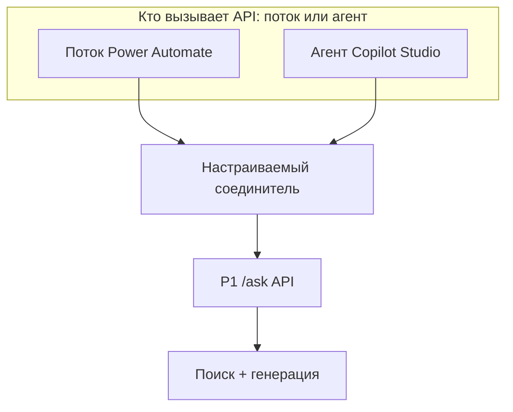

# Построй рабочий процесс вокруг API, которое можно тестировать

Сервис может правильно отвечать на вопросы, но оставаться неудобным в повседневной работе. Пользователь копирует вопрос в отдельное приложение, а затем переносит ответ и источники в свой рабочий процесс. Форма, автоматизация или диалог с агентом могут избавить от этих действий. Но если для каждого интерфейса заново реализовать поиск по документам, придётся отдельно защищать и проверять каждую реализацию.

Поведение, которое нужно проверять контролируемыми тестами, оставь за API. Окружающему приложению поручай сбор входных данных и работу с результатом. Low-code подходит для знакомых бизнес-процессов, если ответственные за них люди могут сопровождать такую реализацию и соблюдать правила платформы.

## Как это работает в Azure \{#how-it-works-on-azure}

В Power Platform для этого есть несколько продуктов. В Power Apps создают интерфейсы: в приложениях на основе холста размещают элементы на экранах, а приложения на основе модели строят по модели данных Dataverse. Power Automate выполняет рабочие процессы; облачные потоки запускаются вручную, по событию или по расписанию. В Copilot Studio создают агентов и потоки агентов, а операцию соединителя агент может вызывать как инструмент. Распределение этих задач и возможности расширения описаны во [введении для разработчиков](https://learn.microsoft.com/ru-ru/power-platform/developer/get-started).

Dataverse хранит бизнес-данные: таблицы, связи и правила доступа на основе ролей. Например, в нём можно вести статус рассмотрения вопроса, не перенося туда документы для RAG и поисковый индекс. [Модель таблиц и доступа Dataverse](https://learn.microsoft.com/ru-ru/power-apps/maker/data-platform/data-platform-intro) решает другую задачу, чем поиск по документам.

[Настраиваемый соединитель (custom connector)](https://learn.microsoft.com/ru-ru/connectors/custom-connectors/) описывает для платформы операции API, их входные и выходные данные и способ аутентификации (authentication).

Подключение (connection) — это настроенный доступ к сервису через соединитель: при вызове используются учётные данные (credentials) этого подключения.

В потоке, включённом в решение Power Platform (Power Platform solution), [ссылка на подключение (connection reference)](https://learn.microsoft.com/ru-ru/power-apps/maker/data-platform/create-connection-reference) связывает операцию с этим подключением. Поиск и генерация ответа по-прежнему выполняются в API.

В проекте курса P1 (RAG-сервис) вызвать API может либо поток Power Automate, либо агент Copilot Studio:



Ответ и ссылки на источники возвращаются через соединитель. Ни потоку, ни агенту не нужно знать, как сервис разбивает документы на фрагменты (chunks) и ранжирует результаты поиска.

[Среда Power Platform (Power Platform environment)](https://learn.microsoft.com/ru-ru/power-platform/admin/environments-overview) содержит приложения, потоки и подключения. Это отдельная административная сущность, отличная от группы ресурсов (resource group) Azure, где размещён P1. Роль `Environment Maker` позволяет создавать компоненты, но сама по себе не даёт доступа к данным Dataverse. Даже если API в Azure доступно, у разработчика ещё должны быть права на создание и запуск интеграции в Power Platform.

## Как распределить задачи между платформой и API \{#choosing-the-boundary}

Начни с того, как человек будет взаимодействовать с сервисом и кто будет сопровождать реализацию. Продукты можно сочетать, поручая каждому свою задачу. В Copilot Studio [тема](https://learn.microsoft.com/ru-ru/microsoft-copilot-studio/authoring-create-edit-topics) задаёт ход разговора с явно описанными шагами.

| Что выбрать | Когда подходит | Когда стоит рассмотреть другой подход |
|---|---|---|
| Power Apps | Бизнес-форма, очередь на рассмотрение или экран со структурированным вводом вопроса. | Нужен особый способ взаимодействия, который трудно поддерживать в конструкторе приложений. |
| Power Automate | Известна последовательность шагов вокруг вызова API: получить входные данные, запросить ответ, направить его на рассмотрение. | Логика поиска или сложная обработка окажутся распределены по выражениям и действиям соединителей. |
| Dataverse | Нужны общие записи, связи между ними и доступ на основе ролей. | Требуется лишь вызвать существующее API, а копирование корпуса документов создаст ещё одно хранилище, за которым придётся следить. |
| Copilot Studio | Нужен диалог с выбором инструментов или заранее описанными темами. | Задачу уже решает обычная форма либо тебе нужен прямой контроль над средой выполнения агента. |
| Собственный сервис на .NET | Поиск, валидацию и логику приложения нужно тестировать вместе с остальным кодом. | Осталось реализовать обычный интерфейс для отдела, а ответственные за него люди уже сопровождают компоненты Power Platform. |

Несовместимое описание API может остановить интеграцию ещё до того, как вопрос попадёт к модели. Документированный способ импорта настраиваемого соединителя требует [OpenAPI 2.0 и не поддерживает OpenAPI 3.0](https://learn.microsoft.com/ru-ru/connectors/custom-connectors/define-openapi-definition). Проверь формат экспортированного описания. Если нужна одна операция, её контракт можно задать и через мастер создания соединителя.

Отдельно реши, с чьими правами выполняется вызов. Подключение с избыточными правами может разрешать больше, чем положено пользователям. Для инструментов Copilot Studio доступны [аутентификация пользователя и учётные данные, заданные автором](https://learn.microsoft.com/ru-ru/microsoft-copilot-studio/configure-enduser-authentication). Если доступ зависит от вызывающего пользователя, выбирай его аутентификацию. API при этом должно само проверять права. Отдельно проверяй вход пользователя в диалог и то, разрешено ли инструменту вызывать API с используемыми учётными данными.

Для исходящих синхронных запросов Power Automate документирует [ограничение в 120 секунд](https://learn.microsoft.com/ru-ru/power-automate/limits-and-config). Это верхний предел для указанной категории запросов; он не задаёт желаемое время ответа и не гарантирует столько времени при любом способе вызова через соединитель. У P1 должно быть более короткое ограничение времени на уровне приложения. Для длительной обработки спроектируй отправку фонового задания и последующее получение его состояния, чтобы интерактивный вызов завершался до окончания фоновой работы.

Проверь [политику повторных попыток](https://learn.microsoft.com/ru-ru/power-automate/limits-and-config#retry-policy) у действия: значения по умолчанию зависят от профиля производительности. При повторном запросе к `/ask` сервис может [снова вызвать модель за отдельную плату](https://azure.microsoft.com/en-us/pricing/details/ai-foundry-models/aoai/) и [вернуть другой ответ](https://learn.microsoft.com/ru-ru/azure/foundry/openai/latest). Если требуется, API P1 должно предотвращать повторное выполнение одного запроса и связывать попытки между собой. Сам по себе идентификатор трейса (trace) [не предотвращает повторное выполнение](https://learn.microsoft.com/ru-ru/azure/architecture/patterns/retry#idempotency).

Компонентам low-code тоже нужен управляемый выпуск изменений. [Решения Power Platform](https://learn.microsoft.com/ru-ru/power-platform/alm/solution-concepts-alm) объединяют компоненты для переноса между средами. Разрабатывай компоненты в неуправляемом решении, а в другие среды переноси их в составе управляемых решений. В новую целевую среду сначала [импортируй настраиваемый соединитель отдельным решением](https://learn.microsoft.com/ru-ru/connectors/custom-connectors/customconnectorssolutions), затем ссылки на подключения и потоки. Иначе импорт может завершиться ошибкой до регистрации соединителя. Версионируй контракт вместе с P1: переименование поля API может сломать поток, даже если сам поток не менялся.

## Что это меняет для AI-сервиса \{#in-an-ai-workload}

P1 спроектирован как сервис с минимальными API ASP.NET Core, который отвечает на вопросы по документам из открытых источников. Он размещается в Azure Container Apps и использует Azure AI Search, Blob Storage и развёртывание модели (model deployment) в Foundry. Учётные данные для этих зависимостей остаются внутри сервиса. Его [управляемое удостоверение (managed identity)](https://learn.microsoft.com/ru-ru/azure/container-apps/managed-identity) служит для исходящего доступа к ресурсам Azure; аутентификацию входящих вызовов соединителя нужно настраивать отдельно.

В запросе к API обязательно должен быть вопрос. Сервис должен возвращать структурированный ответ со ссылками на источники. Определи и то, что происходит, когда в документах нет ответа. Интеграция должна сохранять метаданные источников вплоть до отображения результата. Если агент переформулирует ответ, проверь, что его утверждения всё ещё подтверждаются указанными источниками.

В уроке [«Использование инструментов»](/rag-agents/part-2-agents/tool-use/) объясняется, как описание инструмента и схема аргументов влияют на выбор модели. В описании `AskDocuments` укажи, что инструмент отвечает только по проиндексированному набору документов из открытых источников, и объясни, в каких случаях он не поможет. В Copilot Studio описания в [настройках инструментов](https://learn.microsoft.com/ru-ru/microsoft-copilot-studio/copilot-plugins-enable-admin) помогают агенту выбрать нужный инструмент. Для фиксированного сценария вопросов и ответов явный вызов из темы может упростить проверку последовательности действий.

[Standard harness](https://learn.microsoft.com/ru-ru/microsoft-copilot-studio/harnesses-overview#standard-harness) — среда выполнения Copilot Studio для структурированных диалогов и потоков агентов. Для агентов в этой среде здесь используется [соединитель как инструмент](https://learn.microsoft.com/ru-ru/microsoft-copilot-studio/advanced-connectors). Соединители как источники знаний — отдельная возможность, которую документация помечает как preview. Для этой интеграции она не нужна; различай эти способы подключения, когда решаешь, кто отвечает за поиск подтверждающих документов.

Прежде чем искать ошибку в модели, проверь правила платформы. Классические [политики данных (data policies)](https://learn.microsoft.com/ru-ru/power-platform/admin/dlp-connector-classification) относят настраиваемые соединители к группам `Business`, `Non-Business` или `Blocked` и ограничивают допустимые сочетания. Соединитель, разрешённый в среде разработки, в другой среде может оказаться заблокирован. Эти политики регулируют перемещение данных, а проверка прав на документы, которые выдаёт P1, остаётся задачей самого сервиса.

Проверяй весь путь: вопросы с ответом в документах, вопросы без ответа, некорректные запросы и вызовы без необходимых прав. Интерфейс должен сохранять сведения об отказах. Сопоставляй данные Application Insights с историей запусков потока. Урок [«Наблюдаемость, выкатка и аварийный стоп»](/ai-sdlc/part-4-platform/observability-rollout) формулирует тот же принцип: измеряй то, что получает пользователь, включая сбои между компонентами, каждый из которых сам по себе работает нормально.

## Попробуй \{#try-it}

Это необязательное упражнение: добавь к P1 поток Power Automate с ручным запуском. Отложи его, пока из среды Power Platform не станет доступна развёрнутая конечная точка `/ask`, защищённая Microsoft Entra ID, и не будут подготовлены все перечисленные ниже компоненты. [Руководство по аутентификации соединителя](https://learn.microsoft.com/ru-ru/connectors/custom-connectors/azure-active-directory-authentication) использует Azure Resource Manager; для P1 нужны собственная регистрация приложения для API (app registration) и разрешение на вызов P1.

| Компонент и поле | Что подготовить |
|---|---|
| Регистрация API P1, **Expose an API** | Application ID URI и включённая делегированная область действия для вопросов. Владелец P1 определяет её по [руководству по публикации веб-API](https://learn.microsoft.com/ru-ru/entra/identity-platform/quickstart-configure-app-expose-web-apis); урок не задаёт конкретного имени. |
| Клиент соединителя, **API permissions** | API P1 и его делегированная область действия в **My APIs**. Согласие пользователя или администратора — в зависимости от области действия и политики тенанта (tenant); см. [разрешения клиента](https://learn.microsoft.com/ru-ru/entra/identity-platform/quickstart-configure-app-access-web-apis) и [политику согласия](https://learn.microsoft.com/ru-ru/entra/identity/enterprise-apps/configure-user-consent). |
| Безопасность соединителя, **Client ID**, **Client secret** | Идентификатор приложения клиента соединителя и его учётные данные. Это отдельная регистрация, отличная от регистрации API P1. |
| Безопасность соединителя, **Resource URL**, тенант | Зарегистрированный для P1 Application ID URI и нужный тенант Microsoft Entra. Не подставляй сюда имя хоста API или ресурс ARM. |
| URI перенаправления клиента | URI, который соединитель выдаст после сохранения. Затем его нужно добавить в регистрацию клиента. |

До начала упражнения API P1 должно [проверять токены доступа (access tokens)](https://learn.microsoft.com/ru-ru/entra/identity-platform/access-tokens#validate-tokens), убеждаясь, что они предназначены именно ему, и [проверять требуемую область действия](https://learn.microsoft.com/ru-ru/entra/identity-platform/scenario-protected-web-api-verification-scope-app-roles). Согласие разрешает выдачу токена, но не реализует авторизацию (authorisation) в сервисе. Также подготовь пользователя с доступом, вызывающую сторону без доступа и образцы запросов, ответов и ошибок из реализованного контракта. Если хотя бы одно из этих требований ещё не выполнено, отложи упражнение.

Тебе нужны рабочая или учебная учётная запись и одобренная администратором среда разработки с Dataverse. У твоей учётной записи должны быть права на создание компонентов в этой среде. Также нужна лицензия Power Automate Premium либо доступная тебе пробная лицензия с премиальными возможностями. В [сравнении лицензий](https://learn.microsoft.com/ru-ru/power-platform/admin/power-automate-licensing/types) настраиваемые соединители относятся к Premium; Free включает стандартные соединители. Подписка (subscription) Azure сама по себе этих прав не даёт. Вместе с администратором проверь [доступность пробных лицензий и ограничения тенанта](https://learn.microsoft.com/ru-ru/power-platform/admin/pricing-billing-skus).

У курса пока нет подписки Azure для выполнения упражнения. Команды сверены с актуальной справкой CLI, но не запускались в действующей подписке. Соединитель и поток тоже не проверялись запуском. Ниже перечислены ожидаемые результаты проверок; фактических результатов выполнения практикума пока нет.

1. Для этого шага нужен установленный Azure CLI. Подставь сведения о существующем развёртывании P1 вместо трёх значений-заглушек. Выполни [вход](https://learn.microsoft.com/ru-ru/cli/azure/authenticate-azure-cli-interactively?view=azure-cli-latest), [выбери подписку](https://learn.microsoft.com/ru-ru/cli/azure/account?view=azure-cli-latest#az-account-set) и [запроси сведения о приложении](https://learn.microsoft.com/ru-ru/cli/azure/containerapp?view=azure-cli-latest#az-containerapp-show):

   ```bash
   P1_SUBSCRIPTION_ID='replace-with-subscription-id'
   P1_RESOURCE_GROUP='replace-with-p1-resource-group'
   P1_APP_NAME='replace-with-p1-container-app'

   az login
   az account set --subscription "$P1_SUBSCRIPTION_ID"
   az containerapp show \
     --resource-group "$P1_RESOURCE_GROUP" \
     --name "$P1_APP_NAME" \
     --query properties.configuration.ingress.fqdn \
     --output tsv
   ```

   Это [документированный запрос имени хоста ingress](https://learn.microsoft.com/ru-ru/azure/container-apps/troubleshoot-deployment-errors). Ожидается имя хоста, настроенное для входящих запросов к приложению. Если вывод пустой, проверь развёртывание.

2. В Power Automate выбери среду разработки. В **Solutions** создай неуправляемое решение `P1ConnectorLab`, а в нём — настраиваемый соединитель `P1Questions` с нуля. В [мастере](https://learn.microsoft.com/ru-ru/connectors/custom-connectors/define-blank) укажи HTTPS, имя хоста из первого шага и базовый URL `/`.

3. Настрой OAuth 2.0 с поставщиком Microsoft Entra, который в [руководстве](https://learn.microsoft.com/ru-ru/connectors/custom-connectors/azure-active-directory-authentication) обозначен как **Azure Active Directory**. Используй значения из таблицы выше. Сохрани соединитель, затем добавь выданный URI перенаправления в регистрацию клиента соединителя. Передавай секрет только через настройки безопасности.

4. Добавь операцию `AskDocuments` для `POST /ask`. Импортируй образцы запроса и успешного ответа из контракта API; в образце ответа должна быть хотя бы одна ссылка на источник. Предлагаемая в уроке структура — строка `question` на входе, `answer` и массив `citations` с полями `title` и `url` на выходе. Приведи имена к реализованному контракту P1, сделай вопрос обязательным, исправь ошибки валидации и сохрани соединитель. На вкладке **Test** создай подключение с аутентификацией и выполни **Test operation** с вопросом, на который есть ответ в корпусе документов.

5. В `P1ConnectorLab` явно создай отдельную [ссылку на подключение](https://learn.microsoft.com/ru-ru/power-apps/maker/data-platform/create-connection-reference#manually-add-a-connection-reference-using-solution-explorer) только для этого упражнения через **New > More > Connection Reference**. Задай имя `P1LabConnection`, выбери `P1Questions` и подключение из теста соединителя, затем создай ссылку. Без этого Power Automate может повторно использовать ссылку из другого решения.

6. В том же решении создай [мгновенный облачный поток](https://learn.microsoft.com/ru-ru/power-automate/create-child-flows#create-the-child-flow-in-a-solution): **Manually trigger a flow**, текстовое поле `Question`. Добавь [действие настраиваемого соединителя](https://learn.microsoft.com/ru-ru/connectors/custom-connectors/use-custom-connector-flow), выбери `P1LabConnection` и передай введённый текст в поле вопроса запроса. Перед сохранением проверь привязку к ссылке на подключение, а до запуска проверок — [настройки повторных попыток](https://learn.microsoft.com/ru-ru/power-automate/guidance/coding-guidelines/error-handling#implement-a-retry-policy) действия.

Проверяй результат только по реализованному контракту развёрнутого P1. Следующая таблица задаёт условия приёмки; выполнение этих проверок здесь не подтверждено.

| Проверка / где выполнять | Критерий приёмки |
|---|---|
| Вопросы с ответом и без ответа в документах / поток | Открой историю запуска и проверь выходные данные: ответ и метаданные источников должны совпадать с ответом P1, а для вопроса без ответа должен сохраняться предусмотренный контрактом результат. |
| Пустой ввод / сначала тест соединителя, затем поток | Если P1 отклоняет пустой ввод, отправь вопрос только из пробелов. Сравни статус валидации и публичные поля ошибки с образцом P1. Если соединитель блокирует запрос раньше, проверь P1 ещё и напрямую: локальный отказ не подтверждает проверку в сервисе. |
| Вызывающая сторона без доступа / сначала P1 напрямую, затем тест соединителя и поток | Сначала вызови P1 напрямую от имени подготовленной вызывающей стороны без доступа и убедись, что сервис отклоняет запрос. Затем попробуй создать отдельное тестовое подключение от её имени. Если вход или согласие не дают создать подключение, запиши, на каком этапе возник отказ, и всё равно проверь прямым вызовом, что P1 отклоняет запрос. Если подключение удалось создать, используй в копии учебного потока временную ссылку на него, созданную только для этого упражнения, и сравни ошибку с контрактом P1. Не используй для этой проверки подключение пользователя с доступом. |

Если запрос дошёл до P1 и завершился отказом, сохрани возможность проверить предусмотренную контрактом категорию отказа и сведения об ошибке, которые можно показать пользователю без раскрытия секретов. Сгенерированного ответа быть не должно. Для диагностики используй [статус и ошибку неудавшегося действия в истории запусков](https://learn.microsoft.com/ru-ru/power-automate/troubleshoot-flow-errors).

Ожидаемый результат потока — ответ P1 либо отказ, который можно исследовать. Запиши проверенные случаи и источники для регрессионных проверок. Успешный результат относится только к тем случаям, которые ты проверяешь.

Вместо потока можно добавить соединитель как [инструмент Copilot Studio](https://learn.microsoft.com/ru-ru/microsoft-copilot-studio/advanced-connectors) и проверить те же случаи в диалоге. Для этого нужен отдельный доступ к Copilot Studio. [Пробная лицензия позволяет тестировать чат, но не публиковать агента](https://learn.microsoft.com/ru-ru/microsoft-copilot-studio/requirements-licensing-subscriptions).

**Стоимость:** тебе нужна лицензия Power Automate Premium либо подходящая пробная лицензия, которая может покрыть использование платформы. Бесплатное выполнение всего упражнения не гарантируется: сервисы P1 в Azure оплачиваются отдельно, включая [вычисления и запросы Container Apps](https://azure.microsoft.com/en-us/pricing/details/container-apps/) и [использование модели](https://azure.microsoft.com/en-us/pricing/details/ai-foundry-models/aoai/). До запуска проверь условия лицензий по ссылкам выше и стоимость существующего развёртывания.

**Удаление ресурсов:** удали потоки упражнения, затем их ссылки на подключения, тестовые подключения и настраиваемый соединитель. Перед удалением проверь [зависимости](https://learn.microsoft.com/ru-ru/power-apps/maker/data-platform/view-component-dependencies) и удаляй только зависимые компоненты этого упражнения. Убедись, что его компонентов больше нет, и лишь затем удали `P1ConnectorLab`: [удаление одного контейнера неуправляемого решения не удаляет компоненты](https://learn.microsoft.com/ru-ru/power-apps/maker/data-platform/create-solution#delete-an-unmanaged-solution). Удали также учётные данные и регистрации клиентов, созданные только для практикума. Если P1 запускался исключительно ради него, выполни отдельные инструкции по удалению ресурсов Azure.

## Что перенести в свою практику \{#what-to-take-away}

- Распределяй между продуктами задачи интерфейса, рабочего процесса, бизнес-данных и диалога. Поиск и генерацию поручай сервису с контрактом API, по которому можно проверять поведение сервиса тестами.
- Различай соединитель, который описывает API, и подключение, которое даёт доступ. Выбирай, с чьими правами выполняется вызов, а проверку доступа оставляй сервису.
- Передавай ссылки на источники и сведения об ошибках на всём пути до пользователя. Когда ответа в документах нет, обеспечь поведение, предусмотренное контрактом. Проверяй и ответ API, и то, что показывает интерфейс.
- До выбора low-code проверь лицензии, политики среды и ограничения времени запросов. Версионируй и выпускай компоненты платформы с той же тщательностью, что и сервис, который они вызывают.

**[Новые термины](../glossary.md#copilot-studio-power-platform)**: Power Apps, Power Automate, Dataverse, Copilot Studio, среда Power Platform, настраиваемый соединитель, подключение, ссылка на подключение, политика данных, решение Power Platform.

## Источники \{#sources}

Проверено на 17.10.2026.

Платформа и границы ответственности:

- [Introduction to Microsoft Power Platform for developers](https://learn.microsoft.com/ru-ru/power-platform/developer/get-started)
- [What is Microsoft Dataverse?](https://learn.microsoft.com/ru-ru/power-apps/maker/data-platform/data-platform-intro)
- [Power Platform environments overview](https://learn.microsoft.com/ru-ru/power-platform/admin/environments-overview)
- [Custom connectors overview](https://learn.microsoft.com/ru-ru/connectors/custom-connectors/)
- [Connector classification and custom connector policies](https://learn.microsoft.com/ru-ru/power-platform/admin/dlp-connector-classification)
- [Solution concepts with Power Platform](https://learn.microsoft.com/ru-ru/power-platform/alm/solution-concepts-alm)
- [Use a connection reference in a solution](https://learn.microsoft.com/ru-ru/power-apps/maker/data-platform/create-connection-reference)
- [Create custom connectors in solutions — import limitations](https://learn.microsoft.com/ru-ru/connectors/custom-connectors/customconnectorssolutions)
- [Delete an unmanaged solution](https://learn.microsoft.com/ru-ru/power-apps/maker/data-platform/create-solution#delete-an-unmanaged-solution)
- [View component dependencies](https://learn.microsoft.com/ru-ru/power-apps/maker/data-platform/view-component-dependencies)
- [Power Automate limits](https://learn.microsoft.com/ru-ru/power-automate/limits-and-config)
- [Power Automate error handling and retry settings](https://learn.microsoft.com/ru-ru/power-automate/guidance/coding-guidelines/error-handling)
- [Troubleshoot cloud flow errors](https://learn.microsoft.com/ru-ru/power-automate/troubleshoot-flow-errors)
- [Retry pattern — idempotency](https://learn.microsoft.com/ru-ru/azure/architecture/patterns/retry#idempotency)
- [Azure OpenAI chat reference — determinism qualification](https://learn.microsoft.com/ru-ru/azure/foundry/openai/latest)

Интеграция соединителей и агентов:

- [Create a custom connector from an OpenAPI definition](https://learn.microsoft.com/ru-ru/connectors/custom-connectors/define-openapi-definition)
- [Create a custom connector from scratch](https://learn.microsoft.com/ru-ru/connectors/custom-connectors/define-blank)
- [Authenticate your API and connector with Microsoft Entra ID](https://learn.microsoft.com/ru-ru/connectors/custom-connectors/azure-active-directory-authentication)
- [Expose a web API and its scopes](https://learn.microsoft.com/ru-ru/entra/identity-platform/quickstart-configure-app-expose-web-apis)
- [Configure client permissions for a web API](https://learn.microsoft.com/ru-ru/entra/identity-platform/quickstart-configure-app-access-web-apis)
- [Configure user consent policy](https://learn.microsoft.com/ru-ru/entra/identity/enterprise-apps/configure-user-consent)
- [Validate access tokens](https://learn.microsoft.com/ru-ru/entra/identity-platform/access-tokens#validate-tokens)
- [Verify scopes in a protected web API](https://learn.microsoft.com/ru-ru/entra/identity-platform/scenario-protected-web-api-verification-scope-app-roles)
- [Use a custom connector from a flow](https://learn.microsoft.com/ru-ru/connectors/custom-connectors/use-custom-connector-flow)
- [Create an instant flow in a solution](https://learn.microsoft.com/ru-ru/power-automate/create-child-flows#create-the-child-flow-in-a-solution)
- [Use connectors in Copilot Studio agents](https://learn.microsoft.com/ru-ru/microsoft-copilot-studio/advanced-connectors)
- [Harnesses in Copilot Studio](https://learn.microsoft.com/ru-ru/microsoft-copilot-studio/harnesses-overview)
- [Create and edit topics](https://learn.microsoft.com/ru-ru/microsoft-copilot-studio/authoring-create-edit-topics)
- [Configure user authentication for tools](https://learn.microsoft.com/ru-ru/microsoft-copilot-studio/configure-enduser-authentication)
- [Add tools to agents](https://learn.microsoft.com/ru-ru/microsoft-copilot-studio/copilot-plugins-enable-admin)

Лицензирование и проверка ресурсов Azure:

- [Types of Power Automate licences](https://learn.microsoft.com/ru-ru/power-platform/admin/power-automate-licensing/types)
- [Power Platform licensing overview](https://learn.microsoft.com/ru-ru/power-platform/admin/pricing-billing-skus)
- [Copilot Studio access, subscriptions and trial](https://learn.microsoft.com/ru-ru/microsoft-copilot-studio/requirements-licensing-subscriptions)
- [Azure CLI interactive sign-in](https://learn.microsoft.com/ru-ru/cli/azure/authenticate-azure-cli-interactively?view=azure-cli-latest)
- [Azure CLI: az account set](https://learn.microsoft.com/ru-ru/cli/azure/account?view=azure-cli-latest#az-account-set)
- [Azure CLI: az containerapp show](https://learn.microsoft.com/ru-ru/cli/azure/containerapp?view=azure-cli-latest#az-containerapp-show)
- [Container Apps ingress hostname query](https://learn.microsoft.com/ru-ru/azure/container-apps/troubleshoot-deployment-errors)
- [Managed identities in Container Apps](https://learn.microsoft.com/ru-ru/azure/container-apps/managed-identity)
- [Azure Container Apps pricing](https://azure.microsoft.com/en-us/pricing/details/container-apps/)
- [Foundry Models pricing — Azure OpenAI](https://azure.microsoft.com/en-us/pricing/details/ai-foundry-models/aoai/)
