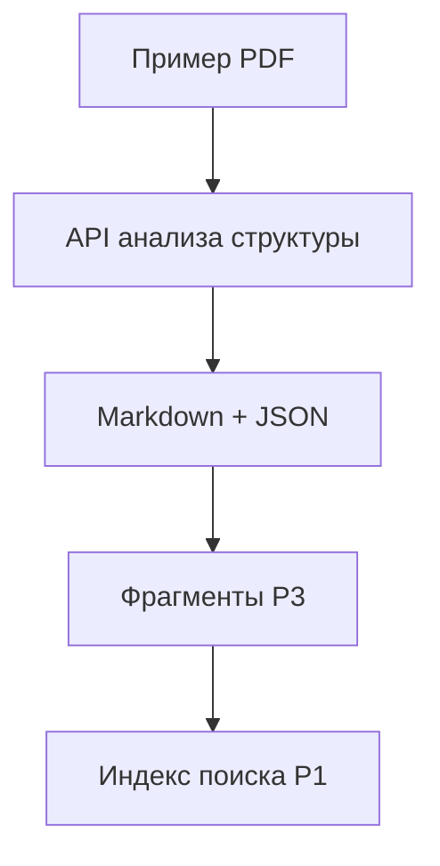

# Поиск начинается со структуры документа

PDF может выглядеть безупречно, а после извлечения текста колонки перемешаются, таблица потеряет заголовки, нижний колонтитул окажется посреди предложения. Каждый фрагмент (chunk), который попадёт в индекс с такими повреждениями, даст модели искажённые данные. Изменение промпта не восстановит потерянную связь между ценой и товаром.

При приёме документов нужен промежуточный результат, который можно проверить: читаемый текст, структура для осмысленного разбиения и ссылки на страницы оригинала. В необязательном проекте P3 — конвейере приёма документов (ingestion pipeline) — этот результат находится между загрузкой файла и фрагментами в индексе P1. Здесь ты подготовишь его для одного PDF; обработчик загрузок и обновление индекса разобраны в [P3](../part-5-projects/ingestion-pipeline.md).

## Как Azure извлекает содержимое и структуру \{#how-azure-extracts-content}

Оптическое распознавание символов (OCR) распознаёт символы на изображениях страниц. Анализ структуры документа (layout analysis) определяет, какой текст образует заголовок, какие ячейки входят в таблицу и где на странице расположен абзац.

Извлечение полей (field extraction) решает другую задачу: сопоставляет значения полям схемы, например `InvoiceDate`. Для поиска может быть полезен целый абзац, даже если он не укладывается в схему бизнес-данных.

В Azure эти возможности доступны в двух сервисах: **Azure Document Intelligence in Foundry Tools** и **Azure Content Understanding in Foundry Tools**. Дальше — Document Intelligence и Content Understanding. В [каталоге моделей Document Intelligence v4.0](https://learn.microsoft.com/ru-ru/azure/ai-services/document-intelligence/model-overview?view=doc-intel-4.0.0) перечислены модели анализа структуры, готовые модели для отдельных типов документов и настраиваемые модели извлечения. Для v4.0 версия API `2024-11-30` имеет статус GA. Модель `prebuilt-layout` распознаёт текст и извлекает структуру документа, а модель для конкретного типа документа, например счёта, добавляет предусмотренные для него поля.

В Content Understanding поведение задаёт **анализатор (analyzer)** — конфигурация извлечения, в которой при необходимости описаны схема полей и генеративная обработка. [Обзор сервиса](https://learn.microsoft.com/ru-ru/azure/ai-services/content-understanding/overview) указывает API `2025-11-01` со статусом GA и `2026-06-01-preview` со статусом public preview. В [предварительную версию добавлены](https://learn.microsoft.com/ru-ru/azure/ai-services/content-understanding/whats-new) агентный анализ документов и обнаружение подписей; в этом упражнении они не используются.

В [каталоге анализаторов Content Understanding](https://learn.microsoft.com/ru-ru/azure/ai-services/content-understanding/concepts/prebuilt-analyzers) есть `prebuilt-read` и `prebuilt-layout`, которым не нужны ни языковая модель, ни модель эмбеддингов (embeddings). Анализатор `prebuilt-documentSearch` добавляет семантический анализ для RAG. Имена `prebuilt-read` и `prebuilt-layout` встречаются в обоих сервисах, поэтому по одному идентификатору нельзя определить, какой сервис вызывается.

В упражнении ты отправишь URL документа в API анализа структуры Document Intelligence. Запрос асинхронный: сервис вернёт URL операции, по которому нужно проверять её состояние до завершения. Параметр [`outputContentFormat=markdown`](https://learn.microsoft.com/ru-ru/azure/ai-services/document-intelligence/prebuilt/layout?view=doc-intel-4.0.0) задаёт Markdown в поле `content`. Сохрани и весь JSON: в нём есть сведения о страницах, абзацах и таблицах, позволяющие сопоставить текст с исходным PDF.



Упражнение заканчивается на Markdown и JSON. В этом варианте с Document Intelligence разбиением на фрагменты и индексированием дальше занимается приложение; успешный запрос анализа ещё не делает документ доступным для поиска в P1. У Content Understanding есть и другой вариант: [`prebuilt-documentSearch`](https://learn.microsoft.com/ru-ru/azure/ai-services/content-understanding/concepts/prebuilt-analyzers#prebuilt-documentsearch) возвращает фрагменты для последующего получения эмбеддингов и индексирования. Он может разбивать текст на фрагменты фиксированного размера или выполнять семантическое разбиение с учётом структуры документа.

## Выбирай извлечение под документ \{#choosing-extraction}

Сначала определи, что нужно получить. Если исходный Markdown уже аккуратно оформлен, а заголовки размечены правильно, OCR создаст лишний риск повредить текст. Если перед тобой скан, чтение одного только закодированного текста не восстановит слова на изображении.

В [текущем руководстве по выбору сервиса](https://learn.microsoft.com/ru-ru/azure/ai-services/content-understanding/choosing-right-ai-tool) Microsoft рекомендует Content Understanding для новых задач, где нужны только OCR или структура. Document Intelligence остаётся вариантом для стандартных форм и настраиваемого извлечения по размеченным примерам. В этом упражнении Document Intelligence выбран намеренно: его [GA REST API `2024-11-30`](https://learn.microsoft.com/ru-ru/azure/ai-services/document-intelligence/model-overview?view=doc-intel-4.0.0) позволяет в пределах F0 изучить извлечённые данные до разработки компонента разбиения для P3. Для эксплуатации выбирай сервис по результатам проверки на своём корпусе. В том числе проверь, отвечают ли готовые фрагменты Content Understanding требованиям твоего поиска.

| Вариант | Когда выбирать | Когда не подходит |
|---|---|---|
| Анализаторы чтения и структуры Content Understanding | Нужны текст или структура документа без семантического вывода значений полей. | Исходник уже имеет пригодную структуру или нужна схема бизнес-полей. |
| Анализ структуры Document Intelligence | Нужны Markdown и JSON для проверки в этом упражнении на F0 либо уже есть интеграция с Document Intelligence. | Ожидаешь, что один анализ структуры определит итоговую сумму счёта или выведет обязательства из договора. |
| Готовые модели Document Intelligence для отдельных типов документов и настраиваемое извлечение | Есть стандартные формы с известными полями или размеченные примеры документов одного семейства. | Нужен поиск по произвольному связному тексту, а не эти поля. |
| Семантические и настраиваемые анализаторы Content Understanding | Нужны обработка неструктурированных документов, вывод значений полей или более полная подготовка к RAG. | Достаточно прямого извлечения, а сгенерированная интерпретация не добавляет полезных сведений. |

Для поиска абзаца об условиях доставки нужны текст и контекст раздела. Чтобы провести счёт в бухгалтерской системе, нужны именованные значения, их типы и проверка. Внешне правдоподобная таблица ещё не означает, что счёт проверен. Если ограничиться извлечением нескольких полей, можно потерять окружающие пояснения, которые нужны системе для ответа на вопрос.

Генеративное извлечение меняет и то, что предстоит проверять. Краткое изложение или выведенное из текста обязательство — интерпретация источника. Храни её отдельно от дословных отрывков, чтобы позже не выдать за исходную формулировку. В [описании тарификации Content Understanding](https://learn.microsoft.com/ru-ru/azure/ai-services/content-understanding/pricing-explainer) разделены извлечение, контекстуализация и плата за токены подключённых моделей. При расчёте расходов на семантический анализатор учитывай все эти составляющие, а не только OCR.

Перед выбором сервиса проверь сложные страницы: перекошенные сканы, плотные таблицы, колонки, в которых важен порядок чтения. Отдельно ищи пропущенный текст и нарушенные связи. Парсер может прочитать все слова, но приписать число другой строке — корректный JSON и аккуратный Markdown сами по себе этого не обнаружат.

## Что это меняет для AI-сервиса \{#in-an-ai-workload}

Размер фрагментов, перекрытие и эмбеддинги разбираются в уроке [«Из документов — в поисковый индекс»](/rag-agents/part-1-rag/ingestion/). Здесь Azure даёт структуру, на которую можно опереться при разбиении. В P3 начинай с границ разделов и сохраняй с каждым фрагментом иерархию заголовков. Если абзац продолжается на следующей странице, разрыв страницы — плохое место для разделения. Когда текст фрагмента собран, проверь, укладывается ли он в лимит токенов выбранной модели эмбеддингов.

Для таблиц нужны отдельные правила. Небольшую таблицу сохраняй вместе с подписью и относящимся к ней вводным текстом. Большую дели на осмысленные группы строк и добавляй в каждую нужные заголовки. В [формате Markdown Document Intelligence v4.0](https://learn.microsoft.com/ru-ru/azure/ai-services/document-intelligence/concept/markdown-elements?view=doc-intel-4.0.0) используются HTML-таблицы, чтобы передать в том числе объединённые ячейки. Компонент разбиения, который понимает лишь таблицы с вертикальными чертами, может разрезать эту структуру.

Сведения о происхождении данных (provenance) связывают фрагмент с исходным документом: его идентификатором и версией, страницами, иерархией заголовков и настройками извлечения. Ограничивающая область (bounding region) показывает, где элемент находится на странице. Сохрани JSON до очистки или переписывания Markdown, чтобы не потерять эти соответствия.

В [схеме результата](https://learn.microsoft.com/ru-ru/rest/api/aiservices/document-models/get-analyze-result?view=rest-aiservices-v4.0%20(2024-11-30)) поля `analyzeResult.paragraphs[*].spans` задают положение абзацев в `analyzeResult.content`. Сопоставь отрывок исходного Markdown с диапазоном текста в `spans`, затем возьми номера страниц из `boundingRegions[*].pageNumber` того же абзаца. Для таблиц аналогичные соответствия находятся в `analyzeResult.tables[*].spans` и `boundingRegions`, для ячеек — в `cells[*]`. Смещения и длины относятся к исходному результату извлечения и должны интерпретироваться по `analyzeResult.stringIndexType`. После произвольных правок текста исходные смещения символов уже нельзя безопасно использовать для такого сопоставления.

В P3 храни отдельно исходную версию документа, полный ответ сервиса и производный текст. Записи в индексе должны наследовать права доступа к документу. Для идентификатора фрагмента сочетай версию документа с устойчивым идентификатором самого фрагмента: повторный запуск фонового задания должен заменять собственный результат. Публикуй новую версию целиком и удаляй устаревшие фрагменты, иначе P1 сможет найти и старую, и исправленную редакцию одного регламента.

До изменения модели, которая отвечает на вопросы, проверь извлечение на нескольких характерных запросах. Возвращает ли поиск строку таблицы вместе с её заголовками? Ведёт ли ссылка на нужную страницу? Находится ли последний раздел документа — или обработана только часть страниц? Урок [«Измерять качество, а не гадать»](/rag-agents/part-1-rag/cross-cutting/evaluation/) разбирает оценку шире; здесь такие проверки помогают найти ошибку извлечения и разбиения до того, как она проявится в ответе модели.

## Попробуй \{#try-it}

Подготовь первый результат извлечения для P3 через Azure CLI. Выполняй команды в Bash: используются переменные, интерактивный ввод и ожидание между запросами. Нужны подписка, интерактивный вход под пользователем, права на создание ресурсов и назначение ролей для нового ресурса. Подставь свою подписку и глобально уникальное имя ресурса, а регион выбери из разрешённых в подписке.

Команды сверены со справочником CLI по ссылкам ниже, но **ещё не запускались в действующей подписке Azure**: во время подготовки урока доступной подписки не было. Описанные далее результаты соответствуют документации API, а не наблюдениям при запуске.

Создай отдельную группу ресурсов и ресурс Document Intelligence на F0. В команде `az cognitiveservices account create` тип ресурса всё ещё называется [`FormRecognizer`](https://learn.microsoft.com/ru-ru/dotnet/api/overview/azure/ai.formrecognizer-readme?view=azure-dotnet). Параметры создания описаны в [справочнике `account create`](https://learn.microsoft.com/ru-ru/cli/azure/cognitiveservices/account?view=azure-cli-latest#az-cognitiveservices-account-create). Затем получи идентификатор и адрес ресурса, идентификатор текущего пользователя и назначь ему роль `Cognitive Services User` на уровне нового ресурса.

```bash
az login
az account set --subscription 'YOUR-SUBSCRIPTION-ID'

ingest_rg='rg-p3-layout-lab'
ingest_name='YOUR-GLOBALLY-UNIQUE-ACCOUNT-NAME'
ingest_region='eastus'

az group create --name "$ingest_rg" --location "$ingest_region"
az cognitiveservices account create \
  --name "$ingest_name" --resource-group "$ingest_rg" \
  --kind FormRecognizer --sku F0 --location "$ingest_region" \
  --custom-domain "$ingest_name" --yes

ingest_id="$(az cognitiveservices account show \
  --name "$ingest_name" --resource-group "$ingest_rg" \
  --query id --output tsv)"
ingest_endpoint="$(az cognitiveservices account show \
  --name "$ingest_name" --resource-group "$ingest_rg" \
  --query properties.endpoint --output tsv)"
ingest_user="$(az ad signed-in-user show --query id --output tsv)"

az role assignment create --assignee-object-id "$ingest_user" \
  --assignee-principal-type User --role 'Cognitive Services User' \
  --scope "$ingest_id"
```

Собственный поддомен и назначенная роль нужны для [аутентификации Microsoft Entra](https://learn.microsoft.com/ru-ru/azure/ai-services/document-intelligence/sdk-overview-v4-0?view=doc-intel-4.0.0). Перед анализом дождись, пока назначение роли вступит в силу. Если доступ отклонён, проверь назначение и адрес сервиса перед повторной попыткой. Если Azure не позволяет создать ресурс F0, проверь доступность этого уровня и условия его использования. Переход на S0 изменит стоимость упражнения; не подменяй им F0 без пересмотра расходов.

Укажи URL [примера PDF от Microsoft](https://github.com/Azure-Samples/cognitive-services-REST-api-samples/blob/master/curl/form-recognizer/sample-layout.pdf) в JSON-теле [запроса на анализ документа](https://learn.microsoft.com/ru-ru/rest/api/aiservices/document-models/analyze-document?view=rest-aiservices-v4.0%20(2024-11-30)). Azure сам получит файл по открытому адресу; учётная запись хранения (storage account) для этого шага не нужна. Запрос использует `prebuilt-layout`, версию API `2024-11-30`, формат Markdown и страницы 1–2.

```bash
ingest_sample='https://raw.githubusercontent.com/Azure-Samples/cognitive-services-REST-api-samples/master/curl/form-recognizer/sample-layout.pdf'
ingest_api="${ingest_endpoint%/}/documentintelligence/documentModels/prebuilt-layout"

az rest --method post \
  --url "${ingest_api}:analyze?_overload=analyzeDocument&api-version=2024-11-30&outputContentFormat=markdown&pages=1-2" \
  --resource 'https://cognitiveservices.azure.com/' \
  --headers 'Content-Type=application/json' \
  --body "{\"urlSource\":\"$ingest_sample\"}" --debug
```

Ожидаемый ответ по документации — HTTP `202 Accepted` с заголовками `Operation-Location` и `Retry-After`. Параметр [`--debug`](https://learn.microsoft.com/ru-ru/cli/azure/reference-index?view=azure-cli-latest#az-rest) включает [вывод заголовков ответа в Azure CLI](https://github.com/Azure/azure-cli/blob/dev/src/azure-cli-core/azure/cli/core/util.py). Скопируй весь URL из `Operation-Location` без окружающих кавычек. Ответ `202 Accepted` подтверждает приём задания, но ещё не содержит извлечённого Markdown.

Перед **первым** GET подожди не менее одной секунды; если `Retry-After` требует больше, используй это значение. Для F0 действует ограничение [один GET в секунду](https://learn.microsoft.com/ru-ru/azure/ai-services/document-intelligence/service-limits?view=doc-intel-4.0.0). Затем обратись к [операции получения результата](https://learn.microsoft.com/ru-ru/rest/api/aiservices/document-models/get-analyze-result?view=rest-aiservices-v4.0%20(2024-11-30)):

```bash
read -r -p 'Paste Operation-Location URL: ' ingest_operation
read -r -p 'Wait seconds (at least 1; use longer Retry-After): ' ingest_wait
sleep "$ingest_wait"
az rest --method get --url "$ingest_operation" \
  --resource 'https://cognitiveservices.azure.com/' \
  --query status --output tsv --debug
```

После каждого GET проверяй и заголовки ответа, и состояние. Если состояние — `notStarted` или `running`, задай `ingest_wait` по значению `Retry-After` из последнего ответа. Задержка должна быть не меньше одной секунды. Затем повтори команды начиная со `sleep`. При `failed` прекрати опрос и изучи ошибку. Сохранять результат можно только после `succeeded`.

Сохрани полный JSON и отдельно Markdown. Для каждого файла команда `az rest` отправляет отдельный GET-запрос, поэтому перед каждым запросом снова выжди нужный интервал, ориентируясь на заголовки последнего ответа.

```bash
read -r -p 'Wait seconds (at least 1; use longer Retry-After): ' ingest_wait
sleep "$ingest_wait"
az rest --method get --url "$ingest_operation" \
  --resource 'https://cognitiveservices.azure.com/' \
  --output json --debug > analysis.json
read -r -p 'Wait seconds (at least 1; use longer Retry-After): ' ingest_wait
sleep "$ingest_wait"
az rest --method get --url "$ingest_operation" \
  --resource 'https://cognitiveservices.azure.com/' \
  --query analyzeResult.content --output tsv --debug > layout.md
```

Открой оба файла. При успешном ответе текст находится в `analyzeResult.content`, а `contentFormat` имеет значение `markdown`. Сравни структуру извлечённого текста с PDF. Ниже — **выдуманный пример формата**, показывающий Markdown с HTML-таблицей; это не результат анализа образца PDF:

```markdown
# Delivery terms

Orders leave the warehouse within five working days.

<table>
<tr><th>Service</th><th>Days</th></tr>
<tr><td>Standard</td><td>5</td></tr>
</table>
```

В собственном результате отметь границу раздела и границу таблицы. По диапазонам текста абзацев и таблиц перейди к соответствующим полям `boundingRegions` в ответе JSON и найди там номера страниц. Используй эти наблюдения при подготовке тестовых данных для проверки компонента разбиения на следующем шаге P3. Сохрани оба файла, URL образца и версию API: они понадобятся для разбиения и индексирования, но сами ещё не являются готовым поисковым индексом.

**Стоимость:** F0 включает [500 бесплатных страниц в месяц](https://azure.microsoft.com/en-us/pricing/details/document-intelligence/), но один запрос возвращает не более двух страниц, а размер файла ограничен 4 МБ — см. [лимиты сервиса](https://learn.microsoft.com/ru-ru/azure/ai-services/document-intelligence/service-limits?view=doc-intel-4.0.0). Оставайся в пределах бесплатного объёма и проверяй, какие страницы вернулись: успешный анализ не гарантирует обработку всего документа.

**Удаление ресурсов:** удали только отдельную группу этого упражнения. Локальные результаты извлечения сохрани для P3.

```bash
az group delete --name "$ingest_rg" --yes
```

## Что перенести в свою практику \{#what-to-take-away}

- Выбирай OCR, анализ структуры или извлечение полей по нужному результату: эти задачи решают разные проблемы.
- В упражнении Document Intelligence используется через GA API `2024-11-30`, чтобы изучить извлечённые данные до разработки компонента разбиения для P3. Для эксплуатации оцени сервис на своём корпусе.
- Храни вместе Markdown, структурные соответствия и версии источников: так сохраняются смысл текста и правильные ссылки. Успешный запрос может обработать лишь часть документа.
- Проверяй качество извлечения и границы фрагментов до изменения модели, которая отвечает на вопросы.

**[Новые термины](../glossary.md#document-ingestion)**: оптическое распознавание символов (OCR), анализ структуры документа, извлечение полей, анализатор, ограничивающая область, сведения о происхождении данных.

## Источники \{#sources}

Проверено на 17.10.2026.

- **Выбор сервисов и статус:** [Content Understanding overview](https://learn.microsoft.com/ru-ru/azure/ai-services/content-understanding/overview), [release notes](https://learn.microsoft.com/ru-ru/azure/ai-services/content-understanding/whats-new), [document processing choices](https://learn.microsoft.com/ru-ru/azure/ai-services/content-understanding/choosing-right-ai-tool), [prebuilt analyzers](https://learn.microsoft.com/ru-ru/azure/ai-services/content-understanding/concepts/prebuilt-analyzers), [Content Understanding billing](https://learn.microsoft.com/ru-ru/azure/ai-services/content-understanding/pricing-explainer).
- **Document Intelligence:** [models](https://learn.microsoft.com/ru-ru/azure/ai-services/document-intelligence/model-overview?view=doc-intel-4.0.0), [layout](https://learn.microsoft.com/ru-ru/azure/ai-services/document-intelligence/prebuilt/layout?view=doc-intel-4.0.0), [Markdown elements](https://learn.microsoft.com/ru-ru/azure/ai-services/document-intelligence/concept/markdown-elements?view=doc-intel-4.0.0), [authentication](https://learn.microsoft.com/ru-ru/azure/ai-services/document-intelligence/sdk-overview-v4-0?view=doc-intel-4.0.0), [REST workflow and polling](https://learn.microsoft.com/ru-ru/azure/ai-services/document-intelligence/how-to-guides/use-sdk-rest-api?view=doc-intel-4.0.0), [limits](https://learn.microsoft.com/ru-ru/azure/ai-services/document-intelligence/service-limits?view=doc-intel-4.0.0), [pricing](https://azure.microsoft.com/en-us/pricing/details/document-intelligence/).
- **Контракт REST:** [analyze a document URL](https://learn.microsoft.com/ru-ru/rest/api/aiservices/document-models/analyze-document?view=rest-aiservices-v4.0%20(2024-11-30)), [get analysis result](https://learn.microsoft.com/ru-ru/rest/api/aiservices/document-models/get-analyze-result?view=rest-aiservices-v4.0%20(2024-11-30)).
- **CLI:** [`az login` и `az rest`](https://learn.microsoft.com/ru-ru/cli/azure/reference-index?view=azure-cli-latest), [subscription selection](https://learn.microsoft.com/ru-ru/cli/azure/account?view=azure-cli-latest#az-account-set), [resource groups](https://learn.microsoft.com/ru-ru/cli/azure/group?view=azure-cli-latest), [service accounts](https://learn.microsoft.com/ru-ru/cli/azure/cognitiveservices/account?view=azure-cli-latest), [signed-in user](https://learn.microsoft.com/ru-ru/cli/azure/ad/signed-in-user?view=azure-cli-latest), [role assignment](https://learn.microsoft.com/ru-ru/cli/azure/role/assignment?view=azure-cli-latest), [resource-kind example](https://learn.microsoft.com/ru-ru/dotnet/api/overview/azure/ai.formrecognizer-readme?view=azure-dotnet).
- **Официальная реализация и пример:** [Azure CLI response logging](https://github.com/Azure/azure-cli/blob/dev/src/azure-cli-core/azure/cli/core/util.py), [sample PDF](https://github.com/Azure-Samples/cognitive-services-REST-api-samples/blob/master/curl/form-recognizer/sample-layout.pdf).
