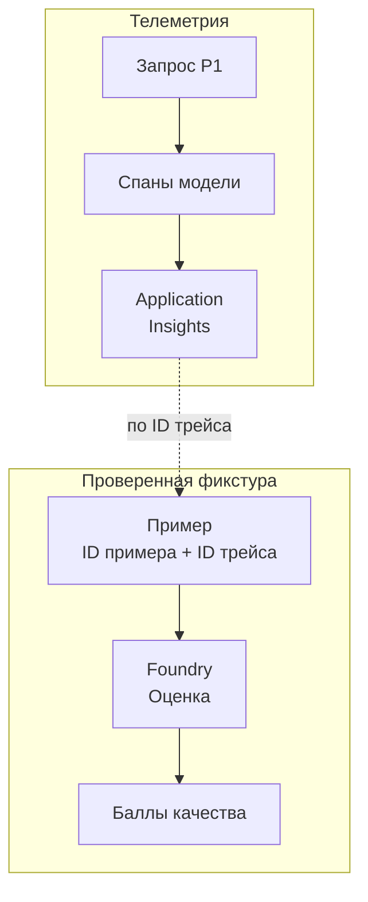

# Свяжи оценку ответа с трейсом запроса

Сервис может быстро вернуть HTTP 200, хотя фрагмент (chunk), на который он ссылается, не подтверждает ответ. Метрики запросов показывают, что сервис ответил, но не позволяют судить о качестве ответа. Если балл качества снизился, без сведений о выполнении запроса нельзя определить причину: поиск не нашёл нужные сведения, модель не использовала найденные сведения или средству оценки (evaluator) передали неверный контекст.

При оценке проверяется выбранное свойство ответа на заданных входных данных. Трассировка записывает операции, в результате которых этот ответ появился. Для RAG-сервиса свяжи эти сведения так, чтобы по примеру, который не прошёл проверку, можно было найти фрагменты, полученные при поиске для этого примера, и вызов модели, а после исправления воспроизвести проверку.

## Как это работает в Azure \{#how-it-works-on-azure}

В [Microsoft Foundry](https://learn.microsoft.com/ru-ru/azure/foundry/concepts/evaluation-overview) средства оценки проверяют сохранённые результаты приложения, заново сгенерированные ответы или трейсы (traces) из рабочей среды. Запуск объединяет объект проверки, данные, критерии и результаты. Если выбрать существующий набор данных, Foundry оценит уже полученные ответы приложения: заново запрашивать ответ у модели не требуется. Так ты проверяешь результат работы всего P1, включая поиск и формирование ссылок на источники.

Во [встроенном каталоге](https://learn.microsoft.com/ru-ru/azure/foundry/concepts/built-in-evaluators) есть критерии качества, безопасности, поиска и работы агентов. Для P1 начни с двух: средство оценки опоры ответа на контекст (groundedness evaluator) проверяет, подтверждается ли ответ предоставленным контекстом, а средство оценки релевантности (relevance evaluator) — насколько ответ соответствует вопросу пользователя. В Foundry они называются [Groundedness и Relevance](https://learn.microsoft.com/ru-ru/azure/foundry/concepts/evaluation-evaluators/rag-evaluators). Оба используют модель-судью и шкалу 1–5; заданный порог определяет результат `pass` или `fail`. В текущем справочнике у этих двух средств нет пометки preview. Groundedness Pro — другое средство оценки со статусом preview; похожие названия не означают, что реализации взаимозаменяемы.

Сбор и отправка телеметрии устроены отдельно: приложение создаёт спаны (spans) OpenTelemetry, провайдер подписывается на их источники, а экспортёр отправляет записи в Application Insights. Здесь используется ресурс из урока [«Наблюдаемость» Части I](/part-1-azure-foundations/observability.md). Создание этого ресурса само по себе не добавило инструментирование вызовов модели в P1.



Тестовую фикстуру (test fixture) — сохранённые и проверенные примеры — нужно подготовить отдельно. Пунктир на схеме обозначает сопоставление по идентификатору трейса (trace identifier), а не копирование содержимого трейса в тестовые данные. Фикстура не создаётся автоматическим копированием всех трейсов.

Если ты добавляешь инструментирование в .NET-приложение, [текущее руководство Microsoft](https://learn.microsoft.com/ru-ru/azure/azure-monitor/app/opentelemetry-enable?tabs=aspnetcore) рекомендует Microsoft OpenTelemetry Distro. Приложениям с Azure Monitor OpenTelemetry Distro переходить на него не нужно; в одном приложении инициализируй один дистрибутив OpenTelemetry (OpenTelemetry distribution). Обёртка [`UseOpenTelemetry`](https://learn.microsoft.com/ru-ru/dotnet/ai/ichatclient#use-telemetry) над `IChatClient` создаёт спаны и метрики операций модели. В обёртке и в подписке провайдера укажи одно и то же имя источника.

В [примечаниях к API](https://learn.microsoft.com/ru-ru/dotnet/api/microsoft.extensions.ai.opentelemetrychatclientbuilderextensions.useopentelemetry?view=net-10.0-pp#remarks) семантические соглашения для генеративного AI и формат создаваемой телеметрии отмечены как экспериментальные: они могут измениться. Прежде чем строить на этих полях запросы или подключать регулярную оценку, проверь их актуальный состав.

## Какие сведения нужны для проверки \{#choosing-and-tradeoffs}

Офлайн-оценка (offline evaluation) позволяет менять сервис и сравнивать результаты на неизменном наборе примеров. Так обнаруживаются регрессии в уже известных случаях. Оценка на реальных запросах помогает найти вопросы, которых в наборе не было. Эти подходы дополняют друг друга.

| Вариант | Для чего подходит | Чего не проверяет или где может подвести |
|---|---|---|
| Офлайн-запуск на наборе данных | Сравнение релизов на сохранённых примерах P1 | Не обнаружит типы вопросов из рабочей среды, которых нет в наборе |
| Непрерывная оценка (continuous evaluation) | Проверка выборки реальных взаимодействий по мере поступления запросов | Не остановит плохой ответ до того, как его получит вызывающая сторона |
| Встроенное средство оценки с моделью-судьёй | Измерение документированного свойства, например опоры на контекст | Высокий балл не доказывает корректность каждой ссылки на источник |
| Собственное детерминированное средство оценки | Проверяет, входят ли цитируемые источники в найденный набор, присутствуют ли обязательные поля и соблюдён ли формат ответа | Не определяет, подтверждает ли фрагмент утверждение по смыслу |
| Собственное средство оценки на основе промпта | Проверка смыслового критерия, специфичного для приложения | При неоднозначных критериях судья может поощрять правдоподобные формулировки |
| Трейс выполнения | Поиск медленных вызовов, повторов и операций с ошибками | Успешное завершение спанов не подтверждает правильность ответа |

В Foundry [регулярная оценка имеет статус preview](https://learn.microsoft.com/ru-ru/azure/foundry/observability/how-to/how-to-monitor-agents-dashboard). Оценка по расписанию (scheduled evaluation) запускается в заданное время, непрерывная — проверяет выборку реальных взаимодействий по мере поступления запросов. Долю отбора и ограничения запусков задавай явно. Для агентов, размещённых вне Foundry, нужны регистрация собственного агента через плоскость управления Foundry и AI-шлюз, а также совместимая телеметрия в Application Insights проекта. Одной отправки спанов из произвольного Container App для этого недостаточно. В упражнении P1 ниже выполняется только один офлайн-запуск.

[Собственные средства оценки (custom evaluators) тоже находятся в preview](https://learn.microsoft.com/ru-ru/azure/foundry/concepts/evaluation-evaluators/custom-evaluators). Их можно реализовать кодом на Python, промптом для модели-судьи или внешней конечной точкой HTTP. Код выполняется в изолированной среде без доступа к сети. Если для проверки нужен другой сервис, используй внешнюю конечную точку. Тогда сама оценка будет зависеть от доступности этого сервиса.

В P1 детерминированная проверка может установить, что каждый цитируемый источник входит в найденный набор. Подтверждает ли конкретный фрагмент утверждение по смыслу, оценивает судья. Если такая проверка не пройдена, открой сам цитируемый фрагмент и разбери причину.

Политику сбора данных определяй при проектировании. [В трейсах могут оказаться промпты, ответы и персональные данные](https://learn.microsoft.com/ru-ru/azure/foundry/observability/concepts/trace-data). Даже если документы взяты из открытых источников, вопрос пользователя от этого не становится публичным. Начни с метаданных операций, а текст для проверенной тестовой фикстуры собирай отдельно. Заранее реши, кто сможет читать эти данные и как долго они будут храниться.

Если нужного трейса нет, проверь сэмплирование (sampling), прежде чем объяснять ошибку по доступным трейсам: сведения о части операций могли не сохраниться.

## Что это меняет для AI-сервиса \{#in-an-ai-workload}

P1 использует минимальные API: ищет фрагменты в Azure AI Search, вызывает развёртывание модели Foundry и возвращает ответ со ссылками на документы в Blob Storage. Телеметрия позволяет наблюдать за работой P1. Сохрани существующий доступ через управляемое удостоверение (managed identity) и настройки Key Vault.

Для каждого тестового запуска записывай идентификатор релиза, версии промпта и индекса, а также развёртывание модели (model deployment). Сохраняй именно тот контекст, который был передан модели. Позднее Search может найти другие фрагменты, и новый поиск уже не восстановит исходные условия. Постоянные идентификаторы примеров позволяют сравнивать ошибки между запусками, даже когда идентификаторы трейсов меняются.

Допустим, ответ релевантен вопросу, но слабо опирается на контекст. Открой сохранённый контекст, проверь наличие нужного фрагмента и найди операцию модели в трейсе. Если фрагмента нет, исследуй поиск; если есть — сборку контекста и генерацию. Прежде чем менять поиск или генерацию, проверь сопоставление полей фикстуры. Если поля сопоставлены неверно, средство оценки проверяет ответ по другому тексту и может показать ошибку, которой сервис не совершал.

В уроке [«Измерять качество, а не гадать»](/rag-agents/part-1-rag/cross-cutting/evaluation/) разделены метрики поиска и генерации, а в [углублённом разборе](/rag-agents/part-1-rag/cross-cutting/evaluation/deep-dive) объясняются калибровка судьи и разметка человеком. Применяй эти методы, когда задаёшь критерии приёмки. Шкала средства оценки Azure сама по себе не определяет порог для выпуска твоего приложения. Сохраняй проверки ссылок на источники рядом со смысловыми оценками и разбирай отдельные неудачные примеры, прежде чем доверять общему результату.

## Попробуй \{#try-it}

Подключи P1 в среде разработки к Application Insights из Части I и оцени пять сохранённых ответов. Понадобятся работающий RAG API, проект Foundry, развёртывание Azure OpenAI для модели-судьи и право обновлять приложение. Для инференса при оценке с помощью модели роль [`Foundry User` должна действовать на уровне ресурса Foundry](https://learn.microsoft.com/ru-ru/azure/foundry/observability/how-to/evaluation-permissions). Доступ только к проекту не разрешает такой инференс.

Согласно [таблице разрешений для трейсов](https://learn.microsoft.com/ru-ru/azure/foundry/observability/how-to/evaluation-permissions#add-permissions-for-trace-based-workflows), для просмотра трейсов вошедшему в систему пользователю нужна роль Log Analytics Reader на Application Insights. Если запросы выполняются на уровне связанной рабочей области Log Analytics (Log Analytics workspace), эта роль нужна и на ней. Для защищённого содержимого дополнительно требуется Privileged Monitoring Data Reader. Роли управляемого удостоверения проекта для оценки по трейсам назначаются отдельно. В этом упражнении ты загружаешь набор данных.

Оба фрагмента C# скомпилированы 18.10.2026 в проверочном приложении ASP.NET Core для .NET 10. Использовались .NET SDK 10.0.402, Microsoft.OpenTelemetry 1.2.0, Microsoft.Extensions.AI 10.11.0, Microsoft.Extensions.AI.OpenAI 10.11.0, OpenAI 2.14.0 и Azure.Identity 1.21.0. Локальная команда запустила приложение с отключённым наблюдением за файлами и фиктивным адресом телеметрии на loopback. Вызов `/ask` завершился ошибкой получения учётных данных, поэтому фикстура из пяти строк не была получена. Команды Azure CLI, экспорт телеметрии (export) в Azure и оценка в Foundry на действующей подписке не выполнялись. Ожидаемые облачные результаты ниже описаны по документации.

Используй существующий способ создания клиента из урока [«AI в .NET»](/part-2-modern-dotnet/ai-in-dotnet.md). Здесь используются стабильные пакеты [Microsoft.OpenTelemetry 1.2.0](https://www.nuget.org/packages/Microsoft.OpenTelemetry/1.2.0) и [Microsoft.Extensions.AI 10.11.0](https://www.nuget.org/packages/microsoft.extensions.ai/10.11.0). Директивы `using` помести в начало файла, остальные строки — перед `builder.Build()`, заменив существующую регистрацию клиента чата. `builder`, `chatDeployment` и зарегистрированный `OpenAIClient` уже есть в коде запуска P1. [Настройка провайдера](https://learn.microsoft.com/ru-ru/azure/azure-monitor/app/opentelemetry-add-modify?tabs=aspnetcore) подписывает его на источник обёртки, а [параметр инструментирования](https://learn.microsoft.com/ru-ru/dotnet/api/microsoft.opentelemetry/microsoft.opentelemetry.instrumentationoptions?view=opentelemetry-dotnet-latest) отключает дублирующее прямое инструментирование OpenAI.

```csharp
using Microsoft.Extensions.AI;
using Microsoft.OpenTelemetry;
using OpenAI;
using OpenTelemetry.Trace;

const string modelSource = "P1.ModelCalls";

builder.Services.ConfigureOpenTelemetryTracerProvider((_, tracing) =>
    tracing.AddSource(modelSource));
builder.UseMicrosoftOpenTelemetry(options =>
{
    options.Exporters = ExportTarget.AzureMonitor;
    options.Instrumentation.EnableOpenAIInstrumentation = false;
});

builder.Services.AddChatClient(services =>
    services.GetRequiredService<OpenAIClient>()
        .GetChatClient(chatDeployment).AsIChatClient())
    .UseOpenTelemetry(
        sourceName: modelSource,
        configure: telemetry => telemetry.EnableSensitiveData = false);
```

[`EnableSensitiveData = false`](https://learn.microsoft.com/ru-ru/dotnet/api/microsoft.extensions.ai.opentelemetrychatclient.enablesensitivedata?view=net-10.0-pp) исключает исходные входные и выходные данные из телеметрии этой обёртки. Остальные сборщики проверь отдельно. Подготовь образ обычным конвейером сборки P1. До его развёртывания [задай место отправки телеметрии](https://learn.microsoft.com/ru-ru/azure/azure-monitor/app/opentelemetry-enable?tabs=aspnetcore#modify-your-application) для существующего приложения, затем перейди на новый образ. Сборка сайта документации эту интеграцию не проверяет.

Следующие команды рассчитаны на Bash, один контейнер и режим одной ревизии. Предполагается, что переменная `APPLICATIONINSIGHTS_CONNECTION_STRING` ещё не задана. Подставь имена существующих ресурсов среды разработки. Команды выполняют вход, выбирают подписку, обновляют расширение application-insights, получают строку подключения (connection string) из `connectionString` компонента Application Insights и добавляют переменную в Container App. Подробности: [справочник компонента](https://learn.microsoft.com/ru-ru/cli/azure/monitor/app-insights/component?view=azure-cli-latest#az-monitor-app-insights-component-show), [настройка Application Insights](https://learn.microsoft.com/ru-ru/azure/azure-monitor/app/create-workspace-resource) и [справочник Container Apps](https://learn.microsoft.com/ru-ru/cli/azure/containerapp?view=azure-cli-latest#az-containerapp-update).

```bash
az login
p1_subscription='<subscription-id>'
p1_group='<P1-resource-group>'
p1_app='<P1-container-app>'
p1_telemetry_group='<Part-I-telemetry-resource-group>'
p1_insights='<Part-I-application-insights-name>'
az account set --subscription "$p1_subscription"
az extension add --name application-insights --upgrade

p1_connection=$(az monitor app-insights component show \
  --subscription "$p1_subscription" \
  --resource-group "$p1_telemetry_group" --app "$p1_insights" \
  --query connectionString --output tsv)
az containerapp update \
  --subscription "$p1_subscription" \
  --resource-group "$p1_group" --name "$p1_app" \
  --set-env-vars "APPLICATIONINSIGHTS_CONNECTION_STRING=$p1_connection" \
  --output none
```

Разверни подготовленный образ, отправь обычный запрос и найди его в [Search сервиса Application Insights](https://learn.microsoft.com/ru-ru/azure/azure-monitor/app/failures-performance-transactions?tabs=transaction-search). Открой подробности сквозной транзакции. После экспорта и приёма телеметрии там должны появиться спаны `P1.ModelCalls`. Если их нет, проверь, какой образ запущен, подписку провайдера на источник, настройки отправки и сэмплирование.

Для подготовки примеров запусти тот же P1 локально с его зависимостями в Azure, используя учётные данные разработчика с нужными разрешениями. В существующем обработчике, который возвращает готовый ответ без потоковой передачи, замени вызов чата следующим фрагментом. Здесь `http` — `HttpContext` обработчика, `chat` — зарегистрированный `IChatClient`, `query` — вопрос, `messages` — окончательный промпт. В `context` должна быть точная строка контекста, вставленная в `messages` после фильтрации и усечения: именно такой формат [требуется средству оценки](https://learn.microsoft.com/ru-ru/azure/foundry/concepts/evaluation-evaluators/rag-evaluators#context-format). Возвращай `answer` обычным способом вместе со ссылками на источники. Если P1 дополнительно обрабатывает ответ модели, сохраняй ответ после этой обработки.

```csharp
// Add using System.Diagnostics; and using System.Text.Json; at the file top.
var traceId = Activity.Current?.TraceId.ToHexString();
var completion = await chat.GetResponseAsync(
    messages, cancellationToken: http.RequestAborted);
var answer = completion.Text;

if (app.Environment.IsDevelopment() &&
    Environment.GetEnvironmentVariable("P1_CAPTURE_EVAL") == "1")
{
    var caseId = http.Request.Headers["X-Eval-Case-Id"].ToString();
    if (string.IsNullOrWhiteSpace(caseId) || traceId is null)
        throw new InvalidOperationException("Capture needs case and trace IDs.");
    var row = new { case_id = caseId, trace_id = traceId,
        query, response = answer, context };
    await File.AppendAllTextAsync("p1-eval.jsonl",
        JsonSerializer.Serialize(row) + "\n");
}
```

Идентификатор текущего трейса берётся из [`Activity.Current`](https://learn.microsoft.com/ru-ru/azure/azure-monitor/app/opentelemetry-add-modify?tabs=aspnetcore#get-the-trace-id-or-span-id). Запись включена только при одновременном выполнении двух условий: среда Development и `P1_CAPTURE_EVAL`, равная `1`. Идентификатор примера приходит в заголовке `X-Eval-Case-Id`; при пустом значении или отсутствии идентификатора трейса код выбрасывает исключение. [Компактная сериализация JSON](https://learn.microsoft.com/ru-ru/dotnet/standard/serialization/system-text-json/how-to) и [добавление в файл](https://learn.microsoft.com/ru-ru/dotnet/api/system.io.file.appendalltextasync?view=net-10.0) дают один объект на строку; переносы строк внутри текста экранируются.

Используй один локальный процесс и отправляй запросы последовательно. Начни с нового файла фикстуры в рабочем каталоге приложения и не добавляй его в систему контроля версий. Из этого каталога запусти локальный P1, сохранив его существующие настройки зависимостей. Команда задаёт [среду разработки](https://learn.microsoft.com/ru-ru/aspnet/core/fundamentals/environments?view=aspnetcore-10.0), флаг записи и адрес телеметрии только для локального процесса; облачное приложение оставь в обычной среде. См. также [параметры запуска](https://learn.microsoft.com/ru-ru/dotnet/core/tools/dotnet-run).

```bash
DOTNET_ENVIRONMENT=Development P1_CAPTURE_EVAL=1 \
  APPLICATIONINSIGHTS_CONNECTION_STRING="$p1_connection" \
  dotnet run --no-launch-profile -- --urls http://127.0.0.1:5080
```

В другом терминале отправь первый запрос через [curl](https://curl.se/docs/manpage.html). Пример предполагает `POST /ask` с полем `query`. Замени вопрос на вопрос по своим документам из открытых источников. Если у твоего P1 другой маршрут, формат тела или способ аутентификации, адаптируй запрос.

```bash
curl --fail --silent --show-error http://127.0.0.1:5080/ask \
  --header 'Content-Type: application/json' \
  --header 'X-Eval-Case-Id: p1-001' \
  --data '{"query":"What does the document say about retention?"}'
```

Затем по очереди отправь запросы с идентификаторами от `p1-002` до `p1-005`. Всего должно быть пять вопросов: три, на которые документы дают ответ, один без ответа в документах и один с предпосылкой, которая вводит в заблуждение. В `p1-eval.jsonl` должно получиться пять строк. Прочитай сохранённый текст и проверь идентификаторы примеров и трейсов. По каждому идентификатору трейса найди локальный тестовый запрос в Search. Сохрани для запуска идентификатор релиза, версии промпта и индекса и развёртывание модели. [Набор данных JSONL](https://learn.microsoft.com/ru-ru/azure/foundry/observability/how-to/evaluation-datasets) содержит `query`, `response`, `context` и метаданные для расследования; его текст хранится отдельно от обычной телеметрии.

Затем выполни [оценку через портал](https://learn.microsoft.com/ru-ru/azure/foundry/how-to/evaluate-generative-ai-app):

1. Открой `Evaluation → Create`, выбери `Dataset` и `Individual turns`, загрузи или выбери `p1-eval.jsonl`.
2. Явно сопоставь поля `query`, `response` и `context`. Оставь только `Groundedness` и `Relevance`, настрой развёртывание модели-судьи и убери неиспользуемые критерии, выбранные заранее.
3. Назови запуск `p1-baseline`, проверь настройки и отправь его на выполнение. Успешное завершение задания должно дать статус `Completed`; `Partial` означает ошибку выполнения части средств оценки, а не низкое качество ответов. Открой [результаты по отдельным примерам](https://learn.microsoft.com/ru-ru/azure/foundry/how-to/evaluate-results) и сопоставь их со своей оценкой всех пяти ответов.

Сохрани настройки запуска и примеры, которые не прошли проверку, вместе с фикстурой. На пяти примерах можно проверить подключение компонентов, но их слишком мало, чтобы судить о качестве сервиса в промышленной эксплуатации. Разбери каждую ошибку с учётом критериев приёмки, затем расширяй набор.

**Стоимость:** [облачная оценка качества со своей моделью-судьёй](https://azure.microsoft.com/en-us/pricing/details/foundryobservability/) оплачивается по входным и выходным токенам без дополнительной платы за оценку. Отдельно оплачиваются инференс P1, размещение приложения, Search, [приём телеметрии и её платное хранение](https://azure.microsoft.com/en-us/pricing/details/monitor/). Упражнение не бесплатное. До отправки задания проверь тариф выбранного развёртывания; длина контекста влияет на расход токенов судьи. Ограничься одним запуском на пяти строках. Учебный бюджет — 10 долларов США в месяц; это ориентир для планирования, а не обещанная стоимость упражнения.

**Удаление ресурсов:** останови локальный процесс и тестовые запросы, убери код записи и сохрани фикстуру в архив либо удали её. Удали инструментирование и повторно разверни P1, чтобы запуск приложения больше не требовал настройки адреса телеметрии. После этого в том же сеансе Bash выполни:

```bash
az containerapp update \
  --subscription "$p1_subscription" \
  --resource-group "$p1_group" --name "$p1_app" \
  --remove-env-vars APPLICATIONINSIGHTS_CONNECTION_STRING \
  --output none
unset p1_connection
```

Регулярная оценка в этом упражнении не включалась. Удаление настройки не стирает уже принятые данные: к ним продолжает применяться срок хранения. Общие ресурсы Части I, которые нужны P1, пока сохрани; когда закончишь всю практическую работу, удали их по инструкциям соответствующих упражнений. До этого размещение сервиса и Search продолжают оплачиваться.

## Что перенести в свою практику \{#what-to-take-away}

- Связывай оценку ответа с выполнением и контекстом, на основе которых он получен, чтобы разбирать конкретные ошибки.
- Сравнивай версии на фиксированном наборе примеров. Добавляй оценку выборки реальных запросов, когда оправданы расходы и усилия на настройку.
- Выбирай средство оценки под проверяемое свойство: принадлежность источника найденному набору, опора на контекст и релевантность отвечают на разные вопросы.
- Проверяй инструментирование и экспорт отдельно, собирай минимум текста и разбирай неудачные примеры, прежде чем задавать проверку, блокирующую выпуск.

**[Новые термины](/glossary.md#evaluation-and-tracing)**: средство оценки, средство оценки опоры ответа на контекст, средство оценки релевантности, офлайн-оценка, непрерывная оценка, оценка по расписанию, собственное средство оценки, идентификатор трейса.

## Источники \{#sources}

Проверено на 17.10.2026. Дополнения при исправлении проверены 18.10.2026.

- **Оценка:** [Evaluation overview](https://learn.microsoft.com/ru-ru/azure/foundry/concepts/evaluation-overview), [Built-in evaluators](https://learn.microsoft.com/ru-ru/azure/foundry/concepts/built-in-evaluators), [RAG evaluators](https://learn.microsoft.com/ru-ru/azure/foundry/concepts/evaluation-evaluators/rag-evaluators), [Custom evaluators (preview)](https://learn.microsoft.com/ru-ru/azure/foundry/concepts/evaluation-evaluators/custom-evaluators), [Monitoring and recurring evaluation (preview)](https://learn.microsoft.com/ru-ru/azure/foundry/observability/how-to/how-to-monitor-agents-dashboard).
- **Офлайн-оценка:** [Evaluation datasets](https://learn.microsoft.com/ru-ru/azure/foundry/observability/how-to/evaluation-datasets), [Portal evaluation](https://learn.microsoft.com/ru-ru/azure/foundry/how-to/evaluate-generative-ai-app), [Evaluation permissions](https://learn.microsoft.com/ru-ru/azure/foundry/observability/how-to/evaluation-permissions), [View results](https://learn.microsoft.com/ru-ru/azure/foundry/how-to/evaluate-results).
- **Трассировка:** [Enable OpenTelemetry](https://learn.microsoft.com/ru-ru/azure/azure-monitor/app/opentelemetry-enable?tabs=aspnetcore), [Custom telemetry](https://learn.microsoft.com/ru-ru/azure/azure-monitor/app/opentelemetry-add-modify?tabs=aspnetcore), [IChatClient telemetry](https://learn.microsoft.com/ru-ru/dotnet/ai/ichatclient#use-telemetry), [Experimental telemetry shape](https://learn.microsoft.com/ru-ru/dotnet/api/microsoft.extensions.ai.opentelemetrychatclientbuilderextensions.useopentelemetry?view=net-10.0-pp#remarks), [Sensitive-data capture](https://learn.microsoft.com/ru-ru/dotnet/api/microsoft.extensions.ai.opentelemetrychatclient.enablesensitivedata?view=net-10.0-pp), [Distro instrumentation options](https://learn.microsoft.com/ru-ru/dotnet/api/microsoft.opentelemetry/microsoft.opentelemetry.instrumentationoptions?view=opentelemetry-dotnet-latest), [Trace data handling](https://learn.microsoft.com/ru-ru/azure/foundry/observability/concepts/trace-data).
- **Локальная запись:** [Runtime environments](https://learn.microsoft.com/ru-ru/aspnet/core/fundamentals/environments?view=aspnetcore-10.0), [Run options](https://learn.microsoft.com/ru-ru/dotnet/core/tools/dotnet-run), [Chat call](https://learn.microsoft.com/ru-ru/dotnet/api/microsoft.extensions.ai.ichatclient.getresponseasync?view=net-10.0-pp), [JSON serialization](https://learn.microsoft.com/ru-ru/dotnet/standard/serialization/system-text-json/how-to), [File append](https://learn.microsoft.com/ru-ru/dotnet/api/system.io.file.appendalltextasync?view=net-10.0), [curl manual](https://curl.se/docs/manpage.html).
- **Настройка и CLI:** [Application Insights configuration](https://learn.microsoft.com/ru-ru/azure/azure-monitor/app/create-workspace-resource), [CLI login](https://learn.microsoft.com/ru-ru/cli/azure/reference-index?view=azure-cli-latest#az-login), [CLI account selection](https://learn.microsoft.com/ru-ru/cli/azure/account?view=azure-cli-latest#az-account-set), [CLI extensions](https://learn.microsoft.com/ru-ru/cli/azure/extension?view=azure-cli-latest#az-extension-add), [CLI Application Insights](https://learn.microsoft.com/ru-ru/cli/azure/monitor/app-insights/component?view=azure-cli-latest#az-monitor-app-insights-component-show), [CLI Container Apps](https://learn.microsoft.com/ru-ru/cli/azure/containerapp?view=azure-cli-latest#az-containerapp-update).
- **Разбор трейсов:** [Search and transaction diagnostics](https://learn.microsoft.com/ru-ru/azure/azure-monitor/app/failures-performance-transactions?tabs=transaction-search), [.NET trace concepts and identifiers](https://learn.microsoft.com/ru-ru/dotnet/core/diagnostics/distributed-tracing-concepts).
- **Пакеты и цены:** [Microsoft.OpenTelemetry 1.2.0](https://www.nuget.org/packages/Microsoft.OpenTelemetry/1.2.0), [Microsoft.Extensions.AI 10.11.0](https://www.nuget.org/packages/microsoft.extensions.ai/10.11.0), [Foundry observability pricing](https://azure.microsoft.com/en-us/pricing/details/foundryobservability/), [Azure Monitor pricing](https://azure.microsoft.com/en-us/pricing/details/monitor/).
