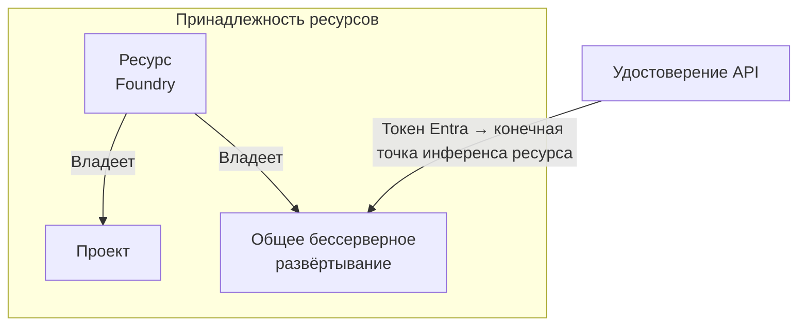

# Доступ к модели: принадлежность развёртывания и удостоверение API

Модель может отвечать в тестовой среде портала, а при вызове из приложения — выдавать ошибку. Прежде чем выбирать модель, определи, какому ресурсу будет принадлежать её развёртывание, какие настройки рабочие нагрузки будут использовать совместно и какому удостоверению разрешено вызывать модель. Это позволит воспроизвести настройку и запустить API без чужих учётных данных. Если запрос завершился ошибкой, отдельно проверь адрес, выбор модели и права доступа.

## Как это устроено в Azure \{#how-it-works-on-azure}

[Microsoft Foundry](https://learn.microsoft.com/ru-ru/azure/foundry/what-is-foundry) объединяет Foundry Models и Foundry Agent Service. В текущей иерархии есть ресурс Foundry и его дочерние проекты. Старые проекты на основе хабов относятся к классическому интерфейсу и устроены иначе. Выбирай документацию для той иерархии ресурсов, с которой работаешь.

[**Ресурс Foundry (Foundry resource)**](https://learn.microsoft.com/ru-ru/azure/foundry/concepts/architecture) — ресурс Azure типа `Microsoft.CognitiveServices/accounts` с видом `AIServices`. Он хранит общие настройки сети и безопасности. **Проект Foundry (Foundry project)** — его дочерний ресурс типа `Microsoft.CognitiveServices/accounts/projects`. В проектах [организована работа с агентами, оценками и файлами](https://learn.microsoft.com/ru-ru/azure/foundry/how-to/create-projects); настройки доступа каждого проекта действуют в рамках родительского ресурса.

Бессерверные развёртывания (serverless deployments) принадлежат ресурсу Foundry, а [развёртывания на управляемых вычислительных ресурсах (managed compute) — проекту](https://learn.microsoft.com/ru-ru/azure/foundry/concepts/deployments-overview).



На схеме показана принадлежность бессерверного развёртывания в P1. Стрелки обозначают принадлежность, а не сетевые вызовы через проект. Два проекта внутри одного ресурса [используют общие настройки сети и развёртывания уровня ресурса](https://learn.microsoft.com/ru-ru/azure/foundry/how-to/create-projects). Создание ещё одного проекта не изолирует сеть и не резервирует вычислительные мощности для модели.

**Каталог моделей (model catalog)** перечисляет доступные варианты моделей для сравнения. **[Развёртывание модели (model deployment)](https://learn.microsoft.com/ru-ru/azure/foundry/foundry-models/concepts/endpoints)** — конфигурация с именем, которая задаёт модель и версию для обслуживания запросов. При обращении к развёртыванию в запросе указывается это имя. Наличие модели в каталоге не подтверждает совместимость с нужным API и не создаёт развёртывание.

Исключение — [мгновенный доступ (instant access)](https://learn.microsoft.com/ru-ru/azure/foundry/concepts/instant-models): сейчас эта возможность имеет статус preview и позволяет проектам в West US 3 вызывать поддерживаемые модели по их именам без развёртывания. В P1 ты будешь создавать развёртывание явно.

[Конечная точка проекта (project endpoint)](https://learn.microsoft.com/ru-ru/azure/foundry/how-to/develop/sdk-overview) имеет вид `https://<resource-name>.services.ai.azure.com/api/projects/<project-name>`. Она предназначена для клиента проекта, включая совместимый с OpenAI клиент модели. Сейчас конечная точка проекта не маршрутизирует запросы на эмбеддинги, а конечная точка OpenAI v1 на уровне ресурса их поддерживает. Поэтому в P1 для подключения к модели используется **конечная точка инференса (inference endpoint)** ресурса. Её [базовый URL v1](https://learn.microsoft.com/ru-ru/azure/foundry/foundry-models/concepts/endpoints) может иметь вид `https://<resource>.openai.azure.com/openai/v1/`; вариант на домене `services.ai.azure.com` тоже работает. При вызове развёртывания передавай его имя в поле `model` без параметра запроса `api-version`. Выбирая конечную точку, учитывай, с каким клиентом она будет работать.

[Различие между плоскостью управления (control plane) и плоскостью данных (data plane) из урока 1](../part-1-azure-foundations/how-azure-is-organised.md) действует и здесь: создание ресурсов ещё не даёт API права вызывать модель.

Для **доступа без ключей (keyless access)** API получает токен Entra через [управляемое удостоверение (managed identity)](https://learn.microsoft.com/ru-ru/entra/identity/managed-identities-azure-resources/overview), и приложению не приходится управлять учётными данными.

Удостоверение, назначаемое пользователем (user-assigned), существует независимо от вычислительного ресурса. Подключи его к вычислительному ресурсу API и отдельно выдай права доступа. У API и самого ресурса Foundry разные удостоверения. При доступе к модели действует принцип из урока [«Секреты»](/ai-sdlc/part-4-platform/secrets).

В документации Microsoft фигурируют две роли. [Руководство по настройке инференса через Entra](https://learn.microsoft.com/ru-ru/azure/foundry/foundry-models/how-to/configure-entra-id) использует `Cognitive Services User` — эту роль ты назначишь в упражнении. [Архитектурное руководство](https://learn.microsoft.com/ru-ru/azure/foundry/concepts/architecture) рекомендует при первоначальной настройке доступа назначать `Foundry User` на уровне ресурса, чтобы выдать минимальные привилегии. Раньше эта роль называлась `Azure AI User`; при переименовании её идентификатор сохранился. Для [вызовов через Entra на управляемых вычислительных ресурсах](https://learn.microsoft.com/ru-ru/azure/foundry/how-to/deploy-models-managed) требуется `Foundry User` на ресурсе Foundry. Пока переименование не завершено, используй в автоматизации [GUID ролей](https://learn.microsoft.com/ru-ru/azure/role-based-access-control/built-in-roles/ai-machine-learning): `a97b65f3-24c7-4388-baec-2e87135dc908` для `Cognitive Services User` и `53ca6127-db72-4b80-b1b0-d745d6d5456d` для `Foundry User`.

Ни одна из этих ролей не ограничивает аутентификацию токенами: [обе включают `listkeys` и широкие права в плоскости данных](https://learn.microsoft.com/ru-ru/azure/role-based-access-control/built-in-roles/ai-machine-learning). Вызывающая сторона может получить ключ и пользоваться им, пока разрешена локальная аутентификация (local authentication). Перед переходом в прод проверь совместимость всех клиентов, затем [отключи локальную аутентификацию через Bicep или ARM, задав `disableLocalAuth` равным `true`](https://learn.microsoft.com/ru-ru/azure/ai-services/disable-local-auth). Дождись, пока настройка начнёт действовать, и проверь, что запросы с ключом отклоняются. Использование токенов в одном приложении само по себе не запрещает другим клиентам обращаться с ключом.

## Что выбрать и какие компромиссы учесть \{#choosing-and-tradeoffs}

Сначала определи, какой ресурс тебе нужен. Если нужны только ответы моделей OpenAI без размещения агентов и оценки качества, [может хватить отдельного ресурса Azure OpenAI](https://learn.microsoft.com/ru-ru/azure/foundry/concepts/architecture). Для остальных возможностей начни с ресурса Foundry. Существующий ресурс Azure OpenAI можно [обновить для доступа к полному каталогу Foundry](https://learn.microsoft.com/ru-ru/azure/foundry/concepts/deployments-overview); [пользовательские политики и действия RBAC продолжат применяться](https://learn.microsoft.com/ru-ru/azure/foundry/concepts/architecture).

Затем проверь, кто продаёт выбранную модель. Категория [Foundry Models sold by Azure](https://learn.microsoft.com/ru-ru/azure/foundry/foundry-models/concepts/models-sold-directly-by-azure) включает OpenAI и отдельные модели других поставщиков: оплата проходит через Azure, поддержку предоставляет Microsoft. Meta и Mistral встречаются и среди [предложений партнёров и сообщества в Marketplace](https://learn.microsoft.com/ru-ru/azure/foundry/foundry-models/concepts/models-from-partners). По имени поставщика нельзя определить, к какой коммерческой категории относится модель: её продаёт Azure или партнёр либо сообщество через Marketplace. Прежде чем рассчитывать на SLA Azure, проверь применимые условия. У [управляемых вычислительных ресурсов сейчас статус preview и нет SLA](https://learn.microsoft.com/ru-ru/azure/foundry/concepts/deployments-overview).

В Marketplace поставщики определяют цены и лицензии, а возможность покупки зависит от подписки (subscription). Подписки Student, Visual Studio Enterprise и Free credit [не позволяют покупать SaaS-предложения, описанные в руководстве для партнёрских моделей](https://learn.microsoft.com/ru-ru/azure/foundry/foundry-models/concepts/models-from-partners). Это ограничение не означает запрета на весь каталог. Для [Claude нужна платная подписка](https://learn.microsoft.com/ru-ru/azure/foundry/foundry-models/how-to/use-foundry-models-claude); подписки только с кредитами не подходят, а оплата может списываться с привязанной карты вместо кредитов Azure. Не рассчитывай, что бесплатных кредитов из учебного бюджета хватит на каждую модель.

Сопоставь способ обслуживания запросов с условиями продажи модели:

| Вариант | Когда выбрать | Когда отказаться |
|---|---|---|
| [Бессерверное API для моделей, продаваемых Azure](https://learn.microsoft.com/ru-ru/azure/foundry/concepts/deployments-overview) | Нужная модель доступна с оплатой через Azure и поддержкой Microsoft. | В этой категории нет нужной модели или возможности API. |
| [Предложение партнёра или сообщества в Marketplace](https://learn.microsoft.com/ru-ru/azure/foundry/foundry-models/concepts/models-from-partners) | Модель, лицензия и условия покупки подходят для рабочей нагрузки и подписки. | Подписка не позволяет купить предложение или лицензия запрещает нужное использование. |
| [Управляемые вычислительные ресурсы — public preview](https://learn.microsoft.com/ru-ru/azure/foundry/concepts/deployments-overview) | Нужны выделенные GPU и допустимы условия preview. | Для прода требуется SLA; Microsoft не рекомендует использовать в проде этот вариант preview. |

Бессерверное API поддерживает модели, продаваемые Azure, и отдельные модели партнёров и сообщества. При выборе управляемых вычислительных ресурсов [проверь исходную лицензию в карточке модели и шаблон развёртывания](https://learn.microsoft.com/ru-ru/azure/foundry/how-to/deploy-models-managed). Наличие модели в каталоге не даёт права использовать её без ограничений.

Наконец, реши, какие рабочие нагрузки могут использовать один ресурс. Проекты позволяют разделить работу, но настройки ресурса у них остаются общими. Если рабочим нагрузкам нужны независимые сети, используй отдельные ресурсы. Вычислительные мощности для модели нужно планировать с учётом развёртываний и квот — это тема урока [«Развёртывания моделей, квоты и стоимость»](./deployments-quotas-cost.md); само по себе разделение ресурсов их не гарантирует.

## Что это меняет для AI-сервиса \{#in-an-ai-workload}

В P1 API на ASP.NET Core в Azure Container Apps будет отвечать на вопросы по документам из открытых источников. Сервис найдёт подходящие фрагменты, составит запрос к модели и вернёт ответ со ссылками на источники, а Foundry предоставит развёртывание модели. Такая схема реализует на платформе Azure подход из урока [«Generation — генерация ответа»](/rag-agents/part-1-rag/generation/); для вызова модели добавлять агента не требуется.

Поиском займётся Azure AI Search, документы будут храниться в Blob Storage, оставшиеся секреты — в Key Vault, а телеметрия приложения будет поступать в Application Insights. Всё это [отдельные ресурсы со своими правилами использования и доступа](https://learn.microsoft.com/ru-ru/azure/foundry/concepts/architecture). Проект Foundry не создаёт их автоматически и не выдаёт права на работу со всеми этими ресурсами.

В этом уроке ты создашь ресурс Foundry, проект и удостоверение для будущего API, затем выдашь этому удостоверению доступ на уровне ресурса. В [P1](../part-5-projects/rag-service.md) ты подключаешь его к Container Apps и добавляешь развёртывание модели. Прежде чем принять новую модель взамен прежней, прогони на ней имеющиеся вопросы и проверки ссылок на источники. По неизменному интерфейсу API нельзя судить о качестве ответов; для этой проверки используй метод из урока [Evaluation](/rag-agents/part-1-rag/cross-cutting/evaluation/).

## Попробуй \{#try-it}

Подготовь ресурсы и удостоверение для P1 через Azure CLI. В этом упражнении ты ещё не будешь развёртывать модель и отправлять запросы на инференс.

**Проверка:** при подготовке урока подписки Azure не было. Команды сверены с актуальными справочниками CLI и руководством по созданию проекта на 17.10.2026, но не выполнялись в Azure. Ожидаемые результаты ниже описаны по документации; это не сохранённый вывод команд.

Понадобятся активная подписка, [Azure CLI версии `2.80.0` или новее](https://learn.microsoft.com/ru-ru/azure/foundry/how-to/create-projects), права на создание ресурсов и удостоверений, а также на назначение ролей. Для упражнения достаточно роли `Owner`. Регистрация поставщиков ресурсов (resource providers) и политики подписки должны разрешать создание этих ресурсов. При последующих вызовах модели одни роли `Owner` или `Contributor` могут привести к [ошибке `401 PermissionDenied`](https://learn.microsoft.com/ru-ru/azure/foundry/foundry-models/how-to/configure-entra-id). Назначь роль для плоскости данных удостоверению, которое действительно отправляет запросы, и подожди до пяти минут, пока новые права начнут действовать.

**Стоимость:** в этом упражнении нет потребления платных возможностей, поэтому плата не ожидается. Согласно [FAQ о ценах](https://azure.microsoft.com/en-us/pricing/details/microsoft-foundry/#faq), каждая используемая возможность оплачивается отдельно. В упражнении ты не создаёшь ни развёртываний моделей, ни подключённых платных сервисов, не выделяешь GPU и не отправляешь запросы на инференс. За [управляемые удостоверения дополнительная плата не взимается](https://learn.microsoft.com/ru-ru/entra/fundamentals/licensing#managed-identities).

Выполняй все блоки в одной сессии Bash и замени `<your-subscription-id>` на идентификатор своей подписки. Нужна новая группа ресурсов (resource group), которую можно целиком удалить после упражнения. Если `RG` уже используется для другой работы, измени его. Регион (region) `eastus` взят из [руководства по созданию проекта](https://learn.microsoft.com/ru-ru/azure/foundry/how-to/create-projects); это не обещание доступности нужной модели или определённого размещения данных. Команда формирует имя для пользовательского домена, которое ещё должно оказаться глобально уникальным. Управление проектами нужно включить при создании ресурса: позже эту настройку изменить нельзя.

```bash
az version
az login
az account set --subscription "<your-subscription-id>"

RG="rg-p1-foundry-lab"
LOCATION="eastus"
FOUNDRY_NAME="p1-foundry-$(date +%s)-$RANDOM"
PROJECT_NAME="p1-rag"
API_IDENTITY="id-p1-rag-api"
INFERENCE_ROLE_ID="a97b65f3-24c7-4388-baec-2e87135dc908"

az group create --name "$RG" --location "$LOCATION" --output none
az cognitiveservices account create \
  --name "$FOUNDRY_NAME" --resource-group "$RG" \
  --kind AIServices --sku S0 --location "$LOCATION" \
  --custom-domain "$FOUNDRY_NAME" --assign-identity \
  --allow-project-management true --output none
az cognitiveservices account project create \
  --name "$FOUNDRY_NAME" --resource-group "$RG" \
  --project-name "$PROJECT_NAME" --location "$LOCATION" --output none

az identity create --name "$API_IDENTITY" --resource-group "$RG" \
  --location "$LOCATION" --output none
API_PRINCIPAL_ID=$(az identity show --name "$API_IDENTITY" \
  --resource-group "$RG" --query principalId --output tsv)
FOUNDRY_ID=$(az cognitiveservices account show --name "$FOUNDRY_NAME" \
  --resource-group "$RG" --query id --output tsv)

az role assignment create \
  --assignee-object-id "$API_PRINCIPAL_ID" \
  --assignee-principal-type ServicePrincipal \
  --role "$INFERENCE_ROLE_ID" --scope "$FOUNDRY_ID" --output none
```

По умолчанию проект использует [удостоверение, назначаемое системой (system-assigned)](https://learn.microsoft.com/ru-ru/cli/azure/cognitiveservices/account/project?view=azure-cli-latest#az-cognitiveservices-account-project-create). Команда `az identity create` создаёт отдельное удостоверение для будущего API. [Поле `principalId`](https://learn.microsoft.com/ru-ru/cli/azure/identity?view=azure-cli-latest) указывает, какому субъекту назначается роль RBAC, а `clientId` позволяет выбрать удостоверение при аутентификации. Идентификатор ресурса (resource ID), поле `id`, нужен, чтобы [подключить удостоверение к вычислительному ресурсу](https://learn.microsoft.com/ru-ru/entra/identity/managed-identities-azure-resources/overview). К API это удостоверение пока не подключено.

Проверь состояние ресурса и проекта, затем назначение роли:

```bash
az cognitiveservices account show --name "$FOUNDRY_NAME" \
  --resource-group "$RG" --query properties.provisioningState --output tsv
az cognitiveservices account project show --name "$FOUNDRY_NAME" \
  --resource-group "$RG" --project-name "$PROJECT_NAME" \
  --query properties.provisioningState --output tsv
az role assignment list --scope "$FOUNDRY_ID" \
  --assignee-object-id "$API_PRINCIPAL_ID" --fill-principal-name false \
  --role "$INFERENCE_ROLE_ID" --output table
```

Ожидается `Succeeded` для ресурса и проекта, а в таблице — строка созданного назначения роли. Это подтверждает только настройку в плоскости управления: развёртывания модели ещё нет, поэтому проверить инференс пока нельзя. Доступ получило удостоверение API, а не пользователь, под которым выполнен вход. Если создать ресурсы не удалось, прежде чем продолжать, разбери ошибку, которую выдала команда: она может быть связана с авторизацией, регионом, регистрацией поставщика ресурсов или политикой.

**Удаление ресурсов:** удаляй только отдельную группу, созданную для этого упражнения. Если планируешь продолжить P1, сохрани имена и настройки локально, чтобы воссоздать ресурсы при дальнейшей работе над инфраструктурой. При удалении группы ресурс Foundry [удаляется обратимо (soft delete), а его имя остаётся зарезервировано на 48 часов](https://learn.microsoft.com/ru-ru/azure/ai-services/recover-purge-resources). Чтобы освободить имя, затем удали ресурс окончательно (purge). Для этого нужно разрешение `Microsoft.CognitiveServices/locations/resourceGroups/deletedAccounts/delete`. Его дают, например, роли `Cognitive Services Contributor` и `Contributor`; роль `Contributor` должна быть назначена на уровне подписки.

```bash
az group delete --name "$RG" --yes
az cognitiveservices account purge --location "$LOCATION" \
  --resource-group "$RG" --name "$FOUNDRY_NAME"
az group exists --name "$RG"
```

Команда [purge](https://learn.microsoft.com/ru-ru/cli/azure/cognitiveservices/account?view=azure-cli-latest#az-cognitiveservices-account-purge) окончательно удаляет ранее удалённый ресурс Foundry. [Проверка существования группы](https://learn.microsoft.com/ru-ru/cli/azure/group?view=azure-cli-latest) должна вернуть `false`, но этот результат сам по себе не подтверждает, что ресурс Foundry удалось удалить окончательно.

## Что перенести в свою практику \{#what-to-take-away}

- Ресурсу Foundry принадлежат общие бессерверные развёртывания и настройки сети. Проекты организуют работу в рамках родительского ресурса; им принадлежат развёртывания на управляемых вычислительных ресурсах. Если рабочим нагрузкам нужны независимые настройки сети, используй отдельные ресурсы, а вычислительные мощности планируй с учётом развёртываний и квот.
- Запись в каталоге, имя развёртывания, конечная точка проекта и конечная точка инференса служат разным целям. Проверь, что именно из этого ожидает твой клиент.
- Выдай API собственное удостоверение и явное право на инференс. `Cognitive Services User` — исходный вариант из документации с широкими правами; перед использованием в проде пересмотри их.
- Успешное создание ресурсов подтверждает настройку. Отдельно проверь развёртывание модели и реальный вызов на инференс, а затем оцени ответы, которые нужны твоему приложению.

**[Новые термины](../glossary.md#microsoft-foundry)**: ресурс Foundry, проект Foundry, каталог моделей, развёртывание модели, конечная точка инференса, доступ без ключей.

## Источники \{#sources}

Проверено на 17.10.2026.

- Платформа и принадлежность ресурсов: [обзор Foundry](https://learn.microsoft.com/ru-ru/azure/foundry/what-is-foundry), [архитектура](https://learn.microsoft.com/ru-ru/azure/foundry/concepts/architecture), [проекты](https://learn.microsoft.com/ru-ru/azure/foundry/how-to/create-projects), [обзор SDK](https://learn.microsoft.com/ru-ru/azure/foundry/how-to/develop/sdk-overview) и [конечные точки инференса](https://learn.microsoft.com/ru-ru/azure/foundry/foundry-models/concepts/endpoints).
- Модели и обслуживание запросов: [варианты развёртывания](https://learn.microsoft.com/ru-ru/azure/foundry/concepts/deployments-overview), [модели, продаваемые Azure](https://learn.microsoft.com/ru-ru/azure/foundry/foundry-models/concepts/models-sold-directly-by-azure), [модели партнёров и сообщества](https://learn.microsoft.com/ru-ru/azure/foundry/foundry-models/concepts/models-from-partners), [управляемые вычислительные ресурсы](https://learn.microsoft.com/ru-ru/azure/foundry/how-to/deploy-models-managed), [мгновенный доступ — preview](https://learn.microsoft.com/ru-ru/azure/foundry/concepts/instant-models) и [условия покупки Claude](https://learn.microsoft.com/ru-ru/azure/foundry/foundry-models/how-to/use-foundry-models-claude).
- Удостоверения и права: [настройка инференса через Entra](https://learn.microsoft.com/ru-ru/azure/foundry/foundry-models/how-to/configure-entra-id), [определение роли Cognitive Services User](https://learn.microsoft.com/ru-ru/azure/role-based-access-control/built-in-roles/ai-machine-learning#cognitive-services-user), [определение роли Foundry User](https://learn.microsoft.com/ru-ru/azure/role-based-access-control/built-in-roles/ai-machine-learning#foundry-user), [отключение локальной аутентификации](https://learn.microsoft.com/ru-ru/azure/ai-services/disable-local-auth) и [управляемые удостоверения](https://learn.microsoft.com/ru-ru/entra/identity/managed-identities-azure-resources/overview).
- Команды CLI: [вход и версия](https://learn.microsoft.com/ru-ru/cli/azure/reference-index?view=azure-cli-latest), [выбор подписки](https://learn.microsoft.com/ru-ru/cli/azure/account?view=azure-cli-latest), [группы ресурсов](https://learn.microsoft.com/ru-ru/cli/azure/group?view=azure-cli-latest), [ресурсы (`az cognitiveservices account`)](https://learn.microsoft.com/ru-ru/cli/azure/cognitiveservices/account?view=azure-cli-latest), [проекты](https://learn.microsoft.com/ru-ru/cli/azure/cognitiveservices/account/project?view=azure-cli-latest), [удостоверения](https://learn.microsoft.com/ru-ru/cli/azure/identity?view=azure-cli-latest) и [назначения ролей](https://learn.microsoft.com/ru-ru/cli/azure/role/assignment?view=azure-cli-latest).
- Удаление ресурсов: [восстановление и окончательное удаление](https://learn.microsoft.com/ru-ru/azure/ai-services/recover-purge-resources).
- Стоимость: [цены Foundry](https://azure.microsoft.com/en-us/pricing/details/microsoft-foundry/) и [лицензирование управляемых удостоверений](https://learn.microsoft.com/ru-ru/entra/fundamentals/licensing#managed-identities).
