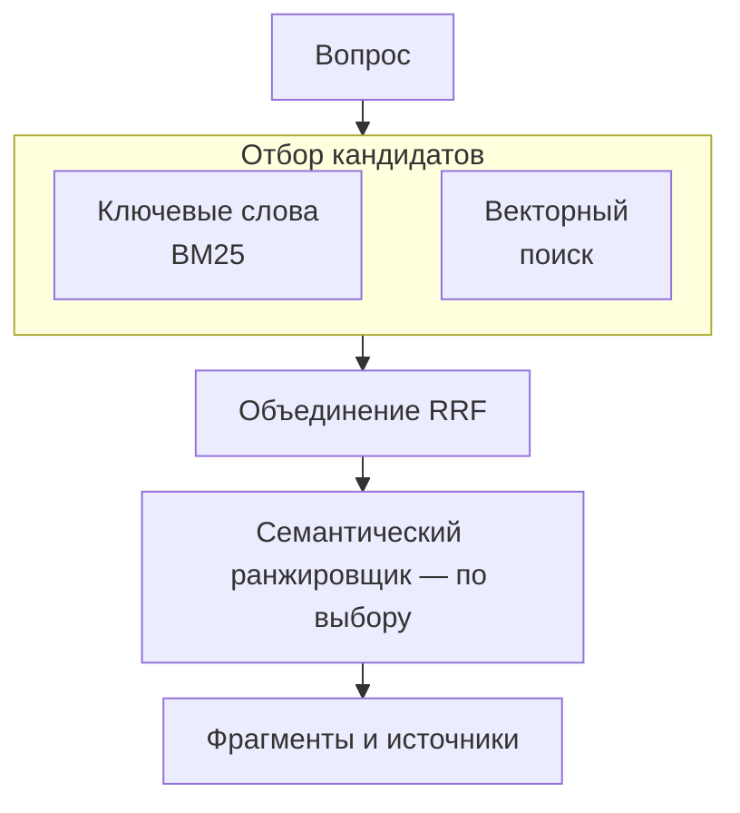

# Качество поиска начинается с устройства индекса

Сервис ответов на вопросы может успешно вызвать модель и всё же ответить по неподходящему фрагменту (chunk). Проблема может возникнуть ещё до генерации: документ не попал в индекс, идентификатор фрагмента потерялся при обработке или нужный абзац не вошёл в результаты поиска. Изменение промпта не вернёт модели материал, которого поиск ей не передал.

Azure AI Search позволяет хранить доступную для поиска копию небольшого набора документов из открытых источников в отдельном сервисе. В этом уроке ты создашь первый поисковый индекс (search index) и выполнишь гибридный запрос (hybrid query) для проекта P1 — RAG-сервиса. Теорию поиска разбирает урок [Retrieval](/rag-agents/part-1-rag/retrieval/); здесь речь пойдёт о том, как организовать его в Azure.

## Как индекс становится источником контекста \{#how-it-works}

Индекс содержит поисковые документы, устроенные по общей схеме. Для RAG представляй каждый поисковый документ как фрагмент с уникальным ключом, читаемым текстом и метаданными источника. Исходный файл может оставаться в Blob Storage, а Search хранит подготовленное для запросов представление. Сохраняй URL источника и стабильный идентификатор фрагмента сразу при проектировании [схемы индекса](https://learn.microsoft.com/ru-ru/azure/search/search-what-is-an-index), чтобы после генерации не пришлось восстанавливать происхождение текста.

**Атрибуты полей (field attributes)** задают, какие операции доступны для каждого поля. `searchable` включает поле в полнотекстовый поиск, `retrievable` разрешает возвращать его в результатах, `filterable` позволяет задавать точные условия отбора, `sortable` — сортировать, а `facetable` — получать количество результатов по группам. Значение поля с URL источника обычно нужно возвращать в результатах, а лингвистический анализ ему не нужен. Чтобы ограничивать результаты по категории, включи фильтрацию для соответствующего поля. Если включить всё, сервис создаст структуры, которые приложению могут не понадобиться.

В REST фильтрация, сортировка и фасеты для `Edm.String` включены по умолчанию. У вспомогательных классов SDK значения по умолчанию отличаются, поэтому задавай возможности полей явно. На полях с обычным текстом отключай `filterable`, `sortable` и `facetable`, чтобы избежать ограничения в 32 KB на один термин, которое накладывают эти атрибуты. Подробности есть в [описании атрибутов](https://learn.microsoft.com/ru-ru/azure/search/search-what-is-an-index) и [правилах создания индекса через REST](https://learn.microsoft.com/ru-ru/azure/search/search-how-to-create-search-index).

Рядом с текстом векторное поле хранит эмбеддинг (embedding); часто для него используют тип `Collection(Edm.Single)`. Значение `dimensions` должно совпадать с размерностью выхода модели. **Профиль векторного поиска (vector search profile)** связывает поле через `vectorSearchProfile` с настройками алгоритма. HNSW выполняет приближённый поиск ближайших соседей; доступен и полный перебор. Получай эмбеддинги документов и запросов одной моделью и с одинаковой размерностью. Совпадение длины массивов само по себе не делает векторы разных моделей сопоставимыми. Это описано в [руководстве по векторному индексу](https://learn.microsoft.com/ru-ru/azure/search/vector-search-how-to-create-index).

Обновление содержимого документов и изменение схемы индекса — разные операции. Если меняешь имя или тип существующего поля либо его атрибуты `searchable`, `filterable`, `sortable` или `facetable`, потребуется [перестроение индекса](https://learn.microsoft.com/ru-ru/azure/search/search-howto-reindex). Смена модели эмбеддингов требует другого: заново вычислить векторы корпуса и согласованно перевести запросы на ту же модель, даже если размерность осталась прежней. Векторы в [общем пространстве эмбеддингов](https://learn.microsoft.com/ru-ru/azure/search/vector-search-how-to-create-index) должны быть получены одной моделью.

Классический гибридный запрос содержит текст и вектор. Azure параллельно выполняет полнотекстовый поиск с BM25 и поиск близких векторов, затем объединяет упорядоченные списки с помощью **RRF (reciprocal rank fusion, объединение по обратным рангам)**. В результате сервис возвращает один общий набор результатов для одного запроса. Алгоритм работает с позициями документов в списках, а не усредняет несопоставимые исходные значения релевантности; см. [описание гибридного поиска](https://learn.microsoft.com/ru-ru/azure/search/hybrid-search-overview).



После отбора можно подключить **семантический ранжировщик (semantic ranker)**. Он читает текст кандидатов; в конфигурации индекса задаются поля заголовка, содержимого и ключевых слов, а в запросе — `queryType: "semantic"` и имя семантической конфигурации. Ранжировщик меняет порядок не более чем первых 50 результатов и не найдёт абзац в той части корпуса, которая не попала в первоначальную выборку. Краткие выдержки и извлекаемые ответы он получает из индексированного текста. Извлекаемый ответ ещё не является итоговым ответом LLM; [границы семантического ранжирования](https://learn.microsoft.com/ru-ru/azure/search/semantic-search-overview) нужно учитывать отдельно от генерации.

**Встроенная векторизация (integrated vectorization) имеет статус GA.** При индексировании **индексатор (indexer)** читает поддерживаемый источник данных.

Затем набор навыков (skillset) может разбить содержимое и получить эмбеддинги, а векторизатор запросов (query vectorizer) — преобразовать текст запроса в вектор при поиске. Само по себе добавление векторного поля не выполняет ни одну из этих операций. Чтобы Search мог вызывать модель эмбеддингов, ему по-прежнему нужен доступ к её конечной точке, а для вызовов необходимы доступная квота и совместимые настройки; см. [устройство конвейера](https://learn.microsoft.com/ru-ru/azure/search/vector-search-integrated-vectorization) и [подтверждение статуса GA в FAQ](https://learn.microsoft.com/ru-ru/azure/search/search-faq-frequently-asked-questions).

В **агентном поиске (agentic retrieval)** база знаний (knowledge base) координирует поиск и возвращает материалы, на которые модель сможет опереться при ответе, и ссылки на их источники.

**Через API `2026-04-01` доступен вариант GA с извлечением содержимого при минимальном уровне рассуждения.** Поиск идёт по настроенным источникам знаний (knowledge sources) тех типов, которые имеют статус GA. Планирование запросов с помощью LLM, синтез ответа, обработка нескольких реплик диалога и уровни рассуждения выше минимального остаются в preview через `2026-08-01-preview`. Объекты, созданные в портале, могут использовать схемы preview. Проверяй [статус конкретных возможностей и API](https://learn.microsoft.com/ru-ru/azure/search/agentic-retrieval-overview); обычному гибридному запросу не нужны ни база знаний, ни LLM для планирования.

## Выбирай поисковую архитектуру, которую сможешь сопровождать \{#choosing-and-tradeoffs}

Начни с того, где хранятся основные данные и какие запросы нужны приложению. Поддержка векторов сама по себе не определяет выбор. Сравнение ниже опирается на документированные механизмы сервисов, а не на результаты сравнительного теста производительности.

| Вариант | Когда подходит | Когда лучше выбрать другое |
|---|---|---|
| Azure AI Search | Нужен отдельный поисковый слой с управляемым текстовым и векторным поиском, необязательным переранжированием и конвейерами индексаторов. | Вторая копия данных мало что даёт или нужно соединять таблицы с текущими данными приложения в рамках транзакций. |
| PostgreSQL с pgvector | Эмбеддинги должны храниться рядом с реляционными строками, а запросы — использовать SQL-соединения и транзакции. | Ты рассчитываешь получить извлечение текста из документов, оркестрацию загрузки и семантическое переранжирование одной установкой расширения: всё это придётся проектировать отдельно. |
| Векторный поиск Cosmos DB for NoSQL | Приложение уже хранит JSON-документы, распределённые по логическим разделам, и должно искать по векторам вместе с другими свойствами. | Организация разделов и стоимость в единицах запросов не подходят рабочей нагрузке или прежде всего нужен самостоятельный поисковый конвейер. |

Механизмы альтернатив описаны в документации [PostgreSQL с pgvector](https://learn.microsoft.com/ru-ru/azure/postgresql/extensions/how-to-use-pgvector) и [векторного поиска Cosmos DB for NoSQL](https://learn.microsoft.com/ru-ru/azure/cosmos-db/vector-search). Cosmos DB также поддерживает [гибридные полнотекстовые и векторные запросы с RRF](https://learn.microsoft.com/ru-ru/azure/cosmos-db/gen-ai/hybrid-search), поэтому потребность в гибридном поиске сама по себе не обязывает выбирать Search. В P1 выбран Search, чтобы отработать индексирование, настройку поиска и разделение удостоверений. В другом проекте разумнее может оказаться уже используемая база данных.

Сначала проверь простой запрос. Поиск по ключевым словам полезен для кодов товаров и точных названий; векторы — когда один смысл выражен разными словами. Подключай семантическое переранжирование, если оценка показывает, что полезные кандидаты находятся, но стоят не на своих местах. Число кандидатов векторного поиска `k` и размер итогового ответа `top` — разные параметры: увеличение одного `top` не расширяет векторный поиск. Их роль объясняет [документация по ранжированию](https://learn.microsoft.com/ru-ru/azure/search/hybrid-search-ranking).

Ищи причину там, где возникает проблема. Если ожидаемого фрагмента нет в индексе, проверь приём документов. Если векторный поиск возвращает плохих кандидатов — эмбеддинги, фильтры и число кандидатов. Если кандидаты подходят, но порядок неверен — ранжирование. Если нет полей для ссылок на источники — схему и выбор полей ответа. Добавленный до такой диагностики планировщик затруднит воспроизведение неудачного запроса.

Кто вычисляет векторы — ещё одно отдельное решение. [Варианты получения эмбеддингов](https://learn.microsoft.com/ru-ru/azure/search/vector-search-how-to-generate-embeddings), [работа индексаторов](https://learn.microsoft.com/ru-ru/azure/search/search-indexer-overview) и [встроенная векторизация](https://learn.microsoft.com/ru-ru/azure/search/vector-search-integrated-vectorization) дают разные возможности управления загрузкой и обновлением.

| Кто отвечает за векторизацию | Источники и обновление | Зависимость от модели эмбеддингов |
|---|---|---|
| Приложение передаёт готовые векторы | Любой источник, который твой код может преобразовать в поисковые документы. Приложение управляет временем отправки, пакетами и повторами. Подходит для нестандартных источников или более точного контроля обновлений. | Твой код вызывает модель для документов и запросов, обрабатывает недоступность сервиса и исчерпание квоты. |
| Индексатор, набор навыков и векторизатор запросов Search | Поддерживаемые источники, например Blob Storage; запуск вручную или по расписанию, обнаружение изменений зависит от источника. Подходит, если имеющиеся подключения и обновление по расписанию отвечают требованиям. | Навык получения эмбеддингов и векторизатор вызывают настроенную конечную точку. Повторные попытки Search не помогут, если квота модели исчерпана. |

Индексирование и обработку запросов можно распределить независимо: индекс, который заполняет приложение, может использовать [векторизатор запросов](https://learn.microsoft.com/ru-ru/azure/search/vector-search-how-to-configure-vectorizer).

[Уровень Free использует общие вычислительные ресурсы и не масштабируется, а Basic предоставляет выделенные ресурсы](https://learn.microsoft.com/ru-ru/azure/search/search-sku-tier). Free подходит для этого небольшого упражнения, но рассчитывать на него при планировании вычислительных ресурсов готового сервиса нельзя. У семантического ранжирования есть собственный [план оплаты](https://learn.microsoft.com/ru-ru/azure/search/semantic-how-to-enable-disable) и [региональная доступность](https://learn.microsoft.com/ru-ru/azure/search/search-region-support), поэтому перед включением проверь выбранные уровень и регион.

## Что это меняет для AI-сервиса \{#in-an-ai-workload}

В полном проекте P1 сервис на ASP.NET Core с минимальными API будет работать в Container Apps, получать фрагменты из Search и запрашивать у развёртывания модели Foundry ответ со ссылками. Исходные документы останутся в Blob Storage. Более широкая архитектура включает доступ к Key Vault через управляемое удостоверение (managed identity), Application Insights, Bicep с `azd` и GitHub Actions с OIDC. Это упражнение создаёт только сервис Search, учебный индекс и удостоверение для API.

Передавай от поиска к генерации читаемый текст каждого фрагмента вместе с идентификатором его источника. Числовое значение релевантности не заменяет ссылку, а массив эмбеддинга не служит полезным контекстом для текстовой модели. Подготовку содержимого разбирает [Ingestion](/rag-agents/part-1-rag/ingestion/), а проверку того, возвращает ли поиск материалы, необходимые модели для ответа, — [Evaluation](/rag-agents/part-1-rag/cross-cutting/evaluation/).

Для API достаточно `Search Index Data Reader`. Роль `Search Service Contributor` позволяет управлять определениями индексов, а `Search Index Data Contributor` — загружать документы и выполнять запросы. Обычная роль `Contributor` для ресурса Azure не даёт автоматически прямого доступа к документам. При проектировании развёртывания сверяйся с [матрицей ролей Search](https://learn.microsoft.com/ru-ru/azure/search/search-security-rbac): API не нужны права изменять материалы, на которых оно строит ответы.

Если вопрос требует нескольких отдельных поисков, можно рассмотреть планировщик агентного поиска в preview, который составляет более узкие подзапросы. Планирование добавляет задержку и вызовы модели. Сохраняй для сравнения фиксированный вариант с одним запросом: он помогает воспроизводить ошибки и измерять, оправдывает ли более полный поиск дополнительные затраты. Записывай задержку поиска, идентификаторы возвращённых фрагментов и ошибки отдельно от генерации, чтобы видеть медленный поиск и пустые результаты. Возможности планировщика описаны в [обзоре агентного поиска](https://learn.microsoft.com/ru-ru/azure/search/agentic-retrieval-overview).

## Попробуй \{#try-it}

Выполняй команды в Bash с Azure CLI из нового локального каталога. Это временная основа для P1. Нужны подписка Azure, интерактивный вход под пользователем, права создавать ресурсы и назначать роли. Используй новую группу ресурсов: её удаление в конце упражнения не должно затронуть предыдущую работу над проектом.

**Команды сверены с актуальным справочником CLI, но пока не запускались в реальной подписке. Ожидаемые результаты ниже описывают документированный контракт, а не наблюдения живого запуска.** Синтетические трёхмерные векторы проверяют только прохождение данных через запросы; измерять по ним семантическую релевантность нельзя. Перед загрузкой реальных документов из открытых источников в P1 замени учебный индекс индексом с размерностью выбранной модели.

Укажи свою подписку. Имя сервиса должно быть свободно во всём Azure; если создание завершится конфликтом имени, выбери другой суффикс. France Central есть в [текущем списке регионов](https://learn.microsoft.com/ru-ru/azure/search/search-region-support), но доступность для твоей подписки всё равно нужно проверить.

```bash
az login
az account set --subscription 'YOUR-SUBSCRIPTION-ID'

lab_group="rg-p1-search-lab-$RANDOM"
search_name="p1-search-$RANDOM-$RANDOM"
location='francecentral'
az group create --name "$lab_group" --location "$location" --output none
az search service create --name "$search_name" --resource-group "$lab_group" \
  --location "$location" --sku free --disable-local-auth true --output none
search_id=$(az search service show --name "$search_name" \
  --resource-group "$lab_group" --query id --output tsv)
operator_id=$(az ad signed-in-user show --query id --output tsv)

for role in 'Search Service Contributor' 'Search Index Data Contributor'; do
  az role assignment create --assignee-object-id "$operator_id" \
    --assignee-principal-type User --role "$role" \
    --scope "$search_id" --output none
done
api_principal=$(az identity create --name id-p1-api --resource-group "$lab_group" \
  --location "$location" --query principalId --output tsv)
az role assignment create --assignee-object-id "$api_principal" \
  --assignee-principal-type ServicePrincipal --role 'Search Index Data Reader' \
  --scope "$search_id" --output none

endpoint="https://${search_name}.search.windows.net"
api_version='2025-09-01'
```

Созданное управляемое удостоверение, назначаемое пользователем (user-assigned), позже нужно подключить к API. Здесь API не развёртывается и доступ от имени этого удостоверения не проверяется: следующие запросы выполняет вошедший пользователь. Аутентификация только через роли работает и на Free. [Назначения ролей могут вступать в силу от пяти до десяти минут](https://learn.microsoft.com/ru-ru/azure/search/search-security-enable-roles). При отказе в доступе проверь назначения, дай изменениям распространиться и повтори запрос.

Создай индекс с возвращаемыми текстовыми полями, URL источника и векторным полем HNSW. Файлы JSON содержат тела запросов для [`az rest`](https://learn.microsoft.com/ru-ru/cli/azure/reference-index?view=azure-cli-latest#az-rest); команда получает токен для плоскости данных Search. Схема использует стабильный [API индексов](https://learn.microsoft.com/ru-ru/rest/api/searchservice/indexes/create-or-update?view=rest-searchservice-2025-09-01).

```bash
cat > index.json <<'JSON'
{
  "name": "p1-chunks-lab",
  "fields": [
    {"name": "id", "type": "Edm.String", "key": true, "searchable": false,
     "retrievable": true, "filterable": false, "sortable": false, "facetable": false},
    {"name": "title", "type": "Edm.String", "searchable": true, "retrievable": true,
     "filterable": false, "sortable": false, "facetable": false},
    {"name": "content", "type": "Edm.String", "searchable": true, "retrievable": true,
     "filterable": false, "sortable": false, "facetable": false},
    {"name": "sourceUrl", "type": "Edm.String", "searchable": false, "retrievable": true,
     "filterable": false, "sortable": false, "facetable": false},
    {"name": "contentVector", "type": "Collection(Edm.Single)",
     "searchable": true, "retrievable": false, "dimensions": 3,
     "filterable": false, "sortable": false, "facetable": false,
     "vectorSearchProfile": "p1-vector"}
  ],
  "vectorSearch": {
    "algorithms": [{"name": "p1-hnsw", "kind": "hnsw",
                    "hnswParameters": {"metric": "cosine"}}],
    "profiles": [{"name": "p1-vector", "algorithm": "p1-hnsw"}]
  }
}
JSON
az rest --method put --url "$endpoint/indexes/p1-chunks-lab?api-version=$api_version" \
  --resource https://search.azure.com \
  --headers Content-Type=application/json Prefer=return=representation --body @index.json
```

Загрузи два составленных автором кратких пересказа открытых страниц Microsoft Learn, затем выполни гибридный запрос. Векторы заданы вручную как тестовые данные. Упражнение не вызывает модель эмбеддингов, векторизатор или семантический ранжировщик.

```bash
cat > documents.json <<'JSON'
{
  "value": [
    {"@search.action": "upload", "id": "roles-1", "title": "Search permissions",
     "content": "Give a query-only application Search Index Data Reader. Use a separate identity for document uploads.",
     "sourceUrl": "https://learn.microsoft.com/en-us/azure/search/search-security-rbac",
     "contentVector": [1, 0, 0]},
    {"@search.action": "upload", "id": "auth-1", "title": "Search authentication",
     "content": "A Search service can accept Entra tokens for data requests. Disabling local authentication prevents API key access.",
     "sourceUrl": "https://learn.microsoft.com/en-us/azure/search/search-security-enable-roles",
     "contentVector": [0, 1, 0]}
  ]
}
JSON
az rest --method post \
  --url "$endpoint/indexes/p1-chunks-lab/docs/index?api-version=$api_version" \
  --resource https://search.azure.com --headers Content-Type=application/json \
  --body @documents.json

cat > query.json <<'JSON'
{
  "search": "query application permissions",
  "searchFields": "title,content",
  "vectorQueries": [{"kind": "vector", "vector": [1, 0, 0],
                     "fields": "contentVector", "k": 2}],
  "select": "id,title,content,sourceUrl",
  "top": 2
}
JSON
az rest --method post \
  --url "$endpoint/indexes/p1-chunks-lab/docs/search?api-version=$api_version" \
  --resource https://search.azure.com --headers Content-Type=application/json \
  --body @query.json
```

В ответ на запрос создания сервис должен вернуть определение индекса, на загрузку — результат со `status: true` для каждого документа, на поиск — массив `value` с выбранными полями и `@search.score`. [Загрузка может завершиться частично](https://learn.microsoft.com/ru-ru/rest/api/searchservice/documents/?view=rest-searchservice-2025-09-01), поэтому проверь статус каждого документа. До появления проиндексированных документов в поиске возможна небольшая задержка; при необходимости повтори [поисковый запрос](https://learn.microsoft.com/ru-ru/rest/api/searchservice/documents/search-post?view=rest-searchservice-2025-09-01) после успешной индексации. Этот пример не гарантирует конкретных значений релевантности или порядка результатов.

**Стоимость:** сервис Search уровня Free не тарифицируется; [управляемые удостоверения бесплатны](https://learn.microsoft.com/ru-ru/entra/identity/managed-identities-azure-resources/overview). Упражнение не вызывает платные модели или операции обогащения. На подписку разрешён только один сервис Search уровня Free. Если он уже есть, остановись либо осознанно спланируй платный вариант, сверившись с [уровнями сервиса](https://learn.microsoft.com/ru-ru/azure/search/search-sku-tier) и [текущими ценами](https://azure.microsoft.com/en-us/pricing/details/search/).

**Удаление ресурсов:** удали только временную группу из этого упражнения. В ней находятся созданные здесь сервис Search, его индекс и удостоверение API.

```bash
az group delete --name "$lab_group" --yes
```

Сохрани локальные файлы запросов — `index.json`, `documents.json` и `query.json`: они пригодятся для дальнейшей работы над инфраструктурой и приёмом документов в P1.

## Что перенести в свою практику \{#what-to-take-away}

- Проектируй индекс так, чтобы он возвращал читаемые фрагменты, стабильные идентификаторы и метаданные источников. Одни векторы не дадут ссылок для ответа.
- Гибридный поиск объединяет результаты текстового и векторного поиска. Семантическое переранжирование меняет порядок уже найденных кандидатов; материал, которого среди них нет, оно не вернёт.
- Встроенная векторизация имеет статус GA. У агентного поиска есть вариант GA для извлечения содержимого и планирование в preview; проверяй сочетание возможности и API.
- Выдай API права чтения, а компоненту загрузки документов — отдельные права записи. Здесь настроены только назначения. В дальнейшем упражнении с развёрнутым API проверь, что его удостоверение может искать, но не может загружать документы; сверяй права с [матрицей ролей](https://learn.microsoft.com/ru-ru/azure/search/search-security-rbac).

**[Новые термины](https://nikolaisachok.com/ai-engineering-handbook/azure-dotnet/glossary#rag-on-ai-search)**: поисковый индекс, атрибуты полей, профиль векторного поиска, гибридный запрос, RRF, семантический ранжировщик, индексатор, набор навыков, встроенная векторизация, векторизатор запросов, база знаний, источник знаний.

## Источники \{#sources}

Проверено на 17.10.2026.

Решения по схеме и устройству конвейера повторно проверены 18.10.2026.

Индексирование и выполнение запросов:

- [Search indexes](https://learn.microsoft.com/ru-ru/azure/search/search-what-is-an-index), [schema defaults](https://learn.microsoft.com/ru-ru/azure/search/search-how-to-create-search-index), [update or rebuild an index](https://learn.microsoft.com/ru-ru/azure/search/search-howto-reindex), [vector indexes](https://learn.microsoft.com/ru-ru/azure/search/vector-store), [create a vector index](https://learn.microsoft.com/ru-ru/azure/search/vector-search-how-to-create-index), [vector queries](https://learn.microsoft.com/ru-ru/azure/search/vector-search-how-to-query)
- [Hybrid search](https://learn.microsoft.com/ru-ru/azure/search/hybrid-search-overview), [RRF ranking](https://learn.microsoft.com/ru-ru/azure/search/hybrid-search-ranking), [semantic ranker](https://learn.microsoft.com/ru-ru/azure/search/semantic-search-overview), [invoke semantic ranking](https://learn.microsoft.com/ru-ru/azure/search/semantic-how-to-query-request)
- [Integrated vectorization](https://learn.microsoft.com/ru-ru/azure/search/vector-search-integrated-vectorization), [indexers](https://learn.microsoft.com/ru-ru/azure/search/search-indexer-overview), [embedding generation options](https://learn.microsoft.com/ru-ru/azure/search/vector-search-how-to-generate-embeddings), [query vectorizers](https://learn.microsoft.com/ru-ru/azure/search/vector-search-how-to-configure-vectorizer), [Search FAQ](https://learn.microsoft.com/ru-ru/azure/search/search-faq-frequently-asked-questions), [agentic retrieval and feature availability](https://learn.microsoft.com/ru-ru/azure/search/agentic-retrieval-overview)

Выбор сервиса, доступ и стоимость:

- [Choose a vector search service](https://learn.microsoft.com/ru-ru/azure/architecture/guide/technology-choices/vector-search), [PostgreSQL pgvector](https://learn.microsoft.com/ru-ru/azure/postgresql/extensions/how-to-use-pgvector), [Cosmos DB vector search](https://learn.microsoft.com/ru-ru/azure/cosmos-db/vector-search), [Cosmos DB hybrid search](https://learn.microsoft.com/ru-ru/azure/cosmos-db/gen-ai/hybrid-search)
- [Search roles](https://learn.microsoft.com/ru-ru/azure/search/search-security-rbac), [enable RBAC](https://learn.microsoft.com/ru-ru/azure/search/search-security-enable-roles), [managed identities](https://learn.microsoft.com/ru-ru/entra/identity/managed-identities-azure-resources/overview)
- [Service tiers](https://learn.microsoft.com/ru-ru/azure/search/search-sku-tier), [regional availability](https://learn.microsoft.com/ru-ru/azure/search/search-region-support), [semantic billing plans](https://learn.microsoft.com/ru-ru/azure/search/semantic-how-to-enable-disable), [Search pricing](https://azure.microsoft.com/en-us/pricing/details/search/)

Источники для упражнения:

- CLI: [login and REST](https://learn.microsoft.com/ru-ru/cli/azure/reference-index?view=azure-cli-latest), [account](https://learn.microsoft.com/ru-ru/cli/azure/account?view=azure-cli-latest), [resource groups](https://learn.microsoft.com/ru-ru/cli/azure/group?view=azure-cli-latest), [Search service](https://learn.microsoft.com/ru-ru/cli/azure/search/service?view=azure-cli-latest), [signed-in user](https://learn.microsoft.com/ru-ru/cli/azure/ad/signed-in-user?view=azure-cli-latest), [identity](https://learn.microsoft.com/ru-ru/cli/azure/identity?view=azure-cli-latest), [role assignment](https://learn.microsoft.com/ru-ru/cli/azure/role/assignment?view=azure-cli-latest)
- REST `2025-09-01`: [create or update index](https://learn.microsoft.com/ru-ru/rest/api/searchservice/indexes/create-or-update?view=rest-searchservice-2025-09-01), [upload documents](https://learn.microsoft.com/ru-ru/rest/api/searchservice/documents/?view=rest-searchservice-2025-09-01), [search documents](https://learn.microsoft.com/ru-ru/rest/api/searchservice/documents/search-post?view=rest-searchservice-2025-09-01), [index loading behaviour](https://learn.microsoft.com/ru-ru/azure/search/search-how-to-load-search-index)
