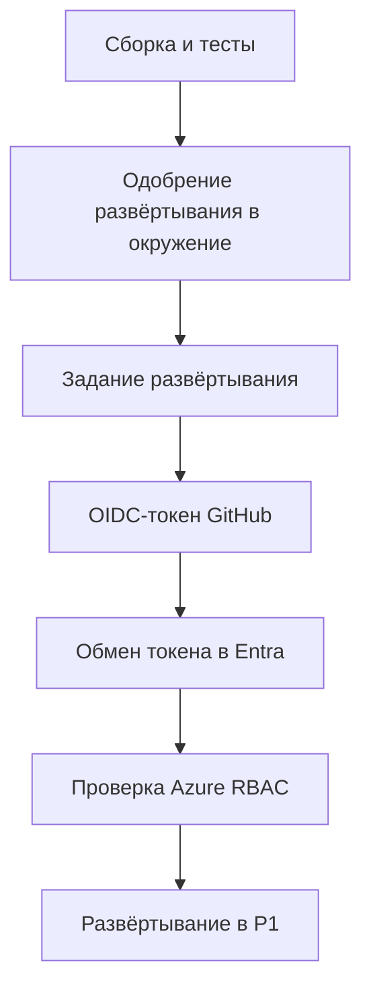

# Для развёртывания нужны права доступа и решение о выпуске

Тесты помогают проверить изменение, но не определяют, в какое окружение его можно выпустить, кто разрешит выпуск и от чьего имени обновится приложение. Скрипт на ноутбуке оставляет эти решения за личной учётной записью разработчика. Если перенести в CI те же учётные данные (credentials), проблема сохранится: теперь ими будет пользоваться общий исполнитель (runner).

Конвейер поставки позволяет повторять один и тот же процесс: проверить исходный код, решить, выпускать ли изменение, и предоставить заданию развёртывания нужный доступ. Для AI-сервиса нужно различать результаты проверки кода и оценки качества ответов: даже работающее HTTP API может находить неподходящие источники.

## Как это устроено в Azure \{#how-it-works-on-azure}

Рабочий процесс (workflow) описывает задания и события, по которым они запускаются. Исполнитель выполняет шаги заданий. И GitHub Actions, и Azure DevOps Pipelines могут выполнять команды сборки и развёртывания. Самому приложению не требуется работать на той же машине или использовать то же удостоверение, что и конвейер.

При [федерации через OIDC (OpenID Connect)](https://learn.microsoft.com/ru-ru/azure/developer/github/connect-from-azure-openid-connect) задание запрашивает у GitHub токен идентификации. Microsoft Entra ID проверяет его по настройкам доверия, записанным для приложения или управляемого удостоверения (managed identity).

В случае управляемого удостоверения оно должно быть назначаемым пользователем (user-assigned). После проверки Microsoft Entra ID выдаёт токен доступа (access token). Модель удостоверений разобрана в [уроке о Microsoft Entra ID](../part-1-azure-foundations/entra-id.md).

Учётные данные федеративного удостоверения (federated identity credential) задают допустимые значения издателя, субъекта токена и аудитории (audience). В общедоступном облаке Azure для GitHub используются издатель `https://token.actions.githubusercontent.com` и аудитория `api://AzureADTokenExchange` — эти значения указаны в [документации по настройке доверия](https://learn.microsoft.com/ru-ru/entra/workload-id/workload-identity-federation-create-trust-user-assigned-managed-identity). Запись доверия не содержит пароля для развёртывания. Субъект токена указывает, какой рабочей нагрузке разрешён обмен.

Если задание с настройками по умолчанию ссылается на окружение развёртывания (deployment environment) в GitHub, субъект токена содержит имя окружения вместо ветки. Пользовательский шаблон может менять набор утверждений. Современные форматы для новых репозиториев включают неизменяемые идентификаторы владельца и репозитория; у старых репозиториев или при других настройках формат может отличаться. Сверь [форматы субъекта токена в GitHub](https://docs.github.com/en/actions/reference/security/oidc) и настрой точное значение для своего репозитория, включая имя окружения.



Здесь действуют три независимых механизма. Разрешение GitHub `id-token: write` позволяет заданию запросить OIDC-токен. Azure RBAC — управление доступом на основе ролей (role-based access control) — определяет допустимые для удостоверения операции. А [одобрение развёртывания в окружение](https://docs.github.com/en/actions/reference/workflows-and-actions/deployments-and-environments) определяет, начнётся ли задание. Строка YAML `environment: p1-ci` выбирает окружение, но не назначает обязательного рецензента (required reviewer). Правила защиты окружения и ограничение развёртывания веткой `main` нужно настроить отдельно: субъект токена с именем окружения сам по себе ветку не ограничивает.

## Как выбрать платформу и учесть ограничения \{#choosing-and-tradeoffs}

Выбирай платформу с учётом того, где команда хранит код и кто управляет выпусками. Команды развёртывания приложения стоит сохранять переносимыми, чтобы выбор платформы конвейера не влиял на API.

| Вариант | Когда подходит | Когда не стоит выбирать / чего опасаться |
|---|---|---|
| GitHub Actions | Команда уже хранит код, работает с pull request и проводит ревью выпусков в GitHub. | На тарифе репозитория недоступны нужные правила защиты окружения или никто не отвечает за их настройки. |
| Azure DevOps Pipelines | Команда уже управляет проектами Azure DevOps, подключениями к службам и разрешениями на выпуск. | После добавления ещё одной системы управления никто не будет отвечать за доступ конвейера и одобрение развёртываний. |
| `azd` внутри любой из платформ | У P1 уже есть описание приложения и инфраструктура на Bicep. | Ты рассчитываешь, что инструмент предоставит тесты, правила одобрения или архитектуру приложения. |

В Azure Pipelines [подключение к службе (service connection) Azure Resource Manager](https://learn.microsoft.com/ru-ru/azure/devops/pipelines/library/connect-to-azure?view=azure-devops) хранит настройки аутентификации в Azure. Выбери федерацию удостоверений рабочей нагрузки (workload identity federation) и разреши конкретному конвейеру использовать подключение. Укажи окружение, в которое [задание развёртывания](https://learn.microsoft.com/ru-ru/azure/devops/pipelines/process/deployment-jobs?view=azure-devops) будет развёртывать приложение. Владельцы ресурсов настраивают [одобрения и проверки](https://learn.microsoft.com/ru-ru/azure/devops/pipelines/process/checks?view=azure-devops) для окружения или подключения вне YAML. Условие в YAML не заменяет эти проверки. Разрешение использовать подключение тоже не заменяет роли Azure на целевых ресурсах.

[Настройка конвейера через Azure Developer CLI](https://learn.microsoft.com/ru-ru/azure/developer/azure-developer-cli/configure-devops-pipeline) поддерживает GitHub Actions и Azure Pipelines. Команда [`azd pipeline config` помечена как Beta](https://learn.microsoft.com/ru-ru/azure/developer/azure-developer-cli/reference#azd-pipeline-config). При настройке инструмент может создать удостоверение, закоммитить и отправить файлы в репозиторий, а затем запустить развёртывание. До его использования проверь разрешения и сгенерированный рабочий процесс.

В P1 `azd` координирует развёртывание, а Bicep описывает инфраструктуру — это разделение разобрано в уроке [«Инфраструктура как код»](../part-1-azure-foundations/infrastructure-as-code.md). Отделяй первоначальную подготовку инфраструктуры и назначения ролей от регулярного развёртывания приложения: удостоверению для обычного выпуска не должно требоваться право расширять собственный доступ.

При отказе сначала выясни, какой механизм его вызвал, вместо того чтобы автоматически выдавать более широкие роли. Отклонённый токен может указывать на несовпадение издателя, субъекта токена или аудитории. Если вход выполнен, но Azure запрещает развёртывание, проверь роль и область действия. При тайм-ауте соединения разбирайся с сетью: федерация не прокладывает маршрут от исполнителя к частной конечной точке (private endpoint).

## Что это меняет для AI-сервиса \{#in-an-ai-workload}

P1 объединяет приложение на минимальных API ASP.NET Core в Container Apps, развёртывание модели (model deployment) в Foundry, Azure AI Search, Blob Storage, Key Vault и Application Insights. Удостоверению работающего приложения нужен доступ к вызываемым сервисам, а удостоверению конвейера — права на публикацию и развёртывание приложения. Используй для них разные удостоверения: сборке не нужен доступ к документам и секретам лишь потому, что он нужен работающему сервису.

До обращения к облаку запускай детерминированные тесты с контролируемыми ответами модели и поиска. Такие тесты могут обнаружить отсутствие поля со ссылкой на источник или неверную обработку пустого результата поиска. Полезность ответов на реальном корпусе нужно проверять отдельно: для оценки нужны собственный датасет, доступ к сервисам и лимит расхода токенов. Какие результаты подтверждают качество ответов, разобрано в уроке [Evaluation](/rag-agents/part-1-rag/cross-cutting/evaluation/), а как сочетать проверки — в [уроке о проверках AI SDLC](/ai-sdlc/part-3-verification/layered-gates/).

Чтобы рецензент мог оценить изменение AI-сервиса, укажи идентификатор ревизии исходного кода, покажи изменения промпта, сведения о развёртывании и версии модели, конфигурацию индекса и версию корпуса. Изменение фильтра поиска может повлиять на ответы даже при прежней модели. При одобрении выпуска нужно ссылаться на эти изменения и результаты оценки, поскольку успешная компиляция сама по себе не подтверждает качество ответов.

## Попробуй \{#try-it}

Составь локально `.github/workflows/p1-deploy.yml` для будущего репозитория приложения P1. [Пошаговое руководство по сборке P1 пока запланировано](../part-5-projects/overview.md#whats-inside), поэтому сейчас упражнение заканчивается подготовкой рабочего процесса. К настройке Azure, запуску конвейера и проверке развёртывания переходи, когда будут готовы все перечисленные компоненты:

- `RagService.slnx`;
- тесты, совместимые с VSTest;
- `global.json` с закреплённой версией SDK;
- файлы с зафиксированными версиями зависимостей NuGet, сохранённые в репозитории;
- `azure.yaml` с Bicep;
- подготовленное окружение `azd` с именем `p1-ci` и сохранённой исходной записью о развёртывании на уровне подписки.

Предварительный просмотр из упражнения по хранилищу не заменяет эти компоненты, поэтому сам по себе не позволяет перейти к запуску.

В примере есть два независимых окружения с именем `p1-ci`. [Окружение GitHub](https://docs.github.com/en/actions/reference/workflows-and-actions/deployments-and-environments) хранит правила защиты выпуска и настройки рабочего процесса. [Окружение `azd`](https://learn.microsoft.com/ru-ru/azure/developer/azure-developer-cli/work-with-environments) хранит конфигурацию развёртывания приложения, восстановленную после прежней подготовки инфраструктуры. Ключ YAML `environment` выбирает первое, переменная `AZURE_ENV_NAME` — второе. Совпадающие имена не связывают их автоматически.

**Статус выполнения:** сейчас у автора нет подписки Azure. Команды сверены с актуальной документацией CLI, но не выполнялись в действующей подписке; рабочий процесс также не запускался. Ниже описано ожидаемое поведение по документации, а не результаты развёртывания.

Когда P1 будет готов, администратор отдельной учебной подписки сможет создать удостоверение конвейера в отдельной группе ресурсов. Для этого нужны права создавать ресурсы и назначать роли. Замени все значения в угловых скобках; укажи настоящие группу ресурсов и реестр P1.

Прежде чем заполнить `githubSubject`, проверь, используется ли в репозитории формат с неизменяемыми идентификаторами, и получи [числовые идентификаторы владельца и репозитория](https://learn.microsoft.com/ru-ru/entra/workload-id/workload-identities-github-immutable-subjects#get-the-immutable-repository-and-owner-ids). Через [GitHub REST API](https://docs.github.com/en/rest/actions/oidc) запроси `GET /repos/OWNER/REPO/actions/oidc/customization/sub`: проверь `use_default` и `include_claim_keys`. Для репозитория организации также запроси шаблон через `GET /orgs/ORG/actions/oidc/customization/sub` и выясни, подключён ли к нему репозиторий. Если действует пользовательский шаблон, составь субъект токена из значений утверждений этого шаблона. При стандартном шаблоне выбери подходящий [формат](https://docs.github.com/en/actions/reference/security/oidc): `repo:OWNER@OWNER-ID/REPO@REPO-ID:environment:p1-ci` с неизменяемыми идентификаторами или прежний `repo:OWNER/REPO:environment:p1-ci`. Замени `OWNER`, `REPO`, `OWNER-ID` и `REPO-ID` именами и идентификаторами из настроек, сохранив суффикс `environment:p1-ci`. Для проверки настроек не выводи JWT в журналы.

Следующие команды опираются на справочники Azure CLI: [вход](https://learn.microsoft.com/ru-ru/cli/azure/authenticate-azure-cli-interactively?view=azure-cli-latest), [подписки](https://learn.microsoft.com/ru-ru/cli/azure/account?view=azure-cli-latest), [группы ресурсов](https://learn.microsoft.com/ru-ru/cli/azure/group?view=azure-cli-latest), [удостоверения](https://learn.microsoft.com/ru-ru/cli/azure/identity?view=azure-cli-latest), [учётные данные федеративного удостоверения](https://learn.microsoft.com/ru-ru/cli/azure/identity/federated-credential?view=azure-cli-latest), [назначения ролей](https://learn.microsoft.com/ru-ru/cli/azure/role/assignment?view=azure-cli-latest) и [реестры](https://learn.microsoft.com/ru-ru/cli/azure/acr?view=azure-cli-latest).

```bash
az login
subscriptionId="<subscription-id>"
p1Group="<existing-p1-resource-group>"
registryName="<existing-p1-registry>"
githubSubject="<exact-environment-subject>"
identityGroup="rg-p1-delivery-lab"
identityName="p1-delivery"

az account set --subscription "$subscriptionId"
az group create --name "$identityGroup" --location westeurope
clientId=$(az identity create --name "$identityName" \
  --resource-group "$identityGroup" --query clientId --output tsv)
principalId=$(az identity show --name "$identityName" \
  --resource-group "$identityGroup" --query principalId --output tsv)
tenantId=$(az identity show --name "$identityName" \
  --resource-group "$identityGroup" --query tenantId --output tsv)
az identity federated-credential create --name github-p1-ci \
  --identity-name "$identityName" --resource-group "$identityGroup" \
  --issuer https://token.actions.githubusercontent.com \
  --subject "$githubSubject" --audiences api://AzureADTokenExchange

p1Scope=$(az group show --name "$p1Group" --query id --output tsv)
registryScope=$(az acr show --name "$registryName" --query id --output tsv)
readAssignment=$(az role assignment create \
  --assignee-object-id "$principalId" --assignee-principal-type ServicePrincipal \
  --role Reader --scope "/subscriptions/$subscriptionId" --query id --output tsv)
deployAssignment=$(az role assignment create \
  --assignee-object-id "$principalId" --assignee-principal-type ServicePrincipal \
  --role Contributor --scope "$p1Scope" --query id --output tsv)
pushAssignment=$(az role assignment create \
  --assignee-object-id "$principalId" --assignee-principal-type ServicePrincipal \
  --role AcrPush --scope "$registryScope" --query id --output tsv)
printf 'clientId=%s\ntenantId=%s\n' "$clientId" "$tenantId"
```

Роль [Contributor](https://learn.microsoft.com/ru-ru/azure/role-based-access-control/built-in-roles/privileged#contributor) на группе P1 разрешает управлять ресурсами, но не назначать роли. Роль [Reader](https://learn.microsoft.com/ru-ru/azure/role-based-access-control/built-in-roles/general#reader) на уровне подписки нужна для обнаружения метаданных развёртывания в плоскости управления (control plane). Из-за столь широкой области чтения упражнение рассчитано на отдельную учебную подписку. Конвейер под этим удостоверением не сможет управлять отдельной группой ресурсов, в которой удостоверение создано. Пример с `AcrPush` требует режима **RBAC Registry Permissions**; [для реестров с ABAC нужны другие роли](https://learn.microsoft.com/ru-ru/azure/container-registry/container-registry-rbac-built-in-roles-overview).

В GitHub открой Settings → Environments, создай `p1-ci`, разреши развёртывание только из `main` и назначь обязательного рецензента. Если есть другой рецензент, запрети одобрять собственный запуск. На тарифах Free, Pro и Team [обязательные рецензенты доступны для публичных репозиториев](https://docs.github.com/en/actions/reference/workflows-and-actions/deployments-and-environments); для частного репозитория сначала проверь доступность функции.

В переменные окружения GitHub запиши `AZURE_CLIENT_ID`, `AZURE_TENANT_ID`, `AZURE_SUBSCRIPTION_ID`, `AZURE_ENV_NAME=p1-ci` и `AZURE_LOCATION`. Используй напечатанные идентификаторы и конфигурацию подготовленного P1. В `AZURE_LOCATION` укажи регион Azure, в котором подготовлен P1. Это идентификаторы и параметры конфигурации, а не секрет клиента.

В черновике ниже действия закреплены по SHA коммитов. `setup-dotnet` читает версию SDK из [`global.json`](https://github.com/actions/setup-dotnet/tree/d4c94342e560b34958eacfc5d055d21461ed1c5d) проекта P1; версия `azd` — 1.29.0. Шаги [аутентификации и развёртывания через `azd`](https://learn.microsoft.com/ru-ru/azure/developer/azure-developer-cli/pipeline-create-definition) напрямую используют федерацию. Они находятся в отдельном задании с разрешением запросить OIDC-токен; оно начинается после успешных проверок и одобрения развёртывания в окружение.

```yaml
name: P1 validation and deployment
on:
  pull_request:
  push:
    branches: [main]
  workflow_dispatch:
permissions:
  contents: read
defaults:
  run:
    shell: bash
jobs:
  validate:
    runs-on: ubuntu-24.04
    steps:
      - uses: actions/checkout@08c6903cd8c0fde910a37f88322edcfb5dd907a8 # v5.0.0
        with:
          persist-credentials: false
      - uses: actions/setup-dotnet@d4c94342e560b34958eacfc5d055d21461ed1c5d # v5.0.0
        with:
          global-json-file: global.json
      - run: dotnet restore RagService.slnx --locked-mode
      - run: dotnet build RagService.slnx --configuration Release --no-restore
      - run: dotnet test RagService.slnx --configuration Release --no-build
  deploy:
    needs: validate
    if: github.event_name != 'pull_request' && github.ref == 'refs/heads/main'
    runs-on: ubuntu-24.04
    environment: p1-ci
    concurrency:
      group: p1-ci-deploy
      cancel-in-progress: false
    permissions:
      contents: read
      id-token: write
    env:
      AZURE_CLIENT_ID: ${{ vars.AZURE_CLIENT_ID }}
      AZURE_TENANT_ID: ${{ vars.AZURE_TENANT_ID }}
      AZURE_SUBSCRIPTION_ID: ${{ vars.AZURE_SUBSCRIPTION_ID }}
      AZURE_ENV_NAME: ${{ vars.AZURE_ENV_NAME }}
      AZURE_LOCATION: ${{ vars.AZURE_LOCATION }}
    steps:
      - uses: actions/checkout@08c6903cd8c0fde910a37f88322edcfb5dd907a8 # v5.0.0
        with:
          persist-credentials: false
      - uses: actions/setup-dotnet@d4c94342e560b34958eacfc5d055d21461ed1c5d # v5.0.0
        with:
          global-json-file: global.json
      - uses: Azure/setup-azd@0b7e3a35ab00f2eee7080c845eb39c3f0ebfa553 # v2.4.0
        with:
          version: 1.29.0
      - name: Authenticate and deploy
        run: |
          azd auth login --client-id "$AZURE_CLIENT_ID" \
            --tenant-id "$AZURE_TENANT_ID" --federated-credential-provider github
          azd env new "$AZURE_ENV_NAME" --subscription "$AZURE_SUBSCRIPTION_ID" \
            --location "$AZURE_LOCATION" --no-prompt
          azd env refresh "$AZURE_ENV_NAME" --no-prompt
          azd deploy --environment "$AZURE_ENV_NAME" --no-prompt
```

Рабочий процесс запускается для pull request, push в `main` и вручную. По умолчанию ему разрешено только чтение содержимого репозитория. Задание `validate` получает код без сохранения учётных данных, восстанавливает зависимости, собирает Release и запускает тесты. Задание `deploy` ждёт успешной проверки, допускается только для `main` и исключает событие pull request. Даже при ручном запуске условие ветки сохраняется. Окружение GitHub определяет, когда задание может начаться. Благодаря общей группе параллелизма развёртывания выполняются последовательно, а уже идущее развёртывание не отменяется.

[`restore --locked-mode`](https://learn.microsoft.com/ru-ru/dotnet/core/tools/dotnet-restore) проверяет разрешение зависимостей по файлам фиксации. Флаги [`build`](https://learn.microsoft.com/ru-ru/dotnet/core/tools/dotnet-build) и [`test`](https://learn.microsoft.com/ru-ru/dotnet/core/tools/dotnet-test-vstest) позволяют использовать результаты уже выполненных команд восстановления и сборки. Команда [`env refresh`](https://learn.microsoft.com/ru-ru/azure/developer/azure-developer-cli/work-with-environments) загружает выходные значения прежней подготовки инфраструктуры и не создаёт недостающие ресурсы. Для [`--no-prompt`](https://learn.microsoft.com/ru-ru/azure/developer/azure-developer-cli/reference) все обязательные входные значения должны быть доступны без диалога. Выходные значения Bicep должны содержать идентификаторы ресурсов и адреса сервисов, а не секреты.

Сейчас результат упражнения — локальный черновик с отдельными заданиями проверки и развёртывания. После подготовки P1 и завершения настроек ожидается следующее: pull request проходит только проверку, а успешный запуск из `main` ждёт ревью до начала задания развёртывания. Отклони один запрос на одобрение, чтобы проверить ограничение, затем одобри другой запуск и проверь результат развёртывания. Убедись, что тесты действительно выполнялись.

Успешное развёртывание не подтверждает качество RAG. Кроме того, при развёртывании этот рабочий процесс заново упаковывает приложение из тех же исходников. Чтобы передавать на развёртывание именно тот образ, который прошёл тесты, понадобится дополнительный шаг работы с артефактами.

**Стоимость:** локальный черновик не создаёт облачных ресурсов. При последующем запуске управляемые удостоверения [не требуют дополнительной оплаты](https://learn.microsoft.com/ru-ru/entra/fundamentals/licensing), а стандартные исполнители, предоставляемые GitHub для публичных репозиториев, [бесплатны](https://docs.github.com/en/billing/concepts/product-billing/github-actions). Само развёртывание P1 платное. До одобрения проверь выбранные конфигурации [Container Apps](https://azure.microsoft.com/en-us/pricing/details/container-apps/), [Search](https://azure.microsoft.com/en-us/pricing/details/search/) и остальных ресурсов P1, соблюдай [учебный бюджет](../intro.md#budget) и удали ресурсы после упражнения. Замеров стоимости в действующей подписке у автора нет.

**Удаление ресурсов:** после локальной подготовки удалять в облаке нечего. После будущего запуска сначала отключи рабочий процесс, затем удаляй доступ. В исходной оболочке администратора удали только три назначения ролей по сохранённым идентификаторам и отдельную группу ресурсов, в которой создано удостоверение конвейера. Сам рабочий процесс сохрани в исходном коде. Чтобы удалить временное окружение P1 командой [`azd down`](https://learn.microsoft.com/ru-ru/azure/developer/azure-developer-cli/reference#azd-down), перейди в каталог P1 и используй ту же учётную запись разработчика, под которой ты первоначально вошёл в `azd`. Первые две команды относятся к оболочке администратора, третья — к этому контексту разработчика:

```bash
az role assignment delete --ids "$readAssignment" "$deployAssignment" "$pushAssignment"
az group delete --name "$identityGroup" --yes
azd down --environment p1-ci --force
```

Закончив работу, удали переменные окружения GitHub и настройки рецензентов.

## Что перенести в свою практику \{#what-to-take-away}

- Федерация устраняет необходимость хранить секрет для развёртывания. Полномочия в Azure по-прежнему определяются ролями.
- Сопоставляй точный субъект OIDC-токена с настройками репозитория; отдельно задавай допустимую ветку и рецензента, который разрешает развёртывание в окружение.
- Запускай проверки без облачных учётных данных и разделяй удостоверения приложения и конвейера.
- `azd` помогает повторять развёртывание. Для изменений инфраструктуры сохраняй результаты их проверок, а для качества ответов — результаты оценки.

**[Новые термины](../glossary.md#pipelines-to-azure)**: рабочий процесс (workflow), исполнитель (runner), окружение развёртывания (deployment environment), обязательный рецензент (required reviewer), подключение к службе (service connection).

## Источники \{#sources}

Проверено на 17.10.2026. Уточнения об удостоверениях и окружениях повторно проверены 18.10.2026.

- **Удостоверения и права доступа:** [GitHub Actions OIDC on Azure](https://learn.microsoft.com/ru-ru/azure/developer/github/connect-from-azure-openid-connect), [user-assigned identity federation](https://learn.microsoft.com/ru-ru/entra/workload-id/workload-identity-federation-create-trust-user-assigned-managed-identity), [Contributor](https://learn.microsoft.com/ru-ru/azure/role-based-access-control/built-in-roles/privileged#contributor), [Reader](https://learn.microsoft.com/ru-ru/azure/role-based-access-control/built-in-roles/general#reader), [immutable subject IDs](https://learn.microsoft.com/ru-ru/entra/workload-id/workload-identities-github-immutable-subjects#get-the-immutable-repository-and-owner-ids), [registry roles](https://learn.microsoft.com/ru-ru/azure/container-registry/container-registry-rbac-built-in-roles-overview).
- **Платформы конвейеров:** [Azure Pipelines service connections](https://learn.microsoft.com/ru-ru/azure/devops/pipelines/library/connect-to-azure?view=azure-devops), [deployment jobs](https://learn.microsoft.com/ru-ru/azure/devops/pipelines/process/deployment-jobs?view=azure-devops), [approvals and checks](https://learn.microsoft.com/ru-ru/azure/devops/pipelines/process/checks?view=azure-devops); в GitHub — [OIDC subjects](https://docs.github.com/en/actions/reference/security/oidc), [OIDC template inspection API](https://docs.github.com/en/rest/actions/oidc), [environment protection](https://docs.github.com/en/actions/reference/workflows-and-actions/deployments-and-environments) и [workflow syntax](https://docs.github.com/en/actions/reference/workflows-and-actions/workflow-syntax).
- **Azure Developer CLI:** [pipeline setup](https://learn.microsoft.com/ru-ru/azure/developer/azure-developer-cli/configure-devops-pipeline), [pipeline definitions](https://learn.microsoft.com/ru-ru/azure/developer/azure-developer-cli/pipeline-create-definition), [environments](https://learn.microsoft.com/ru-ru/azure/developer/azure-developer-cli/work-with-environments), [command reference](https://learn.microsoft.com/ru-ru/azure/developer/azure-developer-cli/reference).
- **Azure CLI:** [sign-in](https://learn.microsoft.com/ru-ru/cli/azure/authenticate-azure-cli-interactively?view=azure-cli-latest), [account](https://learn.microsoft.com/ru-ru/cli/azure/account?view=azure-cli-latest), [group](https://learn.microsoft.com/ru-ru/cli/azure/group?view=azure-cli-latest), [identity](https://learn.microsoft.com/ru-ru/cli/azure/identity?view=azure-cli-latest), [federated credential](https://learn.microsoft.com/ru-ru/cli/azure/identity/federated-credential?view=azure-cli-latest), [role assignment](https://learn.microsoft.com/ru-ru/cli/azure/role/assignment?view=azure-cli-latest), [registry](https://learn.microsoft.com/ru-ru/cli/azure/acr?view=azure-cli-latest).
- **Сборка и закреплённые версии инструментов:** [.NET restore](https://learn.microsoft.com/ru-ru/dotnet/core/tools/dotnet-restore), [build](https://learn.microsoft.com/ru-ru/dotnet/core/tools/dotnet-build), [VSTest](https://learn.microsoft.com/ru-ru/dotnet/core/tools/dotnet-test-vstest); записи о выпусках [checkout](https://github.com/actions/checkout/releases/tag/v5.0.0), [setup-dotnet](https://github.com/actions/setup-dotnet/releases/tag/v5.0.0), [setup-azd](https://github.com/Azure/setup-azd/releases/tag/v2.4.0) и [azd 1.29.0](https://github.com/Azure/azure-dev/releases/tag/azure-dev-cli_1.29.0).
- **Стоимость:** [Entra licensing](https://learn.microsoft.com/ru-ru/entra/fundamentals/licensing), [GitHub Actions billing](https://docs.github.com/en/billing/concepts/product-billing/github-actions), [Container Apps pricing](https://azure.microsoft.com/en-us/pricing/details/container-apps/), [Search pricing](https://azure.microsoft.com/en-us/pricing/details/search/).
