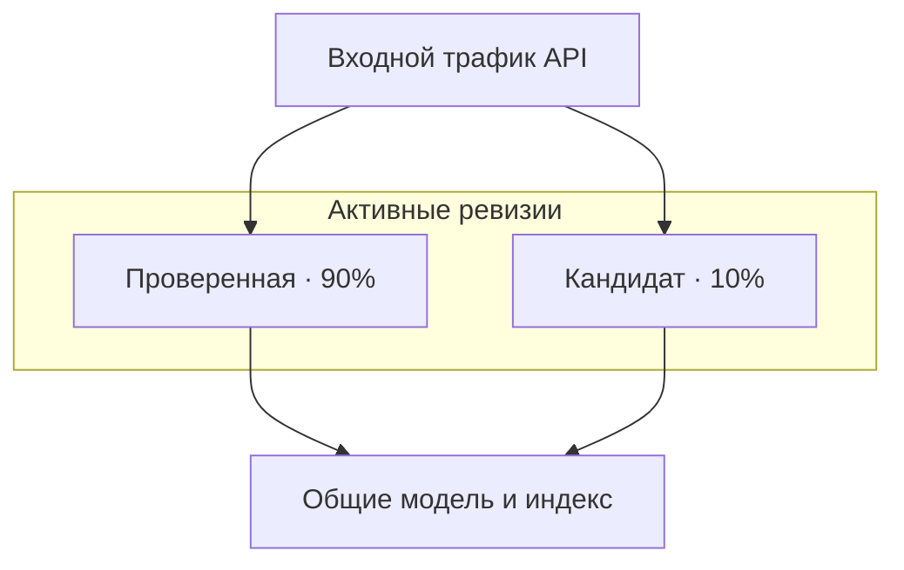

# До релиза подготовь откат

Новая версия запускается, проходит проверку работоспособности и отвечает пользователям — но ссылается на неверные документы. Развёртывание прошло успешно, а качество сервиса ухудшилось. Если при замене работающей версии удалить предыдущую, для срочного восстановления придётся заново собирать приложение.

Поэтому до первого запроса к новой версии подготовь **откат (rollback)**. Сохрани прежнюю версию, направь на новую ограниченную долю запросов и собери данные, по которым решишь, стоит ли эту долю увеличивать. Переключение запросов вернёт прежнее приложение, но не восстановит данные, которые новая версия успела перезаписать.

## Как это устроено в Azure \{#how-it-works-on-azure}

В уроке [«Выбор вычислительной среды»](../part-1-azure-foundations/compute.md) разбирается, где разместить P1. Здесь нужно сохранить две версии одновременно и управлять тем, какая из них получает запросы.

В App Service **рабочий слот (deployment slot)** — работающее приложение с собственным именем хоста. Разверни новую версию в промежуточном слоте, проверь её и выполни **обмен слотами (slot swap)** с продом. Платформа подготовит исходный слот, затем переключит маршрутизацию. После обмена прежнее приложение из прода останется в промежуточном слоте: повторный обмен той же пары позволит вернуться к нему. Слоты доступны в [планах App Service уровней Standard, Premium и Isolated](https://learn.microsoft.com/ru-ru/azure/app-service/deploy-staging-slots).

Учитывай и [правила обмена настройками](https://learn.microsoft.com/ru-ru/azure/app-service/deploy-staging-slots#which-settings-are-swapped). Параметры приложения и строки подключения можно закрепить за слотом, а управляемые удостоверения (managed identities) при обмене не перемещаются. Проверь настройки и разрешения целевого слота: версия, которая работает в промежуточном слоте, после переключения может получить другую конфигурацию и другие права доступа.

В Azure Container Apps **ревизия (revision)** фиксирует неизменяемую версию приложения. В **режиме нескольких ревизий (multiple revision mode)** можно оставить активными несколько ревизий и распределять между ними входящие запросы.

Для каждой цели маршрутизации задаётся доля запросов (traffic weight); [сумма долей должна составлять 100%](https://learn.microsoft.com/ru-ru/azure/container-apps/traffic-splitting?pivots=azure-cli). В упражнении прежняя проверенная ревизия получает 90%, а кандидат на выпуск — 10%. Это учебное распределение, а не универсальный порог безопасности. Для отката доли меняются на 100% и 0%.



Часть настроек общая для всех ревизий. [Изменения `properties.template`](https://learn.microsoft.com/ru-ru/azure/container-apps/revisions#change-types), в том числе образа и правил масштабирования, создают новую ревизию. Изменения `properties.configuration` действуют на приложение в целом: сюда относятся входной трафик, секреты и учётные данные реестра. Обновление секрета не создаёт ревизию; чтобы контейнеры получили новое значение, ревизию нужно перезапустить. Возврат запросов на прежнюю ревизию не вернёт прежние общие настройки.

В правилах маршрутизации [указывай имена ревизий явно](https://learn.microsoft.com/ru-ru/azure/container-apps/traffic-splitting?pivots=azure-cli#rapid-iteration). Правило с `latest` будет направлять запросы на каждую следующую развёрнутую версию. Если явно указать имя проверенной ревизии, правило продолжит направлять запросы на неё.

## Как выбрать механизм и учесть ограничения \{#choosing-and-tradeoffs}

Выбор зависит от сервиса размещения и от того, какие последствия неудачного релиза нужно ограничить.

| Механизм | Когда подходит | Ограничения и частые ошибки |
|---|---|---|
| Промежуточный слот и обмен слотами в App Service | Нужно проверить версию до переключения прода. | Слоты используют общие ресурсы плана. Промежуточный слот нельзя считать изолированным окружением для нагрузочных тестов. |
| Режим одной ревизии в Container Apps (single revision mode) | Достаточно обычной замены версии; платформа дождётся готовности новой ревизии и переключит запросы. | Не подходит, если старая и новая версии должны одновременно обслуживать заданные доли запросов. Готовность ревизии не подтверждает качество ответов. |
| Режим нескольких ревизий в Container Apps | Нужен канареечный релиз (canary release), после которого ты решишь, расширять выкатку или откатывать её. | Не определено, кто отвечает за период наблюдения, либо старые ревизии остаются активными без определённой цели. |

Подробности о механизмах — в документации об [общих ресурсах плана App Service](https://learn.microsoft.com/ru-ru/azure/app-service/overview-hosting-plans), [режимах ревизий Container Apps](https://learn.microsoft.com/ru-ru/azure/container-apps/revisions#revision-modes) и [сине-зелёном развёртывании](https://learn.microsoft.com/ru-ru/azure/container-apps/blue-green-deployment?pivots=azure-cli).

Для обоих сервисов до релиза проверь совместимость с данными при откате. Если удалить поле индекса или изменить смысл сохранённой записи, прежнее приложение тоже может перестать работать. Вноси изменения, которые добавляют поля и возможности, а удаление откладывай до конца периода, в течение которого нужен откат. Последовательность совместимых изменений разбирается в уроке [«Окружения, миграции и реальные данные»](/ai-sdlc/part-4-platform/environments-migrations-data).

Сохрани ссылки на прежний образ и конфигурацию, а также доступ, необходимый для их получения. [Дайджест образа (image digest)](https://learn.microsoft.com/ru-ru/azure/container-registry/container-registry-concepts#manifest-digest) указывает на конкретное содержимое; тег можно переназначить. Если образ больше недоступен, одного сохранённого имени ревизии для восстановления не хватит. Задай [правила хранения и блокировки](https://learn.microsoft.com/ru-ru/azure/container-registry/container-registry-image-lock), которые защитят образы и теги релизов от перезаписи и удаления.

### Расхождение конфигурации и управление маршрутизацией \{#configuration-drift-and-traffic-routing}

Допустим, настройку входного трафика исправили через портал, а следующий запуск развёртывания снова применил ошибочное значение из исходников. Чтобы обнаружить такое расхождение конфигурации (configuration drift), сравни последнее одобренное описание Bicep и его параметры с действующими ресурсами. Отдельно посмотри, какие изменения предлагает следующее развёртывание. Регулярное сравнение может выявить правки, внесённые между развёртываниями; основа этого подхода — в уроке [«Инфраструктура как код»](../part-1-azure-foundations/infrastructure-as-code.md).

[ARM what-if](https://learn.microsoft.com/ru-ru/azure/azure-resource-manager/bicep/deploy-what-if) показывает предполагаемые изменения без их применения. Неразрешённые выражения и значения по умолчанию могут добавлять шум в отчёт, а некоторые ресурсы и модули могут не попасть в проверку. Поэтому what-if не даёт полного перечня расхождений. Разбери диагностические сообщения и необъяснённые различия: краткий отчёт сам по себе не подтверждает совпадение конфигураций. После аварийного исправления перенеси его в Bicep либо осознанно верни одобренную конфигурацию.

Определи, кто отвечает за доли запросов при выпуске и их согласование с конфигурацией развёртывания. Если задание выпуска меняет доли, а Bicep по-прежнему задаёт старые значения, следующий запуск развёртывания может отменить это решение. Установи, как параметры маршрутизации при выпуске передаются в конфигурацию развёртывания и как согласуются последующие изменения. В уроке [IV.1 — «Конвейеры поставки в Azure»](./pipelines-to-azure.md) разобраны удостоверение, используемое при развёртывании, и порядок одобрения. Здесь используются уже полученный артефакт и предоставленный доступ.

### Что проверить в цепочке поставки ПО \{#what-to-check-in-the-supply-chain}

До того как новая версия приложения начнёт получать запросы, ответь на три разных вопроса.

- **Что входит в образ?** SBOM (software bill of materials) перечисляет его программные компоненты. Создавай SBOM во время сборки и сохраняй вместе с релизом: когда появятся сведения о риске, связанном с использованием компонента, по этому перечню можно будет найти затронутые релизы. Microsoft описывает подход в [рекомендациях по SBOM для образов](https://learn.microsoft.com/ru-ru/azure/architecture/guide/devsecops/devsecops-on-aks).
- **Какие известные уязвимости есть в зависимостях?** Сканирование зависимостей (dependency scanning) должно охватывать [пакеты NuGet](https://learn.microsoft.com/ru-ru/nuget/concepts/auditing-packages), от которых приложение зависит прямо или транзитивно, а также образ контейнера. [Defender for Cloud может проверять образы в ACR](https://learn.microsoft.com/ru-ru/azure/container-registry/scan-images-defender). Само предупреждение или запись на панели мониторинга не остановит развёртывание. Задай, какие результаты блокируют выпуск и когда истекает срок действия исключений из этих правил.
- **Кто подписал артефакт и тому ли содержимому ты доверяешь?** Подпись артефакта (artefact signature) связывает его с подписантом. [Процесс с Notation и Key Vault](https://learn.microsoft.com/ru-ru/azure/container-registry/container-registry-tutorial-sign-build-push) позволяет хранить подписи рядом с образами ACR и проверять их по политике доверия. Простое наличие сохранённой подписи не обеспечивает соблюдения правил выпуска. Задание выпуска должно проверять, что артефакт подписан с использованием ожидаемого удостоверения, а его содержимое соответствует ожидаемому. Если проверка не пройдена, задание должно завершиться с ошибкой.

В записи о релизе свяжи коммит, дайджест образа, SBOM, результаты сканирования и проверки подписи. Подписанный образ может содержать уязвимую зависимость, а образ без выявленных уязвимостей может быть выпущен другим издателем. Ни подпись, ни результат сканирования не подтверждают правильность ответов приложения. Различие между происхождением и корректностью подробнее разбирается в уроке [«Энтерпрайз-уровень: аудит, происхождение и обязательные проверки»](/ai-sdlc/part-5-scale-governance/enterprise-tier/).

## Что это меняет для AI-сервиса \{#in-an-ai-workload}

P1 — минимальное API ASP.NET Core, которое отвечает на вопросы по документам из открытых источников и указывает источники. Его поведение определяет целый набор: образ приложения, промпт, развёртывание модели Foundry, индекс Azure AI Search и набор документов Blob Storage. Записывай их идентификаторы вместе, а где доступна версия развёрнутой модели — и её тоже. Иначе при сравнении ревизий можно спутать последствия изменения кода с последствиями изменения поиска.

В этом упражнении меняется только образ приложения. Промпт, модель и индекс остаются прежними, чтобы сузить круг возможных причин регрессии. Обе ревизии используют существующее управляемое удостоверение P1 для доступа к зависимостям и Key Vault. Проверь разрешения: создание ревизии не заменяет эту проверку.

До выкатки отправь небольшой фиксированный набор вопросов прямо кандидату. Проверь, найдены ли ожидаемые документы, действительны ли ссылки на источники и отказывается ли сервис отвечать на вопросы, для которых в документах нет оснований. Методика — в уроке [Evaluation](/rag-agents/part-1-rag/cross-cutting/evaluation/). [Проверки готовности](https://learn.microsoft.com/ru-ru/azure/container-apps/health-probes) определяют, может ли ревизия принимать запросы; они не устанавливают, подтверждается ли ответ указанными источниками.

Во время канареечного релиза сравнивай ошибки, высокие перцентили задержки, расход токенов и оценки качества ответов из выборки отдельно для каждого релиза. Сначала добавь в спаны (spans) P1 атрибут `release.id` с отдельным значением для каждого образа. Настрой его экспорт в [Application Insights как `customDimensions["release.id"]`](https://learn.microsoft.com/ru-ru/azure/azure-monitor/app/opentelemetry-add-modify#add-a-custom-property-to-a-span). Записывай расход токенов и оценки ответов с привязкой к запросу. До распределения запросов убедись, что в телеметрии обеих ревизий видны разные значения `release.id`.

Поле `release.id` нужно добавить явно: оно обязательно для упражнения и не появляется автоматически как свойство ревизии. В упражнении по [наблюдаемости](../part-1-azure-foundations/observability.md) создаётся только место назначения телеметрии. Добавь необходимое инструментирование в [P1](../part-5-projects/rag-service.md#milestones) до этого упражнения.

Условия остановки и период наблюдения выбери до начала выкатки. Если запросов мало, данных может не хватить для вывода: добавь контролируемые запросы или продолжи наблюдение, прежде чем увеличивать долю кандидата. Как принимать такое решение, разбирается в уроке [«Наблюдаемость, выкатка и аварийный стоп»](/ai-sdlc/part-4-platform/observability-rollout).

Откат маршрутизации направит новые запросы на прежнюю ревизию, но не отзовёт уже переданный пользователю ответ и не отменит запись в индекс. Если кандидат ещё и обрабатывает поступающие документы, управляй этой обработкой отдельно. Кандидат в данном упражнении только отвечает на запросы, а общие данные остаются прежними.

## Попробуй \{#try-it}

Разверни вторую ревизию P1, направь на неё 10% входящих запросов и отрепетируй откат.

**Для упражнения нужен [P1](../part-5-projects/rag-service.md):** работающее API, описанный в руководстве набор неизменных тестовых запросов, проверяющих ссылки на источники и обоснованность отказов отвечать, а также описанная выше телеметрия. Выполни эти этапы P1, прежде чем возвращаться сюда. Пример из урока о вычислениях не является P1.

Начальное состояние: одна исправная активная ревизия, входной трафик HTTP и доступ к реестру. Совместимый образ кандидата должен пройти сканирование и проверку подписи. Используй уникальный защищённый тег релиза и сохрани дайджест образа.

Для полного удаления ресурсов нужна опись P1, которая подтверждает: все ресурсы находятся в одной выделенной группе и ни один не используется совместно. Если ресурсы размещены иначе, не выполняй упражнение. Обратись к [руководству P1](../part-5-projects/rag-service.md#teardown), в котором объясняется, какие ресурсы относятся к проекту и как их удалить.

Команды сверены с актуальной справкой Azure CLI по [ревизиям](https://learn.microsoft.com/ru-ru/cli/azure/containerapp/revision?view=azure-cli-latest) и [маршрутизации](https://learn.microsoft.com/ru-ru/cli/azure/containerapp/ingress/traffic?view=azure-cli-latest). **В Azure они пока не запускались:** для курса нет доступной подписки. Согласно документации, команды должны дать описанные ниже результаты; это не результаты измерений.

Работай в Bash. Войди через Azure CLI и выбери подписку P1. Запускай блоки по порядку и останавливайся при ошибке. Не закрывай терминал, чтобы сохранить переменные. В цепочках с `&&` следующая зависимая команда выполняется только после успешной предыдущей. Блок отката можно использовать, даже если кандидат ещё не существует.

### Проверь исходное состояние \{#check-the-starting-state}

Введи имена группы ресурсов и приложения, затем посмотри ревизии и заданные доли запросов:

```bash
read -r -p 'P1 resource group: ' RG
read -r -p 'P1 container app: ' APP
az containerapp revision list --name "$APP" --resource-group "$RG" --output json
az containerapp ingress traffic show --name "$APP" --resource-group "$RG"
```

Найди исправную ревизию, которая обслуживает все запросы: её имя потребуется для `OLD`.

### Создай кандидата без переключения запросов \{#create-the-candidate-without-shifting-traffic}

В `OLD` введи имя проверенной ревизии, в `IMAGE` — полный адрес образа кандидата, например `yourregistry.azurecr.io/p1:release-2`. Для `SUFFIX` при каждой попытке выбирай новый суффикс, например `safe2`. Из имени приложения и суффикса получится `NEW`.

```bash
read -r -p 'Known-good revision name: ' OLD
read -r -p 'Candidate image with unique release tag: ' IMAGE
read -r -p 'New revision suffix (for example safe2): ' SUFFIX
NEW="${APP}--${SUFFIX}"

az containerapp revision set-mode --name "$APP" --resource-group "$RG" --mode multiple &&
az containerapp ingress traffic set --name "$APP" --resource-group "$RG" \
  --revision-weight "$OLD=100" &&
az containerapp revision copy --name "$APP" --resource-group "$RG" \
  --from-revision "$OLD" --image "$IMAGE" --revision-suffix "$SUFFIX" &&
az containerapp revision show --name "$APP" --resource-group "$RG" --revision "$NEW"
```

Последовательность включает режим нескольких ревизий, закрепляет за `OLD` 100% запросов, копирует её с новым образом и суффиксом, затем показывает `NEW`. При ошибке `&&` остановит последующие зависимые команды. Ожидаемый результат — появилась вторая ревизия, а запросы по-прежнему получает явно указанная старая.

В [сведениях о ревизии](https://learn.microsoft.com/ru-ru/rest/api/resource-manager/containerapps/container-apps-revisions/get-revision?view=rest-resource-manager-containerapps-2025-07-01) проверь, что у `NEW` значение `properties.provisioningState` равно `Provisioned`, а `properties.healthState` — `Healthy`. Если состояние пока `Provisioning`, подожди и повтори последнюю команду `revision show`. При `Failed`, `Unhealthy` или отсутствии прогресса разбери причину и не переключай запросы.

Затем обратись по HTTPS к [прямой конечной точке кандидата](https://learn.microsoft.com/ru-ru/azure/container-apps/traffic-splitting?pivots=azure-cli#update-existing-revision), используя `properties.fqdn`, и выполни фиксированный набор запросов P1. Продолжай только после успешной проверки состояния, ответов и идентификаторов `release.id`.

### Направь на кандидата ограниченную долю запросов \{#send-a-limited-share-of-traffic-to-the-candidate}

```bash
az containerapp ingress traffic set --name "$APP" --resource-group "$RG" \
  --revision-weight "$OLD=90" "$NEW=10" &&
az containerapp ingress traffic show --name "$APP" --resource-group "$RG"
```

Ожидаемое распределение в конфигурации — 90% для `OLD` и 10% для `NEW`. Небольшая выборка запросов не обязана в точности соответствовать этой пропорции. Проверь показатели релизов с учётом выбранного периода наблюдения и условий остановки, затем переходи к репетиции отката.

### Отрепетируй откат \{#rehearse-the-rollback}

Даже если кандидат выглядит исправным, верни все запросы на прежнюю ревизию:

```bash
az containerapp ingress traffic set --name "$APP" --resource-group "$RG" \
  --revision-weight "$OLD=100" &&
az containerapp ingress traffic show --name "$APP" --resource-group "$RG"
```

В выводе только проверенная ревизия должна иметь долю 100%. Убедись, что её ответы по-прежнему проходят проверки. Если ошибка возникла раньше, используй тот же блок отката и разбери ошибки до удаления ресурсов.

**Стоимость:** упражнение может привести к расходам. В Consumption плата зависит от того, как долго репликам выделены CPU и память, а также от количества платных запросов. Две активные ревизии могут потреблять ресурсы. До начала проверь [актуальные региональные цены](https://azure.microsoft.com/en-us/pricing/details/container-apps/) и [правила тарификации](https://learn.microsoft.com/ru-ru/azure/container-apps/billing). Сократи время канареечного релиза и учти в учебном бюджете уже существующие ресурсы P1: модель, поиск, хранилище, реестр и телеметрию. Отсутствие запросов не гарантирует отсутствия платы за вычисления.

**Удаление ресурсов:** после подтверждённого отката деактивируй кандидата и проверь список всех ревизий:

```bash
az containerapp revision deactivate --name "$APP" --resource-group "$RG" --revision "$NEW" &&
az containerapp revision list --name "$APP" --resource-group "$RG" --all --output json
```

Кандидат должен стать неактивным. [За неактивные ревизии плата не начисляется](https://learn.microsoft.com/ru-ru/azure/container-apps/revisions#inactive-status), но исходные ресурсы P1 по-прежнему могут оплачиваться. До следующего запуска развёртывания согласуй маршрутизацию с Bicep.

Для полного удаления сначала проверь выделенную группу и перечень её ресурсов командами [управления группами](https://learn.microsoft.com/ru-ru/cli/azure/group?view=azure-cli-latest) и [перечисления ресурсов](https://learn.microsoft.com/ru-ru/cli/azure/resource?view=azure-cli-latest):

```bash
az group show --name "$RG" --output json &&
az resource list --resource-group "$RG" --output table
```

Сверь подписку и каждый ресурс с описью P1. Продолжай, только если все ресурсы группы принадлежат этому одноразовому развёртыванию P1, ничего не используется совместно и за пределами группы не осталось его ресурсов. [Удаление группы необратимо удаляет её ресурсы](https://learn.microsoft.com/ru-ru/azure/azure-resource-manager/management/delete-resource-group).

```bash
az group delete --name "$RG"
```

Подтверди запрос CLI и дождись успешного завершения. Если удаление вернуло ошибку, разбери её до завершения работы.

## Что перенести в свою практику \{#what-to-take-away}

- До первого запроса к кандидату сохрани прежнюю версию с известным идентификатором и проверь, что её можно получить для восстановления.
- Слоты и ревизии позволяют управлять тем, какая версия обслуживает запросы. Для общих настроек и данных нужен отдельный план восстановления.
- Прежде чем увеличивать долю запросов, оцени качество ответов вместе с показателями работы сервиса.
- Для предварительного просмотра изменений, сканирования зависимостей и проверки подписей задай явные условия, при которых выпуск останавливается.

**[Новые термины](../glossary.md#releasing-safely)**: рабочий слот, обмен слотами, режим нескольких ревизий, доля запросов, канареечный релиз, откат, SBOM, подпись артефакта, сканирование зависимостей.

## Источники \{#sources}

Проверено на 17.10.2026. Процедура выпуска, проверки состояния, телеметрия и удаление ресурсов повторно проверены 18.10.2026.

Механизмы выпуска:

- [App Service deployment slots](https://learn.microsoft.com/ru-ru/azure/app-service/deploy-staging-slots)
- [App Service plans and shared capacity](https://learn.microsoft.com/ru-ru/azure/app-service/overview-hosting-plans)
- [Container Apps revisions and change scopes](https://learn.microsoft.com/ru-ru/azure/container-apps/revisions)
- [Container Apps traffic splitting](https://learn.microsoft.com/ru-ru/azure/container-apps/traffic-splitting?pivots=azure-cli)
- [Container Apps blue-green deployment](https://learn.microsoft.com/ru-ru/azure/container-apps/blue-green-deployment?pivots=azure-cli)
- [Container Apps health probes](https://learn.microsoft.com/ru-ru/azure/container-apps/health-probes)
- [Azure CLI revision commands](https://learn.microsoft.com/ru-ru/cli/azure/containerapp/revision?view=azure-cli-latest)
- [Azure CLI traffic commands](https://learn.microsoft.com/ru-ru/cli/azure/containerapp/ingress/traffic?view=azure-cli-latest)
- [Revision details and endpoint schema](https://learn.microsoft.com/ru-ru/rest/api/resource-manager/containerapps/container-apps-revisions/get-revision?view=rest-resource-manager-containerapps-2025-07-01)

Инфраструктура и цепочка поставки ПО:

- [Bicep deployment what-if](https://learn.microsoft.com/ru-ru/azure/azure-resource-manager/bicep/deploy-what-if)
- [Container Registry concepts and image digests](https://learn.microsoft.com/ru-ru/azure/container-registry/container-registry-concepts)
- [Lock Container Registry images](https://learn.microsoft.com/ru-ru/azure/container-registry/container-registry-image-lock)
- [DevSecOps image SBOM guidance](https://learn.microsoft.com/ru-ru/azure/architecture/guide/devsecops/devsecops-on-aks)
- [NuGet dependency auditing](https://learn.microsoft.com/ru-ru/nuget/concepts/auditing-packages)
- [Container Registry vulnerability scanning](https://learn.microsoft.com/ru-ru/azure/container-registry/scan-images-defender)
- [Sign and verify images with Notation and Key Vault](https://learn.microsoft.com/ru-ru/azure/container-registry/container-registry-tutorial-sign-build-push)

Стоимость:

- [Container Apps billing](https://learn.microsoft.com/ru-ru/azure/container-apps/billing)
- [Container Apps pricing](https://azure.microsoft.com/en-us/pricing/details/container-apps/)

Телеметрия и удаление ресурсов:

- [Add OpenTelemetry custom properties](https://learn.microsoft.com/ru-ru/azure/azure-monitor/app/opentelemetry-add-modify#add-a-custom-property-to-a-span)
- [Resource group deletion](https://learn.microsoft.com/ru-ru/azure/azure-resource-manager/management/delete-resource-group)
- [Azure CLI resource group commands](https://learn.microsoft.com/ru-ru/cli/azure/group?view=azure-cli-latest)
- [Azure CLI resource inventory](https://learn.microsoft.com/ru-ru/cli/azure/resource?view=azure-cli-latest)
- [Bash AND-list execution](https://www.gnu.org/s/bash/manual/html_node/Lists.html)
